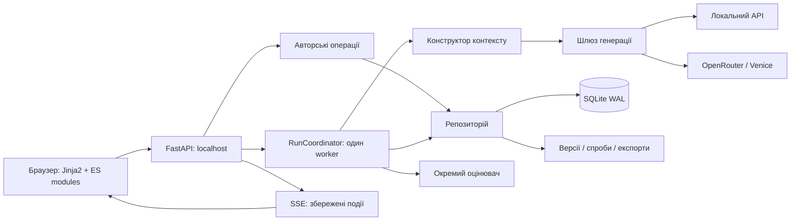

# Obscura Text Writer (Storygen) — специфікація системи

## Purpose

Storygen автоматизує створення українського оповідання за авторським планом із рекомендованим цільовим обсягом до 15 тисяч слів. Автор керує сценами, моделями, редактурою та пам’яттю твору через локальний вебінтерфейс українською або англійською. Це специфікація реалізованої архітектури, а не початковий бріф Gemini чи перелік майбутніх можливостей.

Базову редакцію звірено з кодом на коміті `c53e669` станом на 20 жовтня 2026 року. Від цієї редакції SPEC.MD є головним джерелом правди щодо архітектури; подальші зміни документа і відповідного коду виконуються разом.

Використано формат OpenSpec: нормативні розділи `Requirement` та перевірні `Scenario` з `GIVEN / WHEN / THEN`. На запит власника всі можливості й технічні рішення зібрані в одному кореневому файлі. Це адаптація формату, без встановлення OpenSpec CLI та без твердження про відповідність його типовій структурі каталогів.

## Зміст

[Простежуваність і перевірки](docs/verification/README.md) · [Стан виконання тестів](docs/STATUS.md) · [Мотиви рішень](docs/adr/README.md)

- [R22-SOURCE — Ядро Markdown і точні координати](#r22-source)
- [R22-EDITOR — Візуальне форматування й сумісність версій](#r22-editor)
- [R22-MARKUP — Форматування в pipeline та книгах](#r22-markup)
- [R23-COMMENTS — Збережені коментарі автора](#r23-comments)
- [R23-SAVE — Атомарний текст і нотатки](#r23-save)

- [ARCH-001 — Узгодженість архітектури](#arch-001)
- [RUNTIME-001 — Локальний застосунок](#runtime-001)
- [DATA-001 — Перевірений імпорт](#data-001)
- [DATA-002 — Авторський контроль структури](#data-002)
- [DATA-003 — Незмінні матеріали версій](#data-003)
- [DATA-004 — Конкурентні зміни](#data-004)
- [DATA-005 — Застарілі залежності](#data-005)
- [DATA-010 — Явне авторське прийняття застарілого тексту](#data-010)
- [RUN-ACCEPTED — Продовження після прийнятої альтернативи](#run-accepted)
- [DATA-009 — Похідна актуальність версій](#data-009)
- [DATA-006 — Кошик і відновлення](#data-006)
- [DATA-007 — Ручна чернетка](#data-007)
- [DATA-008 — Прийняття збереженої чернетки](#data-008)
- [MODEL-001 — Чотири незалежні ролі](#model-001)
- [ROLE-PROFILES — Переносимі комплекти ролей](#role-profiles)
- [MODEL-002 — Явний виклик провайдера](#model-002)
- [MODEL-003 — Каталог Venice](#model-003)
- [BUDGET-001 — Явні ліміти й резерв виклику](#budget-001)
- [BUDGET-002 — Достовірне завершення обліку](#budget-002)
- [PIPE-001 — Послідовність сцени](#pipe-001)
- [PIPE-002 — Один виконавець на каталог](#pipe-002)
- [PIPE-003 — Ідемпотентне створення запуску](#pipe-003)
- [PIPE-004 — Відновлення після збою](#pipe-004)
- [PIPE-005 — Пауза і скасування](#pipe-005)
- [PIPE-006 — Перевірка завершення](#pipe-006)
- [PIPE-007 — Слід виконання](#pipe-007)
- [CONTEXT-001 — Явний бюджет контексту](#context-001)
- [CONTEXT-004 — Перевірений профіль і ручна активація](#context-004)
- [CONTEXT-002 — План і вже написані події](#context-002)
- [CONTEXT-005 — Горизонт майбутніх планів](#context-005)
- [CONTEXT-003 — Вибрана проза, підтверджена пам’яттю](#context-003)
- [MEMORY-001 — Походження пам’яті](#memory-001)
- [MEMORY-002 — Пам’ять через фрагменти](#memory-002)
- [MEMORY-003 — Історія та сумісність пам’яті](#memory-003)
- [MEMORY-004 — Обмежена нормалізація й точна діагностика](#memory-004)
- [PROMPT-CONTRACT — Призначення промптів](#prompt-contract)
- [EDIT-001 — Обмежена точкова редактура](#edit-001)
- [REWRITE-DIFF — Суцільна редактура з програмними змінами](#rewrite-diff)
- [EDIT-CLASSIFICATION — Окремі необов’язкові поради](#edit-classification)
- [EDIT-DIAGNOSTICS — Конкретні безпечні помилки редактора](#edit-diagnostics)
- [EDIT-REVIEW — Авторський вибір точкових правок](#edit-review)
- [LANGUAGE-WARNINGS — Локальні мовні попередження](#language-warnings)
- [UI-001 — Передумови workflow](#ui-001)
- [UI-002 — Безпека редакторського буфера](#ui-002)
- [UI-003 — Достовірний стан виконання](#ui-003)
- [UI-004 — Зрозумілі повідомлення](#ui-004)
- [UI-005 — Оновлення ресурсів інтерфейсу](#ui-005)
- [UI-006 — Брендинг і представлення назв](#ui-006)
- [PERF-001 — Швидка відповідь робочого простору](#perf-001)
- [EVAL-001 — Відокремлене оцінювання](#eval-001)
- [EVAL-002 — Калібрування](#eval-002)
- [EVAL-003 — Вимкнення оцінювача](#eval-003)
- [EVAL-004 — Покриття великого твору](#eval-004)
- [EVAL-005 — Відмова і фактична причина помилки](#eval-005)
- [EVAL-006 — Постійне блокування оцінювача для твору](#eval-006)
- [EVAL-007 — Політики workflow та придатність профілю](#eval-007)
- [EXPORT-001 — Відтворюваний експорт](#export-001)
- [SECURITY-001 — Локальна межа доступу](#security-001)
- [SECURITY-002 — Ключі поза даними ролей](#security-002)
- [CONTENT-001 — Українська проза і авторський матеріал](#content-001)
- [STORAGE-BOUNDARY — Предметні транзакції сховища](#storage-boundary)
- [SCENE-DESCRIPTION — Назва та учасники з авторського плану](#scene-description)
- [SCENE-CAST-DISPLAY — Імена замість редагування ID](#scene-cast-display)
- [CHARACTER-IMPORT — Початкові картки з Markdown](#character-import)
- [CHARACTER-TIME — Доступність відомостей за порядком сцен](#character-time)
- [PLANNER-ACQUAINTANCE — Знайомства головного героя для планувальника](#planner-acquaintance)
- [RATING-001 — Віковий рейтинг твору й сцени](#rating-001)
- [RATING-002 — Запобіжник щодо неповнолітніх](#rating-002)
- [MAINT-001 — Діагностика без repair](#maint-001)
- [MAINT-002 — Перевірений холодний backup](#maint-002)
- [MAINT-003 — Відновлення в новий каталог](#maint-003)
- [PUB-001 — Відокремлення публічного коду від приватної історії](#pub-001)
- [EDIT-SENTENCE-CONTEXT — Речення в контексті редакторської правки](#edit-sentence-context)
- [EDIT-SENTENCE-GROUPS — Одна група прийняття на речення](#edit-sentence-groups)
- [BUDGET-LAST-CALL — Вартість останнього виклику в бюджеті](#budget-last-call)
- [EDIT-NO-CHANGES — Відсутність модельних правок не є прийнятною пропозицією](#edit-no-changes)
- [EDIT-LOOP — Багатопрохідна редактура з одним прийняттям](#edit-loop)
- [EDIT-LOOP-STOP — Завершення та recovery](#edit-loop-stop)
- [EDIT-LOOP-REVIEW — Сумарний diff та атомарне завершення](#edit-loop-review)
- [EDIT-WORKFLOW — Єдина редактура для всіх дій](#edit-workflow)
- [DOCS-TRACE — Сталі ID й конкретні перевірки](#docs-trace)
- [DOCS-STATUS — Датоване свідчення виконання](#docs-status)

Технічні розділи: [Architecture](#architecture), [матриця R-05](#матриця-перевірок-r-05), [обмеження](#known-limitations-and-deviations), [Source map](#source-map).

## Requirements

<a id="arch-001"></a>
### Requirement: ARCH-001 — Узгодженість архітектури

Будь-яка архітектурна зміна SHALL супроводжуватися зміною SPEC.MD у тому самому наборі змін і коміті. Відомий дефект SHALL описуватися окремо від бажаного контракту.

<a id="arch-001-s01"></a>
#### Scenario: ARCH-001-S01 — Зміна контракту збереження
- GIVEN розробник змінює схему даних або правила публікації результату
- WHEN готується завершення роботи
- THEN SPEC.MD описує нові інваріанти, сценарії та обмеження
- AND історичний план не підміняє чинну специфікацію.

<a id="runtime-001"></a>
### Requirement: RUNTIME-001 — Локальний застосунок

Система SHALL надавати локальний вебінтерфейс із серверним доступом до моделей і постійним сховищем у вибраному каталозі даних.

<a id="runtime-001-s01"></a>
#### Scenario: RUNTIME-001-S01 — Перезапуск вебсервера
- GIVEN автор зберіг твір і його версії
- WHEN сервер запускається з тим самим каталогом даних
- THEN збережені матеріали доступні без повторної генерації.

<a id="data-001"></a>
### Requirement: DATA-001 — Перевірений імпорт

Імпорт SHALL приймати непорожні UTF-8 TXT/MD файли до 2 MiB кожний, зберігати вихідні байти та створювати версії декодованого тексту.

<a id="data-001-s01"></a>
#### Scenario: DATA-001-S01 — Некоректний файл у наборі
- GIVEN набір містить непідтримуваний або некоректно закодований файл
- WHEN виконується імпорт
- THEN попередня перевірка відхиляє набір до початку запису його файлів.

Шаблони плану й персонажів SHALL постачатися як UTF-8 Markdown у пакетних `web/static/templates/*.md` і завантажуватися з блоку «Додати матеріали» через same-origin посилання з download. План SHALL використовувати розпізнавані заголовки сцен і склад, відповідний заголовкам імен шаблону персонажів. Приклади Початок/Кінець SHALL явно містити день та час, зокрема перехід через північ. Ці рядки зберігаються у beats як авторський текст: окремої моделі фізичного часу, автоматичного обчислення тривалості чи перевірки суперечностей немає. Вони не змінюють порядок читання й часову проєкцію пам’яті; єдиний виняток — рядок «Початок:» у формі `дата, час` або `день N, час` (`memory/story_time.py`) використовується пам’яттю як сигнал переходу дня. Шаблон персонажів SHALL пояснювати чинне unclassified після імпорту та окреме налаштування доступності у картках.

<a id="data-001-s02"></a>
#### Scenario: DATA-001-S02 — Сумісні завантажувані шаблони
- GIVEN автор відкрив «Додати матеріали»
- WHEN завантажує шаблони плану й персонажів та імпортує їх у новий твір
- THEN сцени й початкові картки розпізнані, склад заповнений відповідними іменами
- AND межі часу, включно з різними днями на початку й наприкінці, збережені в планах без автоматичної зміни доступності карток.

<a id="data-002"></a>
### Requirement: DATA-002 — Авторський контроль структури

Система SHALL дозволяти редагувати сцени та застосовувати запропоновану моделлю структуру лише окремою авторською дією. Повторний імпорт SHALL не замінювати наявні активні сцени автоматично.

<a id="data-002-s01"></a>
#### Scenario: DATA-002-S01 — Підготовка структури
- GIVEN існують імпортовані матеріали
- WHEN планувальник завершує підготовку
- THEN пропозиція доступна для перегляду
- AND канон і картки персонажів не стають поточними до застосування.

<a id="data-003"></a>
### Requirement: DATA-003 — Незмінні матеріали версій

Байти збереженої версії SHALL бути незмінними. Читання SHALL перевіряти належність шляху каталогу даних і SHA-256, а поточні матеріали SHALL вибиратися через явні головні версії, а не дату створення.

<a id="data-003-s01"></a>
#### Scenario: DATA-003-S01 — Пошкодження файла
- GIVEN файл версії змінено поза застосунком
- WHEN система читає його
- THEN повертається помилка цілісності замість використання зміненого тексту.

<a id="data-004"></a>
### Requirement: DATA-004 — Конкурентні зміни

Авторське збереження SHALL перевіряти очікувану ревізію. Нова модельна публікація SHALL атомарно перевіряти релевантний dependency snapshot і окремий target CAS (ID та лічильник вибору голови). Зміна використаного контексту або цілі зберігає результат альтернативою; нерелевантна зміна твору чи налаштувань ролі сама його не відхиляє. Legacy-спроба без snapshot зберігає консервативний CAS ревізій.

<a id="data-004-s01"></a>
#### Scenario: DATA-004-S01 — Автор редагує сцену під час генерації
- GIVEN запит моделі вже розпочато
- WHEN автор змінює матеріали, від яких залежав запит
- THEN результат не перезаписує новіший авторський стан.

<a id="data-005"></a>
### Requirement: DATA-005 — Застарілі залежності

Заміна джерела SHALL транзитивно позначати залежні результати застарілими та відповідні сцени такими, що потребують перегляду, зберігаючи історію і головні посилання.

<a id="data-005-s01"></a>
#### Scenario: DATA-005-S01 — Заміна прози
- GIVEN пам’ять залежить від поточної прози
- WHEN автор зберігає нову версію прози
- THEN попередня залежна пам’ять стає застарілою
- AND її файл залишається доступним в історії.

<a id="data-010"></a>
### Requirement: DATA-010 — Явне авторське прийняття застарілого тексту

Автор SHALL мати окремий preview тексту, змінених залежностей expected/current і наслідків прийняття для draft/edited/manual. Окрема явна дія SHALL транзакційно перевіряти власність/вид/complete/SHA-256, scene revision та fingerprint показаного baseline/diff, вибирати голову й додавати append-only рішення з новим author_text baseline. Старі байти, model input_refs/fingerprint та стани історичних alternative-спроб SHALL не переписуватися. Stale brief/memory/evaluation не мають універсального прийняття.

<a id="data-010-s01"></a>
#### Scenario: DATA-010-S01 — Прийняття й гонка після preview
- GIVEN автор переглянув stale draft/prose та зміни джерел
- WHEN підтверджує за незмінного показаного стану
- THEN рішення й голова збережені разом, а пам’ять/evaluation не підтверджені автоматично
- AND зміна джерел або ревізії після preview повертає 409 без часткової зміни голови/журналу.

<a id="run-accepted"></a>
### Requirement: RUN-ACCEPTED — Продовження після прийнятої альтернативи

Після явного вибору актуального результату зупиненого етапу автор SHALL мати окреме продовження без повторного inference цього етапу. Предметна транзакція SHALL перевіряти стан run, точний cursor/task, останню відповідну спробу/result ID, selected head, scene revision, freshness і чинний acceptance ID за наявності рішення. Автоматичного просування від самого вибору голови немає. Cancellation та story/model refusal block SHALL не обходитися.

<a id="run-accepted-s01"></a>
#### Scenario: RUN-ACCEPTED-S01 — Без повтору й підміни історії
- GIVEN remaining зупинився на alternative і автор прийняв саме цей результат
- WHEN явно продовжує після нього
- THEN лише правильний cursor просувається й наступні етапи читають актуальні входи
- AND історичний alternative лишається alternative; cancelled або змінений baseline не дозволяє продовження.

<a id="data-009"></a>
### Requirement: DATA-009 — Похідна актуальність версій

Версії з перевіреним dependency snapshot SHALL визначати актуальність порівнянням baseline з поточними релевантними selectors, refs/хешами, complete і актуальністю джерел. Публічні списки/версії/контекст/експорт SHALL використовувати цей самий resolver. Legacy stale без snapshot SHALL лишатися застарілим до явного author acceptance або чинної перевіреної review authority за REVIEW-BASIS. Цикл, відсутнє/чуже/пошкоджене джерело не є доказом актуальності.

<a id="data-009-s01"></a>
#### Scenario: DATA-009-S01 — Повернення залежностей A→B→A
- GIVEN нова версія мала перевірений baseline A
- WHEN усі релевантні залежності після зміни на B знову точно A
- THEN актуальність відновлюється без inference та переписування model input_refs
- AND target CAS активної спроби все одно відхиляє вибір її голови A→B→A.

<a id="data-006"></a>
### Requirement: DATA-006 — Кошик і відновлення

Видалення творів і сцен SHALL бути зворотним переміщенням до кошика. Звичайні операції репозиторію SHALL приховувати такі об’єкти. Архівація SHALL відхилятися за наявності незавершеного запуску.

У бібліотеці дія кошика SHALL перевіряти всі запуски твору. За наявності лише зупинених paused/interrupted/needs_review/alternative вона SHALL явно запропонувати їх скасування разом із переміщенням. Після підтвердження UI послідовно викликає чинний cancel API й перевіряє завершений стан кожного запуску перед чинним trash API. Активні/невідомі стани блокують цю дію без автоматичного скасування. Помилка скасування або незавершене cancellation_requested SHALL не запускати trash; уже скасовані запуски залишаються скасованими, тексти й історія зберігаються. Остаточна серверна перевірка запусків і ревізії лишається обов’язковою; ці окремі запити не є спільною транзакцією.

<a id="data-006-s03"></a>
#### Scenario: DATA-006-S03 — Старі зупинені запуски не утворюють глухий кут кошика
- GIVEN у творі є старі alternative/paused/interrupted/needs_review, а останній запуск уже завершено
- WHEN автор у бібліотеці підтверджує скасування зупинених запусків і кошик
- THEN усі такі запуски скасовані до переміщення, версії та історія збережені
- AND відмова від підтвердження, активна генерація або невдале скасування не переміщують твір.

<a id="data-006-s01"></a>
#### Scenario: DATA-006-S01 — Експорт архівного твору
- GIVEN твір перебуває в кошику на початку SQL-знімка експорту
- WHEN автор запитує експорт, зокрема з `allow_incomplete=true`
- THEN API повертає 404
- AND нові файли експорту не створюються.

<a id="data-006-s02"></a>
#### Scenario: DATA-006-S02 — Відновлення сцени
- GIVEN сцена в кошику, а твір активний
- WHEN автор відновлює сцену
- THEN вона повертається на збережену або найближчу допустиму позицію
- AND матеріали, залежні від зміненої послідовності, потребують перегляду.

<a id="data-rename"></a>
### Requirement: DATA-RENAME — Назва оповідання

Автор SHALL перейменовувати активний твір кнопкою олівця поруч із назвою: поле й «ОК», Enter для збереження, Escape для скасування. UI SHALL зберігати введення після помилки, блокувати повторне збереження та захищати незбережену назву перед виходом зі сторінки. Заголовок і document.title SHALL оновлюватися без перезавантаження буфера сцени; назва відображається як текст, а не HTML.

PATCH `/api/stories/{id}` SHALL приймати лише title/expected_revision. Межа Authoring/Repository SHALL перевіряти активність/CAS у write-транзакції, прибирати зовнішні пробіли й приймати 1–300 символів. Змінена назва підвищує story.revision, однакова не змінює її після CAS. Конфлікт — 409, твір у кошику — 404. Перейменування SHALL не змінювати config_revision, матеріали/актуальність сцен чи явно задану назву публікації; незадана назва публікації використовує чинний story.title. Міграція не потрібна.

<a id="data-rename-s01"></a>
#### Scenario: DATA-RENAME-S01 — Перейменування без зміни рукопису
- GIVEN активний твір і відкритий, зокрема незбережений, текст сцени
- WHEN автор зберігає нову непорожню назву з чинною ревізією
- THEN назва збережена й відображена в заголовку та бібліотеці, а текст/актуальність сцен не змінені
- AND Escape не зберігає; помилка лишає введення; конфлікт, порожня чи задовга назва та кошик не дозволяють перезапис.

<a id="data-007"></a>
### Requirement: DATA-007 — Ручна чернетка

Автор SHALL мати можливість вставити або змінити чернетку й зберегти її як нову поточну `draft`-версію без виклику моделі. Збереження SHALL перевіряти ревізію, відхиляти порожній текст і позначати залежні результати застарілими.

<a id="data-007-s01"></a>
#### Scenario: DATA-007-S01 — Вставлення зовнішнього тексту
- GIVEN автор відкрив вкладку «Чернетка», зокрема без раніше створеної чернетки
- WHEN він вставляє непорожній текст і натискає «Зберегти»
- THEN текст дослівно зберігається в новій головній draft-версії
- AND він доступний редактору як чернетка, а не підміняє фінальну прозу.

<a id="data-007-s02"></a>
#### Scenario: DATA-007-S02 — Конфлікт ручної чернетки
- GIVEN інша вкладка вже змінила ревізію сцени
- WHEN автор зберігає чернетку зі старою ревізією
- THEN сервер повертає 409, зберігаючи надіслану версію в історії
- AND актуальна голова чернетки не замінюється.

<a id="data-008"></a>
### Requirement: DATA-008 — Прийняття збереженої чернетки

Автор SHALL мати можливість зробити завершену незастарілу draft-версію тієї самої сцени поточною через історію без копіювання тексту й нового модельного виклику. Дія SHALL перевіряти ревізію й інвалідовувати залежності попередньої голови.

<a id="data-008-s01"></a>
#### Scenario: DATA-008-S01 — Прийняття альтернативи
- GIVEN генерація зберегла завершену draft-версію, яка не стала головною
- WHEN автор обирає її в історії та натискає «Прийняти чернетку»
- THEN поточна голова вказує на той самий ID версії
- AND вкладка «Чернетка» показує прийнятий текст.

<a id="model-001"></a>
### Requirement: MODEL-001 — Чотири незалежні ролі

Планувальник, письменник, редактор і пам’ять SHALL мати окремі налаштування моделі, провайдера та промпту. Інтерфейс SHALL також дозволяти атомарно зберегти спільного провайдера й модель для чотирьох ролей, зберігши інші рольові параметри.

<a id="model-001-s01"></a>
#### Scenario: MODEL-001-S01 — Одна модель для всіх ролей
- GIVEN ролі мають різні промпти й ліміти
- WHEN автор застосовує спільну модель
- THEN усі чотири ролі використовують її
- AND їхні окремі промпти та режими зберігаються.

<a id="model-002"></a>
### Requirement: MODEL-002 — Явний виклик провайдера

Генерація SHALL використовувати налаштовану модель без прихованого перемикання провайдера, автоматичного повтору SDK або заміни авторського тексту через тематичний фільтр застосунку.

<a id="model-002-s01"></a>
#### Scenario: MODEL-002-S01 — Відмова провайдера
- GIVEN провайдер повертає відмову або помилку
- WHEN завершується спроба
- THEN запуск показує відповідний результат
- AND інша модель не викликається автоматично.

<a id="model-003"></a>
### Requirement: MODEL-003 — Каталог Venice

Генерація через Venice SHALL дозволяти лише текстові моделі з явним `uncensored=true` і без `offline=true`. Ця перевірка SHALL діяти також для вручну введеного ID.

<a id="model-003-s01"></a>
#### Scenario: MODEL-003-S01 — Невідповідна модель Venice
- GIVEN вибраний ID не проходить перевірку каталогу
- WHEN готується генерація
- THEN платний запит завершення не надсилається.

<a id="budget-001"></a>
### Requirement: BUDGET-001 — Явні ліміти й резерв виклику

Кожний cloud completion SHALL мати явний scope limit, чинний official/manual
тариф і атомарний reserve до POST. Story scope накопичувальний; optional run
cap фіксується на перший reserve запуску. Немає типового дозволеного $1.
Повтор call ID SHALL не надсилатися вдруге. Readiness не створює резервів.
Local/Codex — unpriced: usage зберігається без вигаданого USD-рахунку.

<a id="budget-001-s01"></a>
#### Scenario: BUDGET-001-S01 — Конкурентні резерви
- GIVEN залишку бюджету вистачає лише на один із двох викликів
- WHEN виклики одночасно резервують кошти
- THEN BEGIN IMMEDIATE допускає лише один reserve; другий не переходить до POST.

<a id="budget-001-s02"></a>
#### Scenario: BUDGET-001-S02 — Відсутній або прострочений тариф
- GIVEN немає чинного каталожного тарифу
- WHEN неможливо оновити офіційний каталог
- THEN cloud completion блокується до explicit manual тарифу з джерелом
  та expires_at; невідоме не стає нулем.

<a id="budget-002"></a>
### Requirement: BUDGET-002 — Достовірне завершення обліку

Ledger SHALL відрізняти provider actual від priced_usage_estimate та
unresolved. Пріоритет — валідна reported cost; інакше повна фінальна usage
і snapshot тарифу; інакше весь reserve лишається counted. Перезапуск,
скасування й новий attempt ID не звільняють невизначений попередній виклик.
Manual reconcile потребує суми, джерела та власного scope й не дозволений
для активного workflow. Реальний overrun зберігається, а не обрізається.

<a id="budget-002-s01"></a>
#### Scenario: BUDGET-002-S01 — Usage без підтвердженої вартості
- GIVEN завершена відповідь має обидва невід’ємні цілі token counts
- WHEN reported cost відсутня
- THEN reserve зменшується до розрахунку за зафіксованим тарифом;
  UI позначає його розрахунком, actual лишається null.

<a id="budget-002-s02"></a>
#### Scenario: BUDGET-002-S02 — Збій після POST
- GIVEN завершення або вартість невідомі
- WHEN виконується recovery або авторський retry
- THEN counted reserve збережений; наступний виклик потребує окремого резерву.


### Захист активного виклику та фінальна usage

Runtime утримує неблокувальний OS lease `billing-locks/<hash(call_id)>/worker.lock`
від резервування до завершення обліку. Ручна звірка SHALL захопити той самий
lease; для активного виклику вона відхиляється. Crash звільняє OS lock, але
не грошовий резерв. Standalone evaluation/calibration і budget CLI утримують
кореневий AppInstanceLock, сумісний із R-02 backup; dry-run його не потребує.
Local/Codex standalone без явного scope обліковуються у `cli:evaluator`.
Scope нових записів перевіряється до запису: `story:<id>` або `cli:<name>`;
для story scope потрібен чинний твір.

Невалідний usage container нормалізується до порожнього telemetry без втрати
тексту чи refusal. Лічильники stream SHALL братися з одного останнього usage
snapshot; поля з різних chunks не складаються в удавано повний фінальний usage.
Зберігаються лише дозволені числові лічильники/деталі та валідна cost.

<a id="budget-002-s03"></a>
#### Scenario: BUDGET-002-S03 — Ручна звірка під час активного standalone виклику
- GIVEN CLI вже відправив запит і тримає lease виклику
- WHEN інший клієнт намагається звірити його до нуля
- THEN операція відхиляється і доступний залишок не збільшується.

<a id="budget-002-s04"></a>
#### Scenario: BUDGET-002-S04 — Неповний останній usage
- GIVEN ранній chunk має обидва лічильники, а останній usage — лише один
- WHEN потік завершується без валідної reported cost
- THEN отриманий текст збережений, виклик unresolved, повний резерв лишається.

<a id="pipe-001"></a>
### Requirement: PIPE-001 — Послідовність сцени

Повний запуск сцени SHALL виконувати завдання планувальника, чернетку письменника, редактуру та оновлення пам’яті послідовно. Окремі етапи SHALL запускатися самостійно за виконаних передумов.

<a id="pipe-001-s01"></a>
#### Scenario: PIPE-001-S01 — Повна сцена
- GIVEN сцена має потрібний план і налаштовані ролі
- WHEN запускається повний workflow
- THEN етапи виконуються в порядку `brief → draft → edit → memory`
- AND автоматичне оцінювання виконується після пам’яті, якщо ввімкнене.

<a id="pipe-002"></a>
### Requirement: PIPE-002 — Один виконавець на каталог

Система SHALL послідовно виконувати завдання всіх творів у межах одного каталогу даних і блокувати запуск другого виконавця для цього каталогу.

<a id="pipe-002-s01"></a>
#### Scenario: PIPE-002-S01 — Два вебсервери
- GIVEN один виконавець уже володіє блокуванням каталогу
- WHEN другий намагається використати той самий каталог
- THEN він не починає конкурентно виконувати чергу.

<a id="pipe-003"></a>
### Requirement: PIPE-003 — Ідемпотентне створення запуску

Повторне надсилання того самого `request_id` і запиту SHALL повертати існуючий запуск. Інший запит із цим ID SHALL отримувати конфлікт.

<a id="pipe-003-s01"></a>
#### Scenario: PIPE-003-S01 — Відповідь на створення запуску втрачена
- GIVEN браузер не отримав підтвердження
- WHEN він повторює той самий запит з тим самим ID
- THEN друга модельна операція не створюється.

<a id="pipe-004"></a>
### Requirement: PIPE-004 — Відновлення після збою

Після перезапуску незавершені активні запуски SHALL отримувати стан перерваних. Повтор невизначеної спроби SHALL вимагати явного підтвердження, а не відбуватися автоматично.

<a id="pipe-004-s01"></a>
#### Scenario: PIPE-004-S01 — Збій під час платного запиту
- GIVEN процес завершився без остаточного результату спроби
- WHEN виконавець знову запускається
- THEN стан відновлюється як перерваний
- AND повтор запиту не приховує ризику повторної оплати.

<a id="pipe-005"></a>
### Requirement: PIPE-005 — Пауза і скасування

Пауза SHALL діяти на межі етапів. Скасування SHALL перевірятися між етапами й під час читання потоку; воно SHALL не трактувати частковий текст як завершену версію.

<a id="pipe-005-s01"></a>
#### Scenario: PIPE-005-S01 — Скасування потокової генерації
- GIVEN модель уже надсилає текст
- WHEN виконавець помічає запит скасування
- THEN частковий матеріал залишається діагностичним
- AND не стає поточною прозою.

Скасування SHALL не змінювати payload або журнал для completed/failed/cancelled та повторного cancellation_requested. Для queued результат — cancelled; running/pause_requested — cancellation_requested. Для paused/interrupted/needs_review/alternative результат — cancelled зі збереженням error, cursor, текстів і версій. Повторна пауза також не створює зайвих подій.

<a id="pipe-005-cancel-finished"></a>
#### Scenario: PIPE-005-CANCEL-FINISHED — Повторне скасування
- GIVEN запуск завершено, він невдалий або вже скасований
- WHEN надходить cancel
- THEN стан, діагностика, cursor та журнал подій не змінюються.

<a id="pipe-005-cancel-stopped"></a>
#### Scenario: PIPE-005-CANCEL-STOPPED — Скасування зупиненого запуску
- GIVEN запуск paused/interrupted/needs_review/alternative
- WHEN автор обирає cancel
- THEN запуск стає cancelled без видалення матеріалів.

<a id="pipe-006"></a>
### Requirement: PIPE-006 — Перевірка завершення

Прийняття генерації SHALL вимагати непорожньої відповіді, коректного завершення `stop`, відсутності відмови та валідності очікуваної структури. Усічення через ліміт SHALL бути помилкою.

Порожній content за `finish_reason=stop` без явної відмови SHALL мати категорію `empty_output` та повідомлення про наявний `stop`, але відсутній фінальний текст. За наявності додатного `reasoning_tokens` повідомлення SHALL наводити цю кількість і загальний `completion_tokens`, якщо він коректний, та пропонувати вимкнути/зменшити reasoning для сумісної моделі. Без usage причина не вигадується. Для структурованої відповіді (`response_format`) понад 1024 поспіль пробільних символів content SHALL зупиняти потік як `degenerate_output` (PIPE-006-S03): обмежене декодування, якому заборонено закрити об’єкт, інакше марнує весь вихідний ліміт. Такий результат не означає відмову через контент чи вичерпання ліміту; автоматичного повтору немає. Редактор SHALL зберігати це пояснення у помилці спроби. Усунене відхилення: порожня відповідь письменника з `stop` помилково описувалася як відсутність повної відповіді з `stop`. Збережені історичні помилки не переписуються; схема та налаштування моделей не змінюються.

<a id="pipe-006-s02"></a>
#### Scenario: PIPE-006-S02 — Порожня відповідь із коректним stop
- GIVEN потік завершується з finish_reason=stop, без content і без явної відмови
- WHEN шлюз перевіряє завершення та зберігається невдала спроба
- THEN помилка прямо повідомляє про порожню відповідь із stop; доступні витрати reasoning зберігаються в поясненні
- AND без usage витрати не вигадуються, результат не публікується й запит не повторюється.

<a id="pipe-006-s01"></a>
#### Scenario: PIPE-006-S01 — Вичерпано вихідні токени
- GIVEN провайдер повернув `finish_reason=length`
- WHEN перевіряється відповідь
- THEN вона не публікується як завершений етап.

<a id="pipe-006-s03"></a>
#### Scenario: PIPE-006-S03 — Зациклення на пробілах у структурованій відповіді
- GIVEN запит містить `response_format`, а модель після частини JSON надсилає лише пробільні символи
- WHEN поспіль отримано понад `WHITESPACE_RUNAWAY_LIMIT` (1024) пробільних символів content
- THEN шлюз SHALL закрити потік до `finish_reason`, повернути `error` з категорією `degenerate_output` і поясненням про ймовірно неописане обов’язкове поле схеми; частковий текст зберігається, автоматичного повтору немає
- AND прозовий запит без `response_format` і коротші пробільні фрагменти (відступи JSON) не обриваються; облік вартості завершується як для перерваного потоку (`complete=False`).

<a id="pipe-007"></a>
### Requirement: PIPE-007 — Слід виконання

Спроба SHALL зберігати контекст і налаштування до виклику моделі, часткову відповідь у checkpoint під час потоку та результат перевірки після нього.

<a id="pipe-007-s01"></a>
#### Scenario: PIPE-007-S01 — Невалідний JSON
- GIVEN модель повернула синтаксично неправильну структуру
- WHEN перевірка завершується помилкою
- THEN сирий результат доступний для діагностики
- AND система не виправляє його приховано іншою моделлю.

Потік генераційних етапів SHALL записувати partial пакетами дозаписом: поріг 16384 UTF-8-байтів або 0,5 секунди, перевірений при наступній непорожній delta. Перед збереженням пакетної події SHALL виконуватися flush/fsync файла; seq призначається SQL-транзакцією. При звичайному завершенні, скасуванні або винятку шлюзу хвіст SHALL скидатися перед фінальним станом. Помилка checkpoint забороняє публікацію результату й не повторюється автоматично.

<a id="pipe-007-batch"></a>
#### Scenario: PIPE-007-BATCH — Дрібні фрагменти
- GIVEN 1000 delta по 10 ASCII-байтів і незмінний годинник
- WHEN потік завершується
- THEN точний текст збережено з не більш як трьома записами partial, fsync та транзакціями delta.

<a id="pipe-007-crash"></a>
#### Scenario: PIPE-007-CRASH — Незбережений хвіст
- GIVEN checkpoint завершений і новий хвіст залишається в RAM
- WHEN процес аварійно завершується без finally
- THEN хвіст може бути втрачений, а partial не стає завершеною версією.

<a id="pipe-007-replay"></a>
#### Scenario: PIPE-007-REPLAY — Повторне підключення
- GIVEN клієнт уже отримав пакетну подію з seq N
- WHEN він підключається з after або Last-Event-ID N
- THEN сервер повертає лише зафіксовані події з більшими seq без повторення тексту.

<a id="pipe-007-utf8"></a>
#### Scenario: PIPE-007-UTF8 — Читання під час дозапису
- GIVEN читач partial бачить лише початок останнього UTF-8 символу
- WHEN виконується GET стану запуску
- THEN повертається повний коректний префікс без помилки декодування
- AND сирий файл не змінюється.

<a id="context-001"></a>
### Requirement: CONTEXT-001 — Явний бюджет контексту

Конструктор контексту SHALL перевіряти ліміт символів і оцінку токенів із резервом відповіді до модельного виклику. Матеріали SHALL не обрізатися приховано.

Generation та інтегрований API Evaluator SHALL оцінювати повний зафіксований
API body, включно зі schema та provider options, через спільний token_budget.
Без явно активованого перевіреного профілю SHALL застосовуватися
консервативна евристика UTF-8 bytes канонічного body +256, з окремим резервом
виходу. Метод, confidence, profile ID і причини fallback зберігаються в
ContextBundle/контексті evaluation attempt. Невідомий tokenizer не дає
математичної гарантії. Для Codex CLI body є лише обліковим envelope:
CLI не отримує Chat Completions body, емпіричний API-профіль не застосовується.

<a id="context-001-s01"></a>
#### Scenario: CONTEXT-001-S01 — Контекст завеликий
- GIVEN оцінка входу перевищує `context_tokens - max_output_tokens`
- WHEN формується етап
- THEN система пояснює перевищення без відправлення цього запиту моделі.

<a id="context-004"></a>
### Requirement: CONTEXT-004 — Перевірений профіль і ручна активація

Профіль SHALL прив’язуватися до provider/endpoint/model, відомої revision
tokenizer або explicit unknown, system prompt hash, message shape, response
schema та input-affecting provider options. Потрібно ≥40 різних body hashes:
train≥30, holdout10 за детермінованим порядком digest; size range≥4×,
≥5 кириличних/ASCII/JSON user contents кожного типу та кожен тип в обох
частинах. Max train tokens/bytes ×1.20 +256 SHALL не недооцінювати holdout.
Eligible не означає active: активація лише через явний локальний CLI.

<a id="context-004-s01"></a>
#### Scenario: CONTEXT-004-S01 — Недостатні або повторні спостереження
- GIVEN повтори того самого body або usage без додатного цілого prompt_tokens
- WHEN будується профіль
- THEN повтори не збільшують distinct samples, відсутня usage не навчальна;
  недостатній набір не активується.

<a id="context-004-s02"></a>
#### Scenario: CONTEXT-004-S02 — Зміна моделі, діапазону або фактична недооцінка
- GIVEN активний перевірений профіль
- WHEN identity не збігається, body поза min/max або профілю більше7 днів
- THEN цей запит використовує fallback.
- WHEN нова фактична usage перевищує прогноз у чинному діапазоні
- THEN профіль атомарно деактивується до нового build і явного activate.

<a id="context-002"></a>
### Requirement: CONTEXT-002 — План і вже написані події

Контекст SHALL відрізняти майбутні плани від підтверджених подій і використовувати пам’ять попередніх сцен та обмежений хвіст попередньої прози замість безумовного додавання всього твору.

Для сцени n SHALL читатися лише перевірена пам’ять n−1, навіть якщо n та
наступні сцени вже мають готові матеріали. Джерела пам’яті SHALL точно
відповідати вибраній прозі попереднього префікса у порядку сцен. Літературна
секція пам’яті SHALL містити детерміновану проєкцію без технічних IDs/цитат;
повні докази й refs залишаються на сервері.

Ядро стану відстежуваних персонажів SHALL бути обов’язковим шаром літературної
проєкції: секція «ЯДРО СТАНУ — <ім’я>» виводиться першою, фільтр за складом сцени
її не відкидає, а MEMORY-FORWARD діє на неї так само, як на інші записи. Як і
решта проєкції, вона входить у CONTEXT-001: переповнення бюджету дає явну
помилку, а не обрізання.

<a id="context-002-s01"></a>
#### Scenario: CONTEXT-002-S01 — Написання другої сцени
- GIVEN перша сцена має прозу та актуальну пам’ять
- WHEN готується контекст письменника
- THEN попередні події представлені пам’яттю й хвостом тексту
- AND майбутні сцени позначені як плани.

<a id="context-002-s02"></a>
#### Scenario: CONTEXT-002-S02 — Повтор ранньої сцени після завершення твору
- GIVEN усі сім сцен мають прозу й пам’ять
- WHEN формується brief/draft/prose-edit сцени 2
- THEN секція пам’яті містить лише відомості зі сцени 1
- AND жодна пам’ять сцени 2 або наступних не вибирається за датою завершення.

<a id="context-002-s03"></a>
#### Scenario: CONTEXT-002-S03 — Ядро перед іншою пам’яттю
- GIVEN журнал має чинні записи слотів відстежуваного персонажа (протагоніста), а в складі поточної сцени його немає
- WHEN будується літературна проєкція пам’яті для brief/draft/prose-edit
- THEN першою йде секція «ЯДРО СТАНУ — <ім’я>» з рядками «мітка: значення» за порядком реєстру слотів, без порожніх слотів, і вона не відкидається фільтром за складом сцени
- AND записи слотів не дублюються в «ПОТОЧНИХ СТАНАХ», запис автора без цитати має суфікс « (читачеві невідомо: якщо знадобиться, введи в тексті як нове)» і в ядрі, і після переходу в атмосферний стан за `unknown`, а вимкнений за MEMORY-FORWARD запис слота не виводиться.

<a id="context-005"></a>
### Requirement: CONTEXT-005 — Горизонт майбутніх планів

Кожна роль SHALL мати `RoleSettings.future_plan_mode=all|next_n|current` (типово all) та `future_plan_count` — ціле 0–1000, типово 2, використане лише next_n. All зберігає попередній вибір усіх поточних/наступних активних планів; next_n передає поточний і N наступних, current — лише поточний. Кошик виключено, досягнення кінця твору не є помилкою, N=0 еквівалентний current. Автоматичного скорочення за token budget немає.

`StyleProfile.ending_goal` SHALL бути спільним необов’язковим авторським текстом до12000 символів, типово порожнім, збереженим у чинній versioned style-формі/API/CAS. Непорожній орієнтир SHALL передаватися один раз окремою секцією «АВТОРСЬКИЙ ОРІЄНТИР ФІНАЛУ — ЗАДУМ, НЕ ЗДІЙСНЕНІ ПОДІЇ», без дублювання в секції стилю. Обмежені режими та запит з орієнтиром SHALL явно обмежувати реалізацію поточними бітами: неостання сцена не завершує весь твір. Це prompt-контракт, не доказ літературної поведінки моделі. Для current/next_n=0 відсутній орієнтир дає context warning без блокування.

Чистий `story_horizon.py::selected_plan_scenes` SHALL використовуватися builder і snapshot. Ref/selectors виключених планів не додаються. Limited snapshot order `narrative_window` SHALL містити минулий префікс, поточну та N наступних сцен; optional selector.future_count обов’язковий лише для narrative_window. Окремий story.scene_count відстежує загальну кількість через видимий заголовок n/total. Перестановка виключених сцен за незмінного вікна не інвалідовує прямі залежності; включені плани, префікс, порядок вікна та total залишаються захищеними. Author acceptance baseline не звужується. Стара snapshot schema1 читається з future_count=null, old all/prefix зберігає значення; SQL2/міграції незмінні. Старі версії/спроби не переписуються. Fsck SHALL перевіряти власника narrative_window як сцену того самого твору. Порівняння snapshot при прийнятті старих patches/diff SHALL нормалізувати обидва документи як DependencySnapshot: відсутнє optional поле не є підміною джерел; реальні відмінності й CAS лишаються захищеними.

Горизонт SHALL обмежувати лише окремо підставлені плани. Канон, стиль, власні промпти, преамбула й уже створений brief/draft можуть містити далекий задум; limited context warning SHALL це пояснювати. Ширший використаний brief зберігає транзитивні залежності, навіть якщо письменник обрав current. Семантичного прихованого фільтрування/переписування джерел немає. Memory, patches/diff та prepare SHALL не отримувати нових планів/орієнтира: memory — попередній журнал/поточна проза, мовна редактура — чернетка, prepare — чинний повний імпортований план.

UI SHALL показувати select/N для planner/writer/prose-editor, вимикати N поза next_n і керування редактора в patches/diff, пояснювати відсутність майбутнього контексту memory та незмінність prepare. Форма письма містить ending_goal. Чинні settings API з CAS зберігають поля; R-11 переносить горизонт ролі, але не ending_goal. Frozen спроба не змінюється після збереження конфігурації; наступний етап читає нові параметри й має відповідний fingerprint. Сама зміна налаштувань не переписує готову прозу. Token estimation/overflow/accounting використовують фактичний запит.

<a id="context-005-s01"></a>
#### Scenario: CONTEXT-005-S01 — Точне вікно планів
- GIVEN 7 або15 активних сцен і горизонт next_n=2 для сцени3
- WHEN будується проєкція
- THEN включено лише поточну3 та наступні4,5; N=0/current включає лише поточну
- AND біля кінця твору та за наявності кошика не додаються зайві сцени.

<a id="context-005-s02"></a>
#### Scenario: CONTEXT-005-S02 — Залежності фактично використаних планів
- GIVEN обмежений контекст без транзитивної залежності на виключений план
- WHEN змінено лише виключений текст або переставлено дві виключені сцени
- THEN прямий snapshot і fingerprint не змінюються
- AND зміна включеного плану/порядку або загальної кількості сцен виявляється.

<a id="context-005-s03"></a>
#### Scenario: CONTEXT-005-S03 — Необов’язковий авторський орієнтир
- GIVEN current без орієнтира або непорожній спільний ending_goal
- WHEN формується контекст
- THEN відсутність дає warning без блокування; наявний текст показано один раз як задум фіналу
- AND memory/patches/diff цього тексту не отримують.

<a id="context-005-s04"></a>
#### Scenario: CONTEXT-005-S04 — Ширший бриф не приховується
- GIVEN writer=current читає бриф, створений із all
- WHEN змінено далекий план, від якого залежить бриф
- THEN його транзитивна stale-ознака зберігається
- AND limited warning пояснює, що бриф/канон можуть містити відомості поза горизонтом.

<a id="context-005-s05"></a>
#### Scenario: CONTEXT-005-S05 — Збереження й перенос горизонту
- GIVEN збережено per-role next_n та спільний ending_goal
- WHEN профіль R-11 застосовано до нового твору або змінено конфігурацію після створення спроби
- THEN ролі незалежні, горизонт переноситься без авторського фіналу, а frozen context лишається незмінним
- AND UI вимикає непридатні поля та сервер відхиляє недопустимі значення без зміни ревізій.

<a id="context-003"></a>
### Requirement: CONTEXT-003 — Вибрана проза, підтверджена пам’яттю

Контекст SHALL фіксувати точні ID вибраної прози, допустимої через перевірену актуальну пам’ять. Етап memory спирається на вибрані тексти/хеші префікса й поточної сцени та їхні авторські baseline IDs; літературна застарілість цієї прози через непрочитані майбутні плани не створює конфлікту пам’яті. Це не є літературним прийняттям прози. Зміна релевантних selectors/джерел і target CAS SHALL зберігати захист публікації; legacy-спроби також перевіряють ревізії.

<a id="context-003-s01"></a>
#### Scenario: CONTEXT-003-S01 — Застарілість перед початком
- GIVEN актуальна пам’ять дослівно підтверджена тими самими вибраними версіями прози
- AND одна з цих версій уже позначена stale до побудови контексту
- WHEN генерація завершується без зміни релевантних входів або target CAS
- THEN результат стає поточним автоматично
- AND вихідна проза залишається stale й потребує авторського перегляду.

<a id="context-003-s02"></a>
#### Scenario: CONTEXT-003-S02 — Нове застарівання під час виклику
- GIVEN джерело було актуальним на початку генерації
- WHEN воно або використана пам’ять стає застарілим до публікації
- THEN результат зберігається як альтернатива.

<a id="memory-001"></a>
### Requirement: MEMORY-001 — Походження пам’яті

Пам’ять SHALL посилатися на точний упорядкований набір обраних версій прози до поточної сцени включно або на історичні версії цього самого префікса після явного авторського підтвердження MEMORY-REUSE. Кожний запис SHALL мати джерело. Дослівна цитата обов’язкова, крім записів автора, явно позначених як без цитати (`source_kind='author'`, читачеві невідомо); цитата з ранішої сцени префікса лежить у `evidence_version_id`. Ручне збереження SHALL не переприв’язувати цитати до інших версій автоматично.

<a id="memory-001-s01"></a>
#### Scenario: MEMORY-001-S01 — Ручне збереження зі старими джерелами
- GIVEN JSON пам’яті називає інший набір джерел, ніж поточний
- WHEN автор зберігає його
- THEN система відхиляє некоректні дані без зміни походження записів.

<a id="memory-001-s02"></a>
#### Scenario: MEMORY-001-S02 — Запис автора без цитати
- GIVEN подія журналу має `source_kind='author'` і `quote=None`, без `evidence_version_id` і `supporting_quotes`
- WHEN журнал будується, читається чи перевіряється
- THEN така подія валідна й не має перевірки дослівності
- AND `quote=None` для `source_kind='prose'`, а також разом з `evidence_version_id` чи `supporting_quotes`, відхиляється.

<a id="memory-002"></a>
### Requirement: MEMORY-002 — Пам’ять через фрагменти

Кожен новий виклик пам’яті SHALL використовувати wire v4: стандартний вбудований промпт і
власний `memory/evidence_delta/4` (PROMPT-CONTRACT); власні `/2` і `/3` preflight відхиляє до
API. Parsers v2 і v3 лишаються лише для збережених спроб, captured `memory_wire_version` яких
`'2'`/`'3'` (спроба без ключа — v2). Wire v2 — schema_version=2/operations з
add/update/retire та ID фрагментів поточної прози. Сервер SHALL підставляти
джерела/цитати, зберігати повний журнал і застосовувати всі операції атомарно.
Update/retire дозволені лише для активних character_states/open_threads зі
сталими claim ID/category/scope; facts/timeline мають лише add. До 12 операцій
і до трьох add на категорію; target не змінюється двічі за відповідь.

Wire v3 (`schema_version=3`, модуль `memory/wire_v3.py`) — стандартний згрупований
формат: об’єкти `facts`/`timeline` (лише `add`) і `character_states`/`open_threads`
(`add`/`update`/`retire`), усі масиви обов’язкові. Кожен елемент має `evidence_ids`
(1–3 унікальні ID фрагментів); `character_ids` лише в `character_states.add`. Категорію
й scope update/retire сервер бере з активного claim каталогу, а claim іншої категорії
дає `target_unknown`. Межі: до трьох add на категорію, до 12 елементів, один target
не двічі. Переклад у журнал іде в порядку категорій, у групі add → update → retire:
перший доказ стає `quote`, решта — `supporting_quotes`. Для одного доказу журнал
побайтово збігається з v2 (ті самі `claim_id`/`event_id`). Відповідь іншої версії
протоколу дає код `wire_version`; нормалізація scope MEMORY-004 діє лише для v2, а зайве
`character_ids` у v3 є порушенням схеми. Порожня відповідь v3 валідна й лише фіксує прозу.

Динамічна схема: у режимі `json_schema` для wire v3 запит містить схему, зібрану
`memory_wire_v3_schema(bounds)` із `fragments['memory_schema_bounds']` (JSON від
`schema_bounds(previous, prose, allowed_character_ids)` — ID фрагментів поточної прози,
активні змінні claim за категоріями `character_states`/`open_threads` і дозволені
персонажі сцени; ті самі captured дані, що й у `check_v3`). Схема обмежує `add` трьома
елементами, `evidence_ids` — 1–3 ID з `enum` фрагментів, `claim_id` у update/retire —
`enum` активних claim саме цієї категорії, `character_ids` — `enum` персонажів сцени;
`schema_version` — integer з `enum: [3]`; усі об’єкти закриті (`additionalProperties: false`, усі ключі обов’язкові). Якщо
кандидатів немає, масив має `maxItems: 0` без `enum` (порожній `enum` недопустимий).
Схема використовує лише `type`, `properties`, `required`, `additionalProperties`,
`items`, `enum`, `minItems`, `maxItems`: `uniqueItems` Venice відхиляє, `minLength` не
вживається. Унікальність доказів, непорожній текст, ліміт 12 елементів і `target_twice`
перевіряє лише сервер; серверна перевірка відповіді лишається обов’язковою. Спроба без
`memory_schema_bounds` використовує статичну схему `MemoryWireV3`.

<a id="memory-002-s01"></a>
#### Scenario: MEMORY-002-S01 — Невідомий фрагмент
- GIVEN доповнення містить ID, якого немає у поточному документі
- WHEN перевіряється відповідь
- THEN пам’ять не публікується.

<a id="memory-002-s02"></a>
#### Scenario: MEMORY-002-S02 — Переклад v3 у журнал
- GIVEN коректна відповідь wire v3 з одним доказом на елемент
- WHEN вона перекладається
- THEN журнал збігається з журналом еквівалентних операцій v2, зі сталими claim/event ID
- AND категорію й scope update/retire підставляє сервер із каталогу.

<a id="memory-002-s03"></a>
#### Scenario: MEMORY-002-S03 — Кілька доказів
- GIVEN елемент v3 має два або три `evidence_ids`
- WHEN відповідь перекладається
- THEN перший фрагмент стає `quote`, решта — `supporting_quotes` у порядку переліку.

<a id="memory-002-s04"></a>
#### Scenario: MEMORY-002-S04 — Динамічна схема
- GIVEN wire v3 і режим `json_schema`
- WHEN будується запит
- THEN схема обмежує add, докази, `claim_id` і scope за captured даними
- AND спроба без меж використовує статичну схему.

Wire v4 (`schema_version=4`, модуль `memory/wire_v4.py`) — v3 плюс дві обов’язкові секції
рішень; це wire усіх нових викликів (стандартний промпт `memory_delta_uk_v4.txt`).
- `core`: ключі — відстежувані персонажі у складі сцени (`bounds.tracked`), значення — об’єкт
  з усіма слотами реєстру. Рішення слота — закритий об’єкт `{status, text, evidence_ids,
  reason}` з усіма ключами: `unchanged` (решта ігноруються), `changed` (непорожній `text`, 1–3
  докази), `unknown` (непорожній `reason` — пояснення моделі, не цитата; у журнал не
  потрапляє), `introduced` (1–3 докази; значення лишається з запису автора, `text` ігнорується) — лише для слота з
  `bounds.unestablished`, інакше `target_unknown`. Відсутній персонаж має порожній `core`.
  Поле, яке статус не використовує (наприклад, `reason` у `changed` чи `text` в `unknown`),
  сервер ігнорує, а не відхиляє: строга схема змушує модель заповнити всі ключі, і застосування
  рішення таких полів не читає. Обов’язкові для статусу поля й докази перевіряються як раніше.
  Усунене відхилення: заповнене невикористане поле давало `schema` і відкидало всю відповідь
  (09.11.2026: 4 з 6 спроб v4, зокрема пояснення в `reason` для `changed`).
- `threads`: ключі — `claim_id` усіх активних `open_threads` (`bounds.threads`), значення
  `{status, resolution, evidence_ids}`: `open` (решта ігноруються) або `closed` (непорожній
  `resolution`, 1–3 докази).
- `character_states` має `add`/`update`/`retire`, але update/retire дозволені лише для
  claim з `bounds.mutable.character_states`: станів без `slot` і записів слотів персонажа,
  якого вже не відстежують (колишній протагоніст). Слот відстежуваного персонажа змінюється
  лише рішенням `core`, навіть коли персонажа немає у складі сцени; інакше `target_unknown`.
  Межі, захоплені до цієї зміни, не містять слотових claims у `mutable`, тож для старих спроб
  перевірка не змінюється. `open_threads` має лише `add`.

Пропущений ключ слота чи лінії дає `schema` з міткою `core.<персонаж>.<слот>` /
`threads.<claim_id>`; зайвий ключ — `schema` на рівні об’єкта (`core`, `core.<персонаж>`,
`threads`) без значень моделі в мітці. Невживане поле ігнорується, порожнє обов’язкове — `schema`; докази
перевіряються як у v3 (`evidence_count`, `evidence_unknown`). Ліміти: до трьох `add` на
категорію (`add_limit`) і до 12 `add` сумарно (`ops_limit`); рішення `core` і `threads`
та update/retire станів до лімітів не входять, тож повністю правильна відповідь допустима.
Відповідь v3, v2 або legacy дає `wire_version`.

Підключення до конвеєра. `build_context` для етапу memory бере відстежуваних персонажів як
`tracked_characters(картки, активні сцени)` ∩ склад сцени, рахує `day_change` для кожного з них
(MEMORY-003) і фіксує у fragments спроби `memory_wire_version='4'`, `memory_schema_bounds`
(JSON `schema_bounds_v4`) і `memory_tracked` (JSON-список). `schema_bounds_v4` і
`memory_catalog_v4(..., all_tracked=...)` отримують також повний список відстежуваних
персонажів твору: так вони відрізняють відстежуваного персонажа поза складом сцени (його слоти
не змінюються в цій сцені) від колишнього протагоніста (його слоти — звичайні стани). Контекст складається з секцій «ЯДРО
СТАНУ ВІДСТЕЖУВАНИХ ПЕРСОНАЖІВ — УСІ СЛОТИ ОБОВ’ЯЗКОВІ» (імена й `core` каталогу), «АКТИВНІ
ЛІНІЇ — ДЛЯ КОЖНОЇ ОБОВ’ЯЗКОВЕ open/closed», каталогу `mutable`/`immutable`, для кожного
персонажа з `day_change` — «ЗМІНИВСЯ ДЕНЬ: <день сцени порівняння> → <день поточної>» (день
показується як «день N» або «Д.М.РРРР» через `story_time.day_label`, без технічних префіксів
`day:`/`date:` ключа),
дозволених `character_ids` і нумерованих фрагментів. `memory_catalog_v4(journal, tracked, names, *, all_tracked=None)`
(`projection_version=memory-catalog-v4`) дає JSON `names`, `core` (`{персонаж: {слот: {value,
source, reader_unknown}}}`, порожній слот — `value=null`, `source=null`), `threads`
(`[{claim_id, text}]`), `mutable` (стани без слота й записи слотів персонажів поза
`all_tracked`, тих самих, що й у `bounds.mutable`) і `immutable` (факти й хронологія без ID).
`generation_request` у `json_schema` бере `memory_wire_v4_schema(bounds)` із captured меж, а
`execute_stage` передає ті самі межі в `parse_memory_result(..., wire_version=4, bounds=...)`;
межі ніколи не перераховуються під час розбору. Офлайн-повтор передає їх так само.
Відомі обмеження: спроба snapshot, що була в польоті під час оновлення до v4, після перечитування налаштувань має режим `evidence_delta` без ключа wire, тож розбирається parser v2 і завершується помилкою; пам’ять оновлюють повторним запуском. Усунене відхилення (#41, PR 2): записи слотів персонажа, якого перестали відстежувати (позначку протагоніста перенесено на іншу картку або змінився запасний протагоніст), лишалися замороженими: update/retire слотових claims давали `target_unknown`, а рішень `core` для цього персонажа вже не було. Тепер такі записи входять у `bounds.mutable` і `mutable` каталогу, і модель може оновити чи зняти їх як звичайні стани; письменнику вони, як і раніше, показуються в «ПОТОЧНИХ СТАНАХ», а в ядро не потрапляють (MEMORY-002-S11).

Межі `schema_bounds_v4(previous, prose, allowed_character_ids, tracked, day_change)`:
`fragment_ids`, `mutable.character_states` (claim без слота й записи слотів персонажів поза
`tracked`), `threads` (порядок replay),
`character_ids`, `tracked` (`{персонаж: слоти}` лише для персонажів сцени), `unestablished`
(слоти, чинне значення яких — запис автора без цитати), `day_change` (`{персонаж: bool}`,
обчислений MEMORY-003 для кожного відстежуваного персонажа) і `slot_registry`.
`memory_wire_v4_schema(bounds)` будує закриту схему з тими самими ключовими словами, що й v3:
усі слоти й лінії в `required`, `evidence_ids` рішень `minItems: 0`, `maxItems: 3` (0 без
фрагментів, тоді статуси з доказами зникають з `enum`), `introduced` в `enum` лише для
`unestablished`. Елементи `evidence_ids` у рішеннях `core` і `threads` — `{type: string}` без
`enum` фрагментів: ці рішення повторюються для кожного слота й кожної лінії, і копія `enum` у
кожному роздувала б схему разом із каталогом (46 ліній × 120 фрагментів давали ≈104 КБ і 57
копій `enum`, тепер ≈28 КБ). Невідомий ID у рішенні й далі відхиляє `check_v4`
(`evidence_unknown`). `enum` фрагментів лишається, як у v3, лише в `add`/`update`/`retire`
груп, тож кількість його копій не залежить від кількості ліній і слотів. Усунене відхилення:
розмір схеми ріс з кожною лінією, що загрожувало відмовою провайдера на великому творі.

Переклад (`wire_v4_events`, журнал завжди `schema_version=3`) детермінований: `core` за
порядком `tracked` і реєстру, далі `threads` за порядком меж, далі категорії як у v3. Перший
доказ — `quote`, решта — `supporting_quotes`; дублікати `add` рахуються одним лічильником за
ключем `journal.duplicate_key` (категорія, текст, цитати й нестандартні поля), тим самим, що й у
ручній нормалізації, тож повторне ручне збереження відповіді v4 не перепризначає `claim_id`.
Усунене відхилення: ручна нормалізація рахувала дублікати без нестандартних полів, і звичайний
факт, ідентичний факту-розв’язці, отримував інший `claim_id`.
- `changed` у порожній слот — `add` зі `slot`; у зайнятий — `update` того самого claim.
- `unknown` у зайнятому слоті — `retire` запису слота і `add` атмосферного стану без `slot`
  з тим самим текстом; обидві події мають `source_version_id` поточної прози, а `quote`,
  `supporting_quotes` і `evidence_version_id` (= `evidence_version_id` або
  `source_version_id` вихідного запису) — від вихідного запису. Для запису автора без
  цитати обидві події — `source_kind='author'` без цитати. Атмосферний `add` має
  `resolves_claim_id` знятого запису слота (наступник знятого claim), тож успадковує його
  позначку MEMORY-FORWARD (І5). У порожньому слоті подій немає.
- `introduced` — `update` запису слота з тим самим текстом, `source_kind='prose'` і цитатою
  поточної прози.
- `closed` — `retire` лінії з текстом розв’язки і `facts` `add` з тим самим текстом і
  доказом та `resolves_claim_id` лінії.

<a id="memory-002-s05"></a>
#### Scenario: MEMORY-002-S05 — Обов’язкові рішення v4
- GIVEN межі v4 з відстежуваним персонажем у складі сцени й активними лініями
- WHEN відповідь пропускає слот або `claim_id` лінії
- THEN перевірка дає `schema` з міткою `core.<персонаж>.<слот>` або `threads.<claim_id>`
- AND пам’ять не публікується.

<a id="memory-002-s06"></a>
#### Scenario: MEMORY-002-S06 — Заміщення слота
- GIVEN слот персонажа має чинний запис
- WHEN рішення слота `changed`
- THEN журнал отримує `update` того самого `claim_id` зі збереженим `slot` і цитатою поточної прози.

<a id="memory-002-s07"></a>
#### Scenario: MEMORY-002-S07 — Закриття лінії з розв’язкою
- GIVEN активна лінія
- WHEN рішення лінії `closed` з розв’язкою й доказами
- THEN журнал отримує `retire` лінії з текстом розв’язки
- AND `facts` `add` з тим самим текстом і доказами та `resolves_claim_id` лінії.

<a id="memory-002-s08"></a>
#### Scenario: MEMORY-002-S08 — Повна правильна відповідь не впирається в ліміт
- GIVEN 13 активних ліній, усі справді закриті прозою
- WHEN відповідь містить 13 рішень `closed` з доказами
- THEN перевірка не дає `ops_limit` чи `add_limit`, а переклад закриває всі лінії.

<a id="memory-002-s09"></a>
#### Scenario: MEMORY-002-S09 — Етап пам’яті на wire v4
- GIVEN сцена з відстежуваним персонажем, вибраною прозою і стандартним промптом
- WHEN будується контекст і виконується етап memory з відповіддю v4
- THEN fragments містять `memory_wire_version='4'` і межі з усіма слотами персонажа, а запит `json_schema` — `memory_wire_v4_schema` цих меж
- AND публікується журнал `schema_version=3` з подією слота, а відповідь без обов’язкового `core` провалює спробу без публікації.

<a id="memory-002-s10"></a>
#### Scenario: MEMORY-002-S10 — Повідомлення про зміну дня
- GIVEN поточна сцена й попередня сцена персонажа мають мітки `Початок:` однієї форми з різними днями
- WHEN будується контекст пам’яті
- THEN межі мають `day_change={персонаж: true}`, а контекст містить «ЗМІНИВСЯ ДЕНЬ» з `day_key` обох сцен
- AND без мітки в одній зі сцен сигналу й секції немає.

<a id="memory-002-s11"></a>
#### Scenario: MEMORY-002-S11 — Слоти колишнього протагоніста
- GIVEN журнал має запис слота Анни, а позначку протагоніста перенесено на Богдана
- WHEN будуються межі й каталог v4 і модель надсилає `character_states.update` або `retire` цього запису
- THEN запис є в `bounds.mutable` і `mutable` каталогу, не входить у `core`, а зміна приймається
- AND `update` слота відстежуваного персонажа (у складі сцени чи поза ним) і далі дає `target_unknown`.

<a id="memory-003"></a>
### Requirement: MEMORY-003 — Історія та сумісність пам’яті

M[n] SHALL будуватися з M[n−1] та доказової поточної прози, зберігаючи всі
events попереднього префікса. Ручне збереження v1/v2 SHALL створювати нову v2
версію після перевірки ревізії, префікса, цитат і поточних операцій. Воно не
переписує старі bytes та не підтверджує пам’ять після авторського прийняття прози.
`MemoryEvent` має адитивне необов’язкове поле `supporting_quotes` (до 2 дослівних
цитат); воно не серіалізується, коли порожнє, тож журнали без додаткових доказів
лишаються побайтово незмінними й читаними старими збірками. Непорожнє поле входить
у `claim_id` (add) та `event_id` (update/retire, `change_event_id`).

Журнал v3 (`MemoryJournal.schema_version` 2 або 3; v2 і legacy читаються без змін)
додає до `MemoryEvent` необов’язкові поля: `slot` (слот ядра стану з реєстру
`memory/core.py`, версія `core-slots-v1`; лише для `character_states` з рівно одним
`character_ids`), `source_kind` (`prose` типово або `author`), `evidence_version_id`
(версія прози префікса, у якій лежить `quote`, коли вона не є прозою поточної
сцени), `resolves_claim_id` (явне посилання нового claim на знятий claim, який він продовжує:
факту-розв’язки на закриту лінію або атмосферного стану на знятий за `unknown` запис слота) і
`quote=None` (лише для `author`, без `evidence_version_id` і `supporting_quotes`).
Поля зі значеннями за замовчуванням не серіалізуються, а `quote=None` не
серіалізується й читається назад для `author`. Нестандартні поля входять у
`claim_id` (add) і `event_id` (`change_event_id`) окремим словником після
`supporting`, лише коли він непорожній. `source_version_id` нової події лишається
прозою поточної сцени; цитата перевіряється в `evidence_version_id` або, якщо його
немає, у `source_version_id`, а `evidence_version_id` має стояти в префіксі не пізніше
за джерело. Replay гарантує не більше одного активного запису на пару
(персонаж, слот) і забороняє update/retire змінювати слот claim. Нова подія з
нестандартним полем підвищує версію журналу до 3.

Ручне збереження (`normalize_manual_memory(..., tracked=...)`; `save_scene_memory` передає
`core.tracked_characters` карток і активних сцен твору) перераховує канонічні `claim_id` нових
add і так само переводить `resolves_claim_id` нових подій на канонічний ID цього збереження;
посилання має вказувати на claim, записаний раніше в журналі (попередній префікс або
попередня подія того самого збереження), інакше збереження відхиляється. `add` зі `slot`
дозволено лише для відстежуваного персонажа (І2), інакше помилка «Слот ядра стану дозволено
лише для відстежуваного персонажа (протагоніста)»: такий запис не мав би рішень `core` і
залишився б замороженим. Усунене відхилення: ручне збереження залишало посилання на
поданий (неканонічний) ID лінії, тож закриття показувалося двічі (факт і хронологія), і
приймало слот невідстежуваного персонажа.

<a id="memory-003-s01"></a>
#### Scenario: MEMORY-003-S01 — Змінений стан і закрита лінія
- GIVEN попередній claim активний
- WHEN прийнято доказовий update або retire
- THEN чинна проєкція відображає новий стан або закриття
- AND усі попередні події та їхні докази лишаються в журналі.

<a id="memory-003-s02"></a>
#### Scenario: MEMORY-003-S02 — Legacy-протокол після v2
- GIVEN старий snapshot-промпт отримав сумісний active view
- WHEN він повертає коректні add-only доповнення
- THEN сервер зберігає повний попередній журнал включно з retired events
- AND невалідна v2-відповідь не переходить приховано до іншого parser чи inference.

<a id="memory-003-s03"></a>
#### Scenario: MEMORY-003-S03 — Додаткові цитати журналу
- GIVEN журнал без поля `supporting_quotes` або з ним
- WHEN він читається, зберігається вручну або перевіряється fsck
- THEN старий журнал валідний без змін і перезаписується тими самими bytes
- AND кожна додаткова цитата перевіряється так само, як `quote`.

<a id="memory-003-s04"></a>
#### Scenario: MEMORY-003-S04 — Додаткові докази в перегляді пам’яті
- GIVEN подія журналу має `supporting_quotes` (0–2) або не має їх
- WHEN читається `/api/scenes/{id}/memory-view`
- THEN кожен рядок має `supporting_quotes: list[str]` (порожній для старих подій) у порядку журналу
- AND UI показує їх після основної цитати як звичайний текст, а прапорці переносу не змінюються.

<a id="memory-003-s05"></a>
#### Scenario: MEMORY-003-S05 — Журнал v3 сумісний за байтами
- GIVEN подія з `source_kind='prose'`, без `slot`, `evidence_version_id`, `resolves_claim_id` і з цитатою
- WHEN вона створюється й серіалізується
- THEN JSON не містить нових полів, а `claim_id` і `event_id` збігаються з v2-формою
- AND подія з будь-яким нестандартним полем має інші ID й серіалізує це поле.

Сигнал переходу дня (`memory/story_time.py`). `scene_start(beats)` бере перший рядок beats (після зняття Markdown-розмітки), що починається з `Початок:` (регістр неважливий), і повертає `(day_key, time)`, де `day_key` — канонічний `date:Д.М.РРРР` (числа без нулів попереду, двоцифровий рік — 20РР, тож `1.3.24`, `01.03.2024` і `1.3.2024` дають `date:1.3.2024`) або `day:N`; без цього рядка сигналу немає. `day_change(scenes, scene, character_id)` порівнює ключ сцени з ключем `comparison_scene` — останньої активної сцени перед нею, де персонаж є у складі, — і повертає true лише для однакової форми ключа з різним значенням. Snapshot scope `memory` (лише `memory_mode='evidence_delta'`) додає скінченні селектори `story/tracked_characters` (список від `core.tracked_characters`) і `scene/memory_day_key` для поточної сцени та сцени порівняння кожного відстежуваного персонажа; `selector_value` обчислює їх з view (`scene_start(beats)` і картки `characters_version_id`). Зміна лише формулювання beats без зміни ключа дня, зокрема інший запис тієї самої дати, не робить пам’ять застарілою. Усунене відхилення: ключ брав сирий рядок дати, тож `1.3.2024` і `01.03.2024` вважалися різними днями, модель отримувала хибний перехід дня, а зміна запису дати робила пам’ять застарілою.

<a id="memory-003-s08"></a>
#### Scenario: MEMORY-003-S08 — Ручне збереження посилань і слотів
- GIVEN ручний журнал сцени з лінією, її закриттям і фактом-розв’язкою, що посилається на поданий ID лінії
- WHEN він зберігається вручну
- THEN `resolves_claim_id` факту вказує на канонічний ID лінії, а закриття показується лише як факт
- AND посилання на неіснуючий claim і `add` зі слотом невідстежуваного персонажа відхиляються з поясненням.

<a id="memory-003-s06"></a>
#### Scenario: MEMORY-003-S06 — Перехід дня з рядка Початок
- GIVEN сцени героя з рядками «Початок:» різних днів і проміжна сцена без героя
- WHEN обчислюється `day_change` для наступної сцени героя
- THEN порівняння іде з останньою сценою, де герой у складі
- AND різні форми ключа (`date` проти `day`) або відсутня мітка не дають переходу.

<a id="memory-003-s07"></a>
#### Scenario: MEMORY-003-S07 — Зміна протагоніста робить пам’ять застарілою
- GIVEN пам’ять сцени зберігає селектор `tracked_characters`
- WHEN позначка «Протагоніст» переходить на іншу картку
- THEN пам’ять сцени має причину `selector_changed` для `tracked_characters`
- AND зміна дня в «Початок:» сцени або сцени порівняння так само дає `selector_changed` для `memory_day_key`, а зміна формулювання без зміни дня (зокрема `1.3.24` замість `01.03.2024`) — ні.

<a id="memory-004"></a>
### Requirement: MEMORY-004 — Обмежена нормалізація й точна діагностика

Лише для модельної відповіді v2/operations сервер SHALL прибирати непорожній
`character_ids` у `facts`, `timeline`, `open_threads`, якщо це список рядків.
Цей scope не має значення за контрактом цих категорій. Інші поля, категорії,
тексти, claim IDs та докази SHALL залишатися незмінними; всі звичайні перевірки
й атомарна публікація виконуються після нормалізації. `character_states`, ручні
журнали та доменні validators лишаються строгими. Некоректний тип scope не
виправляється автоматично. Немає повторного inference чи зміни оригінального partial.

Перед JSON decode модельної пам’яті в обох режимах сервер SHALL знімати одну повну парну зовнішню обгортку: потрійні backticks або апострофи з необов’язковим json (без урахування регістру) та окремими LF/CRLF рядками, або одинарні backtick/апостроф навколо JSON-об’єкта. Пробіли зовні допускаються; вміст JSON, апострофи в текстах і цитатах не змінюються. Супровідний текст, непарна/кілька обгорток, некоректний JSON або duplicate keys не виправляються. decode_memory/load_memory/ручне збереження лишаються строгими; після зняття обгортки чинні схема/evidence/scope/CAS перевірки обов’язкові. Попередження про обгортку додається тільки після успішного decode і schema/evidence перевірок у parse_memory_result. Оригінальний partial не переписується, повторного inference немає. Усунуто відхилення: коректний JSON у повному ```json блоці більше не відхиляється на першому символі.

Кожне виправлення SHALL зберігатися у `attempt.context.memory_warnings` (для операцій — із номером/категорією; для обгортки — загальне безпечне повідомлення) та переноситися у стійкий `run.warning`, видимий після reload.
Помилка пам’яті SHALL називати безпечну конкретну причину: JSON-координати,
операцію/поле схеми або порушене правило. Значення model input, невідомі ключі,
тексти документів, довільні exception messages та секрети не потрапляють у
діагностику; невідома причина має загальне безпечне повідомлення.

Для відповіді v2 і v3 сервер SHALL збирати всі незалежні порушення за один прохід
(`memory/violations.py` — `check_v2`, `memory/wire_v3.py` — `check_v3`), а не зупинятися
на першому: кожне порушення — пара `Violation(operation, code)`. Мітка `operation`
містить лише фіксовані ідентифікатори й індекси: для v2 — `operations[i]`, для v3 —
`<категорія>.<дія>[i]` (наприклад `character_states.retire[0]`) або `<категорія>.add`
для ліміту add категорії; `$` позначає конверт чи агрегати відповіді. Коди: `schema`,
`wire_version`, `evidence_unknown`, `evidence_count`, `add_limit`, `ops_limit`,
`target_unknown`, `target_meta`, `target_twice`, `scope_unknown`. `wire_version`
діє на обох шляхах: v2-parser так позначає відповідь `schema_version=3`, v3-parser —
відповідь зі `schema_version=2`, ключем `operations` або формою старого MemoryDelta
(масиви категорій верхнього рівня без груп). Інша невалідна відповідь, зокрема
v3-форма без `schema_version`, дає `$`/`schema`. `evidence_count` (1–3 унікальні
`evidence_ids`) і `target_meta` (лише v2) специфічні для свого wire. Порожній або
пробільний `text` елемента — `schema` цього елемента. Відповідь v2 без ключа
`operations` лишається порожнім набором операцій, як і до збирання порушень. Дубльовані або порожні `character_ids` у `character_states.add` — `scope_unknown` цього елемента (v2 і v3). Для v3 помилка форми конверта (верхній рівень, група, значення дії не список) зупиняє перевірку з міткою `$`/`<категорія>`; далі кожен елемент валідується окремо (`<категорія>.<дія>[i]` — `schema`) і не блокує семантичні перевірки інших. Помилка
схеми однієї операції не перешкоджає перевірці інших; агрегатні коди (`ops_limit`,
`target_twice`, а для v2 також `add_limit`) подаються один раз на відповідь. `MemoryViolations` зберігається у
`attempt.context.memory_violations` як `{items: [{operation, code}…≤50], total}`;
повідомлення помилки показує кількість (з українською формою «порушення/порушень») і
перші три пари «операція: правило». У діагностику потрапляють лише мітка й код, без
текстів, ID зі значень моделі та повідомлень винятків. Усунене відхилення: раніше
показувалася лише перша помилка, і автор виправляв відповідь по одній.

<a id="memory-004-s01"></a>
#### Scenario: MEMORY-004-S01 — Зайвий scope відкритої лінії
- GIVEN модель повернула open_threads із character_ids як непорожнім списком рядків
- WHEN решта операцій і докази проходять перевірку
- THEN у журналі scope порожній, оригінальна відповідь незмінна
- AND спроба та запуск містять попередження про виправлення.

<a id="memory-004-s02"></a>
#### Scenario: MEMORY-004-S02 — Невідомий доказ після нормалізації
- GIVEN виправлено зайвий scope, але evidence_id відсутній у поточній прозі
- WHEN перевіряється відповідь
- THEN пам’ять не публікується, конкретна причина показується без відлуння текстів
- AND частковий результат та історія спроб зберігаються, автоматичного повтору немає.

<a id="memory-004-s03"></a>
#### Scenario: MEMORY-004-S03 — Зовнішня обгортка модельного JSON
- GIVEN модель повернула JSON пам’яті у повній парній обгортці backticks/апострофів
- WHEN модельна відповідь проходить нормалізацію й чинні перевірки доказів
- THEN пам’ять SHALL публікуватися з незмінними внутрішніми текстами й оригінальним partial, попередження зберігається після reload
- AND невідомий доказ, duplicate keys, непарна обгортка й зайва проза відхиляються; ручний JSON не нормалізується.

<a id="memory-004-s04"></a>
#### Scenario: MEMORY-004-S04 — Кілька незалежних порушень
- GIVEN відповідь v2 або v3 із трьома незалежними порушеннями (наприклад, невідомий доказ, перевищення add або невідомий scope, повтор чи невідомий claim)
- WHEN виконується перевірка
- THEN пам’ять не публікується, а спроба містить усі три коди з мітками операцій
- AND повідомлення показує кількість і перші три порушення без текстів і ID моделі.

<a id="memory-004-s05"></a>
#### Scenario: MEMORY-004-S05 — Повний список порушень у деталях спроби
- GIVEN спроба пам’яті має `context.memory_violations` (`{items: [{operation, code}…≤50], total}`) і, можливо, `context.memory_warnings`
- WHEN читаються деталі запуску `/api/runs/{id}`
- THEN кожна спроба віддає `memory_violations` і `memory_warnings` лише коли ключ є й має очікуваний тип (dict / list), а решта `context` не віддається
- AND `memory_violations.items[].operation` зберігає сирий 0-based шлях (`$`, `operations[i]`, `<категорія>.<дія>[i]`), а UI формує з нього локалізовану мітку («Відповідь», «Операція i+1», «<категорія>.<дія>, елемент i+1»; невідомий формат показується сирим) і код у статусній панелі невдалого запуску, а «ще N» — коли `total` більший за кількість записів (понад 50).


<a id="prompt-contract"></a>
### Requirement: PROMPT-CONTRACT — Призначення промптів

Власна prompt-версія SHALL мати незмінний `prompt_contract` зі stage/mode/schema_version. Очікувані контракти: prepare/blueprint/1, brief/brief/1, draft/prose/1, edit/prose/1, edit/patches/1, edit/diff/1 і memory/evidence_delta/4. Сумісний лише точно очікуваний контракт: збережені власні промпти пам’яті `memory/evidence_delta/2` і `/3` несумісні, бо не вимагають обов’язкових рішень `core` і `threads` wire v4; preflight, збереження ролі й побудова контексту відхиляють їх з поясненням «Несумісний промпт: потрібно memory/evidence_delta/4, збережено …». Стандартний промпт завжди v4. Збереження нового тексту призначає його вибраному режиму з поточним очікуваним контрактом, крім власного промпту пам’яті `/2` чи `/3`: редагування тексту чи явне підтвердження без прапорця зберігає старий контракт, тож збереження ролі відхиляється тією самою помилкою, а старий текст ніколи мовчки не стає `/4`. Перехід на `/4` — лише явний: `SettingsChange.upgrade_memory_wire=true`, дозволений тільки для ролі `memory` у режимі `evidence_delta`, інакше `ValueError` → 400; за прапорця новий чи підтверджений текст зберігається з `memory/evidence_delta/4`, а стандартний чи порожній текст повертає вбудований промпт (без прапорця теж v4). Старий контракт береться зі збереженої версії, на яку вказує `prompt_version_id` вхідних налаштувань запиту, а не з попередніх налаштувань ролі; ця версія MUST бути `kind=='prompt'` цієї історії, інакше `ValueError('Чужий промпт')` → 400. Підпис очікуваного контракту в налаштуваннях обчислюється тим самим правилом, а прапорець «Перевести власний промпт на формат v4» показується для збережених `/2` і `/3`. Це навмисна зміна контракту (#41), а не усунення відхилення; переносимий профіль ролей із власним промптом пам’яті `/2` чи `/3` імпорт теж відхиляє як несумісний. Режим `memory_mode='snapshot'` для нових викликів прибрано: `RoleSettings` читає збережене `snapshot` як `evidence_delta`, тож перший новий виклик іде через v4, а налаштування не пропонують snapshot. Старий або несумісний промпт вимагає явного перепризначення новою версією або повернення стандартного. Зміна моделі сама не змінює контракт. Перевірки власності, типу, актуальності й сумісності SHALL виконуватися під час збереження ролі, preflight усіх запланованих етапів і побудови фактичного контексту до API. Metadata не доводить змістовної правильності довільного промпту.

<a id="prompt-contract-s01"></a>
#### Scenario: PROMPT-CONTRACT-S01 — Несумісний або legacy-промпт
- GIVEN промпт edit/prose/1 обрано для patches або стара версія не має контракту
- WHEN автор запускає workflow
- THEN виклик блокується до API з очікуваним призначенням і способом виправлення
- AND явне підтвердження в налаштуваннях створює нову версію, не переписуючи старої.

<a id="prompt-contract-s03"></a>
#### Scenario: PROMPT-CONTRACT-S03 — Явний перехід власного промпту пам’яті на v4
- GIVEN для пам’яті `evidence_delta` призначено власний промпт `/2` або `/3`
- WHEN автор зберігає роль із `upgrade_memory_wire=true` (з новим текстом або підтвердженням без тексту)
- THEN нова версія промпту має контракт `memory/evidence_delta/4`, а без прапорця старий контракт лишається, і збереження відхиляється як несумісне
- AND для іншої ролі запит відхиляється клієнтською помилкою без збереження.

<a id="prompt-contract-s04"></a>
#### Scenario: PROMPT-CONTRACT-S04 — Старий власний промпт пам’яті
- GIVEN для пам’яті призначено власний промпт із контрактом `memory/evidence_delta/2` або `/3`
- WHEN виконується preflight або будується контекст пам’яті
- THEN виклик блокується до API помилкою «Несумісний промпт: потрібно memory/evidence_delta/4»
- AND збережена версія промпту не змінюється.

<a id="prompt-contract-s05"></a>
#### Scenario: PROMPT-CONTRACT-S05 — Режим snapshot читається як evidence_delta
- GIVEN збережені налаштування ролі пам’яті мають `memory_mode='snapshot'`
- WHEN налаштування читаються
- THEN `memory_mode` дорівнює `evidence_delta`, і наступний виклик іде через wire v4
- AND інше невідоме значення режиму відхиляється валідацією.

<a id="edit-001"></a>
### Requirement: EDIT-001 — Обмежена точкова редактура

Режим `patches` SHALL застосовувати лише перевірені локальні заміни з однозначними якорями, без перетинів і переносів рядка, зі збереженням чисел і заперечень та обмеженням сумарного обсягу змін.

Вхід редактора SHALL бути одним JSON-об’єктом або одним зовнішнім Markdown-блоком із трьох backticks та необов’язковою міткою json. Знімається тільки повна зовнішня обгортка без стороннього тексту, із попередженням у спробі/run; сирий partial незмінний. Довільне витягування JSON, текст навколо, кілька блоків, повтор ключа та NaN/Infinity не виправляються. Після розпізнавання повна схема й усі guards залишаються обов’язковими.

<a id="edit-001-s01"></a>
#### Scenario: EDIT-001-S01 — Неоднозначний якір
- GIVEN оригінальний фрагмент заміни повторюється в зазначеному рядку
- WHEN перевіряються правки
- THEN увесь результат відхиляється замість довільного вибору місця.

<a id="edit-001-limits"></a>
#### Scenario: EDIT-001-LIMITS — Межі точкової правки
- GIVEN patches має понад 80 правок, original понад 160 або replacement понад 240 символів
- WHEN перевіряється схема
- THEN результат відхилено; рівні граничні значення допускаються схемою, але все одно проходять якірні та змістові guards.

<a id="rewrite-diff"></a>
### Requirement: REWRITE-DIFF — Суцільна редактура з програмними змінами

`RoleSettings.edit_mode=diff` SHALL отримувати тільки актуальну незмінну чернетку та сумісний промпт `edit/diff/1`. Бриф, пам’ять, канон і майбутні сцени не входять у цей мовний прохід; snapshot використовує чинний scope patches з head draft та фактичними input_refs. Навіть за response_mode=json_schema запит SHALL не містити response_format. Модель повертає всю прозу без JSON; partial, exact request, usage і finish_reason зберігаються штатно.

Програма SHALL створювати `copyedit_proposal.protocol_version=2`: draft_id і proposal з algorithm_version=1, candidate_text та edits[start,end,original,replacement]. Позиції — Unicode code points Python, не JS offsets; вставки мають start=end. Алгоритм — слова/пробіли/пунктуація без нормалізації Unicode/CRLF, SequenceMatcher(autojunk=False). Сусідні зміни об’єднуються, якщо проміжок ≤24 символів, об’єднаний діапазон ≤240 і він не містить переносу рядка або .!?… . Такі одиниці не оголошуються семантично незалежними. Збережений список не перераховується новою версією алгоритму.

Перед переглядом і будь-яким застосуванням SHALL перевірятися original за точними позиціями, порядок, межі, відсутність перетинів/no-op і повний round-trip до candidate_text. Межі: ≤80000 символів кожного тексту й вибраного результату, ≤12000 токенів порівняння на вхід, ≤400 одиниць diff. Перевищення не обрізає текст; сирий результат зберігається, спроба завершується конкретною помилкою. Порожній кандидат/результат не публікується.

<a id="rewrite-diff-s01"></a>
#### Scenario: REWRITE-DIFF-S01 — Повторювані цитати та вставка
- GIVEN однакові слова у кількох місцях і вставка в одному з них
- WHEN автор приймає вибрані індекси
- THEN застосовуються тільки позиції незмінної чернетки; пошук першої відповідної цитати не використовується.

<a id="rewrite-diff-s02"></a>
#### Scenario: REWRITE-DIFF-S02 — Обов’язковий перегляд
- GIVEN edit_mode=diff та edit_review=auto
- WHEN отримано повну редактуру з finish_reason=stop і фактичними змінами
- THEN етап завжди переходить у needs_review, не створюючи prose-head або автоматичного рішення
- AND початково UI не позначає жодної зміни; перед прийняттям непорожнього вибору показує серверний preview саме цієї підмножини.

Для v2 зміни чисел, заперечень, переносів, істотного обсягу й покриття понад 35% SHALL показуватися як попередження з обов’язковим авторським вибором. Це не послаблює EDIT-001 для модельних patches v1. Самі guards не доводять збереження подій, образів чи голосу. При прийнятті storage SHALL використовувати чинні ownership/snapshot/fingerprint/scene revision/prose-head CAS та зберігати індекси, історію рішення і попередження вибраного результату. Пам’ять/оцінювання інвалідуються звичайним шляхом.

<a id="rewrite-diff-limits"></a>
#### Scenario: REWRITE-DIFF-LIMITS — Операційні числові межі
- GIVEN вхід чи кандидат понад 80000 символів або понад 12000 одиниць порівняння, чи результат понад 400 змін
- WHEN будується програмний diff
- THEN операція відхиляється без обрізання; 400 змін допускаються, 401 — ні.

<a id="edit-classification"></a>
### Requirement: EDIT-CLASSIFICATION — Окремі необов’язкові поради

`RoleSettings.classification` SHALL бути None або допоміжним профілем редактора з provider/context_tokens/max_output_tokens/max_input_chars/temperature. Це не п’ята основна роль; shared-provider чотирьох ролей не перепризначає цей профіль. Ключі — лише через key_env. UI редагує JSON із прикладом і безпечними помилками назв полів; робочі профілі не заповнюються платною моделлю автоматично.

Класифікація SHALL запускатися лише явною кнопкою через окремий queued RunRequest mode=classify з scene_id/proposal_attempt_id/proposal_fingerprint та окремою StageAttempt stage=classify. Вхід — оригінал, кандидат і вже обчислені пронумеровані зміни v2. Вихід: changes[index,category,assessment,explanation]; category — grammar/spelling/punctuation/wording/style/meaning/formatting/mixed/uncertain, assessment — improvement/regression/neutral/uncertain. Схема не містить замін; кожен індекс SHALL зустрічатися рівно один раз. Зміна actual proposal через результат не допускається.

Операція SHALL використовувати штатні тариф/бюджет/usage/токенний preflight, чергу, скасування й відновлення. Точні settings/prompt/request/partial/result зберігаються. Активна класифікація тієї самої пропозиції не дублюється; request_id лишається ідемпотентним. Приймання та продовження оригінального run SHALL працювати без класифікатора й не чекати його результату. Поради не змінюють прапорці, original/replacement, fingerprint, prose-head, рішення автора або cursor вихідного запуску. UI показує останню валідну пораду й окрему історію спроб; вона може помилятися.

<a id="edit-classification-s01"></a>
#### Scenario: EDIT-CLASSIFICATION-S01 — Помилка чи відмова класифікатора
- GIVEN готова пропозиція v2
- WHEN класифікатор повертає відмову, технічну помилку, неправильні індекси/схему або неповну відповідь
- THEN причина та сирий partial зберігаються окремо; автоматичних повторів і заміни моделі немає
- AND ручне прийняття diff лишається доступним.

Відмова класифікатора SHALL блокувати наступні classify-виклики цього provider/base_url/model для всього оповідання, включно з відмовою без встановленої причини; зміна тільки токенів/температури не обходить блок. Звичайні технічні/протокольні помилки такого блоку не створюють. Цей блок не вимикає письменника/редактора або чинний Evaluator та не підміняє їхні окремі політики.

<a id="edit-diagnostics"></a>
### Requirement: EDIT-DIAGNOSTICS — Конкретні безпечні помилки редактора

Відхилення результату редактора SHALL мати структурну категорію json/schema/guard/publication та пояснення з довіреного словника. JSON-позиція, номер правки й дозволене ім’я поля можуть показуватися; модельні значення, довільні exception і секрети не копіюються. Невідповідність якоря, перетини, числові факти, заперечення та обсяг правок розрізняються. Оригінальна відповідь зберігається, автоматичного повтору немає.

Надмірна вкладеність JSON SHALL перетворюватися на довірену json-помилку й стан failed, а не лишати спробу running через неперехоплений RecursionError.

CopyEditAnchorError SHALL зберігати 1-based edit_index, edit_count, безпечний fragment_id лише формату f із шістьма цифрами та anchor_reason: fragment_missing/original_missing/original_ambiguous. Повідомлення називає номер правки, конкретну причину й відхилення всього набору, пропонує режим diff як ручну альтернативу. original/replacement не копіюються в діагностику. Неточний original не виправляється нечітким пошуком; валідні правки того самого невдалого набору не застосовуються частково. Ця guard-помилка не є доказом контентної відмови. Усунене відхилення: одна загальна помилка приховувала, який саме якір і чому відхилено.

#### Scenario: EDIT-DIAGNOSTICS-S02 — Неточний або неоднозначний якір

- GIVEN JSON-правки з відсутнім фрагментом, неточно скопійованим original або кількома точними збігами
- WHEN перевіряється застосування
- THEN guard містить номер/кількість правок і конкретну причину без авторського тексту; весь набір відхилено, джерело не змінене, повтору чи автоматичної зміни режиму немає.

<a id="edit-diagnostics-s01"></a>
#### Scenario: EDIT-DIAGNOSTICS-S01 — Reasoning вичерпав вихідну відповідь
- GIVEN finish_reason=length, порожній content і usage вказує completion_tokens повністю у reasoning_tokens
- WHEN показується помилка
- THEN називаються вихідний ліміт і витрати reasoning; для сумісної моделі пропонується вимкнути/зменшити reasoning
- AND це не видається за переповнення вхідного контексту, запит не повторюється.

<a id="edit-review"></a>
### Requirement: EDIT-REVIEW — Авторський вибір точкових правок

`RoleSettings.edit_review` SHALL типово дорівнювати `auto`; значення `review` керує `edit_mode=patches`. Новий `edit_mode=diff` завжди вимагає ручного перегляду незалежно від edit_review. Валідована повна пропозиція, вихідна чернетка, сирий partial та історія рішень SHALL зберігатися. У auto усі перевірені правки публікуються чинним CAS із записом автоматичного рішення. У review етап із фактичними змінами SHALL зупинятися в needs_review без публікації edited-версії до вибору автора. Для одиночного stage=edit API поза editor loop порожній набір правок або набір без фактичної зміни тексту SHALL завершуватися failed із категорією editor_failure=no_changes, без пропозиції прийняття, edited-версії чи зміни голови; те саме обмеження діє для auto та diff. Звичайний resume не повторює такий етап: після вибору доступне явне продовження після прийнятого результату.

<a id="edit-review-s01"></a>
#### Scenario: EDIT-REVIEW-S01 — Вибір підмножини
- GIVEN повний набір містить фактичні зміни й пройшов усі guards EDIT-001, джерела й ціль публікації незмінні
- WHEN автор вибирає унікальні індекси або порожній список із поточною ревізією та fingerprint пропозиції
- THEN storage атомарно публікує нову edited-версію, зберігає рішення й інвалідує залежні матеріали
- AND оригінал та попередні рішення не переписуються; пам’ять і оцінка не стають актуальними автоматично.

<a id="edit-review-s02"></a>
#### Scenario: EDIT-REVIEW-S02 — Зміна тексту під час перегляду
- GIVEN змінилися джерела, fingerprint, ревізія або поточна проза поза рішеннями цієї пропозиції
- WHEN застосовується старий вибір
- THEN зміна голови й запис рішення відхиляються
- AND UI не перезаписує незбережений буфер після публікації чи refresh.

Повторний вибір допускається лише над останньою опублікованою версією цієї пропозиції з точною ревізією prose-head або над початковою ціллю CAS до першого рішення. Повернення голови після сторонньої заміни не обходить цю перевірку. Невалідний повний набір не можна врятувати підмножиною. Run/cursor після ручного прийняття змінюється лише чинною явною дією продовження.

<a id="edit-review-s03"></a>
#### Scenario: EDIT-REVIEW-S03 — Скасування очікування перегляду
- GIVEN run із редакторською пропозицією скасовано зі стану needs_review
- WHEN автор викликає звичайний resume
- THEN новий виклик редактора не дозволяється без `repeat_interrupted=true`
- AND цей явний повтор дозволений для cancelled run, а звичайний needs_review навіть із цим прапорцем чекає прийняття та продовження після результату.

UI SHALL блокувати застосування старої пропозиції відразу після зміни вибору й до завершення завантаження нової; запізніла відповідь іншої сцени/пропозиції не змінює поточного перегляду.

<a id="language-warnings"></a>
### Requirement: LANGUAGE-WARNINGS — Локальні мовні попередження

Локальний аналіз SHALL показувати коди, позиції, цитати й пояснення ознак: ы/э/ъ/ё, змішані латинські/кириличні літери в слові, сусідні повтори, дефіс/коротке тире на початку можливої репліки й точні підтверджені регресії. Попередження SHALL не змінювати текст, блокувати workflow, знижувати літературний бал або реагувати лише на дорослу тему. Відмінювання імен та час оповіді не оголошуються достовірно перевіреними цими евристиками.

<a id="language-warnings-s01"></a>
#### Scenario: LANGUAGE-WARNINGS-S01 — Контекстний дефект і чистий приклад
- GIVEN підтверджений регрес «що відбиваючи аритмічний пульс» та нормативне «Вона йшла, відбиваючи ритм кроками»
- WHEN виконується локальна перевірка
- THEN перший фрагмент отримує попередження, а саме слово «відбиваючи» не є причиною попередження в другому.

Версійований language_regressions_v1.json SHALL містити підтверджені дефекти й чисті контрприклади; його hash входить у evaluator_fingerprint. Зміна набору скасовує допуск старого каліброваного профілю, але offline-тести не надають нового допуску без реального прогону.

<a id="ui-001"></a>
### Requirement: UI-001 — Передумови workflow

Інтерфейс SHALL вимикати недоступні операції з поясненням причини, а сервер SHALL незалежно перевіряти передумови. Readiness API підтримує необов’язковий `operation` для однієї операції; без параметра повертає повний сумісний набір. Робочий простір перевіряє активну операцію, завантажує всі операції при відкритті додаткових команд і згортає повторні фонові запити; хелпер `api()` ділить один `fetch` між одночасними однаковими GET без `body` і без `AbortSignal`, кожен викликач отримує власну копію даних (`structuredClone`, також у `APIError.data`), а запис видаляється після завершення запиту (це не кеш). GET, виданий після початку або завершення мутуючого (не-GET) виклику `api()`, ніколи не приєднується до GET, виданого раніше. Перед enqueue операція перевіряється повторно; серверна перевірка не використовує кеш браузера.

<a id="ui-001-s01"></a>
#### Scenario: UI-001-S01 — Незбережені ручні зміни
- GIVEN у редакторі є змінений буфер
- WHEN відображаються операції генерації
- THEN вони недоступні до збереження або скидання змін.

<a id="ui-001-s02"></a>
#### Scenario: UI-001-S02 — Вибіркова перевірка готовності
- GIVEN автор працює з основною дією у вибраній сцені
- WHEN інтерфейс перевіряє її передумови або запускає дію
- THEN запитується потрібна операція, застарілі результати не дозволяють запуск, а сервер незалежно повторює перевірку; повний readiness залишається доступним для додаткових команд.

<a id="ui-001-s03"></a>
#### Scenario: UI-001-S03 — Згортання однакових запитів
- GIVEN одна дія інтерфейсу одночасно запитує той самий GET URL кількома споживачами
- WHEN запити в дорозі без `body` і без `AbortSignal`
- THEN виконується один `fetch`, кожен споживач отримує власну копію даних або власну `APIError` з тим самим статусом, запити із сигналом, POST та послідовні виклики не згортаються, а GET після початку чи завершення мутації, а також GET, надісланий у відповідь на подію сервера (SSE `state`, `stage_finished`, звірка очікуваного запуску), не приєднується до запиту, виданого до неї (`api(url,{fresh:true})`).

<a id="ui-002"></a>
### Requirement: UI-002 — Безпека редакторського буфера

Буфер SHALL бути прив’язаний до ревізії; завершення фонового збереження або оновлення даних SHALL не стирати введений пізніше текст чи відкриту історичну версію. Чистий поточний буфер завдання, чернетки, прози або пам’яті SHALL оновлюватися після зміни його головної версії, включно з першою генерацією у порожню вкладку.

Підказка порожнього редактора залежить від матеріалу і змінюється через loadBuffer разом із вкладкою: імпорт/створення сцени лише для плану; створення завдання або його JSON — для завдання; ручний текст/«Написати» — для чернетки; прийняття редактури/ручний текст — для прози; «Оновити пам’ять»/розширений JSON — для пам’яті. Невідомі режими не успадковують підказку плану. Після видалення вибраної сцени повертається підказка плану. Значення тексту, dirty і CAS цим оформленням не змінюються.

<a id="ui-002-s01"></a>
#### Scenario: UI-002-S01 — Введення під час збереження
- GIVEN запит збереження попереднього тексту ще триває
- WHEN автор вводить новий текст
- THEN відповідь на попереднє збереження не позначає новий текст збереженим.

<a id="ui-002-s02"></a>
#### Scenario: UI-002-S02 — Результат генерації у відкритій вкладці
- GIVEN відкрита поточна вкладка завдання, чернетки, прози або пам’яті
- WHEN story-refreshed повідомляє нову головну версію цього матеріалу
- THEN чистий буфер оновлює текст і CAS ревізію разом, без перемикання вкладок, навіть якщо до цього матеріалу не було
- AND dirty, saving та історичний буфери не замінюються; введення під час GET інвалідує його відповідь через bufferEpoch.

<a id="ui-003"></a>
### Requirement: UI-003 — Достовірний стан виконання

Потокові події SHALL доповнювати авторитетний стан запуску із сервера. Перезавантаження сторінки SHALL не скасовувати серверну роботу й не відновлювати застарілий стан із давніх подій.

<a id="ui-003-s01"></a>
#### Scenario: UI-003-S01 — Відкриття завершеного запуску
- GIVEN запуск уже завершився
- WHEN браузер знову відкриває його
- THEN показуються остаточний стан і доступний частковий результат
- AND таймер не продовжує рахувати активний виклик.

<a id="ui-004"></a>
### Requirement: UI-004 — Зрозумілі повідомлення

Успіх, помилка, попередження та інформація SHALL візуально й семантично відрізнятися. Підтвердження операції SHALL перелічувати лише залучені до неї ролі та активний оцінювач.
Основні модельні дії робочого простору показують ці відомості до натискання за WORKSPACE-TELEMETRY; окремий дозвіл на застарілу пам’ять зберігається.

<a id="ui-004-s01"></a>
#### Scenario: UI-004-S01 — Оновлення пам’яті
- GIVEN викликається лише етап пам’яті
- WHEN показується підтвердження
- THEN воно не перелічує моделі письменника, редактора і планувальника як учасників цього виклику.

<a id="ui-005"></a>
### Requirement: UI-005 — Оновлення ресурсів інтерфейсу

Локальний сервер SHALL встановлювати `Cache-Control: no-store` для відповідей після перевірки локального доступу, включно з HTML, CSS, усіма ES-модулями та conditional GET. Наступне завантаження сторінки SHALL не покладатися на збережену за цією політикою стару копію інтерфейсу.

<a id="ui-005-s01"></a>
#### Scenario: UI-005-S01 — Оновлення JavaScript
- GIVEN код інтерфейсу змінено, а браузер раніше отримав його з політикою no-store
- WHEN автор заново завантажує сторінку
- THEN браузер отримує актуальні entrypoint і відносно імпортовані модулі з сервера.

<a id="ui-006"></a>
### Requirement: UI-006 — Брендинг і представлення назв

Спільна верхня панель містить бренд і перемикач UA/EN. Статичний напис «Локальна робота» та декоративна крапка відсутні: вони не є індикатором провайдера або підключення.

Вебінтерфейс SHALL використовувати назву Obscura Text Writer (коротко Obscura), SVG-іконку пера із замковою шпариною та спільні токени винного акценту й пергаментних поверхонь. Триколонкова структура робочого простору SHALL зберігатися на широких екранах, адаптуючись до вузьких. Активний матеріал SHALL мати видиме та семантичне позначення.

<a id="ui-006-s01"></a>
#### Scenario: UI-006-S01 — Заголовок вкладки браузера
- GIVEN автор відкриває бібліотеку або твір
- WHEN сервер формує HTML
- THEN бібліотека має title `Obscura Text Writer`, а твір — `<Назва твору> — Obscura`
- AND усі сторінки містять метадані застосунку та `/static/favicon.svg`.

<a id="ui-006-s02"></a>
#### Scenario: UI-006-S02 — Markdown у назві сцени
- GIVEN назва містить початковий Markdown-заголовок або маркери `**` чи `__`
- WHEN браузер показує список сцен і заголовок редактора
- THEN ці маркери не відображаються в назві
- AND збережена назва, авторський текст, API, історія та експорт не переписуються.

#### Технічний опис і сумісність

`displaySceneTitle` у `editor.js` прибирає початковий ATX-префікс (`#`–`######` із пробілом) і парні символи `**`/`__` лише з видимого заголовка через `textContent`; HTML не інтерпретується. Вкладки матеріалів використовують `aria-pressed`, список сцен — `aria-current`. Токени у `app.css` мають світлу палітру за замовчуванням і варіант `[data-theme="dark"]`; перемикач теми й автоматичний вибір за ОС не додаються. У темній палітрі другорядний текст і текст акцентних контролів освітлені для читабельності. Іконка постачається як пакетний SVG-ресурс, спільний для header і favicon. Міграції даних та нові зовнішні залежності не потрібні. Усунуте відхилення: сирі Markdown-маркери у видимих назвах сцен; вихідні матеріали залишаються дослівними. Візуальні правила записані в DESIGN.md; архітектурні контракти визначає ця специфікація. Локальний `.impeccable/design.json` є похідним описом для інструментів Impeccable: розширення токенів і preview-компоненти, без участі у runtime. Каталог ігнорується Git і може бути відсутнім у чистому checkout. R-19 узгоджує його з DESIGN.md та CSS без зміни UI-006; процедура й фактичні результати — у [супроводі дизайну](docs/design-sidecar-maintenance.md).

<a id="perf-001"></a>
### Requirement: PERF-001 — Швидка відповідь робочого простору

Серверні обчислення актуальності та списки спроб і запусків SHALL давати ті самі результати, що й повний перерахунок із копіюванням, але без глибоких копій моделей у внутрішніх шляхах, без повторного розбору всіх спроб твору та без кешу між HTTP-запитами. Readiness, story view, freshness, CAS і dependency snapshot для будь-якого стану бази MUST збігатися з результатом повного перерахунку з копіюванням.

<a id="perf-001-s01"></a>
#### Scenario: PERF-001-S01 — Еквівалентність швидкого шляху
- GIVEN твір із залежностями, stale-ланцюжками, циклом, прийнятими версіями й спробами кількох сцен і запусків
- WHEN актуальність і план перевірки впливу обчислюються внутрішнім читанням без копій (з повторним використанням рівних читань у межах одного захоплення), а спроби й запуски фільтруються в SQL
- THEN результати збігаються з обчисленими копіювальним шляхом і Python-фільтром.

<a id="perf-001-s02"></a>
#### Scenario: PERF-001-S02 — Внутрішнє читання не змінює знімок
- GIVEN побудований `ContextView` твору
- WHEN виконано readiness, розрахунок статусу сцен і план перевірки впливу
- THEN моделі `ContextView` не змінені, а зміна копії, отриманої через публічний метод, не псує кеш актуальності
- AND другий запит, виконаний після зміни між запитами, бачить цю зміну: стан між запитами не зберігається.

<a id="perf-001-s03"></a>
#### Scenario: PERF-001-S03 — Межі часу типових дій
- GIVEN копія робочих даних (68 сцен) і синтетичний твір на 300 сцен
- WHEN запускається `scripts/workspace_bench.py` і в браузері виконується типова дія (вибір сцени, збереження)
- THEN відповідь надходить не пізніше ніж за 1 с на 68 сценах і 3 с на 300 сценах, а digest результатів збігається з базовим.

<a id="perf-001-s04"></a>
#### Scenario: PERF-001-S04 — Короткий список запусків
- GIVEN твір із запусками (завершений `prepare`, пізніший запуск, провалений запуск з `error`/`warning`, сесією рев'ю з `impact.protocol == 3`) і запуск іншого твору
- WHEN інтерфейс запитує `GET /api/stories/{id}/runs`
- THEN відповідь містить лише запуски цього твору в порядку створення і лише поля короткої форми `id`, `story_id`, `request_id`, `state`, `created_at`, `request`, `impact` (`{protocol, phase}` або `null`), а повні дані доступні лише через `GET /api/runs/{id}`
- AND кнопки «Останній запуск» і «Пропозиція», вибір сесії рев'ю та блокування за активними запусками мають ту саму доступність, що й за повної форми, а `follow` малює лише повний запуск, отриманий з `/api/runs/{id}`.

#### Технічний опис і сумісність

API: `GET /api/stories/{id}/runs` повертає `{'runs':[run_summary(r)…]}` у порядку створення; режиму сумісності й параметра для повної відповіді немає. `run_summary` (`storygen.run_models`) віддає `id`, `story_id`, `request_id`, `state`, `created_at`, повний `request` і `impact` лише з ключами `protocol`/`phase` (або `null`); `tasks`, `cursor`, `error`, `warning`, `editor_loop`, `editor_loops`, `planned_telemetry`, `cancelled_before_enqueue` і повний `impact` у список не входять. Споживачі списку (`state`, `id`, `request`, `impact.protocol`) читають лише ці поля. `follow` для короткого запуску лише встановлює `state.workspaceRun` і стан кнопок зупинки/паузи (подія `workspace-run-pending`, без плану й помилки), а повний запуск малює після `GET /api/runs/{id}`; для вже повного запуску малює одразу. Сесія рев'ю (`review-session.js`) вибирає запуск за `impact.protocol` зі списку й читає `tasks`/`impact`/`error` із `GET /api/runs/{id}`. Внутрішні виклики `list_runs` (координатор, воркер) і `GET /api/runs/{id}` повертають повну модель.

`ContextView` має внутрішні методи лише для читання `peek_story`, `peek_scene`, `peek_scenes`, `peek_version` і `is_stale`; вони повертають спільні моделі без копіювання й кидають ті самі `KeyError`, що й публічні (сцена або твір у кошику дають `selector_unavailable`). Публічні `get_scene`, `get_version`, `list_scenes`, `effective_scene` і `get_story` копіюють, як і раніше. `snapshots.freshness` повертає спільний результат `freshness_cache` без копії; його викликає лише `ContextView.is_stale` (повертає bool). Внутрішні споживачі `selector_value`, `compare_snapshot`, `choices_at` і `reuse._candidate` читають через `peek_*` та `is_stale`; `resolve_freshness` лишається копіювальним зовнішнім шляхом (`freshness(...).model_copy(deep=True)`). Правило: значення `peek_*` не повертаються в код, що змінює моделі; значення в `DependencyChange` — незмінні (ID, числа) або нові списки. `build_context(..., view=None)` приймає готовий `ContextView`; `readiness.preview` будує один view на виклик замість чотирьох; розібраний `source_preamble` кешується в `view.preamble_cache`. Кеші живуть лише в межах одного view, тобто одного запиту. Колонки `run_id`, `scene_id`, `story_id` спроби й `story_id` запуску не змінюються після вставки: на цьому стоять SQL-фільтри `list_attempts` і `list_runs`.

Один запит readiness (усі операції або одна через `operation`) читає один SQL-знімок через один `ContextView`: `RunCoordinator.readiness` будує view під час першої операції й передає його в `preview(repo, request, view)` для кожної наступної, а `rebuild_memory` не робить знімка на кожну наступну сцену. Операція з `MemoryApprovalRequired` або помилкою не впливає на результат наступних; результат «усіх операцій» дорівнює зібраним окремим запитам, включно зі сценою в кошику, відсутнім планом і `scene_id=None`. Readiness `edit_loop` також іде через `editor_loop.readiness(repo, request, view=…)`: збережену семантику `Repository.get_version` відтворюють `ContextView.get_stored_version` і `read_stored_text`, а джерело редактури читає `source(view, …, stored=True)`. Статистика сцени (`source` без `stored`) зберігає семантику перерахованого `stale`. Цей контракт не вводить кешу між запитами.

`Repository.list_attempts(story_id, run_id=None, *, scene_id=None, context_key=None)` фільтрує в SQL за колонками `run_id`, `scene_id` і allowlist-ключами `context_key`; `run_store.list_runs` використовує `WHERE story_id=?`. Множина результатів збігається з попереднім Python-фільтром, включно з `null` і порожнім `copyedit_proposal`/`rewrite_proposal`. Схема SQL, індекси й формат payload і блобів не змінюються; відкат — відкат коду. Бенчмарк `scripts/workspace_bench.py` (логіка в `application/workspace_bench.py`) друкує ID, час і digest без текстів. Синтетичний твір наприкінці побудови отримує ролі planner/writer/editor/memory (`configure_roles`: локальний провайдер, стандартні промпти, вікно 262144 токени), тож readiness проходить перевірку ролей і доходить до `build_context`; виклики моделей не виконуються. Наявність ролей позначає завершену побудову: повторне використання `--workdir` дозволене лише для одного синтетичного твору з тією самою кількістю сцен і всіма ролями, інакше `run()` відмовляє (`synthetic_mismatch`, `synthetic_incomplete`, `synthetic_ambiguous`; скрипт повертає код 2). Він не є суто читальним: `run()` відкриває звичайний `Repository`, який може застосувати міграції й увімкнути WAL, тому запускати його MUST лише на копії даних. До відкриття `Repository` `run()` відмовляє (`live_data`) для робочого каталогу `<корінь репозиторію>/data` (корінь визначається з розташування пакета) і, якщо код запущено з git worktree, для `data` основної робочої копії — як для `--data`, так і для синтетичного `--workdir`; `--data` без наявного `storygen.sqlite3` відхиляється (`not_a_data_copy`) без створення файлів. Вибір сцени бенчмарк вимірює реальними GET-запитами інтерфейсу через `fastapi.testclient.TestClient` на застосунку над тим самим каталогом: readiness з `operation=brief`, `/runs`, `versions`, `statistics?stage=draft`, `comments`, `copyedits`, `rewrites`, `evaluator` і, якщо твір має сесію рев'ю протоколу 3, читання сесії (`/api/runs/{id}`, `/review/{id}`, пріоритети для схеми 4). Клієнт не входить у lifespan застосунку, тож воркер не стартує й нічого не ставиться в чергу; `.env` проєкту не завантажується. Вихід: `timings.scene_select` — сума серверного часу цих запитів, `scene_select_requests` — час кожного запиту за міткою без ID, `digest` — хеш усіх виходів разом із відповідями вибору сцени, `digest_core` — хеш виходів без вибору сцени (порівнюваний із дайджестами до переходу на реальні запити). Помилка ендпоінта (HTTP 5xx або не-JSON) дає `scene_select_failed: <мітка> returned HTTP <код>` без тіла відповіді, а скрипт повертає код 2. Свідомо не змінено в ядрі (відхилення від початкової спеки): `build_dependency_snapshot` лишився на публічних копіювальних читаннях, бо це ~14 викликів на запит (~0,4 с) поза гарячим шляхом; `Repository.list_scenes` не приймає параметр view, бо гарячі шляхи (readiness, story view) тримають один `ContextView` і викликають його методи напряму.

Огляд впливу `GET /api/stories/{id}/impact` (план перевірки `review.capture.plan_review`/`capture`, `impact.planning.plan_impact`/`capture_target`, `impact.memory_review`) і `impact.presentation.scene_status` читають сцени й версії через `peek_scene`, `peek_scenes`, `peek_version` і `is_stale` замість публічних копій. Єдине місце, що змінювало отриману модель, — проєкція карток персонажів зі старим складом сцени: тепер вона підставляє окрему поверхневу копію лише цільової сцени (`model_copy(update={'character_ids': old_cast})`), а спільні моделі view не змінюються. Сцена цілі в `capture_target` і `effective_scene` лишаються публічними копіями (по одній на ціль/сцену). У межах одного `capture_target` читання джерела `read(id, old)` обчислюється один раз: текст і його записи в `hashes`, `warnings`, `baseline_ids` залежать лише від `(id, old)` і знімка. Для селектора, рівного за всіма полями (`model_dump_json`) уже обробленому в цьому захопленні, перевірки, `selector_value`, читання документів і відбиток не повторюються: перевірки вже пройдено, а `changes[key]` отримав би те саме значення. Його живе значення (`expected=current`) усе одно записується повторно в `selectors`, бо ключ там — `(kind, owner_id, field)` і перемагає останній запис: послідовність A, B, A (наприклад, `narrative_window` з різним `future_count`) лишає A, як і повний перерахунок. `validated_journal` зберігає перший успішний результат у `view.journal_cache` (ключ — ID пам’яті, ID, твір і позиція сцени) і щоразу віддає нові контейнери `hashes` і `prefix`; журнал лише читається, помилки не кешуються. Ці кеші живуть у межах одного захоплення або одного view, тобто одного запиту. `classification_state` і `build_classification_context` читають спроби через `list_attempts(story_id, context_key='classification_proposal_id')` і `context_key='classification_refusal'` (обидва ключі додано до allowlist `ATTEMPT_CONTEXT_KEYS`); Python-предикати (stage, fingerprint, identity, істинність відмови) і порядок `rowid` не змінилися.

Ендпоінти вибору сцени читають один SQL-знімок на запит. `Repository.scene_view(scene_id)` в одній транзакції перевіряє, що сцена й твір не в кошику (`KeyError`, як `get_scene`), і будує `ContextView` твору сцени. `Repository.get_scene(id, include_trashed=False, *, view=None)` і `Repository.list_versions(story_id, scene_id=None, kind=None, *, view=None)` з view читають його рядки й дають той самий результат, що й без view; без view поведінка не змінилася. З view сцена іншого твору дає `KeyError` (також з `include_trashed`, тоді як шлях без view її повертає), а `list_versions` з view іншого твору — `ValueError`; виклики передають лише view, побудований `scene_view` для тієї самої сцени. `ContextView.list_acceptances(story_id)` повертає журнал прийняття зі знімка в порядку запису (копіями), як `Repository.list_acceptances(story_id)`. `GET /api/scenes/{id}/versions` бере сцену, версії й журнал прийняття з одного view; `GET /api/scenes/{id}/statistics` — сцену й усі читання матеріалів з одного view, а останнє використання моделі — через SQL-фільтр `list_attempts(story_id, scene_id=…)`. Пояснення джерела редактури в статистиці (`editor_loop.source` без `stored`) оцінює актуальність за перерахованим `stale` view, як до PERF-001; збережену семантику `Repository.get_version` (`get_stored_version`) використовує лише readiness `edit_loop` на спільному view (`source(..., stored=True)`). Списки `GET /api/scenes/{id}/copyedits` і `/rewrites` не будують view: `Repository.active_scene_story_id(scene_id)` лише перевіряє, що сцена й твір активні (`KeyError` → 404), і повертає ID твору. Свідоме відхилення: на творі, для якого view не можна побудувати (пошкоджений журнал прийняття або інші дані, що ламають побудову view чи `effective_scene`), ці два списки повертають спроби (200), тоді як раніше запит завершувався помилкою; ендпоінти на view (`versions`, `statistics`, readiness) і далі повертають помилку.

Стан: серверне ядро реалізовано; коротка форма `/runs` і переведення її споживачів реалізовані (S04); ендпоінти вибору сцени читають один view на запит; згортання одночасних однакових GET в інтерфейсі реалізоване (UI-001-S03). Межі S03 у браузері виміряно 08.11.2026: PERF-001-S03 НЕ PASS, див. «Відомі обмеження» нижче.

Усунене відхилення (вибір сцени): `versions` і `statistics` будували по два view на запит, а списки `copyedits`/`rewrites` — view лише заради ID твору; серверна сума запитів вибору сцени (бенчмарк, реальні запити) зменшилася з 1,20 до 0,61 с на копії 68 сцен і з 4,47 до 2,20 с на синтетичних 300 сценах; найбільша частка тепер — readiness `brief` (≈ 1,0 с на 300 сценах). Хеші виходів старого й нового коду однакові.

Усунене відхилення (відкриття твору): огляд впливу будував план перевірки через публічні копіювальні читання (~604 тис. глибоких копій моделей на копії 68 сцен) і повторно читав ті самі джерела й журнали пам’яті для кожного селектора, а стан класифікації двічі розбирав усі спроби твору. Серверний час (TestClient, медіана трьох запитів): `GET /api/stories/{id}/impact` 13,1 → 1,6 с на копії 68 сцен і 1,85 → 1,16 с на синтетичних 300 сценах; story view на 300 сценах 1,07 → 0,75 с (`scene_status` без копій голів); `GET /api/scenes/{id}/copyedits/{attempt}` 0,82–0,91 → 0,19–0,25 с на копії 68 сцен. Хеші відповідей старого й нового коду однакові, дайджести бенчмарку (`digest`, `digest_core`) не змінилися. Відомі обмеження: на 300 сценах story view, `/trash`, `/impact`, `/readiness` і `/evaluations` лишаються понад 0,3 с через обчислення актуальності (`freshness`) і побудову `ContextView` (валідація ~94 тис. селекторів), а не через копії; огляд впливу будує другий view у `impact('state')`; найбільша решта плану на 68 сценах — проєкція пам’яті для кожної цілі та відбитки змін.

Усунене відхилення (S04): `/api/stories/{id}/runs` віддавав повну форму кожного запуску (≈ 1,08 МБ на 273 запусках копії 68 сцен; тепер ≈ 225 КБ, решта — повний `request`).

Межі S03 виміряно наскрізно в браузері 08.11.2026 (результат: НЕ PASS, див. «Відомі обмеження» нижче); вимірювання ядра зафіксовані в журналі виконання. Усунене відхилення: розбір усіх спроб і глибокі копії давали різко надлінійний ріст відповіді на синтетичному творі: вибір сцени 3,17 с на 68 реальних сценах і 127,9 с на 300 синтетичних із налаштованими ролями (дані різні, порівняння орієнтовне). Лінійне виведення початкової спеки виявилося хибним. Серія росту після оптимізацій (один прогін, лише серверний час, синтетичні твори з однаковою кількістю версій на сцену; секунди): 50 сцен — readiness `brief` 0,06, «усі операції» 0,22, вибір сцени 0,25, story view 0,06; 100 — 0,14 / 0,51 / 0,46 / 0,21; 200 — 0,44 / 1,88 / 1,36 / 0,60; 300 — 0,85 / 3,40 / 2,67 / 1,33. Ріст надлінійний (приблизно n^1,6–1,7 для `brief` на 100–300 сценах), лінійного закону немає. Усунене відхилення бенчмарку: попередні 300-сценові цифри readiness (45–50 с до, ~0,27 с після) вимірювали лише побудову view і `list_scenes`, бо синтетичний твір не мав ролей і readiness завершувався помилкою «Роль не налаштовано» до `build_context`; тести еквівалентності мали ту саму ваду. Повторне вимірювання повного шляху на новому синтетичному творі (лише серверний час, один виклик): readiness `brief` 66,6 → 0,85 с, `scene` 68,5 → 1,58 с, story view 48,2 → 1,20 с, вибір сцени 127,9 → 3,0–3,3 с (три прогони, до оптимізацій периферії); хеші виходу всіх 12 операцій, які завершив базовий код, збігаються. Усунене відхилення (`rebuild_memory`): readiness `rebuild_memory` від середньої сцени тривав ~94–102 с (до зміни — понад 150 с, вимірювання перервано), бо цикл перевірки прози викликав `repo.get_version` для кожної наступної сцени, а кожен виклик заново обчислював актуальність (~0,5 с); тепер цикл читає `view.peek_version` на спільному view без знімка на кожну сцену. Окремого вимірювання `rebuild_memory` після виправлення немає: воно входить у «усі операції» (3,40 с на 300 сценах у серії росту). Цифра 3,0–3,3 с для серверного вибору сцени на 300 сценах — вимірювання до оптимізацій периферії; її замінили 2,20 с серверної суми запитів вибору сцени (бенчмарк) і 1,24–2,13 с у браузері (різні вимірювання). Відомі обмеження: браузерний вимір 08.11.2026 (код `08218e7`, вбудований браузер, один процес Python; від кліку до завершення останнього API-запиту) НЕ досяг PERF-001-S03, ціль не оголошується досягнутою: відкриття твору триває 3,2–3,5 с на 68 сценах (ціль 1 с) і 5,4–5,9 с на 300 (ціль 3 с); вибір сцени на 68 сценах 0,26–1,08 с (медіана 0,64 с, максимум ≈ 1,08 с над ціллю 1 с), на 300 — 1,24–2,13 с (у межах 3 с); розгортання всіх 9 операцій readiness на пізній сцені 300 триває ≈ 5,3–5,6 с (над ціллю 3 с), на 68 сценах 0,67–0,69 с; збереження не вимірювалося. Залишкові причини: `build_context` для readiness усіх операцій на пізній сцені (`ContextView.get_version` із копіюванням, `build_dependency_snapshot`, `reuse._candidate`, `journal_before` через `read_text`); кожен запит відкриття твору (`/impact`, `/trash`, твір, readiness, versions) будує власний `ContextView` (≈ 0,3 с на 300) і перераховує актуальність (≈ 0,75 с на 300), а один процес Python виконує їх послідовно. readiness `brief` читає плани через `view.read_text` з обходом актуальності (збережено для паритету з пошкодженим знімком), тому лишається найбільшою частиною вибору сцени; лише для пошкоджених даних, якщо голова вказує на версію іншого твору, view кидає `KeyError`, а шлях через репозиторій — `ValueError`; повна перевірка всіх 9 операцій дорожча за вибіркову.

<a id="eval-001"></a>
### Requirement: EVAL-001 — Відокремлене оцінювання

Оцінювач SHALL формувати структурований звіт із критеріями, доказами, покриттям, налаштуваннями та результатом перевірки. Самооцінка генератора SHALL не вважатися доказом літературного приймання.

Діагностика SHALL приховувати всі застосовні ключі до будь-якого обрізання
повідомлення. Повний збіг авторського документа SHALL приховуватися також
за довжини менш як 24 символи; довгі часткові збіги перевіряються окремо.
Це усуває витік короткого Document.text та частини frozen key на межі truncation.

<a id="eval-001-s01"></a>
#### Scenario: EVAL-001-S01 — Непідтверджена цитата
- GIVEN звіт посилається на відсутній текст або джерело
- WHEN виконується перевірка звіту
- THEN така оцінка не зараховується як повне підтверджене оцінювання.

<a id="eval-002"></a>
### Requirement: EVAL-002 — Калібрування

Некалібрований профіль SHALL давати лише попередні висновки з формальним станом `incomplete`. Політика зупинки за негативною оцінкою SHALL вимагати перевіреного калібрування відповідного профілю.

<a id="eval-002-s01"></a>
#### Scenario: EVAL-002-S01 — Змінений промпт оцінювача
- GIVEN калібрування виконано для попереднього відбитка налаштувань
- WHEN промпт змінено
- THEN старе калібрування не підтверджує новий профіль.

<a id="eval-003"></a>
### Requirement: EVAL-003 — Вимкнення оцінювача

Політика `off` SHALL забороняти ручне оцінювання в інтегрованому workflow і пропускати автоматичне оцінювання, зокрема наступні вікна ще не завершеного багатовіконного запуску.

<a id="eval-003-s01"></a>
#### Scenario: EVAL-003-S01 — Ручне тестування без оцінки
- GIVEN оцінювач вимкнено для твору
- WHEN завершуються етапи сцени
- THEN дані не надсилаються оцінювачу автоматично.

<a id="eval-004"></a>
### Requirement: EVAL-004 — Покриття великого твору

Оцінювання SHALL фіксувати неперевірені вимоги та обмежене покриття. Поділ завеликого твору на вікна SHALL не представляти далекі сюжетні зв’язки як повністю перевірені.

<a id="eval-004-s01"></a>
#### Scenario: EVAL-004-S01 — Твір не вміщується в символьний бюджет
- GIVEN повний текст завеликий для одного оцінювання
- WHEN будуються вікна за сценами
- THEN звіт позначає непокриті зв’язки
- AND відсутність перевірки не прирівнюється до успіху.

<a id="eval-005"></a>
### Requirement: EVAL-005 — Відмова і фактична причина помилки

Оцінювач SHALL розрізняти refused, error, incomplete та літературні passed/failed. Явна API/структурована/розпізнана текстова відмова SHALL не створювати балів або preliminary_verdict. Технічна помилка SHALL показувати відому причину, HTTP status, provider code/type/request ID та безпечне пояснення, якщо вони надані. Ключі, Authorization, raw stderr/HTTP body і відлуння запиту не публікуються як діагностика. Невідома причина прямо позначається невідомою.

<a id="eval-005-cause"></a>
#### Scenario: EVAL-005-CAUSE — Помилка квоти
- GIVEN провайдер явно повідомляє insufficient_quota
- WHEN runner формує результат
- THEN status=error з причиною квоти й доступними кодами, а не refused або літературним failed.

<a id="eval-005-refusal"></a>
#### Scenario: EVAL-005-REFUSAL — Явна відмова
- GIVEN модель явно відмовила через контент або без пояснення
- WHEN формується outcome
- THEN status=refused, без літературних балів; сирий результат і usage зберігаються за наявності.

<a id="eval-006"></a>
### Requirement: EVAL-006 — Постійне блокування оцінювача для твору

Контентна або непояснена явна відмова SHALL блокувати identity оцінювача для цього твору до будь-якого наступного виклику, включно з наступними вікнами, сценами, чергою, resume/retry та рестартом. Захист SHALL записуватися до partial і звітів; їхня помилка не скасовує вже записаного блокування. Помилка запису захисту зупиняє виконання. Технічні error не блокують identity як контентну відмову.

<a id="eval-006-restart"></a>
#### Scenario: EVAL-006-RESTART — Повтор після відмови
- GIVEN story/model заблоковано після refused
- WHEN змінено промпт/температуру, виконано off/on, restart або retry
- THEN ця модель не отримує нових викликів для твору; причина доступна користувачу.

<a id="eval-006-io"></a>
#### Scenario: EVAL-006-IO — Недоступний partial після відповіді
- GIVEN відмову вже отримано, а запис partial або звіту падає
- WHEN користувач повертається до запуску
- THEN стійке блокування вже існує й повторний запит заборонено.

<a id="eval-007"></a>
### Requirement: EVAL-007 — Політики workflow та придатність профілю

У report refused/error/incomplete SHALL давати збережене warning й дозволяти наступні сцени без позначки успішного оцінювання. Заблоковані оцінки пропускаються без API. У pause_on_failure непозитивний результат дає паузу; блокування не обходиться явним повтором. Storage failure та alternative не маскуються політикою report.

<a id="eval-007-report"></a>
#### Scenario: EVAL-007-REPORT — Текст не оцінено
- GIVEN report-workflow отримав технічну помилку
- WHEN переходить до наступного етапу
- THEN запуск може продовжитися з Run.warning, а результат оцінки лишається error.

Допуск SHALL вимагати канонічного набору v2: 10 нейтральних і 6 дорослих синтетичних прикладів (ню, взаємна доросла близькість без графічного сексу, помірне неграфічне насильство; чистий і дефектний варіант кожної категорії), щонайменше три незалежні повтори кожного та нуль refused на всьому наборі разом із чинними якісними порогами. Зміна suite/config/prompt/rubric інвалідовує допуск; старі звіти не стають v2-придатними автоматично.

<a id="eval-007-calibration"></a>
#### Scenario: EVAL-007-CALIBRATION — Один refused у контрольному наборі
- GIVEN якісні метрики достатні, але один контрольний запуск refused
- WHEN реєструється калібрування
- THEN профіль не допускається.

<a id="export-001"></a>
### Requirement: EXPORT-001 — Відтворюваний експорт

Кнопка «Опублікувати» SHALL розташовуватися в кінці розділу «Контекст твору». Після створення MD/TXT/FB2/EPUB/PDF посилання на завантаження твору та маніфесту SHALL з’являтися безпосередньо під кнопкою; повторна публікація замінює попередні посилання в поточній сторінці. Це створення локального експорту, без розміщення у відкритому доступі.

<a id="export-001-s01"></a>
#### Scenario: EXPORT-001-S01 — Посилання після публікації
- GIVEN автор відкрив активний твір із прозою
- WHEN автор успішно виконує «Опублікувати»
- THEN посилання на файли показані під кнопкою в кінці «Контексту твору» й не залежать від перемикання сцени.


Експорт SHALL використовувати обрані головні версії прози зі знімка БД та створювати MD/TXT/FB2/EPUB/PDF із маніфестом походження. Відомі ознаки неповноти SHALL вимагати явного авторського `allow_incomplete`. Попередження зберігаються в окремому manifest, але SHALL NOT додаватися до тексту чи метаданих книги.

Експорт SHALL включати лише активні сцени активного твору, зафіксовані разом з ревізією й метаданими prose-head в одній read-транзакції. `allow_incomplete` SHALL не обходити перевірку кошика або SHA-256.

<a id="export-001-s02"></a>
#### Scenario: EXPORT-001-S02 — Сцена в кошику
- GIVEN активний твір містить активні й архівні сцени
- WHEN формується MD або TXT
- THEN архівні сцени відсутні в тексті, маніфесті, попередженнях і підрахунку слів.

<a id="export-001-s03"></a>
#### Scenario: EXPORT-001-S03 — Конкурентна зміна після початку знімка
- GIVEN експортер уже зафіксував read snapshot твору
- WHEN автор змінює голову прози або архівує сцену
- THEN експорт використовує початкові ревізію, порядок сцен і головні версії
- AND не змішує старі й нові дані.

<a id="export-001-s04"></a>
#### Scenario: EXPORT-001-S04 — Відсутня проза сцени
- GIVEN знімок містить сцену без поточної прози
- WHEN автор не дозволив неповний експорт
- THEN експорт відхиляється з поясненням.

<a id="security-001"></a>
### Requirement: SECURITY-001 — Локальна межа доступу

HTTP-застосунок SHALL обслуговувати loopback-хости та відхиляти змінювальні запити з чужим `Origin`, якщо цей заголовок присутній. Це SHALL не трактуватися як автентифікація користувачів.

<a id="security-001-s01"></a>
#### Scenario: SECURITY-001-S01 — Чужий сайт змінює локальні дані
- GIVEN запит має інший Origin, ніж адреса застосунку
- WHEN викликається змінювальний API
- THEN сервер повертає 403.

<a id="security-002"></a>
### Requirement: SECURITY-002 — Ключі поза даними ролей

Налаштування SHALL зберігати назву змінної середовища, а не значення API-ключа. Ключі SHALL залишатися на сервері й не передаватися браузеру як конфігурація ролі.

<a id="security-002-s01"></a>
#### Scenario: SECURITY-002-S01 — Перегляд налаштувань
- GIVEN сервер має ключ із `.env`
- WHEN інтерфейс отримує конфігурацію
- THEN відповідь не містить секретного значення.

<a id="content-001"></a>
### Requirement: CONTENT-001 — Українська проза і авторський матеріал

Стандартні промпти SHALL вимагати української мови й авторських стильових правил. Застосунок SHALL не впроваджувати окремого тематичного цензурування; обмеження й відмови самого провайдера SHALL залишатися видимими.

<a id="content-001-s01"></a>
#### Scenario: CONTENT-001-S01 — Провайдер змінює поведінку
- GIVEN той самий авторський матеріал більше не приймається моделлю
- WHEN провайдер відмовляє
- THEN система повідомляє про невдалу спробу без прихованого обходу чи підміни моделі.

## Architecture

### A1. Межі компонентів і виконання



- Python >=3.10; пакет `storygen` 0.1.0; setuptools. Базові залежності: OpenAI SDK 2.x, Pydantic 2.x, python-dotenv 1.x, httpx 0.x (`>=0.28,<1`). Web extra додає FastAPI, Uvicorn, Jinja2, python-multipart. Pytest і Playwright належать до перевірок, а не робочого конвеєра.
- Команда `storygen` викликає `storygen.server:main`; `storygen-eval` — `storygen.evaluation.cli:main`. Сервер приймає `--data-dir`, `--env-file`, `--port`, `--open-browser`; типово це `./data`, `./.env`, порт 8765. Uvicorn працює на `127.0.0.1` з одним процесом.
- `.env` завантажується під час запуску; зміна ключів потребує перезапуску. Браузер звертається тільки до локального API, не до API моделей. Фронтенд — HTML/CSS і звичайні JS-модулі, без обов’язкового frontend build service.
- FastAPI lifespan керує worker-потоком. ОС-блокування `worker.lock` (`msvcrt` Windows, `flock` Unix) береться до відновлення черги. Окремі каталоги даних можуть мати окремих виконавців.
- Шаблони, статичні файли, системні промпти, JSON-схеми й SQL-міграції входять до ресурсів пакета.

<a id="storage-boundary"></a>
### Requirement: STORAGE-BOUNDARY — Предметні транзакції сховища

Production-шари поза storage SHALL використовувати публічні предметні операції Repository без прямого SQL, repo.db або приватних методів репозиторію. Storage SHALL не імпортувати generation; спільні RunRequest/Run/RunEvent визначені в незалежному run_models. Валідація літературних схем залишається у сервісах. Універсального SQL API чи зовнішнього callback усередині транзакції немає.

<a id="storage-rollback"></a>
#### Scenario: STORAGE-ROLLBACK
- GIVEN пакет ролей, blueprint, зміна плану/порядку чи відновлення з кошика
- WHEN CAS або перевірка власності/виду матеріалу відхиляє операцію
- THEN SQL-голови, порядок, налаштування й інвалідація не змінюються частково
- AND створені перед транзакцією незмінні файли версій можуть залишитися невибраними.

<a id="storage-event-sequence"></a>
#### Scenario: STORAGE-EVENT-SEQUENCE
- GIVEN два паралельні записи подій одного запуску
- WHEN Repository додає події
- THEN seq призначається разом із INSERT у BEGIN IMMEDIATE і replay має унікальний зростаючий порядок.

### A2. Домен, версії та сховище

Моделі Pydantic суворі: зайві поля заборонені, нечислові нескінченності не приймаються. ID — UUID4 у hex-поданні, час — UTC ISO. `Story` має назву, цільовий обсяг, ревізію та config_revision (default 0), посилання на стиль/канон/картки персонажів і прапорець кошика. `Scene` має твір, позицію, назву, біти, персонажів, цільовий обсяг, ревізію, головні версії, head_revisions (default {}, відсутній лічильник 0), `needs_review` та дані кошика. Обсяг твору: від 5000, типово 7000 слів; сцени: від 1, типово 1000. Верхньої межі target_words у доменній валідації й формах немає; UI SHALL показувати «Рекомендовано до 15 000 слів» для твору й сцени. Збережені значення понад рекомендацію не обрізаються; міграція не потрібна. Це планові значення, без жорсткого контролю довжини фактичної генерації.

Версія містить ID, власника-твір і необов’язкову сцену, вид, формат, шлях, SHA-256, вхідні посилання, запуск-джерело, `complete`, `stale`, optional dependency_snapshot (default null), дату. Види: `source_plan`, `source_characters`, `character_cards`, `scene_plan`, `canon`, `style`, `prompt`, `brief`, `draft`, `edited`, `manual`, `memory`, `evaluation`. Окремого класу SourceVersion немає: імпорт — звичайні версії плюс `source_files`.

| Головний матеріал сцени | Допустимий вид версії |
| --- | --- |
| plan | scene_plan |
| brief | brief |
| draft | draft |
| prose | edited або manual |
| memory | memory |

Байти версій незмінні, але метадані застарілості змінюються; застосування структури може прив’язувати підготовлену версію плану до сцени. Структуровані brief/style/cards/memory/evaluation записуються JSON; решта переважно TXT. Шляхи перевіряються після розв’язання відносно data-dir. Запис файла: унікальний ексклюзивний тимчасовий файл, flush/fsync, replace; читання перевіряє хеш. SHA-256 забезпечує цілісність, а не дедуплікацію за вмістом.

SQLite: `storygen.sqlite3`, WAL, foreign keys ON, busy timeout 5 секунд, окремі з’єднання операцій. Таблиці: `stories`, `scenes`, `versions`, `dependency_edges`, `role_settings`, `runs`, `stage_attempts`, `run_events`, `source_files`, `app_settings`. JSON payload доповнюється індексованими/FK-полями; унікальні позиції сцен у творі, `request_id` запусків та порядкові номери подій. Схема керується `PRAGMA user_version`: початкова міграція 0→1, друга 1→2 додає поля кошика до JSON; R-16a міграція 2→3 додає publication_signatures, story_publications і publication_assets; R-23a міграція3→4 додає authoring_comment_sets; міграції транзакційні, міграція4→5 додає active_sources і backfill author_scene_number; поточна схема5, невідомі версії відхиляються.

Публікація головної версії перевіряє власника, вид, завершеність, свіжість, хеш і очікувану ревізію; оновлює ревізії та транзитивно інвалідовує залежності попередньої голови, виключаючи її заміну. Звичайна інвалідація не видаляє голови, файли й не збільшує ревізію кожної залежної сцени. Зміна загальних авторських матеріалів позначає brief/draft/edited/memory/evaluation застарілими й сцени `needs_review`; ручна проза не включена до цього масового переліку. Зміни конфігурації ролей/evaluator збільшують config_revision і legacy ревізію твору; ролі змінюють майбутні відбитки, але не масово інвалідовують уже прийняті результати.

### Requirement: SAVE-UNCHANGED — Незмінне збереження сцени

Ручний Save плану/завдання/чернетки/прози/JSON-пам’яті з точнісінько тими самими UTF-8 bytes чинної голови SHALL бути no-op після перевірки CAS. Він не створює версій, не змінює heads/head_revisions/story/scene revision, інвалідацію або needs_review. Це не приховане прийняття: stale матеріал лишається stale зі старими залежностями/provenance. Змінені пробіли є зміною тексту; загальної дедуплікації за SHA-256 немає. Перше створення голови лишається записом. Незмінні типізовані metadata й повторний set_head того самого ID також не збільшують ревізії; set_head зберігає чинні guards завершеності/актуальності.

#### Scenario: SAVE-UNCHANGED-S01 — Незмінний матеріал не інвалідує наступні сцени

- GIVEN поточний план, brief, draft, prose або memory та залежні пізніші матеріали
- WHEN автор зберігає дослівно той самий текст з актуальною ревізією
- THEN чинні ID/versions/revisions/statuses збережені; повтор зі старою ревізією повертає 409
- AND unchanged stale не стає актуальним, а фактична зміна тексту як раніше інвалідує залежності.

Техніка: Repository.unchanged_scene_text делегує storage/authoring.py; BEGIN IMMEDIATE охоплює active story/scene, current head, перевірку цілісності файла й exact bytes/CAS. Повертається поточний ref з effective freshness без публікації. Brief/memory перевіряють незмінний raw buffer до нормалізації; changed path зберігає чинні validation/CAS/альтернативи. При незмінному плані derived metadata повторно не застосовуються. SQL migration/backfill немає; старі наслідки помилкових Save автоматично не скидаються.

Repository делегує авторські транзакції storage/authoring.py, ролі/evaluator/calibration/refusal blocks — storage/settings_store.py, run/event/recovery — storage/run_store.py. Транзакційна інвалідація зосереджена в storage/invalidation.py. Авторський сервіс створює й перевіряє літературні payload, storage повторно перевіряє CAS і власність/вид посилань. Збереження спільного провайдера атомарно записує пакет чотирьох ролей. Окремої SQL-міграції для цього перенесення немає (схема 2).

Файлова система і SQL не мають спільної транзакції: файл, записаний перед конфліктом/збоєм SQL, може лишитися без активного посилання. Автоматичного GC, безповоротного purge, шифрування чи хмарної синхронізації немає.

DependencySnapshot v1 містить scope, типізовані finite selectors (story/scene/head/source/order), expected значення з явним null, refs→SHA-256, релевантний scene_order та явні допустимі stale prose IDs; ref_baselines фіксує acceptance ID кожного джерела (null до першого прийняття). Невідома версія/scope/поле відхиляється. Історичні input_refs і dependency_edges не переписуються. Останнє author acceptance рішення за порядком вставлення є чинним baseline версії й не переписує її оригінальний snapshot. Resolver повертає stale, baseline_id та структуровані причини expected/current. Для нових baseline stored stale є лише legacy-сигналом інвалідації, а поточна істина виводиться з залежностей; для legacy він лишається консервативним. needs_review вибраної нової прози виводиться з її актуальності, legacy стан зберігається. Ці доповнення JSON самі не потребують SQL-міграції.

Віковий рейтинг (RATING-001): `Story.content_rating` і `Story.initial_content_rating` (`ContentRating | None`, початково `None`) та `Scene.content_rating` (`None` — «як у твору») зберігаються в JSON-payload `stories`/`scenes`; старі записи читаються з `None`, окремої міграції SQLite немає. Finite selector `scene.content_rating` (значення `'0'…'2'` за осями) записується для областей brief, draft, prose_edit, patches, author_rewrite; порівняння несиметричне («не нижче»), знімок без селектора порівнюється з `initial_content_rating`, `author_text` селектора не має. Докладно: RATING-001/RATING-002.

### A3. Авторські операції та кошик

- Імпорт спершу перевіряє всі файли, потім зберігає raw-байти й декодовані версії. Для поточного імпортованого джерела відповідного виду береться останній запис `source_files`. Увесь багатофайловий імпорт і створення сцен не є однією атомарною транзакцією.
- Поділ плану розпізнає українські заголовки `Сцена N.` / `Сцена N:` з необов’язковими Markdown `#`; без заголовків створюється одна сцена. Автоматичне створення працює лише за відсутності активних сцен; обсяг розподіляється рівномірно.
- `StoryBlueprint` містить канон, картки персонажів із цитатами джерел, щонайменше одну сцену й попередження. Цитата картки має дослівно існувати у вихідному плані/персонажах того самого твору. Застосування зберігає версії до фінальної перевірки ревізії; оновлення покажчиків і інвалідація транзакційні. Початкові версії планів із blueprint зараз не мають ребер до імпортованого джерела.
- Список перестановки містить усі активні scene ID рівно один раз; перевіряється ревізія твору. Ручні зміни створюють версії перед CAS-публікацією, тому конфлікт може залишити невибрану версію.
- Ручна чернетка зберігається через `POST /api/scenes/{scene_id}/draft` (`text`, `expected_revision`); відповідь містить `version` і `scene`, як для ручної прози. Авторський текст має вид draft, порожні `input_refs`, `source_run_id=null`; він не приписується моделі або непідтвердженому джерелу. Публікація використовує звичайний `set_head`, тому залежні від попередньої чернетки edited/memory/evaluation стають stale. Поточна вкладка чернетки підтримує збереження та захист введення під час запиту; перегляд сирої історичної draft-версії лишається режимом history без прямого збереження. Передумови запуску редактора не змінені: режим prose додатково потребує brief, режим patches — чернетки.
- Прийняття наявної чернетки: `POST /api/scenes/{scene_id}/accept-draft` (`version_id`, `expected_revision`) повертає сцену після `set_head`. Версія повинна бути draft тієї самої сцени, complete і не stale; повторного запису її тексту та нового модельного виклику немає. Кнопка історії недоступна для інших видів, неготових/застарілих версій, під час збереження або за незбережених правок; сервер незалежно перевіряє власність, вид, цілісність і CAS. Прийняття не переписує історичний результат запуску alternative як нібито автоматично completed.
- Стиль типово має третю особу, минулий час, українську та тире в діалогах; жанр і тон не нав’язані. `previous_tail_chars=1200`, допустимо 0–12000.
- Кошик зберігає дані, версії й історію запусків. Архівація заборонена за будь-якого стану запуску, крім completed/failed/cancelled, включно з paused/interrupted. Архівація твору не скидає окрему архівацію сцен; перед відновленням сцени треба відновити твір.
- Активні сцени мають суцільний порядок, архівні стоять після них; перебудова використовує тимчасові від’ємні позиції. Відновлення бере `min(збережена позиція, кількість активних)`. Зміна меж послідовності інвалідовує пізніші матеріали, включно з ручними, збільшує ревізії відповідних сцен і лишає головні посилання для перегляду.

Авторське прийняття: Repository.preview_acceptance повертає текст, expected scene revision, список DependencyChange, новий baseline та SHA-256 fingerprint показаного стану. commit під BEGIN IMMEDIATE повторює preview і перевіряє fingerprint/ревізію/файл. Журнал app_settings має ключ acceptance:<story_id>:<acceptance_id>, AcceptanceRecord із version/scene/story, датою, accept_draft/accept_prose, optional note, baseline і previous_baseline_id. Записи лише додаються; чинний останній для версії. author_text baseline фіксує поточні авторитетні матеріали/джерела, плани, metadata сцени й порядок без заяви, що модель їх читала. Звичайне ручне збереження не створює прихованого acceptance; R-28 додає новим фактичним ручним версіям власний narrative snapshot без заяви про модельний виклик. Нові явні author_text acceptance також фіксують префіксну прозу та попередню пам’ять; старі записи не змінюються. Прийняття змінює head_revision і legacy revision, інвалідовує похідні, а ref_baselines не дозволяє старій пам’яті/evaluation автоматично стати fresh через саме прийняття того самого prose ID.

### A4. Конфігурація моделей і шлюз генерації

Для Venice `venice_disable_thinking=true` передає і legacy `venice_parameters.disable_thinking=true`, і рекомендоване `reasoning:{enabled:false}` через спільні generation/evaluation request builders та SDK extra_body. З false поле reasoning не додається. За активного вимкнення reasoning wire-контракт входить у evaluator_fingerprint; старий допуск не переноситься на новий запит автоматично. Ця опція не гарантує підтримки будь-якою моделлю: можливості перевіряються за актуальним каталогом провайдера.

| Провайдер | Base URL | Ключ / timeout |
| --- | --- | --- |
| local | типовий `http://localhost:1235/v1`; лише HTTP loopback, шлях `/v1` | dummy `local-server`; 3600 с |
| openrouter | тільки `https://openrouter.ai/api/v1` | типово `OPENROUTER_API_KEY`; 180 с |
| venice | тільки `https://api.venice.ai/api/v1` | типово `VENICE_API_KEY`; 180 с |

URL із credentials/query/fragment відхиляються. Ім’я змінної ключа можна налаштувати; значення не зберігається у ролі. ID моделі обов’язковий, не є константою `local-model`. Кожна роль має власний provider/model, системний промпт-версію, контекстний і вихідний бюджет, температуру, stop-послідовності, режими.

Типові рольові параметри: context 8192, output 2048 токенів, max input 80000 символів, temperature 0.7 у діапазоні 0–2; output строго менший context; до чотирьох непорожніх stop-послідовностей до 200 символів. `response_mode`: prompt_json або json_schema; include_usage типово false. `memory_mode`: лише evidence_delta (збережене snapshot читається як evidence_delta); `edit_mode`: prose/patches; типові evidence_delta і prose. Промпт підготовки структури налаштовується окремо в ролі планувальника.

OpenAI SDK використовується через окремі клієнти з `max_retries=0`, потоковим Chat Completions, max_tokens, temperature та stop. Структурована відповідь за потреби отримує strict JSON schema: прибираються defaults, усі properties стають required, додаткові властивості заборонені. Автоматичного fallback або модельного ремонту JSON немає.

Venice перевіряє `GET /models?type=text` перед кожним completion: `uncensored` має бути саме boolean true, offline — не true. Для json_schema потрібна підтримка response schema. Vendor-параметри: вебпошук off, scraping false, X false; `venice_include_system_prompt` і `venice_disable_thinking` — окремі прапорці, типово false. Скасування ще раз перевіряється після каталогу до completion.

Потік нормалізується до delta/terminal/error/cancelled; зберігаються finish reason,
usage та надані провайдером cost/USD/DiEM. Спільний client builder задає keys,
timeout/retries=0 для generation/evaluation. providers/accounting.py зв’язує
кожну спробу зі scope/run/call/attempt IDs і точним request hash. SDK gateway
без accounting context не надсилає cloud POST; integrated worker та standalone
evaluation/calibration CLI явно прив’язують context. Розпізнавання відмов,
uncensored/schema checks, exact body R-07 і доменні schemas не об’єднуються
з грошовим обліком. BudgetError — окрема безпечна причина failure budget.

billing/models.py використовує Decimal та цілі nanodollars, money діапазону
0…10^9 USD, reserve округлюється вгору. Офіційні тарифи OpenRouter prompt/
completion (USD/token) нормалізуються в USD/M; Venice USD/M читається з
model_spec.pricing. Тарифи global per provider/model/endpoint, manual має
пріоритет до expires_at; official cache24h. Snapshot ставки/джерела збережений
у кожному виклику. Reserve враховує повний body bytes+256 та output cap,
не знижується через емпіричний R-07 profile. Це обмежує внутрішні резерви,
не гарантує рахунок зовнішнього сервісу при зміні його тарифів/правил.

storage/billing_store.py містить policy/tariff/run/call namespaces app_settings
(SQL2), BEGIN IMMEDIATE, append-only events і стани reserved/sent/settled/
unresolved/released. Cost пріоритет: OpenRouter usage.cost, Venice top-level
cost.usd/diem; інакше final prompt/completion tokens × frozen tariff; інакше
reserve лишається. USD0 із positive DiEM використовує тарифний еквівалент,
DiEM показується окремо. Missing/invalid cost не маскує finish/refusal/прозу.
Збій settle не втрачає текст: sent reserve лишається, warning у attempt context.
Зміна policy має власну revision, не торкається story freshness; архівування
не скидає ledger. Legacy витрати не відновлюються здогадками. Fsck перевіряє
формат/суми/власність записів, cold backup/restore включає всі namespaces.

GET/PUT /api/stories/{id}/budget керує cap/default run cap та summary;
GET budget/calls повертає ledger без body/keys; POST budget/prices задає
manual тариф або refresh; POST budget/calls/{call_id}/reconcile звіряє
невизначений виклик із сумою/джерелом. RunRequest має optional
budget_limit_usd. Settings UI має ліміти/тарифи/історію, workspace — summary
і optional ліміт наступного запуску. Standalone CLI приймає budget-data-dir,
budget-scope та run-limit-usd; storygen-budget конфігурує scope локально без
completion. Dry-run не резервує. Факт, usage-оцінка та незвірений резерв
відображаються окремо; ledger не містить авторського body або auth headers.

### A5. Черга, контекст та публікація результатів

RunCoordinator керує condition, preflight і викликами моделей, а SQL run/event/recovery належить Repository. Повтор request_id перевіряється до нового preflight, порівнює точний request і повертає збережений запуск; enqueue_run повторює перевірку всередині транзакції перед INSERT. Requeue повторно перевіряє активність твору/сцени. Моделі run/event залишаються сумісно доступними зі старих generation imports.

Режими `RunRequest`: stage, scene, remaining, prepare, rebuild_memory, evaluate. Генераційні етапи: brief, draft, edit, memory; `pause_after` визначає межі паузи. Оцінювання інтегрованого запуску: scene/edit_pair/story. `prepare` лише створює пропозицію; її застосування — інша авторська операція.

Стани запуску: queued, running, pause_requested, paused, cancellation_requested, cancelled, completed, failed, interrupted, needs_review, alternative. Paused є станом зупинки UI/SSE, але не завершенням, що дозволяє архівацію. Після рестарту queued/running/pause_requested/cancellation_requested переходять в interrupted, активні спроби також. Автоматичного повторного виконання немає.

RunCoordinator — один daemon thread, condition/RLock і постійна черга в БД для всіх творів. Завдання та cursor фіксуються при enqueue; роль читається під час початку конкретного етапу і зберігається у спробі. `request_id` унікальний глобально, не лише в межах твору. Початковий preflight перевіряє потрібні ролі, промпти та доступний початковий контекст, а майбутні етапи повторно будуються на актуальних залежностях. Resume невизначеної спроби вимагає `repeat_interrupted=true`.

Таблиця керувальних переходів (недозволений pause/cancel — без зміни й без нової події; недозволений resume — помилка):

| Стан | cancel | pause | resume |
|---|---|---|---|
| queued | cancelled | paused | помилка |
| running | cancellation_requested | pause_requested | помилка |
| pause_requested | cancellation_requested | без зміни | помилка |
| cancellation_requested | без зміни | без зміни | помилка |
| paused/interrupted/needs_review/alternative | cancelled | без зміни | queued після preflight |
| failed/cancelled | без зміни | без зміни | queued після preflight |
| completed | без зміни | без зміни | помилка |

Resume не означає прийняття alternative й не просуває cursor через сам факт ручної заміни голови. Для цього потрібен окремий контракт R-05. Наявний resume може повторити етап; автоматичного повтору немає.

`ContextBundle` містить system/user, налаштування, ревізії, впорядковані input refs, фрагменти, `accepted_stale_prose_ids`, fingerprint, api_request і token_estimate. Provider request builders спільні для preflight і SDK transport; SDK extra_body відповідає тим самим top-level полям body. Старі bundles без body читаються з порожнім api_request і legacy estimate_method; нова спроба будується за чинним контрактом. Перевіряються також сумарні символи messages. Fingerprint — SHA-256 серіалізованих промптів/налаштувань/refs, дозволеної початкової застарілості прози й повного порядку сцен; зміна прогнозу сама по собі не робить готовий текст stale.

token_budget/core.py — чисті identity/measurement/estimate/build_profile;
providers/requests.py формує generation/evaluation API bodies; service.py
зв’язує прогноз із Repository. storage/token_store.py зберігає observations
і profiles в app_settings namespace token_observation/token_profile, SQL2.
Observation не дублює авторський body: лише hash, bytes, content class,
identity, source ID і prompt_tokens; exact body лишається у StageAttempt або
standalone outcome. ContextView фіксує profile records разом із read snapshot
генерації; кожне наступне evaluation window читає актуальні профілі окремо,
зберігаючи зафіксований read snapshot авторських джерел. Недооцінка попереднього
вікна тому відразу змінює наступний preflight. Integrated outcome зберігає
той самий прогноз, який був у його StageAttempt, без повторного fallback.
Запис usage не змінює story revision; збій telemetry дає warning у context,
не руйнує згенерований результат. include_usage не вмикається приховано.
Legacy без exact body не використовується для навчання. Cold backup/restore
включають записи. CLI `storygen-tokens --data-dir ... list|collect|build|activate|deactivate`
керує профілями без provider calls; list показує агрегати й hashes, без прози.

`accepted_stale_prose_ids` фіксується перед викликом: тільки вже stale edited/manual ID з вибраної прози, перевіреної `memory_before`, та поточна вибрана проза етапу memory. Публікація допускає незмінну початкову застарілість цих ID, але не нове застарівання інших refs. Пам’ять, brief і решта джерел не отримують такого винятку; ревізії твору/сцени перевіряються як раніше. Старі контексти без поля мають порожній список дозволів; жоден stale-статус не скидається автоматично.

Контекст оповідання включає стиль, канон, часову проєкцію лише карток учасників сцени (неструктурований вихідний опис цілком не підставляється), преамбулу імпортованого плану до першого заголовка, поточний і вибрані горизонтом ролі майбутні плани, окремий необов’язковий авторський орієнтир фіналу, попередню перевірену пам’ять, хвіст попередньої прози та brief/draft відповідно до етапу. Контекст пам’яті ізольований до попереднього журналу і пронумерованої поточної прози; майбутні плани/сторонній канон не додаються. Контекст точкової редактури містить лише пронумеровану чернетку.

<a id="scene-description"></a>
### Requirement: SCENE-DESCRIPTION — Назва та учасники з авторського плану

Імпорт, створення сцени, ручне збереження плану й застосування blueprint SHALL
використовувати спільний deterministic parser `scene_description.py`.
Заголовок `Сцена N: Назва` або `Сцена N. Назва` (plain/Markdown heading/bold)
стає title без службового префікса й bold-маркерів; номер не змінює порядок.
При ручному збереженні заголовок розпізнається на першому непорожньому рядку.
Авторські beats/scene_plan bytes лишаються незмінними; title має ліміт300.
UI SHALL оновлювати заголовок із metadata поточного буфера після збереження,
не замінюючи його текст або CAS ревізію новішими серверними даними.

`Хто бере участь:` і `Персонажі:` SHALL задавати список імен або точних ID
через кому/крапку з комою. Імена зіставляються за нормалізованим регістром,
пробілами й апострофами; exact ID має пріоритет. Немає нечіткого зіставлення,
автоматичної транслітерації або створення карток. Дублікати вилучаються,
кілька рядків об’єднуються; порожній рядок очищає список. Без рядка учасників
зберігається ручний character_ids; без заголовка — ручний title.

Збалансовані круглі дужки в записі учасника позначають пояснення: коми та
крапки з комою всередині них не розділяють список, а при зіставленні вони
ігноруються, якщо повний запис не збігається з точним ID або назвою картки.
Авторський план разом із поясненнями лишається незмінним і передається в
контекст. Неоднозначне ім'я не вибирається автоматично. Усунено помилкове
визначення «ім'я (пояснення)» як невідомого персонажа.

Storage SHALL оновлювати title/character_ids/plan head разом під scene revision
CAS. Публікація карток/blueprint повторно зіставляє учасників активних сцен у
своїй транзакції, збільшує ревізію лише за зміни складу та інвалідує залежні
матеріали. Рядок плану є джерелом автоматичного списку при повторному збереженні
плану або карток. Окрема ручна зміна параметрів може перевизначити поточний
список; наступне розпізнавання знову застосує авторський рядок.

План із невідомим або неоднозначним ім’ям SHALL зберігатися, а scene generation
(також memory) SHALL блокуватися до уточнення плану/карток із конкретною причиною.
Старі сцени автоматично не переписуються після оновлення програми: повторне
збереження плану застосовує metadata. SQL/schema2 і формат Scene незмінні.

<a id="scene-description-s01"></a>
#### Scenario: SCENE-DESCRIPTION-S01 — План збережено раніше за картки
- GIVEN сцена називає Лєру й Марію, але карток ще немає
- WHEN автор зберігає план, а потім створює відповідні картки
- THEN імена зіставляються зі стабільними ID та заповнюють character_ids
- AND до уточнення невідомих імен модельний запит не надсилається.

<a id="scene-description-s02"></a>
#### Scenario: SCENE-DESCRIPTION-S02 — Сцена з двома учасниками
- GIVEN картотека має трьох персонажів, склад сцени містить двох
- WHEN будується запит brief/draft/edit або оцінювання сцени
- THEN опис третього персонажа не додається з картотеки
- AND часові обмеження двох вибраних карток продовжують діяти.

#### Scenario: SCENE-DESCRIPTION-S03 — Пояснення в складі сцени
- GIVEN план називає персонажів із поясненнями в круглих дужках, зокрема з комою всередині
- WHEN план зберігається та формується контекст планувальника
- THEN персонажі зіставляються з картками без пояснень, а план і пояснення зберігаються та передаються без змін
- AND точний збіг і неоднозначні або невідомі імена обробляються за чинними правилами.

Сценове й парне оцінювання SHALL використовувати ту саму character projection;
story-case збирає проєкції учасників оцінюваних сцен, пропускаючи повтори.
Попередження включаються в unchecked coverage. Evaluation snapshot SHALL
враховувати character_ids цільових сцен; зміна складу не залишає стару оцінку
актуальною. Неструктуровані описи доступні для prepare та авторської звірки,
але не підставляються цілком у сценові generation/evaluation запити.

<a id="scene-cast-display"></a>
### Requirement: SCENE-CAST-DISPLAY — Імена замість редагування ID

У параметрах сцени UI SHALL показувати нередагований текст «Учасники сцени»
з розпізнаними іменами. Порожній склад та відсутня картка мають повідомлення
без raw ID. Підказка спрямовує до рядків учасників у плані; форма назви/обсягу
SHALL не надсилати character_ids, не змінюючи їх прихованим значенням.

GET `/api/stories/{id}` SHALL додавати `character_names` (ID→ім’я) без описів.
Story/scenes/registry читаються з одного captured view. Блок складу показує
останній server cast вибраної сцени та його імена після refresh, не підміняючи
текст/metadata CAS ревізію авторського буфера. Domain/API character_ids та
можливість явної metadata зміни через API лишаються; SQL2 незмінна.

<a id="scene-cast-display-s01"></a>
#### Scenario: SCENE-CAST-DISPLAY-S01 — Імена після збереження плану
- GIVEN план містить двох розпізнаних учасників
- WHEN автор зберігає план і UI оновлюється
- THEN блок показує їхні імена, не editable UUID поле
- AND збереження обсягу не надсилає character_ids.

<a id="character-import"></a>
### Requirement: CHARACTER-IMPORT — Початкові картки з Markdown

Імпорт `source_characters` SHALL створювати початкові картки без inference,
додаючи тільки нові імена через нормалізований name_key. Іменні Markdown-заголовки одного
рівня визначають межі описів; загальний «Персонажі»/«Персонажи»/«Characters»
та порожні описи пропускаються, глибші підзаголовки лишаються в описі.
Імена очищаються від bold/кінцевої двокрапки; змішані абетки дають попередження,
без автоматичної заміни букв. Опис і citation.quote SHALL бути тим самим
дослівним фрагментом імпортованої версії, origin=imported, availability=unclassified.
IDs призначає чинний character service; публікація має story CAS і синхронізує
склад сцен. Порядок імпорту план/персонажі не впливає на заповнення учасників.

Наявні картки SHALL не замінюватися повторним імпортом: дублікати імен пропускаються з попередженням про редагування у «Персонажах», нові додаються в кінець. Порожній опублікований набір дозволяє нові картки. Дублі всередині файла пропускаються після першої придатної картки. Файл лише з дублями не створює нової версії карток. Неструктурований файл зберігається з поясненням необхідного формату. ImportResult.created_character_cards повертає кількість доданих карток; часова неперевіреність явно показується. При prepare чинні картки з усіма entries/мітками є авторитетним джерелом; тільки legacy без карток використовує сирий опис. Нові цитати можуть посилатися на immutable character_cards поряд із сирими джерелами, з тими самими перевірками власності, complete і дослівності; історичні цитати незмінні. Fsck і сервіс перевіряють цей розширений перелік. Prepare snapshot відстежує characters_version_id та активний план, а сирі описи — лише за відсутності карток.

<a id="character-import-s01"></a>
#### Scenario: CHARACTER-IMPORT-S01 — Новий твір із планом і описами
- GIVEN імена в плані відповідають іменним заголовкам файла персонажів
- WHEN автор імпортує обидва файли в довільному порядку
- THEN створюються початкові картки з точними джерелами й заповнюється склад сцен
- AND модельні API не викликаються.

<a id="character-time"></a>
### Requirement: CHARACTER-TIME — Доступність відомостей за порядком сцен

Картки SHALL читатися через чисті `characters/models.py` і `projection.py`.
CharacterRecord v2 містить schema_version=2, стабільні id/name та entries;
entry містить id/text, availability (`unclassified`, `timeless`, `from_scene`),
available_from_scene_id, origin (`author`, `imported`) і sources(version_id/quote).
Імпортований запис MUST мати точну цитату complete source_plan/source_characters
цього твору. Авторський запис може не мати цитати; це вказівка автора, а не
доказ подій. Legacy description адаптується до unclassified без перезапису bytes.
ID карток і записів у наборі унікальні; нові авторські ID призначає сервер.

Brief/draft/edit SHALL отримувати лише картки зі складу сцени (порожній склад —
жодної картки з попередженням), timeless та from_scene з позицією anchor <= поточної позиції. Порядок —
авторське подання сцен, не фізичний час подій. Майбутні записи й технічні поля
не передаються; порожня проєкція не дозволяє raw fallback. Відсутня, чужа або
архівна anchor поточної обраної картки зупиняє побудову контексту.

<a id="character-time-s01"></a>
#### Scenario: CHARACTER-TIME-S01 — Ранні сцени та непозначені описи
- GIVEN відомість доступна з третьої сцени, інша має unclassified
- WHEN будується контекст другої сцени
- THEN майбутня відомість відсутня, непозначена присутня з попередженням
- AND reorder змінює доступність за новими позиціями, без зміни immutable карток.

`characters/context.py` використовує один captured view. Списки context_warnings
зберігаються у ContextBundle, додаються до Run.warning без стирання попередніх
попереджень, надсилаються подією context_warning до stage_started і повертаються
readiness. UI показує warning разом із окремою реальною error, після reload теж.
Readiness агрегує попередження цільових сцен; memory не читає карток. Канон,
преамбула плану та custom literary prompt мають окреме попередження: часові мітки
не доводять відсутності майбутніх відомостей у цих матеріалах.

<a id="character-time-s02"></a>
#### Scenario: CHARACTER-TIME-S02 — Незалежне збереження та перегляд
- GIVEN автор редагує відомості в окремому буфері контекстної панелі
- WHEN виконує preview для сцени
- THEN текст показано без збереження, модельних викликів чи зміни буфера прози
- AND запізнілі відповіді не стирають нові локальні правки.

Edit/save буфера інвалідують pending GET tokens, тому відповідь, розпочата до
правки, не може повернути стару ревізію після успішного save. Звуження legacy
source_prose_ids у JSON Schema застосовується лише до memory snapshot; v2
operations використовує власну схему навіть за наявності server-side provenance.

GET `/api/stories/{id}/characters` повертає revision/version_id/cards/scenes,
попередження і raw source лише за відсутності карток; optional scene_id додає
preview. PUT приймає expected_revision/cards, перевіряє цитати/власність/active
anchors, створює immutable character_cards і публікує через story CAS (409 при
гонці). POST `/api/stories/{id}/characters/preview` приймає cards/scene_id й
проєктує незбережені правки без запису. Repository.publish_story_material має
скінченний список style_version_id/style і characters_version_id/character_cards.
Редактор підтримує поділ опису за абзацами, походження, часову мітку, першу сцену,
збереження і preview; поля plain-text. Редактор розміщується на окремій сторінці
`/stories/{id}/characters`, доступній через «Персонажі» поруч із «Налаштуваннями»
у верхній навігації твору. Старої форми у правій панелі немає. Сторінка отримує
story ID із шаблону й працює через чинний API без імпорту editor.js.
На desktop описи й часові параметри розташовані поруч, на mobile — послідовно.
Повернення передає scene/material із перевіркою чинного workspace-маршруту.
Dirty/saving захищає вихід із кожного редактора через beforeunload; незбережені
картки в іншій вкладці не блокують генерацію, яка читає збережену версію.
CAS-конфлікт не стирає буфер. Перемикання UA/EN не змінює авторські значення.

<a id="character-time-s03"></a>
#### Scenario: CHARACTER-TIME-S03 — Окрема сторінка персонажів
- GIVEN відкритий твір із поточною сценою та матеріалом
- WHEN автор переходить через «Персонажі» у верхній навігації
- THEN відкривається окремий широкий редактор зі збереженням і preview
- AND повернення відновлює сцену й матеріал, незбережені правки захищені під час виходу
- AND порожній твір без сцен допускає редагування карток із недоступним preview.

Fsck перевіряє всі історичні картки v1/v2, IDs, точні цитати/власність і anchors.
Архівна anchor того самого твору не псує історію; для поточної картки активного
твору це limitation `archived_character_anchor`, а не corruption. Backup/restore
зберігає старі й нові bytes. Міграції SQLite не потрібно. Усунене відхилення:
суцільний опис картки раніше міг передавати ранній сцені відомості з майбутнього.
Це не моделює знання окремого POV і не автоматично класифікує довільну прозу.
Перевірки: tests/characters/, test_character_context.py, test_character_availability.py,
test_context_warnings.py, test_character_integrity.py та синтетичний browser QA.

Перед викликом зберігаються точний контекст, налаштування й порожній partial-файл. `generation/stream_buffer.py` накопичує delta, а окремий mutable writer `FileStore.open_partial` дозаписує пакет із flush/fsync перед callback події. Пороги: 16384 UTF-8-байтів або 0,5 секунди на черговій непорожній delta; фонового таймера немає. Хвіст скидається у finally, зокрема при винятку шлюзу; спроба отримує failed/cancelled без публікації. Помилковий checkpoint не повторюється. `FileStore.write` для immutable версій не змінений. `read_partial` повертає коректний UTF-8 префікс, не декодуючи незавершений останній символ. Прийнятий результат стає версією лише після структурної перевірки й CAS-коміту. Нові спроби перевіряють snapshot і target CAS у тій самій write-транзакції; legacy без snapshot — story/scene revision. target CAS містить scene/head/ID/head_revision; кожний вибір голови збільшує її лічильник. Лічильник не входить до content baseline, щоб власна публікація не робила результат stale. Спеціальний rebuild memory допускає обрані stale edited/manual джерела для відновлення пам’яті, що не означає літературного приймання такої прози. Brief із `proposed_changes` потребує перегляду й окремого прийняття перед публікацією.

Повторне використання результату можливе для неокремого stage-запуску за завершеної свіжої голови з тим самим fingerprint; ручний brief має спеціальне правило авторського вибору. Це не гарантія exactly-once оплати зовнішнього запиту.

Файл partial і SQL-подія не є однією транзакцією: збій між fsync і SQL може лишити файл довшим за журнал. Аварія всередині запису може залишити непідтверджений хвіст; partial залишається діагностичним. Без нових delta часовий поріг не гарантує wall-clock durability. Події запуску зберігаються з монотонним seq; SSE підтримує `after`/Last-Event-ID та heartbeat. Браузер звіряє стан окремим GET, захищає послідовність асинхронних відповідей і показує час поточної спроби/етапу. Термінальний знімок завершує стеження навіть без нової події. Reload не зупиняє worker. Скасування кооперативне; блокувальний виклик може тривати до наступного chunk або timeout. Shutdown чекає потік до 5 секунд, не гарантує миттєвого abort у провайдера.

ContextView фіксує story/scenes/version metadata/активні джерела в одній SQL read-транзакції; зовнішній код отримує копії доменних об’єктів. Незмінні байти читаються за captured SHA-256 після транзакції й кешуються тільки в межах цього view. Формування context і prepare використовує цей view. Матриця: prepare — джерела й їхня відсутність; brief/draft/prose-edit — фактично використані авторські матеріали, сцени/плани/metadata/пам’ять/проза й порядок; patches — draft і frozen prompt/параметри без сторонніх metadata; memory — selected prose, попередня пам’ять і проза префікса без майбутніх сцен/стилю. Відсутній глобальний preamble відстежується окремо від невикористаної частини source_plan. Frozen конфігурація активної спроби не замінюється налаштуванням наступного етапу; reuse усе ще перевіряє fingerprint точного запиту. Memory валідується проти captured prose/previous memory; заміна під час виклику дає збережену alternative замість помилкової відмови схеми.

Продовження після прийняття: RunCoordinator робить preflight наступних завдань, Repository.continue_after_acceptance повторно перевіряє run/task/cursor, останній result attempt з відповідним run_cursor, selected head, freshness/acceptance і ревізію сцени в одній write-транзакції. Дозволені зупинені alternative/needs_review з головними результатами brief/draft/edit/memory; prepare/evaluate не мають такого переходу. За чинного acceptance ID він обов’язково збігається з останнім рішенням; fresh явний вибір без acceptance допускає null. Операція просуває cursor, ставить queued, записує continued_after_acceptance і state події атомарно; worker прокидається після commit. Перед наступним API R-04 guard зберігається; pause_on_failure block додатково перевіряється при cursor commit. Нові evaluator stage_started містять scene_id/run_cursor, тому завершене попереднє вікно не видається за невизначений pending-виклик; legacy-події лишаються консервативними.

Збирання контексту й віковий рейтинг (RATING-001/002): `generation/context.py::make_context` викликає `rating/guard.py::enforce_rating` до оцінки токенів: не заданий рейтинг твору блокує всі етапи, включно з підготовкою; для brief/draft/edit/rewrite/memory із сексуальним змістом ≥ 1 порожній склад → відсутні картки → вік учасників (`characters/age.py`). Для brief/draft/edit/rewrite `rating/instructions.py` додає розділи рейтингу й вищих сцен у кінець `system_text`; вони входять у відбиток контексту, `user_text` не змінюється (режим `diff`, patches). Для `memory` і підготовки плану інструкції рейтингу немає.

### A6. Пам’ять та редактура

`generation/editor_output.py` розпізнає вузько визначену зовнішню JSON-обгортку й суворо перевіряє дублікати ключів/нечислові константи перед CopyEdits. `StageAttempt.context.editor_warnings` фіксує зняття обгортки навіть за подальшої помилки схеми; worker переносить їх у run.warning і context_warning. `editor_failure` зберігає category/message без відлуння модельних значень; stage.error/run.error містять цю довірену причину. Промпт вимагає перевіряти всі фрагменти, не задає мінімальну кількість замін; це не доводить повноти мовної редактури.

Контракти промптів живуть у незалежному `prompt_contracts.py`; `generation/prompts.py` вибирає вбудовані тексти. Optional `VersionRef.prompt_contract` читається зі старих JSON як null, без зміни blobs або SQL2. `configure_prompts` призначає нові тексти й створює нову версію після `confirm_prompt_contract` / окремого `confirm_prepare_prompt_contract`; storage перевіряє контракт у write-транзакції налаштувань, а readiness і make_context повторюють перевірку перед використанням.

Спільний контракт `CopyEdits`, guards та перевірки пропозиції/цілі — у незалежному `copyediting.py`; generation/copyediting.py лишає compatibility exports. `generation/copyedit_review.py` працює через публічний Repository, а `storage/copyedit_store.py` виконує атомарний CAS і публікацію. Storage не імпортує generation. Валідована пропозиція у `StageAttempt.context.copyedit_proposal` містить protocol_version=1 для модельних patches або protocol_version=2 для програмного diff, draft_id і proposal; SHA-256 канонічного JSON є fingerprint. `copyedit_decisions` зберігає ID, час, auto/manual, selected_indices, result_version_id, head_revision і мовні попередження зібраного результату. Початковий сирий partial не змінюється. Невдалий CAS може залишити незмінну неопубліковану версію; голови й журнал рішень не змінюються.

API: GET `/api/scenes/{scene_id}/copyedits` перелічує валідовані пропозиції; GET `/api/scenes/{scene_id}/copyedits/{attempt_id}` повертає original/edits/preview, рішення, proposal_fingerprint, expected_revision, can_apply/reason. POST за тим самим шляхом приймає expected_revision/proposal_fingerprint/selected_indices. Перед публікацією повний набір, підмножина, snapshot, власність та ціль повторно перевіряються в storage write-транзакції. GET `/api/versions/{id}/language-warnings` аналізує лише збережені draft/edited/manual і повертає version_id/sha256/stale/suite_hash/warnings. UI показує пропозиції як текст із прапорцями й не замінює dirty/saving буфер після асинхронної відповіді.

`MemorySnapshot`: facts, character_states, open_threads, timeline; запис має text, source_version_id, quote; `source_prose_ids` — точний список обраної прози в хронології. Перед першою сценою попередня пам’ять порожня, перед наступними потрібні попередні вибрані тексти й актуальний останній snapshot. Повний snapshot від моделі має буквально зберігати попередні записи.

R-06a/b: `memory/journal.py` читає legacy snapshot і версійований журнал
schema_version=2 через `load_memory`; legacy bytes не переписуються. Канонічні
events мають стабільні claim/event IDs, operation/category/text/scope/source/quote.
Чистий replay відхиляє повтори, невідомі/закриті targets, зміну category/scope,
незмінних facts/timeline та порядок джерел. `journal_before` перевіряє точний
поточний префікс і цитати; сумісний `memory_before` повертає legacy active view.
Записи автора без цитати (`quote=None`) у legacy view відсутні, бо legacy-форма
вимагає цитату; повний журнал і каталоги v3/v4 їх містять.
Поле `supporting_quotes` (≤2) перевіряється в `validate_memory_journal`
і `normalize_manual_memory` так само, як `quote`; ключ дубліката add у ручному
збереженні містить його, а канонічний `event_id` update/retire теж його враховує.
Нові результати генерації й ручного збереження завжди v2. Наявні v1 файли не
переписуються; ці JSON-доповнення самі не потребують SQL-міграції. Stable IDs детерміновані від
джерела/операції, legacy-конвертація не об’єднує суперечливі старі твердження.

`memory/projection.py` передає brief/draft/prose-edit facts/timeline й
активні open_threads, крім claims, які автор вимкнув для цієї межі сцен за MEMORY-FORWARD. Стани додатково відбираються за scene.character_ids плюс загальні.
Порожній cast включає всі стани, legacy-стани загальні. Закриття лінії без парного
факту-розв’язки (v2/v3 і ручні закриття) видиме в хронології; закриття v4, для якого
в журналі є `facts` `add` з `resolves_claim_id` цієї лінії, показується лише як факт-розв’язка
і в хронології не дублюється. Retired/superseded стани не видаються за чинні.
`project_memory(journal, character_ids, source_scene_numbers, *, hidden_claim_ids=(),
forwarded_claim_ids=(), tracked=(), names=None)` (`projection_version=memory-uk-v3`)
першою виводить для кожного персонажа з `tracked` (контекст письменника й огляд впливу
передають `core.tracked_characters` усього твору, не лише складу сцени) секцію
«ЯДРО СТАНУ — <ім’я з names>» (без імені картки — нейтральне «протагоніст», технічний ID у
літературну секцію не потрапляє; відстежується лише протагоніст): рядки `мітка: значення` з `core.SLOTS[*].label_uk` за
порядком реєстру, без порожніх і прихованих слотів. Запис `source_kind='author'` з
`quote=None` має суфікс « (читачеві невідомо: якщо знадобиться, введи в тексті як нове)»
скрізь, де його виведено (`projection.reader_unknown`): у ядрі й у звичайних секціях, зокрема
атмосферний стан, на який за `unknown` перейшов такий запис слота (він лишається `author` без
цитати). Усунене відхилення: після `unknown` невідомий читачеві запис автора потрапляв у
«ПОТОЧНІ СТАНИ» без суфікса й читався письменником як уже введений факт.
Секцію без рядків не виводять. Стани зі слотом відстежуваного персонажа не повторюються
в «ПОТОЧНИХ СТАНАХ»; стани зі слотом персонажа поза `tracked` лишаються звичайними
станами. `memory_metrics` додатково фіксує `core_line_count`, а `hidden_claim_count`
рахує фактично приховані claims (з урахуванням І5). IDs і цитати не
додаються до літературної секції, власний текст твердження не змінюється.
ContextBundle.memory_metrics фіксує версію проєкції, journal/projection chars,
кількість подій/чинних claims, виключених станів та hidden_claim_count; defaults сумісні зі старими
спробами. Загальний бюджет перевіряється після проєкції, overflow повідомляє
її внесок. Немає прихованого summary або гарантії сталого розміру timeline.
Усунуте відхилення: сирий JSON пам’яті з цитатами/UUID у літературному запиті.

MemoryOperation має action/category/nullable claim_id/text/character_ids/evidence_id.
Add створює новий claim; update замінює його чинний текст, retire фіксує причину
закриття. Retired claim не оновлюється повторно. Scope для нових станів обмежений
character_ids сцени, невідомі прив’язки лишаються загальними; scope існуючого
claim незмінний. Порожній набір операцій дозволений і теж фіксує оброблену прозу.
Каталог моделі містить лише активні ID/category/text/scope; повний previous
journal, expected source IDs і allowed scope зберігаються у fragments спроби.
`build_context` визначає wire через `validate_role_prompt` і `memory_wire_version`
(стандартний промпт — 4, власний — `prompt_contract.schema_version`, а пройти preflight може
лише `/4`) та записує `fragments['memory_wire_version']='4'`, `memory_schema_bounds` і
`memory_tracked`; каталог — `memory_catalog_v4` (`memory-catalog-v4`, MEMORY-002).
ID незмінних claims моделі не передаються. `execute_stage` передає wire і captured межі
у parser, а `generation_request` у `json_schema` бере для v4 динамічну схему з
`memory_schema_bounds`. Збережені спроби wire v3 (динамічна схема v3 або статична
`MemoryWireV3` без меж) і v2 (`MemoryOperations`) розбираються своїми parsers; спроба,
контекст якої захоплено до wire v3 (без ключа), розбирається як v2. Переносимий профіль
ролей зберігає контракт власного промпту пам’яті; імпорт приймає лише `/4`.
Офлайн-повтор `scripts/memory_replay.py` (`memory/replay.py`) — засіб розробника: відкриває базу лише
`mode=ro` через `storage/replay_source.py` (`readonly_database`; модуль `memory` не виконує SQL сам),
не звертається до мережі й нічого не пише; друкує лише лічильники та коди порушень (без прози,
текстів відповідей, ID claim/персонажів, назв творів і шляхів). Для кожної збереженої спроби `memory`
(`evidence_delta`, стани completed/failed) відповідь перевіряється чинним валідатором за wire спроби
(`as_is`). Replay знімає рівно одну повну зовнішню огорожу ```/''' або пару лапок навколо JSON-об’єкта
перед обома варіантами й рахує такі відповіді в `wrapped`; застосунковий парсер так само знімає підтримувану зовнішню обгортку перед перевіркою wire v2 або v3. Лічильник
`fixed_by_v3` — відповіді, що падають як є, але проходять як v3; `bad_context` (пошкоджені
context/settings/fragments) пропускається. Для відповідей wire v2 додатково `as_v3` — та сама відповідь, прочитана як v3 (`v2_as_v3`:
групування за категорією, розбиття `evidence_id` на `evidence_ids`, відкидання `character_ids` в update/retire,
категорія відомого claim для update/retire береться з каталогу сервера, як у v3, а відсутній scope add
стає `[]`, як у v2); відповідь або операція, яку не можна перекласти, дає `as_v3=fail` з кодом
`unmappable`. Спроби без `partial`, прози чи меж (`expected_source_prose_ids`) рахуються окремими
лічильниками `skipped` і не зупиняють повтор. Результат — показник формату, а не семантики.
Вбудований текст v4 — `memory_delta_uk_v4.txt` (форма `core` і `threads`; `unknown` лише з
причиною; `introduced` лише для слотів «читачеві невідомо»; лінія закривається тільки доказом
розв’язки, зокрема непрямої, і ніколи через відсутність персонажа); тексти v2 і v3 лишаються
в пакеті без використання як стандартних.
Нові докази — тільки поточна проза, а не плани/картки. Фрагменти — фізичні
непорожні рядки f000001 із точними позиціями; чистий алгоритм у `evidence.py`,
`generation/evidence.py` сумісно re-export. Модель не переписує старі цитати.
Поточний delta/parser/validation спираються на captured bytes; зміна heads/cast
під час виклику дає alternative. Сирий output лишається в partial. Точний доказ
не доводить семантичну правильність висновку. Усунуте відхилення: лише накопичення
суперечливих станів без update/retire.

Єдиний memory_mode — evidence_delta. Збережений explicit snapshot та legacy payload
без поля читаються як evidence_delta (PROMPT-CONTRACT-S05), тож нові виклики snapshot
не створюють; збережені snapshot-журнали читаються як раніше. Валідний старий
MemoryDelta з чотирма масивами add-only лише під wire v2; під стандартним промптом v4
така відповідь відхиляється кодом `wire_version`. Структурована schema нового виклику
— динамічна схема v4. Custom prompts не переписуються. JSON із дублікатами полів і порожні докази відхиляються.

Ручний memory API використовує `save_scene_memory`: captured префікс, ревізія,
незмінний журнал попередніх сцен і докази поточного suffix, серверні IDs нових
подій, нова immutable версія та R-05 snapshot. Repository.set_head повторює
freshness і CAS у write-транзакції. Fsck через чисті memory-моделі перевіряє
структуру, source ownership/quote й captured історичний порядок; не порівнює
історичні snapshots із новими heads. `IntegrityReport.limitations` описує
неперевірений історичний порядок legacy без snapshot, не називаючи його
пошкодженням. Backup/restore зберігають змішані v1/v2 bytes і хеші без конвертації.

Точкова редактура (`CopyEdits`): до 80 правок; original 1–160 символів, replacement до 240; категорії grammar/spelling/punctuation/wording. Якір має рівно один збіг у вказаному фрагменті, правки не перетинаються і не містять переносів рядка. Розмір replacement ≤max(24, 3×довжина original); сума max(original,replacement) ≤35% тексту. Перевіряється послідовність чисел і заперечень у кожній правці й у цілому результаті, який не може бути порожнім. Це не перевірка всіх імен, фактів або художнього голосу. Режим prose повертає повну редакцію й не має цих обмежень patches. Прийнята edited-версія містить зібрану прозу, а не JSON правок.

Ручна пам’ять спочатку перевіряє ревізію (409), потім поточні джерела та цитати. UI розрізняє поточний та історичний буфер: для завдання, чернетки, прози й пам’яті лише чистий поточний буфер автоматично переходить на нову голову після refresh; dirty/saving/історичний зберігає введений текст. versions.js використовує show/loadBuffer з перевіркою bufferEpoch після GET, тому текст і ревізія переходять разом; план і пропозиція структури не підпадають під цей автоматичний перехід.

### A7. Автоматичний оцінювач

Налаштування, реєстрація перевіреного калібрування й перший refusal block зберігаються предметними Repository операціями. Block використовує INSERT OR IGNORE, зберігаючи першу причину до запису partial/report. Нове evaluation фіксує документи, релевантні selectors і порядок конкретного case/window з одного ContextView. Публікація в одній write-транзакції порівнює snapshot; legacy без нього перевіряє input refs і story revision. Нерелевантні майбутні сцени не роблять window stale; заміна його документів робить. Зміна acceptance ID використаного джерела робить старий звіт stale незалежно від незмінності його текстового ID.

Окрема підсистема evaluation не використовує конфігурацію чотирьох генераційних ролей. Провайдери: local, openrouter, codex_cli, venice. Venice використовує офіційний endpoint і VENICE_API_KEY (або явно задане ім’я змінної); перед chat/completions спільний providers/venice.py перевіряє exact ID, uncensored=true, не-offline та supportsResponseSchema для json_schema. Web search/scraping/X search вимкнено; include_venice_system_prompt і disable_thinking типово false, явно входять у config/fingerprint. Каталожна перевірка не доводить якості. Режими: scene, revision (рівно дві цільові версії), story. Інтегрований edit_pair будує revision-case. Стандартний output budget 6000, API response mode json_schema, temperature може бути None; max_input_chars задається явно. Локальний API типово порт 1235, timeout 3600; OpenRouter — офіційний URL, timeout 180; retries=0.

Codex CLI викликається масивом аргументів без shell: `exec --ignore-user-config --ephemeral --sandbox read-only --skip-git-repo-check --cd <temp> --output-schema ... --output-last-message ... --json -`, з необов’язковою моделлю. Типовий timeout 300 секунд. Вхід і вихід UTF-8, BOM допускається. Поля API max_tokens/temperature не означають передавання відповідних CLI-перемикачів. CLI не є необхідним для генерації, це один із backend оцінювання. Standalone evaluation exit codes: passed=0, failed=1, incomplete=2, error=3, refused=4; calibrate зупиняє наступні виклики після першого refused і не встановлює допуск. Standalone cases не мають story_id і не створюють story-block; захист творів застосовується в інтегрованому workflow.

Рубрика охоплює українську, стиль, голос, відповідність плану; story додає безперервність, revision — збереження змісту редактором; case може вимагати додаткові критерії. Оцінки — цілі 0–4 зі статусом assessed; not_checked/not_applicable мають null. Цитати перевіряються за відомими ID/версіями та точним текстом, типово ≥12 непробільних символів; окремі критерії потребують двох незалежних неперекривних якорів. Типовий прохідний бал 3; major/critical блокують приймання.

Формальні підсумки: passed, failed, incomplete, error, refused. Outcome schema_version=2 додає optional FailureDetail; старі outcome читаються без переписування. FailureDetail містить категорію, message, HTTP status, provider code/type/message, request ID. Пояснення провайдера обмежене, ключі й відлуння запиту приховуються; за відсутності точних даних причина не вигадується. Codex timeout/OSError типізовані, nonzero exit використовує лише безпечні structured stdout error/turn.failed, а не raw stderr. JudgeReport додає nullable refusal; непорожня відмова несумісна з оцінками/findings/checked IDs у валідному JudgeReport. Runner розпізнає явну непорожню refusal до валідації цього звіту: навіть суперечливі бали відкидаються, результат refused блокує наступні виклики. API refusal/content_filter і вузькі українські/англійські початкові формулювання текстової відмови розпізнаються лише у відповіді, не в документах або валідних звітах. Нерозпізнана невалідна відповідь залишається error. Refused не має report/балів/preliminary_verdict. Відсутність калібрування, непокриті вимоги, невідомі цитати, неповні оцінки чи відсутні пороги дають incomplete з пріоритетом над failed; попередній verdict може лишатися у метаданих. Перевищення символьного бюджету дає incomplete без модельного виклику; невалідний JSON — error. Вхідні JSON відхиляють дублікати ключів і нечислові нескінченності; текст або відносний файл задаються взаємовиключно, шлях обмежений каталогом manifest.

Калібрування прив’язане до fingerprint конфігурації, рубрики, промпту, protocol_version=2, SHA-256 канонічного набору calibration_suite_v2.json та явно заданої моделі. Набір містить 16 прикладів у чотирьох категоріях, включно з трьома дорослими парами. Звіт реєстрації зберігає suite version/hash/categories, required_repeats, evaluator fingerprint, метрики та run IDs; метрики явно містять refusal_count/error_count. Умовою допуску є також refusal_count=0. При читанні старого каліброваного профілю з нечинним fingerprint effective calibrated=false; off залишається доступним. Збереження нової config може скинути допуск раніше зареєстрованого профілю, але не дозволяє підробити calibrated=true; pause_on_failure все ще потребує актуального допуску. Потрібен повний вбудований набір, щонайменше три незалежні повтори: recall ≥0.8, false positive rate чистих прикладів ≤0.2, доступність ≥0.9, без пропущених critical і невідомих доказів, зі стабільними доступними вердиктами та повними очікуваннями. Precision відображається, але не є окремим порогом допуску. Малий набір не доводить універсальної літературної якості. Прапорця calibrated=true недостатньо: встановлення перевіряє артефакти; реєстрація профілю зберігається глобально в app_settings і файлах.

Для твору зберігаються профіль/контекст (типово 32768), політика off/report/pause_on_failure. Початковий кандидат — report; UI за відсутньої конфігурації трактує оцінювання як off. pause_on_failure вимагає перевіреного профілю. Зміна на off перевіряється також між вікнами, але не перериває миттєво вже активний блокувальний API-запит. У report технічні error не зупиняють решту вікон; refused негайно блокує identity й припиняє надсилання наступних вікон. Наявні результати записуються як completed attempts (або alternative за змінених входів), без прирівнювання літературного результату до успіху. Run.warning зберігає непідтверджене оцінювання; UI показує warning, але наступний справжній failed залишається error. Неочікуваний виняток поза структурованим outcome оцінювача зупиняє запуск без повтору; run.error і поточна незавершена evaluator-спроба зберігають безпечний діагноз із типом винятку та доступним повідомленням, приховавши поточний ключ, ключ зі frozen config спроби та відлуння поля Document.text. При pause_on_failure контентна відмова лишає cursor на заблокованому завданні до вибору іншої моделі або off; для решти непозитивних результатів чинна пауза — після завдання оцінювання.

`evaluation/blocks.py` зберігає app_settings evaluator_block:<story_id>:<hash_identity> з первісною FailureDetail, UTC та run/attempt IDs. Identity — provider/base_url/model; loopback localhost/127.0.0.1/::1 нормалізуються разом із портом і шляхом, CLI не враховує неактивний base_url. Prompt/temperature/response_mode/calibration і назва CLI command не знімають блокування. Codex без model ID має окрему identity CLI default. Віддалені aliases різних model ID не ототожнюються без доказів. INSERT OR IGNORE зберігає першу причину; загальний settings PUT не може видалити блокування. Існуючий request_id повертає свій run, але не створює нового inference. Новий ручний enqueue, readiness, queued execution і guard перед API перевіряють захист; у report автоматичні оцінки пропускаються з evaluation_skipped, у pause_on_failure потрібне рішення автора. GET evaluator/policy response додає read-only block; форма не відсилає його назад у settings; для сумісності GET→PUT сервер приймає read-only поле, але ніколи не застосовує передане block до сховища. Міграція SQL не потрібна, backup/restore включає app_settings.

Case включає план, канон, стиль, персонажів, потрібні brief і попередню прозу; відсутні/stale залежності стають неперевіреним покриттям. Завеликий story-case ділиться на сценові вікна з позначенням далеких зв’язків як unchecked; кожне вікно додатково проходить оцінку токенів із резервом, без автоматичного стискання. Інтегрований оцінювач працює через ту саму чергу, зберігає спроби/версії/залежності й checkpoints; зміна входів дає alternative.

Звіти у UUID-каталогах містять inputs, raw, request, Markdown і outcome JSON, відбитки, commit, UTC, usage/вартість за наявності. Окремі файли записуються атомарно. Compare порівнює лише формальні passed/failed за сумісних контексту, порядку, налаштувань і профілю; текст цілей маскується для зіставлення, ID зберігаються. Регресія — нижчий спільний бал або новий підтверджений major/critical; incomplete не порівнюється як повноцінний результат.

CLI підтримує evaluate/compare/calibrate, dry-run, reverse-pair, фільтр прикладів і повтори (типово 3 зі зміною порядку). Evaluate exit codes: 0 passed, 1 failed, 2 incomplete, 3 error; compare повертає 2 за непорівнюваності.

### A8. HTTP, UI, експорт та експлуатаційні межі

Нові API: GET /api/scenes/{scene_id}/acceptance-preview?version_id=...; POST /api/scenes/{scene_id}/accept-version (version_id, expected_revision, preview_fingerprint, optional note); versions GET додає acceptances. POST /api/runs/{id}/continue-after-acceptance приймає version_id/expected_cursor/expected_scene_revision/optional acceptance_id. Preview fingerprint — optimistic CAS, не секрет чи автентифікація.

API охоплює твори, сцени, версії, запуски/події/partial, налаштування ролей/оцінювача, каталог моделей, readiness, кошик/відновлення, експорт. Некоректні доменні значення дають 400 із обмеженим повідомленням; відсутність — 404; конфлікт ревізій або цілісності — 409; невалідна HTTP-схема — 422. Middleware допускає hostname localhost/127.0.0.1/::1 і перевіряє Origin змінювальних запитів на той самий scheme/netloc, якщо Origin присутній. Автентифікації, облікових записів і моделі багатокористувацького доступу немає.

Відповіді після цих перевірок отримують `Cache-Control: no-store`, зокрема сторінки, API, статичні файли й відповіді 304. Це запобігає збереженню старих entrypoint і відносно імпортованих ES-модулів та кешуванню приватних відповідей. Уже відкритий документ не оновлюється самостійно. Старий кеш, створений до цієї політики, може потребувати одноразового примусового оновлення Ctrl+F5; сама зміна серверного middleware потребує перезапуску процесу.

Історія має «Переглянути й прийняти текст»: текст і expected/current зміни показуються поруч із окремим підтвердженням, без заміни редакторського буфера. Dirty/saving/epoch/зміна сцени блокують commit; 409 зберігає буфер і потребує нового preview. Після явного прийняття окрема кнопка «Продовжити після прийнятого етапу» надсилає точний cursor та рішення; простий select не запускає фонового продовження.

UI використовує dirty/saving, ревізію буфера й epoch для захисту від гонок. Непідтверджений request_id зберігається локально до підтвердженого enqueue. Є окремі класи/ARIA для error/success/warning/info. Readiness має серверну перевірку й пояснення в UI; набір моделей у підтвердженні залежить від операції. Публічний стан спроби не видає весь приватний контекст; partial доступний для перегляду результату.

`Repository.publication_snapshot(story_id)` в одній SQL read transaction перевіряє активний твір і повертає story revision, resolved картку/підписи/обкладинку й активні сцени в порядку position,id з ефективними refs прози. `publication/book.py` після транзакції читає незмінні blobs за захопленими шляхами/SHA-256; renderer не читає поточні heads або картки повторно. Legacy `export_snapshot` зберігається як repository API, але фасад публікації використовує повний publication snapshot. Missing/stale/incomplete/needs_review блокують повний експорт; allow_incomplete дозволяє експорт за рішенням автора; службові попередження лишаються лише в manifest, без вставок у текст або метадані книги. Exporter protocol=4 відрізняє цей результат; старі файли не переписуються. MD/TXT UTF-8 зберігають колишнє оформлення; заголовок усіх форматів — effective_title картки. Manifest v2 зберігає попередні поля story_id/revision/created_at/format/complete/warnings/scenes/word_count (regex `\b[\w’'-]+\b`) і додає schema_version=2, export_id, edition_id, metadata (resolved card/signatures/cover з revisions), exporter/protocol, validation, output_file і output_sha256. Поле `age_rating` і попередження про незаданий рейтинг manifest також фіксує за RATING-001-S04. Edition UUIDv5 сталий для story_id у фіксованому namespace f194517a-40c4-52c1-8d82-74d6c82bb54b; кожна операція має окремий export UUID. Atomic FileStore пише файл першим, manifest останнім; спільної файлової/SQL транзакції немає. Збій manifest може лишити недоступний orphan; старі експорти не переписуються. Download перевіряє активний твір, allowlist UUID-імен, власника/формат/назву/версію manifest і SHA-256, потім повертає вже прочитані bytes з MIME й attachment. Manifest download теж перевіряє відповідний файл. Старий manifest без schema_version допускається лише для MD/TXT за попереднім контрактом без hash гарантії. Новий файл без manifest не видається. Окремої таблиці експорту/міграції немає.

Секрети, `.env`, data, артефакти, логи, SQLite і локальні середовища виключені з Git. Це не шифрування і не керування правами ОС; авторські матеріали зберігаються локально відкритим текстом, а вибрані операції передають відповідний контекст зовнішньому провайдеру. Матеріали твору — дані, не інструкції для виконання shell. Повної гарантії стійкості всіх модельних промптів до prompt injection немає. Cloudflare, віддалений Git, хостинг, embeddings/vector DB та нескінченний автоматичний цикл переписування не є частиною поточної архітектури.

API вікового рейтингу (`web/routes_rating.py`): `PUT /api/stories/{id}/content-rating` (`content_rating` — повний об’єкт осей, `expected_revision`; `null` відхиляється) і `PUT /api/scenes/{id}/content-rating` (`story_id`, `content_rating` або `null`, `expected_revision`); конфлікт ревізії дає 409. Пониження інвалідує залежні матеріали сцени так само, як `update_scene_metadata`. Налаштування твору мають розділ «Письмо» з трьома списками (`rating-settings.js`); перевизначення рейтингу сцени в інтерфейсі й вікова позначка експорту — окремий набір змін.

### A9. Цілісність і холодне резервування

CLI `storygen fsck`, `storygen backup`, `storygen restore` обробляється в `server.main` до імпорту web/uvicorn і завантаження .env. `fsck --data-dir PATH [--json]` повертає 0 за відсутності проблем, 1 за пошкодження або операційної помилки; синтаксис аргументів — 2. Backup додає обов’язковий `--destination`, restore приймає `--backup-dir` і `--destination`. Без підкоманди збережено запуск вебсервера.

`storage/integrity.py` не використовує Database/Repository і не застосовує міграцій. SQLite відкривається через `mode=ro`, `query_only`, read snapshot; підтримуються схеми 2, 3 та 4, без міграції при діагностиці. Для checkpointed БД без непорожнього WAL додається `immutable=1`, щоб читання не створювало WAL/SHM. Наявний непорожній WAL читається за протоколом SQLite; службовий SHM може створюватися/оновлюватися, авторські дані не записуються. Перевірка живого каталогу не гарантує спільного знімка SQL і файлів; остаточне приймання — на холодному каталозі.

Звіт перевіряє формат snapshot, власність/хеш його refs, scene_order, ref_baselines і власників selectors (invalid_snapshot), формат/власність/ключ/попередній baseline журналу acceptance (invalid_acceptance), SQL integrity/FK, доменні payload і відповідність ключових колонок, власників версій, головні посилання творів/сцен, граф input_refs/dependency_edges, імпортовані джерела й SHA-256 усіх зареєстрованих blobs. Файли без SQL у каталогах immutable versions/sources — orphan_blob; partial, exports, calibration reports та інші допоміжні файли рахуються окремо. Перевіряються також об’єкти кошика. Stale/needs_review не є пошкодженням. Шляхи замкнені в root; symlink/junction/reparse points у дереві відхиляються без переходу до їхнього вмісту. Автоматичного repair/GC немає.

`storage/locking.py` містить той самий AppInstanceLock і worker.lock; імпорт з generation.worker лишається сумісним. Холодний backup захоплює exclusive lock, перевіряє джерело й створює новий destination поза джерелом і не його предком. Формат 1: `manifest.json` і `data/`; SQLite — через backup API з явним закриттям з’єднання, решта звичайних файлів data-dir копіюється, крім worker.lock і кореневих SQLite WAL/SHM/journal. Ці службові журнали поглинаються знімком SQLite. Manifest містить UTC, format_version, status і точний список шляхів/розмірів/SHA-256. Статус complete ставиться тільки після перевірки копії; невдалий результат лишається incomplete, не стираючи джерело.

Restore перевіряє complete manifest, точний inventory, кожний hash і fsck до створення нового каталогу; зайві файли всередині data/ або поруч із manifest відхиляються. Наявне призначення не перезаписується. Копіювання лишає `.restore-incomplete.json` до перевірки фінального inventory/fsck; Repository відхиляє цей маркер до створення/міграції БД, а backup не приймає такий каталог як джерело. Відновлення зберігає UUID/голови/стани, не виконує inference, recovery або міграцій. При наступному звичайному запуску діють чинні правила interrupted/recovery. Кооперативний lock не захищає від прямих зовнішніх записів; сервер має бути зупинений. Міграція схеми для R-02 не потрібна; резервні копії не шифруються.

<a id="planner-acquaintance"></a>
### Requirement: PLANNER-ACQUAINTANCE — Знайомства головного героя для планувальника

Перед brief, чернеткою й переписуванням сцени система SHALL будувати детермінований блок «ЗНАЙОМСТВА ГОЛОВНОГО ГЕРОЯ — <ім’я>» після карток персонажів і ділити учасників сцени (крім героя) на знайомих (із вказаним джерелом) та ще не представлених. Блок MUST NOT будуватися для edit/memory, коли героя немає в складі сцени або коли в складі немає нікого, крім героя. Знайомства рахуються лише відносно одного головного героя, без моделей і міграцій; єдиний запис — підтвердження автора `brief_link` у метаданих прози. ID історичних brief не додаються до refs чи inputs.

Технічний опис. Модуль `characters/acquaintance.py` (залежність characters → generation.models для читання WritersBrief): `protagonist`, `pre_story_known`, `lineage_brief`, `lineage_source`, `introduced_of`, `acquaintances`, `acquaintance_material(view, story, scene, stage)`, `unexpected_introduced`. Підключення в `build_context` після `character_material`.
- Протагоніст: рядок відомості (без маркерів Markdown `**`, `*`, `-`, `—`, без регістру, кінцеві `.`, `:`, `!` ігноруються) «Протагоніст»/«Протагоністка»/«Головний герой»/«Головна героїня», або рядок ролі зі стандартного шаблону карток «Роль у творі:»/«Роль:», де перша названа роль (до `,`, `;`, `.`, `(`, тире) — одна з цих позначок; кілька позначок — перша в порядку карток із попередженням; без позначки — перший ID складу найранішої активної сцени з непорожнім складом; немає ні карток, ні складу — немає блоку. Позначка протагоніста діє незалежно від часової доступності відомості.
- «Знайомий з: Ім’я, Ім’я» (також «знайома з», «знайомі з», «знайм з»): імена розбираються `split_participants` і зіставляються `resolve_participants`; заповнювач без жодної літери чи цифри («—», «-», «…») означає «нікого» й не є ім’ям; невідомі або неоднозначні імена дають попередження без блокування; попередження називає картку з позначкою і саме ім’я та каже, що виправити (ім’я в позначці чи назву картки), повтори того самого імені в одній картці зводяться до одного попередження. Знайомство симетричне й підкоряється часовій доступності своєї відомості (`project_characters`); джерело — «до початку історії».
- `WritersBrief.introduced: list[str] | None` (за замовчуванням `None`, список без повторів; `null`/відсутнє — «не сказано», `[]` — «нікого не представлено»); `introduced` входить до FIELDS у `planner_output`, невалідний тип — звичайна помилка схеми. ID поза `cast(S)\{H}` не помилка: ігноруються під час підрахунку, а brief-етап записує planner warning без значень. Ручне завдання (`POST /api/scenes/{id}/brief`) приймає й повертає поле; схема SQLite, CharacterRecord і Scene не змінюються, `contract schema_version` лишається 1.
- Підрахунок для сцени S (позиція p, герой H): активні сцени Q з позицією < p і прийнятою прозою (`heads.prose`). `intro(Q)=∅`, якщо H ∉ cast(Q). Родовід прози Q обходиться від `heads.prose` через `input_refs` і `author_lineage.parent_version_id` у межах тієї самої сцени й видів prose/edited/manual/draft/brief. Версія з `brief_link` (підтвердження автора) зупиняє свою гілку: якщо в родоводі є підтвердження — `brief_link.introduced ∩ cast(Q) \ {H}` (кілька — найновіше); інакше, якщо є brief з `introduced`≠`null` — `introduced ∩ cast(Q) \ {H}` (кілька brief — найновіший за `created_at`); інакше запасне правило `cast(Q) \ {H}`. Brief, збережений після прийняття прози, не є її предком. Номер сцени в блоці — `position + 1`.
- Зв’язок «завдання → проза» (#44, модуль `characters/brief_link.py`, маршрути в `web/routes_characters.py`). `VersionRef` має два поля метаданих у payload JSON без міграції SQL: `author_lineage: {parent_version_id}` і `brief_link: {brief_version_id, introduced, confirmed_at, by='author'}`. Жодне з них не входить до sha256, `input_refs`, `dependency_edges`, `dependency_snapshot` чи відбитків запиту, тож вони не впливають на інвалідацію, impact і stale. `save_manual_prose`/`save_manual_draft` записують `author_lineage` на попередню голову того самого виду; `Repository.save_version` відхиляє батька з іншої сцени чи твору (ValueError).
- `GET /api/scenes/{id}/brief-link` повертає `needed`, `source` (`link`/`lineage`/`fallback`), героя, поточну голову brief (перший абзац мети, stale), підтвердження, склад без героя з позначками `checked`, `next_scene_id` (наступна за позицією сцена, де потрібне підтвердження, інакше перша така) і ревізію. `needed` істинне, коли є `heads.prose` і `heads.brief`, герой у складі, склад без героя непорожній, а родовід не має ні підтвердження, ні brief з `introduced`≠`null`. `checked` береться з підтвердження, інакше з `introduced` поточної голови brief, інакше з brief родоводу, інакше порожнє.
- `POST /api/scenes/{id}/brief-link` (`prose_version_id`, `brief_version_id`, `introduced`, `expected_revision`) у транзакції `BEGIN IMMEDIATE` перевіряє ревізію сцени, що `heads.prose` і `heads.brief` досі ці версії і що їхні види правильні (інакше 409 «Сцена вже змінилась…»); `introduced` поза складом без героя або з повторами → 400. Записується лише `brief_link` у payload прози: ревізія, голови, stale й залежності не змінюються.
- Панель підтвердження (`static/brief-link.js`, секція `#brief-link`) показується в режимі прози для прийнятої прози, коли підтвердження потрібне або вже є. Вона містить мету поточного brief з позначкою stale, кнопку «Відкрити завдання», прапорці знайомств, «Проза базується на цьому завданні» і «Наступна непідтверджена сцена»; після підтвердження згортається до підсумку з кнопкою «Змінити». Позначені прапорці — локальна чернетка, що переживає перезавантаження тієї самої сцени й прози; конфлікт залишає їх і нічого не зберігає.
- Brief-блок додає інструкцію не називати ще не представлених на ім’я та вносити їхні ID в `introduced` разом зі списком «ID — ім’я»; draft/rewrite отримують той самий перелік без вимоги щодо поля.
- Типовий промпт brief — `resources/brief_uk_v2.txt` (поле `introduced` у формі відповіді); `brief_uk_v1.txt` лишається для відтворення історичних контрактів; збережений текст власних промптів не змінюється. Якщо brief будується з власної prompt-версії, `make_context` SHALL додавати до системного тексту одразу після неї фіксований блок `BRIEF_INTRODUCED_CONTRACT` (`prompt_contracts.py`): повна форма JSON з `introduced` і пояснення `[]`. Блок не залежить від `response_mode`, контракт `brief/brief/1` і blobs не змінюються, вбудований промпт блоку не отримує (тож fingerprint стандартних brief незмінний).
- Новий текст контексту змінює відбиток запиту: уже завершені завдання не перевикористовуються як готовий результат для нового запуску, наявні голови не стають stale.

Відомі обмеження. Brief, досяжний лише через `dependency_edges`, не враховується (діє запасне правило); перевірка на реальних даних показала однакову досяжність. У строгому режимі відповіді json_schema поле `introduced` на дроті обов’язкове, але допускає null (anyOf масив/null). Усунене відхилення: припущення, що власні промпти v1 просто повернуть null, не справдилося — модель, якій промпт не описав поле, не могла закрити об’єкт після `proposed_changes` і генерувала пробіли до `finish_reason=length` (09.11.2026, три спроби по 8192 токени); тепер власний промпт отримує блок контракту форми, а зациклення зупиняє запобіжник PIPE-006-S03. Факт знайомства — намір планувальника, а не доказ із прози: якщо письменник пропустив представлення, наступна сцена вважатиме персонажа знайомим. Запасне правило (спільна присутність у складі = знайомство) діє для прози без brief у родоводі й без підтвердження автора і може оголосити знайомим того, хто лише стояв поруч. Усунене відхилення ([#44](https://github.com/ysilvestrov/obscura-text-writer/issues/44)): ручне збереження прози обривало родовід, і brief губився; тепер ручні збереження записують `author_lineage`, а для вже збереженої прози автор підтверджує завдання в панелі. Ручні збереження, зроблені до цієї зміни, `author_lineage` не мають, і їх закриває лише підтвердження. Підтвердження — слово автора, а не перевірка тексту: система не порівнює прозу із завданням. Підтвердження не робить stale уже згенеровані наступні сцени, хоча їхній блок знайомств міг рахуватися за запасним правилом. Якщо героя немає у складі сцени, блоку й запобіжника немає; автор додає героя до складу. Позначка протагоніста ігнорує доступність, а «Знайомий з:» її враховує. Блок контракту описує форму, але не гарантує, що модель заповнить `introduced` правильно; `null` від моделі й далі вмикає запасне правило.

<a id="planner-acquaintance-s01"></a>
#### Scenario: PLANNER-ACQUAINTANCE-S01 — Перша поява без позначки
- GIVEN герой у складі сцени, а інший учасник не має позначки знайомства й не був у попередніх сценах із прийнятою прозою
- WHEN збирається контекст brief, чернетки або переписування
- THEN блок SHALL відносити учасника до «ще не представлених»; brief-блок містить ID та інструкцію щодо `introduced`, draft/rewrite — без ID й поля
- AND edit/memory блоку не мають.

<a id="planner-acquaintance-s02"></a>
#### Scenario: PLANNER-ACQUAINTANCE-S02 — Позначка «Знайомий з:» і часова доступність
- GIVEN відомість картки з рядком «Знайомий з:» у картці героя або в картці знайомого
- WHEN сцена доступна відомості за правилами часу
- THEN знайомство SHALL бути взаємним із джерелом «до початку історії»; до доступності відомості воно відсутнє
- AND невідоме або неоднозначне ім’я дає попередження без блокування; попередження SHALL називати картку з позначкою, саме ім’я та що виправити, а повтори того самого імені (з точністю до написання) в одній картці SHALL давати одне попередження
- AND заповнювач без літер і цифр («Знайомий з: —») SHALL означати «нікого»: не давати попередження й не перевіряти доступність своєї відомості. Усунене відхилення: прочерк давав попередження про невідоме ім’я «—».

<a id="planner-acquaintance-s03"></a>
#### Scenario: PLANNER-ACQUAINTANCE-S03 — Родовід замість перегенерованого brief
- GIVEN прийнята проза сцени Q виросла з brief, а поточну голову brief згодом замінено або збережено після прийняття
- WHEN рахуються знайомства для наступної сцени
- THEN береться `introduced` brief із родоводу прийнятої прози Q, а не поточна голова
- AND застарілий brief із родоводу не робить наступну сцену `source_stale`, ID brief немає в refs, перестановка сцен змінює номери в блоці.

<a id="planner-acquaintance-s04"></a>
#### Scenario: PLANNER-ACQUAINTANCE-S04 — Запасне правило і явне «нікого»
- GIVEN попередня сцена з прозою без підтвердження автора і без brief у родоводі або з brief, де `introduced` відсутнє чи `null`
- WHEN рахуються знайомства
- THEN SHALL діяти запасне правило: усі з cast(Q) \ {H} знайомі
- AND явний `introduced: []` лишає учасників незнайомими, ID поза складом ігноруються й дають planner warning, а сцена без героя в складі нічого не додає.

<a id="planner-acquaintance-s05"></a>
#### Scenario: PLANNER-ACQUAINTANCE-S05 — Протагоніст
- GIVEN картки з позначкою протагоніста, без позначки або з кількома позначками
- WHEN визначається головний герой
- THEN SHALL братися позначена картка (за кількох — перша з попередженням, незалежно від доступності відомості), інакше перший учасник найранішої сцени з непорожнім складом
- AND без карток або без складу протагоніста та блоку немає; розпізнаються курсивні й markdown-маркери, а картка з некоректним якорем не перериває розбір.
- AND рядок «Роль у творі: Головна героїня, …» зі стандартного шаблону позначає героїню, а «Роль у творі: союзниця головної героїні» чи незаповнений шаблонний текст у квадратних дужках — ні; шаблон карток для завантаження містить таку позначку і рядок «Знайомий з:» з поясненням. Усунене відхилення: картка, заповнена за шаблоном, раніше не давала позначки протагоніста.

<a id="planner-acquaintance-s06"></a>
#### Scenario: PLANNER-ACQUAINTANCE-S06 — Власний промпт brief без поля introduced
- GIVEN власна prompt-версія brief із контрактом `brief/brief/1`, форма відповіді якої не містить `introduced`
- WHEN збирається контекст brief
- THEN системний текст SHALL містити незмінений текст промпту, а одразу після нього — блок `BRIEF_INTRODUCED_CONTRACT` з полем `introduced`
- AND збережена версія та її контракт не змінюються, а вбудований промпт brief блоку не отримує.

<a id="planner-acquaintance-s07"></a>
#### Scenario: PLANNER-ACQUAINTANCE-S07 — Підтвердження завдання зі знайомствами
- GIVEN сцена з прийнятою прозою без brief у родоводі, поточною головою brief, героєм і ще одним учасником у складі
- WHEN автор відкриває панель і підтверджує завдання, позначивши лише частину учасників як представлених
- THEN `GET /api/scenes/{id}/brief-link` SHALL до підтвердження повертати `needed=true`, а після — `source=link` і `needed=false`
- AND наступна сцена SHALL вважати знайомими лише позначених учасників, а не весь склад; порожній список означає «нікого не представлено»
- AND без голови brief або без інших учасників, крім героя, підтвердження не потрібне.

<a id="planner-acquaintance-s08"></a>
#### Scenario: PLANNER-ACQUAINTANCE-S08 — Підтвердження й brief переживають ручну правку
- GIVEN проза з підтвердженням або з brief у родоводі
- WHEN автор вручну зберігає нову прозу чи чернетку тієї сцени
- THEN підрахунок знайомств SHALL і далі брати підтвердження або brief із родоводу через `author_lineage`
- AND батько з іншої сцени чи твору SHALL відхилятися.

<a id="planner-acquaintance-s09"></a>
#### Scenario: PLANNER-ACQUAINTANCE-S09 — Конфлікт підтвердження
- GIVEN відкрита панель підтвердження
- WHEN голова brief чи прози або ревізія сцени змінилися до натискання «Проза базується на цьому завданні»
- THEN сервер SHALL повертати 409 з локалізованим «Сцена вже змінилась…», нічого не записуючи
- AND панель SHALL лишати позначені прапорці; `introduced` поза складом без героя або з повторами дає 400.

<a id="planner-acquaintance-s10"></a>
#### Scenario: PLANNER-ACQUAINTANCE-S10 — Підтвердження не змінює версій
- GIVEN прийнята проза сцени
- WHEN автор підтверджує завдання
- THEN ревізія сцени, голови, sha256, `input_refs`, `dependency_snapshot` і stale прози SHALL лишатися незмінними
- AND жодна інша версія не стає stale.

<a id="planner-acquaintance-s11"></a>
#### Scenario: PLANNER-ACQUAINTANCE-S11 — Ручне збереження записує author_lineage
- GIVEN сцена з головою прози або чернетки
- WHEN автор зберігає ручну прозу чи чернетку
- THEN версія SHALL мати `author_lineage.parent_version_id` попередньої голови того самого виду
- AND `input_refs` і `dependency_edges` SHALL лишатися такими самими, як без цього поля.

Перевірки: tests/characters/test_acquaintance_markers.py, test_acquaintance_history.py, test_brief_link_lineage.py, tests/generation/test_acquaintance_context.py, tests/generation/test_planner_output.py, tests/web/test_author_templates.py, tests/web/test_brief_link_api.py, tests/web/browser/brief-link.spec.mjs.

<a id="rating-001"></a>
### Requirement: RATING-001 — Віковий рейтинг твору й сцени

Твір SHALL мати віковий рейтинг `Story.content_rating` за трьома осями (сексуальний зміст, насильство, жорсткі теми; рівні 0–2) зі станом «не задано» (`None`), а сцена — необов’язкове перевизначення `Scene.content_rating` (`None` — «як у твору»). Ефективний рейтинг сцени — `scene.content_rating or story.content_rating`. Поки рейтинг твору не задано, `make_context` MUST відхиляти запит кожного етапу, включно з підготовкою плану. Для етапів `brief`, `draft`, `edit` (усі режими) і `rewrite` розділ рейтингу SHALL додаватися в кінець `system_text`, а `user_text` MUST лишатися без змін. Пониження ефективного рейтингу сцени SHALL робити застарілими матеріали, створені за вищої межі; підвищення — не SHALL. Винятком є матеріал, явно прийнятий автором (ручний текст `author_text` і модельний текст із чинним авторським прийняттям за DATA-010): пониження його не робить застарілим, бо рейтинг обмежує модель, а рішення лишається за автором (рішення власника від 09.11.2026).

<a id="rating-001-s01"></a>
#### Scenario: RATING-001-S01 — Рейтинг твору не задано
- GIVEN твір без `content_rating`
- WHEN `make_context` збирає запит будь-якого етапу, включно з підготовкою плану
- THEN запит відхиляється повідомленням «Задайте віковий рейтинг твору в налаштуваннях, щоб запустити генерацію.» до оцінки токенів
- AND `PUT /api/stories/{id}/content-rating` приймає лише повний об’єкт осей, `null` відхиляється, а перше задання записує `initial_content_rating` один раз.

<a id="rating-001-s02"></a>
#### Scenario: RATING-001-S02 — Межа рейтингу в запиті генерації
- GIVEN твір і сцена із заданим ефективним рейтингом, серед попередніх або майбутніх сцен є сцени з вищим рейтингом
- WHEN збирається запит brief, draft, edit або rewrite
- THEN у кінці `system_text` є розділ «ВІКОВИЙ РЕЙТИНГ СЦЕНИ» і, за наявності вищих сцен, розділ «СЦЕНИ З ВИЩИМ РЕЙТИНГОМ» із групами за осями
- AND у режимі редактури `diff` `user_text` не змінюється, а зміна рейтингу дає інший відбиток контексту.

<a id="rating-001-s03"></a>
#### Scenario: RATING-001-S03 — Несиметрична застарілість
- GIVEN матеріали сцени (brief, draft, prose_edit, patches, author_rewrite), створені за рейтингу R
- WHEN ефективний рейтинг сцени знижується хоча б за однією віссю
- THEN ці матеріали стають застарілими, а підвищення рейтингу їх не змінює
- AND знімок без селектора рейтингу або з очікуваним `None` порівнюється з `initial_content_rating` твору
- AND ручний текст автора (`author_text`) і модельний текст, явно прийнятий автором після створення, від пониження не застарівають.

<a id="rating-001-s04"></a>
#### Scenario: RATING-001-S04 — Вікова позначка експорту
- GIVEN твір із рейтингом і сцени з перевизначеннями рейтингів
- WHEN виконується експорт FB2 або EPUB
- THEN позначка пишеться за найвищим рівнем серед рейтингу твору й ефективних рейтингів сцен експорту за всіма осями (0 → `0+`, 1 → `16+`, 2 → `18+`) у `custom-info info-type="age-rating"` (FB2) або `meta property="obscura:age-rating"` (EPUB)
- AND без рейтингу твору позначки немає, у manifest є попередження «Віковий рейтинг твору не задано; позначку не додано», а `complete` і зупинка неповного експорту від цього попередження не залежать.

<a id="rating-001-s05"></a>
#### Scenario: RATING-001-S05 — Перевизначення рейтингу сцени
- GIVEN твір із рейтингом
- WHEN автор у параметрах сцени вибирає власний рейтинг або «як у твору»
- THEN зберігається об’єкт осей або `null`, а `GET /api/stories/{id}` віддає `scene_ratings` з ефективним рейтингом і джерелом («story» / «scene») для кожної сцени; для твору без рейтингу й сцени без власного рейтингу `effective` і `source` дорівнюють `null`
- AND запис із застарілою ревізією відхиляється (409).

<a id="rating-002"></a>
### Requirement: RATING-002 — Запобіжник щодо неповнолітніх

Для етапів `brief`, `draft`, `edit`, `rewrite` і `memory`, якщо ефективний рейтинг сцени за сексуальним змістом ≥ 1, `make_context` MUST заблокувати запит, коли склад сцени порожній, немає підготовлених карток або хоча б один учасник неповнолітній чи без вказаного віку. Вік SHALL читатися чистою функцією `characters/age.py` з рядка `Вік:`/`Age:` відомостей картки, доступних на сцену за проєкцією `CHARACTER-TIME`. Сцена із сексуальним змістом 0 SHALL дозволяти будь-яких учасників. Запобіжник реалізує заборону Умов використання в робочому процесі й не є гарантією: його обходить неправдивий вік або занижений рейтинг.

<a id="rating-002-s01"></a>
#### Scenario: RATING-002-S01 — Блокування сцени із сексуальним змістом
- GIVEN сцена з ефективним сексуальним змістом ≥ 1
- WHEN склад порожній, або немає карток, або учасник неповнолітній чи без вказаного віку
- THEN запит відхиляється повідомленням із поясненням причини; перелічено до п’яти персонажів за іменами, а без картки персонажа — за ID; якщо таких більше, після п’ятого додається «; і ще k» (англійською «; and k more»)
- AND повідомлення про персонажів радить дописати рядок «Вік: …», прибрати персонажа зі складу або позначити сцену рейтингом «сексуальний зміст 0»
- AND якщо вік учасника без вказаного віку записано лише у відомостях `from_scene`, доступних від пізнішої сцени (жодної недійсної прив’язки й жодного рядка віку, доступного на поточну сцену), пункт замість «не має вказаного віку» називає найранішу таку сцену номером і назвою та радить перевірити «Першу сцену доступності». Раніше повідомлення казало, що віку немає, хоча його було записано у відомості з пізнішою першою сценою; це відхилення усунено.
- AND блокування діє й для етапу `memory`, а повідомлення має англійський переклад.

<a id="rating-002-s02"></a>
#### Scenario: RATING-002-S02 — Правила розбору віку
- GIVEN відомості картки з рядками віку
- WHEN вік розбирається
- THEN порожнє значення й заперечення («ще не дорослий») дають «невказаний», а серед кількох цілих чисел береться найменше
- AND дорослим без числа вважається лише повне значення `дорослий`/`доросла`/`дорослі`/`доросле`/`adult`
- AND береться група `from_scene` з найпізнішою першою сценою не пізніше поточної, а в групі пріоритет неповнолітній > невказаний > дорослий
- AND відомість `from_scene` з рядком віку, чия перша сцена в кошику, відсутня або належить іншому твору, не пропускається: вердикт учасника стає щонайменше «невказаний» (зокрема для редактури `patches`/`diff` і `memory`, які не викликають проєкцію).

<a id="rating-002-s03"></a>
#### Scenario: RATING-002-S03 — Сцена без сексуального змісту
- GIVEN сцена з ефективним сексуальним змістом 0 і неповнолітнім учасником
- WHEN збирається запит
- THEN запобіжник вікових перевірок не спрацьовує і контекст будується.

#### Технічний опис і сумісність (RATING-001, RATING-002)

- **Дані.** `ContentRating` (`domain.py`) — три осі `Literal[0,1,2]`. `Story.content_rating`, `Story.initial_content_rating` і `Scene.content_rating` додано в JSON-payload наявних таблиць `stories`/`scenes`; старі записи читаються з `None`, міграції SQLite немає. `initial_content_rating` пишеться сервером один раз при першому заданні й не змінюється. Повернути рейтинг твору в «не задано» не можна.
- **Рівні й інструкції.** `rating/levels.py` — ефективний рейтинг, опис рівнів, порівняння «нижче»; `rating/instructions.py` будує розділи для `system_text` (етапи brief/draft/edit/rewrite; не для `memory` і підготовки плану; `user_text`, зокрема в режимах `patches`/`diff`, не змінюється; у редактурі `patches`/`diff` блок вищих сцен не додається, бо запит містить лише чернетку). Блок вищих сцен охоплює сцени, чий матеріал входить у запит, і групує номери за осями через «; ». Рядок кожної осі в розділі «ВІКОВИЙ РЕЙТИНГ СЦЕНИ» має формат `Назва (визначення осі): рівень N — опис.`. Визначення (`DEFINITIONS`) збігаються за змістом із підказками «?» у формах рейтингу (`rating.help.*` в `i18n.json`): «насильство» описує показану фізичну шкоду, а «жорсткі теми» — важкі теми розповіді навіть без фізичного насильства. Зміна цих текстів змінює `system_text` і відбиток контексту.
- **Запобіжник.** `rating/guard.py::enforce_rating` викликається в `generation/context.py::make_context` перед оцінкою токенів. Порядок: рейтинг твору не задано (усі етапи) → для сцен-етапів із сексуальним змістом ≥ 1: порожній склад → немає карток → вік учасників. Для учасника з вердиктом «невказаний» `characters/age.py::later_age_scenes` знаходить найранішу пізнішу сцену, від якої доступний його вік, і повідомлення називає її (`rating.guard.later_age`); вердикт і блокування не змінюються. Готовність запуску (`generation/readiness.py`) викликає `enforce_rating` для кожної цільової сцени, тож заблокована пізніша сцена запуску «решта сцен» видна до старту.
- **Розбір віку.** `characters/age.py`: регулярний вираз `(?im)^[ \t]*[\W_]*(вік|age)[*_ \t]*:[ \t]*([^\r\n]*)$`, CR/CRLF нормалізуються, Markdown-виділення на краях значення прибирається; мітка мусить починатися з початку рядка.
- **Застарілість.** `storage/snapshots.py`: селектор `scene.content_rating` для областей `brief`, `draft`, `prose_edit`, `patches`, `author_rewrite`; `compare_snapshot` фіксує зміну лише коли поточне значення нижче очікуваного за віссю. Знімки без селектора або з очікуваним `None` порівнюються з `Story.initial_content_rating`. `storage/authoring.py::update_story_rating`/`update_scene_rating` у разі пониження інвалідують залежні матеріали голів потрібних сцен так само, як `update_scene_metadata`. `impact/planning.py` під час захоплення ігнорує підвищення рейтингу, а для знімків без власного рейтингу бере той самий запасний селектор `initial_content_rating` (`snapshots.py::rating_fallback`) лише тоді, коли рейтинг понижено: вердикт впливу не підтверджує непереглянутого пониження, а відбитки незачеплених захоплень не змінюються.
- **API.** `web/routes_rating.py`: `PUT /api/stories/{id}/content-rating` (`content_rating`, `expected_revision`; `null` відхиляється) і `PUT /api/scenes/{id}/content-rating` (`story_id`, `content_rating` або `null`, `expected_revision`); конфлікт ревізії — 409. Інтерфейс: розділ «Письмо» налаштувань твору (`rating-settings.js`); форма зареєстрована в `settings-workspace.js::registerSettingsForm` (ключ `rating`), тож незбережені зміни осей позначають розділ і попереджають під час виходу зі сторінки, як інші форми налаштувань.
- **Тести й bench.** `tests/conftest.py` автоматично оцінює тестові твори рейтингом R(0,0,0); маркер `unrated_stories` вимикає це. `tests/web/browser/server.py::rated_story()` і `workspace_bench` рейтингують власні твори; bench відмовляється від каталогів без рейтингу.
- **Наслідок для даних.** Після оновлення жоден наявний твір не має рейтингу, тож генерація зупиняється до першого задання рейтингу твору.
- **Вікова позначка експорту.** `rating/levels.py::age_label(story, scenes)` бере найвищий рівень за всіма осями серед рейтингу твору й ефективних рейтингів сцен експорту (0 → `0+`, 1 → `16+`, 2 → `18+`); без рейтингу твору — `None`. `publication/book.py` кладе значення в `Book.age_rating`; `publication/fb2.py` пише `<custom-info info-type="age-rating">` в `description`, `publication/epub.py` — `<meta property="obscura:age-rating">` у `metadata`. MD, TXT і PDF позначки не мають. `application/exports.py` додає в manifest поле `age_rating` і, коли рейтингу твору немає, попередження «Віковий рейтинг твору не задано; позначку не додано». Це попередження не входить до `book.warnings`, тож `manifest.complete` і зупинка неповного експорту від нього не залежать. Нової міграції й нової версії протоколу експорту немає.
- **Рейтинг сцени в API й інтерфейсі.** `GET /api/stories/{id}` (`web/routes_stories.py`) додає `scene_ratings`: для кожної сцени `{effective, source}`, де `source` — `story` (рейтинг успадковано) або `scene` (власний); для твору без рейтингу й сцени без власного рейтингу `effective` і `source` дорівнюють `null`. Запис лишається в наявному `PUT /api/scenes/{id}/content-rating`. Форма «Віковий рейтинг сцени» (`scene-settings.js`) у параметрах сцени: перемикач «Як у твору (…)» / «Власний рейтинг», три списки осей, кнопка збереження з ревізією сцени; пониження позначає матеріали застарілими, підвищення — ні.

<a id="maint-001"></a>
### Requirement: MAINT-001 — Діагностика без repair

Перевірка цілісності SHALL діагностувати пошкоджені/відсутні immutable файли, сироти, некоректні голови й залежності без запису авторських даних, repair або міграції. Відсутня БД SHALL не створюватися.

<a id="maint-001-s01"></a>
#### Scenario: MAINT-001-S01 — Некоректна або стара база
- GIVEN каталог не містить БД або має непідтримувану версію схеми
- WHEN виконується fsck
- THEN повертається діагностика й ненульовий exit code
- AND Repository/міграції не запускаються.

#### Scenario: MAINT-001-S02 — Точні переноси рядків у цитатах карток
- GIVEN legacy або schema2 картки містять цитату джерела з LF, CRLF або CR
- WHEN виконується read-only fsck
- THEN цитата перевіряється у точному UTF-8 тексті джерела без нормалізації переносів, як у Repository.read_text
- AND відмінні переноси не вважаються дослівним збігом; файли й метадані не переписуються.

Усунено відхилення: універсальне читання рядків у character_checks нормалізувало CRLF/CR і хибно відхиляло точні Windows-цитати або приймало неточні LF-цитати. Перевірка читає байти джерела з UTF-8 декодуванням; immutable історія не мігрується.

<a id="maint-002"></a>
### Requirement: MAINT-002 — Перевірений холодний backup

Backup SHALL відхиляти зайнятий каталог і наявний/вкладений destination; complete SHALL означати успішну перевірку копії та manifest її файлів.

<a id="maint-002-s01"></a>
#### Scenario: MAINT-002-S01 — Зайнятий каталог
- GIVEN worker утримує lock джерела
- WHEN запитується backup
- THEN операція відхиляється до створення destination
- AND worker не зупиняється.

<a id="maint-003"></a>
### Requirement: MAINT-003 — Відновлення в новий каталог

Restore SHALL відхиляти неповний/змінений резерв до створення destination і SHALL не перезаписувати наявні дані. Незавершене відновлення SHALL бути позначене й блокувати запуск Repository.

<a id="maint-003-s01"></a>
#### Scenario: MAINT-003-S01 — Збій копіювання
- GIVEN почате відновлення в новий каталог
- WHEN копіювання завершується помилкою
- THEN у результаті залишається `.restore-incomplete.json`
- AND застосунок відхиляє такий каталог до відкриття БД.

## Матриця перевірок R-05

| Контракт | Перевірки |
|---|---|
| STORAGE-BOUNDARY / rollback / event seq | tests/storage/test_storage_boundaries.py, test_authoring_transactions.py, test_run_store.py |
| Snapshot / missing source / atomic read view | tests/storage/test_dependency_snapshots.py |
| Relevant publication / irrelevant edit / target ABA / role change | tests/generation/test_publication_snapshot.py |
| Freshness A→B→A / legacy / fsck / backup | tests/storage/test_freshness.py |
| Preview / acceptance ledger / ownership / race / no automatic memory refresh | tests/storage/test_acceptance.py |
| API/UI / dirty / 409 / fingerprint | tests/web/test_acceptance_api.py, test_acceptance_ui.py, js/acceptance_regressions.mjs |
| Cursor / no repeat / cancellation / refusal guards | tests/generation/test_accepted_resume.py |
| Семисценовий pause/reopen/alternative/accept/continue/memory/evaluation/export | tests/integration/test_prototype_flow.py::test_seven_scenes_accept_alternative_restart_and_export |

## Known limitations and deviations

1. **Усунене відхилення R-01:** експорт раніше міг включати сцени з кошика або створюватися для архівного твору. Тепер знімок репозиторію виключає такі сцени й відхиляє архівний твір до запису файлів. Межа знімка збережена: подальші авторські зміни не оновлюють уже створений експорт автоматично.
2. Сукупні точні цитати snapshot-пам’яті збільшують контекст із довжиною твору; необмеженого масштабування немає. Евристика токенів не гарантує збігу з tokenizer провайдера.
3. Перевірка походження цитати/фрагмента й захист чисел/заперечень не доводять правдивості переказу, відсутності всіх сюжетних суперечностей або якості української. Детерміновані мовні попередження охоплюють лише перелічені ознаки й підтверджені регресії, не повний граматичний аналіз, відмінювання імен чи час оповіді. Літературне приймання потребує окремих доказів.
4. Preflight не заморожує всі майбутні входи запуску; кожний етап повторно перевіряє свій контекст. Зміна входів може зупинити довгий workflow пізніше.
5. Немає спільної FS/SQL-транзакції або гарантії exactly-once зовнішніх платежів. Продуктовий грошовий обмежувач R-08 діє через явні ліміти та резерви; він не скасовує невідомі витрати провайдера чи можливе перевищення підтвердженої вартості над резервом. Повтор перерваного запиту може бути платним.
6. Скасування не гарантує негайної зупинки віддаленої генерації; timeout і швидкість локального inference залежать від backend. Позначка uncensored — метадані каталогу Venice, не гарантія будь-якого змісту чи стабільності поведінки.
7. Прототип розрахований на довіреного локального користувача. Публічне розгортання, кілька процесів на одному data-dir і повноцінний захист від стороннього локального користувача не підтримуються як робочий режим.
8. **Віковий рейтинг (#28), відомі обмеження.** (1) Аналітичні виклики поза `make_context` (класифікація порад редактора, перевірка впливу, підказки метаданих публікації) не перевіряють рейтинг, зокрема блок «не задано». (2) Legacy-версії без знімка залежностей пониженням рейтингу не інвалідуються. (3) Зміна рейтингу сусідньої сцени не робить поточну застарілою, а лише змінює текст інструкції й відбиток. (4) Підготовка плану не отримує інструкції рейтингу. (5) Запобіжник обходиться неправдивими даними: це втілення заборони Умов використання в робочому процесі, а не гарантія. (6) Мітка віку мусить починатися з початку рядка картки.

## Source map

Шляхи нижче — місця реалізації для перевірки документа; вони не замінюють вимоги.

- Запуск і конфігурація пакета: `pyproject.toml`, `src/storygen/server.py`.
- Домен: `src/storygen/domain.py`, `src/storygen/dependency_models.py`; snapshot/view/freshness: `src/storygen/storage/context_view.py`, `src/storygen/storage/snapshots.py`; авторські операції: `src/storygen/authoring/`; налаштування, контекст і виконання: `src/storygen/application/`, `src/storygen/generation/`; пам’ять: `src/storygen/memory/`; шлюзи провайдерів: `src/storygen/providers/`.
- Репозиторій, SQL і міграції: `src/storygen/storage/` (authoring, settings_store, run_store, invalidation); незалежні моделі запусків: `src/storygen/run_models.py`; авторські рішення: `src/storygen/storage/acceptance.py`; спільна data-only identity Evaluator: `src/storygen/evaluation_identity.py`.
- Знайомства героя й підтвердження завдання (#44): `src/storygen/characters/acquaintance.py`, `src/storygen/characters/brief_link.py`, `src/storygen/web/routes_characters.py`, `src/storygen/web/static/brief-link.js`.
- Віковий рейтинг і запобіжник: `src/storygen/rating/`, `src/storygen/characters/age.py`, `src/storygen/web/routes_rating.py`; вікова позначка експорту: `src/storygen/publication/` (book, fb2, epub) і `src/storygen/application/exports.py`; форма рейтингу сцени: `src/storygen/web/static/scene-settings.js`.
- Автоматичне оцінювання, CLI, рубрика, калібрування: `src/storygen/evaluation/`.
- HTTP, шаблони, стан браузера та SSE: `src/storygen/web/`.
- Перевірки інваріантів і регресій: `tests/`; експериментальні прогони: `scripts/`, історичні результати: `docs/`.

Початкові design/plans у `docs/superpowers/`, звіти прогонів та README допоміжні й можуть описувати попередній стан. Якщо архітектурне рішення змінюється, спочатку узгоджують намір, потім одночасно змінюють код, потрібні перевірки та SPEC.MD. Виявлену регресію не узаконюють простим переписуванням вимоги під помилковий код.

## References

- [OpenSpec: concepts](https://github.com/Fission-AI/OpenSpec/blob/main/docs/concepts.md).
- [OpenSpec: writing specifications](https://github.com/Fission-AI/OpenSpec/blob/main/docs/writing-specs.md).
- [Правила проєкту](AGENTS.md).

## PUB-001. Публічне пакування вихідного коду

<a id="pub-001"></a>
### Requirement: PUB-001 — Відокремлення публічного коду від приватної історії

Публічна копія SHALL містити код, нейтральні тестові fixtures, конфігураційні
приклади, MIT License та актуальну документацію. Авторські оригінали, бази,
чернетки, exact requests/responses, персональні звіти й секрети MUST залишатися
поза публічним пакетом. Історичні плани та звіти локальної розробки не є
обов’язковими залежностями запуску або тестів.

<a id="pub-001-s01"></a>
### Scenario: PUB-001-S01 — Перша публікація після приватної розробки

- GIVEN локальна Git-історія містить авторські fixtures та персональні метадані
- WHEN готується перша публічна копія
- THEN вона формується з перевірених поточних файлів без старого `.git`, гілок і тегів
- THEN нейтральний тестовий план зберігає семисценовий контракт імпорту
- THEN оригінали лишаються в приватній локальній резервній копії.

Усунене відхилення: авторський план і опис персонажів використовувалися як
fixtures у відстежуваних файлах; тепер це короткий вигаданий приклад бібліотеки.
Нейтралізація також охоплює evaluation-fixtures, production calibration suites
і відповідні цитати/очікування тестів. Чинний набір v2 має version
`adult-v2-neutral-1`, той самий склад 16 випадків і новий canonical SHA-256.
Старий калібрований допуск не переноситься: fingerprint включає hash набору;
історичні приватні outcomes не переписуються й не публікуються.
Інші короткі синтетичні регресійні приклади є частиною тестового коду.
Схема даних, API та поведінка генерації не змінюються; міграція не потрібна.
Старий локальний репозиторій не стає придатним до прямого push лише після
заміни поточних файлів. `.gitignore` не є контролем доступу для AI-інструментів.
Процедура — `docs/github-publication.md`; персональні дані рекомендовано
зберігати поза checkout через наявний `--data-dir`.

<a id="pub-001-s02"></a>
### Scenario: PUB-001-S02 — Перевірки у свіжій копії

- GIVEN чиста копія без локального каталогу `artifacts`
- WHEN розробник запускає pytest з установленими тестовими залежностями
- THEN pytest створює `.pytest-tmp/` без потреби в попередньому створенні батьківського каталогу
- THEN Node.js-сценарії запускаються pytest-обгортками, якщо Node.js доступний.

Усунене відхилення: попередній `--basetemp=artifacts/pytest-tmp` падав у свіжому
checkout без каталогу `artifacts`. Тимчасовий каталог ігнорується Git; це не
змінює місця зберігання творів.


## Технічне доповнення: редактура diff та допоміжна класифікація

`rewrite_diff.py` є незалежним доменним модулем. `copyediting.proposal_data/apply_proposal` адаптують v1 CopyEdits та v2 RewriteDiff; storage/copyedit_store повторно перевіряє протокол, snapshot, subset, текст edited-версії та CAS у BEGIN IMMEDIATE. У рішенні v2 додатково зберігаються rewrite_warnings для вибраного тексту. Версії SQL-таблиць не змінені; старі payload читаються з типовими значеннями нових необов’язкових полів.

API використовує чинні GET/POST `/api/scenes/{scene_id}/copyedits/{attempt_id}`. GET додатково повертає protocol_version/default_selected_indices, контекст змін, warnings, classification/classification_history/can_classify/classification_reason. POST `/selection-preview` під цим шляхом приймає ті самі expected_revision/proposal_fingerprint/selected_indices й повертає text/warnings без публікації. POST `/classify` приймає request_id/proposal_fingerprint і необов’язковий budget_limit_usd; повертає окремий Run, за яким працюють чинні SSE/керування запуском. Запізнілі preview іншої сцени/пропозиції/підмножини не розблоковують прийняття. Класифікація не скидає вибір автора.

`generation/edit_classification.py` відповідає за вхід, schema, повне покриття індексів, fingerprint та історію порад. StageAttempt stage=classify зберігає classification_proposal_id/classification_fingerprint/classification_identity/classification_result або classification_failure/refusal. Пропозиція батьківського edit не змінюється. Черга має окрему гілку classify без створення VersionRef чи зміни scene-head. Окремий профіль читається перед етапом; активна спроба лишає точний знімок налаштувань.

`ProviderSettings.venice_reasoning_effort` — None або none/low/medium/high/xhigh/max. Непорожній effort несумісний із venice_disable_thinking=True. Для Venice exact builder передає reasoning.effort, SDK переносить його в extra_body зі збереженням верхнього JSON-рівня. Для None стара поведінка не змінюється; поле не оголошує можливість моделі підтвердженою. Для classify API-помилки мають безпечну категорію timeout/connection/quota/authentication/permission/rate_limit/provider/refusal; відлуння запиту й ключі не копіюються у повідомлення. Протокольна помилка та неповний вихід відокремлені від відмови.

Відомі обмеження: автоматичне визначення смислових змін відсутнє; автор має перевіряти дії, метафори, голос і зв’язність вибраної підмножини. Злиття близьких операцій лише зменшує ризик прийняти половину локальної правки. Класифікація й локальні попередження — поради, не допуск. Чанкінг великих сцен, паралельна класифікація й прихований перезапуск не реалізовані.


<a id="edit-sentence-context"></a>
### Requirement: EDIT-SENTENCE-CONTEXT — Речення в контексті редакторської правки

GET перегляду редакторської пропозиції SHALL повертати `context_before` і `context_after` для кожної правки обох протоколів v1/v2. Разом із дослівним original ці поля відтворюють ціле речення навколо правки; багатореченнєва правка включає всі зачеплені речення. Межі визначаються локально за кінцевою пунктуацією або фізичним переносом рядка, без обрізання за числом символів і без модельного виклику. Для v1 позиція походить із перевіреного унікального якоря всередині фрагмента; для v2 — зі збережених точних позицій. Поля є лише похідним відображенням, не змінюють fingerprint, збережений протокол, одиниці вибору чи правила публікації.

UI SHALL показувати «Було» і «Стало» з однаковим незмінним контекстом звичайного кольору; original — кольором помилки із закресленням, replacement — кольором успіху з підкресленням. Авторський текст SHALL вставлятися як текстові вузли, не HTML; рядки переносяться в межах панелі. Кольори адаптуються до чинної теми; підписи й оформлення передають різницю без залежності лише від кольору.

<a id="edit-sentence-context-s01"></a>
### Scenario: EDIT-SENTENCE-CONTEXT-S01 — Правка в середині речення

- GIVEN правка «з бібліотекі» → «з бібліотеки» у реченні «Вона знала дорогу з бібліотекі до виходу.»
- WHEN автор відкриває пропозицію будь-якого протоколу
- THEN обидва рядки містять повне речення, а кольором та оформленням виділена лише заміна
- AND прийняття використовує первісні перевірені позиції, без повторного пошуку за показаним контекстом.

Усунене відхилення: v1 показував лише якір, v2 — довільні 70 символів із кожного боку. Новий контекст не потребує міграції або перегенерації пропозицій. Відоме обмеження: сегментація пунктуаційна, не лінгвістична; скорочення з крапкою можуть утворювати окрему межу, а рядок без кінцевої пунктуації показується до фізичного переносу або кінця тексту.


<a id="budget-last-call"></a>
### Requirement: BUDGET-LAST-CALL — Вартість останнього виклику в бюджеті

GET `/api/stories/{id}/budget` SHALL додатково повертати `last_call`: null за відсутності відправлених викликів або безпечний підсумок останнього відправленого виклику цього scope. Порядок SHALL визначатися часом події `sent`, а не порядком SQL-рядків чи часом пізнішої звірки. Невідправлені резерви не витісняють останній виклик. Підсумок містить call_id, provider/model, sent_at, state, cost_source та суми nanos; запит, секрети й тариф у це поле не копіюються. Це похідне поле ledger, без міграції й без зміни бюджетних розрахунків.

Панель «Бюджет викликів» у workspace і налаштуваннях SHALL показувати окремий рядок останнього виклику з моделлю та сумою: provider — «підтверджено», priced_usage_estimate — «розраховано за токенами». Без підтвердженої вартості SHALL явно називати суму резервом і показувати «виконується» або «потребує звірки». Для unpriced SHALL показувати відсутність токенної USD-ціни, без вигаданого нуля. Рядок оновлюється чинним ручним refresh і подією story-refreshed; усі дані моделі вставляються як текст.

<a id="budget-last-call-s01"></a>
### Scenario: BUDGET-LAST-CALL-S01 — Пізня звірка старого виклику

- GIVEN виклик A відправлено перед B, а A звірено пізніше за B
- WHEN автор оновлює бюджет
- THEN останнім лишається B з його власною сумою та статусом, незалежно від пізнішого запису A або нового невідправленого резерву.


<a id="edit-no-changes"></a>
### Requirement: EDIT-NO-CHANGES — Відсутність модельних правок не є прийнятною пропозицією

Для одиночного stage=edit API поза editor loop у режимах patches/diff редакторський результат SHALL відтворювати текст, відмінний від початкової чернетки. Порожній edits, усі original=replacement або ідентичний повний кандидат SHALL завершувати спробу failed з editor_failure.category=no_changes та повідомленням «Редактор не запропонував змін». Сирий partial і usage зберігаються; автоматичного повтору, edited-версії чи авторського рішення немає. Це відсутність придатних змін, не підтвердження літературної якості й не відмова моделі через контент. Для справді порожньої/пробільної відповіді з finish_reason=stop SHALL бути окрема категорія empty_output та конкретне повідомлення. Помилки провайдера, відмови й length зберігають власні причини.

GET preview SHALL повертати похідне has_changes. Історичні no-op пропозиції залишаються читабельними, але can_apply/can_classify=false; UI SHALL показувати відсутність змін, приховувати прийняття, preview підмножини й зібраний текст. POST прийняття, selection-preview та атомарний storage CAS SHALL відхиляти такі пропозиції незалежно від UI. Нові виклики не створюють no-op proposal. Збережені версії та попередні рішення не переписуються; міграції не потрібні.

<a id="edit-no-changes-s01"></a>
### Scenario: EDIT-NO-CHANGES-S01 — Порожня відповідь редактора правок

- GIVEN модель повернула {"edits":[]} або лише заміни original=replacement
- WHEN відповідь перевірено в patches review/auto
- THEN показано «Редактор не запропонував змін», пропозицію прийняття не створено, голови та версії незмінні.

<a id="edit-no-changes-s02"></a>
### Scenario: EDIT-NO-CHANGES-S02 — Автор відхиляє запропоновані зміни

- GIVEN повна валідована пропозиція містить фактичні зміни
- WHEN автор сам обирає порожню підмножину
- THEN чинна можливість явно прийняти початкову чернетку зберігається з усіма перевірками джерел і CAS.

Усунене відхилення: порожній модельний набір раніше переходив у needs_review або auto-публікацію і пропонував оригінал як результат редактора. Це відокремлено від свідомого авторського відхилення непорожньої пропозиції.


<a id="edit-loop"></a>
### Requirement: EDIT-LOOP — Багатопрохідна редактура з одним прийняттям

RunRequest SHALL підтримувати mode=edit_loop, scene_id та strict int edit_pass_limit 1..10 (типово 5). Це окремий запуск лише редактора patches/diff/prose, без автоматичних memory/evaluator/classify. Поточні heads.draft/prose не змінюються між проходами. Під час початку виконання джерелом SHALL бути поточна завершена актуальна проза, а за її відсутності — чернетка; непридатна поточна проза не замінюється чернеткою мовчки. Readiness SHALL бути без записів і називати тільки редактора та максимум спроб.

`generation/editor_loop.py` SHALL відповідати за source/context/readiness, приватний результат проходу, checkpoint, stop і підсумкову пропозицію. Run SHALL мати необов’язковий editor_loop checkpoint з IDs джерела/початкової та поточної робочої копії, кандидатів, початковою scene_revision і target CAS, seen SHA-256, attempt_count, stop_reason та proposal_attempt_id; авторських текстів у публічному Run немає. Working copies — незмінні draft VersionRef з provenance/input_refs/snapshot, без призначення головами. Baseline snapshot прив’язаний до початкових джерел, target CAS — до початкової прози; перед кожним викликом і перед завершенням перевіряються початковий snapshot, ревізія сцени та prose-head CAS. Публікація нового результату не повинна робити його stale лише через заміну вихідної прози.

Кожен прохід SHALL використовувати актуальну роль редактора, чинний prompt contract/парсер/guards, точний builder і gateway/accounting у тому самому run_id. Спеціальний внутрішній edit_loop_run_id у ContextBundle.fragments дозволяє execute_stage зберігати валідний результат як draft без commit_stage_result; marker перевіряється на власний loop-run. Звичайна редактура без marker не змінюється. Кожна створена модельна StageAttempt, включно з невдалою, рахується в ліміт; явне повторення не збільшує ліміту. Ліміти бюджету оповідання/запуску, тариф, token preflight, timeout, відмови та відсутність прихованих повторів лишаються чинними. Нові налаштування діють із наступного проходу.

<a id="edit-loop-s01"></a>
### Scenario: EDIT-LOOP-S01 — Послідовне виправлення

- GIVEN перший прохід виправив одну помилку, а другий знайшов наступну
- WHEN цикл виконує другий прохід
- THEN джерелом є збережений кандидат першого; початкові чернетка та проза лишаються вибраними до рішення автора.

<a id="edit-loop-stop"></a>
### Requirement: EDIT-LOOP-STOP — Завершення та recovery

Нормальні stop_reason SHALL бути no_changes, limit або cycle; pass_failed позначає зупинку після невдалої модельної спроби зі збереженням попередніх успішних змін для перегляду. Відсутність фактичних змін зупиняє тільки модельні виклики циклу й не є літературним допуском. Повтор SHA-256 будь-якого попереднього тексту зберігає циклічний кандидат в історії, але лишає останній неповторений кандидат для огляду. No_changes першої успішної спроби дає completed із попередженням без пропозиції та автоматично зберігає незмінний текст як поточну прозу. Порожня відповідь не є no_changes. Порожня/неповна відповідь, відмова, guard або бюджетна/технічна помилка зупиняють виклики без повтору. Якщо завершена StageAttempt має state=failed і попередні успішні проходи вже змінили робочу копію, цикл SHALL створювати сумарну пропозицію тільки останнього успішного неповтореного кандидата та переходити в needs_review. Реальна причина показується у warning; невдала спроба, partial, usage/accounting лишаються в історії failed та враховуються в ліміті. Перша невдала спроба без успішних змін лишається failed без пропозиції. Винятки побудови контексту (включно з overflow до спроби), storage/checkpoint та зміни джерел не маскуються як успішне завершення; проміжні draft лишаються в історії.

Пауза SHALL діяти між проходами; скасування й recovery використовують чинну чергу. Завершений StageAttempt перед незаписаним checkpoint повторно використовується без API. Stop_reason зберігається разом із просуванням cursor до локального завершення, тому переривання після no_changes/cycle не дозволяє нового виклику. Невизначені спроби потребують explicit repeat_interrupted у межах залишку ліміту. Активний дублікат циклу для тієї ж сцени заборонено, request_id ідемпотентний.

Checkpoint pass_failed SHALL зберігати failed_attempt_id та failure_message перед побудовою summary. Явне продовження failed/interrupted/paused із таким перевіреним checkpoint потребує лише локального завершення, без повтору невдалої спроби. Readiness окремого edit_loop показує calls=0; комплексний workflow може додатково показувати потенційні наступні етапи, хоча відновлення зупиняється на needs_review до авторського рішення. Уже збережена failed-спроба поточного pass із попередніми успішними змінами повторно використовується для зупинки без API, навіть якщо checkpoint не встиг записатися; для впізнаної модельної помилки редакторський preflight показує calls=0 і звичайне явне продовження не просить дозволу повторювати API. StageAttempt.context.edit_loop_failure_origin=model_response встановлюється лише для завершеного модельного результату/довіреної помилки його протоколу, не для винятку StreamBuffer/storage чи невідомої помилки збереження. Старі failed-спроби без цього маркера не класифікуються автоматично як модельна зупинка. Скасування має перевагу: cancelled не створює автоматичного часткового прийняття. Джерела/CAS й ліміти diff перевіряються перед summary та при прийнятті.

### Scenario: EDIT-LOOP-STOP-S03 — Остання спроба невдала, попередні зміни збережені

- GIVEN один або кілька успішних проходів змінили робочу копію
- WHEN наступна модельна спроба завершується failed, зокрема reasoning вичерпав вихідний ліміт без content
- THEN нових викликів немає, останній успішний текст показано як спільну пропозицію в needs_review, причина зупинки видима
- AND невдала спроба лишається failed у журналі, її текст не використано; голови прози/чернетки не змінені до авторського прийняття
- AND recovery після checkpoint виконує лише локальне завершення; перша failure, cancel або зміна джерел не отримують автоматичного прийняття.

<a id="edit-loop-stop-s01"></a>
### Scenario: EDIT-LOOP-STOP-S01 — Ліміт і повтор кандидата
- GIVEN цикл має ліміт N або отримує текст з уже відомим SHA-256
- WHEN завершується відповідний прохід
- THEN додаткового виклику немає; останній неповторений текст лишається кандидатом.

<a id="edit-loop-stop-s02"></a>
### Scenario: EDIT-LOOP-STOP-S02 — Відновлення збереженого no_changes
- GIVEN спроба збережена, але checkpoint перервано
- WHEN автор явно продовжує запуск
- THEN готова спроба використовується без повторного API.

### Scenario: EDIT-LOOP-STOP-S04 — Успішна перевірка без правок створює прозу

- GIVEN перший валідований completed/stop прохід повернув непорожню відповідь без фактичних змін
- WHEN цикл завершується з no_changes, а джерела й target CAS не змінилися
- THEN незмінний текст стає поточною прозою зі збереженим content_format; чернетка не замінюється, прийняття порожнього diff не пропонується
- AND ідентична актуальна проза повторно використовується, recovery не дублює публікацію або модельний виклик
- AND порожня відповідь, помилка, скасування чи зміна джерел не створюють прозу.

`storage/editor_loop_store.py` SHALL перевіряти ownership спроби/циклу, completed/stop/no_changes, непорожній raw partial, незмінну робочу копію, dependency snapshot та scene/prose CAS. Публікація edited-версії, голови, інвалідації попередньої прози, checkpoint no_change_prose_version_id/no_change_attempt_id та події editor_no_changes_published атомарна. Checkpoint оновлює власні scene revision/target CAS для recovery після публікації. Це не літературний допуск. UI відкриває вкладку «Проза» лише якщо буфер, сцена й вкладка не були змінені автором під час виклику. Старий одиночний stage=edit API зберігає попередній контракт; стандартний UI використовує edit_loop навіть з лімітом 1. Усунено тупик: успішна перша перевірка без правок залишала сцену без прози. SQL4 не змінюється; масового перепризначення історичних запусків немає.

<a id="edit-loop-review"></a>
### Requirement: EDIT-LOOP-REVIEW — Сумарний diff та атомарне завершення

Після нормальної зупинки або pass_failed із сумарними змінами SHALL локально будуватися один протокол v2 між початковою робочою копією й останнім неповтореним кандидатом, у межах чинних diff-лімітів. Синтетична StageAttempt edit містить edit_loop_summary з IDs модельних спроб і stop_reason, raw фінального тексту й початкові snapshot/target CAS; для pass_failed додано failed_attempt_id, failure_message та successful_attempt_ids. Це не новий модельний виклик і не вигаданий usage. Початково всі прапорці порожні. Чинні ownership/fingerprint/snapshot/scene revision/CAS, preview підмножини та manual decision SHALL діяти повністю.

`storage/copyedit_store.py` SHALL у транзакції прийняття перевіряти відповідний loop-run і summary ID, публікувати edited-версію та атомарно переводити needs_review run у completed, cursor до кінця. Події edit_loop_accepted/state записуються в тій самій транзакції; API повертає Run для refresh UI. Уже completed чи cancelled історія не переписується як новий запуск; cancelled зберігає стан. Пам’ять/оцінювання не стають актуальними автоматично. Свідомий порожній авторський вибір непорожньої пропозиції дозволений; відсутність сумарних змін не створює прийняття.

Workspace SHALL мати єдину кнопку «Редагувати» для edit_loop замість двох окремих запусків редактора, ліміт 1..10 (типово 5), підтвердження максимуму викликів та одного кінцевого перегляду; SSE показує номер спроби. Зміна ліміту стосується нового RunRequest, не збільшує вже запущений цикл. Пауза після кожного етапу для цього режиму означає паузу між проходами.

Сумісність: нової SQL-міграції немає, поля checkpoint/summary необов’язкові для старих payload; робочі матеріали/профілі не мігруються. Автоматична класифікація/оцінювання/пам’ять в окремому циклі не запускаються. Після невдалої модельної спроби з попередніми успішними змінами використовується чинний перегляд спільного diff без окремої кнопки прийняття часткового циклу. Старі failed-цикли при читанні не переписуються. Усунене відхилення: пізня помилка приховувала готові успішні проходи за failed-станом без підсумкової пропозиції. Максимум проходів — операційна межа, не гарантія повної мовної якості.


<a id="edit-loop-review-s01"></a>
### Scenario: EDIT-LOOP-REVIEW-S01 — Єдиний окремий запуск редактора

- GIVEN автор хоче один або кілька проходів редактури сцени
- WHEN він запускає «Редагувати» з максимумом N (1..10, типово 5)
- THEN UI надсилає mode=edit_loop і edit_pass_limit=N; окремої кнопки багатопрохідного запуску немає
- AND значення 1 обмежує цикл однією модельною спробою зі спільним авторським переглядом.

<a id="edit-workflow"></a>
### Requirement: EDIT-WORKFLOW — Єдина редактура для всіх дій

Workspace SHALL надсилати edit_workflow=loop та вибраний edit_pass_limit для «Уся сцена» й «Пройти решту», а для «Редагувати» — mode=edit_loop. У комплексному запуску кожне завдання edit отримує editor_loop=true. Run.editor_loops SHALL містити незалежні checkpoints за рядковим індексом завдання; pass_cursor відокремлений від Run.cursor. Внутрішні fragments.edit_loop_task_cursor/edit_loop_pass_index фіксують фазу й прохід; модельні спроби/підсумки не змішуються між сценами. Budget/run_id спільні для всього workflow.

Комплексний цикл SHALL брати поточну актуальну чернетку після письменника, а не попередню прозу. Patches/diff зберігають власні builders; prose використовує повний літературний build_context з editor_source_id замість draft-head. Перед збереженням приватного результату prose застосовуються операційні diff-обмеження. Налаштований режим і prompt contract не підмінюються. Проміжні результати всіх трьох режимів — draft, не публікація.

<a id="edit-workflow-s01"></a>
### Scenario: EDIT-WORKFLOW-S01 — Спільний diff кожної сцени і явне продовження

- GIVEN scene/remaining workflow із edit_workflow=loop завершив редактуру поточної сцени
- WHEN є сумарні зміни
- THEN Run лишається needs_review на тому самому edit cursor до авторського перегляду
- AND storage атомарно перевіряє checkpoint саме цього завдання і summary ID та публікує вибраний edited результат
- AND прийняття лишає комплексний Run у needs_review, не викликаючи моделей
- AND «Продовжити після прийнятого етапу» штатно перевіряє вибраний результат, просуває cursor до пам’яті та продовжує workflow.

Після успішного no_changes без сумарних змін комплексний запуск SHALL автоматично зберігати незмінну прозу й переходити до пам’яті зі збереженням пауз. Ідентична чинна актуальна проза повторно використовується без нової версії. Окремий edit_loop завершується completed без прийняття. Вичерпаний ліміт без успішної перевірки, порожня відповідь або помилка не отримують цієї автоматичної публікації. Readiness/підтвердження SHALL рахувати до N викликів редактора на кожну сцену плюс решту етапів; зміна поля ліміту перераховує підтвердження.

Продовження після no-op з ідентичною вибраною прозою SHALL зберігати pause_requested/paused і pause_after=edit: cursor переходить до наступного завдання, але пам’ять не запускається до явного продовження. Усунене відхилення реалізації: цей локальний перехід міг скинути паузу в running.

Сумісність: RunRequest.edit_workflow типово single для старих API-клієнтів; новий UI явно обирає loop. Збережені завдання без editor_loop marker зберігають стару поведінку; одиночний API stage=edit незмінний. Нове поле editor_loops має типове порожнє значення; SQL2 незмінна, дані не мігруються. Усунене відхилення: UI мав дубльовані одиночну й багатопрохідну кнопки та різну редактуру в окремому й комплексному запусках.


## Перевірність специфікації та стан перевірок

<a id="docs-trace"></a>
### Requirement: DOCS-TRACE — Сталі ID й конкретні перевірки

SPEC.MD SHALL мати зміст та унікальні сталі Requirement/Scenario ID. Зміна назви не змінює ID. Матриця `docs/verification/traceability.json` SHALL вказувати для кожного сценарію вимогу, конкретні test node IDs без wildcard та/або локальну процедуру ручної перевірки з причиною. Наявність зв’язку не доводить повноти тесту або виконання ручної процедури. Read-only `scripts/check_docs.py` SHALL ненульовим exit відхиляти пропуски/зайві записи, невідомі ID/тести, пусті межі перевірки й зламані локальні посилання актуальних документів. Реєстр req markers SHALL бути перевірним; marker допускається на конкретній test-функції та звіряється з матрицею, не є допуском цілої вимоги. Runtime не залежить від інструмента.

<a id="docs-trace-s01"></a>
#### Scenario: DOCS-TRACE-S01 — Видалений тест або новий сценарій
- GIVEN сценарій без mapping або mapping на відсутню test-функцію
- WHEN виконується check_docs.py
- THEN команда завершується помилкою, не викликаючи моделей і не змінюючи даних.

<a id="docs-trace-s02"></a>
#### Scenario: DOCS-TRACE-S02 — Ручна перевірка без удаваного допуску
- GIVEN процесний або літературний сценарій потребує людського судження
- WHEN його процедура з причиною записана в матриці
- THEN структурна перевірка допускає цей зв’язок, але не оголошує процедуру виконаною або текст якісним.

<a id="docs-status"></a>
### Requirement: DOCS-STATUS — Датоване свідчення виконання

`scripts/verify.py` SHALL запускати pytest поточним Python зі свіжим JUnit XML у новому artifact-каталозі та формувати `docs/STATUS.md`: дата UTC, базовий commit, dirty flag, SHA-256 перевірених вихідних файлів, точна команда, exit code, passed/failed/errors/skipped та тривалість. Згенеровані STATUS/artifacts не входять у hash знімка. Успіх SHALL вимагати exit=0, валідний XML і хоча б один виконаний тест; collection-only не є виконанням. Відсутній/пошкоджений XML або exit≠0 не дає успішного статусу, старий XML не використовується. Частковий запуск описується своєю командою, не видається за повний suite. Після завершення вихідний hash перевіряється повторно; зміна hash або commit під час виконання робить результат unconfirmed. Звіт описує конкретний знімок, а не довільні майбутні зміни. Літературна якість і робота реальних моделей ним не підтверджуються.

<a id="docs-status-s01"></a>
#### Scenario: DOCS-STATUS-S01 — Collection замість виконання
- GIVEN запит містить --collect-only або --co
- WHEN запускається verify.py
- THEN runner відхиляє його до запуску pytest і не переписує STATUS як успішний.

<a id="docs-status-s02"></a>
#### Scenario: DOCS-STATUS-S02 — Помилка або відсутній XML
- GIVEN pytest повернув ненульовий exit або немає придатного свіжого звіту
- WHEN формується STATUS
- THEN стан невдалий або непідтверджений, а не зелений; жодні старі підсумки не підставляються.

Спільний `.venv` може мати editable-встановлення, що вказує на інший worktree; `pythonpath` pytest діє лише в його процесі. Тому `tests/conftest.py` SHALL ставити `src` поточного checkout першим у `PYTHONPATH` для дочірніх процесів Python. Усунене відхилення: тести з підпроцесами в одному worktree перевіряли код основної теки, і паралельні сесії отримували змішаний результат verify.

<a id="docs-status-s03"></a>
#### Scenario: DOCS-STATUS-S03 — Підпроцеси перевіряють свій checkout
- GIVEN кілька worktree користуються одним `.venv` з editable-встановленням іншої теки
- WHEN тест запускає дочірній процес Python
- THEN той імпортує `storygen` з `src` поточного checkout, а не з теки editable-встановлення.

ADR у docs/adr/ пояснюють мотиви реалізованих рішень, не задають паралельного контракту. Датовані звіти та старі плани історичні; їхні числа не переписуються. Перевірка локальних посилань охоплює SPEC/README/CONTRIBUTING/STATUS, інструкцію перевірок та ADR, не довільні старі журнали. Нових runtime-залежностей, SQL/API або платних прогонів R-10 не додає. Старі pytest-тести можна зв’язувати через матрицю без масового декорування.


<a id="edit-sentence-groups"></a>
### Requirement: EDIT-SENTENCE-GROUPS — Одна група прийняття на речення

У межах однієї обраної редакторської пропозиції v1/v2 або сумарного diff циклу всі зміни одного вихідного речення SHALL прийматися разом одним прапорцем. Різні спроби/пропозиції не змішуються. `sentence_groups.py` — незалежний доменний модуль: будує derived групи з незмінних початкових індексів і before_parts/after_parts (`text`, `changed`). UI SHALL показувати повне «Було / Стало», змінені частини через del/ins, незмінні — звичайним текстом. Поради класифікатора зберігають початкові індекси й відображаються всередині групи.

Межі використовують детерміновану евристику sentence context: .!?… з можливими закривальними лапками/дужками перед пробілом/кінцем та переноси рядка. Повний мовний аналіз скорочень не виконується. Якщо одна первинна зміна перетинає кілька речень, вона не розрізається; перекриті контексти об’єднуються консервативно. Raw proposal, algorithm_version, fingerprint, індекси/позиції й історичні рішення не переписуються.

GET copyedits preview SHALL додавати `groups` і `grouping_version=1`, зберігаючи плоскі edits для provenance/класифікації. POST зберігає старі selected_indices, але selection-preview, сервіс публікації та storage write-транзакція SHALL відхиляти неповну групу з конкретною причиною, без прихованого додавання правок. CAS/snapshot/guards/diff limits лишаються чинними. Міграції немає, старі пропозиції отримують групи при читанні без нового модельного виклику. Історичний частковий вибір читається незмінно; UI показує невизначений прапорець та блокує прийняття до явного повного вибору або відхилення. Старий API-клієнт із частковим вибором тепер отримує помилку. Свідоме відхилення всіх змін непорожньої пропозиції лишається допустимим.

<a id="edit-sentence-groups-s01"></a>
#### Scenario: EDIT-SENTENCE-GROUPS-S01 — Взаємозалежні заміни в реченні
- GIVEN дві віддалені зміни однієї пропозиції переставляють частини одного речення
- WHEN автор відкриває перегляд
- THEN одна група показує повне вихідне й виправлене речення з виділенням усіх змін
- AND один прапорець надсилає всі первинні індекси, не утворюючи проміжного зламаного речення.

<a id="edit-sentence-groups-s02"></a>
#### Scenario: EDIT-SENTENCE-GROUPS-S02 — Частковий API-вибір
- GIVEN запит вибрав лише одну зміну багатокомпонентної групи
- WHEN перевіряється preview або публікація, включно з прямим storage-викликом
- THEN запит відхиляється до зміни prose-head, історії рішень і запуску наступних моделей.

<a id="edit-sentence-groups-s03"></a>
#### Scenario: EDIT-SENTENCE-GROUPS-S03 — Історичне часткове прийняття
- GIVEN раніше автор прийняв лише частину змін речення
- WHEN новий інтерфейс читає цю пропозицію
- THEN старе рішення лишається незмінним, а повторне прийняття чекає явного вибору цілої групи або її відхилення.

Усунене відхилення: евристика близькості первинних diff змін могла розділити взаємозалежну перестановку слів одного речення на незалежні прапорці. Нова авторська група не змінює збереженого алгоритму diff або сирих модельних даних.


<a id="role-profiles"></a>
### Requirement: ROLE-PROFILES — Переносимі комплекти ролей

Глобальний іменований профіль SHALL містити рівно planner/writer/editor/memory та необов’язковий Evaluator. Це копійований шаблон без живого зв’язку з творами. Кожне збереження SHALL створювати незмінну версію; оновлення вимагає expected_version поточної голови. Імпорт завжди створює новий ID, навіть за однакової назви. Відсутній Evaluator SHALL залишати чинну конфігурацію твору незмінною. Авторський стиль, матеріали, бюджети, тарифи, спостереження токенів і блокування відмов у профіль не входять.

`role_profiles.py` визначає строгий JSON format=obscura-role-profile/schema_version=1: name 1–100 непорожніх символів, roles з налаштуваннями та portable prompt/prepare_prompt, evaluator або null. Імпорт/експорт обмежений 2 MiB UTF-8, текст власного промпту — 100000 символів. Невідомі поля, дубльовані JSON-поля, сирі prompt UUID, неправильні контракти й калібрування відхиляються без echo довільних значень. Імена key_env/api_key_env дозволені за шаблоном змінної середовища; значення ключів не читаються й не експортуються. Для переносимого Evaluator codex_command SHALL бути лише стандартним codex; власні команди не імпортуються.

Промпт SHALL містити контракт stage/mode/schema_version; text=null обирає чинний вбудований промпт, власний text створює нову prompt-версію цільового твору без input_refs на вихідний твір. Legacy без контракту не перепризначається приховано. Бібліотека вбудованих промптів не заморожена у профілі; точні тексти й запит заморожуються кожною спробою як раніше.

Збереження й застосування SHALL перевіряти story revision; capture повторює CAS джерела при записі профілю. `storage/role_profile_store.py` зберігає незмінні `role_profile:{id}:{version}`, CAS-голову `role_profile_head:{id}` та `role_profile_applied:{story_id}` (ID/version/applied_at) в app_settings. Застосування публікує всі чотири ролі, необов’язковий Evaluator, походження та приріст revision/config_revision однією write-транзакцією. Спільний writer ролей перевіряє ownership/контракти; перевірка Evaluator використовує спільну функцію без запису. Підготовлені prompt-версії при CAS-конфлікті можуть лишитися неопублікованими; частково застосованих налаштувань немає. SQL2 незмінна, міграції/оновлення старих творів немає.

Capture Evaluator SHALL прибирати calibrated/fingerprints; імпорт не доводить придатності моделі. Report/off доступні як candidate, pause_on_failure без підтвердженого калібрування відхиляється без зміни політики. Застосування не змінює стійкий refusal block цільового твору. Активна спроба зберігає заморожені параметри; наступний етап читає нові, готовий текст лише від зміни моделі не стає outdated. Профілі не запускають provider calls.

HTTP: GET /api/role-profiles, GET /api/role-profiles/{id}/versions/{version} та /export; POST /api/role-profiles/import (сирий JSON), POST /api/stories/{id}/role-profiles/capture (name/include_evaluator/expected_revision та optional profile_id/expected_version), /preview та /apply (profile_id/version/expected_revision). Export — JSON attachment; надмірний імпорт — 413, CAS — 409, неправильний документ — безпечний 400. Preview показує параметри, промпти, Evaluator і warnings; apply повторює перевірки. UI у налаштуваннях SHALL вимагати preview вибраної версії перед активуванням apply, скидати його при зміні вибору/ручних правках і попереджати про втрату незбережених форм перед успішним застосуванням та reload. Capture включає лише вже збережені параметри. UI не є серверним дозволом: прямий apply самостійно перевіряє CAS і контракт.

<a id="role-profiles-s01"></a>
#### Scenario: ROLE-PROFILES-S01 — Копія й незмінні версії
- GIVEN профіль версії 1 застосовано до іншого твору
- WHEN збережено версію 2
- THEN твір зберігає попередні параметри, а обидві версії профілю читаються окремо
- AND власний промпт у цільовому творі має власний ID без чужих refs.

<a id="role-profiles-s02"></a>
#### Scenario: ROLE-PROFILES-S02 — CAS і атомарне застосування
- GIVEN ревізія джерела/цілі чи профілю змінилася або сталася помилка write-транзакції
- WHEN виконується capture чи apply
- THEN конфлікт/помилка не створює частково застосованих ролей, Evaluator чи приросту ревізії цілі.

<a id="role-profiles-s03"></a>
#### Scenario: ROLE-PROFILES-S03 — Безпечний переносимий JSON
- GIVEN експортований документ або невалідний JSON із секретом/чужим prompt UUID/контрактом/командою/калібруванням
- WHEN виконується import
- THEN валідний документ стає новим профілем; невалідний відхиляється без секретного echo
- AND імпорт понад 2 MiB не зберігається.

<a id="role-profiles-s04"></a>
#### Scenario: ROLE-PROFILES-S04 — Необов’язковий Evaluator без обходу блокування
- GIVEN у цільовому творі є відмова Evaluator або профіль не містить Evaluator
- WHEN застосовується комплект
- THEN відмова не скидається, а за відсутності Evaluator його налаштування не змінюються
- AND pause_on_failure без калібрування відхиляється до публікації ролей.

<a id="role-profiles-s05"></a>
#### Scenario: ROLE-PROFILES-S05 — Перегляд перед застосуванням
- GIVEN автор відкрив налаштування твору
- WHEN обрано й переглянуто конкретну версію, а потім змінено вибір або форму
- THEN apply доступний лише для чинного preview; застосування попереджає про незбережені форми й оновлює сторінку лише після успіху.


## Супровід критичних модулів (R-13, 22.10.2026)

У generation/worker.py, generation/stages.py, storage/snapshots.py та storage/copyedit_store.py розгорнуто inline suites і semicolon-послідовності, оформлено довгі виклики/умови та додано анотації вже доступних типів. Межі RunCoordinator/execute_stage/storage, блокувань, транзакцій, SQL, CAS, потоків, подій і діагностики незмінні. Нових runtime-вимог, API, схем чи міграцій цей пакет не вводить.

Нормалізований AST виконуваного коду та послідовність коментарів звірено з базою d2d589d; лише анотації параметрів/повернення є дозволеною зміною метаданих. Розгорнуто35 OP-semicolon та18 inline тіл; вибрані файли більше їх не містять. Довгі рядки понад120 символів скорочено з61 до24, без переписування текстів повідомлень. Межі та докази приймання описано в docs/specs/changes/R-13-maintainability.md і плані 2026-10-22-r13-maintainability.md; фактичний прогін — docs/STATUS.md. Тестова матриця зберігає чинні Scenario IDs: нова поведінка не вигадується заради рефакторингу.


<a id="publication-meta"></a>
### Requirement: R16-META — Картка публікації та публічні підписи

Система SHALL зберігати окрему картку твору з publication title override, language=uk, author_ids, genres, annotation, keywords, cover_id, cycle_title/number, publication_date, publisher, ISBN, rights, translator_ids і source_language. Порожні картки допустимі; список/ліміти та інструкція — [картка публікації](docs/publication-card.md). Немає автоматичного запозичення особистих даних, публічний підпис — один незалежний display_name, без прихованої прив’язки псевдоніма до особи.

#### Scenario: R16-META-S01 — Міграція й defaults

- GIVEN каталог зі схемою 2 і наявним твором
- WHEN Repository застосовує транзакційну міграцію 003
- THEN міграція4→5 додає active_sources і backfill author_scene_number; поточна схема5 після послідовних міграцій; старі Story/Scene/Version payload незмінні, картка без backfill читає default revision=0 й ефективну назву твору; старі MD/TXT не змінюються.

#### Scenario: R16-META-S02 — CAS та архівація підпису

- GIVEN картка з вибраним публічним підписом і формою з відомими ревізіями
- WHEN підпис змінено/архівовано або картку зберегла інша вкладка
- THEN наступний перегляд бачить актуальний підпис, refs зберігаються, нове додавання архівного підпису заборонене, застарілий CAS дає 409 без часткових записів; прозові heads/freshness незмінні.

#### Scenario: R16-META-S03 — Правки під час асинхронного збереження

- GIVEN незбережена форма
- WHEN відповідь Save приходить після нових правок або сервер повертає конфлікт
- THEN нові значення залишаються dirty, помилка пояснюється, форма не очищується; Reload відкидає їх лише після явного підтвердження.

Техніка: data-only publication_models.py; Repository.publication делегує storage/publication_store. Записи довідника та картки мають окремі revision і BEGIN IMMEDIATE CAS; зміни не торкаються story.revision та інвалідації прози. Перевіряються всі вибрані signature revisions. Read defaults не створює SQL-запис; перше Save має expected_revision=0. story_id має чинний рядковий контракт Story, включно з legacy ID; лише нові власні signature/asset IDs вимагають UUID hex. Довідник live для наступних переглядів, а publication_snapshot в одному SQL read transaction фіксує Story, картку, підписи/ревізії, cover ref та ContextView активних Scene/prose refs у position/id порядку. Чужі ресурси заборонені. Розв’язана назва — card.title або story.title. Архівація підпису зворотна й не стирає використовувані записи.

HTTP: GET/POST /api/publication-signatures, PATCH /api/publication-signatures/{id}; GET/PUT /api/stories/{id}/publication; сторінка /stories/{id}/publication із посиланням у workbench. Body PUT: data, expected_revision, expected_signature_revisions. Перекладачі й автори використовують той самий довідник та зберігають окремий вибраний порядок. Підписи показуються як textContent, шаблони екрануються. Структурна перевірка мовного тега не підтверджує реєстрацію в IANA. Genre vocabulary повний, із українськими підписами: авторський upstream gribuser/fb2, commit 4d3740e319039911c30d291abb0c8b26ec99703b; чотири XSD та SHA-256 manifest у пакетних resources/fb2; локальний .gitattributes задає XSD -text для збереження upstream bytes при checkout у Windows. Copyright/license лишаються в FictionBook.xsd. Включення ресурсів ще не означає реалізації FB2 renderer/XSD acceptance.

<a id="publication-cover"></a>
### Requirement: R16-COVER — Обкладинка й цілісність публікаційних даних

Upload SHALL локально перевіряти один статичний PNG/JPEG <=10MiB й <=20MP, без довіри до filename/MIME клієнта. Обкладинка необов’язкова. Нормалізація застосовує EXIF orientation, копіює pixels у нове зображення без EXIF/GPS та не кадрує. Стара версія ресурсу не стирається при заміні/ref removal.

#### Scenario: R16-COVER-S01 — Upload, власність та окреме Save

- GIVEN картка з іншими незбереженими полями
- WHEN завантажено придатне зображення або помилковий/надмірний/багатокадровий файл
- THEN придатний ресурс зареєстрований під системним ID, але картка змінюється лише явним Save; інші поля не втрачені, хибний upload відхилено; чужий asset ID недоступний і не призначається картці.

#### Scenario: R16-COVER-S02 — Схеми 2/3 та перевірене резервування

- GIVEN каталог схеми2/3 або новий схеми4 з archived підписами й cover blobs
- WHEN запущено read-only fsck, холодний backup і restore
- THEN обидві схеми перевіряються без міграції; картки/підписи/assets зберігаються, hash/payload/owner corruption діагностуються, невідома схема відхиляється.

Техніка: multipart parser має один file/нуль текстових fields і bounded stream <=10MiB+64KiB framing; bytes file перевіряються окремо. publication/covers.py lazy-import Pillow; publication extra додає Pillow>=11,<13, у перевіреному lock Pillow12.3.0. Без нього картки/MD/TXT/server не імпортують Pillow; upload дає інструкцію, fsck з cover перевіряє hashes і явно зазначає пропущене декодування. З декодером fsck перевіряє format/dimensions, payload/колонки, FK/owner і refs, включно з кошиком; незареєстровані cover blobs — orphan_blob. Нормалізований blob у stories/{story_id}/publication/covers/{id}.png|jpg, metadata — publication_assets. Upload перевіряє активного власника до decode і повторно під write lock перед file/SQL registration. File write і SQL не є спільною файловою транзакцією; збій може лишити діагностований orphan, але не приховано призначену обкладинку.

POST /api/stories/{id}/publication/cover реєструє ресурс; GET /api/stories/{id}/publication/covers/{asset_id} перевіряє активний твір, власність і SHA-256 та повертає фактичний image/png|image/jpeg із nosniff. Заміну/прибирання cover_id виконує звичайний CAS PUT картки. Готові файли експорту не переписуються. R-16c додає FB2/EPUB до export endpoint; R-16d додає PDF. Додаткова міграція БД не потрібна.

### Requirement: R16-SUGGEST — Переглядна пропозиція порожніх метаданих

Система SHALL створювати одну пропозицію за всією повною актуальною прозою активних сцен через чинний профіль планувальника. Дозволені лише порожні title/annotation/genres/keywords; успадкована назва твору вважається заповненою. Автори, права, видавець, ISBN, дата, цикл, перекладачі й обкладинка не вгадуються. Пропозиція MUST не змінювати картку автоматично.

Після перевірки JSON, схеми й PublicationData система SHALL зберігати коректні непорожні допустимі поля, навіть якщо інші дозволені поля порожні/відсутні/null. Для кожного поля без пропозиції SHALL показувати попередження й можливість ручного заповнення; жанр лишається обов’язковим при FB2 експорті. Порожнє відоме поле поза eligible_fields SHALL пропускатися з попередженням без зміни збереженого значення. Непорожнє недопустиме значення, непорожнє поле поза eligible_fields або невідоме поле навіть із порожнім значенням SHALL відхиляти всю пропозицію; це правило не ремонтує дані. Відсутність усіх непорожніх пропозицій SHALL завершуватися поясненням, без прийняття порожнього результату.

#### Scenario: R16-SUGGEST-S01 — Один запит і ручні правки

- GIVEN повний твір і порожні допустимі поля
- WHEN автор запускає пропозицію й редагує поле під час запиту
- THEN один запит планувальника аналізує всю прозу, результат доступний для перегляду, ручне поле не замінене, заповнення форми й Save є окремими явними діями.

#### Scenario: R16-SUGGEST-S02 — Контекст і бюджет до виклику

- GIVEN запит завеликий або платному твору не задано явний бюджет
- WHEN автор запускає пропозицію
- THEN операція заблокована з поясненням до модельного dispatch і резервування, без обрізання, частин, заміни моделі чи повторів.

#### Scenario: R16-SUGGEST-S03 — Помилка й актуальність при Save

- GIVEN збережені джерела й пропозиція
- WHEN модель відмовила, сталася технічна помилка, отримано порожній/некоректний JSON, запуск скасовано/перервано або джерела змінено до Save
- THEN причина збережена окремо, partial/usage лишаються у спробі, картка не змінена автоматично; застаріле чи чуже прийняття відхиляється атомарно.

#### Scenario: R16-SUGGEST-S04 — Часткова непорожня пропозиція

- GIVEN модель повернула коректну анотацію й ключові слова, але порожні genres
- WHEN перевірено відповідь планувальника
- THEN анотація й ключові слова доступні для перегляду й окремого явного заповнення/Save; жанри пропущені з попередженням у спробі, запуску, API та UI, без автоматичного запису картки
- AND якщо genres не запитувалися, порожнє відоме поле пропущене з попередженням без зміни збереженого жанру; непорожній недопустимий жанр, непорожнє незапитане/невідоме поле та повністю порожні пропозиції лишаються помилками; сирий текст і usage збережені.

Техніка часткового результату: parse_suggestions спочатку перевіряє всі значення, потім вилучає лише порожні нормалізовані поля. publication_warnings зберігаються в context спроби, зливаються в run.warning/event context_warning та повертаються у proposals/history API. UI показує їх через textContent, включно з історією; старі спроби без поля читаються як warnings=[]. Fingerprint пропозиції та чинні source/eligible/CAS guards не змінені. Історичні failed спроби не переписуються і приховано не приймаються; міграції немає.

RunRequest.mode=publication_suggest, одна task зі stage=publication_suggest і scene_id=None; використано чинні coordinator/stream/cancel/recovery/accounting без нової міграції, ролі чи VersionKind. Профіль планувальника фіксується на початку спроби; наступна спроба бере актуальні налаштування. Окремий пакетний prompt publication_metadata_uk_v1.txt не отримує планів, канону, карток персонажів чи пам’яті. Повний JSON Schema (якщо ввімкнено) включено до фактичного request/token estimate та max_input_chars; перевищення пояснює оцінку й ліміт. Платний dispatch додатково проходить чинний тариф/резерв/accounting шлюз; UI preflight не обіцяє остаточного бюджетного допуску.

PublicationSuggestions приймає nullable title/annotation/genres/keywords; зайві/повторні ключі, нечислові константи, порожній результат, невідомі жанри чи заповнення поза маскою відхиляються. StageAttempt.context.publication_proposal містить suggestions, eligible_fields, source_stamp і SHA-256 fingerprint канонічного вмісту; result_version_id відсутній. source_stamp фіксує story ID/title, порядок/назви/ID сцен і ID/hash поточної прози; усі сцени потребують complete/fresh prose без needs_review. Старі пропозиції лишаються в історії. Відмови з явною причиною контенту відрізняються від відмов невідомої причини, timeout/connection/authentication/quota/rate_limit/provider errors, output_limit, empty_output та protocol. Небезпечні відлуння запиту й ключі приховує чинний safe API adapter. Автоматичного повтору немає.

GET /api/stories/{id}/publication/suggestions повертає історію/актуальність/активні запуски без сирого контексту; GET .../suggestions/readiness — причину доступності та лише модель планувальника. POST /api/runs запускає операцію з request_id. Одна кнопка «Запропонувати», status/cancel і відновлення спостереження після reload; повторний активний запуск відхиляється. «Заповнити порожні поля» переносить після перегляду лише незмінені автором порожні поля у форму, не в базу. Змішування різних пропозицій до Save/відкидання блокується. PUT картки приймає optional suggestion={attempt_id,fingerprint,fields}; у тій самій BEGIN IMMEDIATE transaction, що CAS картки, повторно перевіряє власника, completed run/attempt, hash, source_stamp та порожність полів. Автор може виправити запропонований текст до Save. Ручне збереження без suggestion лишається звичайним авторським введенням, а не доказом модельного походження. Оцінювання літературної якості цієї пропозиції автоматичними тестами не підтверджується.


### Requirement: MEMORY-FORWARD — Авторський відбір пам’яті для наступних сцен

Система SHALL дозволяти вимкнути передавання успадкованого або нового запису пам’яті без зміни доказового журналу. Scene.memory_forwarding — optional словник claim_id→strict bool, типово {}; на межі сцен правила активних попередніх сцен складаються за поточним порядком, останній явний вибір перемагає. Правило сцени n діє з n+1; вхідний контекст n не змінюється. Update того самого claim зберігає вимкнення до явного ввімкнення; нові claim ID типово ввімкнені, зіставлення за схожістю не виконується. SQL-міграції та нового VersionKind немає; Scene payload включається в чинні fsck/backup/restore.

#### Scenario: MEMORY-FORWARD-S01 — Хронологічне приховування й повернення

- GIVEN накопичена пам’ять містить факт попередньої сцени
- WHEN автор у сцені n знімає прапорець і зберігає, а згодом явно вмикає його на пізнішій межі
- THEN наступні літературні проєкції враховують останній вибір лише з наступної сцени, минуле й bytes журналу незмінні
- AND оновлений стан і закриття прихованої лінії залишаються прихованими, повний каталог моделі пам’яті збережений.

#### Scenario: MEMORY-FORWARD-S02 — Конфлікт і залежності

- GIVEN таблиця відкрита з певною ревізією й fingerprint та існують готові залежні тексти
- WHEN інша вкладка змінює пам’ять/вибір попередніх сцен або передано невідомий claim
- THEN конкурентний Save відхилено без часткового запису; невідомі claims і не-bool значення відхилено
- AND зміна вибору позначає залежні майбутні тексти застарілими, не переписуючи їх чи журнал; точне повернення початкової політики дозволяє відновити актуальність.

#### Scenario: MEMORY-FORWARD-S03 — Таблиця та розширений JSON

- GIVEN автор відкриває поточну пам’ять сцени
- WHEN він шукає записи, фільтрує за сценою-джерелом і категорією, змінює прапорці, зберігає або переходить до розширеного JSON
- THEN таблиця показує текст/категорію/сцену/розгортний доказ без видимих ID, dirty вибір не губиться при конфлікті чи async Save
- AND фільтр сцени початково показує поточну сцену, «Усі сцени» показує також невідомі джерела, а приховані прапорці зберігаються
- AND зміна режиму з dirty потребує явного відкидання, JSON typing не скидає режим або буфер, звичайне збереження JSON доступне.

<a id="memory-forward-s04"></a>
#### Scenario: MEMORY-FORWARD-S04 — Розв’язка прихованої лінії
- GIVEN закриття лінії v4 у журналі має факт-розв’язку з `resolves_claim_id` цієї лінії
- WHEN автор вимкнув лінію на попередній межі, а для самого факту нічого не вибирав
- THEN факт-розв’язка не потрапляє в літературну проєкцію, а рядок факту в `memory-view` має `forward=False`
- AND явний вибір автора для самого факту-розв’язки перемагає успадковану позначку лінії.

<a id="memory-forward-s05"></a>
#### Scenario: MEMORY-FORWARD-S05 — Прихований слот після unknown
- GIVEN автор вимкнув передавання запису слота ядра, а пізніше модель пам’яті дала для слота `unknown`
- WHEN сервер знімає запис слота й додає атмосферний стан із тим самим текстом і `resolves_claim_id` знятого запису
- THEN атмосферний стан не потрапляє в літературну проєкцію, а його рядок у `memory-view` має `forward=False`
- AND явний вибір автора для самого атмосферного стану перемагає успадковану позначку, а без прихованого слота посилання нічого не змінює і не впливає на показ закриттів ліній.

Технічний контракт: memory/forwarding.py обчислює choices_at/hidden_before й читабельний view з captured ContextView; storage/memory_forwarding.py виконує write під BEGIN IMMEDIATE. GET/PUT /api/scenes/{id}/memory-view повертає/перевіряє expected_revision, fingerprint, current memory_id, can_save/reason і rows (кожен рядок має `supporting_quotes`). PUT choices — зміни тільки для claims поточного view, перевірка активного власника/ревізії/джерел/попередніх політик/актуальності перед записом. Stamp включає поточний memory head, префікс ID сцен/прози та forwarding maps; Journal не переписується. Застарілий журнал доступний лише для читання прапорців. Порожня пам’ять пояснює відсутність записів.

Літературний project_memory прибирає hidden_claim_ids з усіх категорій, включно з історією закритих ліній і ядром стану, до оцінки бюджету. Інваріант І5: `effective_hidden(journal, hidden_claim_ids, *, forwarded=())` додає до прихованих кожен claim, `resolves_claim_id` якого належить прихованому claim (факт-розв’язку прихованої лінії й атмосферний стан, яким сервер замінює за `unknown` прихований запис слота), якщо claim самого наступника не має явного вибору «передавати» (`forwarded`, тобто `forwarded_before` — claims зі значенням true у `choices_at`). Посилання йдуть назад за порядком журналу, тож один прохід за подіями підхоплює й ланцюжки. Його використовують `project_memory`, `memory_view_from_view` і `projection_policy`, тож рядок наступника має `forward=False`, поки знятий claim прихований і автор не вибрав нічого для самого наступника. Показ закриттів у хронології дивиться лише на `retire` ліній, тож посилання атмосферного стану на запис слота його не зачіпає. Усунене відхилення: атмосферний стан за `unknown` отримував новий типово ввімкнений `claim_id` і розкривав письменнику прихований запис слота. Рядки `memory-view` беруть сцену-джерело й назву з версії, з якої взято цитату (`evidence_version_id`, інакше `source_version_id`). Усунене відхилення: новий `claim_id` розв’язки був типово ввімкнений і розкривав зміст прихованої лінії; рядок із цитатою з попередньої сцени показував назву поточної сцени. Повний journal/catalog/legacy view для моделі пам’яті не фільтрується; Evaluator використовує свої первинні джерела. Плани, канон, проза/чернетка та previous_prose_tail не змінюються цим прапорцем: це відбір блоку пам’яті, не загальна заборона відомостей.

Скінченний selector scene/memory_projection_policy (`projection_policy(view, scene_id)`) містить sorted list фактично прихованих claim ID на межі сцени: вимкнені claims попередніх активних сцен плюс наступники прихованих claims за І5 (факти-розв’язки ліній і атмосферні стани слотів) (`effective_hidden` над журналом голови memory сцени n−1, без перевірки цитат; без вимкнених claims журнал не читається). Те саме значення пишеться в `manual_projection_policy` ручних версій і порівнюється для версій без baseline. Для журналів без `resolves_claim_id` (усі журнали до wire v4) значення збігається з колишнім sorted list вимкнених claims, тож оновлення не робить наявні версії застарілими. Огляд впливу передає збережену політику в `project_memory` як готовий прихований набір, не виводячи І5 повторно. Він додається до brief/draft/prose_edit та author_text baseline; patches/diff/memory/prepare не читають цю проєкцію. Старі snapshots цих літературних scope без selector порівнюються з початковим порожнім списком за власником scene/title; старі текстові версії без baseline також вважають початковою політикою «все ввімкнено». Новий author acceptance фіксує поточний вибір. Приховування не переписує збережених prompts/версій і не робить журнал пам’яті stale лише через прапорці. Усунене відхилення: selector містив лише вимкнені claims, тож явне ввімкнення факту-розв’язки прихованої лінії змінювало б літературну проєкцію, не роблячи залежні тексти застарілими.

memory-table.js встановлюється versions.js у workbench; вкладка «Пам’ять» типово ховає сирий textarea за таблицею. Пошук, категорія та сцена-джерело — локальні фільтри, не відкидають вибір інших рядків; список сцени типово вибирає поточну сцену, «Усі сцени» включає невідомі джерела, при переході до іншої сцени вибирається вона; при перейменуванні чи перестановці зберігається ідентичність вибраної сцени, а після її видалення фільтр повертається до поточної; лічильник враховує весь набір. Вибір використовує чинний dirty/saving/Save і блокує генерацію до збереження. JSON для розширеного редагування зберігає попередній протокол/правила ручного журналу; історичні версії показуються попереднім способом. Async запити прив’язані до сцени/head/buffer epoch, JSON keystrokes не запускають повторне завантаження таблиці; Save має CAS, поля вибору заблоковані під час запиту, конфлікт зберігає pending. На вузькій ширині рядки таблиці складаються вертикально. Усі авторські тексти в DOM передаються як textContent. Блок «доказ» рядка показує `quote`, а далі кожну `supporting_quotes` окремим абзацом. Інструкція: docs/memory-view.md.

UI порушень пам’яті: `memory-violations.js` (`violationDetails(violations,{t})`) будує `<details>` зі списком «мітка · локалізований код» (мітка формується на клієнті з сирого шляху функцією `operationLabel`, ключі `memory.violation.path.*`) (до 50 записів, «ще N», коли `total` більший; невідомий код показується сирим; `unmappable` — лише replay, мітки не має) і повертає `null` без записів; `runs.js` для запуску в стані `failed` читає `/api/runs/{id}` і додає цей список до статусу з `memory_violations` останньої спроби. Налаштування пам’яті показують режим «Операції пам’яті v3 за доказами», підказку про `json_schema` і, коли в режимі `evidence_delta` призначено збережений власний промпт із контрактом `/2`, прапорець `upgrade_memory_wire` («Перевести власний промпт на формат v3»); його вибір надсилає також `confirm_prompt_contract=true`, а `expectedPromptContract(…, upgrade)` дає `/3`. Мітки кодів і нові рядки — `i18n.json` (`uk`/`en`).


### Requirement: R16-EBOOK — Локальні FB2 та EPUB зі спільного знімка

Система SHALL експортувати FB2 namespace FictionBook 2.0 й EPUB package 3.0 (можливості EPUB 3.3) без модельних викликів, зміни прози або зовнішніх ресурсів. Один активний scene — один розділ з поточною назвою; кошик виключено. Читацькі метадані SHALL використовувати тільки публічні підписи, без внутрішніх story/version IDs.

#### Scenario: R16-EBOOK-S01 — Текст, поля й обкладинка

- GIVEN сім активних сцен з українським текстом і картка з авторами, перекладачами, жанрами, анотацією, ключовими словами, циклом, датою, видавцем, ISBN, правами, мовою оригіналу та PNG/JPEG
- WHEN автор експортує FB2 або EPUB
- THEN порядок/назви/проза/публічні метадані й обкладинка збережені; plain text екранований як текст, а не HTML; FB2 проходить комплектну XSD, EPUB має navigation, spine й локальні ресурси.

#### Scenario: R16-EBOOK-S02 — Неповнота й непридатні дані

- GIVEN відсутня або застаріла сцена, відсутні обов’язкові FB2 автор/жанр, непридатний XML символ або пошкоджений blob
- WHEN автор виконує експорт
- THEN неповнота вимагає explicit allow_incomplete; попередження лишаються тільки в окремому manifest, книга не містить службового маркування; решта помилок не обходиться цим прапорцем, пошкоджений файл не видається як успіх.

#### Scenario: R16-EBOOK-S03 — Незмінність і завершення публікації

- GIVEN знімок отримано, а поточні метадані/проза змінюються або запис manifest завершується помилкою
- WHEN виконується export/download
- THEN файл містить лише захоплені джерела; edition ID сталий, export ID новий; попередній файл доступний, новий orphan недоступний; зміна файла виявляється SHA-256, у тому числі при завантаженні manifest.

#### Scenario: R16-EBOOK-S04 — Явна форма публікації

- GIVEN робоча область твору з обраною прозою
- WHEN автор відкриває «Опублікувати»
- THEN форма явно обирає MD/TXT/FB2/EPUB/PDF і allow_incomplete, веде до картки; «Скасувати» не викликає API; busy/dirty/saving блокують виклик; помилка показана біля форми й зберігає попередні посилання; успіх замінює посилання. Вибір сцени не є умовою експорту твору.

#### Scenario: R16-EBOOK-S05 — Перевірка форматів на великому творі

- GIVEN синтетичні сім сцен понад 15 тисяч слів, мінімальна й повна картки та неповний контроль
- WHEN розробник виконує scripts/check_ebooks.py з локальними Java й офіційним EPUBCheck
- THEN усі FB2 проходять локальну XSD, EPUB — офіційний validator; результат із хешами й кодами виходу записується окремо від pytest; візуальне читання книги є окремою ручною перевіркою.

Техніка: `publication/fb2.py` будує XML stdlib і lazy-import lxml (publication extra lxml>=6,<7; lock6.1.3). SHA-256 комплектних чотирьох XSD перевіряється перед використанням; resolver дозволяє тільки ці локальні ресурси, no_network/load_dtd=false/resolve_entities=false, вихід з DTD/entities заборонено. FB2 потребує автора й жанру; публічне ім’я цілком зберігається в nickname, без вигаданого поділу. Publisher/ISBN/rights — custom-info, без неправдивого publish-info друкованого джерела. Обкладинка — base64 binary + xlink. `publication/epub.py` формує UTF-8 XHTML/OPF/container/nav/ZIP: mimetype перший і ZIP_STORED, решта DEFLATED, одна scene на XHTML; окрема cover page у spine та cover-image. Authors — creator/aut, translators — contributor/trl, genres/keywords — subject з ознакою походження; source-language — власний metadata vocabulary; цикл — belongs-to-collection/group-position, ISBN — додатковий identifier. EPUB допускає відсутнього автора; обов’язкові title/language/stable edition identifier/modified. CSS використовує відносний serif без мережевих шрифтів або кольорів UI. Runtime структурна перевірка контролює ZIP paths/duplicates, package metadata, manifest/spine/nav, локальні посилання, заборону активного контенту, DTD/entities та 64MiB uncompressed ceiling. Вона не підміняє офіційний EPUBCheck. Java/EPUBCheck — лише dev acceptance, не runtime сервера.

Для legacy plain фізичний непорожній рядок — p, порожній рядок — FB2 empty-line або EPUB p/br; для явно позначеного Markdown діє структурна проєкція R22-MARKUP; CRLF/CR нормалізуються як роздільники. Символи, відступи всередині рядків і тире не виправляються. Недопустимі XML1.0 controls/surrogates відхиляються, не зникають мовчки. MIME: application/x-fictionbook+xml, application/epub+zip; MD/TXT text/markdown|text/plain, manifest application/json. Картка зберігається на окремій сторінці зі своїм dirty/CAS guard; story export працює лише зі збереженою карткою. PDF реалізований окремим renderer R16-PDF. Перевірка схеми не доводить літературної якості або вигляду в кожному читачі.


### Requirement: R16-PDF — Книжковий PDF A5

Експорт PDF SHALL використовувати той самий captured Book, правила активних матеріалів/неповноти й manifest-last, що й інші формати; він не викликає модель. PDF SHALL мати A5 148×210мм, поля17мм/нижнє18мм, Noto Serif11pt/15pt, абзацний відступ4мм, вбудовані комплектні шрифти й придатний для виділення український текст. Формат додається до чинної форми, API та download allowlist із application/pdf.

#### Scenario: R16-PDF-S01 — Книга, зміст і номери

- GIVEN сім сцен, назва/публічні автори/цикл і необов’язкова завантажена обкладинка
- WHEN автор експортує PDF
- THEN cover вписаний пропорційно без crop на білому, далі титул, зміст із фізичними номерами й розділи у порядку сцен; титул/обкладинка без видимого номера, зміст і наступні сторінки мають послідовні номери; plaintext/українські символи не перетворюються на markup.

#### Scenario: R16-PDF-S02 — Шрифти й помилки до публікації

- GIVEN відсутній ReportLab, пошкоджений комплектний шрифт/ліцензія або символ без glyph у Noto Serif
- WHEN формується PDF
- THEN конкретна помилка зупиняє публікацію; для unsupported glyph показано U+codepoint без заміни символу; MD/TXT не вимагають ReportLab. Manifest PDF містить format_details з версією ReportLab, профілем і pinned font source/commit/SHA-256/license.

#### Scenario: R16-PDF-S03 — Великий і неповний твір

- GIVEN сім сцен понад15k слів, довгі заголовки/слова або явно дозволена неповнота
- WHEN автор експортує PDF
- THEN текст переноситься, номер змісту відповідає початку розділу, немає штучних парних/порожніх сторінок; неповнота видима на титулі й відповідній сцені; порожній неповний твір не містить службового TOC placeholder. Автоматичний extract/bounds контроль і візуальний render є різними перевірками.

Техніка: `publication/pdf.py` lazy-import ReportLab4.x (lock4.5.1, BSD), Platypus BaseDocTemplate/Frame/Paragraph/TableOfContents з multiBuild до10 passes. Frame без внутрішнього padding відповідає полям; Front template пригнічує footer, Body друкує9pt номер на9мм віднизу. afterFlowable зафіксованого заголовка створює bookmark/TOCEntry/outline; користувацькі назви повторно екрануються при передаванні в TOC. Кожна сцена починається з нової сторінки; widow/orphan обмеження, keepWithNext для заголовка, splitLongWords. Непорожній фізичний рядок — абзац; порожній — вертикальний пропуск, кінцеві пусті рядки не створюють сторінок. PDF має типографічне перенесення й нормалізацію пробільних роздільників Paragraph; семантичний текст/Unicode/тире не спрощуються до ASCII. Поля титулу: effective_title, автори, optional цикл/номер/видавець/дата. Інші поля лишаються в manifest, а не вигадуються на титулі. Надзвичайно довгий титул може займати кілька сторінок; це не фіксований одноаркушний постер.

Чотири незмінені статичні NotoSerif Regular/Italic/Bold/BoldItalic з OFL-1.1 зберігаються в publication/resources/fonts; pinned upstream notofonts/noto-fonts commit ffebf8c1ee449e544955a7e813c54f9b73848eac, файли/хеші в manifest.json. TTF і OFL bytes не нормалізуються Git. Кожний PDF перевіряє хеші всього комплекту перед реєстрацією fonts; process lock захищає першу реєстрацію, об’єкти PDF не поділяються між запитами. Перевірка glyph coverage для Regular/Bold охоплює всі видимі author text перед layout. Системні шрифти/мережа не використовуються. `publication` extra додає ReportLab і його Pillow/charset-normalizer; `dev` — pypdf/pdfplumber для extract/geometry acceptance. Poppler лише явний dev renderer через scripts/check_pdf.py, не прихована залежність server. PyMuPDF/MuPDF застосовано тільки як зовнішній локальний reader acceptance, не включено у runtime чи package.

Обмеження: один погоджений книжковий профіль, без A4/керування гарнітурою/автоматичних українських словникових переносів, без PDF/A або tagged-PDF гарантії. Перевірка на синтетичному тексті не підтверджує літературної якості або всі можливі reader/UI реалізації. Нова міграція БД не потрібна; старі експорти не змінюються.


### Requirement: UI-FEEDBACK — Статус роботи над сценою й керовані повідомлення

Навігація сцен SHALL розрізняти відсутність тексту та текст, який потребує перегляду. needs_review у сховищі не змінюється для косметичного виправлення; readiness і збережені попередження зберігають чинні правила.

#### Scenario: UI-FEEDBACK-S01 — Сцена лише з планом

- GIVEN сцена має тільки план, у тому числі needs_review=true після імпорту/інвалідації
- WHEN оновлюється список сцен
- THEN статус «Не почато»; якщо вже є brief, але немає draft/prose — «Немає тексту»; draft без needs_review — «Є чернетка»; лише за наявності draft/prose needs_review має підпис «Потребує перегляду».

#### Scenario: UI-FEEDBACK-S02 — Закриття повідомлення

- GIVEN глобальне повідомлення успіху або помилки
- WHEN автор натискає кнопку-хрестик із доступною назвою «Закрити повідомлення» або фактично переходить до іншої сцени
- THEN повідомлення приховується, його timeout скасовується; скасований через незбережені правки перехід не приховує його; наступне повідомлення може знову показатися. Текст залишається plain text; error має role=alert, решта — status. Чинні auto-hide12s/7s збережені.

Техніка: base.html зберігає .notice-message і #notice-close (SVG-хрестик із aria-label/title «Закрити повідомлення»); api.js оновлює span через textContent, dismissNotice очищає timer і hidden, scene-selected завершує повідомлення попереднього контексту. Це не видалення run history або журналу помилок. Виправлено відсутню дію закриття й залишене повідомлення попередньої сцени.

### Requirement: MANUAL-POLICY — Поточний вибір пам’яті для нового ручного тексту

Новий ручний brief/draft/prose SHALL фіксувати поточний sorted hidden_before(scene) у nullable VersionRef.manual_projection_policy, не помилково успадковувати припущення про порожній вибір. Це тільки відбиток правила проєкції, а не декларація читання планів моделлю чи приховане авторське прийняття старої версії.

#### Scenario: MANUAL-POLICY-S01 — Ручне збереження після приховування факту

- GIVEN попередня сцена приховує claim від передачі далі
- WHEN автор зберігає нову ручну чернетку або прозу наступної сцени з правильною revision
- THEN нова версія публікується й актуальна за цієї політики; старі stale версії не приймаються автоматично; зміна політики робить нову версію stale, повернення до захопленого набору усуває лише цю причину. CAS конфлікт лишає head і зберігає конфліктний текст в історії.

Техніка: save_manual_draft/prose отримують choices із read ContextView перед save_version; set_head повторно перевіряє ефективну freshness у write transaction. Якщо choices змінилися між читанням і публікацією — захист від stale лишається. За відсутності dependency_snapshot/acceptance legacy raw stale flag та перевірка complete/hash залишаються; expected policy — manual_projection_policy, якщо поле задане, інакше[] для старих даних. Повні dependency snapshots й авторські acceptances мають попередній пріоритет; їхні семантичні правила не послаблено. Repository.get_version враховує цю проєкцію; effective_scene для нової ручної прози додає її stale до raw needs_review через OR, не приховуючи незалежної інвалідації стилю/персонажів. Повний snapshot/acceptance лишає попереднє точне перевизначення. Поле default=None не backfill-ить історію, не потребує міграції SQL і не змінює bytes текстів. Виправлено дефект, за якого щойно створена ручна версія після приховування пам’яті відхилялася «Версія застаріла або незавершена».


#### Scenario: MANUAL-POLICY-S02 — Ручна правка згенерованого завдання

- GIVEN згенерований brief і приховані записи пам’яті попередніх сцен
- WHEN автор змінює JSON у вкладці «Завдання» й зберігає з правильною scene revision
- THEN створюється нова актуальна авторська brief-версія з поточним manual_projection_policy, не старим модельним snapshot; без proposed_changes вона стає head; з ними правка поточного прийнятого head зберігає прийняття, а неприйнята пропозиція чекає явного accept-brief. Конфлікт409 не замінює head і лишає текст в історії; попередні stale версії не приймаються автоматично.

Техніка доповнення: POST /api/scenes/{id}/brief фіксує effective scene, story, plan/previous prose-memory/source refs і sorted hidden_before в одному ContextView. `save_version` лишає input_refs і додає той самий manual_projection_policy, що й draft/prose; set_head перевіряє його заново при публікації. Native WritersBrief schema, legacy raw stale і CAS не змінені; proposed_changes нової неприйнятої пропозиції залишаються за явним gate. Попередній баг: поле для manual brief не задавалося, тому нова правка хибно вважалася створеною за policy[]. Схема SQL/конфігурація/генерація не змінюються; старі version payload не backfill-яться.


### Requirement: PLANNER-JSON — Обгортка JSON та конкретні помилки планувальника

Етапи brief/prepare SHALL приймати plain JSON або одну повну зовнішню Markdown-обгортку з міткою json (без урахування регістру) чи без мітки, лише whitespace поза нею. Схема WritersBrief містить необов’язкове `introduced` (`list[str]|null`, див. PLANNER-ACQUAINTANCE). Схеми WritersBrief/StoryBlueprint, strict types, complete stream/stop, proposed_changes review та CAS/залежності SHALL залишатися незмінними. Автоматичного повтору/зміни моделі/довільного ремонту вмісту немає. Єдина додаткова model-only wire-нормалізація proposed_changes визначена у PLANNER-JSON-S03; ручна/domain схема незмінна.

#### Scenario: PLANNER-JSON-S01 — Валідний об’єкт у Markdown

- GIVEN планувальник завершив stop із одним fenced JSON об’єктом, придатним для схеми етапу
- WHEN перевіряється результат
- THEN система знімає лише зовнішню обгортку, зберігає внутрішній JSON у version, оригінальний partial без змін і planner_warnings у спробі/run; непорожні proposed_changes лишають needs_review без автоматичного head.

#### Scenario: PLANNER-JSON-S02 — Невалідний JSON або схема

- GIVEN відповідь має пояснення поза блоком, кілька JSON-об’єктів, duplicate keys/nonfinite/deep JSON або невірні поля/типи
- WHEN перевіряється результат
- THEN результат не публікується, raw partial лишається; повідомлення називає JSON line/column або до3 порушень відомих структурних полів без відлуння авторських значень/довільних назв ключів. Повторних API-викликів немає.

Техніка: generation/planner_output.py використовує спільний model_json.unwrap_model_json для єдиної обгортки, json.loads з duplicate/nonfinite guards, обмежену wire-нормалізацію proposed_changes і незмінений model_validate_json (включно з його перевіркою Unicode). Для brief дозволений лише object із рівно scene_number (strict positive int, не bool) і change (непорожній str): рядок «Сцена N: {change}» зберігає номер, точний текст, порядок і дублікати. Інші об’єкти/типи/додаткові ключі лишаються schema error. Рядки не змінюються. Якщо нормалізація не потрібна, зберігається точний JSON після зняття обгортки; інакше version містить normalized JSON, а partial — точну початкову відповідь. Лише після успішної strict валідації додається безпечний UA/EN planner warning; needs_review та явний accept-brief залишаються обов’язковими. Manual/domain WritersBrief і prepare не приймають цю wire-форму. JSON не шукається всередині довільної прози й не лагодиться евристиками. planner_failure.category=json|schema|publication; невідома помилка збереження не називається порушенням схеми моделі. StageAttempt.context містить planner_failure/planner_warnings, worker зливає warnings у run і context_warning event. Сирий StreamBuffer/usage/finish reason не переписуються. Зміна не стосується parser memory/editor/evaluation/publication_suggest. Старі failed attempts не перезаписуються й їхній результат не приймається приховано. Нова схема БД або зміна конфігурації провайдерів не потрібні. Усунене відхилення: валідний brief із Markdown-обгорткою помилково відхилявся загальною помилкою, яка приховувала причину.

#### Scenario: PLANNER-JSON-S03 — Текст пропозиції всередині об’єкта
- GIVEN модельний brief містить proposed_changes зі звичайними рядками або об’єктами рівно scene_number/change дозволених типів
- WHEN відповідь завершена stop й проходить чинні guards
- THEN candidate version SHALL містити list[str] із точними текстами та номерами сцен, needs_review без автоматичного head
- AND original partial незмінний, warning збережено в attempt/run/events після reload обома мовами, нового inference немає
- AND неповні/невідомі об’єкти, bool/string/непозитивний номер, порожній або вкладений change та duplicate keys відхиляються; manual JSON залишається строгим.

### Requirement: R18-STATS — Локальна статистика матеріалів, пам’яті й контексту

Система SHALL показувати окремі counts plan/brief/draft/prose за selected heads, version/stale/complete та зіставлення слів прози з target_words. Історія й альтернативи не додаються до готового обсягу; absent матеріал SHALL бути unknown/відсутній, а не нуль. Plan без голови використовує поточні beats із явною позначкою «Без версії». Символи — Unicode code points з пробілами/переносами; слова — Unicode літери/цифри після NFC з внутрішніми апострофами ' ’ ʼ та дефісами - ‐ ‑, тире є роздільником.

#### Scenario: R18-STATS-S01 — Збережене й незбережене не змішуються

- GIVEN сцена з вибраною прозою, історією й альтернативами та ручний буфер
- WHEN автор вводить текст або відкриває статистику
- THEN компактний рядок локально рахує видимий буфер і позначає dirty/saving/history/JSON/table-memory, а деталі показують лише збережені heads з актуальністю й target; ввід не викликає API, модель або запис матеріалів
- AND запізніла відповідь іншої сцени не змінює панель.

#### Scenario: R18-STATS-S02 — Пам’ять лише до поточної сцени

- GIVEN накопичені журнали попередніх і поточної сцен
- WHEN статистика завантажена
- THEN окремо показано префікс попередніх сцен і журнал після поточної, counts чинних claims/історичних events за facts/character_states/open_threads/timeline, add/update/retire й внесок сцени
- AND майбутнє/невідоме джерело робить відповідну статистику недоступною з причиною; stale/incomplete журнал явно позначений, відсутній журнал не видається за порожній; перед першою сценою порожній префікс відомий.

#### Scenario: R18-STATS-S03 — Оцінка справжнього запиту й фактичний usage

- GIVEN обраний brief/draft/edit/memory і поточний профіль ролі
- WHEN автор відкриває або оновлює панель контексту
- THEN read-only GET будує справжній запит локально, показує модель, вхідний бюджет/резерв/вікно, метод оцінки, розбивку system/plans/characters/memory/previous-tail/brief/draft/prose/other/schema/protocol та окремо останній actual usage із датою/моделлю
- AND сума JSON bytes дорівнює canonical API body; сума розподіленої оцінки дорівнює token_estimate; пропорційний розподіл не називається токенізацією; overflow показує розбивку, відсутні prerequisites — причину, не фіктивний нуль; немає gateway/queue/reservation/write.

Техніка: application/statistics.py — counts/read facade, generation/context_metrics.py — metadata-only breakdown із тих самих system/sections/body в make_context; optional ContextBundle.context_breakdown default={} та ContextOverflow.breakdown. JSON escaping враховано, response_format виділено; wrappers/escaped separators/provider options і резерв256/rounding віднесені protocol. Підрахунок не змінює messages/max_tokens/temperature чи чинну логіку бюджетів; емпіричний профіль лишається чинним token_estimate. Без явної пари editor_source_head/editor_source_version_id standalone edit використовує editor_loop.context з current prose або draft; він приймає captured ContextView. Показано початкову робочу копію наступної редактури, а не майбутній невідомий текст її проходів. Джерела всіх підрахунків матеріалів/пам’яті взяті з captured SQL view; налаштування ролі зафіксовані окремим чинним read. Usage останньої спроби — окреме історичне читання, не приписується оцінці поточного профілю.

API GET /api/scenes/{scene_id}/statistics?stage=brief|draft|edit|memory повертає counts, refs/статуси й metadata, не текст прози/промптів/цитат/секретів. Панель під редактором: компактний рядок + details, select етапу/ручне оновлення, ліниві GET на open/scene-selected/story-refreshed; немає polling. scene/epoch guard і textContent зберігають буфер/безпечний рендер. JSON пам’яті/завдання рахується як JSON, таблиця пам’яті не видається за текст прози. Counts журналу включають приховані записи; їхній forwarding/scope впливає на справжню проєкцію контексту, а не переписує журнал. Старі attempts без context_breakdown сумісні, SQL migration відсутня. Інструкція: docs/scene-statistics.md. Це не оцінка літературної якості.


## Ручний маршрут сцени (R-20)

### Requirement: R20-WORKSPACE — Видимі етапи та безпечна основна дія

Список сцен SHALL бути одним native details із видимою кількістю, початково open. Імпорт матеріалів розташовано поза цим disclosure. Згортання не змінює scene/material, dirty текст чи API стан; refresh і UA/EN зберігають open, reload починається open.

Сторінка твору SHALL показувати шість етапів: План, Завдання, Чернетка, Редактура, Проза, Пам’ять. Редактура — перегляд чинних пропозицій, не новий VersionKind. Відкриття вкладки не викликає моделей і не є авторським прийманням. Вкладки та Save/основна дія знаходяться в закріпленій області над матеріалом. Історія, повторні/службові й автоматичні операції згруповані в розгортаних блоках; керування запуском показане за його станом. План не приховується після підготовки. Картка публікації є явним інтерактивним переходом.

Основна дія SHALL зберігати dirty матеріал до початку наступного етапу, перевіряти незмінність scene/mode/buffer epoch та readiness перед enqueue. Save і enqueue — дві окремі операції; збій другої не відкидає успішне Save. Помилка Save, нове введення, перемикання сцени, історичний буфер чи active run SHALL блокувати запуск. Повтор — явний «Створити новий варіант…» зі збереженням історії, без послаблення CAS/актуальності. Для memory збереження forwarding та перехід не запускають наступну сцену; після останньої перехід веде до картки. Без створеної актуальної пам’яті primary завершення недоступний; ручна навігація сцен збережена.

#### Scenario: R20-WORKSPACE-S01 — Save перед запуском та конкурентні зміни
- GIVEN автор змінив поточний матеріал
- WHEN натискає основну дію
- THEN спершу завершується Save, після цього перевірка передумов і явний enqueue
- AND помилка Save, зміна buffer epoch/scene/mode або повторне натискання не породжує додаткового виклику.

#### Scenario: R20-WORKSPACE-S02 — Редактура та завершення сцени
- GIVEN відкрито етап редактури або пам’яті
- WHEN автор приймає вибрані чинні правки або переходить далі після збереження пам’яті
- THEN застосовується існуючий механізм прийняття або відкривається наступна сцена/картка без нового inference
- AND відсутня/порожня пропозиція не дозволяє прихованого прийняття, а відсутня пам’ять не позначає сцену завершеною.

Техніка: static/workspace-state.js задає маршрут/primary transition, workspace-route.js координує UI; workspace-commands.js — Promise-команди save/show/run/accept-review. Чинні editor.js/versions.js/runs.js та copyedit/memory компоненти реалізують ці команди. Стан версій/актуальності залишається серверним. text-editor.js інкапсулює serialized read/write/focus/input/readOnly; новий маршрут не залежить від textarea.value. Markdown-рядки зберігаються без нормалізації. R-22 rich editing і конвертація Markdown у книги реалізовані контрактами R22-EDITOR/R22-MARKUP. Історичні ручні сценарії та автоматичні режими збережено.


#### Scenario: R20-WORKSPACE-SCENES — Згортання довгого списку сцен
GIVEN65 сцен і поточний матеріал із незбереженим вводом
WHEN автор згортає/розгортає native details «Сцени», перемикає UA/EN або отримує refresh
THEN список і mobile picker SHALL ховатися/показуватися разом, імпорт поза списком лишається доступним; кількість видима в summary, current scene/material/dirty текст і стан disclosure збережені без API mutations.

### Requirement: R20-EDITOR-SOURCE — Зафіксоване джерело окремої редактури

RunRequest SHALL приймати optional editor_source_head=draft|prose і editor_source_version_id лише разом і лише для mode=edit_loop. Вибір із чернетки SHALL редагувати саме її, явна повторна редактура прози — саме прозу. Server перевіряє head/version, scene/story ownership, вид матеріалу, complete/freshness/nonempty до запуску; initialize повторює перевірку після черги. Нова голова не підміняє зафіксоване джерело. Подальші проходи використовують чинні робочі копії циклу, target CAS і контроль бази. Legacy відсутність пари зберігає prose-or-draft, пакетний workflow — draft.

#### Scenario: R20-EDITOR-SOURCE-S01 — Обидва матеріали існують
- GIVEN сцена має чернетку та прозу
- WHEN standalone редактуру запускають із явними head/version
- THEN контекст використовує саме цей текст, а зміна голови після enqueue відхиляється до inference
- AND чужий/невідповідний/неповний матеріал не приймається.

#### Scenario: R20-EDITOR-SOURCE-S02 — Узгоджений preview
- GIVEN для редактури обрано конкретну чернетку або прозу
- WHEN запитано readiness або статистику контексту
- THEN optional editor_source_head/editor_source_version_id визначають той самий source, що й у запуску
- AND preview не створює версій або модельних викликів.

GET /api/stories/{id}/readiness і GET /api/scenes/{id}/statistics?stage=edit приймають цю пару optional query параметрів. editor_loop readiness повертає editor_source_version_id, статистика — context.editor_source_version_id. Без параметрів чинна API-сумісність збережена. SQL-міграції та автоматичної зміни старих runs немає.

### Requirement: R20-RECOVERY — Налаштування за причиною зупинки та достовірний usage

Сторінка SHALL зберігати розрізнення input overflow, output/reasoning limit, refusal й технічної помилки. Поруч доступний перехід до відповідної ролі на чинній сторінці налаштувань із поверненням у сцену/матеріал; dirty/saving блокує вихід без збереження, повернення не запускає inference. Role/mode/scene перевіряються за allowlist, return target будується тільки для поточного твору; текстів/секретів у URL немає. Нові role settings не змінюють параметри активної спроби.

last_call бюджетного summary SHALL включати optional usage лише з явно збереженими невід’ємними integer token counters; невідома usage — null. UI SHALL розрізняти відсутню телеметрію й явно повернений 0. Ліміти/резерв/confirmed/estimated та порядок останнього sent виклику лишаються чинними. Вартість останнього виклику не видається за суму editor-loop.

#### Scenario: R20-RECOVERY-S01 — Повернення до сцени
- GIVEN зупинка конкретної ролі або context/configuration preflight error
- WHEN автор переходить у її налаштування й повертається
- THEN відкривається та сама активна сцена/матеріал без довільного redirect або автоматичного повтору
- AND незбережений буфер спершу потребує збереження.

#### Scenario: R20-RECOVERY-S02 — Відсутні або нульові токени
- GIVEN провайдер не повернув token counter або явно повернув 0
- WHEN показано usage останнього відправленого виклику
- THEN відсутнє значення показане як «Немає даних», а явний 0 збережено як 0
- AND історичному виклику не приписано вигаданої вартості чи токенів.


### Requirement: R21-SETTINGS — Налаштування за розділами та незалежні буфери

Сторінка налаштувань SHALL показувати розділи Письмо, Моделі, Оцінювач, Бюджет, Комплекти через ліве меню; на вузькому екрані — через select. Видима одна форма ролі. Перемикання SHALL зберігати незбережені значення й позначки. Основна кнопка зберігає лише поточний розділ/роль; тарифи й звірка бюджету мають власні дії. Save сусіда не скидає інші буфери. Вихід із dirty/busy стану захищений beforeunload.

Під час асинхронного Save, скидання з GET або застосування комплекту всі зареєстровані форми SHALL бути заблоковані до завершення; повторний запис не запускається. Явне застосування комплекту попереджає про втрату незбережених форм перед reload. Застосування підключення до чотирьох ролей підтверджує заміну лише зачеплених dirty полів і зберігає решту буферів.

#### Scenario: R21-SETTINGS-S01 — Незалежне збереження і захист очікування
- GIVEN у письменника є незбережений промпт
- WHEN автор зберігає редактора або очікує скидання/застосування комплекту
- THEN Save редактора зберігає буфер письменника, а протягом операції введення та другий Save заблоковані
- AND помилка звільняє блокування, не підміняючи буфер типовими значеннями.

#### Scenario: R21-SETTINGS-S02 — Видимий розділ і повернення до сцени
- GIVEN автор відкрив налаштування з role/scene/material за маршрутом R-20
- WHEN перемикає розділи й ролі на desktop або mobile
- THEN видима лише потрібна форма, dirty значення збережені, повернення веде до того самого матеріалу без inference.

Техніка: settings-state.js — чистий реєстр базових/поточних значень; settings-workspace.js — DOM-реєстрація, навігація, busy/error, блокування та scope Save/Reset. settings.js зберігає наявні API ролей і профілю письма, preflight порівнює збережений scope й використовує свіжу story revision для чинного CAS. Це не нова міжклієнтська транзакція: evaluator API не має CAS; R-15 лишається відкладеною. Budget limits зберігають revision завантаженої політики; оновлення summary не перебазовує dirty ліміти. Deep link відкриває роль перед фокусуванням. Схема БД, queue та активні спроби не змінені.

### Requirement: R21-EVALUATOR-FORM — Звичайні поля та явний технічний JSON

EvaluatorConfig і вкладений класифікатор редактора SHALL налаштовуватися без обов’язкового JSON. Адаптер підключення розрізняє ProviderSettings timeout/key_env і EvaluatorConfig timeout_seconds/api_key_env; null temperature/timeout/model CLI, advanced поля та промпт-контракти зберігаються без неявної нормалізації. Каталог завантажується лише явною дією, не змінює ліміти автоматично. Форма містить лише назву env-змінної, не секрет. Класифікатор зберігається разом із редактором; його налаштування не запускає класифікацію.

Evaluator JSON SHALL мати окремий pending буфер із Apply/Discard. До рішення звичайні поля та повне Save заблоковані. Невалідний JSON/типи не змінюють структурований стан. Негайний off використовує policy endpoint незалежно від невалідних полів/JSON; успішний off зберігається при наступному Apply. Увімкнення пояснює, що використовує вже збережені параметри. Fingerprints/calibrated — read-only свідчення сервера, не довіра до введеного JSON. Для зміни порогів перевіреного профілю потрібне явне створення candidate; зміна fingerprint при pause вимагає явного report/off до Save. Refusal block і його причина залишаються чинними.

#### Scenario: R21-EVALUATOR-FORM-S01 — Round-trip і pending JSON
- GIVEN оцінювач має null/advanced параметри або незастосований технічний JSON
- WHEN автор редагує звичайну форму, застосовує невалідний JSON або негайно вимикає оцінювач
- THEN параметри збережено, помилка JSON не підміняє стан, а успішний off переживає Apply без прихованого ввімкнення.

#### Scenario: R21-EVALUATOR-FORM-S02 — Калібрування та причина блокування
- GIVEN збережено калібрований pause профіль або серверне блокування після відмови
- WHEN автор змінює модель/пороги чи вводить fingerprints у JSON
- THEN форма не надає нового допуску, вимагає candidate/явну policy і не обходить серверну перевірку чи історичний блок.

Техніка: settings-connection.js — provider-aware поля й окремі адаптери; classification-settings.js — вкладена форма; evaluator-form-state.js — типізований локальний стан і raw Apply; evaluator-settings.js — завантаження, normal/profile поля та чинні API. Лише справжній стан «не налаштовано» створює початкову off форму; інші GET-помилки мають retry, не фальшиві defaults. settings-role-layout.js групує чинні поля ролі у основні/додаткові/промпти, не змінюючи їхні контракти. SQL-міграцій, нових провайдерів або модельних викликів під час відкриття/збереження форми немає.


### Requirement: R24-LOCALE — Український та англійський вебінтерфейс

Web UI SHALL підтримувати uk/en. Валідна cookie obscura_locale має перевагу; без неї початкова мова — перша підтримана з Accept-Language браузера з урахуванням q і регіональних варіантів, інакше uk. UA/EN перемикач у спільній верхній панелі зберігає ручний вибір у first-party cookie на рік (Path=/, SameSite=Strict), незалежно від твору. Некоректна перевага ігнорується. Мова UI не є залежністю матеріалів/параметром моделі.

Перемикання SHALL оновлювати html.lang, title, власні text/placeholder/title/aria-label та поточні похідні підписи без reload, повторного API-запису/inference або перепідключення SSE. Input values, selection, незбережені матеріали й форми, dirty/busy та активний запуск SHALL зберігатися. Прив’язки застосовуються лише до явно позначених власних підписів; streamed partial/model text та author fields не реєструються для перекладу.

#### Scenario: R24-LOCALE-S01 — Початковий вибір і перевага
- GIVEN ручна перевага відсутня, коректна чи некоректна
- WHEN відкрито сторінку з en-US/uk-UA, q-вагами або непідтриманими мовами
- THEN валідна перевага має пріоритет, інакше застосовано першу підтриману мову або uk
- AND серверний html.lang і початкова клієнтська мова узгоджені.

#### Scenario: R24-LOCALE-S02 — Перемикання без зміни матеріалів
- GIVEN є dirty чернетка/налаштування, вкладені статуси або потокова відповідь
- WHEN автор перемикає UA/EN
- THEN власні підписи оновлюються, а текст, selection/dirty, дочірні статуси й SSE-потік збережені
- AND не виникають Save, зміни revision чи нові модельні виклики.

Техніка: web/localization.py визначає request locale та серверне представлення; Jinja pass_context t не використовує спільний змінний locale між запитами. static/i18n.json — єдині пакетні каталоги; i18n.js імпортує їх як JSON module, надає t/msg/labelEntries, точкові text/attribute/markup bindings і formatter-и. Власні HTML-підписи мають data-i18n/attrs markers, UI markup додається через explicit helpers; довільне DOM-дерево/JSON не перекладається пошуком і заміною. LiveLabel зберігає мовну залежність підписів, що проходять через helper/lookup. Package-data включає JSON; нових runtime-залежностей або SQL-міграцій немає. Потрібний сучасний браузер із ES/JSON modules; локальна Python CLI-локалізація не входить у цей пакет.

### Requirement: R24-MESSAGES — Каталоги та незмінний оригінал діагностики

Власні web-повідомлення SHALL мати UA/EN представлення з однаковими ключами й placeholder параметрами. Підстановка SHALL бути одноразовою, без інтерпретації параметрів як HTML або нових placeholders. Відсутній ключ/переклад має читабельний uk fallback; тести контролюють комплектність каталогів. Відомі числа/дати форматуються для UI locale; ISO/Decimal/JSON і unknown usage у даних не змінюються. Підписи FB2-жанрів локалізовані, коди жанрів незмінні.

API-помилки, сформовані web app exception handlers, SHALL зберігати HTTP status і повертати detail для обраної мови та additive detail_original із попереднім безпечним повідомленням. Клієнт зберігає оригінальну причину для чинних guards і перекладає лише під час показу. Readiness, SSE і storage-історія не переписуються. Для відомих історичних повідомлень дозволена контрольована точна/template проєкція діагностичних полів; довільні невідомі/provider/model тексти залишаються оригінальними. Ніякої втрати refusal/technical розрізнення, числових лімітів або реальної причини помилки.

#### Scenario: R24-MESSAGES-S01 — Помилка та параметри
- GIVEN відома власна причина помилки або HTTP404/422
- WHEN UI/API відкрито англійською
- THEN показано переклад з тими самими параметрами та HTTP status, оригінальна detail_original доступна
- AND невідомий діагностичний текст і авторські значення параметрів не переписуються.

#### Scenario: R24-MESSAGES-S02 — Авторські тексти й безпечне форматування
- GIVEN рукопис/план/пам’ять/промпт або параметр із HTML та буквальним {p1}
- WHEN змінюється UI locale або підставляється перекладний підпис
- THEN вихідні авторські дані лишаються точними, HTML не виконується і параметри не підставляються рекурсивно
- AND стандартні/власні модельні промпти, цільова українська мова прози та CLI не змінюються.

Сумісність: без locale preference і підтриманої мови браузера діє uk. Старі клієнти зберігають detail; нові використовують detail_original для сумісної інтерпретації, не для розкриття додаткових секретів. Існуючі safe/redacted diagnostic обмеження збережено. Acorn використано лише як локальний ignored migration-tool, до пакета/мережевих залежностей не входить. Розширення мов генерації/промптів (R-27), CLI (R-26) і двомовний сайт (R-25) не реалізовані цим контрактом.


<a id="memory-reuse"></a>
### Requirement: MEMORY-REUSE — Авторське використання історичної пам’яті

Окремий етап memory SHALL дозволяти підтвердити використання застарілого попереднього журналу, включно зі зміненою прозою. Readiness SHALL відрізняти можливість підтвердити від готовності до enqueue; без fingerprint-підтвердження запуск заборонено. Попередження показує сцену, кількість змінених версій/текстів і ризик історичних фактів. Підтвердження SHALL не обходити бюджет, context limit, schema/hash/complete, належність твору, відповідність сцен і хронологію.

<a id="memory-reuse-s01"></a>
#### Scenario: MEMORY-REUSE-S01 — Нові ID або змінений текст
- GIVEN попередня пам’ять застаріла або називає історичні версії прози того самого префікса
- WHEN автор підтверджує конкретний fingerprint оновлення
- THEN модель отримує старий журнал і лише поточну прозу; старі джерела, цитати й прапорець stale оригінального журналу не змінюються
- AND відмова від підтвердження не створює запуску; чинні інші блокування лишаються.

<a id="memory-reuse-s02"></a>
#### Scenario: MEMORY-REUSE-S02 — Зміна після підтвердження
- GIVEN автор підтвердив певні попередню пам’ять, порядок і джерела сцени
- WHEN ці дані змінилися до виконання або під час генерації
- THEN несвіже підтвердження відхиляється до inference, а пізній результат не замінює чинний head за CAS/dependency guards.

<a id="memory-reuse-s03"></a>
#### Scenario: MEMORY-REUSE-S03 — Походження в наступній сцені
- GIVEN нова пам’ять створена з авторським допуском історичних фактів
- WHEN автор використовує її далі без зміни зафіксованих залежностей
- THEN успадковуються джерела й memory_provenance; ризик видимий у контекстних попередженнях і таблиці пам’яті, не оголошується автоматично перевіреним
- AND джерело іншого твору, майбутньої/пропущеної сцени або з недійсними цитатами не може отримати такий допуск.

Техніка: memory/reuse.py перевіряє оригінальні SHA/text/quotes і прив’язку source_prose_ids до сцен префікса; формує metadata-only fingerprint із цільової revision/heads/character IDs, порядку/обраної прози, memory ID/hash/stale й історичних hash. RunRequest.memory_approval — optional hex SHA256, лише mode=stage/stage=memory. Readiness.can_confirm/memory_review виникають після решти preflight; UI вмикає дію, але enqueue вимагає повторно перевірений token. Згода зберігається в RunRequest і новому DependencySnapshot.memory_provenance; accepted_stale_memory_ids дозволяє лише конкретний memory ref із цієї provenance у scope=memory. Успадкована provenance не дозволяє загального обходу stale. journal_before приймає актуальні похідні журнали з цим provenance і перевіряє кожне історичне джерело; зміни залежностей знову блокують читання. Стандартні snapshot/CAS перевірки publication залишаються чинними. Порожні default списки сумісні зі старими payload, SQL migration та зміна модельного JSON відсутні. Не запускати rebuild/remaining із blanket дозволом на майбутні сцени; для заблокованого етапу потрібне окреме memory-підтвердження. Специфікація зміни: docs/specs/changes/memory-author-reuse-2026-10-24.md.

Доповнення MEMORY-REUSE: ручне редагування чинного нового журналу може використати підтвердження його власного snapshot за точного збігу попереднього memory ref, історичних/обраних джерел і актуальних залежностей. Це не дозвіл на новий модельний виклик; stale поточний журнал такого допуску не має. Read-only fsck визнає лише точні пари історичне/обране джерело з memory_provenance та чинний scene_order; сам факт непорожньої provenance не дозволяє довільних джерел.


### Requirement: MEMORY-CONFIRM — Авторське підтвердження ядра пам’яті

Версія memory SHALL мати необов’язкове персистентне поле `memory_confirmation{confirmed_at, by:'author'}`. Підтвердження ставить лише `Repository.confirm_memory(scene_id, version_id, expected_revision)` під `BEGIN IMMEDIATE`, коли сцена активна, `scene.revision==expected_revision` і `scene.heads['memory']==version_id`; інакше RevisionConflict. Поле є метаданими JSON-рядка `versions`: файл журналу, `sha256` і ревізія сцени не змінюються; нова голова memory SHALL починатися непідтвердженою. Поле SHALL не входити в DependencySnapshot, порівняння залежностей, fingerprint MEMORY-REUSE і хеші.

<a id="memory-confirm-s01"></a>
#### Scenario: MEMORY-CONFIRM-S01 — Підтвердження не робить застарілою наступну сцену
- GIVEN пам’ять сцени 2 побудована з пам’яті сцени 1 і є свіжою
- WHEN автор підтверджує поточну голову memory сцени 1
- THEN пам’ять сцени 2 лишається свіжою, compare_snapshot не дає причин, а fingerprint MEMORY-REUSE не змінюється.

<a id="memory-confirm-s02"></a>
#### Scenario: MEMORY-CONFIRM-S02 — Конфлікт голови
- GIVEN голова memory сцени змінилась або ревізія сцени застаріла
- WHEN автор підтверджує колишню голову чи зі старою ревізією
- THEN повертається RevisionConflict «Пам’ять сцени вже змінилась. Оновіть панель; підтвердження не збережено.», а поле підтвердження не з’являється.

`GET /api/scenes/{id}/core-review` SHALL повертати read-only diff голови memory: `{scene_id, memory_version_id, revision, has_wire, day_change, confirmation, slots[], threads[]}`. «Було» — активні записи журналу, який голова розширила (події всіх попередніх джерел журналу голови, тобто `previous_memory` її спроби), «стало» — активні записи голови. Рядок слота `{character_id, name, slot, label, before, after, status, reason, reader_unknown}` для кожного відстежуваного персонажа (з captured `memory_schema_bounds.tracked`, інакше з чинних карток) і кожного слота реєстру. Якщо ні «було», ні «стало» не мають записів зі слотом (перша сцена, старий журнал), `slots` SHALL бути порожнім. Коли голову створила спроба `memory` з `memory_wire_version=='4'`, чия відповідь читається після `strip_wrapper` (`has_wire=true`), `status` і `reason` (лише для `unknown`) беруться з рішення моделі; інакше `reason=null`, а `status` виводиться з diff: подія `author` цієї сцени → `author`, значення зникло → `unknown`, змінилось → `changed`, інакше `unchanged`. В обох випадках `changed` з тим самим значенням (з точністю до регістру, апострофів, пробілів і кінцевої крапки — модель лише підтвердила слот новою цитатою) показується як `unchanged`. Усунене відхилення: такий рядок показувався як зміна «було: X / стало: X». `reader_unknown` — чинний запис автора без цитати. Лінії `{claim_id, text, status:'open'|'closed', resolution}` ідуть у порядку появи в «було», нові лінії цієї сцени — наприкінці як `open`. Для панелі запису `GET …/core-review/scenes` дає активні сцени з позицією ≤ поточної, що мають вибрану прозу, а `GET …/core-review/fragments?scene_id=&q=` — фрагменти (`fragment_text`) їхньої прози: лише однієї сцени префікса та/або за пошуком без урахування регістру; сцена поза префіксом або запит без `scene_id` і `q` → 422. Відповіді містять текст пам’яті й прози автора для його власного UI; його не логують.

<a id="memory-confirm-s03"></a>
#### Scenario: MEMORY-CONFIRM-S03 — Diff показує рішення моделі
- GIVEN голову memory сцени 2 створила спроба wire v4: одяг `changed`, «при собі» `unknown` з причиною, активна лінія `closed`
- WHEN автор відкриває GET core-review
- THEN `has_wire=true`, одяг має «було/стало» і статус `changed`, «при собі» — `unknown` з `reason` моделі й `after=null`, лінія — `closed` з розв’язкою; без читабельної відповіді моделі `has_wire=false`, `reason=null`, а статус виводиться з diff.

`POST /api/scenes/{id}/core-review` SHALL приймати `{expected_revision, memory_version_id, edits[]}`. Правка — `{kind:'slot', character_id, slot, action:'keep'|'set', text, quote, evidence_version_id}` або `{kind:'thread', claim_id, action:'keep'|'close', text, quote, evidence_version_id}`; `set` і `close` вимагають непорожнього `text`, `keep` не має значення чи цитати, `evidence_version_id` без `quote` і дві правки одного слота чи лінії відхиляються як некоректне тіло (422). Ревізія сцени й голова memory перевіряються до будь-якого запису: інша голова або ревізія → RevisionConflict (409), нічого не збережено. Без правок ставиться підтвердження поточної голови (S02). З правками сервер будує новий журнал сцени:
- голова має відповідати поточній прозі й журналу попередньої сцени (джерела `previous+[prose]`, події попередніх сцен без змін), інакше 422;
- якщо голову створила читабельна wire v4 (`has_wire`), базою є переклад зафіксованої відповіді моделі (`wire_v4_events` над зафіксованими `memory_schema_bounds`), де кожен відредагований слот замінено на `unchanged`, а лінію на `open`; «Лишити попереднє» на цьому й закінчується;
- без wire базою є журнал голови, а `keep` → 422 «Лишити попереднє недоступне: у цієї версії немає відповіді моделі»;
- поверх бази додаються події `source_kind='author'` з `source_version_id` прози поточної сцени: `set` слота — `update` чинного запису слота (той самий `claim_id`; ідентичне значення не дає події) або `add` зі `slot` для відстежуваного персонажа зі складу сцени; `close` лінії — `retire` лінії з текстом-розв’язкою, а з цитатою ще й `facts` `add` з розв’язкою і `resolves_claim_id` лінії (І3, І5); без цитати факт-розв’язка не створюється (виняток І4);
- цитата дослівно перевіряється проти `evidence_version_id or` прози поточної сцени; `evidence_version_id` SHALL бути вибраною прозою активної сцени префікса, на якій побудовано журнал; проза поточної сцени зберігається як `evidence_version_id=null`; інакше 422 «Цитату не знайдено в прозі цієї або попередніх сцен»; запис без цитати — «читачеві невідомо» (`quote=null`);
- ліміти MEMORY-002 на кількість `add` до правок автора не застосовуються, а `validate_memory_journal` і replay (І1–І4) перевіряють результат;
- журнал зберігається шляхом ручного збереження (`save_memory_journal`: та сама перевірка, знімок залежностей і публікація, що й у `save_scene_memory`), після чого нова голова підтверджується з ревізією, яку повернула публікація. Пам’ять наступної сцени стає stale звичайним механізмом голів memory. Відповідь — новий `core_review`. Помилки домену → 422 з локалізованим `detail` (UA/EN).

<a id="memory-confirm-s04"></a>
#### Scenario: MEMORY-CONFIRM-S04 — Лишити попереднє перебудовує з відповіді моделі
- GIVEN голову memory сцени 2 створила wire v4, де «при собі» `unknown`
- WHEN автор надсилає POST core-review з `keep` для «при собі»
- THEN нова голова має чинний попередній запис «при собі» без атмосферного запису й retire цього слота, решта рішень моделі (зокрема закрита лінія з фактом-розв’язкою) збережена, а нова голова підтверджена.

<a id="memory-confirm-s05"></a>
#### Scenario: MEMORY-CONFIRM-S05 — Без відповіді моделі лише записи автора
- GIVEN голова memory сцени створена вручну (немає captured wire v4)
- WHEN автор надсилає `keep` для слота або лінії
- THEN відповідь 422 «Лишити попереднє недоступне: у цієї версії немає відповіді моделі», нова версія не створена
- AND `set` у тій самій ситуації додає подію `author` поверх незміненого журналу голови.

Панель «Ядро протагоніста й лінії» (`web/static/core-review.js`, змонтована в `memory-table.js`) SHALL стояти на вкладці пам’яті сцени під кнопками таблиці й над пошуком пам’яті. Вона показує стан підтвердження («Не підтверджено» / «Підтверджено <час>»), розгорнуту групу «Зміни (N)» (статуси `changed`, `unknown`, `author`, закриті лінії) і згорнуту групу «Без змін (N)» (`unchanged` і відкриті лінії); перша сцена й журнал без ядра показують «Ядро ще не заповнене» та лише лінії. Рядок має «було/стало», причину `unknown`, розв’язку закритої лінії й позначку «читачеві невідомо» для запису автора без цитати. Дії рядка: «Прийняти» (прибирає правку з чернетки), «Лишити попереднє» і «Вписати…». Без captured wire (`has_wire=false`) «Лишити попереднє» вимкнене з поясненням «Немає відповіді моделі для цієї версії пам’яті», а для вже закритої лінії «Вписати…» не пропонується (сервер відповів би 422). «Вписати…» відкриває панель запису: значення (для лінії — розв’язка), вибір сцени цитати серед `GET …/core-review/scenes`, список фрагментів її прози з пошуком (`…/fragments?scene_id=&q=`) і варіант «Без цитати» з підказкою, що запис стане «читачеві невідомо». «Застосувати» й «Скасувати» змінюють лише локальну чернетку панелі; на сервер нічого не йде до кнопки «Підтвердити» (без правок) або «Підтвердити з правками (N)», яка надсилає POST з `expected_revision` і `memory_version_id` показаної голови. Незбережена чернетка (правки або відкрита панель запису зі зміненим значенням чи вибраною цитатою) захищена так само, як змінений буфер: «Оновити таблицю», вибір іншої сцени, перехід між вкладками матеріалу й версіями та закриття сторінки спершу питають підтвердження через діалог застосунку. Перезавантаження таблиці з тією самою головою memory зберігає чернетку; якщо голова змінилась, чернетка відкидається з повідомленням «Панель ядра оновлено…». Відповідь 409 показує повідомлення сервера й перезавантажує панель без чернетки, бо правки могли зберегтися без підтвердження. «Оновити таблицю» під час незавершеного POST не блокує кнопки назавжди: прапорець зайнятості скидається, коли завершились усі запити, а відповідь POST, випереджена перезавантаженням, спричиняє повторне читання голови. Зміна мови інтерфейсу (`ui-locale-changed`) перечитує панель у новій локалі (назви слотів приходять із сервера) із тим самим збереженням чернетки. Мітки панелі є в UA/EN.

Автоматичний режим SHALL не перевіряти підтвердження. Preview операцій `scene` і `remaining` (`generation/readiness.py::unconfirmed_core_scenes`) містить інформаційне поле `unconfirmed_core_scenes`: кількість активних сцен, голова memory яких має подію зі `slot` і `memory_confirmation is None`. Кількість обчислюється один раз на захоплений view (тобто на один запит readiness, спільний для `scene` і `remaining`) і розбирає лише голови, чий журнал містить події зі `slot`. Поле не впливає на `ready`, `reason` і причини блокування; інші операції його не мають. Діалог перед запуском (`run-readiness.js::confirmationText`) показує його рядком `memory.unconfirmed_core` («Сцен із непідтвердженим ядром пам’яті: N. Автоматичний режим не чекає підтвердження.»), коли N>0.

<a id="memory-confirm-s06"></a>
#### Scenario: MEMORY-CONFIRM-S06 — Readiness лише інформує
- GIVEN дві сцени з ядром у голові memory, одну з них підтверджено
- WHEN будується readiness операцій `scene` і `remaining`
- THEN `unconfirmed_core_scenes == 1`, а `ready` і `reason` такі самі, як до підтвердження
- AND журнал без подій зі `slot` не рахується, а діалог запуску показує рядок лише за N>0.

<a id="memory-confirm-s07"></a>
#### Scenario: MEMORY-CONFIRM-S07 — Панель підтвердження ядра
- GIVEN голова memory сцени зі змінами ядра, `unknown` і закритою лінією
- WHEN автор відкриває вкладку пам’яті, приймає, лишає попереднє або вписує значення з цитатою чи без неї й підтверджує
- THEN зміни розгорнуті, рядки без змін згорнуті, «Застосувати»/«Скасувати» змінюють лише чернетку, POST створює підтверджену версію, а запис без цитати позначено «читачеві невідомо»
- AND без captured wire «Лишити попереднє» вимкнене, «Оновити таблицю» питає перед втратою чернетки, а 409 показує повідомлення й перезавантажує панель.

Техніка: `domain.MemoryConfirmation`, `VersionRef.memory_confirmation=None` (старі payload сумісні, SQL-міграції немає); жоден селектор чи хеш у storage/snapshots.py, generation/dependencies.py, memory/reuse.py не серіалізує весь VersionRef. Diff і пошук фрагментів — `memory/core_review.py` (`captured_wire(repo, memory_version_id)`, `core_review`, `prefix_scenes`, `prefix_fragments`), маршрути в `web/routes_versions.py`; панель — `web/static/core-review.js` (`installCoreReview` повертає `{load, dirty, discard}`, `confirmUnsaved` для захисту переходів); «було» береться з префікса журналу голови, а не з поточної пам’яті попередньої сцени, тож diff лишається узгодженим і для застарілої голови. Правки — `apply_core_review` і моделі `CoreReviewBody`/`SlotEdit`/`ThreadEdit` у тому самому модулі; `memory/service.py` має `manual_memory_context` (ревізія, `memory_for_manual_edit`, вибрана проза, джерела, відстежувані персонажі), `publish_memory_journal` (повертає версію й сцену після `set_head`) і `save_memory_journal`; `save_scene_memory` лише нормалізує текст і викликає `save_memory_journal`, поведінка ручного збереження не змінилась. Відомі обмеження: правки, що не змінюють журнал (наприклад, «Вписати…» зі значенням і цитатою, ідентичними поточному авторському запису), однаково публікують нову версію, і пам’ять наступної сцени стає stale; публікація й підтвердження нової версії йдуть окремими транзакціями, тож за гонки між ними голова може лишитися опублікованою без підтвердження (POST поверне 409, панель перезавантажиться). Повторне авторське значення слота (наприклад, «Плащ» → «Сорочка» → «Плащ» у тій самій сцені) дає однакові вхідні дані події `update`; ID такої події має лічильник повторів (`change_event_id(..., occurrence)`: нуль не змінює ID, тож наявні журнали стабільні, а `normalize_manual_memory` рахує повтори так само). Правки застарілої голови (зібраної не з поточного журналу попередньої сцени) відхиляються 422: спершу оновіть пам’ять сцени; підтвердження без правок для неї працює.

<a id="r22-source"></a>
### Requirement: R22-SOURCE — Ядро Markdown і точні координати

Пакет R-22a SHALL постачати локальне ядро ProseMirror з Markdown bridge; інтеграцію до сторінки визначає R22-EDITOR. Залежності фіксуються у frontend/pnpm-lock.yaml; збірка frontend/build.mjs створює статичний ESM rich-editor-engine.js, manifest SHA-256 джерел/lockfile/asset і ліцензії всіх включених залежностей. Python wheel містить bundle/manifest/ліцензії; Node та node_modules не потрібні користувачеві. Перевірка scripts/check_editor_bundle.py SHALL виявляти невідповідність джерел і поставленого bundle без запуску Node. Інструкція розробника: [збірка редактора](docs/frontend-development.md).

Bridge SHALL приймати явний plain/markdown, зберігати вихідний source дослівно при відсутності змін і не вгадувати формат за зірочками. Після зміни тексту серіалізуються змінені блоки; незмінені Markdown-блоки й відповідні роздільники повторно використовуються дослівно. Перехід plain→markdown екранує літеральний синтаксис. Повторний parse SHALL відтворювати текст, strong/em і структуру абзаців; інакше виникає контрольована SourceMappingError. Візуальні переноси нормалізовано до LF, raw source та no-op зберігають CRLF. Початкові, внутрішні й кінцеві порожні абзаци представляються окремо від роздільників.

Редаговані конструкції ядра — paragraph/text, strong/em та переноси; інші CommonMark-вузли SHALL зберігатися як opaque source-backed блоки з буквальним текстовим представленням. HTML не виконується, посилання/зображення не створюють мережевих ресурсів. Виділення opaque-вузла не є підтримуваним коментарним якорем. Конструкція з неперевіреним лексичним відображенням SHALL давати явну помилку, без втрати тексту й fuzzy-пошуку.

SourceMap SHALL зіставляти ProseMirror UTF-16 positions з точними raw source межами escape/entity/CRLF, а toSourceRange повертати half-open Unicode codepoint діапазон, source_quote та display_quote. Межа всередині surrogate pair або лексично неподільного entity SHALL відхилятися. Друге однакове входження визначається координатами документа, без пошуку цитати. DOM і version content_format інтегрує R22-EDITOR. API коментарів ще не інтегровано; Markdown у книгах визначає R22-MARKUP.

#### Scenario: R22-SOURCE-S01 — Джерело, координати й реальна правка
GIVEN plain/markdown з Unicode, повторними фразами, escapes/entities, CRLF, порожніми абзацами й opaque-вузлами
WHEN документ відкрито без змін, виділено конкретне входження або змінено редагований абзац
THEN no-op повертає точний source; виділення посилається на потрібний raw фрагмент; правка зберігає видимий текст/форматування й незмінені блоки, а непідтримані прив’язки явно відхиляються.

#### Scenario: R22-SOURCE-S02 — Відтворювана локальна поставка
GIVEN зібраний bundle, source/lockfile та manifest ліцензій
WHEN виконано перевірку без JS-залежностей або змінено source без повторної збірки
THEN узгоджений набір проходить; розбіжність джерел чи хешів завершується помилкою; ліцензії включених залежностей доступні локально.


<a id="r22-editor"></a>
### Requirement: R22-EDITOR — Візуальне форматування й сумісність версій

VersionRef SHALL містити additive content_format=plain|markdown незалежно від storage format=text|json. Відсутнє поле в старому payload означає plain; міграції SQL та перезапису історичних blobs немає. Markdown дозволено лише для kind draft/edited/manual з format=text. Storage/save_version і DomainModel перевіряють межу. AuthorTextChange додає optional content_format тільки draft/prose endpoints, не brief/memory. Клієнт без поля успадковує формат поточного відповідного head; новий матеріал без поля — plain. No-op SHALL порівнювати source і заданий формат; зміна лише інтерпретації є новою версією з чинним CAS/інвалідацією.

createTextEditor SHALL бути singleton WeakMap adapter на host і надавати read/write/snapshot/markSaved/selection/onInput/onTransaction/readOnly/isReadOnly/visible/focus. Матеріали draft/prose (також відповідна history) використовують ProseMirror; plan/brief/memory/blueprint — текстове поле. При write передаються material/content_format/version_id; попередній редактор не знищується до валідації нового source. Вхідні snapshot, статистика, кошик, raw memory та generation controls SHALL користуватися adapter, а не прямими value/readOnly/hidden rich host. Дані з DOM не зберігаються як HTML.

Панель SHALL мати тільки жирний/курсив, undo/redo й UA/EN aria-підписи. Зміна виділеного тексту й keyboard shortcuts проходять ProseMirror transactions; історія read-only, включно з keymap/paste. Paste імпортує text/plain, без HTML/віддалених ресурсів. Disabled відображає readonly, недоступну історію або непідтримане форматування. Locale switch SHALL не перебудовувати авторський DOM, текст, selection або undo stack. Snapshot Save записує source/content_format; markSaved оновлює baseline без очищення history. Refresh не переписує dirty buffer; це зберігає чинні epoch/revision guards.

Компактна статистика SHALL рахувати видимі символи/слова й окремо показувати розмір Markdown source. Короткий інтерфейс форматування не змінює шість workflow кроків, сцени, праву контекстну панель або моделі. Модельні результати та Markdown preservation визначає R22-MARKUP. Коментарів/rewrite цей пакет ще не додає.

Візуальна текстова область SHALL мати обмежену висоту54vh/54dvh й власну вертикальну прокрутку для довгих текстів, включно з readonly history. Toolbar SHALL лишатися поза текстовою scroll area: прокрутка всередині документа не зміщує панель форматування/коментарів і не розтягує editor surface на весь текст. Усунено відхилення min-height-only, яке спричиняло необмежене зростання.

#### Scenario: R22-EDITOR-S01 — Формат версії й старі клієнти
GIVEN legacy plain або поточна Markdown-чернетка/проза
WHEN клієнт відкриває матеріал, зберігає його без змін або явно змінює content_format
THEN legacy лишається literal plain; однаковий source/формат використовує чинний ID; явна зміна формату створює версію, а клієнт без поля зберігає інтерпретацію head.

#### Scenario: R22-EDITOR-S02 — Панель, історія й захищене введення
GIVEN синтетичний твір з plain/Markdown текстом
WHEN автор форматує, undo/redo, зберігає, перемикає UA/EN/матеріали, вставляє HTML-подібний текст або відкриває історію
THEN збережений Markdown відтворює видимий результат, no-op не створює версію, Save зберігає undo, перемикання мови зберігає selection, вставлення безпечне, історія readonly й adapter не дублюється.


<a id="r22-markup"></a>
### Requirement: R22-MARKUP — Форматування в pipeline та книгах

markdown_document.py SHALL надавати структурну проєкцію raw Markdown через markdown-it-py з явним html=False, без linkify/typographer. Абзаци, переноси, strong/em перетворюються на InlineRun з codepoint межами source та станом bold/italic; парні маркери мають FormatSpan. Непідтримані блоки/inline code/links/images/raw HTML зберігаються буквально як opaque. Для підтриманого тексту неперевірне лексичне відображення SHALL давати помилку, без fuzzy rebinding або мовчазного видалення. Raw HTML виявляється як буквальний блок і не стає авторськими XML/HTML елементами. Legacy plain не розбирається як Markdown.

Новий draft SHALL мати content_format=markdown, заданий контрактом, а не пошуком зірочок у відповіді. Редактор і його base/working/result версії SHALL успадковувати формат конкретного source draft/prose, включно з багатопрохідним циклом. make_context додає стабільні Markdown-preservation instructions до system до chars/token estimate/api_request/fingerprint; output_content_format фіксується у fragments. Власний рольовий промпт проходить чинний stage/mode/schema контракт, а додаткові правила не замінюють його призначення чи JSON-схему patches. Провайдер отримує саме порахований запит; прихованих викликів або нових ролей немає. Пам’ять/evidence SHALL продовжувати використовувати raw source, точні offsets/quotes й історичні version IDs, без переприв’язки до видимого тексту.

Спільна редакторська review логіка SHALL з’єднувати реченнєві групи, якщо правки взаємозалежні через парні strong/em маркери у source або candidate. Групування Markdown має grouping_version=2, plain лишається1. Одна половина форматної пари не приймається окремо; preview, service apply та storage transaction перевіряють цілі групи. Storage SHALL перевіряти content_format result_ref проти frozen source разом із чинними guards; metadata не втрачається під час publication.

Publication capture SHALL фіксувати content_format у Chapter та scene manifest разом із raw source/SHA. Snapshot/manifest schema лишається2 з additive полем; exporter protocol=3 відрізняє нову інтерпретацію. Book word_count використовує видимий текст. publication/markup.py створює лише allowlisted strong/emphasis у FB2, strong/em у EPUB та b/i/br у ReportLab; усі авторські текстові значення екрануються. Карткова анотація й метадані залишаються plain. PDF використовує комплектні Regular/Bold/Italic/BoldItalic й перевіряє glyph coverage; зовнішні зображення/HTML не завантажуються. Чинні XSD/EPUB/font/hash/layout checks залишаються обов’язковими.

TXT SHALL містити видимий текст без дозволених форматних маркерів. MD SHALL зберігати source Markdown; legacy plain і текстові заголовки екрануються для збереження видимого значення. Raw source версії не змінюється через експорт. Старі plain FB2/EPUB/PDF лишаються буквальними. Непідтримані конструкції не перетворюються на прихований HTML або зображення; повний CommonMark publishing не входить у MVP.

#### Scenario: R22-MARKUP-S01 — Єдине форматування у форматах публікації
GIVEN сцени з явним Markdown або legacy plain та безпечна картка
WHEN створено TXT/MD/FB2/EPUB/PDF
THEN підтримані marks відтворюються відповідно до формату, plain зірочки лишаються literal, raw HTML не виконується, а scene manifest містить content_format; старі plain export checks залишаються чинними.

#### Scenario: R22-MARKUP-S02 — Промпт і формат редакторської версії
GIVEN writer context або Markdown source редактора/циклу
WHEN сформовано реальний API request й отримано завершену відповідь fake gateway
THEN формат зафіксовано у metadata, preservation rules присутні в порахованому system, робочі копії й accepted edited version зберігають content_format.

#### Scenario: R22-MARKUP-S03 — Цілісність парних маркерів при прийнятті
GIVEN дві правки різних речень додають/видаляють пару форматних маркерів
WHEN автор обирає лише частину такої групи
THEN preview/apply відхиляє вибір до публікації; повний вибір дозволений без ослаблення source/CAS guards.

#### Scenario: R22-MARKUP-S04 — Незмінні докази Markdown
GIVEN проза з raw Markdown та exact evidence fragments
WHEN пам’ять зберігає факт із фрагмента
THEN quote лишається дослівним raw source з його маркерами, а не видимою проєкцією.


<a id="r23-comments"></a>
### Requirement: R23-COMMENTS — Збережені коментарі автора

Коментарі SHALL бути окремими append-only CommentSet ревізіями чернетки. Набір містить id/story_id/scene_id/material_kind=draft/revision, source_version_id/SHA/content_format, general, comments та created_at. Comment має id/instruction/anchor; Anchor містить half-open Unicode codepoint start/end, exact source_quote, display_quote, valid|needs_review, reason та optional origin. Браузерні UTF-16/DOM offsets не є серверним доказом. Сервер SHALL перевіряти valid source slice і видимий діапазон у цілому документі, включно з escape/entity/CRLF та форматними маркерами, без пошуку схожого входження. Виділення opaque та половини escape/entity/CRLF відхиляються; суміжні чинні ranges дозволені, перетин/вкладення — ні.

Погоджені межі SHALL бути явними:100 фрагментних коментарів,8000 символів інструкції,12000 general,50000 сумарних instruction/general символів; duplicate IDs та порожні інструкції відхиляються. Pending anchors не оголошуються чинними через збіг цитати у новому тексті. Для needs_review origin SHALL зберігати старий version ID/hash/format або immutable raw source proof blob, якщо початковий коментар створено на ще не збереженому тексті. Blob path stories/{story}/c/{key}.txt має короткий детермінований32-hex ключ SHA-256(scene ID + full source SHA) для Windows; читання перевіряє namespace й повний SHA, колізія дає помилку, не overwrite. Input origin_source містить raw text/format лише при явному Save, не зберігається в SQL JSON; там лише origin reference. Proof межі160000 символів на source/1млн унікального source text на Save. Історичні origin quotes перевіряються проти їхнього власного джерела, не нового head.

Міграція004 створює authoring_comment_sets з FK story/scene/source version і unique(scene,material_kind,revision); SQL triggers забороняють UPDATE/DELETE історії. Поточний набір — найбільша revision. Приватний SQL належить storage/comment_store.py; Repository надає get_comment_set/get_comment_state/save_draft_with_comments. GET /api/scenes/{id}/comments?material=draft повертає узгоджений read snapshot source/notes/revision/fingerprint/source_matches_current; інші material у MVP не підтримуються. Старий текстовий Save не переприв’язує коментарів. Коментарі показуються панеллю R23-ANNOTATION-UI; збереження не викликає модель.

Read-only fsck SHALL підтримувати схеми2/3/4 без міграції; для4 перевіряти SQL/payload ownership, revision history, source SHA/format, ranges/quotes/limits, origin refs/blobs та їхні хеші. Cold backup/restore SHALL включати history/proof blobs через чинний verified inventory. Orphan blob після rollback лишається діагностованим R-02 orphan, не чинним коментарем. Production міграція004 — лише після безпечного restart й перевіреного cold backup.

#### Scenario: R23-COMMENTS-S01 — Точні прив’язки та межі
GIVEN коментарі до Unicode/plain/Markdown джерела
WHEN сервер перевіряє exact цитати, видимі lexical межі, сусідні/пересічні ranges або чужий origin
THEN чинні власні прив’язки приймаються; перетин, половина entity, помилкова цитата чи чужий source відхиляються без публікації.

#### Scenario: R23-COMMENTS-S02 — Незбережене джерело й холодне відновлення
GIVEN needs_review до фрагмента, початковий текст якого ще не був окремою версією
WHEN виконано явний Save, reopen, fsck, cold backup та restore
THEN старий raw source/quote зберігаються у перевіреному origin blob, новий head не видається за його джерело; пошкодження blob виявляється.

#### Scenario: R23-COMMENTS-S03 — Послідовна міграція й незмінна історія
GIVEN справжній каталог схеми3 або4 з history
WHEN Repository застосовує004 або спробувано UPDATE/DELETE comment-set row
THEN старі payload не переписуються, база переходить у4, а history mutation відхиляється; read-only перевірка не мігрує каталог.

<a id="r23-save"></a>
### Requirement: R23-SAVE — Атомарний текст і нотатки

DraftChange(AuthorTextChange) SHALL додавати optional comment_set/expected_comments_revision/expected_source_version_id тільки до POST draft. За наявності comment_set обидва CAS поля явні (source може бути null лише без head). Plain/Markdown формат зберігається за R22-EDITOR. Save SHALL перевіряти scene revision, current draft ID та notes revision перед одним SQL publication; immutable text/proof blob writes передують транзакції. Version catalog/head/scene/story revisions, інвалідація та новий CommentSet SHALL комітитися разом або відкотитися разом. Авторські коментарі не є джерелом сюжетної пам’яті або автоматичним дозволом на модельний виклик.

Notes-only Save SHALL не змінювати text version ID, scene/story revision чи freshness похідних матеріалів. Повний no-op source+format+notes SHALL повертати ті самі IDs/revisions; перший порожній набір може лишатися null/revision0. Новий текст створює draft/head із чинним manual projection policy та інвалідує реальних dependents як звичайний manual Save. Конфлікт другої вкладки не переписує її notes/head; відповідь409 зберігає дані поточної спроби в клієнті. Старі clients без comment_set зберігають попередній текстовий контракт; GET comments явно повідомляє mismatch після заміни head.

#### Scenario: R23-SAVE-S01 — No-op і notes-only зміна
GIVEN збережена чернетка, її comment set та залежний матеріал
WHEN збережено однакові текст/коментарі або змінено тільки general/instruction
THEN text ID/head/scene/story revisions і freshness не змінюються; повний no-op повторно використовує note ID, а notes-only створює лише наступну ревізію notes.

#### Scenario: R23-SAVE-S02 — Відкат і конкурентна публікація
GIVEN text+notes Save з очікуваними source/scene/notes revisions
WHEN вставка notes падає або інша вкладка змінює notes між blob write та SQL publication
THEN жоден новий text head/notes revision не публікується частково; стороння правка зберігається, orphan blob не стає current.


<a id="r23-annotation-ui"></a>
### Requirement: R23-ANNOTATION-UI — Коментарі у візуальній чернетці

Чернетка SHALL мати загальну вказівку під редактором та toolbar-кнопку коментаря до виділення. Popover дозволяє додати, змінити або видалити інструкцію; highlight відкриває той самий коментар. Escape/Cancel скасовують незастосований ввід popover і повертають фокус. UA/EN не змінює авторський ввід. Фрагменти не перетинаються; суміжні дозволені. Перелік pending anchors пропонує явну прив’язку до нового виділення, без fuzzy matching.

Транзакції ProseMirror SHALL зміщувати ranges при зовнішніх правках; вставка строго всередині, зміна тексту або marks роблять anchor needs_review. Вставки на зовнішній межі не входять до фрагмента. Локальна історія записує geometry/provenance в no-document-change GeometryStep разом із текстовою подією. Undo/redo відновлює відповідну geometry лише в межах того самого attachment binding, окремого від comment ID. Явна переприв’язка створює новий binding, який старе text undo не скасовує; Save зберігає його локальну identity. Після history mapping перевіряється неперетин; конфліктуючі відновлені ranges стають needs_review замість двох valid overlaps. Undo/redo відновлює відповідну geometry; зміни інструкцій і видалення коментарів не входять до текстового undo. Для пізніше створеного коментаря точний збіг документа з origin при history transaction може відновити anchor; звичайне ручне повернення тексту такого дозволу не дає. R-15 collaborative mapping не реалізовано.

Робочі text+notes SHALL мати спільний dirty стан і явний атомарний Save за R23-SAVE. GET notes завантажується лише для відповідного source ID/epoch; під час завантаження/Save ввід заблокований. Конфлікт зберігає робочий ввід. Повернення undo до точного збереженого text+notes прибирає dirty. Popover Save змінює лише робочі notes; не публікує рукопис і не запускає модель. Plain multiline paste SHALL створювати абзаци, а не вкладати переноси в один paragraph node.

#### Scenario: R23-ANNOTATION-UI-S01 — Прив’язки та історія
GIVEN візуальна чернетка з коментарями
WHEN автор змінює текст зовні/всередині або marks та виконує undo/redo
THEN ranges зберігають точне джерело, pending потребує явного рішення, а історія тексту не скасовує інструкції чи видалення коментаря.

#### Scenario: R23-ANNOTATION-UI-S02 — Popover та атомарний ввід
GIVEN чернетка на desktop/mobile й відкритий коментар
WHEN автор змінює мову, скасовує popover, зберігає text+notes або отримує notes conflict
THEN авторський ввід не перекладається і не втрачається, перетини заблоковані, історичне джерело збережене, модель не викликається.


<a id="r23-rewrite"></a>
### Requirement: R23-REWRITE — Один виклик письменника за збереженими вказівками

RunRequest.mode=rewrite SHALL вимагати scene_id/source_version_id/comment_set_id/comment_fingerprint; ці додаткові поля заборонені в інших режимах. Preflight перевіряє власника, поточний complete draft, останній exact comment set/fingerprint, непорожні вказівки й усі valid anchors. Черга створює один task rewrite, поза STAGES; штатні brief/draft/edit/memory не змінено. Окремий assisted_writer_uk_v1.txt SHALL застосовувати налаштування writer, але не його custom draft prompt або response schema. Весь source, всі вказівки, canon/style/cast, writer horizon і попередня пам’ять входять до точного запиту; brief не є передумовою. Завантаження source SHALL нормалізувати лише CommonMark soft-break whitespace з exact raw extent, включно з CRLF; Python line offsets SHALL використовувати лише CR/LF, не U+2028/U+2029, які лишаються символами тексту. Token/context/billing використовують чинні оцінку реального body, резерв, usage і cancellation; прихованого скорочення чи повтору немає.

ContextBundle SHALL зберігати повний immutable snapshot notes, source ID/hash/format, request/settings, dependency snapshot, fingerprint та TargetCAS draft. Контекст читається з одного ContextView; source/notes повторно перевіряються після capture. Scope author_rewrite має frozen_author_source_id у refs; лише власна complete історична draft цього scope не успадковує source_stale як ongoing залежність. Hash/complete/ownership/baseline/cycle guards і всі зовнішні selectors залишаються чинними. Поточний draft head і latest notes перевіряються на старті/прийнятті, але не стають live selectors нового draft, щоб його публікація та очищення notes не робили результат self-stale.

execute_stage SHALL записати attempt до provider call, зберігати partial/usage та приймати лише stop із непорожнім текстом без відмови. Успішний diff стає rewrite_proposal/needs_review, ніколи head. Concurrent source/notes/dependencies переводять його в alternative. No-change завершується без пропозиції; cancellation, empty, incomplete, length і refusal не дають прийняття. Реальна причина зберігається у rewrite_failure; автоматичного повтору немає. Recovery та явний repeat працюють за чинним загальним контрактом.

#### Scenario: R23-REWRITE-S01 — Один запит без передумови brief
GIVEN збережена чернетка з general та кількома чинними коментарями й writer з JSON configuration
WHEN queued rewrite виконується через fake gateway
THEN один plain-response запит містить повний текст і вказівки; пропозиція не замінює draft, повтор request_id не створює другого run.

#### Scenario: R23-REWRITE-S02 — Джерела та невдала відповідь
GIVEN rewrite з точними source/notes
WHEN anchors потребують перегляду, notes змінено або модель повернула empty/length/refusal/cancel
THEN preflight блокує непридатний ввід; зміни під час call дають alternative; невдала відповідь не дає пропозиції й не стирає source/notes.

#### Scenario: R23-REWRITE-S03 — Історичне джерело без self dependency
GIVEN author_rewrite snapshot із frozen draft source
WHEN поточний head змінюється або змінено зовнішній plan чи пошкоджено source blob
THEN head сам по собі не змінює ongoing snapshot, але зовнішня залежність і точний hash лишаються перевірюваними; старт і apply окремо перевіряють current head.


<a id="r23-review"></a>
### Requirement: R23-REVIEW — Спільний diff і чернетка як ціль прийняття

GET /api/scenes/{scene}/rewrites та /{attempt} SHALL повертати список пропозицій і grouped diff з immutable notes цієї спроби. POST /rewrites/preflight приймає exact source/comment-set/fingerprint, не викликає модель; POST /{attempt}/selection-preview та /{attempt}/apply (також сумісний alias /{attempt}) вимагають selected_indices, expected_revision, expected_comments_revision і proposal_fingerprint. Власник scene/attempt/source перевіряється. RewriteReview SHALL використовувати pure RewriteDiff/sentence_groups/format-group validation; hardcoded copyedit prose publisher не використовується. Початковий вибір порожній, assembled preview підтверджує поточний вибір перед apply. У rewrite review кнопка «Обрати всі зміни» SHALL локально позначати всі цілі sentence/format groups без запиту/публікації, скидаючи старий assembled preview. Вона підкоряється dirty/saving/busy/preview-loading/can_apply guards, прихована без змін і disabled коли все позначено; copyediting adapter незмінний. Історія рішень доступна при reopen.

Кожна source-coordinate зміна SHALL мати inside/outside/cross_boundary й comment_ids. Insertion точно на boundary — cross_boundary; group із різними locations або кількома окремими commented ranges — cross_boundary. Це геометрична позначка, не доказ виконання вказівок. Shared static/change-review.js працює через adapter; copyedits.js зберігає чинний editor API/поведінку, rewrite adapter додає notes revision/location/instruction history. Немає автоматичного classifier/evaluator.

Кнопка rewrite SHALL бути доступна лише для непорожньої візуальної draft із вказівками та valid anchors. Кнопка має основний стиль і показує налаштовану модель writer та один виклик. Одне натискання без діалогу спочатку атомарно зберігає dirty source/notes; scene/epoch/revisions повторно перевіряються до preflight/enqueue, а повторне натискання під час операції заблоковане. Latest GET notes revision/source SHALL збігатися з локально прочитаною збереженою базою; чужий notes-only Save не підміняє вказівки непомітно. Preflight перед запуском перевіряє точні збережені дані; його попередження показуються під кнопкою без переривання запуску й залишаються видимими після оновлення стану; помилка збереження чи preflight, 409, незавершений popover або зміна вводу не запускають inference. Pending review усередині draft робить text/notes readonly й блокує наступну генерацію до рішення. Async response не перебудовує dirty буфер іншої сцени.

#### Scenario: R23-REVIEW-S01 — Розташування та спільний перегляд
GIVEN proposal з локальними коментарями й grouped changes
WHEN відкрито diff, вибрано subset або insertion лежить точно на межі
THEN початковий вибір порожній, цілі sentence/format groups неподільні, геометричні мітки точні й assembled preview відповідає вибору.

#### Scenario: R23-REVIEW-S02 — Збереження і прийняття у draft
GIVEN авторський робочий буфер із вказівками
WHEN автор одним натисканням запускає переписування, а збереження успішне або повертає помилку
THEN успішне збереження і preflight без діалогу створюють один queued call і readonly review; помилка зберігає ввід і не створює run. Прийняття лишає вкладку draft і очищає лише поточні notes, reject-all зберігає source/notes.

#### Scenario: R23-REVIEW-S03 — Обрати всі зміни
GIVEN поточна пропозиція переписування з порожнім або частковим вибором
WHEN автор натискає «Обрати всі зміни» і перемикає UA/EN
THEN усі групи SHALL бути позначені локально без POST/збереження, початковий вибір і тексти незмінні; apply потребує нового assembled preview, зміна subset не обходить fingerprint/CAS; завершена пропозиція не застосовується повторно.

<a id="r23-apply"></a>
### Requirement: R23-APPLY — Атомарне рішення автора

Спільні proposal/current-state guards належать доменному rewriting.py; storage не імпортує generation. storage/rewrite_store.py SHALL повторно перевірити attempt/proposal/source TargetCAS head ID+revision, scene revision, exact latest notes revision/fingerprint і всі external dependencies у BEGIN IMMEDIATE. Blob write перед транзакцією може лишити лише R-02 orphan. Catalog/edges/new draft head, інвалідація dependents, новий порожній CommentSet та append decision SHALL публікуватися однією транзакцією. Новий draft зберігає content_format і author_rewrite frozen snapshot, одразу current; head prose не змінюється. Часткове/повне прийняття очищає робочі notes; історичний набір і snapshot attempt залишаються. Порожній вибір записує reject-all decision без нової текстової версії та без очищення notes. Розглянута пропозиція не застосовується повторно.

#### Scenario: R23-APPLY-S01 — Публікація без самозастарівання
GIVEN complete proposal з незмінними source/notes/dependencies
WHEN автор приймає subset або всі changes
THEN новий head має kind draft, є current одразу, стара prose лишається head, поточні notes очищені, їхня історія збережена.

#### Scenario: R23-APPLY-S02 — Конфлікт і відкат
GIVEN proposal й конкурентна зміна notes/head або збій insert
WHEN виконується apply
THEN чужий ввід не стирається, text/catalog/decision/notes не публікуються частково; однаковий текст у новому source ID не обходить CAS.

#### Scenario: R23-APPLY-S03 — Відхилення всього
GIVEN proposal без прийнятих indices
WHEN автор завершує перегляд
THEN рішення збережене без дубліката draft й без втрати notes; повторне прийняття цієї пропозиції заблоковане.


<a id="r20-position"></a>
### Requirement: R20-POSITION — Відновлення місця роботи

Браузер SHALL зберігати успішно відкриті current scene ID/material у localStorage key obscura.workspace.v1.{story_id}, окремо для кожного твору. Payload містить лише scene_id/material із allowlist plan/brief/draft/review/prose/memory; тексти, коментарі та historical version IDs не зберігаються. Відкриття history/blueprint не замінює останнє current місце. Зберігання не є Save рукопису й не відновлює незбережені правки після reload.

workspace-position.js SHALL перевіряти дані, чинний явний scene/material URL має пріоритет над browser preference. Editor capture читає початкову preference до першого automatic loadBuffer; refresh вибирає тільки active scene власного story. workspace-navigation відновлює material рівно один раз після завантаження view/реєстрації loader, лише якщо bufferEpoch=1, current mode=plan й немає dirty/saving або нового переходу. Уже завантажений view теж обробляється, щоб не залежати від порядку ES module/API завершення. Існуючий матеріальний loader зберігає epoch guard під час fetch. Відновлення не викликає моделей.

Кожен успішний current loadBuffer SHALL оновлювати preference та scene/material URL через replaceState; це не створює history entry на кожну вкладку й не залишає старий deep link пріоритетним після нового вибору. Видалений/чужий scene ID дає план першої доступної сцени; порожній твір не отримує штучного вибору. Недоступний storage/некоректний JSON/відхилений replaceState SHALL не блокувати редагування. Preference діє в поточному browser origin, не синхронізується між пристроями. Серверна схема та API не змінюються.

#### Scenario: R20-POSITION-S01 — Відновлення та розділення творів
GIVEN збережена browser preference для другої сцени й вкладки draft
WHEN сторінку оновлено або повторно відкрито за звичайним посиланням
THEN відкривається ця active scene/material, інший story має власну preference, а явний чинний URL може її перевизначити.

#### Scenario: R20-POSITION-S02 — Безпечний fallback та історія
GIVEN видалена сцена, недоступний storage або historical view
WHEN редактор відновлює місце чи переходить після deep link
THEN invalid scene дає перший plan, storage failure не блокує URL-відновлення, historical view не замінює current preference, а новий current вибір оновлює URL без збереження авторського тексту.


<a id="r20-brief-review"></a>
### Requirement: R20-BRIEF-REVIEW — Видима пропозиція завдання

Вкладка brief SHALL показувати найновішу complete/fresh brief-пропозицію з proposed_changes, новішу за selected head у порядку version catalog. loadBriefMaterial відділяє visible candidate від head: перегляд/Save не приймають пропозицію. За відсутності candidate показується current head або порожній матеріал. Stale/incomplete та unselected варіанти без proposed_changes не підставляються як нова пропозиція. Source текст лишається точним JSON, включно з Unicode escaping.

Панель над завданням SHALL показувати proposed_changes як textContent й явну кнопку «Прийняти завдання». Вона передає саме displayed saved version ID та expected scene revision до чинного accept-brief; dirty/saving/history/stale/incomplete/active-generation блокує дію. Primary draft action пояснює потребу прийняття, замість пропонувати роботу зі старим head. Після явного прийняття refresh оновлює readiness; модель не викликається, а інші помилки контексту/лімітів лишаються чинними. API/SQL й запропонований раніше gate не змінені.

Чистий відкритий brief SHALL підхоплювати новий candidate при story-refreshed навіть без зміни selected head. Only-if-changed не перезавантажує той самий displayed ID й не змінює bufferEpoch на no-op Save. Guard epoch/dirty/saving/history зберігає нові ручні правки під час fetch. Помилка accept/CAS не замінює текст або selected head сторонньою версією. Усунено дефекти: pending завдання показувалося як старий stale head, а після завершення генерації кнопка могла залишатися вимкненою до перемикання вкладки; оновлення readiness повторно обчислює її стан.

Після автоматичного збереження перед primary draft action SHALL повторно перевірятися наявність пропозиції, що очікує прийняття. Правка поточного прийнятого завдання зберігає дозвіл; правка неприйнятої пропозиції потребує явного прийняття, а запуск не використовує попередній head.

#### Scenario: R20-BRIEF-REVIEW-S01 — Перегляд, Save та явне прийняття
GIVEN stale selected brief і нова fresh пропозиція з proposed_changes
WHEN відкрито brief, виконано Save або явне прийняття показаного saved ID
THEN вкладка показує нову пропозицію; Save неприйнятої пропозиції лишає старий head, accept вибирає перевірену версію та оновлює draft readiness.

#### Scenario: R20-BRIEF-REVIEW-S02 — Ручні правки й конкурентне оновлення
GIVEN відкритий brief із dirty вводом або новим candidate при refresh
WHEN відбувається fetch, Save чи accept із застарілою revision
THEN typing не перезаписується, dirty proposal потребує Save перед accept, новий candidate видно лише в чистому буфері, а CAS-конфлікт зберігає показаний текст.

#### Scenario: R20-BRIEF-REVIEW-S03 — Доступність після завершення генерації
GIVEN показана придатна пропозиція завдання та активний запуск блокує її прийняття
WHEN оновлений список запусків більше не містить активного запуску
THEN кнопка прийняття оновлюється без перемикання вкладок; dirty/saving/stale/incomplete та активна генерація лишаються блокувальними.

#### Scenario: R20-BRIEF-REVIEW-S04 — Збереження перед запуском чернетки
GIVEN прийняте завдання з proposed_changes змінено автором
WHEN автор зберігає його або primary action зберігає перед чернеткою
THEN нова версія успадковує прийняття і стає head без повторного підтвердження
AND редагування неприйнятої пропозиції лишається за окремим прийняттям; застаріла revision не замінює head.

POST /api/scenes/{id}/brief приймає необов’язковий `source_brief_id`: редактор передає ID версії буфера й після успішного Save оновлює прив’язку до прийнятого head навіть якщо автор продовжив вводити текст, не втрачаючи новий ввід; тільки збіг із чинним selected brief head дозволяє зберегти прийняття авторської правки з proposed_changes. Scene revision і set_head CAS обов’язкові; відсутній або інший ID лишає пропозицію на ручне прийняття. Схема БД і наявні версії не змінюються. Усунуто відхилення, коли правка вже прийнятого завдання повторно вимагала прийняття.

### Requirement: EXPORT-CLEAN — Авторське рішення без службових вставок

Після явного allow_incomplete експортери MD/TXT/FB2/EPUB/PDF SHALL публікувати авторський текст без доданих попереджень про неперевірені, застарілі або відсутні сцени, включно зі службовими export-status метаданими. Маніфест зберігає complete/warnings та сценові попередження. Авторський текст, який сам містить такі слова, не фільтрується. Відсутній текст не вигадується; порожній FB2/EPUB зберігає мінімальну валідну структуру без службової заглушки. Інтерфейс підтвердження, перевірки цілісності та необхідних метаданих не змінюються. Усунено вставки внутрішнього статусу в опубліковану книгу. SQL/manifest schema_version не змінюються; exporter protocol=4.

#### Scenario: EXPORT-CLEAN-S01 — Публікація після явного рішення автора

- GIVEN автор дозволив експорт твору зі сценами, що потребують перегляду, або відсутньою прозою
- WHEN створено MD/TXT/FB2/EPUB/PDF
- THEN текст і метадані книги не містять доданих службових попереджень
- AND окремий manifest зберігає попередження; без дозволу експорт як раніше блокується.


## R-28: перевірка впливу редагування книги

### Requirement: IMPACT-INPUTS — Історична база й повне охоплення

`impact/planning.py` SHALL будувати конкретні знімки вибраних stale brief/prose з їхньої історичної бази до поточних inputs. Обхід immutable refs перевіряє власність/SHA/complete й цикли; reorder/missing baseline/майбутня проза блокують автоматичний аналіз цього target. Картки персонажів і літературна пам’ять проєктуються для цільової сцени; пізніша проза не передається. Source IDs, old/new текст, scalar selectors і зміни мають сталі fingerprint. Дельта повторно використовується лише за точного group fingerprint. Для legacy wire1/2 delta/check validators SHALL перевіряти exact coverage IDs, target ID і дослівні цитати без fuzzy match; protocol3 використовує окремий refs-only контракт REVIEW-PARTS. Порожня дельта сама не очищує сцену.

Нові фактичні ручні збереження прози/чернетки SHALL фіксувати author_text snapshot: чинні канон/стиль/картки, власний план/метадані, префікс prose heads і попередній memory head; власні brief/draft та майбутні сцени не є залежностями авторського тексту. Незмінний Save не створює нової версії й не приписує старому тексту вигадану базу. Історичні незалежні ручні версії не backfill.

#### Scenario: IMPACT-INPUTS-S01 — Зміна передумов після ручного редагування

- GIVEN пізніший збережений текст має відтворювану базу
- WHEN змінюється проза попередньої сцени
- THEN зафіксовано old/new передумови без пізнішої прози; різні історичні бази не змішуються
- AND нові ручні версії відстежують префікс; стара невідома база не оголошується перевіреною.

#### Scenario: IMPACT-INPUTS-S02 — Некоректні версійні джерела та докази пам’яті

- GIVEN селектор версії має невідомий ненульовий ID, неправильний вид/власника або dependency journal має неточну цитату
- WHEN будується аналіз old/current передумов
- THEN ціль отримує blocker без API й не може стати актуальною через no_impact
- AND version-valued selectors відрізняються від literal metadata; кожен старий і поточний prerequisite journal перевіряється за повним префіксом, ownership, complete, SHA та exact quote до проєкції.

#### Scenario: IMPACT-INPUTS-S03 — Окремі причини перевищення входу

GIVEN запит перевірки впливу проходить незалежні перевірки токенного й операційного символьного лімітів планувальника
WHEN перевищено один або обидва ліміти
THEN діагностика SHALL називати фактично перевищені ліміти й показувати обсяг та межу в обох одиницях; текст не обрізається, налаштування автоматично не змінюються. Спільний ContextOverflow використовує цей контракт також для сценових операцій, класифікації й картки публікації.

### Requirement: IMPACT-VALIDITY — Модельний висновок без підміни авторського рішення

`ImpactRecord`/`ImpactApplication` SHALL бути незмінними типізованими записами app_settings impact:{story}:report|application:{id}. Для protocol1 публікація перевіряє завершені completed/stop impact_check і impact_delta того самого run/story; protocol2 перевіряє повний граф impact_part, точний raw JSON, coverage, ownership та чинний target fingerprint у BEGIN IMMEDIATE. No_impact дає freshness overlay лише для конкретного перевіреного тексту. Snapshot/stale історичної версії й AcceptanceRecord не переписуються. Integrity/incomplete/missing/unknown не перекриваються модельним висновком. Відхилення, новий текст/джерело або стан джерельного звіту роблять висновок нечинним; власний запис не створює self-invalidation. Застаріла історична чернетка/пам’ять не забороняє повністю охоплену перевірку готової прози, але їхні власні статуси не очищуються. Пам’ять/цитати/forwarding не змінюються. Власний journal цільової сцени за наявності точних історичних доказів і достатнього контексту може передаватися як окремий об’єкт memory-аналізу; модель повертає none_found/possible/unchecked без зміни журналу. Якщо він не вміщується, лише optional memory input вилучається з явним попередженням, цільовий текст не обрізається. Без повного memory input її semantic verdict — unchecked. Актуальність memory-висновку окрема від прози; зміна власного memory ID сама не інвалідує prose assessment. SQL4 не мігрується; fsck/backup перевіряють й переносять нові записи з доказами.

#### Scenario: IMPACT-VALIDITY-S01 — Застосування, нові джерела й відхилення

- GIVEN повна валідована перевірка no_impact для вибраної прози
- WHEN джерела не змінилися й застосування збережено
- THEN проза ефективно актуальна без переписування тексту чи старого snapshot
- AND нове джерело/відхилення повертає потребу перегляду; чужа або failed спроба не може очищувати текст
- AND перевірений backup/restore зберігає звіт і його дію.

#### Scenario: IMPACT-VALIDITY-S02 — Вузька префіксна оцінка зберігається

- GIVEN no_impact застосований до авторського тексту лише з префіксними залежностями
- WHEN додається непов’язана майбутня сцена
- THEN цей висновок не скидається через весь список сцен; явні horizon/order selectors ширших матеріалів залишаються чинними залежностями.

### Requirement: IMPACT-QUEUE — Явна двофазна перевірка планувальником

RunRequest mode=impact SHALL містити погоджений impact_plan_fingerprint; черга відхиляє змінений preview й активний дублікат. У protocol1 Run.impact зберігає plan і delta checkpoints. Stages impact_delta/impact_check використовують planner та окремі версійовані prompts, generation_request/schema/token estimate/StreamBuffer/CallAccounting. Кожен check перевіряє один матеріал; preview рахує різні groups+цільові матеріали. Для cloud потрібні явні story-limit та run-limit і чинний тариф; hard reservation не допускає обходу ліміту після зміни settings. Локальна робота не отримує вигаданої ціни USD. Чинна completed/stop спроба перед checkpoint повторно використовується без API. Cancel/pause між викликами; помилка/відмова зупиняють серію без автоматичного повтору. Зміна зовнішніх передумов дає alternative, без очищення. Власний попередній no_impact може оновити review-basis наступного target лише за незмінних інших inputs. Перевірка узгодженості не є літературним допуском і не переписує книгу.

#### Scenario: IMPACT-QUEUE-S01 — Два етапи та recovery без повтору

- GIVEN автор явно запустив перевірку з planner і зафіксованим plan
- WHEN отримано повну дельту й сценовий no_impact
- THEN проза стає узгодженою без заміни тексту
- AND crash після збереження відповіді не спричиняє повторного модельного виклику при recovery.


### Requirement: IMPACT-UI — Редактура книги, статуси й контроль автора

Історія report articles SHALL бути одним початково відкритим native details «Останні результати»; open зберігається при locale/refresh, Усі history articles, включно з current verdict та його дією відхилення, згортаються разом; поточний author checkpoint у #review-session і blockers поза історією лишаються видимими. Докази й дії не видаляються.

Панель «Редагування книги» SHALL бути окремим disclosure під назвою твору, без нового кроку pipeline сцени. Вона активується лише за capability review_protocols=[1,2,3] з GET /api/stories/{id}/impact, щоб hot static update не показував нові кнопки старому серверу. GET також повертає pending матеріали, історичні публічні звіти/дельту/докази й scene_status. Поточні preview/start використовують /review protocol3 (REVIEW-WORKSPACE), зі scope поточної сцени та невідомим майбутнім обсягом/вартістю. Legacy POST .../impact/preview та .../impact з request_id/fingerprint/optional budget_limit_usd лишаються сумісними й не переписуються. POST .../impact/{record_id}/reject журналює відхилення лише історичного звіту цього твору.

Перед запуском dirty buffer пропонується зберегти; відмова/помилка Save не надсилають дані. Preview й Run запобігають дублюванню; review не підміняє живі незбережені буфери. UA/EN перемикання не змінює source text, введений бюджет або стан запуску. Report показує людські назви/дослівні уривки й конкретні пояснення, не службові row IDs. Авторські назви джерельних сцен зберігаються дослівно навіть коли збігаються з локалізованими підписами застосунку. Окрема дельта доступна через disclosure. «Відхилити висновок» прибирає його дію без author acceptance; «Відкрити матеріал» використовує чинний захист dirty scene navigation. Налаштування ведуть до planner.

Dirty/«Потрібні зміни» для прози означає лише чинний changes_required. Сам факт зміни передумов дає «Вплив не перевірено», no_impact — «Узгоджено після перевірки». Завдання/пам’ять мають незалежні статуси; без тексту зберігається «Не почато/Немає тексту». Застарілі/відхилені звіти не видаються за поточні. Статистика витрат використовує чинний бюджет/last_call, без вигаданої вартості локальної моделі. Публікація книги не містить службових повідомлень аналізу.

#### Scenario: IMPACT-UI-S01 — Preview, авторське рішення й незбережений текст

- GIVEN автор відкрив панель редагування книги
- WHEN він явно переглянув planner/calls/budget і запустив перевірку
- THEN no_impact або адресовані findings показані для конкретного матеріалу без переписування його head
- AND зміна локалі/фонове завершення не гублять незбережений текст; відхилення звіту повертає потребу перегляду.

#### Scenario: IMPACT-UI-S02 — Видимий попередній перегляд, скасування та timeout

GIVEN сервер ще обчислює безкоштовний попередній перегляд
WHEN автор натиснув «Перевірити вплив»
THEN стан підготовки й секунди очікування SHALL бути видимі відразу; застарілі targets/cost/start не показуються, запуск недоступний до готової відповіді. Автор може скасувати очікування через AbortController; після120с браузер припиняє очікування з окремою діагностикою. Cancel/timeout/HTTP error SHALL повертати керування й дозволяти повторний preview без модельного run/dispatch. Скасування браузерного fetch не обіцяє зупинку вже розпочатого серверного read-only обчислення. UA/EN локалізація й авторський буфер збережені. Усунуто дефект: loading-текст раніше оновлювався всередині прихованої панелі, тому очікування виглядало як непрацююча кнопка.


#### Scenario: IMPACT-UI-HISTORY — Згортання результатів сцен
GIVEN історія результатів перевірки кількох матеріалів сцен
WHEN автор згортає список «Останні результати» й перемикає UA/EN або оновлює story
THEN усі articles SHALL лишатися під одним native summary зі збереженим open; blockers і поточний author checkpoint поза історією не приховуються; без history порожній disclosure не з’являється.

### Requirement: IMPACT-MEMORY — Окрема перевірка змісту без зміни доказів

Власний префіксний журнал SHALL перевірятися лише з валідними історичними доказами; за надмірного optional input проза може перевірятися окремо, пам’ять лишається unchecked з явним поясненням.

#### Scenario: IMPACT-MEMORY-S01 — Зміст пам’яті й історичні докази

- GIVEN пам’ять має дослівні докази у префіксних історичних версіях
- WHEN semantic review не знаходить потрібних змістових змін
- THEN проза може бути узгодженою, але журнал/цитати/forwarding лишаються незмінними й оновлення джерел пам’яті є окремою дією
- AND надмірний optional journal не блокує перевірку прози й явно залишається unchecked.


### Requirement: IMPACT-CHUNKS — Бюджетовані частини з повним графом доказів

Для legacy запитів без impact_protocol=3, якщо звичайний новий impact preflight не вміщується в токенну або символьну межу, система SHALL формувати protocol2 ChunkManifest; короткі перевірки, історичні звіти й старі run лишаються protocol1. `impact/chunking.py` будує незмінний DAG delta→reduce_delta→check→reduce_check/reduce_memory. Planner і фіксований prompt/native PartResult schema використовуються через stage impact_part. Маніфест фіксує план, налаштування, текст промпту, унікальні документи SHA256, Unicode-діапазони/перекриття128символів, первинні діапазони без прогалин, task IDs/залежності й roots кожного матеріалу. Однакові wire тексти передаються один раз у documents, різні адреси джерел не зливаються. Source units old/new лишаються окремими з явними side/change_id, а модельний синтез зіставляє їх через частини; позиційні відрізки не оголошуються сюжетною відповідністю.

Measured splitting враховує весь generation_request, включно з JSON/schema/промптом. Джерела пакуються з резервом для цільового фрагмента й глобальної дельти. Спочатку зберігається цілий target, а завеликий target ділиться за реченнями/абзацами з fallback точних offsets усередині довгого абзацу. Двійкове зведення має максимум2дочірні результати; фінальний reduce_check обов’язковий навіть за одного leaf. Фіксований result_cap — мінімум із6000, max_input_chars//12, доступні вхідні токени//20 та max_output_tokens//2; якщо два капсульовані результати не вміщуються, cap зменшується, нижче256 — конкретна відмова preflight. Резерв результатів у плануванні використовує консервативні UTF-8 placeholders; фактичні відповіді й API bodies повторно перевіряються перед dispatch. У wire1 covered_ids та службова оболонка також мають вміщуватися у response cap; для wire2 діє уточнений IMPACT-BUDGET. Загальна межа —10000задач, без автоматичного розширення manifest.

Preview SHALL показувати точну кількість частин/зведень і консервативну суму тарифних резервів для worst-case bodies кожного виклику (body_bytes+256, max_output_tokens); не розкривати рукопис чи повний manifest у preview API. Start fingerprint — fingerprint protocol2 manifest, включно з налаштуваннями. Вартість/тариф/ліміти оповідання й запуску перевіряються чинним accounting; без чинного тарифу платний dispatch заблоковано. Підвищення ліміту саме не додає матеріалів: воно може лише відкрити інший перший overflow у protocol1.

Кожний impact_part SHALL мати завершений completed/stop raw proof, прямий coverage саме його units/target span або child IDs, валідовані цитати лише з реально переданих діапазонів/доказів. Зведення не губить підтверджені findings і не перетворює дочірню невизначеність на no_impact. Leaf findings перевіряються проти фактичного target excerpt; нові synthesis findings можуть цитувати фактично передані child summaries/findings, а підсумкові звіряються також із повним оригіналом прози або journal і changed source IDs. Модельні summaries доповнюють перевірку оригіналів і глобальних зв’язків, а не підміняють доставку повного source/target coverage. Непоміщення відповіді в зафіксований cap або невизначене/пропущене покриття не дає позитивного очищення; потрібен новий preflight чи рішення автора, без повтору/обрізання.

Run.impact protocol2 зберігає manifest та proofs task_id→attempt_id; tasks заморожені й топологічні. Checkpoint відновлюється лише після звірки raw response, owner/run/stage/finish, точного API body/settings/system/user й прямого coverage усіх попередніх частин; completed attempt до checkpoint повторно використовується без dispatch. Нова несумісна конфігурація потребує нового preview до наступного виклику. Pause/cancel й refusal/technical/output_limit зберігають успішні частини без автоматичних повторів. Самовільна зміна source/target або зовнішнього assessment не дозволяє публікацію. Власні завершені no_impact звіти цього run можуть оновити лише review baseline_ids, не художні inputs.

ImpactRecord schema2 зберігає chunk_manifest і повний proof_attempt_ids closure свого text/memory root; attempt_id і delta_attempt_id адресують кореневі докази. Storage атомарно перевіряє граф, raw/API proofs, свіжий target/source CAS і лише тоді створює application. Старі schema1 записи читаються за попереднім контрактом. Пам’ять має власні частини/синтез і verdict; її цитати/джерела/forwarding не переписуються, identity стану прив’язана до фактично перевіреного історичного journal. Missing/invalid journal лишається unchecked. Optional memory failure не публікує незавершений поточний звіт; успішні частини збережені. Зміна own-memory після початку не видається за перевірку нового journal. Backup/fsck перевіряють увесь graph; SQL schema4 без міграції. Повне покриття не є доказом безпомилкового модельного розуміння міжфрагментних залежностей.

#### Scenario: IMPACT-CHUNKS-S01 — Завеликий запит і незмінні діапазони

GIVEN довгі old/new джерела та Unicode target не вміщуються у звичайний запит
WHEN автор формує preview
THEN система SHALL побудувати детермінований deduplicated manifest із безперервними primary intervals і запитами в обох межах, включно зі зведеннями та їх резервами.

#### Scenario: IMPACT-CHUNKS-S02 — Неповний або підроблений доказ

GIVEN graph частин має відсутній child, неправильну цитату, невизначеність або змінений фактичний API body
WHEN валідується підсумок чи читається чинний звіт
THEN no_impact SHALL NOT очищувати сцену; пошкоджений persisted proof виявляється fsck, прямий coverage та весь closure обов’язкові.

#### Scenario: IMPACT-CHUNKS-S03 — Відновлення, скасування та фінансові межі

GIVEN виконано частину manifest і збережено raw completed result
WHEN стається crash до checkpoint, pause/cancel, відмова, зміна налаштувань/тексту чи вичерпання run budget
THEN підтверджені частини зберігаються; recovery SHALL не повторювати completed calls, cancellation/refusal не запускають наступні частини, несумісні inputs не публікуються, paid POST не обходить cap.

#### Scenario: IMPACT-CHUNKS-S04 — Авторський preview та сумісність

GIVEN автор відкрив панель перевірки впливу
WHEN великий план потребує частин
THEN UA/EN UI SHALL показувати кількість частин/зведень до явного запуску, поточну фазу й число перевірених proof; preview API не містить повного manifest/рукопису, legacy короткий workflow і dirty editor збережені.

#### Scenario: IMPACT-CHUNKS-S05 — Пам’ять та backup

GIVEN протокол частин перевіряє текст і історичний journal
WHEN завершено весь відповідний proof graph і виконано backup/restore
THEN semantic verdict пам’яті SHALL залишатися окремим, старі цитати/heads/forwarding незмінні; відновлені proofs чинні, втрата доказу скасовує overlay.


### Requirement: IMPACT-LOCAL — Версійний локальний JSON-контракт

`ProviderSettings` та `EvaluatorConfig` SHALL мати `local_disable_thinking=false`. Лише для local з явним true спільні builders додають `reasoning_effort=none`; false не додає поля, Venice/OpenRouter його не отримують. Налаштування ролі та оцінювача доступні через локальний checkbox UA/EN; підтримка параметра конкретним runtime перевіряється окремо. Зміна лише planner не змінює інші ролі. Контекст профілю не перевищує реально завантажений контекст моделі.

Нові перевірки впливу local з JSON Schema або local_disable_thinking SHALL використовувати chunk protocol2 навіть за короткого входу й `wire_schema_version=2`. Старі manifest без поля означають wire1. Wire1 fingerprints/task hashes виключають нову default-false опцію і wire version; старий system/user/API body відтворюється точно, відсутній bool нормалізується при звірці settings. Старий `PartResult` і native schema не змінені. Default-false local flag також виключається з evaluator/input identity, щоб не скидати чинне калібрування; явне true змінює fingerprint. SQL schema4, міграції немає. Preview показує номер wire-контракту.

Wire2 SHALL передавати всі оригінальні діапазони джерел/цілі, але використовувати короткі адреси C/D/U/R/T/V. C aliases детерміновані в межах manifest. Реєстр E містить exact source/target цитати: прямі тексти покриті вікнами до160 символів з overlap32, для child — лише реально передані evidence, findings і typed target_quotes. Alias substitution змінює лише явні машинні адреси та ключі адресних мап; буквальні тексти/цитати не замінюються навіть за збігу з ID. Модель повертає summary/verdict/new_findings/evidence_ids/target_evidence_ids/uncertainty; код розкриває refs у `PartResultV2` (старі поля плюс максимум12 target_quotes). Coverage визначає immutable task, а не самозвіт моделі. Native enums обмежують kind, дозволені changed C IDs і phase verdict; parser окремо перевіряє ID, source ownership, точні цитати та обидва response caps. Fuzzy repair відсутній.

Reducer SHALL копіювати підтверджені findings кодом; модель повертає лише додаткові. Невизначеність дочірніх результатів зберігається й забороняє no_impact. Нові target findings у reducer походять із переданих typed quotes/findings; фінальний verdict додатково звіряється з повним оригіналом. Докази не є заміною читання всіх діапазонів. Повний stop/proof closure, CAS, cancel/recovery та бухгалтерські межі залишаються обов’язковими.

Packing SHALL вимірювати wire payload, registry та native schema. Child у wire адресує цитати через E без дублювання літералів. Планування резервує UTF-8 canonical result_cap плюс1024 байти службової registry/schema оболонки на child; максимум12 standalone target_quotes обмежує цей overhead, source addresses у canonical довші за aliases. Cap зменшується кроком0.8 для wire2, щоб грубе ділення навпіл не втрачало придатного резерву; нижня межа256 збережена. Перед dispatch повторно вимірюється фактичний API body. Raw wire та розгорнуті модельні поля canonical JSON (без code-derived covered_ids у wire2) мусять окремо вміщуватися у result_cap; при перевищенні результат збережено як невдалий, без обрізання й автоматичного повтору. Модель може повернути uncertain; JSON-валідність не підтверджує змістову якість аналізу.

Wire2 prompt SHALL відрізняти необхідні виправлення від описових спостережень: new_findings містить лише доведені конкретні зміни target через old→new, з поясненням що виправити; узгодженість/переказ/необов’язкові поради належать summary. Модель самоперевіряє відповідність verdict, нових та успадкованих findings і uncertainty. Валідатор не видаляє суперечливі findings і не змінює verdict автоматично. Оновлення ресурсу промпту застосовується лише до нових manifests; frozen prompt_text/API старих запусків незмінні. Qualified tokenizer потребує окремої кваліфікованої прив’язки нового system hash; старі bindings зберігаються.

#### Scenario: IMPACT-LOCAL-S01 — Явне вимкнення local thinking

GIVEN роль або оцінювач має local endpoint
WHEN автор зберігає local_disable_thinking=true
THEN запит SHALL містити reasoning_effort=none; false та інші провайдери не отримують цього поля, сусідні ролі не змінюються.

#### Scenario: IMPACT-LOCAL-S02 — Точні references і зведення

GIVEN новий локальний impact run використовує wire2
WHEN модель повертає E/C посилання й завершений stop
THEN код SHALL розкрити тільки передані точні докази, зберегти дочірні findings/uncertainty, виміряти input та обидва output caps, і опублікувати лише повний перевірений graph.

#### Scenario: IMPACT-LOCAL-S03 — Відтворення legacy wire1

GIVEN збережений до інтеграції manifest і raw/API proof без local_disable_thinking та wire_schema_version
WHEN система перевіряє старий запис
THEN fingerprints, task IDs, API body та canonical result SHALL відтворитися без переписування історії.


### Requirement: IMPACT-TOKENS — Кваліфікований offline counter для local impact

Локальний impact SHALL підтримувати opt-in CPU counter з optional `tokenizers==0.23.3` і sandboxed Jinja. `storygen-local-tokens`/`python -m storygen.token_budget.local_cli` виконує лише локальну реєстрацію, qualification, activate/deactivate/show; мережевих запитів чи inference немає. Адміністратор задає шляхи tokenizer/template/evidence; HTTP не приймає довільних шляхів. До запису профілю контрольні input token counts SHALL точно відтворюватися. Evidence на диску профілю — лише hashes і observed counts, без request/manuscript/key. Активація окрема явна, register без --activate її не виконує.

`data/local_tokenizers/<id>/` зберігає tokenizer.json, chat-template.txt, profile.json; id — fingerprint metadata. active.json атомарно обирає один id на binding model/normalized loopback endpoint/system-prompt hash. Профіль включає tokenizer/template SHA256, counter revision і версії tokenizers/Jinja2. Source/artifact sizes обмежено20MB/64KiB; path escape/symlink/reparse заборонено. Metadata/cache binding перевіряються при використанні; **перед фактичним dispatch обидва файли хешуються заново**, навіть за незмінних timestamps. Перевірений handle кешується лише всередині immutable planning manifest і не серіалізується; actual dispatch завжди ігнорує цей кеш для повторної перевірки metadata/byte hashes. Для pinned counter не запитується сторонній empirical-profile DB при кожному probe. Cache compiled backend обмежено4 наборами; process runtime versions фіксовані й кешовані, оновлення залежностей потребує restart/requalification. Backup копіює профілі як звичайні контрольовані файли; немає SQL-міграції.

Counter SHALL допускати тільки явний local model/endpoint binding, точний impact system hash, response_format=json_schema/name=impact_part/strict=true, reasoning_effort=none, рівно текстові system/user messages без tools чи інших невідомих полів. Tokenizer truncation і padding SHALL бути вимкнені перед qualification та кожним завантаженням backend: прихований max_length не може занижувати довгі запити. Chat template застосовується з add_generation_prompt=true/enable_thinking=false, повторне додавання special tokens вимкнено. Known actual body рахується дослівно, без перепакування JSON whitespace; додається512token запасу. Це підтверджений counter для оголошеної конфігурації, не гарантія поведінки сервера, який підмінив модель під тим самим ID.

Для planning unknown children сприятлива повторювана emoji SHALL NOT трактуватися як фактична відповідь: placeholders очищуються, а на кожного child додається worst-case4*result_cap+1024token/metadata reserve; known payload рахується після цього. Перед dispatch рахується повний фактичний body. Збережені raw/canonical caps, exact evidence, full interval/graph coverage, chronology, CAS, cancellation/refusal/recovery не послаблюються. Tokenizer не оцінює якість і не стискає рукопис.

ChunkManifest.local_token_counter — optional frozen metadata snapshot активованого відповідного профілю. None виключається з manifest fingerprint і для wire1, і для wire2, тому старі hashes/raw/API proofs відтворюються. Нові snapshot входять у manifest identity. Втрата/deactivation/невідповідність файлу, dependency/runtime/shape/model/prompt/endpoint SHALL повернути чинний консервативний byte estimator; у pinned snapshot prediction зберігається причина. Fallback не переносить старий коефіцієнт empirical profile на невідомий counter. Actual body повторно проходить бюджети, і continuation може зупинитися, якщо conservative fallback уже не вміщується. Proof replay/чинність готових звітів offline не потребує tokenizer-файлів; читання історії не викликає API. Інші провайдери, ролі та legacy manifests без snapshot використовують попередній estimator.

Активація цього пакета змінює тільки planner.max_input_chars100000→500000 та max_output_tokens4096→8192 у погодженому оповіданні; context131072/model/thinking/інші ролі незмінні. Резерв output підвищено після фактичного canonical result2782chars при старому cap2048; чинна формула дає новий cap4096, без послаблення перевірок. Токенний hard gate збережений. Кількість142 за output4096 та78 за перевіреного output8192 — виміри знімка, не універсальна кількість чи обіцянка latency; full book run лишається явною дією автора.

#### Scenario: IMPACT-TOKENS-S01 — Qualification та явна активація

GIVEN адміністратор має локальні tokenizer/template і контрольний request/usage
WHEN реєструється профіль та окремо виконується activate
THEN SHALL точно збігтися контрольні counts; wrong usage/shape/hash не активується, профіль без --activate не змінює runtime, приватні тексти не потрапляють у metadata.

#### Scenario: IMPACT-TOKENS-S02 — Довгі запити й fallback

GIVEN qualified counter або відсутні/змінені файли, runtime чи unsupported request
WHEN вимірюється planning або фактичний input
THEN SHALL рахуватися повний необрізаний known prompt, unknown-child worst-case та safety reserve; mismatch повертає conservative estimate, а actual byte/hash/input gates не допускають oversize dispatch.

#### Scenario: IMPACT-TOKENS-S03 — Сумісність, покриття та збережені докази

GIVEN legacy wire1/wire2 proof або новий frozen counter manifest
WHEN виконується complete synthetic run, читання історії чи backup/restore
THEN старі fingerprints SHALL відтворюватися, новий граф має повне source/target coverage; findings й актуальний overlay збережені, втрата tokenizer не робить готовий proof нечинним, backup повертає кваліфікований профіль.


### Requirement: IMPACT-BUDGET — Службове покриття поза модельним резервом wire2

Wire2 SHALL виключати тільки code-derived covered_ids із canonical result_cap та packing мінімального результату: модель не повертає ці ID, child wire їх не передає. Raw JSON cap незмінний. Розкриті source evidence, target_quotes, summary, inherited findings та uncertainty залишаються в резерві. Wire1 рахує весь canonical JSON. Coverage/DAG, точні цитати, API body, ownership та CAS не послаблюються; SQL/wire/manifest версії не змінюються, старі completed proofs залишаються валідними.

За явного відновлення автора система MAY локально перевалідовувати failed/stop impact_part wire2 з конкретною старою помилкою result_cap. Completed copy проходить усі перевірки raw, frozen task/manifest/settings/API body та owner до save. Raw/usage не переписуються; validation_history зберігає попередній стан, помилку, failure, час і ревізію валідатора. Інші помилки й незавершені відповіді не ремонтуються. Невдала перевалідація залишає чинний explicit-repeat gate; автоматичного модельного повтору чи запуску книги немає. Старий run зберігає заморожений DAG.

#### Scenario: IMPACT-BUDGET-S01 — Лише службові ID не вичерпують резерв

GIVEN wire2 відповідь з коректними модельними даними та великою кількістю derived covered_ids
WHEN система перевіряє розмір
THEN SHALL рахувати raw та всі розкриті модельні поля без covered_ids; реальне перевищення модельних даних відхиляється; wire1 зберігає попередній повний cap.

#### Scenario: IMPACT-BUDGET-S02 — Явне відновлення збереженої відповіді

GIVEN failed/stop відповідь із колишньою помилкою резерву та незмінними джерелами
WHEN автор відновлює запуск
THEN SHALL повторно перевірити всі докази й frozen API body до зміни стану; за успіху використати ті самі raw/usage без модельного повтору, зберігши попередню помилку в історії; підроблені докази не приймаються.


### Requirement: RUN-RECOVERY-UI — Видимі дії відновлення

Після відкриття сторінки оповідання, reload або повернення з налаштувань UI SHALL завантажувати останній збережений запуск без inference. Для failed/interrupted/cancelled кнопка repeat лишається видимою; для paused/needs_review/alternative — resume. Async readiness, dirty/saving/busy та configuration blocker лише вимикають належну кнопку й показують причину; вони не приховують її. State gate незмінний: completed/active не отримують repeat. Продовження вимагає чинного backend preflight та явного підтвердження автора; visibility не є дозволом API dispatch. API/SQL/states незмінні.

#### Scenario: RUN-RECOVERY-UI-S01 — Повернення до невдалого запуску

GIVEN збережений failed run і повернення зі сторінки налаштувань
WHEN readiness ще очікує або повідомляє про несумісні налаштування
THEN repeat SHALL бути видимим, disabled з поясненням; після дозволу preflight доступність відновлюється; завантаження сторінки не викликає resume/inference.


### Requirement: REVIEW-SESSION — Окрема авторська й модельна підстава актуальності

Контракт4 зберігає report/acceptance schema4 у review4 namespace; Repository.review спільний із review3. Монотонна authority_revision на scene/material є спільним gate для review3/4 і native baseline; legacy означає 0. Створення/заміна/скасування пріоритету append-only збільшує ревізію, скасування не оживляє старих acceptance. Partial не дозволяє жодного author/model acceptance; повний author acceptance4 і його поточна чинність потребують replay всіх raw proofs. Автоматична model authority4 заблокована до окремої кваліфікації.

Послідовна review-сесія використовує mode=impact/protocol3; legacy impact1/2 не переписуються. Нові typed report/acceptance/operation records зберігаються в app_settings під review3 namespace, без SQL міграції. SQLite-транзакції й читання операцій належать storage/review_store.py за публічним Repository.review; review/store.py є domain facade без SQL/private repository доступу. Scene acceptance SHALL бути прив’язаний до exact target version/hash, live source/dependency snapshot, поточної сцени сесії, ownership та operation ID. Automatic model_no_concerns потребує повного verified proof і порожніх concerns. Author authority не переписує model report і не приймає memory/evaluator автоматично. Повтор operation ID з іншим payload відхиляється. Свіжість не обходить incomplete/integrity gates; source зміна знову робить acceptance нечинним. Parent review acceptance IDs входять у downstream review baseline.

#### Scenario: REVIEW-SESSION-S01 — Авторське прийняття й точні джерела

GIVEN поточний report сцени та явне рішення автора
WHEN storage публікує author acceptance
THEN report SHALL лишитися незмінним; accepted material актуальний лише для перевірених exact heads/sources, нова source зміна повертає застарілість.

#### Scenario: REVIEW-SESSION-S02 — Ідемпотентність та захист authority

GIVEN існуючий operation ID або сторонні/змінені матеріали
WHEN повторюється прийняття
THEN ідентичний запит SHALL повернути той самий результат; інший payload/owner/head чи непідтверджений model-no-concerns відхиляється, змінений acceptance record не стає authority.


### Requirement: REVIEW-BASIS — Поточна перевірка старих версій

Protocol3 SHALL обирати базу окремо для кожного завдання/прози: `historical_delta` за наявності root dependency snapshot або авторського baseline, `current_consistency` — коли їх не збережено. Review capture adapter SHALL будувати для другого режиму лише тимчасовий знімок чинних планів, канону, стилю, часових карток, метаданих, попередньої прози та попередньої пам’яті; для прози включається також чинне завдання сцени. Майбутня проза/пам’ять не передається. Історія створення предків не видається за історію цього тексту. Snapshot, input_refs та первинні author acceptance records SHALL залишатися незмінними.

Новий plan/report SHALL фіксувати `basis_modes` для exact target IDs; режими входять у fingerprint та API proof replay. Current-only source entries мають однакові old/new, без вигаданої delta; check/synthesis зберігають повне покриття. Wire додає явний режим для target aliases і пояснення без зміни system prompt/qualified local-counter binding. Preview, UA/EN UI та звіт SHALL відрізняти поточну узгодженість від історичного порівняння. Старі protocol3 plans без карти зберігають точний попередній request body й historical semantics; protocol1/2 незмінні.

Після повного чистого пошуку або авторського рішення діє звична review authority, прив’язана до поточних heads/sources у тому самому режимі; нові зміни знову інвалідують її. Repository.get_version та effective scene SHALL враховувати review acceptance також для старих записів без snapshot. Author finish з новою версією продовжує режим початкового report. Залежності чинного review SHALL перевірятися навіть коли native baseline сам по собі fresh; invalid review повертає review_basis_changed. Пізніше явне author_text прийняття з новим baseline supersedes старий review, не змінюючи його історію. Відсутні/сторонні/пошкоджені чинні джерела, incomplete target і невалідна пам’ять не обходяться. Блокер SHALL називати сцену й матеріал. Усунуто тупикову вимогу відновити невідому історичну базу старих текстів. SQL4, ролі, бюджети й явний dispatch незмінні; це не гарантія змістової безпомилковості моделі.

#### Scenario: REVIEW-BASIS-S01 — Стара версія без backfill

GIVEN застаріла версія без історичного snapshot
WHEN автор готує і запускає послідовну перевірку
THEN current-consistency SHALL перевірити чинні передумови без future prose та delta; чистий результат робить сцену актуальною без зміни старого запису, подальша зміна джерела повертає застарілість.

#### Scenario: REVIEW-BASIS-S02 — Режими, докази та авторська пауза

GIVEN legacy і historical матеріали або зауваження пошуку
WHEN відтворюються докази чи автор завершує правки
THEN режими SHALL бути явними, invalid mode/invented delta відхиляються, авторське рішення і backup зберігають exact basis; пошкодження джерела лишається блокером, старий plan без режиму відтворює попередній body.

#### Scenario: REVIEW-BASIS-S03 — Видимість поточних передумов

GIVEN legacy сцена в попередньому перегляді та авторській паузі
WHEN автор перезавантажує сторінку або перемикає UA/EN
THEN UI SHALL називати режим поточних передумов та відсутність історичного порівняння; відхилення зауважень продовжує звичну сесію без нового пошуку.

### Requirement: REVIEW-PARTS — Окремий компактний wire3 пошуку

Для явно обраного review_contract_version=4 застосовується окремий prompt/schema й classifier_version=1. Delta повертає changes та порожній candidates; інші фази — до4 contradiction/information_gap, analysis_status done/unable, без model kind/complete. Exact Unicode offsets/quotes перевіряються лише у доставлених фрагментах. Premise-фаза доставляє всі source-new пари i≤j, включно з внутрішніми суперечностями, у виміряних групах; check отримує scoped machine-owned premise_authority/current_rules. Класифікація враховує тільки точні твердження й явний пріоритет, не транзитивність несумісності. Загальна межа10000 dispatched задач перевіряється до виклику; при розбитті preflight має додаткову межу100000 пар, без sampling. Підрахунок початкових фаз включає обов’язкові synthesis для одного leaf; нові докази можуть змінити подальше пакування, тому це оцінка, а upper bound —10000 частин однієї сцени. Платний preview наводить консервативну межу вартості початкового пошуку за чинним тарифом/max_input_chars, без пам’яті й майбутніх сцен. Кожен dispatch повторно перевіряє реальний body і бюджет. Локальний контракт4 вимагає окремого активного кваліфікованого counter для нового system hash, native JSON schema й вимкненого thinking; зникнення/пошкодження counter блокує виклик замість fallback.

Для контракту3 Protocol3 SHALL фіксувати план лише поточної сцени: повні target/source тексти, точні перекриті інтервали, налаштування й системний промпт. Кожна частина delta/check/synthesis має content-addressed ID. Delta бачить старі/нові передумови; check — чинні уривки та явно позначені скасовані правила. Модель повертає обмежені зміни/зауваження й короткі aliases, без summary або переліку всіх доказів. Код перевіряє scope/type/side та зберігає глобальні адреси без розкриття цитат у результат. Усі changed old/new інтервали й усі source-new × target інтервали MUST бути доставлені; synthesis наслідує зауваження кодом. Запити розбиваються за реальним серіалізованим body й токенним/символьним бюджетом; дані не обрізаються. review_part використовує accounting і збереження raw наявного execute_stage; native schema builder impact_part не змінює legacy replay.

#### Scenario: REVIEW-PARTS-S01 — Повне покриття й scoped посилання

GIVEN великий текст і старі/нові передумови сцени
WHEN будуються та перевіряються частини
THEN SHALL покрити всі інтервали/пари; невідомі посилання, incomplete або перевищення резерву не є чистим результатом; нормалізація не роздуває модельні дані цитатами.

#### Scenario: REVIEW-PARTS-S02 — Відтворення authority з raw

GIVEN завершений граф пошуку й оригінальні відповіді
WHEN report використовується для автоматичного прийняття
THEN SHALL відтворити exact API body, owner/run/scene/stop, ідентичності частин, повноту графа й registry з повних джерел; змінений body/registry/result або відсутній proof не дозволяє прийняття.


### Requirement: REVIEW-SEQUENCE — Хронологічна сесія й пам’ять

Контракт4 зберігає partial report з exact unresolved_task_ids і task-tagged diagnostics; виконання зупиняється як failed/partial_result. Explicit repeat прибирає з checkpoint тільки непридатні задачі та їхніх нащадків, не переписує історичний report і не повторює придатних задач. Completed partial attempts не є reusable proofs. Кожний material має власні premise/synthesis dependencies, що не змішують авторські scopes.

RunRequest.impact_protocol=3 SHALL явно обирати новий виконавець; відсутність поля зберігає legacy1/2. Run.impact зберігає початковий порядок сцен, scene_cursor, phase, поточний план і завершені proof IDs. Перед кожною сценою формується живий план; відсутні/актуальні матеріали не викликають пошук. Для контракту3 повний пошук без зауважень SHALL автоматично приймати сцену; зауваження/питання зупиняють у needs_review/awaiting_author. До пошуку й переходу далі пам’ять оновлюється найстаршою першою лише для поточного префікса прози через наявні context/validation/accounting. Історичні докази не отримують неявної згоди. Зміна порядку, джерел чи target heads зупиняє застосування; збережені завершені пошуки відтворюються без повторного виклику. Невдала пам’ять/пошук потребує explicit repeat; awaiting_author не відновлюється generic resume. Preview показує початкові виклики й невідомий майбутній обсяг; кожен платний етап перевіряє story/run budget, включно з пам’яттю. SQL4 лишається незмінним.

#### Scenario: REVIEW-SEQUENCE-S01 — Чистий пошук або пауза автора

GIVEN послідовна сесія зі зміненими передумовами
WHEN повний пошук завершився
THEN без зауважень SHALL прийняти сцену й оновити пам’ять; зауваження зупиняють до авторського рішення без пам’яті непереглянутої сцени.

#### Scenario: REVIEW-SEQUENCE-S02 — Checkpoint і збої

GIVEN завершена відповідь до checkpoint або невдала пам’ять
WHEN автор відновлює сесію
THEN збережений completed proof SHALL перевірятися без нового пошуку; невдалий виклик потребує explicit repeat, порядок сцен контролюється до dispatch.


### Requirement: REVIEW-DECISIONS — Явні авторські рішення

Окремі /api/stories/{story_id}/review preview/start та /review/{run_id} GET/decide/finish SHALL обслуговувати protocol3; legacy impact endpoints не змінюють контракт. GET повертає збережений report, живі targets, dispositions та fingerprint. Decide потребує reject/fix для кожного зауваження: усі reject публікують author_rejected і ставлять memory_refresh у чергу; будь-який fix зберігає author_editing без dispatch. Finish після явного авторського завершення приймає поточні heads/sources як author_revised і ставить пам’ять у чергу без повторного пошуку цієї сцени. Автор може користуватися наявними інструментами редагування/генерації; choices самі не переписують текст. Ownership, порядок, phase і exact preview CAS перевіряються до атомарної публікації. Operation ID ідентичного запиту повертає той самий результат; колізія відхиляється. Одна відкрита protocol3 сесія на твір; generic resume не замінює авторське рішення.

#### Scenario: REVIEW-DECISIONS-S01 — Відхилити все або завершити правки

GIVEN зауваження поточної сцени
WHEN автор відхиляє всі або обирає виправлення й явно завершує їх
THEN SHALL зберегти окрему author authority, оновити пам’ять і перейти далі без повторного пошуку; fix choices без finish не запускають модель.

#### Scenario: REVIEW-DECISIONS-S02 — Ownership і застарілий перегляд

GIVEN сторонній run або змінені після preview матеріали
WHEN надходить decide/finish
THEN SHALL відхилити запит; ідентичний operation ID не дублює прийняття чи модельні виклики.


### Requirement: REVIEW-WORKSPACE — Послідовний авторський перегляд у workspace

Capability review_contract_versions=[3,4] дозволяє явний UI-вибір доказового формату; відсутність поля/старий клієнт лишає3, невідома версія відхиляється. UA/EN показує точні цитати, вид проблеми, перелік незавершених частин і read-only partial. Автор може обрати чинне твердження конфліктної пари або скасувати пріоритет; рішення інвалідує відкритий needs_review run як alternative і потребує нового preview. Пріоритети належать конкретній сцені й brief/prose; ланцюжок preferred/superseded заборонений. Новий формат не створює model authority автоматично до окремої кваліфікації.

Нова кнопка перевірки книги SHALL використовувати /review protocol3, показувати початкову оцінку викликів та невідомий майбутній обсяг, потребу memory refresh і явний ліміт платної сесії. Панель показує хід сцен, concern message і точні target/source уривки з назвами передумов, окремі reject/fix та пакетне reject-all. author_editing має одну дію завершення; choices самі не запускають генерацію. Generic resume не замінює рішення автора, але відновлення невдалого review доступне навіть після іншої операції. Cancel зберігає матеріали. Reload/settings return відновлює durable session/dispositions; dirty/saving блокує рішення й не замінює буфер. Чинний workspaceRun має пріоритет над застарілим рядком історії; workspace-readiness повторно обчислює доступність авторських дій, щоб завершений пошук не залишав їх disabled. Нові labels UA/EN перемикаються без reload. Зміна налаштувань застосовується до наступної фізичної спроби, завершені proofs лишаються зі своїми frozen settings; зменшений бюджет може зупинити наступну частину до dispatch. Qualified local counter використовується лише за exact active model/endpoint/system binding з перевіркою artifact hashes, інакше правдивий conservative fallback; новий prompt не успадковує стару кваліфікацію.

#### Scenario: REVIEW-WORKSPACE-S01 — Рішення та захист буфера

GIVEN needs_review сесія в desktop/mobile workspace
WHEN автор відхиляє все або зберігає правки й завершує їх
THEN SHALL продовжити через пам’ять без нового пошуку цієї сцени; reload/settings/UA-EN зберігають стан, dirty текст не губиться і блокує завершення.

#### Scenario: REVIEW-WORKSPACE-S02 — Параметри наступної спроби

GIVEN завершений proof та змінені налаштування планувальника
WHEN починається наступна частина
THEN SHALL використати нові параметри без повторення завершеного proof; історичний API body лишається відтворюваним.


#### Scenario: REVIEW-WORKSPACE-S03 — Capabilities і зовнішня зміна під час рішення

GIVEN старий сервер без review_protocols capability або текст змінений до авторського вибору
WHEN UI завантажується чи оновлює preview очікуваного рішення
THEN SHALL приховати несумісні нові дії; changed_while_waiting блокує decide навіть за свіжим fingerprint, доки автор не створить нову перевірку. Після fix choices навмисні правки приймаються лише через finish. Авторські назви передумов не перекладаються як службові підписи. Checkpoint state events оновлюють progress між частинами й сценами; відновлена невдала пам’ять показує явний retry, reload не викликає модель.


### Requirement: REVIEW-INTEGRITY — Offline цілісність і відновлення

Backup/fsck SHALL включати review4 і review-authority журнали. Авторські events відтворюються з первинних commands, exact statement IDs і попереднього hash/revision. Report4 повторно нормалізується з raw, перевіряє scoped premise coverage, dependencies, кандидати, diagnostics та unresolved tasks. Відмінність report4 від replay або mutation авторського рішення блокує authority. Legacy contract3 лишається за власним wire; після authority_revision>0 він не може створити нове прийняття для обходу авторського рішення.

Стандартний fsck/backup/restore SHALL перевіряти review3 reports, accepted targets, source hashes, raw proof graph та exact operation payload. Застарілий історичний report не видаляється й не вважається current лише через успіх fsck. Missing/tampered proofs або authority без операції є invalid_review. Прийняття сцени не дозволяє непомітно використати нові heads після checkpoint: перед memory_refresh повторно перевіряється exact authority; external conflict зупиняє сесію як alternative до нового preview. Старі wire1/2 та їхні докази не мігруються.

#### Scenario: REVIEW-INTEGRITY-S01 — Перенесення та пошкодження доказу

GIVEN завершена послідовна перевірка
WHEN створюється та відновлюється cold backup або proof змінено
THEN чинна authority SHALL відновитися без виклику моделі; пошкоджений граф позначається invalid_review.

#### Scenario: REVIEW-INTEGRITY-S02 — Конфлікт після авторського рішення

GIVEN author acceptance і ще не виконане оновлення пам’яті
WHEN стороння правка змінює прийняті матеріали
THEN SHALL зупинитися як alternative до модельного виклику й не приймати нову версію потай.


#### Scenario: REVIEW-INTEGRITY-S03 — Збереження авторської пам’яті й явний repeat

GIVEN застаріла пам’ять з авторськими власними записами або affected forwarding choices, чи спроба перервана до checkpoint
WHEN сесія намагається перебудувати журнал або відновити виклик
THEN SHALL зупинити перебудову з назвою сцени й вимогою ручного оновлення, не стираючи старий журнал; unresolved failed/running/interrupted/cancelled attempts потребують explicit repeat навіть без failed_attempt marker; завершена відповідь до checkpoint знаходиться й перевіряється за exact geometry перед вибором нових settings. Operation IDs з двокрапками не змінюють namespace запису.

## Контракт4 доказової перевірки

Статус на 03.11.2026: реалізовано окремий контракт4 у protocol3; старий контракт3 лишається типовим за відсутності review_contract_version. [Специфікація зміни](docs/superpowers/specs/2026-11-03-review-evidence-contract-design.md) описує мотиви й межі. Новий semantic benchmark та автоматичний модельний допуск не активовано: повний report4 потребує авторського рішення, partial не дозволяє прийняття. Наявні тести перевіряють програмний контракт на синтетичних відповідях, а не якість моделей.

### Requirement: REVIEW-NEXT — Доказовий контракт перевірки

Контракт4 SHALL відділяти модельне знаходження несумісності від перевірки точних доказів, авторського пріоритету, категоризації та завершеності плану кодом. Сам JSON або модельний самозвіт MUST NOT створювати authority. Це не доказ семантичної повноти пошуку.

#### Scenario: REVIEW-NEXT-S01 — Авторський пріоритет конкретних тверджень

GIVEN точні source-твердження з version/hash і явне авторське рішення для сцени/матеріалу
WHEN будується новий snapshot або змінюється рішення/джерело
THEN рішення SHALL діяти лише у своєму scope й для exact тверджень; цикл/чужий source або ланцюжок із одночасно preferred/superseded твердженням відхиляється, зміна інвалідує acceptance без переписування історії.

#### Scenario: REVIEW-NEXT-S02 — Адресовані пари доказів

GIVEN candidate із двома endpoints і цитатами
WHEN перевіряється його структурна придатність
THEN SHALL перевірити точні offsets/quotes у доставлених фрагментах і ролі; невідомі, змінені чи target↔target докази не дозволяють чистого результату; код не оголошує цитатний збіг доказом змістової несумісності.

#### Scenario: REVIEW-NEXT-S03 — Категорія після розв’язання передумов

GIVEN структурно придатні кандидати та граф повернутих source-конфліктів
WHEN код застосовує явні авторські рішення
THEN невирішений конфлікт SHALL давати question, target проти чинної однозначної передумови — issue, проти явно відкинутої — suppressed; прогалина окремо дає information_gap; несумісність не вважається транзитивною.

#### Scenario: REVIEW-NEXT-S04 — Покриття передумов і тексту

GIVEN незмінний план із premise_check, check і synthesis
WHEN виконується preflight або відтворення результату
THEN SHALL перевірити доставку всіх необхідних source-пар, кожного source-інтервалу для внутрішніх суперечностей і source-new × target інтервалів, залежності й бюджет; пропущена пара/proof або перевищений ліміт не дозволяє завершення чи прихованого sampling.

#### Scenario: REVIEW-NEXT-S05 — Часткові знахідки без authority

GIVEN валідна envelope з придатним і відхиленим кандидатом або незавершена задача
WHEN результати зберігаються й показуються автору
THEN придатні знахідки SHALL зберігатися з provenance, report лишається partial, а model/author acceptance блокується; synthesis не усуває блокерів і не видаляє дочірніх знахідок.

#### Scenario: REVIEW-NEXT-S06 — Версії, replay і відновлення

GIVEN старі review3 та нові report4 із raw/graph/priority proofs
WHEN працюють resume, fsck, backup або freshness
THEN SHALL відтворювати кожний контракт за його версією, не мігрувати старі докази потай і не давати authority при mutation body/raw/graph/decision; спільна authority_revision блокує старі acceptance/native baseline після зміни пріоритетів і обхід контрактом3; читання не викликає inference.

#### Scenario: REVIEW-NEXT-S07 — Явний вибір і зрозумілий UI

GIVEN клієнти з різною підтримкою review_contract_versions
WHEN готується preview або показується report
THEN відсутність нового поля SHALL зберігати контракт3, явний непідтримуваний 4 відхиляється, UA/EN UI показує цитати, пріоритети, partial та лише дозволені дії; reload не запускає модель.

#### Scenario: REVIEW-NEXT-S08 — Окреме оцінювання нового контракту

GIVEN результати старих 720 відповідей і проєкт контракту4
WHEN готується кваліфікація
THEN нові semantic метрики SHALL вимірюватися окремим frozen планом із новими авторськи перевіреними прикладами; старі ручні пари не є автоматичним benchmark, новий бюджет/виклики/допуск потребують окремої активації.


### Requirement: WORD-TARGET — Рекомендований обсяг

Система SHALL приймати цілі твору й сцени понад15000 слів і показувати рекомендацію до15000 українською й англійською. Нижні межі5000/1 зберігаються. Це не змінює операційних лімітів модельного контексту.

#### Scenario: WORD-TARGET-S01 — Обсяг понад рекомендацію
- GIVEN автор задає25000 слів твору й16000 слів сцени
- WHEN створює їх і змінює обсяг сцени на30000
- THEN API зберігає та повертає точні значення, а UI показує рекомендацію без верхньої межі поля.


### Requirement: IMPORT-NUMBER — Авторський номер сцени

SceneCreate/Scene SHALL мати nullable author_scene_number, незалежний від position. Ручне збереження плану синхронізує його з явним номером першого непорожнього заголовка; видалення номера дає null. Новий зайнятий номер активної сцени відхиляється атомарно. Перестановка та display-назва номер не змінюють. Спільний чистий plan_sections.split_plan зберігає точні секції й відрізняє авторський номер від fallback-назви; нумеровані TXT-заголовки завжди є межами, Markdown того самого рівня допускає ненумеровані сцени, глибші підзаголовки залишаються в описі. Інші правила імпорту поки не змінені.

#### Scenario: IMPORT-NUMBER-S01 — Номер і точні секції
- GIVEN план із нумерованою сценою та ненумерованою інтерлюдією
- WHEN розбирається план або вручну змінюється номер сцени
- THEN секції зберігаються дослівно, номер не залежить від position, зайнятий номер не перезаписує план.


### Requirement: IMPORT-PUBLISH — Атомарне збереження імпорту

Схема SQLite5 SHALL містити active_sources(story_id,kind,version_id), окрему від журналу source_files. Міграція4→5 зберігає попередній останній rowid для кожного типу й визначає nullable авторський номер legacy сцени з явного заголовка beats/title без припущення за position. Repository/ContextView читають один selector; list_source_files показує справжні імпорти з created_at їхніх версій. publish_import SHALL атомарно перевіряти story revision, власність/complete/хеш refs і публікувати журнал, selectors, картки, сцени та heads. CAS і збій відкочують SQL-зміни всього файла; підготовлені неопубліковані версії можуть залишатися. Незмінний selector не інвалідує матеріали від самого додавання запису журналу. Похідні активні джерела виключаються з інвалідації їхньої власної історичної основи. Fsck підтримує схеми2–5 і перевіряє нові selectors; backup/restore зберігає таблицю без зміни bytes.

#### Scenario: IMPORT-PUBLISH-S01 — Selector та відкат
- GIVEN активне джерело й підготовлений імпорт
- WHEN ревізія застаріла або публікація сцени завершується помилкою
- THEN журнал, selector і сцени не публікуються частково.


### Requirement: IMPORT-ADDITIVE — Доповнювальний імпорт

Повторний план SHALL створювати тільки секції з новими явними номерами; номер порівнюється як число незалежно від назви/position. Секція без номера завжди нова, навіть при повторному завантаженні; вкладені підзаголовки залишаються описом. Нові сцени додаються в кінець із target_words=1000; початковий імпорт розподіляє загальний орієнтир. Старі beats/heads/цілі збережено. Активний план стає попереднім текстом плюс точні нові секції з input_refs на попередню основу та сирий файл. Преамбула й секції дублів нового файла не замінюють старі. Файл лише з дублями не змінює активного джерела. Повний multipart перевіряється до запису (400 формат/UTF-8,413 розмір); runtime результати files мають client_index/name/kind/status/source_id/version_id/created_scene_ids/created_character_cards/skipped_character_names/skipped_scene_numbers/warnings/error. Статуси imported/failed/not_processed; після першої runtime-помилки наступні файли не застосовуються. Частковий успіх повертає200 partial=true, перший CAS-конфлікт409 з files, перша інша відмова400 з files. Старі поля ImportResult збережено. GET story додає source_files з назвами/created_at та active_sources; поточне sources лишається для сумісності UI. Браузер показує журнал source_files з назвою, типом, локальними датою/часом і часовим поясом; active_sources позначає активний сирий файл або окремий план зі збережених секцій без вигаданої події.

#### Scenario: IMPORT-ADDITIVE-S01 — Нові матеріали та дублі
- GIVEN існуючі сцени й картки з авторськими правками
- WHEN імпорт містить дублі та нові матеріали
- THEN додаються лише нові картки й сцени, чинні правки незмінні, активний план доповнений новими секціями.

#### Scenario: IMPORT-ADDITIVE-S02 — Частковий успіх набору
- GIVEN перший файл застосовано, другий не публікується через runtime-помилку
- WHEN API повертає результат
- THEN files позначає imported/failed/not_processed, успішний файл зберігається й набір не повторюється автоматично.

### Requirement: WRITING-TARGET — Атомарний обсяг і профіль письма

PUT settings SHALL приймати optional target_words від5000 без верхньої межі в письмовому scope разом з optional profile та expected_revision. Обидва значення публікуються одним CAS; незмінний профіль не створює style-версії. Запит без target_words зберігає поточний обсяг. Role/shared-provider запити з target_words відхиляються. Цілі сцен не перерозподіляються; заморожені спроби незмінні. Форма «Письмо» містить target_words із min5000 і без max, recommendation UA/EN. Save/Reset/dirty/busy/захист виходу охоплюють поле разом із profile. Клієнтський baseline порівнює profile і target_words, щоб помітити зміну лише обсягу іншим клієнтом; target_words не входить до JSON profile.

#### Scenario: WRITING-TARGET-S01 — Спільне збереження і CAS
- GIVEN профіль і новий обсяг25000 слів
- WHEN виконується Save з чинною або застарілою ревізією
- THEN чинна зміна зберігається атомарно,409 не публікує половину, незмінний профіль не створює зайвої style-версії.


Уточнення IMPORT-ADDITIVE: межа глобальної преамбули й selector source_preamble визначаються тим самим чистим plan_sections.split_plan, що й імпорт; ненумеровані секції не передаються як глобальні вказівки в обхід горизонту. Загальні заголовки плану (також нейтрального тестового плану з назвою) є контейнерами; інші Markdown-заголовки перед TXT-сценами теж можуть починати ненумеровані секції. Глобальні примітки у шаблонах слід оформляти звичайним текстом, а не заголовками рівня сцен. Доповнення плану зберігає актуальність незмінних авторських plan heads, але обхід інвалідації продовжується до їхніх згенерованих нащадків. Нові canon/cards, що посилаються на попередні картки, виключаються з інвалідації своєї власної публікації. Усунено відхилення: інакше нові картки й незмінні плани помилково ставали stale, а ненумерована майбутня секція могла потрапити в ранній контекст.


Уточнення інтеграції: помилка обробки окремого файла, включно з несподіваною внутрішньою помилкою, не приховує попередніх успішних публікацій; відповідь не розкриває деталі винятку. Для першої відмови 400/409 повертаються поточні active_sources і безпечне попередження. Усунуто відхилення, коли виняток KeyError/TypeError приховував частковий успіх, а відповідь першої відмови повертала порожній selector.

Уточнення після зовнішнього cross-review IMPORT-ADDITIVE/IMPORT-NUMBER: failed-файл SHALL мати нульові створені результати та порожні warnings/skipped lists, щоб не заявляти про непубліковані картки чи сцени. Доповнення активного плану зберігає актуальність чинних canon/cards із цитатами попереднього плану: їхній зміст не змінювався; інвалідація продовжується до згенерованих нащадків. При створенні сцени явно переданий author_scene_number зберігається, якщо немає числового заголовка; суперечність із явним заголовком відхиляється400. Подальше ручне збереження плану й надалі синхронізує/очищає номер за заголовком. Заголовок, що після очищення містить лише розмітку, отримує fallback «Сцена N» за індексом секції, без втрати розібраного авторського номера. Файли понад2MiB повертають413 до публікації; multipart max_part_size обмежує текстові поля, а не file parts. Погоджена можливість відновлення архівної сцени з історичним збігом номера не змінена.


#### Scenario: WRITING-TARGET-S02 — Письмовий scope у браузері
- GIVEN автор редагує обсяг твору у «Налаштування → Письмо»
- WHEN зберігає, скидає або інший клієнт змінює лише обсяг
- THEN введене значення не втрачається при409/preflight-конфлікті, Save/Reset і UA/EN працюють узгоджено.


### Requirement: IMPORT-UI — Журнал і результат доповнювального імпорту

Інтерфейс SHALL показувати source_files окремими подіями, локалізувати UA/EN дату й час із часовим поясом; null/некоректний timestamp означає невідомий час. Назви файлів і довільна діагностика відображаються текстом. Результат files/partial SHALL зберігатися біля форми з кількостями нових матеріалів, пропущеними іменами/номерами й посиланням на «Персонажі». Pending блокує повторне надсилання й файлові поля. Refresh зберігає відкриті scene/material; автоматичних повторів POST немає.

Підтверджена відповідь імпорту SHALL залишатися видимою при відмові наступного GET; окрема дія повторює тільки оновлення журналу. Втрачена відповідь POST без структурованого результату SHALL означати невідомий результат, без вигаданих нульових кількостей. Файлові поля очищуються; перед явним повторним вибором автору запропоновано оновити журнал і перевірити матеріали. Журнал не доводить точний результат операції без request ID. HTTP-помилка зі структурованими files показує підтверджені сервером статуси та file.error як текст; відома причина CAS локалізована, невідома діагностика зберігається.

#### Scenario: IMPORT-UI-S01 — Датований журнал
- GIVEN кілька сирих імпортів і похідний активний план
- WHEN автор відкриває матеріали й перемикає UA/EN
- THEN кожен файл SHALL мати назву й коректний час або явну невідомість; похідний план не створює додаткову подію та не заявляє об’єднання файлів, якщо лише відфільтровано секції одного файла.

#### Scenario: IMPORT-UI-S02 — Частковий і невідомий результат
- GIVEN повний, частковий або втрачений результат multipart
- WHEN автор імпортує файли чи оновлює журнал після помилки
- THEN UI SHALL розрізняти підтверджений успіх/відмову/невідомість, зберігати результат при відмові GET й не повторювати POST автоматично; pending submit не дублює сцен.


<a id="model-metadata"></a>
### Requirement: MODEL-METADATA — Тариф і відомі ліміти вибраної моделі

POST /api/providers/discover SHALL повертати ModelOption з nullable context_tokens/max_output_tokens/tariff. Tariff використовує чинний billing Tariff/from_catalog: USD за1M input/output і за request, kind/source/fetched_at/expires_at. Чинний cached official або manual snapshot показується узгоджено з billing; expired manual не підміняється fresh official, позначається простроченим. Невідомі/некоректні ставки не є0, відсутні caps не є unlimited. Endpoint/model/provider binding збереженого тарифу перевіряється; помилка cache не відлунює payload. GET/discovery не робить inference, не зберігає роль і не переписує тарифний cache.

Role forms і shared connection widget SHALL показувати ставку/одиниці/caps у списку та під Model ID після явного завантаження моделей. До цього, для довільного ID, Local/Codex без ціни — явна невідомість. UI identity — exact model ID/provider/baseURL; source від іншого provider/URL чи stale async response не підписує іншу модель. Select/reset/UA/EN не переписують token limits або авторські поля; тариф не є гарантією фактичної ціни майбутнього виклику.

Venice gateway SHALL перевіряти known context/output caps каталогу перед accounting/send, зберігаючи online/uncensored/schema policy. OpenRouter перевіряє known context_length/top_provider.max_completion_tokens; відсутній ID/окремий cap у успішному каталозі лишається unknown, без заяви про перевіреність; HTTP/transport failure cloud каталогу завершує спробу до completion POST із safe причиною. Для local нестандартний catalog не стає новою обов’язковою умовою генерації. До context cap порівнюється сума оцінки frozen input_tokens за фактичним body та вихідного резерву max_completion_tokens/max_tokens; configured context_tokens є верхньою межею ролі, а не обсягом запиту. Сам по собі завеликий configured window не блокує запит, який вміщується в cap моделі; output cap перевіряється окремо; перевищення повертає configuration без POST, без прихованого зменшення/зміни налаштувань чи retry. Серверне вікно входу додатково захищено чинними context/token guards.

#### Scenario: MODEL-METADATA-S01 — Одиниці й авторитет тарифу
GIVEN каталог або cached official/manual тариф моделі
WHEN автор отримує список моделей
THEN API SHALL повертати точні USD/1M і request rate з source/часом; чинний cache та expired manual мають визначений пріоритет, malformed/missing ставки і caps лишаються unknown без0/unlimited.

#### Scenario: MODEL-METADATA-S02 — Відмова до POST за known caps
GIVEN сума оцінки frozen input і резерву відповіді або сам вихідний резерв перевищує відомий cap Venice або OpenRouter
WHEN готується cloud generation
THEN SHALL повернути safe configuration із допустимим лімітом без POST, без зміни body/settings; успішний каталог без окремих caps зберігає unknown; відмова cloud каталогу не запускає completion, budget guard перед POST лишається чинним.

#### Scenario: MODEL-METADATA-S03 — Ставка вибраної моделі
GIVEN завантажений каталог у role/shared connection form
WHEN автор обирає модель, змінює provider/URL або UA/EN
THEN ставка/caps SHALL відповідати exact identity, unknown/expired позначено, stale async response не приписує ціну іншій моделі; ліміти/dirty значення не змінюються.


#### Scenario: MODEL-METADATA-S04 — Задане вікно не є обсягом запиту
- GIVEN configured context262144, model context cap256000, оцінка входу101778 і резерв8192
- WHEN виконується preflight
- THEN SHALL дозволити completion POST без зміни body/settings, бо109970 вкладається в cap
- AND сума на самій межі дозволена, справжнє перевищення відхиляється; відсутні caps у успішному каталозі лишаються unknown, Venice availability guard незмінний.


<a id="generation-diagnostics"></a>
### Requirement: GENERATION-DIAGNOSTICS — Безпечна причина провайдерської відмови

Усі етапи OpenAIGenerationGateway SHALL повертати safe failure category/HTTP status/provider code/type/очищене повідомлення через чинний api_failure. Headers, raw SDK exception/body, ключі та відлуння документів не серіалізуються. Missing key має code-owned configuration, timeout/connection/authentication/quota/rate limit/refusal різні; немає автоматичного retry/fallback. Structured error зберігається в attempt.context.generation_failure; чинні classify/publication/rewrite поля/семантики збережені. UA/EN HTTP wrapper локалізує відому вкладену application reason на сервері й клієнті, довільний provider text лишається оригінальним. Успіх без error не підміняється діагностикою.

В GENERATION-DIAGNOSTICS невідомий exception, що не є APIError, SHALL мати нейтральну generation category technical без твердження про доведену відмову провайдера та без raw exception text. Відомі application reasons із no-retry suffix SHALL локалізуватися UA/EN також без HTTP-коду.

#### Scenario: GENERATION-DIAGNOSTICS-S01 — HTTP і транспорт на різних етапах
GIVEN HTTP429/400/401 або transport timeout/connection
WHEN провайдерський запит завершується відмовою
THEN error SHALL мати конкретний safe status/category без key/document echo; лише одна фізична completion спроба, original usage/partial і budget reserve semantics збережені.

#### Scenario: GENERATION-DIAGNOSTICS-S02 — Збережена причина пам’яті
GIVEN memory completion отримав HTTP401
WHEN автор повертається після reload
THEN generation_failure SHALL містити authentication/401, спроба failed без нової пам’яті, current prose не змінюється; UA/EN відомих HTTP причин повний.

<a id="import-counts"></a>
### Requirement: IMPORT-COUNTS — Доказові кількості журналу імпорту

Новий source_files JSON payload SHALL мати created_scene_count/created_character_count, обчислені всередині тієї самої BEGIN IMMEDIATE: len фактично created scene IDs та різниця ID опублікованих/попередніх character cards. Передані caller metadata counters не є авторитетом і перезаписуються. Дублі не додаються до created; duplicate-only імпорт має точний0. INSERT source row/counts, selectors/cards/scenes атомарні. Історичні payload без fields лишаються незмінними й unknown; SQL schema5/backup/restore сумісні, migration/backfill не потрібні. GET source_files повертає збережені значення, не обчислює їх за теперішніми heads.

Journal UI SHALL показувати created scenes/cards кожного файла обома мовами після reload. Лише nonnegative integer пара вважається відомою; missing/invalid показує unknown, не0. Source names/date/active marker й поточний scene/material збережені. Це окрема стійка історія від разового files/partial результату біля форми.

#### Scenario: IMPORT-COUNTS-S01 — Нові, дубльовані й нульові матеріали
GIVEN послідовні імпорти нових/дубльованих сцен і персонажів
WHEN source_files читається після reopen або reload
THEN SHALL показувати counts саме цього імпорту, включно0, не кількість заголовків чи поточний total; crafted counters не змінюють авторитет.

#### Scenario: IMPORT-COUNTS-S02 — Відкат і старі записи
GIVEN runtime/CAS failure або legacy payload без counts
WHEN імпорт відкочується або журнал читається
THEN failure SHALL не лишати source/counts/сцен, legacy counts лишаються unknown без переписування історії.


<a id="model-json"></a>
### Requirement: MODEL-JSON — Зовнішня обгортка структурованої відповіді моделі

Модельні JSON-відповіді brief/prepare, edit patches, classify, publication_suggest, memory, impact_delta/check/part, review_part та evaluator SHALL використовувати спільну обмежену нормалізацію `storygen.model_json.unwrap_model_json` перед чинним строгим decoder. Знімається лише одна повна парна зовнішня обгортка JSON-об’єкта: одинарні апострофи/backticks або потрійні backticks/апострофи з окремими рядками й необов’язковим json. Вміст рядків, апострофи, backticks, цитати й докази SHALL залишатися незмінними. Пояснення навколо JSON, кілька/вкладені/непарні блоки, повторені ключі та порушення схеми/доказів не ремонтуються. Сирі partial та raw_response SHALL залишатися оригінальними; replay/fsck SHALL користуватися тим самим decoder відповідей перевірки.

Нормалізація не застосовується до ручного JSON, конфігурації, доменних записів, CLI event protocol або текстової прози. Оцінювач має protocol_version3 у evaluator_fingerprint; попередня калібрація не переноситься на новий контракт автоматично. Історичні оцінки не перезаписуються. Усунено відхилення, коли коректний JSON перевірки в Markdown-блоці відхилявся, хоча пам’ять уже підтримувала цю обгортку. Невдалий запуск не повторюється автоматично.

<a id="model-json-s01"></a>
#### Scenario: MODEL-JSON-S01 — Одна обгортка на всіх модельних межах
- GIVEN повний JSON-об’єкт у парній зовнішній обгортці
- WHEN парситься структурована відповідь моделі
- THEN чинна схема приймає той самий вміст без зміни внутрішніх апострофів
- AND ручний JSON та неоднозначні/некоректні відповіді залишаються строгими.

<a id="model-json-s02"></a>
#### Scenario: MODEL-JSON-S02 — Перевірка з обгорткою після відновлення
- GIVEN звіт перевірки побудовано з модельних відповідей у парній обгортці
- WHEN перевіряються докази та відновлена резервна копія
- THEN сирі відповіді незмінні й replay/fsck успішний
- AND підміна звіту виявляється без нового inference.

<a id="model-json-s03"></a>
#### Scenario: MODEL-JSON-S03 — Обгортка оцінювача без втрати аудиту
- GIVEN оцінювач повернув валідний звіт у парній зовнішній обгортці
- WHEN обчислюється оцінка
- THEN чинні scoring/evidence перевірки виконуються, оригінальний raw_response збережено та зроблено лише один запит
- AND evaluator fingerprint відокремлює protocol3 від попередньої калібрації.
# Основна дія робочого простору: попередня телеметрія

### Requirement: WORKSPACE-TELEMETRY — Одна дія з попередньою інформацією

Для основних модельних дій plan, brief, draft і prose UI SHALL показувати перед запуском доступні ролі, провайдерів, моделі, максимальну кількість викликів і наявні попередження. Деталі SHALL бути доступні при наведенні та фокусі; невідоме не видається за перевірене. Основна дія зберігає ручні зміни, повторно перевіряє передумови й запускається одним натисканням без загального confirmation. Навігація з memory не є модельним викликом. Інші команди зберігають попереднє підтвердження; fingerprint та окрема згода на застарілу пам’ять залишаються обов’язковими.

Під час підготовки користувач SHALL мати змогу зупинити дію; після enqueue UI надсилає серверний cancel і показує серверний стан. AbortController перериває придатний preflight, а завершення save і результат POST не вважаються скасованими автоматично. Для невизначеної відповіді зберігається request_id, запит і намір скасування; повторно надсилати POST створення заборонено, доки результат не з’ясовано. Ідемпотентний `/api/runs/cancel-request` атомарно скасовує наявний запуск або зберігає cancelled-запис із тим самим request_id до його надходження; запізнілий enqueue повертає цей запис, а відновлення такого запису заборонене. Збережений сервером необов’язковий planned_telemetry містить лише ролі, задіяного оцінювача та кількість, позначається як план, а не фактично виконана модель. Історичні записи без нього лишаються невідомими. Нові поля Run необов’язкові для старих записів; SQL-міграції немає. Скасування серверної роботи асинхронне й не гарантує відсутності витрат; відсутність run у відповіді на перевірку не доводить, що POST не буде завершено пізніше.

#### Scenario: WORKSPACE-TELEMETRY-S01 — Попередня інформація та один запуск
- GIVEN обрано модельну основну дію з доступною оцінкою
- WHEN автор переглядає дію й натискає її один раз
- THEN UI показує заплановані модель і кількість до запуску та не показує загальне підтвердження
- AND збереження і повторна перевірка джерела передують enqueue.

#### Scenario: WORKSPACE-TELEMETRY-S02 — Зупинка під час невизначеного POST
- GIVEN запит створення запуску ще не повернув відповідь або відповідь втрачено
- WHEN автор натискає зупинку
- THEN UI надсилає cancel-request для цього request_id без повторного POST створення
- AND невідомий результат не оголошується скасованим.

#### Scenario: WORKSPACE-TELEMETRY-S03 — Історичний план
- GIVEN запуск зберіг модельний план на момент enqueue
- WHEN змінено налаштування й запуск відкрито знову
- THEN sidebar показує збережений план, а не поточні налаштування як історичний факт.


### Requirement: UI-APP-DIALOGS — Підтвердження й введення в інтерфейсі

Користувацькі підтвердження і запит назви SHALL використовувати спільний локалізований діалог застосунку; повідомлення й авторські дані передаються як текст. Підтвердження зберігає наявні попередження, а скасування й Escape не виконують дію. Одночасні запити не схвалюють один одного. Довгі повідомлення прокручуються, кнопки лишаються доступними; клавіатурний фокус повертається до попереднього елемента або його доступного контейнера, якщо ініціатор тимчасово недоступний. До модельного виклику і заміни незбережених матеріалів UI повторно перевіряє захоплений стан після відповіді. Системне попередження браузера beforeunload залишається під контролем браузера. Усунено відхилення: браузерні confirm/prompt показували системне вікно поза дизайн-системою. Серверний API й дані не змінюються.

#### Scenario: UI-APP-DIALOGS-S01 — Підтвердження, скасування та введення

- GIVEN користувач викликав дію з підтвердженням або введенням назви
- WHEN він підтверджує, скасовує або натискає Escape
- THEN діалог застосунку повертає відповідне рішення або введене значення без виконання скасованої дії
- AND повторний запит не підтверджує іншу дію, а фокус повертається до попереднього елемента або доступного контейнера.
