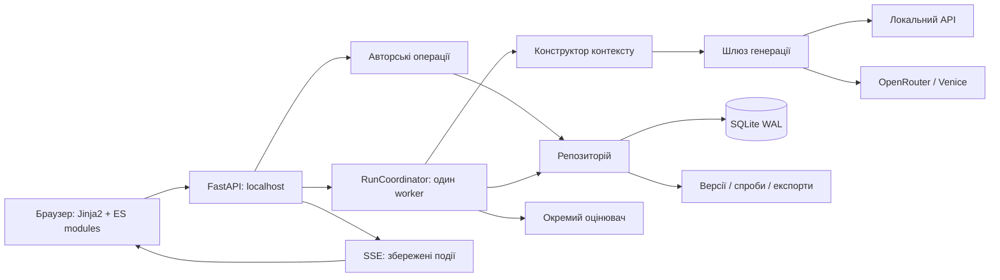

# Obscura Text Writer (Storygen) — специфікація системи

## Purpose

Storygen автоматизує створення українського оповідання за авторським планом із рекомендованим цільовим обсягом до 15 тисяч слів. Автор керує сценами, моделями, редактурою та пам’яттю твору через локальний вебінтерфейс українською або англійською. Це специфікація реалізованої архітектури, а не початковий бріф Gemini чи перелік майбутніх можливостей.

Базову редакцію звірено з кодом на коміті `c53e669` станом на 20 жовтня 2026 року. Від цієї редакції SPEC.MD є головним джерелом правди щодо архітектури; подальші зміни документа і відповідного коду виконуються разом.

Використано формат OpenSpec: нормативні розділи `Requirement` та перевірні `Scenario` з `GIVEN / WHEN / THEN`. На запит власника всі можливості й технічні рішення зібрані в одному кореневому файлі. Це адаптація формату, без встановлення OpenSpec CLI та без твердження про відповідність його типовій структурі каталогів.

## Зміст

[Простежуваність і перевірки](docs/verification/README.md) · [Стан виконання тестів](docs/STATUS.md) · [Мотиви рішень](docs/adr/README.md)

- [R22-SOURCE — Ядро Markdown і точні координати](#r22-source)
- [R22-EDITOR — Візуальне форматування й сумісність версій](#r22-editor)
- [R22-MARKUP — Форматування в pipeline та книгах](#r22-markup)
- [R23-COMMENTS — Збережені коментарі автора](#r23-comments)
- [R23-SAVE — Атомарний текст і нотатки](#r23-save)

- [ARCH-001 — Узгодженість архітектури](#arch-001)
- [RUNTIME-001 — Локальний застосунок](#runtime-001)
- [DATA-001 — Перевірений імпорт](#data-001)
- [DATA-002 — Авторський контроль структури](#data-002)
- [DATA-003 — Незмінні матеріали версій](#data-003)
- [DATA-004 — Конкурентні зміни](#data-004)
- [DATA-005 — Застарілі залежності](#data-005)
- [DATA-010 — Явне авторське прийняття застарілого тексту](#data-010)
- [RUN-ACCEPTED — Продовження після прийнятої альтернативи](#run-accepted)
- [DATA-009 — Похідна актуальність версій](#data-009)
- [DATA-006 — Кошик і відновлення](#data-006)
- [DATA-007 — Ручна чернетка](#data-007)
- [DATA-008 — Прийняття збереженої чернетки](#data-008)
- [MODEL-001 — П’ять незалежних ролей](#model-001)
- [ROLE-PROFILES — Переносимі комплекти ролей](#role-profiles)
- [MODEL-002 — Явний виклик провайдера](#model-002)
- [MODEL-003 — Каталожна перевірка й згода на модель](#model-003)
- [MODEL-004 — Блокування після відмови моделі](#model-004)
- [MODEL-005 — Каталог моделей у налаштуваннях](#model-005)
- [MODEL-RETIREMENT — Модель, яку провайдер прибирає](#model-retirement)
- [OPENROUTER-REASONING — Reasoning ролі з провайдером OpenRouter](#openrouter-reasoning)
- [BUDGET-001 — Явні ліміти й резерв виклику](#budget-001)
- [BUDGET-002 — Достовірне завершення обліку](#budget-002)
- [PIPE-001 — Послідовність сцени](#pipe-001)
- [PIPE-002 — Один виконавець на каталог](#pipe-002)
- [PIPE-003 — Ідемпотентне створення запуску](#pipe-003)
- [PIPE-004 — Відновлення після збою](#pipe-004)
- [PIPE-005 — Пауза і скасування](#pipe-005)
- [PIPE-006 — Перевірка завершення](#pipe-006)
- [PIPE-007 — Слід виконання](#pipe-007)
- [CONTEXT-001 — Явний бюджет контексту](#context-001)
- [CONTEXT-004 — Перевірений профіль і ручна активація](#context-004)
- [CONTEXT-002 — План і вже написані події](#context-002)
- [MEMORY-SELECT — Відбір пам’яті під бюджет](#memory-select)
- [MEMORY-LOCATIONS — Локації сцен і пам’ять місць](#memory-locations)
- [MEMORY-SUMMARY — Підсумки хронології](#memory-summary)
- [CONTEXT-005 — Горизонт майбутніх планів](#context-005)
- [CONTEXT-003 — Вибрана проза, підтверджена пам’яттю](#context-003)
- [MEMORY-001 — Походження пам’яті](#memory-001)
- [MEMORY-002 — Пам’ять через фрагменти](#memory-002)
- [MEMORY-003 — Історія та сумісність пам’яті](#memory-003)
- [MEMORY-004 — Обмежена нормалізація й точна діагностика](#memory-004)
- [PROMPT-CONTRACT — Призначення промптів](#prompt-contract)
- [EDIT-001 — Обмежена точкова редактура](#edit-001)
- [REWRITE-DIFF — Суцільна редактура з програмними змінами](#rewrite-diff)
- [EDIT-CLASSIFICATION — Окремі необов’язкові поради](#edit-classification)
- [EDIT-DIAGNOSTICS — Конкретні безпечні помилки редактора](#edit-diagnostics)
- [EDIT-REVIEW — Авторський вибір точкових правок](#edit-review)
- [EDITOR-IMPORT — Імпорт редакції з DOCX](#editor-import)
- [MANUSCRIPT-IMPORT — Імпорт рукопису](#manuscript-import)
- [LANGUAGE-WARNINGS — Локальні мовні попередження](#language-warnings)
- [BROKEN-TEXT — Втрачені провайдером літери «�»](#broken-text)
- [UI-001 — Передумови workflow](#ui-001)
- [UI-002 — Безпека редакторського буфера](#ui-002)
- [UI-003 — Достовірний стан виконання](#ui-003)
- [UI-004 — Зрозумілі повідомлення](#ui-004)
- [UI-005 — Оновлення ресурсів інтерфейсу](#ui-005)
- [UI-006 — Брендинг і представлення назв](#ui-006)
- [PERF-001 — Швидка відповідь робочого простору](#perf-001)
- [EVAL-001 — Відокремлене оцінювання](#eval-001)
- [EVAL-002 — Калібрування](#eval-002)
- [EVAL-003 — Вимкнення оцінювача](#eval-003)
- [EVAL-004 — Покриття великого твору](#eval-004)
- [EVAL-005 — Відмова і фактична причина помилки](#eval-005)
- [EVAL-006 — Постійне блокування оцінювача для твору](#eval-006)
- [EVAL-007 — Політики workflow та придатність профілю](#eval-007)
- [EXPORT-001 — Відтворюваний експорт](#export-001)
- [EXPORT-DOCX — Рукопис DOCX і RTF для редактури](#export-docx)
- [SECURITY-001 — Локальна межа доступу](#security-001)
- [SECURITY-002 — Ключі поза даними ролей](#security-002)
- [CONTENT-001 — Мова прози і авторський матеріал](#content-001)
- [STORY-LANGUAGE — Мова твору, промптів і прози сцени](#story-language)
- [STORAGE-BOUNDARY — Предметні транзакції сховища](#storage-boundary)
- [SCENE-DESCRIPTION — Назва та учасники з авторського плану](#scene-description)
- [SCENE-NARRATOR — Оповідач сцени](#scene-narrator)
- [SCENE-PLAN-TEMPLATE — План нової сцени з попередньої](#scene-plan-template)
- [PLAN-NUMBERING — Перенумерація пунктів плану сцени](#plan-numbering)
- [SCENE-CAST-DISPLAY — Імена замість редагування ID](#scene-cast-display)
- [CHARACTER-IMPORT — Початкові картки з Markdown](#character-import)
- [CHARACTER-TIME — Доступність відомостей за порядком сцен](#character-time)
- [CHARACTER-EXTRACT — Пошук персонажів у прозі моделлю](#character-extract)
- [CHARACTER-NAMES — Інші імена персонажа та зміна імені зі сцени](#character-names)
- [PLANNER-ACQUAINTANCE — Знайомства головного героя для планувальника](#planner-acquaintance)
- [GHOST-REWRITE — Переписування AI-чернетки по пам’яті](#ghost-rewrite)
- [RATING-001 — Віковий рейтинг твору й сцени](#rating-001)
- [RATING-002 — Запобіжник щодо неповнолітніх](#rating-002)
- [BOOK-STRUCTURE — Частини й арки книги](#book-structure)
- [BOOK-LINEAGE — Родовід сцен](#book-lineage)
- [MEMORY-MERGE — Злиття пам’яті арок](#memory-merge)
- [STORY-TIME — Час історії й спогади](#story-time)
- [BUILD-EDITION-001 — Видання збірки й межа рейтингу](#build-edition-001)
- [DESKTOP-001 — Запуск установленої збірки](#desktop-001)
- [PACKAGING-001 — Збирання пакета для Microsoft Store](#packaging-001)
- [MAINT-001 — Діагностика без repair](#maint-001)
- [MAINT-002 — Перевірений холодний backup](#maint-002)
- [MAINT-003 — Відновлення в новий каталог](#maint-003)
- [PUB-001 — Відокремлення публічного коду від приватної історії](#pub-001)
- [DOCS-SITE — Двомовний сайт інструкцій](#docs-site)
- [WAITLIST-001 — Список очікування платної версії](#waitlist-001)
- [MCP-BRIDGE — Локальний MCP-клієнт до сервера Obscura](#mcp-bridge)
- [CLAUDE-SKILLS — Скіли Obscura для Claude](#claude-skills)
- [CODEX-SKILLS — Скіли Obscura для Codex](#codex-skills)
- [WRITING-MODE — Режим твору: пише чат чи Obscura](#writing-mode)
- [EDIT-SENTENCE-CONTEXT — Речення в контексті редакторської правки](#edit-sentence-context)
- [EDIT-SENTENCE-GROUPS — Одна група прийняття на речення](#edit-sentence-groups)
- [BUDGET-LAST-CALL — Вартість останнього виклику в бюджеті](#budget-last-call)
- [EDIT-NO-CHANGES — Відсутність модельних правок не є прийнятною пропозицією](#edit-no-changes)
- [EDIT-LOOP — Багатопрохідна редактура з одним прийняттям](#edit-loop)
- [EDIT-LOOP-STOP — Завершення та recovery](#edit-loop-stop)
- [EDIT-LOOP-REVIEW — Сумарний diff та атомарне завершення](#edit-loop-review)
- [EDIT-WORKFLOW — Єдина редактура для всіх дій](#edit-workflow)
- [DOCS-TRACE — Сталі ID й конкретні перевірки](#docs-trace)
- [DOCS-STATUS — Датоване свідчення виконання](#docs-status)
- [VALID-LINKS — Зв'язки сцени та їхня валідність](#valid-links)
- [VALID-MEMORY — Рішення для пам'яті, рівноцінність прози й перенос пам'яті](#valid-memory)
- [VALID-CARDS — Інвалідація зв'язків після зміни карток і локацій](#valid-cards)
- [VALID-AUDITOR — Роль «Ревізор» і перевірка зв'язку](#valid-auditor)
- [VALID-RUN — Перевірка сцени й валідація книги Ревізором](#valid-run)

Технічні розділи: [Architecture](#architecture), [матриця R-05](#матриця-перевірок-r-05), [обмеження](#known-limitations-and-deviations), [Source map](#source-map).

## Requirements

<a id="arch-001"></a>
### Requirement: ARCH-001 — Узгодженість архітектури

Будь-яка архітектурна зміна SHALL супроводжуватися зміною SPEC.MD у тому самому наборі змін і коміті. Відомий дефект SHALL описуватися окремо від бажаного контракту.

<a id="arch-001-s01"></a>
#### Scenario: ARCH-001-S01 — Зміна контракту збереження
- GIVEN розробник змінює схему даних або правила публікації результату
- WHEN готується завершення роботи
- THEN SPEC.MD описує нові інваріанти, сценарії та обмеження
- AND історичний план не підміняє чинну специфікацію.

<a id="runtime-001"></a>
### Requirement: RUNTIME-001 — Локальний застосунок

Система SHALL надавати локальний вебінтерфейс із серверним доступом до моделей і постійним сховищем у вибраному каталозі даних. Користувацькі інструкції встановлення й запуску публікуються на двомовному сайті з `docs/site/` ([DOCS-SITE](#docs-site)).

Офіційно підтримувана платформа — Windows 10 і 11: для неї описано встановлення на сайті, на ній перевіряються збірки ([DESKTOP-001](#desktop-001)) і функції, залежні від ОС. Інші ОС (Linux, macOS) мають статус «неофіційні, без гарантій»: запуск із вихідного коду можливий, але не перевіряється, а частина функцій там недоступна (зокрема «Підключити до Claude», що працює лише на `win32`). Середовища розробки для цих ОС, які надсилають контриб’ютори (наприклад, Nix), належать до інструментів розробки в `CONTRIBUTING.md`, а не до продуктового способу запуску, і в користувацьких інструкціях сайту не описуються. Workflow `.github/workflows/nix.yml` на `pull_request` зі змінами файлів Nix, `scripts/start.sh`, `tests/test_nix.py` чи залежностей лише перевіряє на Linux і macOS, що flake обчислюється, оболонка `nix develop` готує `.venv` і проходить `tests/test_nix.py`, а `nix run` запускає сервер, який відповідає на `/`; це перевірка інструмента розробки, а не офіційна підтримка цих ОС.

<a id="runtime-001-s01"></a>
#### Scenario: RUNTIME-001-S01 — Перезапуск вебсервера
- GIVEN автор зберіг твір і його версії
- WHEN сервер запускається з тим самим каталогом даних
- THEN збережені матеріали доступні без повторної генерації.

<a id="runtime-001-s02"></a>
#### Scenario: RUNTIME-001-S02 — Встановлення з вихідного коду за lock-файлом
- GIVEN користувач ставить застосунок за інструкцією: `pip install -r requirements-lock.txt`, потім `pip install --no-deps -e ".[web,publication]"`
- WHEN запускається сервер
- THEN кожна залежність ядра та extra `web` і `publication` з `pyproject.toml` закріплена в `requirements-lock.txt`, тож сервер стартує без додаткових установок.

Усунене відхилення: `tomlkit` (extra `web`, імпорт у `codex_connect.py` з інтеграції Codex, #206) не був закріплений у `requirements-lock.txt`, тож після встановлення з `--no-deps` сервер падав під час запуску з `ModuleNotFoundError`. Виявлено workflow `nix.yml` у PR #211; збірку Store вада не зачіпала, бо вона ставить extra без `--no-deps`.

<a id="data-001"></a>
### Requirement: DATA-001 — Перевірений імпорт

Імпорт SHALL приймати непорожні UTF-8 TXT/MD файли до 2 MiB кожний, зберігати вихідні байти та створювати версії декодованого тексту.

<a id="data-001-s01"></a>
#### Scenario: DATA-001-S01 — Некоректний файл у наборі
- GIVEN набір містить непідтримуваний або некоректно закодований файл
- WHEN виконується імпорт
- THEN попередня перевірка відхиляє набір до початку запису його файлів.

Шаблони плану й персонажів SHALL постачатися як UTF-8 Markdown у пакетних `web/static/templates/*.md` і завантажуватися з блоку «Додати матеріали» через same-origin посилання з download. План SHALL використовувати розпізнавані заголовки сцен і склад, відповідний заголовкам імен шаблону персонажів. Приклади Початок/Кінець SHALL явно містити день та час, зокрема перехід через північ. Ці рядки зберігаються у beats як авторський текст: окремої моделі фізичного часу, автоматичного обчислення тривалості чи перевірки суперечностей немає. Вони не змінюють порядок читання й часову проєкцію пам’яті; єдиний виняток — рядок «Початок:» (`memory/story_time.py`, [STORY-TIME](#story-time)): дата з часом, `день N`, відносна позначка «Рік/Місяць/День» чи «невідомо» дає пам’яті сигнал переходу дня й момент у часі історії. Шаблон персонажів SHALL пояснювати чинне unclassified після імпорту та окреме налаштування доступності у картках.

<a id="data-001-s02"></a>
#### Scenario: DATA-001-S02 — Сумісні завантажувані шаблони
- GIVEN автор відкрив «Додати матеріали»
- WHEN завантажує шаблони плану й персонажів та імпортує їх у новий твір
- THEN сцени й початкові картки розпізнані, склад заповнений відповідними іменами
- AND межі часу, включно з різними днями на початку й наприкінці, збережені в планах без автоматичної зміни доступності карток.

<a id="data-002"></a>
### Requirement: DATA-002 — Авторський контроль структури

Система SHALL дозволяти редагувати сцени та застосовувати запропоновану моделлю структуру лише окремою авторською дією. Повторний імпорт SHALL не замінювати наявні активні сцени автоматично.

<a id="data-002-s01"></a>
#### Scenario: DATA-002-S01 — Підготовка структури
- GIVEN існують імпортовані матеріали
- WHEN планувальник завершує підготовку
- THEN пропозиція доступна для перегляду
- AND канон і картки персонажів не стають поточними до застосування.

<a id="data-003"></a>
### Requirement: DATA-003 — Незмінні матеріали версій

Байти збереженої версії SHALL бути незмінними. Читання SHALL перевіряти належність шляху каталогу даних і SHA-256, а поточні матеріали SHALL вибиратися через явні головні версії, а не дату створення.

<a id="data-003-s01"></a>
#### Scenario: DATA-003-S01 — Пошкодження файла
- GIVEN файл версії змінено поза застосунком
- WHEN система читає його
- THEN повертається помилка цілісності замість використання зміненого тексту.

<a id="data-004"></a>
### Requirement: DATA-004 — Конкурентні зміни

Авторське збереження SHALL перевіряти очікувану ревізію. Нова модельна публікація SHALL атомарно перевіряти релевантний dependency snapshot і окремий target CAS (ID та лічильник вибору голови). Зміна використаного контексту або цілі зберігає результат альтернативою; нерелевантна зміна твору чи налаштувань ролі сама його не відхиляє. Legacy-спроба без snapshot зберігає консервативний CAS ревізій.

<a id="data-004-s01"></a>
#### Scenario: DATA-004-S01 — Автор редагує сцену під час генерації
- GIVEN запит моделі вже розпочато
- WHEN автор змінює матеріали, від яких залежав запит
- THEN результат не перезаписує новіший авторський стан.

<a id="data-005"></a>
### Requirement: DATA-005 — Застарілі залежності

Заміна джерела SHALL позначати залежні результати застарілими, зберігаючи історію і головні посилання. Для версій, що не є поточними головами завдання, прози й пам'яті активної сцени, застарілість визначає порівняння знімка й ребра залежностей (DATA-009); поточні голови завдання, прози й пам'яті застарівають лише через невалідний вхідний зв'язок ([VALID-LINKS](#valid-links)), а сцена потребує перегляду, коли застаріла голова її прози. Змінено в R-44 ([VALID-LINKS](#valid-links)): заміна джерела більше не поширює застарілість голів транзитивно на пізніші сцени; пізнішу сцену зачіпає лише зміна компонента її зв'язку (наприклад, пам'яті попередньої сцени П₀).

<a id="data-005-s01"></a>
#### Scenario: DATA-005-S01 — Заміна прози
- GIVEN пам’ять залежить від поточної прози, а проза наступної сцени без завдання спирається на цю пам'ять
- WHEN автор зберігає нову версію прози
- THEN попередня залежна пам’ять стає застарілою (її зв'язок проза → пам'ять неперевірений)
- AND її файл залишається доступним в історії
- AND проза наступної сцени лишається свіжою, а сцена не потребує перегляду: пам'ять-П₀ не змінилася, а зв'язку завдання → проза без завдання немає.

<a id="data-010"></a>
### Requirement: DATA-010 — Явне авторське прийняття застарілого тексту

Автор SHALL мати окремий preview тексту, змінених залежностей expected/current і наслідків прийняття для draft/edited/manual. Окрема явна дія SHALL транзакційно перевіряти власність/вид/complete/SHA-256, scene revision та fingerprint показаного baseline/diff, вибирати голову й додавати append-only рішення з новим author_text baseline. Старі байти, model input_refs/fingerprint та стани історичних alternative-спроб SHALL не переписуватися. Застарілі brief/memory/evaluation не мають універсального прийняття DATA-010. Змінено в R-44 ([VALID-LINKS](#valid-links)): застарілу голову завдання чи прози автор може зробити свіжою окремим рішенням про зв'язок («Я перевірив сам» чи «Розбіжності немає» в панелі «Узгодженість сцени» — З1/З2 з поточним відбитком); таке рішення не є прийняттям DATA-010 і не робить прозу авторською. Проза, прийнята як авторська, свіжа за будь-якого З2. Змінено в R-44 PR 3 ([VALID-AUDITOR](#valid-auditor)): висновок Ревізора `discrepancy` автор закриває тими самими рішеннями про зв'язок (для З3 — «Залишити попередню пам'ять»; «Створити нову пам'ять» замінює саму пам'ять), а висновок Ревізора `unavailable` рішення автора не закриває: переповнення знімає наступна перевірка після збільшення ліміту, а інші причини — зміна компонента зв'язку. Будь-який висновок Ревізора для З1/З2, старший за інвалідацію, яку автор підтвердив після зміни карток чи локацій, більше не діє: зв'язок стає неперевіреним, і наступна перевірка викликає Ревізора знову ([VALID-CARDS](#valid-cards)).

<a id="data-010-s01"></a>
#### Scenario: DATA-010-S01 — Прийняття й гонка після preview
- GIVEN автор переглянув stale draft/prose та зміни джерел
- WHEN підтверджує за незмінного показаного стану
- THEN рішення й голова збережені разом, а пам’ять/evaluation не підтверджені автоматично
- AND зміна джерел або ревізії після preview повертає 409 без часткової зміни голови/журналу.

Масове прийняття прози з меню твору (пункт «Прийняти всю прозу як авторську», `static/prose-acceptance.js`; `storage/acceptance.py::preview_prose_acceptance`, `accept_all_prose`; `GET`/`POST /api/stories/{id}/prose-acceptance`) SHALL одним натисканням залишати книгу без прози, що чекає перевірки (застаріла голова `prose` активної сцени або `needs_review` — `acceptance._waiting_prose`; пункт меню видимий, лише коли такі сцени є). Після R-44 ([VALID-LINKS](#valid-links)) це голови прози з невалідним З2 (`unchecked`/`discrepancy`/`unavailable`), не прийняті автором; проза без завдання (З2 `missing`) і проза з валідним З2 у переліку не бувають. GET лише читає: повертає сцени, проза яких чекає зараз, у порядку читання, і `fingerprint` — SHA-256 від упорядкованих `preview_fingerprint` цих сцен разом із (ID, голова `prose`, ревізія) кожної активної сцени книги. POST у транзакції `BEGIN IMMEDIATE` до першого запису заново обчислює відбиток і за іншого повертає 409 без змін — так зміна й тієї сцени, якої немає в показаному переліку, після перегляду нічого не змінює. Далі сцени приймаються по одній тим самим ядром, що й одиночне прийняття (`AcceptanceRecord` з `accept_prose`, голова, `needs_review=False`): щоразу на новому view перелік очікуваної прози будується заново й приймається перша в порядку читання сцена, доки перелік не спорожніє. Авторська база сцени (`build_author_baseline`) записує прозу попередніх сцен разом з ID їхніх рішень, а ребра залежностей позначають залежні версії застарілими; на голови прози пізніших сцен це не впливає, бо прийняття не змінює жодного компонента їхніх зв'язків. Змінено в R-44 ([VALID-LINKS](#valid-links)): раніше прийняття сцени робило застарілою прозу пізніших сцен, актуальну до транзакції, і вона приймалася тією самою транзакцією поза переліком GET; тепер перелік GET уже містить усю прозу, що чекає, а повторна побудова переліку після кожного прийняття лишається запобіжником. Відповідь POST перелічує всі прийняті сцени. Після транзакції жодна проза книги не чекає перевірки. Якщо сцена, уже прийнята в цій транзакції, знову чекає (рішення автора знімає не кожну причину), POST відхиляє запит (`ValueError` з назвою сцени й причинами) без змін. Усі сцени приймаються в одній транзакції або жодна. Завдання, пам'ять і evaluation не підтверджуються. Усунене відхилення (22.11.2026, книга власника): перелік фіксувався до першого прийняття, тож прийняття сцени 1 залишало застарілими пізніші сцени, яких у переліку не було (`source_baseline_changed`), і кожне наступне натискання приймало їх і знову застарювало ще пізніші. Усунене відхилення (R-44, PR 1): відкритий запуск перевірки впливу більше не блокує прийняття, а пункт перенесено зі сторінки «Перевірка книги» в меню твору. Оскільки дія тепер виконується поруч із редактором, відкритий буфер прийнятої сцени (збережений чи ні) після прийняття бере нову ревізію сцени: тексти не змінено, тож наступне збереження не дає 409. Відоме обмеження: на книзі з 68 сцен і 40 очікуваними POST триває ≈ 10 с в одній транзакції запису (старий код — ≈ 11 с), бо після кожного прийняття актуальність книги перераховується на новому view.

<a id="data-010-s02"></a>
#### Scenario: DATA-010-S02 — Прийняття всієї прози книги
- GIVEN у книзі кілька сцен поспіль, голова прози яких має невалідний зв'язок завдання → проза (зокрема ручна проза під завданням автора), застарілі версії завдань і пам'яті, сцена з підтвердженими зв'язками і, можливо, проза без завдання (також у книзі з частинами/арками і після зміни порядку сцен)
- WHEN автор у меню твору вибирає «Прийняти всю прозу як авторську» й одним натисканням підтверджує показаний перелік
- THEN перелік містить у порядку читання всі сцени з невалідним З2, не прийняті автором, але не сцену з валідним З2 і не прозу без завдання; проза кожної сцени переліку прийнята з окремим записом у журналі, тексти не змінені, і жодна проза книги після цього не чекає перевірки
- AND прийняття не змінює жодного зв'язку пізніших сцен, тож нових сцен, що чекають, після нього не з'являється, а прийнята проза не чекає знову після зміни вище за книгою (чекає лише нова проза)
- AND завдання й пам'ять не підтверджуються (застарілі лишаються застарілими), а зміна будь-якої сцени після перегляду (зокрема не названої в переліку) не змінює нічого; збережений старий запуск перевірки впливу прийняттю не заважає.

<a id="run-accepted"></a>
### Requirement: RUN-ACCEPTED — Продовження після прийнятої альтернативи

Після явного вибору актуального результату зупиненого етапу автор SHALL мати окреме продовження без повторного inference цього етапу. Предметна транзакція SHALL перевіряти стан run, точний cursor/task, останню відповідну спробу/result ID, selected head, scene revision, freshness і чинний acceptance ID за наявності рішення. Автоматичного просування від самого вибору голови немає. Cancellation та story/model refusal block SHALL не обходитися.

<a id="run-accepted-s01"></a>
#### Scenario: RUN-ACCEPTED-S01 — Без повтору й підміни історії
- GIVEN remaining зупинився на alternative і автор прийняв саме цей результат
- WHEN явно продовжує після нього
- THEN лише правильний cursor просувається й наступні етапи читають актуальні входи
- AND історичний alternative лишається alternative; cancelled або змінений baseline не дозволяє продовження.

<a id="run-accept-close"></a>
### Requirement: RUN-ACCEPT-CLOSE — Запуск не чекає вже ухваленого рішення

Запуск у `needs_review`, що зупинився на своєму останньому завданні, SHALL ставати `completed`, щойно автор прийняв результат, якого він чекає: завдання через `accept-brief` (панель «Прийняти завдання» або історія версій) чи вибір точкових правок одного проходу редактора (`commit_copyedit_selection`). Закриття відбувається лише тоді, коли прийнята спроба належить цьому запуску, відповідає його поточному завданню й `run_cursor`, має `result_version_id` і стан `completed`; cursor стає `len(tasks)`, подія `accepted_outside_run` (`attempt_id`, `version_id`) іде перед подією стану. Запуск із наступними завданнями й далі чекає явного продовження за RUN-ACCEPTED: прийняття саме по собі не просуває cursor.

Новий запуск режиму `stage` або `edit_loop` (етап `edit`) для сцени SHALL скасовувати зупинені запуски (`needs_review`, `alternative`, `paused`, `interrupted`) цього твору, чиє поточне завдання — той самий етап тієї самої сцени, а всі решта завдань стосуються лише цієї сцени. Багатопрохідна редактура, що чекає прийняття підсумку з cursor за останнім проходом, вважає поточним завданням останній прохід. Перед скасуванням записується подія `superseded` з ID нового запуску; скасування йде чинним переходом `cancel`. Запуск, у якого попереду є інші сцени, не скасовується: один ручний етап не перериває автоматичний запуск книги. Повтор того самого `request_id` нічого не створює й нічого не скасовує.

Під час старту `RunCoordinator.recover_interrupted` SHALL одноразово й ідемпотентно закривати за тим самим правилом запуски, де рішення вже ухвалено раніше (`storage/run_store.py::close_accepted_runs`). Схема бази не змінюється.

Усунене відхилення: до цієї зміни `accept-brief` і вибір точкових правок позначали спробу `completed`, а запуск лишався в `needs_review` назавжди. Такий запуск не показувався як дія в панелі (вона показує останній запуск сцени) і блокував видалення та відновлення сцен твору (`authoring.py::_idle`) повідомленням «Спершу завершіть або скасуйте всі запуски цього твору» без способу це зробити.

<a id="run-accept-close-s01"></a>
#### Scenario: RUN-ACCEPT-CLOSE-S01 — Прийняте завдання закриває свій запуск
- GIVEN одноетапний запуск завдання чекає рішення автора через proposed_changes
- WHEN автор приймає це завдання
- THEN запуск стає `completed` з подією `accepted_outside_run`
- AND сцену твору можна перемістити в кошик.

<a id="run-accept-close-s02"></a>
#### Scenario: RUN-ACCEPT-CLOSE-S02 — Наступні завдання й далі чекають продовження
- GIVEN запуск має після завдання ще чернетку
- WHEN автор приймає завдання
- THEN запуск лишається `needs_review` з тим самим cursor до явного продовження.

<a id="run-accept-close-s03"></a>
#### Scenario: RUN-ACCEPT-CLOSE-S03 — Точкові правки одного проходу закривають запуск
- GIVEN одноетапний запуск редактора чекає вибору точкових правок
- WHEN автор застосовує вибір
- THEN запуск стає `completed`, а подія називає прийняту версію.

<a id="run-accept-close-s04"></a>
#### Scenario: RUN-ACCEPT-CLOSE-S04 — Новий запуск того самого етапу замінює зупинений
- GIVEN у творі є зупинені запуски того самого етапу цієї сцени, іншого етапу, іншої сцени та запуск, що має попереду іншу сцену
- WHEN автор запускає цей етап сцени знову
- THEN скасовуються лише запуски того самого етапу цієї сцени, з подією `superseded`
- AND решта чекають далі, а повтор `request_id` нічого не скасовує.

<a id="run-accept-close-s05"></a>
#### Scenario: RUN-ACCEPT-CLOSE-S05 — Старі ухвалені рішення закриваються під час старту
- GIVEN запуск лишився в `needs_review`, хоча його останню спробу вже прийнято
- WHEN застосунок стартує
- THEN запуск стає `completed`, а запуск із неприйнятим результатом і далі чекає автора.

<a id="data-009"></a>
### Requirement: DATA-009 — Похідна актуальність версій

Версії з перевіреним dependency snapshot SHALL визначати актуальність порівнянням baseline з поточними релевантними selectors, refs/хешами, complete і актуальністю джерел. Змінено в R-44 ([VALID-LINKS](#valid-links)): це правило діє для версій, що не є поточними головами `brief`, прози (`edited`/`manual`) чи `memory` активної сцени (чернетки, редактури, історичні версії, матеріали твору); поточну голову цих видів позначає лише її вхідний зв'язок, а збережений прапорець `stale` голови не читається. Публічні списки/версії/контекст/експорт SHALL використовувати цей самий resolver. Legacy stale без snapshot SHALL лишатися застарілим до явного author acceptance (старі записи R-28 не діють, R28-REMOVED). Цикл, відсутнє/чуже/пошкоджене джерело не є доказом актуальності.

<a id="data-009-s01"></a>
#### Scenario: DATA-009-S01 — Повернення залежностей A→B→A
- GIVEN нова версія мала перевірений baseline A
- WHEN усі релевантні залежності після зміни на B знову точно A
- THEN актуальність відновлюється без inference та переписування model input_refs
- AND target CAS активної спроби все одно відхиляє вибір її голови A→B→A.

<a id="data-006"></a>
### Requirement: DATA-006 — Кошик і відновлення

Видалення творів і сцен SHALL бути зворотним переміщенням до кошика. Звичайні операції репозиторію SHALL приховувати такі об’єкти. Архівація SHALL відхилятися за наявності незавершеного запуску.

У бібліотеці дія кошика SHALL перевіряти всі запуски твору. За наявності лише зупинених paused/interrupted/needs_review/alternative вона SHALL явно запропонувати їх скасування разом із переміщенням. Після підтвердження UI послідовно викликає чинний cancel API й перевіряє завершений стан кожного запуску перед чинним trash API. Активні/невідомі стани блокують цю дію без автоматичного скасування. Помилка скасування або незавершене cancellation_requested SHALL не запускати trash; уже скасовані запуски залишаються скасованими, тексти й історія зберігаються. Остаточна серверна перевірка запусків і ревізії лишається обов’язковою; ці окремі запити не є спільною транзакцією.

Видалення сцени в редакторі й відновлення сцени з кошика сцен SHALL діяти так само: перевіряти всі запуски твору, за наявності лише зупинених явно пропонувати скасувати їх разом із дією (з їхньою кількістю), за активних чи невідомих станів відмовляти без скасування, а незавершене скасування SHALL не змінювати кошик сцен; поки запуски скасовуються, буфер редактора заблоковано так само, як під час видалення (`web/static/trash.js::installSceneTrash`, спільні `stoppedRuns`/`cancelRuns` із бібліотекою).

<a id="data-006-s04"></a>
#### Scenario: DATA-006-S04 — Видалення сцени не впирається в зупинені запуски
- GIVEN у творі є зупинений запуск, а активних немає
- WHEN автор видаляє сцену або відновлює її з кошика й підтверджує скасування
- THEN запуск скасовано, а сцена в кошику сцен або відновлена
- AND відмова, активний запуск або незавершене скасування не змінюють ні запуски, ні сцену.

<a id="data-006-s03"></a>
#### Scenario: DATA-006-S03 — Старі зупинені запуски не утворюють глухий кут кошика
- GIVEN у творі є старі alternative/paused/interrupted/needs_review, а останній запуск уже завершено
- WHEN автор у бібліотеці підтверджує скасування зупинених запусків і кошик
- THEN усі такі запуски скасовані до переміщення, версії та історія збережені
- AND відмова від підтвердження, активна генерація або невдале скасування не переміщують твір.

<a id="data-006-s01"></a>
#### Scenario: DATA-006-S01 — Експорт архівного твору
- GIVEN твір перебуває в кошику на початку SQL-знімка експорту
- WHEN автор запитує експорт, зокрема з `allow_incomplete=true`
- THEN API повертає 404
- AND нові файли експорту не створюються.

<a id="data-006-s02"></a>
#### Scenario: DATA-006-S02 — Відновлення сцени
- GIVEN сцена в кошику, а твір активний
- WHEN автор відновлює сцену
- THEN вона повертається на збережену або найближчу допустиму позицію, а текст і порядок зберігаються
- AND версії, у знімку яких записано змінену послідовність, застарівають за DATA-009, а голови завдання й прози пізніших сцен — лише тоді, коли кошик чи відновлення змінює їхню П₀ ([VALID-LINKS](#valid-links)); проза без завдання сусідньої сцени лишається свіжою, і сцена не потребує перегляду (змінено в R-44: раніше кошик позначав пізніші сцени для перегляду безумовно).

<a id="data-rename"></a>
### Requirement: DATA-RENAME — Назва оповідання

Автор SHALL перейменовувати активний твір кнопкою олівця поруч із назвою: поле й «ОК», Enter для збереження, Escape для скасування. UI SHALL зберігати введення після помилки, блокувати повторне збереження та захищати незбережену назву перед виходом зі сторінки. Заголовок і document.title SHALL оновлюватися без перезавантаження буфера сцени; назва відображається як текст, а не HTML.

PATCH `/api/stories/{id}` SHALL приймати лише title/expected_revision. Межа Authoring/Repository SHALL перевіряти активність/CAS у write-транзакції, прибирати зовнішні пробіли й приймати 1–300 символів. Змінена назва підвищує story.revision, однакова не змінює її після CAS. Конфлікт — 409, твір у кошику — 404. Перейменування SHALL не змінювати config_revision, матеріали/актуальність сцен чи явно задану назву публікації; незадана назва публікації використовує чинний story.title. Міграція не потрібна.

<a id="data-rename-s01"></a>
#### Scenario: DATA-RENAME-S01 — Перейменування без зміни рукопису
- GIVEN активний твір і відкритий, зокрема незбережений, текст сцени
- WHEN автор зберігає нову непорожню назву з чинною ревізією
- THEN назва збережена й відображена в заголовку та бібліотеці, а текст/актуальність сцен не змінені
- AND Escape не зберігає; помилка лишає введення; конфлікт, порожня чи задовга назва та кошик не дозволяють перезапис.

<a id="data-007"></a>
### Requirement: DATA-007 — Ручна чернетка

Автор SHALL мати можливість вставити або змінити чернетку й зберегти її як нову поточну `draft`-версію без виклику моделі. Збереження SHALL перевіряти ревізію, відхиляти порожній текст і позначати залежні результати застарілими. Змінено в R-44 ([VALID-LINKS](#valid-links)): чернетка не є компонентом жодного зв'язку, тож нова чернетка застарює лише залежні версії, що не є поточними головами завдання, прози чи пам'яті (за знімком чи ребрами), а голови прози й пам'яті сцени лишаються актуальними, і сцена не починає потребувати перегляду.

Чернетка, записана зовнішнім чат-клієнтом через `storygen-mcp`, іде тим самим шляхом з `external_origin` і обов’язковим відбитком контексту; її правила — у [MCP-BRIDGE](#mcp-bridge).

<a id="data-007-s01"></a>
#### Scenario: DATA-007-S01 — Вставлення зовнішнього тексту
- GIVEN автор відкрив вкладку «Чернетка», зокрема без раніше створеної чернетки
- WHEN він вставляє непорожній текст і натискає «Зберегти»
- THEN текст дослівно зберігається в новій головній draft-версії
- AND він доступний редактору як чернетка, а не підміняє фінальну прозу.

<a id="data-007-s02"></a>
#### Scenario: DATA-007-S02 — Конфлікт ручної чернетки
- GIVEN інша вкладка вже змінила ревізію сцени
- WHEN автор зберігає чернетку зі старою ревізією
- THEN сервер повертає 409, зберігаючи надіслану версію в історії
- AND актуальна голова чернетки не замінюється.

<a id="data-008"></a>
### Requirement: DATA-008 — Прийняття збереженої чернетки

Автор SHALL мати можливість зробити завершену незастарілу draft-версію тієї самої сцени поточною через історію без копіювання тексту й нового модельного виклику. Дія SHALL перевіряти ревізію й інвалідовувати залежності попередньої голови.

<a id="data-008-s01"></a>
#### Scenario: DATA-008-S01 — Прийняття альтернативи
- GIVEN генерація зберегла завершену draft-версію, яка не стала головною
- WHEN автор обирає її в історії та натискає «Прийняти чернетку»
- THEN поточна голова вказує на той самий ID версії
- AND вкладка «Чернетка» показує прийнятий текст.

<a id="model-001"></a>
### Requirement: MODEL-001 — П’ять незалежних ролей

Планувальник, письменник, редактор, пам’ять і Ревізор SHALL мати окремі налаштування моделі, провайдера та промпту; Ревізор без власного рядка налаштувань SHALL брати похідні налаштування від редактора й планувальника ([VALID-AUDITOR](#valid-auditor)). Інтерфейс SHALL також дозволяти атомарно зберегти спільного провайдера й модель для всіх ролей, зберігши інші рольові параметри; похідний Ревізор тоді власного рядка не отримує, бо бере провайдера редактора (`authoring/blueprints.py::shared_roles`). Змінено в R-44 PR 3: ролей було чотири. Письменник MAY мати окремий варіант `low_rating_variant` (власні провайдер, модель, ліміти, температура й timeout) для сцен, у яких жодна вісь ефективного рейтингу не дорівнює 2; промпт і режим відповіді лишаються спільними з основною моделлю. Варіант SHALL бути доступний лише ролі `writer`.

<a id="model-001-s01"></a>
#### Scenario: MODEL-001-S01 — Одна модель для всіх ролей
- GIVEN ролі мають різні промпти й ліміти
- WHEN автор застосовує спільну модель
- THEN усі ролі використовують її: Ревізор із власним рядком отримує її в цей рядок, а похідний Ревізор — через провайдера редактора, без власного рядка
- AND їхні окремі промпти та режими зберігаються.

<a id="model-001-s02"></a>
#### Scenario: MODEL-001-S02 — Окрема модель письменника для сцен 0–1
- GIVEN письменник має `low_rating_variant`, а твір має заданий рейтинг (без рейтингу твору запуск генерації неможливий)
- WHEN етап `draft` або `rewrite` ефективно оцінюється без жодної осі на рівні 2
- THEN запит, бюджети контексту й шлюз беруть провайдера, модель, ліміти, температуру й timeout варіанта
- AND сцена з будь-якою віссю 2 використовує основну модель; сцена без власного рейтингу оцінюється за рейтингом твору, а твір без рейтингу блокується `enforce_rating` до вибору моделі
- AND промпт і режим відповіді спільні, а згода й позначка відмови діють для пари «writer + модель варіанта»
- AND збереження варіанта для іншої ролі відхиляється з повідомленням «Окрема модель для сцен 0–1 доступна лише письменнику.»

Реєстр ролей: `storygen/roles.py` — єдине серверне джерело `ROLES` (порядок `planner`, `writer`, `editor`, `memory`, `auditor`), `ROLE_SET`, `ROLE_STAGE` (роль → етап основного промпту: brief/draft/edit/memory/audit_prose), `ROLE_STAGES` (роль → усі етапи її промптів: planner — `prepare`, `brief`; auditor — `audit_brief`, `audit_prose`, `audit_memory`; решта — один етап), `STAGE_ROLE` (етап сцени → роль, з `prepare` → planner і трьома `audit_*` → auditor), `ROLE_LABELS` і `ROLE_LABEL_KEYS` (ключі каталогу для кнопок ролей). Політика моделей, налаштування, пресети, генерація, статистика, MCP і шаблон налаштувань імпортують звідти; етапи поза сценою (`classify`, `rewrite`, `publication_suggest`, `timeline_summary`) додаються до `STAGE_ROLE` у `providers/policy.py`. Браузер бере ті самі `ROLES`, `ROLE_STAGE`, `STAGE_ROLE`, `ROLE_STAGES` з `web/static/roles.js`; перелік ролей у JS визначає лише цей модуль, а мапи підписів (різні граматичні форми в різних місцях) дають тільки назву ролі. Реєстр запроваджено рефакторингом перед R-44 без зміни поведінки; роль `auditor` (підпис «Ревізор») додано в R-44 PR 3.

<a id="model-001-s03"></a>
#### Scenario: MODEL-001-S03 — Єдиний реєстр ролей
- GIVEN серверний реєстр `roles.py` і браузерний `roles.js`
- WHEN перевіряються копії списку ролей і відповідності «роль ↔ етап»
- THEN `roles.js` збігається з `roles.py`, а поза реєстром у коді немає вбудованого переліку всіх ролей
- AND кожна мапа підписів у JS має назву для кожної ролі, а сторінка налаштувань показує кнопку для кожної ролі реєстру.

<a id="model-002"></a>
### Requirement: MODEL-002 — Явний виклик провайдера

Генерація SHALL використовувати налаштовану модель без прихованого перемикання провайдера, автоматичного повтору SDK або заміни авторського тексту через тематичний фільтр застосунку.

Для Venice етапи, де пошкоджену відповідь відхиляють або розбирають на правки (BROKEN-TEXT: `memory`, `classify`, `edit` у режимах `diff`/`patches`, `rewrite`, `publication_suggest`, етапи Ревізора `audit_brief`, `audit_prose`, `audit_memory`), SHALL надсилатися без потоку: `stream: false`, без `stream_options`, тайм-аут читання 300 с. Запит виконується у фоновому потоці; скасування перевіряється щочверть секунди й повертає керування одразу, а пізня відповідь закриває облік бюджету своїми usage і `cost`. Подія `stage_started` має прапорець `streaming`, і UI для таких етапів показує «Чекаємо на повну відповідь моделі» замість живого тексту.

<a id="model-002-s01"></a>
#### Scenario: MODEL-002-S01 — Відмова провайдера
- GIVEN провайдер повертає відмову або помилку
- WHEN завершується спроба
- THEN запуск показує відповідний результат
- AND інша модель не викликається автоматично.

<a id="model-003"></a>
### Requirement: MODEL-003 — Каталожна перевірка й згода на модель

Генерація через Venice SHALL дозволяти лише текстові моделі, що є в каталозі провайдера, підтримують потрібний режим відповіді й не мають `offline=true`; наявність `uncensored=true` для цього не потрібна. Ця перевірка SHALL діяти також для вручну введеного ID. Виклик моделі, яка не локальна й не має явного `uncensored=true`, SHALL бути заблокований, якщо рейтинг запиту має хоча б одну вісь вище 0, доки автор не підтвердив згоду для пари «роль + модель + endpoint». Рейтинг запиту — максимум за кожною віссю серед рейтингу твору й ефективних рейтингів сцен запиту: для етапу сцени (`prepare`, `brief`, `draft`, `rewrite`, `edit`, `classify`, `memory`, `audit_brief`, `audit_prose`, `audit_memory`) це лише ця сцена, хоч би матеріал попередніх сцен (пам’ять, хвіст прози) і входив у запит; для багатосценних етапів (`publication_suggest`, `timeline_summary`) — сцени всіх версій матеріалу запиту. Згода діє в усіх творах, не переноситься на іншу роль, модель чи Base URL і знімається автором. Моделі без `uncensored=true` SHALL бути видимі й вибираємі в списку для всіх провайдерів. Оцінювач цією вимогою не охоплено: він і далі вимагає `uncensored=true`. Етапи Ревізора перевіряються для ролі `auditor` (ключ `model_consent:auditor:…`, шаблон `policy.block.consent.auditor`): згода редактора на ту саму модель на похідного Ревізора не переноситься.

<a id="model-003-s01"></a>
#### Scenario: MODEL-003-S01 — Невідповідна модель Venice
- GIVEN вибраний ID не проходить перевірку каталогу
- WHEN готується генерація
- THEN платний запит завершення не надсилається.

<a id="model-003-s02"></a>
#### Scenario: MODEL-003-S02 — Модель без Uncensored і без згоди
- GIVEN модель не локальна, `uncensored` не `true`, рейтинг запиту має вісь вище 0, згоди для ролі й моделі немає
- WHEN запускається етап
- THEN виклик блокується з поясненням, що називає модель, рейтинг запиту й роль
- AND платний запит не надсилається.

<a id="model-003-s03"></a>
#### Scenario: MODEL-003-S03 — Згода для ролі й моделі
- GIVEN автор підтвердив згоду для пари «роль + модель»
- WHEN запускається етап у будь-якому творі
- THEN виклик проходить
- AND зміна моделі чи ролі скидає згоду, а зняття згоди повертає блокування.

<a id="model-003-s04"></a>
#### Scenario: MODEL-003-S04 — Локальна модель і ключ згоди
- GIVEN модель локального провайдера (завжди loopback)
- WHEN рейтинг запиту має вісь вище 0
- THEN згода не потрібна
- AND згода для одного Base URL не діє для іншого, бо ключ згоди містить endpoint.

<a id="model-003-s05"></a>
#### Scenario: MODEL-003-S05 — Сцена з вищим рейтингом, ніж у твору
- GIVEN твір 0/0/0, сцена з власним рейтингом 2/0/0, модель без Uncensored і без згоди
- WHEN запускається етап для цієї сцени
- THEN виклик блокується
- AND етапи інших сцен твору не блокуються.

<a id="model-004"></a>
### Requirement: MODEL-004 — Блокування після відмови моделі

Відмова моделі через зміст (`finish_reason == 'content_filter'` з категорією `refusal_content` або `terminal.refusal` з категорією `refusal_unknown`) SHALL записувати позначку для пари «роль + модель + endpoint» з рейтингом запиту. Виклик SHALL бути заблокований, якщо хоча б один збережений вектор за кожною віссю не вищий за рейтинг запиту; новий вектор прибирає з набору вектори, не нижчі за нього за кожною віссю. Автор знімає позначку в налаштуваннях ролі; автоматичного перемикання на іншу модель немає. Текстові відмови («я не можу…») не розпізнаються. Для етапів Ревізора позначка пишеться й перевіряється для ролі `auditor` (`model_refusal:auditor:…`, шаблон `policy.block.refusal.auditor`).

<a id="model-004-s01"></a>
#### Scenario: MODEL-004-S01 — Позначка після відмови через зміст
- GIVEN модель відмовила через зміст на сцені з рейтингом R
- WHEN запускається етап для сцени з таким самим або вищим рейтингом
- THEN виклик блокується з поясненням
- AND сцена з нижчим за якоюсь віссю рейтингом не блокується
- AND зняття позначки відновлює виклики.

<a id="model-004-s02"></a>
#### Scenario: MODEL-004-S02 — Набір векторів відмов
- GIVEN збережено відмови на 2/0/0 і 0/2/0
- WHEN перевіряється запит 1/1/0, 2/1/0 або 0/2/2
- THEN 1/1/0 не блокується, а 2/1/0 і 0/2/2 блокуються
- AND відмова на 0/0/0 блокує всі запити.

<a id="model-005"></a>
### Requirement: MODEL-005 — Каталог моделей у налаштуваннях

Список моделей у формі ролі й у спільному віджеті підключення SHALL бути каталогом із позначками, фільтрами й ціною, побудованими лише з полів каталогу провайдера, а не з назв моделей. Відсутнє поле SHALL показуватися як «невідомо», а не як вигадане значення. Для ролі чи підключення в режимі відповіді `json_schema` застосунок SHALL не дозволяти вибрати чи зберегти модель, якій каталог явно відмовляє в підтримці JSON Schema (`supports_schema = false`). Невідома підтримка (`supports_schema = null`: локальний провайдер завжди, OpenRouter без `supported_parameters`, Venice без `supportsResponseSchema`) SHALL не блокувати вибір і збереження; picker показує підказку «підтримка JSON Schema невідома». Коли автор змінює модель ролі чи підключення (вибирає рядок списку або вводить ID, відомий каталогу), а каталог явно підтверджує підтримку JSON Schema (`supports_schema = true`), режим відповіді SHALL перемикатися на `json_schema` (`model-picker.preferredMode`); невідома чи відсутня підтримка режим не змінює, завантаження форми режим не чіпає, а подальший вибір автора («JSON за промптом») зберігається. Окрема модель письменника режиму не змінює (`autoSchema: false`), бо відповідає в режимі основного письменника. Окремої перевірки JSON Schema перед викликом немає: перед викликом лише Venice звіряє модель із каталогом (`validate_model`), тому для OpenRouter і локальних моделей з невідомою підтримкою відповідальність за сумісність лишається на авторові. Усунене відхилення (фінальне рев’ю PR 1): клієнт трактував невідому підтримку як відсутню, через що локальну роль у режимі `json_schema` не можна було зберегти після завантаження списку. Відомі каталогу межі вибраної моделі (`context_tokens`, `max_output_tokens` у `ModelOption`) SHALL не дозволяти зберегти більші контекст чи резерв відповіді: picker (`limitsProblem`, атрибут `max` полів) у формах ролі, окремої моделі письменника, класифікатора й оцінювача, а сервер (`providers/schema_support.catalog_problem`/`role_problem`) — для ролі, її варіанта й класифікатора та для спільного провайдера проти лімітів кожної ролі. Серверний запит каталогу має timeout не більше 10 с і в разі збою чи невідомої межі не блокує збереження. Відоме обмеження: застосування комплекту ролей (`role-profiles/apply`) і налаштування оцінювача на сервері з каталогом не звіряються — там межа перевіряється лише у формі (оцінювач) або під час виклику. Усунене відхилення: межі каталогу перевірялися лише під час виклику, тож неправильні ліміти зберігалися й давали помилку вже на запуску.

<a id="model-005-s01"></a>
#### Scenario: MODEL-005-S01 — Позначки й ціна з полів каталогу
- GIVEN каталог Venice повертає моделі з полями `privacy`, `uncensored`, `capabilities` і `pricing`, а в частини моделей якихось полів немає
- WHEN автор відкриває список моделей
- THEN рядки показують позначки Uncensored, TEE, Private, Anonymous, JSON Schema, контекст і ціну лише з наявних полів
- AND відсутнє поле дає «приватність невідома» або «не Uncensored», а не вигадане значення
- AND модель Venice без Uncensored видно й можна вибрати; під вибраною моделлю з’являється попередження про згоду (MODEL-003).

<a id="model-005-s02"></a>
#### Scenario: MODEL-005-S02 — JSON Schema у режимі відповіді ролі
- GIVEN роль або підключення має режим відповіді `json_schema`
- WHEN автор відкриває список моделей і зберігає форму
- THEN фільтр JSON Schema увімкнений і заблокований, а модель, якій каталог явно відмовляє в підтримці JSON Schema, не можна вибрати
- AND модель із невідомою підтримкою (зокрема локальна) лишається доступною для вибору й збереження з підказкою «підтримка JSON Schema невідома»
- AND збереження такої моделі відхиляється на сервері з HTTP 400 і поясненням, якщо каталог доступний і підтримку відомо
- AND перемикання на «JSON за промптом» знімає обмеження, а для OpenRouter підтримка береться з `structured_outputs`.

<a id="model-005-s03"></a>
#### Scenario: MODEL-005-S03 — Ліміти не більші за межі моделі з каталогу
- GIVEN каталог повідомляє для вибраної моделі максимальний контекст C і максимум відповіді O
- WHEN автор вводить контекст більший за C або резерв відповіді більший за O і зберігає роль, окрему модель письменника, класифікатор, оцінювача чи спільного провайдера
- THEN форма показує пояснення «… перевищує ліміт вибраної моделі … токенів» і не надсилає збереження, а поле має `max` з межею каталогу
- AND сервер відхиляє таке збереження з HTTP 400 тим самим поясненням до будь-якого запису, перевіряючи для спільного провайдера ліміти кожної ролі
- AND невідома межа, модель поза каталогом, локальний провайдер чи недоступний каталог збереження не блокують.

<a id="model-005-s04"></a>
#### Scenario: MODEL-005-S04 — Зміна моделі вмикає JSON Schema, якщо модель її підтримує
- GIVEN роль чи підключення в режимі «JSON за промптом» і завантажений каталог моделей
- WHEN автор вибирає модель, якій каталог явно підтверджує підтримку JSON Schema, зі списку або вводячи її ID
- THEN режим відповіді перемикається на JSON Schema, а фільтр JSON Schema стає увімкненим і заблокованим
- AND модель із невідомою чи відсутньою підтримкою режиму не змінює
- AND автор може знову вибрати «JSON за промптом», і цей режим зберігається з новою моделлю
- AND вибір окремої моделі письменника не змінює режиму основного письменника.

<a id="model-retirement"></a>
### Requirement: MODEL-RETIREMENT — Модель, яку провайдер прибирає

Коли каталог провайдера повідомляє, що модель буде прибрано, застосунок SHALL попереджати автора заздалегідь і SHALL NOT змінювати вибрану модель сам. `ModelOption.retirement` (`ModelRetirement`: `date`, `replacement | None`) береться лише з каталогу (`providers/retirement.py::retirement_from`): Venice — `model_spec.deprecation.removesAt`, інакше `date`, заміна — `replacementModelId`; OpenRouter — `expiration_date`, заміни немає; локальний провайдер — `None`. Відсутнє чи некоректне поле дає `None`, некоректна заміна — лише `replacement = None`. Попередження не блокує ні збереження, ні запуск, навіть коли дата вже минула, а модель ще є в каталозі; після видалення запуск зупиняє наявна перевірка каталогу (MODEL-003).

- **Запуск.** `OpenAIGenerationGateway.retirement` запам'ятовує повідомлення каталогу для моделі виклику (Venice — з `validate_model`, OpenRouter — з рядка каталогу перед викликом); `execute_stage` кладе текст «Провайдер прибирає модель «{id}» {ДД.ММ.РРРР}; заміна: «{id}». Змініть модель у налаштуваннях ролі.» (без заміни — без середньої частини) у `attempt.context['model_retirement_warnings']` (`generation/run_warnings.py`). У `run.warning` його зливають через `merge_warnings` усі шляхи: `worker` (звичайні етапи, разом з іншими попередженнями контексту), `editor_loop` (кожен прохід — і `edit_loop`, і етап редактора в `scene`/`remaining`). Рядок стану циклу редактури (причина зупинки або «Підсумкові правки прийнято.») замінює попередній такий рядок (`run_models.loop_status`; `storage` не імпортує `generation`), а решта попереджень лишається. Усунене відхилення: `editor_loop.finish` і прийняття підсумкових правок перезаписували `run.warning`, стираючи попередження попередніх етапів.
- **Перевірка каталогу Venice.** Модель, якої немає в каталозі, зупиняє виклик із текстом «Venice: моделі «{id}» немає в каталозі — провайдер міг її прибрати. Виберіть іншу модель у налаштуваннях ролі.»; модель без `uncensored=true` там, де його вимагає перевірка (оцінювач), — «Venice: модель «{id}» не має uncensored=true.». Усунене відхилення: обидва випадки мали один текст «модель не має uncensored=true або недоступна в каталозі», хибний для прибраної моделі.
- **Збереження ролі.** `providers/schema_support.catalog_check` повертає (помилку, попередження); `PUT /api/stories/{id}/settings` і `PUT …/settings/shared-provider` додають до збереженого твору `model_warnings` (список текстів, як у запуску; модель ролі, окрема модель письменника, класифікатор, спільний провайдер — без повторів) лише тоді, коли каталог повідомляє про прибирання; збій каталогу дає збереження без попередження. Сторінка налаштувань показує попередження замість звичайного повідомлення про збереження.
- **Список моделей.** Picker показує позначку «Прибирають ДД.ММ.РРРР» (`models.badge_retiring`) і в рядку вибраної моделі — «Провайдер прибирає модель ДД.ММ.РРРР; заміна: {id}.»; модель лишається доступною для вибору.
- **MCP.** `get_settings(models_for_role)` повертає `retirement` у полях моделей; скіл `setup-models` попереджає про нього під час звірки моделі.

Тексти сервера мають ключі каталогу інтерфейсу (`models.retiring_warning`, `models.retiring_warning_no_replacement`, `models.missing_in_catalog`, `models.not_uncensored`), тож англійський інтерфейс їх перекладає; кілька попереджень (рядки `run.warning`, елементи `model_warnings`) перекладаються кожне окремо (`i18n.diagnosticLines`). Відомі обмеження: OpenRouter не повідомляє заміну; модель, прибрану без позначки в каталозі, видно лише з помилки перевірки каталогу (для OpenRouter — з помилки провайдера); виклики оцінювача (`evaluation/gateway.py`) попередження в запуск не додають — для них діє лише точний текст помилки; позначку в списку видно лише після завантаження каталогу, а попередження збереження й запуску від цього не залежать.

<a id="model-retirement-s01"></a>
#### Scenario: MODEL-RETIREMENT-S01 — Повідомлення каталогу про прибирання
- GIVEN каталог Venice має для моделі `deprecation` з `removesAt` і `replacementModelId`, а каталог OpenRouter — `expiration_date`
- WHEN застосунок будує список моделей
- THEN `retirement` моделі має дату з каталогу й заміну лише від Venice
- AND відсутнє чи некоректне поле дає `retirement = None`, а локальна модель повідомлення не має.

<a id="model-retirement-s02"></a>
#### Scenario: MODEL-RETIREMENT-S02 — Попередження запуску
- GIVEN роль працює на моделі, яку каталог позначив як ту, що прибирають
- WHEN завершується запуск етапу, циклу редактури, сцени чи решти сцен
- THEN `run.warning` містить попередження з моделлю, датою й заміною
- AND запуск не блокується, а попередження інших етапів і рядок стану циклу редактури зберігаються без повторів.

<a id="model-retirement-s03"></a>
#### Scenario: MODEL-RETIREMENT-S03 — Модель прибрано
- GIVEN моделі ролі вже немає в каталозі Venice
- WHEN готується виклик
- THEN платний запит не надсилається
- AND помилка каже, що моделі немає в каталозі й провайдер міг її прибрати, і просить вибрати іншу модель.

<a id="model-retirement-s04"></a>
#### Scenario: MODEL-RETIREMENT-S04 — Збереження ролі, список моделей і MCP
- GIVEN каталог повідомляє, що модель ролі прибирають
- WHEN автор зберігає роль чи спільного провайдера, відкриває список моделей або чат читає `get_settings(models_for_role)`
- THEN збереження проходить і відповідь містить `model_warnings`, picker показує позначку з датою й заміною, а MCP повертає `retirement`
- AND без повідомлення чи за недоступного каталогу поля `model_warnings` немає.

<a id="openrouter-reasoning"></a>
### Requirement: OPENROUTER-REASONING — Reasoning ролі з провайдером OpenRouter

Роль із провайдером OpenRouter SHALL мати налаштування reasoning: `ProviderSettings.openrouter_reasoning_effort` — `None` (типове для моделі) або `none` / `minimal` / `low` / `medium` / `high` / `xhigh` / `max`. Непорожнє значення дозволене лише для `provider=openrouter`; для інших провайдерів збереження відхиляється. `generation_request` для OpenRouter додає `reasoning:{effort:<значення>}`; `none` вимикає reasoning задокументованою формою OpenRouter (проба 22.11.2026: `effort:"none"` дав 0 reasoning-токенів у qwen3.7-plus і qwen3.8-flash, а `enabled:false` діяв так само). SDK переносить `reasoning` в `extra_body`. `provider.require_parameters` до такого запиту не додається, бо в документації OpenRouter він не пов'язаний з `reasoning` і звузив би роутинг інших параметрів. Запити оцінювача (`EvaluatorConfig`) поле не мають. Профіль класифікатора має його разом із `ProviderSettings` і власне поле у своїй формі. Окрема модель письменника для сцен 0–1 теж має `ProviderSettings`, але її форма не має поля «Reasoning», тому payload варіанта поле не несе й не успадковує рівень основної моделі: варіант працює з типовим для своєї моделі reasoning.

- **Відбитки.** Порожнє поле не потрапляє в жоден `model_dump()` (`model_serializer` у `ProviderSettings`). Тому збережені ролі, відбитки контексту сцени, створені до появи поля, лишаються дійсними. Задане поле входить у дамп, тож його зміна, як і будь-яка зміна налаштувань ролі, робить контекст сцени новим.
- **Каталог.** `ModelOption.reasoning` (`ReasoningCapability`: `mandatory`, `default_enabled`, `efforts`, `default_effort`) береться лише з об'єкта `reasoning` рядка каталогу OpenRouter. Відсутній `supported_efforts` означає `efforts=[]` (рівень вибрати не можна), `null` — `efforts=None` (будь-який рівень); невідомі рівні відкидаються, некоректний об'єкт дає `None`. Для Venice і local `reasoning=None`.
- **Форма.** Форма ролі й профілю класифікатора для OpenRouter показує поле «Reasoning». Варіанти: «Типове для моделі»; «Вимкнено», якщо модель не має обов'язкового reasoning; рівні з `efforts`. До завантаження списку моделей видно лише типове й збережене значення. Збережене значення, якого модель не дозволяє, лишається видимим із позначкою «модель не підтримує». Для інших провайдерів форма надсилає `null`.
- **MCP.** `update_settings` приймає `openrouter_reasoning_effort`; зміна провайдера, у якій поле не передано, його скидає. `get_settings(models_for_role)` повертає `reasoning` у полях моделей.
- **Скіл.** `setup-models` після звірки моделі ставить reasoning лише для редактора з OpenRouter і лише коли `default_enabled=true`: без обов'язкового reasoning — `none`; з обов'язковим — найнижчий рівень з `efforts`, за `efforts=None` — `low`, за порожнього переліку нічого не змінює й каже автору.

Сервер під час збереження ролі каталог не перевіряє. Якщо модель не приймає значення (наприклад, `none` для моделі з обов'язковим reasoning), OpenRouter відповідає 400 «Reasoning is mandatory for this endpoint and cannot be disabled.», і запуск показує помилку провайдера. Відомі обмеження: бюджету `reasoning.max_tokens` немає; каталог описує модель, а не кожного провайдера за нею, і провайдер без підтримки параметра може його проігнорувати; що вимкнений чи знижений reasoning вміщує повний прохід редактора в ліміт, не перевірено — для цього потрібен повторний тест редакторів.

<a id="openrouter-reasoning-s01"></a>
#### Scenario: OPENROUTER-REASONING-S01 — Рівень reasoning у запиті
- GIVEN роль з провайдером OpenRouter і `openrouter_reasoning_effort` = рівень від `minimal` до `max`
- WHEN будується запит генерації
- THEN тіло містить `reasoning:{effort:<рівень>}`, а виклик SDK — те саме в `extra_body`
- AND ролі Venice й local такого поля від цього налаштування не отримують.

<a id="openrouter-reasoning-s02"></a>
#### Scenario: OPENROUTER-REASONING-S02 — Вимкнення reasoning
- GIVEN роль з провайдером OpenRouter і `openrouter_reasoning_effort=none`
- WHEN будується запит генерації
- THEN тіло містить `reasoning:{effort:"none"}`.

<a id="openrouter-reasoning-s03"></a>
#### Scenario: OPENROUTER-REASONING-S03 — Порожнє поле нічого не змінює
- GIVEN роль без `openrouter_reasoning_effort` або збережена до появи поля
- WHEN будується запит, дамп налаштувань чи відбиток контексту
- THEN у запиті немає `reasoning`, у дампі немає поля, а збережений legacy-маніфест wire 2 проходить перевірку штампу
- AND задане значення є в дампі й читається назад.

<a id="openrouter-reasoning-s04"></a>
#### Scenario: OPENROUTER-REASONING-S04 — Варіанти форми за каталогом моделі
- GIVEN каталог OpenRouter повідомляє для вибраної моделі об'єкт `reasoning`
- WHEN форма ролі будує поле «Reasoning»
- THEN для обов'язкового reasoning немає варіанта «Вимкнено», а рівні — лише з `efforts`; без `efforts` — лише типове й «Вимкнено»; за `efforts=null` — усі рівні
- AND недозволене збережене значення показано з позначкою, а для провайдера, відмінного від OpenRouter, payload містить `null`.

<a id="openrouter-reasoning-s05"></a>
#### Scenario: OPENROUTER-REASONING-S05 — Каталог і MCP
- GIVEN рядок каталогу OpenRouter з об'єктом `reasoning`
- WHEN застосунок будує список моделей і чат читає `get_settings(models_for_role)` чи пише `update_settings`
- THEN `ModelOption.reasoning` має `mandatory`, `default_enabled`, `efforts`, `default_effort`, а MCP повертає їх у полі `reasoning`
- AND `update_settings` зберігає поле, а зміна провайдера на інший його скидає.

<a id="openrouter-reasoning-s06"></a>
#### Scenario: OPENROUTER-REASONING-S06 — Поле поза OpenRouter
- GIVEN налаштування провайдера Venice або local
- WHEN у них задано `openrouter_reasoning_effort`
- THEN валідація відхиляє налаштування.

<a id="openrouter-reasoning-s07"></a>
#### Scenario: OPENROUTER-REASONING-S07 — Скіл налаштовує reasoning редактора
- GIVEN скіл `setup-models` звірив модель редактора з провайдером OpenRouter
- WHEN модель має reasoning, увімкнений за замовчуванням
- THEN скіл ставить `none`, якщо reasoning не обов'язковий, інакше найнижчий дозволений рівень (`low` за `efforts=null`)
- AND за порожнього переліку рівнів чи без reasoning за замовчуванням скіл поле не змінює.

<a id="budget-001"></a>
### Requirement: BUDGET-001 — Явні ліміти й резерв виклику

Кожний cloud completion SHALL мати явний scope limit, чинний official/manual
тариф і атомарний reserve до POST. Story scope накопичувальний; optional run
cap фіксується на перший reserve запуску. Немає типового дозволеного $1.
Повтор call ID SHALL не надсилатися вдруге. Readiness не створює резервів.
Local/Codex — unpriced: usage зберігається без вигаданого USD-рахунку.

<a id="budget-001-s01"></a>
#### Scenario: BUDGET-001-S01 — Конкурентні резерви
- GIVEN залишку бюджету вистачає лише на один із двох викликів
- WHEN виклики одночасно резервують кошти
- THEN BEGIN IMMEDIATE допускає лише один reserve; другий не переходить до POST.

<a id="budget-001-s02"></a>
#### Scenario: BUDGET-001-S02 — Відсутній або прострочений тариф
- GIVEN немає чинного каталожного тарифу
- WHEN неможливо оновити офіційний каталог
- THEN cloud completion блокується до explicit manual тарифу з джерелом
  та expires_at; невідоме не стає нулем.

<a id="budget-002"></a>
### Requirement: BUDGET-002 — Достовірне завершення обліку

Ledger SHALL відрізняти provider actual від priced_usage_estimate та
unresolved. Пріоритет — валідна reported cost; інакше повна фінальна usage
і snapshot тарифу; інакше весь reserve лишається counted. Перезапуск,
скасування й новий attempt ID не звільняють невизначений попередній виклик.
Manual reconcile потребує суми, джерела та власного scope й не дозволений
для активного workflow. Реальний overrun зберігається, а не обрізається.

<a id="budget-002-s01"></a>
#### Scenario: BUDGET-002-S01 — Usage без підтвердженої вартості
- GIVEN завершена відповідь має обидва невід’ємні цілі token counts
- WHEN reported cost відсутня
- THEN reserve зменшується до розрахунку за зафіксованим тарифом;
  UI позначає його розрахунком, actual лишається null.

<a id="budget-002-s02"></a>
#### Scenario: BUDGET-002-S02 — Збій після POST
- GIVEN завершення або вартість невідомі
- WHEN виконується recovery або авторський retry
- THEN counted reserve збережений; наступний виклик потребує окремого резерву.


### Захист активного виклику та фінальна usage

Runtime утримує неблокувальний OS lease `billing-locks/<hash(call_id)>/worker.lock`
від резервування до завершення обліку. Ручна звірка SHALL захопити той самий
lease; для активного виклику вона відхиляється. Crash звільняє OS lock, але
не грошовий резерв. Standalone evaluation/calibration і budget CLI утримують
кореневий AppInstanceLock, сумісний із R-02 backup; dry-run його не потребує.
Local/Codex standalone без явного scope обліковуються у `cli:evaluator`.
Scope нових записів перевіряється до запису: `story:<id>` або `cli:<name>`;
для story scope потрібен чинний твір.

Невалідний usage container нормалізується до порожнього telemetry без втрати
тексту чи refusal. Лічильники stream SHALL братися з одного останнього usage
snapshot; поля з різних chunks не складаються в удавано повний фінальний usage.
Зберігаються лише дозволені числові лічильники/деталі та валідна cost.

<a id="budget-002-s03"></a>
#### Scenario: BUDGET-002-S03 — Ручна звірка під час активного standalone виклику
- GIVEN CLI вже відправив запит і тримає lease виклику
- WHEN інший клієнт намагається звірити його до нуля
- THEN операція відхиляється і доступний залишок не збільшується.

<a id="budget-002-s04"></a>
#### Scenario: BUDGET-002-S04 — Неповний останній usage
- GIVEN ранній chunk має обидва лічильники, а останній usage — лише один
- WHEN потік завершується без валідної reported cost
- THEN отриманий текст збережений, виклик unresolved, повний резерв лишається.

<a id="pipe-001"></a>
### Requirement: PIPE-001 — Послідовність сцени

Повний запуск сцени SHALL виконувати завдання планувальника, чернетку письменника, редактуру та оновлення пам’яті послідовно. Окремі етапи SHALL запускатися самостійно за виконаних передумов.

<a id="pipe-001-s01"></a>
#### Scenario: PIPE-001-S01 — Повна сцена
- GIVEN сцена має потрібний план і налаштовані ролі
- WHEN запускається повний workflow
- THEN етапи виконуються в порядку `brief → draft → edit → memory`
- AND автоматичне оцінювання виконується після пам’яті, якщо ввімкнене.

<a id="pipe-002"></a>
### Requirement: PIPE-002 — Один виконавець на каталог

Система SHALL послідовно виконувати завдання всіх творів у межах одного каталогу даних і блокувати запуск другого виконавця для цього каталогу.

<a id="pipe-002-s01"></a>
#### Scenario: PIPE-002-S01 — Два вебсервери
- GIVEN один виконавець уже володіє блокуванням каталогу
- WHEN другий намагається використати той самий каталог
- THEN він не починає конкурентно виконувати чергу.

<a id="pipe-003"></a>
### Requirement: PIPE-003 — Ідемпотентне створення запуску

Повторне надсилання того самого `request_id` і запиту SHALL повертати існуючий запуск. Інший запит із цим ID SHALL отримувати конфлікт.

<a id="pipe-003-s01"></a>
#### Scenario: PIPE-003-S01 — Відповідь на створення запуску втрачена
- GIVEN браузер не отримав підтвердження
- WHEN він повторює той самий запит з тим самим ID
- THEN друга модельна операція не створюється.

<a id="pipe-004"></a>
### Requirement: PIPE-004 — Відновлення після збою

Після перезапуску незавершені активні запуски SHALL отримувати стан перерваних. Повтор невизначеної спроби SHALL вимагати явного підтвердження, а не відбуватися автоматично.

<a id="pipe-004-s01"></a>
#### Scenario: PIPE-004-S01 — Збій під час платного запиту
- GIVEN процес завершився без остаточного результату спроби
- WHEN виконавець знову запускається
- THEN стан відновлюється як перерваний
- AND повтор запиту не приховує ризику повторної оплати.

<a id="pipe-005"></a>
### Requirement: PIPE-005 — Пауза і скасування

Пауза SHALL діяти на межі етапів. Скасування SHALL перевірятися між етапами й під час читання потоку; воно SHALL не трактувати частковий текст як завершену версію.

<a id="pipe-005-s01"></a>
#### Scenario: PIPE-005-S01 — Скасування потокової генерації
- GIVEN модель уже надсилає текст
- WHEN виконавець помічає запит скасування
- THEN частковий матеріал залишається діагностичним
- AND не стає поточною прозою.

Скасування SHALL не змінювати payload або журнал для completed/failed/cancelled та повторного cancellation_requested. Для queued результат — cancelled; running/pause_requested — cancellation_requested. Для paused/interrupted/needs_review/alternative результат — cancelled зі збереженням error, cursor, текстів і версій. Повторна пауза також не створює зайвих подій.

<a id="pipe-005-cancel-finished"></a>
#### Scenario: PIPE-005-CANCEL-FINISHED — Повторне скасування
- GIVEN запуск завершено, він невдалий або вже скасований
- WHEN надходить cancel
- THEN стан, діагностика, cursor та журнал подій не змінюються.

<a id="pipe-005-cancel-stopped"></a>
#### Scenario: PIPE-005-CANCEL-STOPPED — Скасування зупиненого запуску
- GIVEN запуск paused/interrupted/needs_review/alternative
- WHEN автор обирає cancel
- THEN запуск стає cancelled без видалення матеріалів.

<a id="pipe-006"></a>
### Requirement: PIPE-006 — Перевірка завершення

Прийняття генерації SHALL вимагати непорожньої відповіді, коректного завершення `stop`, відсутності відмови та валідності очікуваної структури. Усічення через ліміт SHALL бути помилкою.

Порожній content за `finish_reason=stop` без явної відмови SHALL мати категорію `empty_output` та повідомлення про наявний `stop`, але відсутній фінальний текст. За наявності додатного `reasoning_tokens` повідомлення SHALL наводити цю кількість і загальний `completion_tokens`, якщо він коректний, та пропонувати вимкнути/зменшити reasoning для сумісної моделі. Без usage причина не вигадується. Для структурованої відповіді (`response_format`) понад 1024 поспіль пробільних символів content SHALL зупиняти потік як `degenerate_output` (PIPE-006-S03): обмежене декодування, якому заборонено закрити об’єкт, інакше марнує весь вихідний ліміт. Такий результат не означає відмову через контент чи вичерпання ліміту; автоматичного повтору немає. Редактор SHALL зберігати це пояснення у помилці спроби. Усунене відхилення: порожня відповідь письменника з `stop` помилково описувалася як відсутність повної відповіді з `stop`. Збережені історичні помилки не переписуються; схема та налаштування моделей не змінюються.

<a id="pipe-006-s02"></a>
#### Scenario: PIPE-006-S02 — Порожня відповідь із коректним stop
- GIVEN потік завершується з finish_reason=stop, без content і без явної відмови
- WHEN шлюз перевіряє завершення та зберігається невдала спроба
- THEN помилка прямо повідомляє про порожню відповідь із stop; доступні витрати reasoning зберігаються в поясненні
- AND без usage витрати не вигадуються, результат не публікується й запит не повторюється.

<a id="pipe-006-s01"></a>
#### Scenario: PIPE-006-S01 — Вичерпано вихідні токени
- GIVEN провайдер повернув `finish_reason=length`
- WHEN перевіряється відповідь
- THEN вона не публікується як завершений етап.

<a id="pipe-006-s03"></a>
#### Scenario: PIPE-006-S03 — Зациклення на пробілах у структурованій відповіді
- GIVEN запит містить `response_format`, а модель після частини JSON надсилає лише пробільні символи
- WHEN поспіль отримано понад `WHITESPACE_RUNAWAY_LIMIT` (1024) пробільних символів content
- THEN шлюз SHALL закрити потік до `finish_reason`, повернути `error` з категорією `degenerate_output` і поясненням про ймовірно неописане обов’язкове поле схеми; частковий текст зберігається, автоматичного повтору немає
- AND прозовий запит без `response_format` і коротші пробільні фрагменти (відступи JSON) не обриваються; облік вартості завершується як для перерваного потоку (`complete=False`).

<a id="pipe-007"></a>
### Requirement: PIPE-007 — Слід виконання

Спроба SHALL зберігати контекст і налаштування до виклику моделі, часткову відповідь у checkpoint під час потоку та результат перевірки після нього.

<a id="pipe-007-s01"></a>
#### Scenario: PIPE-007-S01 — Невалідний JSON
- GIVEN модель повернула синтаксично неправильну структуру
- WHEN перевірка завершується помилкою
- THEN сирий результат доступний для діагностики
- AND система не виправляє його приховано іншою моделлю.

Потік генераційних етапів SHALL записувати partial пакетами дозаписом: поріг 16384 UTF-8-байтів або 0,5 секунди, перевірений при наступній непорожній delta. Перед збереженням пакетної події SHALL виконуватися flush/fsync файла; seq призначається SQL-транзакцією. При звичайному завершенні, скасуванні або винятку шлюзу хвіст SHALL скидатися перед фінальним станом. Помилка checkpoint забороняє публікацію результату й не повторюється автоматично.

<a id="pipe-007-batch"></a>
#### Scenario: PIPE-007-BATCH — Дрібні фрагменти
- GIVEN 1000 delta по 10 ASCII-байтів і незмінний годинник
- WHEN потік завершується
- THEN точний текст збережено з не більш як трьома записами partial, fsync та транзакціями delta.

<a id="pipe-007-crash"></a>
#### Scenario: PIPE-007-CRASH — Незбережений хвіст
- GIVEN checkpoint завершений і новий хвіст залишається в RAM
- WHEN процес аварійно завершується без finally
- THEN хвіст може бути втрачений, а partial не стає завершеною версією.

<a id="pipe-007-replay"></a>
#### Scenario: PIPE-007-REPLAY — Повторне підключення
- GIVEN клієнт уже отримав пакетну подію з seq N
- WHEN він підключається з after або Last-Event-ID N
- THEN сервер повертає лише зафіксовані події з більшими seq без повторення тексту.

<a id="pipe-007-utf8"></a>
#### Scenario: PIPE-007-UTF8 — Читання під час дозапису
- GIVEN читач partial бачить лише початок останнього UTF-8 символу
- WHEN виконується GET стану запуску
- THEN повертається повний коректний префікс без помилки декодування
- AND сирий файл не змінюється.

<a id="context-001"></a>
### Requirement: CONTEXT-001 — Явний бюджет контексту

Конструктор контексту SHALL перевіряти ліміт символів і оцінку токенів із резервом відповіді до модельного виклику. Матеріали SHALL не обрізатися приховано.

Єдиний виняток із правила «повний запит або явна помилка» — літературна секція пам’яті brief/draft/edit/rewrite: якщо повний запит не вміщається, вона відбирається за [MEMORY-SELECT](#memory-select). Ядро при цьому не обрізається, кожен відкинутий запис порахований у метриках контексту, а відкинута хронологія позначена рядком у самому запиті. Інші матеріали (план, канон, картки, хвіст прози, каталог етапу memory) не відбираються: їхнє переповнення, як і раніше, дає `ContextOverflow`.

Generation та інтегрований API Evaluator SHALL оцінювати повний зафіксований
API body, включно зі schema та provider options, через спільний token_budget.
Без явно активованого перевіреного профілю SHALL застосовуватися
консервативна евристика UTF-8 bytes канонічного body +256, з окремим резервом
виходу. Метод, confidence, profile ID і причини fallback зберігаються в
ContextBundle/контексті evaluation attempt. Невідомий tokenizer не дає
математичної гарантії. Для Codex CLI body є лише обліковим envelope:
CLI не отримує Chat Completions body, емпіричний API-профіль не застосовується.

<a id="context-001-s01"></a>
#### Scenario: CONTEXT-001-S01 — Контекст завеликий
- GIVEN оцінка входу перевищує `context_tokens - max_output_tokens`
- WHEN формується етап
- THEN система пояснює перевищення без відправлення цього запиту моделі.

<a id="context-004"></a>
### Requirement: CONTEXT-004 — Перевірений профіль і ручна активація

Профіль SHALL прив’язуватися до provider/endpoint/model, відомої revision
tokenizer або explicit unknown, system prompt hash, message shape, response
schema та input-affecting provider options. Потрібно ≥40 різних body hashes:
train≥30, holdout10 за детермінованим порядком digest; size range≥4×,
≥5 кириличних/ASCII/JSON user contents кожного типу та кожен тип в обох
частинах. Max train tokens/bytes ×1.20 +256 SHALL не недооцінювати holdout.
Eligible не означає active: активація лише через явний локальний CLI.

<a id="context-004-s01"></a>
#### Scenario: CONTEXT-004-S01 — Недостатні або повторні спостереження
- GIVEN повтори того самого body або usage без додатного цілого prompt_tokens
- WHEN будується профіль
- THEN повтори не збільшують distinct samples, відсутня usage не навчальна;
  недостатній набір не активується.

<a id="context-004-s02"></a>
#### Scenario: CONTEXT-004-S02 — Зміна моделі, діапазону або фактична недооцінка
- GIVEN активний перевірений профіль
- WHEN identity не збігається, body поза min/max або профілю більше7 днів
- THEN цей запит використовує fallback.
- WHEN нова фактична usage перевищує прогноз у чинному діапазоні
- THEN профіль атомарно деактивується до нового build і явного activate.

<a id="context-002"></a>
### Requirement: CONTEXT-002 — План і вже написані події

Контекст SHALL відрізняти майбутні плани від підтверджених подій і використовувати пам’ять попередніх сцен та обмежений хвіст попередньої прози замість безумовного додавання всього твору.

Для сцени n SHALL читатися лише перевірена пам’ять n−1, навіть якщо n та
наступні сцени вже мають готові матеріали. Джерела пам’яті SHALL точно
відповідати вибраній прозі попереднього префікса у порядку сцен. Літературна
секція пам’яті SHALL містити детерміновану проєкцію без технічних IDs/цитат;
повні докази й refs залишаються на сервері. У книзі з арками пам’ять n−1 — пам’ять
останнього предка в родоводі ([BOOK-LINEAGE](#book-lineage)), а для сцени з кількома
головами — підтверджене злиття ([MEMORY-MERGE](#memory-merge)); без нього контекст не будується.

Ядро стану відстежуваних персонажів SHALL бути обов’язковим шаром літературної
проєкції: секція «ЯДРО СТАНУ — <ім’я>» виводиться першою, фільтр за складом сцени
її не відкидає, а MEMORY-FORWARD діє на неї так само, як на інші записи. Як і
решта проєкції, вона входить у CONTEXT-001; при переповненні решта проєкції
відбирається за MEMORY-SELECT, а ядро є обов’язковим шаром: воно або повністю
в запиті, або запит не формується й система показує явну помилку.

Рядок ядра слота з `same_day_history` (у реєстрі — лише `clothing`) SHALL показувати попереднє значення
того самого дня історії (#225, дизайн `docs/superpowers/specs/2026-11/2026-11-21-clothing-same-day-design.md`):
«одяг: <чинне> (раніше цього дня: <попереднє>)», англійською «(earlier this day: …)», мітка
`memory_core_earlier_today`. Попереднє — остання подія того самого персонажа й слота в `journal.events`
перед чинною, чий текст після `strip()` інший, а сцена-джерело має той самий розібраний день `Початок:`, що й
поточна сцена. `retire` слота (зокрема рішення `unknown`) скидає історію; подія без сцени-джерела чи
без дня й поточна сцена без дня підказки не дають. Суфікс «читачеві невідомо» рахується для кожного
значення окремо. Знятий одяг існує й далі, тоді як колишній тілесний стан — ні, тож інші слоти підказки не
мають. Підказку будує `memory_items` з `scene_day` і `source_days` у контексті brief, draft, повної редактури,
rewrite, MCP writing-context і повторному рендері MEMORY-SELECT. `MemoryItem.text` лишається чинним значенням.
Без днів вивід побайтово той самий; каталог етапу пам’яті підказки не має. Відоме
обмеження: сцена через північ датується днем позначки `Початок:`.

Зміна дня відстежуваного персонажа SHALL бути видна етапам письма. Коли персонаж є в складі
сцени, а `day_change(scenes, scene, cid)` (той самий сигнал, що на етапі пам’яті) істинний, контекст
brief, draft, повної редактури й rewrite SHALL містити окрему секцію одразу після секції пам’яті й до
хвоста попередньої прози: «ЗМІНИВСЯ ДЕНЬ: <день сцени порівняння> → <день поточної> (<ім’я>)» і рядок
«Одяг, речі при собі й тілесний стан у «ЯДРО СТАНУ» — з попереднього дня й можуть бути вже не чинні.»
(англійською — «DAY CHANGED: …» з тим самим змістом; мітка `writer_day_changed`, функція
`generation.context.writer_day_change`). Без імені картки — «протагоніст»; кілька персонажів — окремі
абзаци. Секція не входить у проєкцію пам’яті, тож MEMORY-SELECT її не відбирає й не змінює; без зміни
дня запит не змінюється. Секція — дані й діє також для творів із власним промптом.

Сцена-спогад ([STORY-TIME](#story-time)) секції «ЗМІНИВСЯ ДЕНЬ» не отримує, а сцена порівняння
пропускає спогади. Письменник спогаду в короткій прозі не отримує секції пам’яті, а в книзі з
арками отримує її без ядра стану й станів персонажів. Після пам’яті й секції дня контекст письма
сцени книги з арками може містити секцію «Минуле інших арок» з фактами видимих їй спогадів інших арок;
без таких спогадів запит не змінюється.

Знімки залежностей scope `brief`, `draft`, `prose_edit` і `author_rewrite` SHALL містити ті самі
селектори відстежуваних персонажів (`story/tracked_characters` або, у книзі з явним протагоністом арки,
`scene/tracked_characters` — [BOOK-LINEAGE-S04](#book-lineage-s04)) і `scene/memory_day_key` (поточна сцена й сцена порівняння
кожного відстежуваного персонажа), що scope `memory`. Тому зміна розібраного дня в `Початок:` сцени
порівняння робить ці тексти застарілими (після R-44 — чернетки й версії, що не є поточними головами завдання, прози чи пам'яті, [VALID-LINKS](#valid-links)), а інше записання того самого дня там — ні; правка плану
поточної сцени інвалідує їх, як і раніше, через `head/plan` або `beats`. Знімки, створені до цієї
зміни, селекторів не мають і лишаються свіжими. Ці scope (і `author_text`) SHALL також містити
`scene/memory_day_key` кожної попередньої сцени, проза якої є джерелом події слота з `same_day_history`
відстежуваного персонажа (`storage.snapshots.same_day_selectors`): зміна її дня змінює підказку
«раніше цього дня». Без підтвердженої попередньої пам’яті й у спогаді цих селекторів немає; знімки без них лишаються свіжими.

Стандартний промпт пам’яті (`memory_delta_{uk,en}_v4`) SHALL просити для слота `clothing` дописувати до
значення, де лишився знятий одяг, коли проза це показує. Формат відповіді й контракт
`memory/evidence_delta/4` не змінюються; вбудований промпт не є залежністю, тож наявні пам’яті свіжі.

Стандартні промпти письменника (`writer_{uk,en}_v2`) і брифу (`brief_{uk,en}_v3`) SHALL пояснювати
роботу з ядром: «ЯДРО СТАНУ» — стан на початок сцени, йому не можна суперечити; кожну зміну одягу,
речей, місця чи тілесного стану письменник показує явно, а бриф виносить у constraints чи окремий біт;
за «ЗМІНИВСЯ ДЕНЬ» учорашні одяг, речі й тілесний стан мовчки не переносяться; значення «читачеві
невідомо» вводиться як нове. Попередні `writer_v1` і `brief_v2` лишаються в реєстрі для відтворення
історичних запитів. Вбудований промпт не входить у `input_refs` і селектори, тож нова версія не робить
наявні тексти застарілими; змінюється лише відбиток нових запитів. Контракти `draft/prose/1` і
`brief/brief/1` не змінюються, а збережені власні промпти правил не отримують.

<a id="context-002-s01"></a>
#### Scenario: CONTEXT-002-S01 — Написання другої сцени
- GIVEN перша сцена має прозу та актуальну пам’ять
- WHEN готується контекст письменника
- THEN попередні події представлені пам’яттю й хвостом тексту
- AND майбутні сцени позначені як плани.

<a id="context-002-s02"></a>
#### Scenario: CONTEXT-002-S02 — Повтор ранньої сцени після завершення твору
- GIVEN усі сім сцен мають прозу й пам’ять
- WHEN формується brief/draft/prose-edit сцени 2
- THEN секція пам’яті містить лише відомості зі сцени 1
- AND жодна пам’ять сцени 2 або наступних не вибирається за датою завершення.

<a id="context-002-s03"></a>
#### Scenario: CONTEXT-002-S03 — Ядро перед іншою пам’яттю
- GIVEN журнал має чинні записи слотів відстежуваного персонажа (протагоніста), а в складі поточної сцени його немає
- WHEN будується літературна проєкція пам’яті для brief/draft/prose-edit
- THEN першою йде секція «ЯДРО СТАНУ — <ім’я>» з рядками «мітка: значення» за порядком реєстру слотів, без порожніх слотів, і вона не відкидається фільтром за складом сцени
- AND записи слотів не дублюються в «ПОТОЧНИХ СТАНАХ», запис автора без цитати має суфікс « (читачеві невідомо: якщо знадобиться, введи в тексті як нове)» і в ядрі, і після переходу в атмосферний стан за `unknown`, а вимкнений за MEMORY-FORWARD запис слота не виводиться.

<a id="context-002-s04"></a>
#### Scenario: CONTEXT-002-S04 — Примітка про новий день для письменника
- GIVEN попередня сцена з протагоністом має `Початок: день 1, …`, а поточна сцена з ним у складі — `Початок: день 2, …`
- WHEN будується контекст brief або draft поточної сцени
- THEN одразу після секції пам’яті й до хвоста попередньої прози стоїть «ЗМІНИВСЯ ДЕНЬ: день 1 → день 2 (<ім’я>)» з рядком про одяг, речі й тілесний стан (англійський твір — «DAY CHANGED: day 1 → day 2 (…)»)
- AND без зміни дня, без рядка `Початок:` у сцені порівняння або коли протагоніста немає в складі поточної сцени примітки немає.

<a id="context-002-s05"></a>
#### Scenario: CONTEXT-002-S05 — Зміна дня інвалідує бриф і чернетку
- GIVEN бриф і чернетку сцени побудовано після переходу дня
- WHEN у сцені порівняння змінюють запис дати без зміни дня, а потім сам день
- THEN знімки brief і draft містять селектори `memory_day_key` і `tracked_characters`
- AND перша правка не дає `selector_changed` для `memory_day_key`, а друга дає.

<a id="context-002-s06"></a>
#### Scenario: CONTEXT-002-S06 — Правила ядра в стандартних промптах
- GIVEN твір без власних промптів письменника й брифу
- WHEN вибирається стандартний промпт етапу draft або brief українською чи англійською
- THEN текст згадує «ЯДРО СТАНУ» і «ЗМІНИВСЯ ДЕНЬ» (англійською — "CORE STATE" і "DAY CHANGED"), а `writer_v1` і `brief_v2` лишаються доступними без цих правил
- AND жоден `input_ref` чи ref знімка чернетки не є версією `kind='prompt'`, тож зміна вбудованого промпту не інвалідує наявних текстів.

<a id="context-002-s07"></a>
#### Scenario: CONTEXT-002-S07 — Одяг раніше цього дня
- GIVEN слот одягу протагоніста мав «сукня» зі сцени 2 і «гола» зі сцени 3, а сцени 2, 3 і поточна мають той самий день
- WHEN будується проєкція пам’яті для brief, draft чи MCP writing-context
- THEN рядок ядра — «одяг: гола (раніше цього дня: сукня)», а `MemoryItem.text` — «гола»
- AND з іншим днем сцени 2, без позначки дня, після `retire` слота або з вимкненим записом рядок — «одяг: гола», як раніше
- AND запис автора без цитати має суфікс «читачеві невідомо» і в підказці, а тілесний стан підказки не має.

<a id="context-002-s08"></a>
#### Scenario: CONTEXT-002-S08 — Підказка і знімки
- GIVEN чернетку побудовано з підказкою «раніше цього дня»
- WHEN у сцені-джерелі попереднього значення змінюють день
- THEN знімок чернетки й зовнішньої чернетки MCP дає `selector_changed` для `memory_day_key` цієї сцени
- AND знімок, створений без цього селектора, після тієї самої зміни лишається свіжим.

<a id="memory-select"></a>
### Requirement: MEMORY-SELECT — Відбір пам’яті під бюджет

Коли повний запит brief/draft/edit/rewrite не вміщається в ліміт токенів або символів ролі, система SHALL детерміновано відбирати рядки літературної секції пам’яті замість помилки. Ядро SHALL ніколи не обрізатися, а кожен відкинутий запис SHALL бути порахованим. Запит, який вміщається, SHALL не змінюватися.

Технічний опис (дизайн `docs/superpowers/specs/2026-11/2026-11-09-memory-context-selection-design.md`, PR 1).
- Кандидати — рядки повної проєкції `memory/projection.py::memory_items` (ядро, стани після фільтра за складом сцени, лінії, факти, хронологія; MEMORY-FORWARD уже застосовано). `render_memory` рендерить будь-яку підмножину тими самими рядками й розділами, тож вибраний текст завжди є підмножиною повного. `project_memory` = `render_memory(memory_items(...))`.
- `memory/selection.py::classify` (FTS5-індекс у `:memory:` будує `storage/fts.py::bm25_rank`, бо SQL поза `storage` заборонено) кладе кожен рядок рівно в один шар, перший за порядком, правило якого спрацювало: `core` (слоти відстежуваних, перевизначення автора `core`); `hero_recent` (неслотові стани з відстежуваним зі складу сцени, змінені в поточний день історії за `day_key` або за останні 3 сцени); `threads` (лінії, що згадують учасника сцени за основами імен); `present` (стани інших учасників); `general` (стани без персонажів); `facts` (факти, що згадують учасника, крім фактів лише про відстежуваних героїв); `place` (стани, лінії й факти з локацією в околиці сцени за [MEMORY-LOCATIONS](#memory-locations)); `summary` (підсумки блоків за [MEMORY-SUMMARY](#memory-summary); узятий підсумок вилучає записи хронології свого блоку); `timeline` (хронологія останніх 20 сцен; старша не береться ніколи); `atmosphere` (решта станів героя, факти лише про героя, перевизначення `atmosphere`; квота 10 % бюджету, порядок `sha256(scene_id:claim_id)`); `fts` (решта, ранжування BM25 по FTS5 trigram у `:memory:` за планом сцени й, для draft/edit, завданням; рівні за `claim_id`; порожній запит нічого не ранжує). Перевизначення автора (`kinds`) у PR 1 завжди порожні.
- `select_memory(inp, char_budget)`: ядро повністю, шари 2–9 жадібно за вартістю `len(line)+1`, далі точний рендер; поки текст довший за бюджет, вилучається останній доданий нестрижневий рядок. Відкинута хронологія (за вікном чи бюджетом) замінюється першим рядком розділу «ХРОНОЛОГІЯ»: «Не показано записів: N (сцени 1–12, 15).». `minimal_chars` — ядро з порожніми розділами й рядком для всієї хронології; бюджет менший → `CoreOverflow`.
- `generation/context.py::make_context` отримує `MemorySelector` (індекс секції, повний текст, лінивий `SelectionInput`). Повний запит вимірюється як і раніше; лише якщо він не проходить `token_estimate` чи `max_input_chars`, двійковий пошук (не більше 12 кроків) шукає найбільший `char_budget ∈ [minimal_chars, min(len(full)−1, max_input_chars − символи запиту без тексту секції)]`, для якого весь запит проходить ту саму оцінку токенів профілем ролі й ліміт символів. Профіль не застосовується до частин запиту, тож діапазон `[min_bytes, max_bytes]` і резерв не спотворюють бюджет. Оцінка профілем не монотонна за бюджетом (поза діапазоном байтів профілю діє грубіший fallback), тож якщо мінімальна секція не проходить, перед відмовою перевіряється ще найбільший бюджет діапазону; не проходить і він — `ContextOverflow` з поясненням «ядро не обрізається», а розбивка запиту в ньому рахується на тих самих скорочених секціях, що й вимір.
- Метрики `ContextBundle.memory_metrics`: `projection_version='memory-uk-v3-selected'`, `projection_chars` вибраного тексту, `selection{layers, dropped, selected_claim_ids, timeline_note, char_budget, steps}`; попередження контексту «Повна пам’ять не вміщається: у запит відібрано X з Y записів…». Відбиток рахується від фактичного тексту.
- Етап memory (PR 2): якщо повний запит не вміщається, `make_context(memory_narrower=...)` один раз перебудовує його зі звуженим каталогом. `memory/selection.py::narrow_catalog` лишає ядро (слоти відстежуваних учасників сцени; слоти відсутніх відстежуваних немає ні в повному каталозі, ні в межах, тож вони не рахуються й непоказаними) і всі активні лінії, стани учасників сцени й стани без персонажів, до 20 інших станів за BM25 по прозі сцени, факти, що згадують учасника, і хронологію останніх 20 сцен. `memory_catalog_v4(..., keep)` і `schema_bounds_v4(..., keep)` фільтрують `mutable` (і `immutable` каталогу) тим самим набором, тож межі рішень у фрагменті `memory_schema_bounds` збігаються з показаним каталогом; без `keep` обидві функції незмінні. `check_v4` відхиляє update/retire будь-якого стану поза `bounds.mutable` як `target_unknown`. Метрики: `projection_version='memory-catalog-v4-narrow'`, `catalog_chars` звуженого, `narrow{hidden, mutable_shown, immutable_shown}`; попередження «Каталог пам’яті звужено: N записів не показано моделі…». Звужений теж не вміщається — `ContextOverflow`; двійкового пошуку немає.
- Вікна відбору (MEMORY-MERGE): `SelectionInput.lineage_numbers` і `scenes_back()` рахують відстань у сценах родоводу ([BOOK-LINEAGE](#book-lineage), І3) для вікна хронології, недавніх записів і `narrow_catalog(..., lineage_numbers=None)`; без перемежування арок словник порожній, і вікна рахують номери книги, як раніше.

Інваріанти. І1: без переповнення текст, відбиток, метрики й `projection_version` запиту ті самі, що до відбору. І2: ядро або повністю в запиті, або `ContextOverflow`. І3: відбір не змінює журналів, доказів, MEMORY-FORWARD і підтверджень. І4: той самий знімок і налаштування дають той самий набір `selected_claim_ids`. І6: кожен відкинутий рядок порахований у `dropped` свого шару, а будь-яка відкинута хронологія позначена в тексті. І5: межі рішень етапу memory завжди збігаються з показаним каталогом. І7: кожен кандидат належить рівно одному шару. І8: позначки типу впливають на застарілість лише версій, зібраних із відбором, і лише через записи, активні до сцени.

Сумісність. Без міграції SQLite. Старі запити й версії не змінюються; нове `projection_version` лише для запитів із відбором, тож MEMORY-REUSE їх не плутає. Бенчмарк `scripts/memory_retrieval_bench.py` зберігає наявні стратегії й ключі виводу; стратегія `product` (сам продуктовий відбір на реальних даних) звітується окремим ключем `product`.

Відомі обмеження. Під бюджетом модель не бачить частини пам’яті; відкинута хронологія зникає без підсумку, якщо автор не створив підсумок її блоку ([MEMORY-SUMMARY](#memory-summary), шар `summary`). Згадка учасника визначається за основами імен (одна відкинута літера), тож відмінки на кшталт «Оля → Олі» не розпізнаються, і такий запис іде у FTS. Консервативна оцінка токенів (без перевіреного профілю) і далі може не вмістити запит на моделях із 64 тис. незалежно від пам’яті (#70). Позначки зберігаються за `claim_id` на рівні твору: позначка закритого запису лишається в payload, але не діє, поки запису немає серед активних. Звужений каталог етапу memory може не містити запису, який проза змінює: тоді модель додасть новий запис замість оновлення, і в пам’яті з’явиться дубль; так само модель не бачить фактів про відсутніх і хронології старше 20 сцен і може повторити їх. Усунене відхилення (PR 2): `check_v4` перевіряв за `bounds.mutable` лише слотові записи, тож update/retire неслотового стану, якого модель не бачила, приймався; тепер відхиляється. Старі збережені межі перелічують усі неслотові стани, тож для них поведінка та сама. Усунені відхилення за крос-рев’ю #82/#83: (1) мінімальна секція, що не проходила оцінку, одразу давала `ContextOverflow`, хоча більший бюджет усередині діапазону профілю міг пройти; (2) розбивка `ContextOverflow` з мінімальною пам’яттю віднімала розміри повних секцій від скороченого запиту й давала від’ємні байти протоколу; (3) `narrow.hidden` і попередження рахували непоказаними слоти відсутніх відстежуваних персонажів, а бенчмарк каталогу v4 вважав їх досяжними цілями. Рішення після заміру (10.11.2026, затверджено власником): правило свіжості `hero_recent` розширено з «той самий день, а без ключів дня — 3 сцени» до «той самий день або 3 сцени», бо у творі, де кожна сцена має нову дату, вузьке правило відправляло половину оновлюваних станів в атмосферу.

<a id="memory-select-s01"></a>
#### Scenario: MEMORY-SELECT-S01 — Без переповнення нічого не змінюється
- GIVEN повний запит brief/draft/edit/rewrite вміщається в ліміти ролі
- WHEN будується контекст
- THEN секція пам’яті SHALL збігатися з повною проєкцією байт у байт, `projection_version` SHALL лишатися `memory-uk-v3`, метрик відбору й попередження SHALL не бути
- AND розкладання проєкції на рядки й рендер дає той самий текст, що й до відбору.

<a id="memory-select-s02"></a>
#### Scenario: MEMORY-SELECT-S02 — Шари, порядок і належність одному шару
- GIVEN журнал зі слотами героя, свіжими й давніми станами героя, станами інших учасників і відсутніх, загальними станами, лініями, фактами й хронологією
- WHEN рядки розкладаються за шарами
- THEN кожен рядок SHALL належати рівно одному шару, перевизначення автора SHALL мати пріоритет (слот ядра не понижується), свіжий стан героя — змінений у день сцени або за останні 3 сцени
- AND під тісним бюджетом нижчі шари SHALL відкидатися раніше за вищі, а атмосфера SHALL не перевищувати 10 % бюджету в детермінованому хеш-порядку.

<a id="memory-select-s03"></a>
#### Scenario: MEMORY-SELECT-S03 — Ядро не вміщається
- GIVEN навіть ядро з рядком хронології не вміщається в запит
- WHEN будується контекст
- THEN система SHALL показати `ContextOverflow` з поясненням, що ядро не обрізається, і не надсилати запит
- AND `select_memory` SHALL відмовляти `CoreOverflow` для бюджету, меншого за мінімальну секцію.

<a id="memory-select-s04"></a>
#### Scenario: MEMORY-SELECT-S04 — Повнотекстовий пошук і рівні оцінки
- GIVEN рядки поза структурними шарами
- WHEN план сцени містить слова з цих рядків
- THEN вони SHALL ранжуватися BM25 по FTS5 trigram, рівні SHALL упорядковуватися за `claim_id`
- AND порожній запит або слова коротші за 3 літери SHALL нічого не ранжувати, а нерозранжовані рядки SHALL рахуватися відкинутими.

<a id="memory-select-s05"></a>
#### Scenario: MEMORY-SELECT-S05 — Позначка відкинутої хронології
- GIVEN хронологія старша за 20 сцен або недавня хронологія, що не вмістилася
- WHEN секція відбирається
- THEN першим рядком розділу «ХРОНОЛОГІЯ» SHALL бути «Не показано записів: N (сцени …)» з фактичними номерами сцен, стиснутими в діапазони
- AND без відкинутої хронології рядка SHALL не бути.

<a id="memory-select-s06"></a>
#### Scenario: MEMORY-SELECT-S06 — Бюджет усього запиту й відтворюваність
- GIVEN повний запит перевищує ліміт токенів або `max_input_chars`, зокрема з нелінійною оцінкою токенів профілю
- WHEN будується контекст
- THEN вибраний запит SHALL проходити ту саму оцінку токенів і ліміт символів, що й `ContextOverflow`, за не більше ніж 12 кроків двійкового пошуку
- AND той самий знімок SHALL давати той самий текст і `selected_claim_ids`, а `memory_metrics.selection` SHALL узгоджено рахувати вибрані й відкинуті рядки.
- Позначки автора (PR 3): `Story.memory_kind_overrides: dict[claim_id, 'core'|'atmosphere']` у payload твору (до 10 000, без міграції; старі payload — порожній словник). `PUT /api/stories/{id}/memory-kind` `{claim_id, kind | null, expected_revision, scene_id?}` — `storage/memory_kinds.py::update_memory_kind` з CAS на ревізію твору: запис шукається в журналах пам'яті сцен від останньої, невідомий запис і слот персонажа, відстежуваного в сцені `scene_id` (без неї — хоча б в одній активній сцені; [BOOK-LINEAGE-S04](#book-lineage-s04)), відхиляються (400), конфлікт ревізії — 409, той самий тип не змінює ревізії. `memory/kinds.py::kind_overrides(view, scene_id)` дає позначки кандидатів відбору в пам'яті попередньої сцени (`projection.py::candidate_claim_ids`: активні записи й хронологія, зокрема закриття лінії старого формату без факту розв’язки); `build_context` передає їх у `SelectionInput.kinds`, а `classify` ставить «ядро» в шар core, «атмосферу» — в atmosphere. Лише запит, зібраний із відбором, додає до знімка селектор `scene/memory_kind_overrides` зі значенням `kind_overrides`, яке `make_context` рахує сам, тож і rewrite, що повторно входить у `make_context` з метриками базового запиту без `memory_selector`, записує його (І8); запит без відбору, етап memory й старі версії його не мають. Застарілість рахує `compare_snapshot` через `selector_value`, без активного розсилання, як для MEMORY-FORWARD. Рядки `memory-view` мають `kind` і `slot`, відповідь — `story_revision`; таблиця має стовпець «Тип» (Авто / Ядро / Атмосфера), який зберігається одразу, окремо від кнопки «Зберегти». Статистика сцени (`application/statistics.py::memory_summary`) додає до `context` `memory_selection{selected, total, dropped, layers, dropped_layers}` або `memory_narrow`, і UI показує рядок «Відбір пам’яті: вибрано X з Y, відкинуто Z (шари…)».

<a id="memory-select-s07"></a>
#### Scenario: MEMORY-SELECT-S07 — Звужений каталог етапу memory і межі
- GIVEN повний запит етапу memory не вміщається в ліміти ролі
- WHEN будується контекст етапу memory
- THEN каталог SHALL звужуватися до ядра, усіх ліній, станів учасників і загальних, до 20 станів за прозою, фактів про учасників і хронології 20 сцен, а межі рішень SHALL містити рівно показані mutable-стани
- AND update/retire стану поза межами SHALL відхилятися як `target_unknown`, попередження SHALL називати кількість непоказаних записів, без переповнення каталог і межі SHALL лишатися незмінними, а звужений запит, що не вміщається, SHALL давати `ContextOverflow`.

Перевірки: tests/memory/test_selection.py, tests/memory/test_projection_items.py, tests/memory/test_catalog_narrow.py, tests/generation/test_context_selection.py, tests/generation/test_memory_stage_narrow.py, tests/retrieval_bench/test_product.py, tests/retrieval_bench/test_catalog_v4.py.

<a id="memory-select-s08"></a>
#### Scenario: MEMORY-SELECT-S08 — Позначки типу й застарілість лише з відбором
- GIVEN автор позначив запис пам'яті «ядро» або «атмосфера» в таблиці пам'яті
- WHEN контекст brief/draft/edit/rewrite будується з відбором
- THEN запис SHALL потрапляти в шар core або atmosphere, а версія SHALL записати селектор `scene/memory_kind_overrides` з позначками записів, активних до сцени; без відбору запит SHALL лишатися байт у байт тим самим і селектора SHALL не мати
- AND зміна позначки SHALL робити застарілою лише версію з відбором (після R-44 — не поточну голову завдання, прози чи пам'яті, [VALID-LINKS](#valid-links)), де запис був активним, слот ядра SHALL не позначатися, зміна SHALL мати CAS на ревізію твору, а статистика сцени SHALL показувати вибрані, усі й відкинуті записи.

Перевірки: tests/generation/test_memory_kind.py, tests/memory/test_selection.py, tests/web/test_memory_table_ui.py (tests/web/js/memory-kind.mjs, tests/web/js/scene-statistics.mjs), tests/web/browser/memory-kind.spec.mjs.

<a id="memory-locations"></a>
### Requirement: MEMORY-LOCATIONS — Локації сцен і пам’ять місць

Рядок «Локація:» / «Location:» плану сцени SHALL давати картки локацій твору, а записи пам’яті SHALL могти посилатися на них, щоб відбір пам’яті для сцени брав записи про це місце, місця, що його містять, і вкладені в нього. Картка SHALL мати необов’язковий опис автора, який бачать планувальник і письменник. Злиття схожих карток SHALL виконувати лише автор.

Технічний опис (дизайн `docs/superpowers/specs/2026-11/2026-11-22-memory-locations-design.md`, PR 1 — ядро; PR 2 — API, панель «Локації» й таблиця пам’яті).
- **Розбір** (`storygen/locations.py`, без IO). Роздільники значення: `,`, `;`, `→` і цілі слова `потім`, `далі`, `згодом`, `then`, `later` (без регістру); «і», «та», «and» — частина назви. ` / ` (слеш з будь-якими пробілами) вкладає: `А / Б` дає картки `А` і `А / Б` з батьком `А`. Ключ тотожності — нормалізований повний шлях (NFC, нижній регістр, стиснуті пробіли, без лапок по краях і кінцевої `.!?…:`); `location_id = 'loc_' + sha256(story_id + '\n' + key)[:16]`. Повтор за ключем у рядку відкидається; порожні частини ігноруються.
- **Дані.** Міграція `007_locations.sql`: `story_locations(id, story_id, payload)` і `location_dismissals(story_id, a, b)`; `SCHEMA_VERSION = 7`. `StoryLocation{id, story_id, path (перше написання), key, parent_id, merged_into, description (≤ 2000), created_at}`. Міграція в одній транзакції проходить усі сцени, також у кошику, і заповнює картки та `Scene.location_ids` з `beats`, не змінюючи ревізій і не позначаючи версій застарілими. `Scene.location_ids` (за замовчуванням порожній) записують лише `storage/scene_metadata.py::apply_description` під час збереження чи створення плану (також імпорт, рукопис і синхронізація складу) і прийняття місць пропозиції [CHARACTER-EXTRACT](#character-extract) (`storage/locations.py::apply_places_in_transaction`). `Scene.location_source: 'plan' | 'model'` (поле JSON-payload, типово `plan`, міграції немає) каже, звідки місця. Правило плану: непорожнє значення «Локація:» (`plan_fields(text).get('location')`) — місця плану й `location_source='plan'`; значення немає (рядка немає або він порожній) — для `model` місця не змінюються, для `plan` — `[]`, а створені картки лишаються. Зміна лише `location_source` матеріалу не застарює. Зміна `location_ids` дає ту саму пряму застарілість версій без знімка й `invalidate_in_transaction`, що й зміна складу. `storage/locations.py`: `ensure_locations`, `merge_location` (без циклів і самозлиття), `split_location`, `set_description`, `dismiss_pair`, `suggestions` (схожі незлиті пари без відхилених і без пар предок–нащадок — предків рахують і через злиття батьків, — бо вкладене місце ділить слова з тим, що його містить: той самий останній елемент шляху, слова однієї назви в іншій або відстань редагування ≤ 20 %). Цілісність (`storage/location_checks.py`): недійсний payload картки й посилання сцени на відсутню картку (`location_unknown`).
- **Околиця сцени** — ID карток, що після злиттів (`canonical` за `merged_into`, цикл зупиняється) є локаціями сцени, їхніми предками чи нащадками, разом з усіма ID, злитими в них (`locations.neighbourhood`, `storage/locations.py::scene_neighbourhood`).
- **Контекст письма.** `ContextView.locations` (і спільний знімок) містить картки твору. Розділ «ЛОКАЦІЇ СЦЕНИ» / «SCENE LOCATIONS» після карток персонажів у brief, draft, edit повним переписуванням і rewrite (і в MCP writing-context): рядок «— шлях[: опис]» для кожної локації сцени та її предків, предки першими, злита картка — як цільова. MCP writing-context має поле `locations: [{path, description}]` лише для сцени з локаціями, тож воно входить у `context_fingerprint`, а відбиток сцени без локацій не змінюється. Етап memory і edit латками чи diff розділу не мають; сцена без локацій — запит байт у байт як раніше.
- **Знімок залежностей.** Селектори `scene/location_ids` (етап memory в режимі `evidence_delta`, пишеться завжди: memory не залежить від голови плану своєї сцени), `scene/location_neighbourhood` (memory, brief, draft, prose_edit, author_text, author_rewrite, а також знімок ручного збереження `_manual_snapshot` — як `author_text`, узгоджено з базовим знімком прийняття; лише непорожня околиця) і `scene/location_context` (словник шлях → опис показаних локацій; brief, draft, prose_edit, author_rewrite і знімок чернетки MCP `_manual_snapshot(..., day_selectors=True)`, бо writing-context показує описи; лише непорожній). Відсутній у старому знімку селектор не порівнюється, тож міграція нічого не робить застарілим. brief/draft бачать зміну рядка «Локація:» через голову плану. Після R-44 ([VALID-LINKS](#valid-links)) ці селектори порівнюються лише для версій, що не є поточними головами завдання, прози чи пам'яті; голову завдання зміна рядка «Локація:» застарює через план — компонент З1 (лише завдання, створене моделлю), а голови пам'яті й прози селектори локацій не зачіпають.
- **Журнал.** `MemoryEvent.location_ids` — поле запису: порожнє не серіалізується (старі журнали й версії байт у байт), до ID запису й ключа дубліката не входить; непорожнє робить журнал v3. Зміни (`update`, `retire`, закриття лінії, перехід слота в `unknown`, рішення ядра автором, злиття арок) несуть `location_ids` свого запису, а `replay_memory` відхиляє зміну з іншими локаціями, а також повтор чи порожній ID локації («Некоректні локації пам’яті»). Ручне збереження бере для зміни без поля локації її запису, а явну іншу локацію відхиляє; факт розв’язки лінії (моделлю чи автором в огляді ядра) і стан атмосфери після переходу слота в `unknown` успадковують локації свого запису.
- **wire v4.** `schema_bounds_v4(..., location_ids)` пише `bounds.location_ids` (канонічні локації сцени та їхні предки) лише для сцени з локаціями; тоді схема має обов’язкове `location_ids` з enum дозволених у додаваннях усіх чотирьох категорій, а запит — розділ «ДОЗВОЛЕНІ LOCATION_IDS…» з інструкцією й словником ID → шлях. Модель відповіді має `location_ids` необов’язковим (старі відповіді валідні). ID поза дозволеними чи повтор — `location_unknown`, відповідь відхиляється. Вбудовані промпти й версія контракту `/4` не змінюються: інструкція — у самому розділі.
- **API** (`web/routes_locations.py`, `storage/locations.py::locations_view`/`change_locations`). `GET /api/stories/{id}/locations` — `{story_revision, locations[{id, path, parent_id, merged_into, target_path (шлях кінцевої цілі злиття), description, scenes[{id, position, title}]}], suggestions[{a, b, a_path, b_path}]}`; `scenes` — активні сцени, чиї локації після злиттів дорівнюють картці (сцени вкладених карток — у своїх картках, кошик не показується). Зміни приймають `expected_revision` твору: `POST …/locations/{lid}/merge` (`into`), `POST …/locations/{lid}/split`, `POST …/locations/dismiss` (`a`, `b`), `PUT …/locations/{lid}` (`description` ≤ 2000, інакше 422). Кожна в `BEGIN IMMEDIATE` перевіряє ревізію (інакше `RevisionConflict` → 409 без змін), застосовує дію сховища (невідома картка, самозлиття чи цикл → 400) і збільшує ревізію твору на 1; відповідь — свіжий перелік і `dependent_scene_ids` — сцени, яким автор може зняти валідність зв'язків ([VALID-CARDS](#valid-cards); GET цього поля не має). Тексти помилок мають ключі `locations.error.*` у каталозі uk/en.
- **Панель «Локації»** (`static/locations-panel.js`, рядки — `static/locations.js`): розділ рівня твору в панелі пам’яті сцени, після «Підсумків хронології» (права панель лишається лише для розділів сцени, [WORKSPACE-TOOLS-S02](#workspace-tools-s02)). Дерево карток (батьки й цілі — після злиттів, тож ланцюжок А→Б→В і батько, злитий у власну вкладену картку, дерева не перевертають): вкладені — під батьком, злита — під кінцевою ціллю з «Злито в «…»» і кнопкою «Розділити»; для незлитої — сцени, поле опису з лічильником «N / 2000» і «Зберегти опис», «Злити в…» з вибором цілі серед незлитих карток. Підказки «Схожі назви»: пізніша картка зливається в ту, що з’явилася першою, після підтвердження; «Не схожі» відхиляє пару. Відхилене збереження опису лишає набраний текст. Після запису локацій, типу запису чи виправлення підсумку сторінка перечитує стан твору (`editor.refresh`): оновлюються стани сцен і ревізія для дій робочого простору, а панелі рівня твору перечитують свої дані; чиста таблиця пам’яті перечитується, коли ревізія твору в стані сторінки відрізняється від її власної, тож її локації, актуальність і ревізія для типів записів — поточні. Зміна з іншої вкладки лишається конфліктом, доки сторінка її не перечитала.
- **Таблиця пам’яті.** Рядок `memory-view` має `locations` — шляхи канонічних карток запису (злита — як ціль); таблиця показує «Локації: …» під цитатою, пошук враховує шляхи. MCP `get_scene_text(material=memory)` поля не має (`MEMORY_FIELDS`).
- **Відбір і проєкція.** `memory_items(..., place)` не відкидає стан відсутнього персонажа з локацією в околиці; `MemoryItem.location_ids`. Шар `place` у `LAYERS` після `present`: стан, лінія чи факт з локацією в околиці, якщо запис не потрапив вище (`core`, `hero_recent` для свіжого стану героя, `threads` для лінії, що згадує учасника, `present` для стану учасника); хронологія лишається в `timeline`. `narrow_catalog(..., place)` лишає стани й факти околиці.

Інваріанти. І0: непорожній рядок «Локація:» плану завжди має перевагу над місцями моделі; сцена з `location_source='plan'` поводиться при збереженні плану так само, як до появи місць моделі. І1: сцена без локацій має той самий запит, знімок (крім `location_ids` етапу memory), межі й схему memory, що й до зміни. І2: ID картки визначає лише твір і нормалізований шлях. І3: злиття не змінює тексту планів, `Scene.location_ids` і журналів; «Розділити» повертає попередній відбір. І4: зміна запису пам’яті не змінює його локацій.

Сумісність. Сцена без `location_source` читається як `plan`; типове `plan` у payload не пишеться (`exclude_if`), бо старіша версія Obscura забороняє невідомі поля сцени: вона читає сцени без місць моделі, а книгу зі сценою `location_source='model'` не відкриє (повернення — лише з резервної копії). Міграція 6→7 з резервною копією DESKTOP-001-S03; цілісність приймає схеми 2–7. Журнали, межі й знімки без нових полів читаються як раніше. Власні промпти memory з контрактом `/4` працюють; без інструкції розділу модель може не давати `location_ids`, тоді записи без локацій.

Відомі обмеження. Друкарська помилка в назві дає нову картку до злиття автором. Записи, створені до зміни, без локацій, тож шар `place` діє лише для нової пам’яті. Назва з «і»/«та» не розділяється. Підказки не пропонують злити вкладене місце з тим, що його містить; таке злиття можна зробити кнопкою «Злити в…». Предмети (друга частина #67) — окрема зміна.

<a id="memory-locations-s01"></a>
#### Scenario: MEMORY-LOCATIONS-S01 — Розбір рядка «Локація:»
- GIVEN значення рядка з комами, `;`, `→`, словами послідовності, «і»/«та» та `/`
- WHEN рядок розбирається
- THEN кома, `;`, `→`, «потім», «далі», «згодом», «then», «later» SHALL розділяти локації, а «і», «та», «and» SHALL лишатися в назві
- AND `А / Б` SHALL давати шлях з префіксом `А`, однаковий нормалізований шлях SHALL давати той самий ID, а інший текст — інший.

<a id="memory-locations-s02"></a>
#### Scenario: MEMORY-LOCATIONS-S02 — Картки з плану, міграція й застарілість
- GIVEN план сцени з рядком «Локація:»
- WHEN план зберігається, змінюється або база оновлюється з версії 6
- THEN SHALL створюватися картки з батьками, а `Scene.location_ids` SHALL містити ID листів у порядку рядка з `location_source='plan'`; повторне збереження SHALL давати ті самі ID і перше написання; план без значення «Локація:» SHALL лишати місця з `location_source='model'` (також синхронізація складу), а місця `plan` SHALL ставати порожніми
- AND зміна рядка SHALL робити застарілою версію пам’яті сцени, що не є головою (селектор `location_ids` у знімку), а голову завдання, написану автором, — ні (VALID-LINKS); міграція SHALL заповнювати всі сцени, також у кошику, без зміни ревізій.

<a id="memory-locations-s03"></a>
#### Scenario: MEMORY-LOCATIONS-S03 — Злиття, підказки й застарілість околиці
- GIVEN дві схожі картки
- WHEN автор зливає, розділяє або відхиляє підказку
- THEN злиття SHALL відхилятися для циклу й самозлиття, «Розділити» SHALL знімати його, відхилена пара SHALL зникати з підказок
- AND злиття в околиці сцени SHALL робити застарілими її версії пам’яті й завдання, що не є головами (селектор `location_neighbourhood`), а злиття поза околицею — ні; голови завдання, прози й пам'яті злиття не зачіпає (VALID-LINKS).

<a id="memory-locations-s04"></a>
#### Scenario: MEMORY-LOCATIONS-S04 — Локації записів пам’яті
- GIVEN сцена з локаціями та етап memory wire v4
- WHEN модель додає записи або змінює наявні
- THEN межі й схема SHALL дозволяти лише канонічні локації сцени та їхніх предків, ID поза ними чи повтор SHALL давати `location_unknown`, а відповідь без `location_ids` SHALL прийматися
- AND зміни, закриття лінії, ручне збереження й злиття арок SHALL зберігати `location_ids` запису, а порожнє поле SHALL не серіалізуватися.

<a id="memory-locations-s05"></a>
#### Scenario: MEMORY-LOCATIONS-S05 — Шар `place`
- GIVEN записи з локаціями околиці сцени й поза нею
- WHEN пам’ять відбирається або проєктується
- THEN записи околиці SHALL потрапляти в шар `place` після `present`, а свіжі стани героя, стани учасників, лінії про учасників і хронологія SHALL лишатися у своїх шарах
- AND стан відсутнього персонажа в околиці SHALL не відкидатися проєкцією, а звужений каталог SHALL лишати стани й факти околиці.

<a id="memory-locations-s06"></a>
#### Scenario: MEMORY-LOCATIONS-S06 — Опис локації для планувальника й письменника
- GIVEN картки локацій сцени з описами або без
- WHEN будується контекст brief, draft, edit або етапу memory
- THEN brief, draft і повне edit SHALL мати розділ «ЛОКАЦІЇ СЦЕНИ» з локаціями сцени й предків та описами, а memory й edit латками — не мати
- AND MCP writing-context SHALL мати поле `locations` з тими самими шляхами й описами, а зміна опису SHALL змінювати `context_fingerprint`
- AND зміна опису SHALL робити застарілою версію завдання сцени, що його показує й не є головою (селектор `location_context`), а сцени, що його не показує, — ні; голову завдання зміна опису не зачіпає (VALID-LINKS).

<a id="memory-locations-s07"></a>
#### Scenario: MEMORY-LOCATIONS-S07 — API, панель «Локації» й таблиця пам’яті
- GIVEN твір із картками локацій, схожими назвами й вкладеним місцем
- WHEN автор відкриває розділ «Локації» панелі пам’яті, зливає підказку, розділяє, відхиляє пару або зберігає опис
- THEN перелік SHALL показувати картки деревом зі сценами, підказки без пар предок–нащадок, а кожна зміна SHALL перевіряти ревізію твору, збільшувати її й повертати свіжий перелік
- AND застаріла ревізія SHALL давати 409 без змін, а відхилене збереження опису SHALL лишати набраний текст
- AND зміна в розділі SHALL не робити наступну зміну типу запису в таблиці пам’яті конфліктом, а рядки таблиці SHALL показувати локації записів.

<a id="memory-summary"></a>
### Requirement: MEMORY-SUMMARY — Підсумки хронології

Автор SHALL мати змогу створити (моделлю ролі memory) або виправити вручну короткий підсумок хронології блоку сцен. Коли пам’ять запиту відбирається за MEMORY-SELECT, придатний підсумок блоку, частина якого вийшла за вікно хронології, SHALL заміняти весь блок одним рядком. Запит без відбору або без придатного підсумку SHALL не змінюватися.

Технічний опис (дизайн `docs/superpowers/specs/2026-11/2026-11-12-timeline-summaries-design.md`, #68).
- Блоки (`memory/summary_blocks.py`): у книзі з частинами (BOOK-STRUCTURE) блок — частина, ключ `part:<id>`, межа підсумку 2000 символів; у пласкій — повні десятки активних сцен за наскрізною нумерацією `range:a-b` (1–10, 11–20…), неповний хвіст блоку не має, межа 1200 символів. Сцени кошика не рахуються. Кнопка блоку рекомендована, щойно пам’ять має сцена, з вікна якої вийшла перша сцена блоку (`first < last_memory + 1 − 20`, для 1–10 — з пам’яттю сцени 21). Підсумок заміняє блок у запиті сцени n, якщо `first < n − 20` і `last < n` (для 1–10 — від сцени 22).
- Збереження (`storage/timeline_summaries.py`): підсумок — версія твору `timeline_summary` (`scene_id=None`, JSON `{schema_version:1, block_key, scene_ids, memory_version_id, text, origin: model|author, language}`), чиї `input_refs` — вибрана пам’ять кожної сцени блоку, а для частини, що закінчується кількома головами, ще й злиття кінця частини ([MEMORY-MERGE](#memory-merge)-S05) (і попередня версія для виправлення автора). Голови — `Story.timeline_summary_heads: dict[block_key, version_id]` (до 1000, старі payload — порожній словник, без міграції SQLite). `publish_summary` міняє голову з CAS на ревізію твору в `BEGIN IMMEDIATE` і робить застарілим усе, зібране з попередньою головою. `save_author_summary` — нова версія `origin='author'` з CAS на голову й ревізію; порожній текст або довший за межу відхиляється. fsck (`storage/summary_checks.py`) повідомляє `invalid_summary_head` для голови на чужу версію, інший вид або інший блок.
- Придатність (`memory/summaries.py::block_state`): `fresh`, якщо `scene_ids` версії збігаються з поточним складом блоку, `memory_version_id` — з поточною пам’яттю кінця блоку (`generation/timeline_summary.py::end_of_part_memory`: пам’ять останньої сцени або придатне злиття кінця частини), і ні версія, ні ця пам’ять не застарілі; інакше `stale` з причиною `blocks_changed`, `memory_changed` або `stale`. `usable_summaries` дає кандидатів для сцени n і непридатні голови раніших блоків.
- Відбір: шар `summary` у MEMORY-SELECT стоїть між `facts` і `timeline`. Кандидати беруться від пізнішого блоку, кожен вартістю свого рядка; узятий підсумок вилучає з кандидатів усі записи хронології свого блоку, зокрема ті, що ще у вікні 20 сцен, і вони не рахуються відкинутими; підсумок, що не вмістився або вилучений останнім, повертає записи блоку в лічильник «Не показано записів». Рендер: рядок позначки, потім підсумки за порядком блоків («Підсумок сцен 1–10: …» / «Підсумок частини «…» (сцени A–B): …»), потім записи. Запит із підсумком має `projection_version='memory-uk-v3-selected-summary'`, `input_refs` містить версії підсумків, знімок — селектор `story/timeline_summary_heads`, а `memory_metrics.selection.summaries` — список `{block_key, version_id}`. Непридатна голова блоку, записи якого відбір не взяв, дає попередження контексту «Підсумок сцен A–B застарів: перебудуйте його в панелі пам’яті.».
- Запуск: `RunRequest.mode='timeline_summary'` з `summary_block_key`; роль memory, багатосценний етап. `generation/timeline_summary.py::build_summary_context` перевіряє межу видання для твору й кожної сцени блоку, вимагає вибраної свіжої пам’яті кожної сцени блоку й передає моделі назви сцен і записи хронології блоку (не прозу), межу символів і назву частини; промпти `timeline_summary_{uk,en}_v1`. Перевірка відповіді: не порожня, у межі, мова твору (груба перевірка кирилиці проти латиниці). Конфлікт ревізії під час публікації лишає версію неопублікованою (спроба `alternative`). Черга відмовляє, якщо блок не готовий або той самий блок уже створюється («Підсумок цього блоку вже створюється»). Готовність показує модель ролі memory й оцінку токенів; платний провайдер вимагає ліміту бюджету оповідання.
- API (`web/routes_timeline_summaries.py`): `GET /api/stories/{id}/timeline-summaries` — `{story_revision, blocks[{key, part, title, first_number, last_number, state, reason, recommended, ready, ready_reason, text, version_id}]}`; `GET …/readiness?block_key=`; `PUT …/{block_key}` `{text, expected_version_id, expected_revision}` — виправлення (409 на конфлікт). Захист довгої прози (BOOK-STRUCTURE) застосовується й до цих маршрутів.
- UI: розділ «Підсумки хронології» в панелі пам’яті сцени (`static/timeline-summaries-panel.js`, рядки — `static/timeline-summaries.js::summaryRows`): стан блоку, причина, кнопка «Створити підсумок»/«Перебудувати» (рекомендована підсвічується) з переглядом моделі й токенів і підтвердженням платного виклику, «Редагувати» для наявного підсумку; відмова збереження лишає набраний текст. Статистика запиту сцени показує кількість використаних підсумків.

Інваріанти. І1: без відбору або без придатного підсумку запит байт у байт той самий, що без цієї функції (MEMORY-SELECT І1). І2: підсумок не змінює журналів пам’яті, прози й підтверджень. І3: у запиті підсумок і записи його блоку не трапляються разом, а кожен невзятий запис хронології або покритий узятим підсумком, або порахований у позначці. І4: публікація голови й виправлення мають CAS; зміна голови робить застарілим лише те, що використало попередню голову.

Сумісність. Без міграції SQLite: нове поле payload твору з типовим порожнім словником і новий вид версії. Старі версії й запити не змінюються; нове `projection_version` лише для запитів із підсумком.

Відомі обмеження. Підсумки створюються лише за дією автора; автоматичного створення немає. Перевірка мови груба: змішаний текст із перевагою мови твору проходить. Підсумок не оновлюється сам після зміни блоку: він стає непридатним, і запит повертається до записів хронології з позначкою, доки автор його не перебудує. Межі блоку пласкої книги фіксовані десятками, тож вставка сцени зсуває всі пізніші блоки й робить їхні підсумки непридатними. Частина з розривом (тимчасово недійсна структура, де між її сценами стоїть сцена іншої частини чи без арки) блоку не має. Усунені відхилення за крос-рев’ю: (1) хронологія блоку падала на прозі сцени з кошика, яку ще називає накопичений журнал; тепер такий запис пропускається; (2) частина з розривом претендувала на сцени іншої частини між своїми сценами й нумерувала сцени підряд.

<a id="memory-summary-s01"></a>
#### Scenario: MEMORY-SUMMARY-S01 — Блоки
- GIVEN пласка книга з 25 активними сценами або книга з частинами
- WHEN обчислюються блоки підсумків
- THEN пласка книга SHALL мати блоки 1–10 і 11–20 без блоку для 21–25, сцени кошика SHALL не рахуватися, а книга з частинами SHALL мати блок на частину
- AND рекомендація й заміна SHALL вмикатися за порогами вікна 20 сцен, а старий payload твору SHALL читатися без голів.

<a id="memory-summary-s02"></a>
#### Scenario: MEMORY-SUMMARY-S02 — Підсумок заміняє блок, що частково вийшов за вікно
- GIVEN придатний підсумок блоку 1–10 і запит сцени 23, пам’ять якого відбирається
- WHEN будується контекст
- THEN запит SHALL містити рядок підсумку замість усіх записів сцен 1–10, зокрема тих, що у вікні, і SHALL не рахувати їх відкинутими, а для сцени 21 підсумок SHALL не використовуватися
- AND `input_refs` SHALL містити версію підсумку, знімок — селектор голів, тісний бюджет SHALL спершу брати підсумки пізніших блоків, а підсумок, що не вмістився, SHALL повертати записи свого блоку в лічильник.

<a id="memory-summary-s03"></a>
#### Scenario: MEMORY-SUMMARY-S03 — Без відбору чи підсумку нічого не змінюється
- GIVEN твір без придатних підсумків або запит, що вміщається, при наявній голові
- WHEN будується контекст
- THEN запит SHALL збігатися байт у байт із запитом без підсумків
- AND відбір без кандидатів-підсумків SHALL давати той самий результат, що й до цієї функції.

<a id="memory-summary-s04"></a>
#### Scenario: MEMORY-SUMMARY-S04 — Придатність
- GIVEN підсумок блоку, після якого змінено прозу чи пам’ять сцени блоку або склад блоку
- WHEN будується контекст пізнішої сцени
- THEN підсумок SHALL не потрапляти в запит, а контекст SHALL мати попередження про застарілий підсумок
- AND панель SHALL показувати стан «застарів» із причиною зміни.

<a id="memory-summary-s05"></a>
#### Scenario: MEMORY-SUMMARY-S05 — Запуск
- GIVEN готовий блок і налаштована роль memory
- WHEN запускається `timeline_summary`
- THEN контекст SHALL містити хронологію блоку без прози, межа видання SHALL перевірятися для кожної сцени блоку, а успішна відповідь SHALL публікувати голову
- AND порожня, задовга чи іншомовна відповідь SHALL бути помилкою без публікації, конфлікт ревізії SHALL лишати версію неопублікованою, а неготовий блок чи повторний запуск того самого блоку SHALL відхилятися до черги.

<a id="memory-summary-s06"></a>
#### Scenario: MEMORY-SUMMARY-S06 — Ручне виправлення
- GIVEN опублікований підсумок
- WHEN автор зберігає виправлення з очікуваною головою й ревізією
- THEN SHALL з’являтися нова версія `origin='author'` і нова голова, а тексти, зібрані зі старою головою, SHALL ставати застарілими
- AND застаріла голова чи ревізія SHALL давати 409 без змін, а голова на чужу версію SHALL виявлятися fsck.

<a id="memory-summary-s07"></a>
#### Scenario: MEMORY-SUMMARY-S07 — Панель
- GIVEN книга з блоками в різних станах
- WHEN автор відкриває панель пам’яті сцени
- THEN панель SHALL показувати блоки, їхній стан, причину, рекомендацію й дії; запуск SHALL показувати модель і оцінку токенів перед підтвердженням
- AND збережене виправлення SHALL заміняти текст, відмова через конфлікт SHALL лишати набраний текст, обидві мови інтерфейсу SHALL мати тексти, а статистика запиту SHALL рахувати підсумки.

Перевірки: tests/memory/test_summary_blocks.py, tests/storage/test_timeline_summaries.py, tests/memory/test_summary_selection.py, tests/generation/test_context_summaries.py, tests/generation/test_timeline_summary_run.py, tests/web/test_timeline_summaries_api.py, tests/web/test_timeline_summaries_ui.py (tests/web/js/timeline_summaries.mjs), tests/web/browser/timeline-summaries.spec.mjs.

<a id="context-005"></a>
### Requirement: CONTEXT-005 — Горизонт майбутніх планів

Кожна роль SHALL мати `RoleSettings.future_plan_mode=all|next_n|current` (типово all) та `future_plan_count` — ціле 0–1000, типово 2, використане лише next_n. All зберігає попередній вибір усіх поточних/наступних активних планів; next_n передає поточний і N наступних, current — лише поточний. Кошик виключено, досягнення кінця твору не є помилкою, N=0 еквівалентний current. Автоматичного скорочення за token budget немає.

`StyleProfile.ending_goal` SHALL бути спільним необов’язковим авторським текстом до12000 символів, типово порожнім, збереженим у чинній versioned style-формі/API/CAS. Непорожній орієнтир SHALL передаватися один раз окремою секцією «АВТОРСЬКИЙ ОРІЄНТИР ФІНАЛУ — ЗАДУМ, НЕ ЗДІЙСНЕНІ ПОДІЇ», без дублювання в секції стилю. Запит, що містить план хоча б однієї наступної сцени або орієнтир, SHALL явно обмежувати реалізацію поточними бітами за будь-якого режиму горизонту (секція «МЕЖІ ПОТОЧНОЇ СЦЕНИ» рівно один раз); обмежені режими мають її завжди. Неостання сцена не завершує весь твір. Усунено відхилення: режим all без орієнтира подавав плани наступних сцен без межі, і письменник реалізовував їхні біти (#231). Це prompt-контракт, не доказ літературної поведінки моделі. Для current/next_n=0 відсутній орієнтир дає context warning без блокування.

Чистий `story_horizon.py::selected_plan_scenes` SHALL використовуватися builder і snapshot. Ref/selectors виключених планів не додаються. Limited snapshot order `narrative_window` SHALL містити минулий префікс, поточну та N наступних сцен; optional selector.future_count обов’язковий лише для narrative_window. Окремий story.scene_count відстежує загальну кількість через видимий заголовок n/total. Перестановка виключених сцен за незмінного вікна не інвалідовує прямі залежності; включені плани, префікс, порядок вікна та total залишаються захищеними. Author acceptance baseline не звужується. Стара snapshot schema1 читається з future_count=null, old all/prefix зберігає значення; SQL2/міграції незмінні. Старі версії/спроби не переписуються. Fsck SHALL перевіряти власника narrative_window як сцену того самого твору. Порівняння snapshot при прийнятті старих patches/diff SHALL нормалізувати обидва документи як DependencySnapshot: відсутнє optional поле не є підміною джерел; реальні відмінності й CAS лишаються захищеними.

Горизонт SHALL обмежувати лише окремо підставлені плани. Канон, стиль, власні промпти, преамбула й уже створений brief/draft можуть містити далекий задум; limited context warning SHALL це пояснювати. Ширший використаний brief зберігає транзитивні залежності, навіть якщо письменник обрав current. Семантичного прихованого фільтрування/переписування джерел немає. Memory, patches/diff та prepare SHALL не отримувати нових планів/орієнтира: memory — попередній журнал/поточна проза, мовна редактура — чернетка, prepare — чинний повний імпортований план.

UI SHALL показувати select/N для planner/writer/prose-editor, вимикати N поза next_n і керування редактора в patches/diff, пояснювати відсутність майбутнього контексту memory та незмінність prepare. Форма письма містить ending_goal. Чинні settings API з CAS зберігають поля; R-11 переносить горизонт ролі, але не ending_goal. Frozen спроба не змінюється після збереження конфігурації; наступний етап читає нові параметри й має відповідний fingerprint. Сама зміна налаштувань не переписує готову прозу. Token estimation/overflow/accounting використовують фактичний запит.

<a id="context-005-s01"></a>
#### Scenario: CONTEXT-005-S01 — Точне вікно планів
- GIVEN 7 або15 активних сцен і горизонт next_n=2 для сцени3
- WHEN будується проєкція
- THEN включено лише поточну3 та наступні4,5; N=0/current включає лише поточну
- AND біля кінця твору та за наявності кошика не додаються зайві сцени.

<a id="context-005-s02"></a>
#### Scenario: CONTEXT-005-S02 — Залежності фактично використаних планів
- GIVEN обмежений контекст без транзитивної залежності на виключений план
- WHEN змінено лише виключений текст або переставлено дві виключені сцени
- THEN прямий snapshot і fingerprint не змінюються
- AND зміна включеного плану/порядку або загальної кількості сцен виявляється.

<a id="context-005-s03"></a>
#### Scenario: CONTEXT-005-S03 — Необов’язковий авторський орієнтир
- GIVEN current без орієнтира або непорожній спільний ending_goal
- WHEN формується контекст
- THEN відсутність дає warning без блокування; наявний текст показано один раз як задум фіналу
- AND memory/patches/diff цього тексту не отримують.

<a id="context-005-s04"></a>
#### Scenario: CONTEXT-005-S04 — Ширший бриф не приховується
- GIVEN writer=current читає бриф, створений із all
- WHEN змінено далекий план, від якого залежить бриф
- THEN limited warning пояснює, що бриф/канон можуть містити відомості поза горизонтом
- AND голова брифу лишається свіжою, а знімок чернетки зміни не показує: голову брифу позначає лише її зв'язок план сцени + П₀ → завдання, і далекий план до нього не входить. Змінено в R-44 ([VALID-LINKS](#valid-links)): раніше транзитивна застарілість брифу від далекого плану зберігалася в знімку контексту current.

<a id="context-005-s05"></a>
#### Scenario: CONTEXT-005-S05 — Збереження й перенос горизонту
- GIVEN збережено per-role next_n та спільний ending_goal
- WHEN профіль R-11 застосовано до нового твору або змінено конфігурацію після створення спроби
- THEN ролі незалежні, горизонт переноситься без авторського фіналу, а frozen context лишається незмінним
- AND UI вимикає непридатні поля та сервер відхиляє недопустимі значення без зміни ревізій.

<a id="context-005-s06"></a>
#### Scenario: CONTEXT-005-S06 — Межа за всіх майбутніх планів
- GIVEN горизонт all, порожній орієнтир і неостання сцена
- WHEN будується brief, draft, повна редактура чи rewrite
- THEN запит містить «МЕЖІ ПОТОЧНОЇ СЦЕНИ» з «Поточна сцена не остання» рівно один раз, після майбутніх планів
- AND остання сцена в all без орієнтира секції не має; з орієнтиром секція одна, після нього; memory і patches/diff секції не мають.

<a id="style-sample-001"></a>
### Requirement: STYLE-SAMPLE-001 — Зразок звучання твору

`StyleProfile.tone_sample` SHALL бути необов’язковим авторським уривком до 3000 символів, типово порожнім, у чинній версійній формі стилю з CAS. Непорожній зразок MUST NOT входити в JSON секції стилю й SHALL передаватися окремою секцією «ЗРАЗОК ЗВУЧАННЯ — НЕ СЮЖЕТ: …» (en «VOICE SAMPLE — NOT PLOT: …») лише етапам `draft`, `rewrite` і `edit` у режимі переписування; `brief`, `memory`, `edit` у режимах `patches`/`diff` і оцінювач зразка не отримують. Профіль без непорожніх `ending_goal` і `tone_sample` іде в запит текстом версії, як до зміни. Зміна, що різниться від попередньої версії стилю лише зразком, MUST NOT робити застарілими версії скоупів, сліпих до зразка (`brief`, `evaluation`), — ні в сховищі, ні в порівнянні знімка; версії, що зразок бачать (`draft`, `prose_edit`, `author_text`, `author_rewrite`), і все залежне від них SHALL ставати застарілими, як за будь-якої зміни стилю.

Технічний опис (дизайн `docs/superpowers/specs/2026-11/2026-11-14-tone-sample-design.md`; план `docs/superpowers/plans/2026-11/2026-11-14-tone-sample.md`):
- **Запити.** `generation/context.py`: якщо `ending_goal` чи `tone_sample` непорожні, JSON стилю — `model_dump_json(exclude={'ending_goal','tone_sample'})`; секція `label('tone_sample')` іде після стилю для `draft`, `rewrite` і `edit` (режими `patches`/`diff` повертаються раніше). `generation/models.style_without_sample` — JSON профілю без зразка; його бачить оцінювач (`evaluation/story_adapter`, документ стилю). Тексти ролей і контракти промптів не змінюються.
- **Застарілість.** `storygen/style_sample.sample_only_change(read_text, old_id, new_id)` порівнює JSON двох наявних версій без ключа `tone_sample` (простий JSON, бо сховище не імпортує `generation`; пара, де одна версія не має іншого поля, вважається повною зміною стилю). `storage/snapshots.SAMPLE_BLIND_SCOPES = {'brief', 'evaluation'}`. `storage/authoring.publish_writing_settings` при зміні лише зразка позначає застарілими прямі цілі `dependency_edges` старої версії, крім версій зі знімком сліпого скоупу (версія без знімка — не сліпа), разом із `needs_review` їхніх сцен, і далі `invalidate_in_transaction` від них. `compare_snapshot` для селектора `story/style_version_id` у сліпому скоупі не вважає зміною пару версій, що різняться лише зразком. Змінено в R-44 ([VALID-LINKS](#valid-links)): стиль не є компонентом жодного зв'язку, тож будь-яка зміна стилю (лише зразка чи разом з іншими полями) застарює тільки версії, що не є поточними головами завдання, прози чи пам'яті (чернетку, редактуру, історичні версії, оцінку); голови завдання, прози й пам'яті лишаються свіжими, а збережений прапорець `needs_review` сцени не читається — сцена потребує перегляду лише за застарілої голови прози.
- **Налаштування й MCP.** Форма «Профіль письма» має поле `tone_sample` (`maxlength=3000`) з лічильником «N / 3000» (`settings.js`); `mcp/bridge.WRITING_FIELDS` містить `tone_sample` (`get_settings`/`update_settings`); контекст письма MCP (`application/writing_context`) має поле `tone_sample` лише за непорожнього зразка, тож відбиток твору без зразка той самий, що до зміни.

Інваріанти: твір без зразка має ті самі запити, відбитки й знімки; зразок ніколи не потрапляє в запит brief, пам’яті, правок і оцінювача.

Сумісність і міграція: міграції немає; старі версії стилю без ключа `tone_sample` читаються з порожнім зразком.

Відомі обмеження: позначка «не сюжет» — підказка моделі, застосунок не перевіряє, що зміст зразка не перенесено. Ручний текст сцени (`author_text`), що не є поточною головою прози, застаріває від зміни зразка, бо той самий знімок має MCP-чернетка, яка зразок бачить. Версії без запису залежностей, що не є поточними головами завдання, прози чи пам'яті, застарівають від зміни зразка, як від будь-якої зміни стилю. Оцінка застаріває слідом за застарілою прозою, як і раніше; оскільки будь-яка проза, написана зі стилем, зразок бачить, оцінка версії прози, що не є поточною головою, на практиці застаріває від зміни зразка разом зі своєю прозою. Поточна голова прози від зміни стилю не застаріває (VALID-LINKS), тож її оцінка через прозу не застаріває; окремого тесту цього випадку немає. Достатність одного уривку для передачі звучання без реального виклику моделі не перевірено.

<a id="style-sample-001-s01"></a>
#### Scenario: STYLE-SAMPLE-001-S01 — Зразок у запитах
- GIVEN твір зі стилем і непорожнім зразком та твір зі старою версією стилю без зразка
- WHEN будуються запити `draft`, `rewrite`, `edit` у режимі переписування, `brief`, `memory`, `edit` у режимах `patches`/`diff` і документи оцінювача
- THEN `draft`, `rewrite` і повне `edit` SHALL мати секцію зразка рівно раз і JSON стилю без `tone_sample`, а решта SHALL не мати ні секції, ні зразка
- AND запит твору без зразка SHALL містити текст версії стилю як є, а зразок довший за 3000 символів SHALL відхилятися.

<a id="style-sample-001-s02"></a>
#### Scenario: STYLE-SAMPLE-001-S02 — Зміна лише зразка
- GIVEN завдання й чернетка сцени, збережені зі знімками, і старе завдання без знімка
- WHEN автор змінює лише зразок, а потім зразок разом із тоном
- THEN після зміни лише зразка завдання SHALL лишатися свіжим у сховищі й у `compare_snapshot`; чернетка й завдання без знімка (не голова) SHALL ставати застарілими, а сцена без прози SHALL не потребувати перегляду
- AND зміна тону SHALL показуватися в `compare_snapshot` завдання, але голова завдання SHALL лишатися свіжою, бо стиль не є компонентом зв'язку З1 (змінено в R-44, [VALID-LINKS](#valid-links): раніше зміна тону робила голову завдання застарілою).

<a id="style-sample-001-s03"></a>
#### Scenario: STYLE-SAMPLE-001-S03 — Налаштування й MCP
- GIVEN твір у налаштуваннях і чат через MCP
- WHEN автор вводить зразок у «Профіль письма» й зберігає, а чат читає й змінює налаштування письма та контекст письма сцени
- THEN лічильник SHALL показувати «N / 3000», збережений зразок SHALL повертатися після перезавантаження, а `get_settings`/`update_settings` SHALL читати й змінювати `tone_sample`
- AND контекст письма SHALL мати `tone_sample` лише за непорожнього зразка, і його поява SHALL змінювати `context_fingerprint`.

Перевірки: tests/generation/test_tone_sample.py, tests/generation/test_tone_sample_staleness.py, tests/mcp/test_bridge_settings.py; браузер — tests/web/browser/tone-sample.spec.mjs (`docs/verification/manual.md#tone-sample-browser`).

<a id="context-003"></a>
### Requirement: CONTEXT-003 — Вибрана проза, підтверджена пам’яттю

Контекст SHALL фіксувати точні ID вибраної прози, допустимої через перевірену актуальну пам’ять. Етап memory спирається на вибрані тексти/хеші префікса й поточної сцени та їхні авторські baseline IDs; літературна застарілість цієї прози через непрочитані майбутні плани не створює конфлікту пам’яті. Це не є літературним прийняттям прози. Зміна релевантних selectors/джерел і target CAS SHALL зберігати захист публікації; legacy-спроби також перевіряють ревізії.

<a id="context-003-s01"></a>
#### Scenario: CONTEXT-003-S01 — Застарілість перед початком
- GIVEN актуальна пам’ять дослівно підтверджена тими самими вибраними версіями прози
- AND одна з цих версій уже позначена stale до побудови контексту
- WHEN генерація завершується без зміни релевантних входів або target CAS
- THEN результат стає поточним автоматично
- AND вихідна проза залишається stale й потребує авторського перегляду.

<a id="context-003-s02"></a>
#### Scenario: CONTEXT-003-S02 — Нове застарівання під час виклику
- GIVEN джерело було актуальним на початку генерації
- WHEN воно або використана пам’ять стає застарілим до публікації
- THEN результат зберігається як альтернатива.

<a id="memory-001"></a>
### Requirement: MEMORY-001 — Походження пам’яті

Пам’ять SHALL посилатися на точний упорядкований набір обраних версій прози до поточної сцени включно або на історичні версії цього самого префікса після явного авторського підтвердження MEMORY-REUSE. Кожний запис SHALL мати джерело. Дослівна цитата обов’язкова, крім записів автора, явно позначених як без цитати (`source_kind='author'`, читачеві невідомо); цитата з ранішої сцени префікса лежить у `evidence_version_id`. Ручне збереження SHALL не переприв’язувати цитати до інших версій автоматично. Пам’ять сцени після точки злиття розширює злитий журнал ([MEMORY-MERGE](#memory-merge)), тож її префікс джерел — джерела всіх голів у порядку читання.

Пам’ять сцени-спогаду ([STORY-TIME](#story-time)) має ті самі джерела, що й пам’ять звичайної сцени її
родоводу, але додає лише факти: збереження, що змінює наявні записи чи додає інший розряд, MUST
відхилятися з 400 «Спогад додає лише факти».

Пам’ять книги серії ([SERIES-001](#series-001)) має перед прозою префікса ще одне джерело на позиції 0 —
версію `series_start` того самого твору (знімок підсумку попередньої книги); джерело іншого виду
чи іншої позиції там MUST відхилятися.

<a id="memory-001-s01"></a>
#### Scenario: MEMORY-001-S01 — Ручне збереження зі старими джерелами
- GIVEN JSON пам’яті називає інший набір джерел, ніж поточний
- WHEN автор зберігає його
- THEN система відхиляє некоректні дані без зміни походження записів.

<a id="memory-001-s02"></a>
#### Scenario: MEMORY-001-S02 — Запис автора без цитати
- GIVEN подія журналу має `source_kind='author'` і `quote=None`, без `evidence_version_id` і `supporting_quotes`
- WHEN журнал будується, читається чи перевіряється
- THEN така подія валідна й не має перевірки дослівності
- AND `quote=None` для `source_kind='prose'`, а також разом з `evidence_version_id` чи `supporting_quotes`, відхиляється.

<a id="memory-002"></a>
### Requirement: MEMORY-002 — Пам’ять через фрагменти

Кожен новий виклик пам’яті SHALL використовувати wire v4: стандартний вбудований промпт і
власний `memory/evidence_delta/4` (PROMPT-CONTRACT); власні `/2` і `/3` preflight відхиляє до
API. Parsers v2 і v3 лишаються лише для збережених спроб, captured `memory_wire_version` яких
`'2'`/`'3'` (спроба без ключа — v2). Wire v2 — schema_version=2/operations з
add/update/retire та ID фрагментів поточної прози. Сервер SHALL підставляти
джерела/цитати, зберігати повний журнал і застосовувати всі операції атомарно.
Update/retire дозволені лише для активних character_states/open_threads зі
сталими claim ID/category/scope; facts/timeline мають лише add. До 12 операцій
і до трьох add на категорію; target не змінюється двічі за відповідь.

Wire v3 (`schema_version=3`, модуль `memory/wire_v3.py`) — стандартний згрупований
формат: об’єкти `facts`/`timeline` (лише `add`) і `character_states`/`open_threads`
(`add`/`update`/`retire`), усі масиви обов’язкові. Кожен елемент має `evidence_ids`
(1–3 унікальні ID фрагментів); `character_ids` лише в `character_states.add`. Категорію
й scope update/retire сервер бере з активного claim каталогу, а claim іншої категорії
дає `target_unknown`. Межі: до трьох add на категорію, до 12 елементів, один target
не двічі. Переклад у журнал іде в порядку категорій, у групі add → update → retire:
перший доказ стає `quote`, решта — `supporting_quotes`. Для одного доказу журнал
побайтово збігається з v2 (ті самі `claim_id`/`event_id`). Відповідь іншої версії
протоколу дає код `wire_version`; нормалізація scope MEMORY-004 діє лише для v2, а зайве
`character_ids` у v3 є порушенням схеми. Порожня відповідь v3 валідна й лише фіксує прозу.

Динамічна схема: у режимі `json_schema` для wire v3 запит містить схему, зібрану
`memory_wire_v3_schema(bounds)` із `fragments['memory_schema_bounds']` (JSON від
`schema_bounds(previous, prose, allowed_character_ids)` — ID фрагментів поточної прози,
активні змінні claim за категоріями `character_states`/`open_threads` і дозволені
персонажі сцени; ті самі captured дані, що й у `check_v3`). Схема обмежує `add` трьома
елементами, `evidence_ids` — 1–3 ID з `enum` фрагментів, `claim_id` у update/retire —
`enum` активних claim саме цієї категорії, `character_ids` — `enum` персонажів сцени;
`schema_version` — integer з `enum: [3]`; усі об’єкти закриті (`additionalProperties: false`, усі ключі обов’язкові). Якщо
кандидатів немає, масив має `maxItems: 0` без `enum` (порожній `enum` недопустимий).
Схема використовує лише `type`, `properties`, `required`, `additionalProperties`,
`items`, `enum`, `minItems`, `maxItems`: `uniqueItems` Venice відхиляє, `minLength` не
вживається. Унікальність доказів, непорожній текст, ліміт 12 елементів і `target_twice`
перевіряє лише сервер; серверна перевірка відповіді лишається обов’язковою. Спроба без
`memory_schema_bounds` використовує статичну схему `MemoryWireV3`.

<a id="memory-002-s01"></a>
#### Scenario: MEMORY-002-S01 — Невідомий фрагмент
- GIVEN доповнення містить ID, якого немає у поточному документі
- WHEN перевіряється відповідь
- THEN пам’ять не публікується.

<a id="memory-002-s02"></a>
#### Scenario: MEMORY-002-S02 — Переклад v3 у журнал
- GIVEN коректна відповідь wire v3 з одним доказом на елемент
- WHEN вона перекладається
- THEN журнал збігається з журналом еквівалентних операцій v2, зі сталими claim/event ID
- AND категорію й scope update/retire підставляє сервер із каталогу.

<a id="memory-002-s03"></a>
#### Scenario: MEMORY-002-S03 — Кілька доказів
- GIVEN елемент v3 має два або три `evidence_ids`
- WHEN відповідь перекладається
- THEN перший фрагмент стає `quote`, решта — `supporting_quotes` у порядку переліку.

<a id="memory-002-s04"></a>
#### Scenario: MEMORY-002-S04 — Динамічна схема
- GIVEN wire v3 і режим `json_schema`
- WHEN будується запит
- THEN схема обмежує add, докази, `claim_id` і scope за captured даними
- AND спроба без меж використовує статичну схему.

Wire v4 (`schema_version=4`, модуль `memory/wire_v4.py`) — v3 плюс дві обов’язкові секції
рішень; це wire усіх нових викликів (стандартний промпт `memory_delta_uk_v4.txt`).
- `core`: ключі — відстежувані персонажі у складі сцени (`bounds.tracked`), значення — об’єкт
  з усіма слотами реєстру. Рішення слота — закритий об’єкт `{status, text, evidence_ids,
  reason}` з усіма ключами: `unchanged` (решта ігноруються), `changed` (непорожній `text`, 1–3
  докази), `unknown` (непорожній `reason` — пояснення моделі, не цитата; у журнал не
  потрапляє), `introduced` (1–3 докази; значення лишається з запису автора, `text` ігнорується) — лише для слота з
  `bounds.unestablished`, інакше `target_unknown`. Відсутній персонаж має порожній `core`.
  Поле, яке статус не використовує (наприклад, `reason` у `changed` чи `text` в `unknown`),
  сервер ігнорує, а не відхиляє: строга схема змушує модель заповнити всі ключі, і застосування
  рішення таких полів не читає. Обов’язкові для статусу поля й докази перевіряються як раніше.
  Усунене відхилення: заповнене невикористане поле давало `schema` і відкидало всю відповідь
  (09.11.2026: 4 з 6 спроб v4, зокрема пояснення в `reason` для `changed`).
- `threads`: ключі — `claim_id` усіх активних `open_threads` (`bounds.threads`), значення
  `{status, resolution, evidence_ids}`: `open` (решта ігноруються) або `closed` (непорожній
  `resolution`, 1–3 докази).
- `character_states` має `add`/`update`/`retire`, але update/retire дозволені лише для
  claim з `bounds.mutable.character_states`: станів без `slot` і записів слотів персонажа,
  якого вже не відстежують (колишній протагоніст). Слот відстежуваного персонажа змінюється
  лише рішенням `core`, навіть коли персонажа немає у складі сцени; інакше `target_unknown`.
  Межі, захоплені до цієї зміни, не містять слотових claims у `mutable`, тож для старих спроб
  перевірка не змінюється. `open_threads` має лише `add`.

Пропущений ключ слота чи лінії дає `schema` з міткою `core.<персонаж>.<слот>` /
`threads.<claim_id>`; зайвий ключ — `schema` на рівні об’єкта (`core`, `core.<персонаж>`,
`threads`) без значень моделі в мітці. Невживане поле ігнорується, порожнє обов’язкове — `schema`; докази
перевіряються як у v3 (`evidence_count`, `evidence_unknown`). Ліміти: до трьох `add` на
категорію (`add_limit`) і до 12 `add` сумарно (`ops_limit`); рішення `core` і `threads`
та update/retire станів до лімітів не входять, тож повністю правильна відповідь допустима.
Відповідь v3, v2 або legacy дає `wire_version`.

Підключення до конвеєра. `build_context` для етапу memory бере відстежуваних персонажів як
`book/protagonists.scene_tracked(твір, картки, активні сцени, сцена)` ∩ склад сцени, рахує `day_change` для кожного з них
(MEMORY-003) і фіксує у fragments спроби `memory_wire_version='4'`, `memory_schema_bounds`
(JSON `schema_bounds_v4`) і `memory_tracked` (JSON-список). `schema_bounds_v4` і
`memory_catalog_v4(..., all_tracked=...)` отримують також повний список відстежуваних
персонажів твору: так вони відрізняють відстежуваного персонажа поза складом сцени (його слоти
не змінюються в цій сцені) від колишнього протагоніста (його слоти — звичайні стани). Контекст складається з секцій «ЯДРО
СТАНУ ВІДСТЕЖУВАНИХ ПЕРСОНАЖІВ — УСІ СЛОТИ ОБОВ’ЯЗКОВІ» (імена й `core` каталогу), «АКТИВНІ
ЛІНІЇ — ДЛЯ КОЖНОЇ ОБОВ’ЯЗКОВЕ open/closed», каталогу `mutable`/`immutable`, для кожного
персонажа з `day_change` — «ЗМІНИВСЯ ДЕНЬ: <день сцени порівняння> → <день поточної>» (день
показується як «день N» або «Д.М.РРРР» через `story_time.day_label`, без технічних префіксів
`day:`/`date:` ключа),
дозволених `character_ids` і нумерованих фрагментів. `memory_catalog_v4(journal, tracked, names, *, all_tracked=None)`
(`projection_version=memory-catalog-v4`) дає JSON `names`, `core` (`{персонаж: {слот: {value,
source, reader_unknown}}}`, порожній слот — `value=null`, `source=null`), `threads`
(`[{claim_id, text}]`), `mutable` (стани без слота й записи слотів персонажів поза
`all_tracked`, тих самих, що й у `bounds.mutable`) і `immutable` (факти й хронологія без ID).
`generation_request` у `json_schema` бере `memory_wire_v4_schema(bounds)` із captured меж, а
`execute_stage` передає ті самі межі в `parse_memory_result(..., wire_version=4, bounds=...)`;
межі ніколи не перераховуються під час розбору. Офлайн-повтор передає їх так само.
Відомі обмеження: спроба snapshot, що була в польоті під час оновлення до v4, після перечитування налаштувань має режим `evidence_delta` без ключа wire, тож розбирається parser v2 і завершується помилкою; пам’ять оновлюють повторним запуском. Усунене відхилення (#41, PR 2): записи слотів персонажа, якого перестали відстежувати (позначку протагоніста перенесено на іншу картку або змінився запасний протагоніст), лишалися замороженими: update/retire слотових claims давали `target_unknown`, а рішень `core` для цього персонажа вже не було. Тепер такі записи входять у `bounds.mutable` і `mutable` каталогу, і модель може оновити чи зняти їх як звичайні стани; письменнику вони, як і раніше, показуються в «ПОТОЧНИХ СТАНАХ», а в ядро не потрапляють (MEMORY-002-S11).

Межі `schema_bounds_v4(previous, prose, allowed_character_ids, tracked, day_change)`:
`fragment_ids`, `mutable.character_states` (claim без слота й записи слотів персонажів поза
`tracked`), `threads` (порядок replay),
`character_ids`, `tracked` (`{персонаж: слоти}` лише для персонажів сцени), `unestablished`
(слоти, чинне значення яких — запис автора без цитати), `day_change` (`{персонаж: bool}`,
обчислений MEMORY-003 для кожного відстежуваного персонажа) і `slot_registry`.
`memory_wire_v4_schema(bounds)` будує закриту схему з тими самими ключовими словами, що й v3:
усі слоти й лінії в `required`, `evidence_ids` рішень `minItems: 0`, `maxItems: 3` (0 без
фрагментів, тоді статуси з доказами зникають з `enum`), `introduced` в `enum` лише для
`unestablished`. Елементи `evidence_ids` у рішеннях `core` і `threads` — `{type: string}` без
`enum` фрагментів: ці рішення повторюються для кожного слота й кожної лінії, і копія `enum` у
кожному роздувала б схему разом із каталогом (46 ліній × 120 фрагментів давали ≈104 КБ і 57
копій `enum`, тепер ≈28 КБ). Невідомий ID у рішенні й далі відхиляє `check_v4`
(`evidence_unknown`).

Склеєні докази. Без `enum` модель, якій бракує трьох місць, записує кілька ID одним рядком
(`f000014_f000019`, `f000019-f000026`, `f000024,f000044,f000048`). Перед `check_v4`
`split_joined_evidence(data, bounds)` читає такий рядок у рішеннях `core` і `threads` як
окремі ID, якщо він складається лише з двох або більше відомих ID фрагментів та
роздільників: пробільних символів і `, ; . _ - – — / | +`. ID у такому рядку може бути
повним (`f000013`) або скороченим до номера з необов’язковим `f` (`f13`, `13`): номер
доповнюється нулями до шести цифр, тож `f000013_14_19` читається як `f000013`, `f000014`,
`f000019`. Окремий елемент списку зі скороченим номером (`['13']`) не розбирається.
Діапазон читається як два його кінці, проміжні фрагменти не додаються. Після розділення
список рішення очищається від повторів зі збереженням порядку й обрізається до трьох перших
ID; перший лишається `quote`, решта — `supporting_quotes`. Рядок із невідомим ID чи іншим
текстом не змінюється і дає `evidence_unknown`; якщо після розділення в списку рішення
лишається хоч один такий рядок чи невідомий ID, увесь список лишається як є, тож обрізання
ніколи не ховає невалідний доказ; список без склеєних рядків не змінюється
взагалі, тож `evidence_count` для чотирьох окремих ID чи повтору чинний. Групи
`add`/`update`/`retire` не розбираються: там діє `enum`. Вхідні дані не мутуються,
оригінальний partial не переписується, повторного inference немає. Успішний розбір додає в
`attempt.context.memory_warnings` попередження «Пам’ять: склеєні ID доказів у рішеннях ядра
й ліній розділено; враховано до трьох перших.» (ключ `memory.evidence_joined_split`).
`captured_wire` перегляду ядра читає збережену відповідь тим самим правилом, тож перебудова
журналу з правками автора бачить ті самі докази, що й опублікована версія. Усунене
відхилення: відповідь зі склеєними ID у рішенні слота чи лінії відхилялася цілком
(`evidence_unknown`), і на сценах, де модель стабільно так відповідала, пам’ять не
оновлювалася жодним повтором (MEMORY-002-S12).

Порожній список рішень. Першим кроком розбору v4 `empty_sections(data)` читає `core` чи
`threads`, що дорівнює `[]`, як `{}` («рішень немає»): частина моделей так відповідає, коли
активних ліній чи відстежуваних героїв немає. Непорожній список не змінюється й дає `schema`;
за наявності активних ліній порожній список означає відсутні рішення для кожної з них
(`threads.<claim_id>: schema`). Попередження немає, вхідні дані не мутуються, оригінальний
partial не переписується. `captured_wire` читає збережену відповідь тим самим правилом.
Усунене відхилення: відповідь `"threads": []` відхилялася цілком (`threads: schema`), і з
`gemma-4-uncensored` у режимі `prompt_json` пам’ять першої сцени без ліній не зберігалася
жодним повтором (приймання #93, MEMORY-002-S14).

`enum` фрагментів лишається, як у v3, лише в `add`/`update`/`retire`
груп, тож кількість його копій не залежить від кількості ліній і слотів. Усунене відхилення:
розмір схеми ріс з кожною лінією, що загрожувало відмовою провайдера на великому творі.

Переклад (`wire_v4_events`, журнал завжди `schema_version=3`) детермінований: `core` за
порядком `tracked` і реєстру, далі `threads` за порядком меж, далі категорії як у v3. Перший
доказ — `quote`, решта — `supporting_quotes`; дублікати `add` рахуються одним лічильником за
ключем `journal.duplicate_key` (категорія, текст, цитати й нестандартні поля), тим самим, що й у
ручній нормалізації, тож повторне ручне збереження відповіді v4 не перепризначає `claim_id`.
Усунене відхилення: ручна нормалізація рахувала дублікати без нестандартних полів, і звичайний
факт, ідентичний факту-розв’язці, отримував інший `claim_id`.
- `changed` у порожній слот — `add` зі `slot`; у зайнятий — `update` того самого claim.
- `unknown` у зайнятому слоті — `retire` запису слота і `add` атмосферного стану без `slot`
  з тим самим текстом; обидві події мають `source_version_id` поточної прози, а `quote`,
  `supporting_quotes` і `evidence_version_id` (= `evidence_version_id` або
  `source_version_id` вихідного запису) — від вихідного запису. Для запису автора без
  цитати обидві події — `source_kind='author'` без цитати. Атмосферний `add` має
  `resolves_claim_id` знятого запису слота (наступник знятого claim), тож успадковує його
  позначку MEMORY-FORWARD (І5). У порожньому слоті подій немає.
- `introduced` — `update` запису слота з тим самим текстом, `source_kind='prose'` і цитатою
  поточної прози.
- `closed` — `retire` лінії з текстом розв’язки і `facts` `add` з тим самим текстом і
  доказом та `resolves_claim_id` лінії.

<a id="memory-002-s05"></a>
#### Scenario: MEMORY-002-S05 — Обов’язкові рішення v4
- GIVEN межі v4 з відстежуваним персонажем у складі сцени й активними лініями
- WHEN відповідь пропускає слот або `claim_id` лінії
- THEN перевірка дає `schema` з міткою `core.<персонаж>.<слот>` або `threads.<claim_id>`
- AND пам’ять не публікується.

<a id="memory-002-s06"></a>
#### Scenario: MEMORY-002-S06 — Заміщення слота
- GIVEN слот персонажа має чинний запис
- WHEN рішення слота `changed`
- THEN журнал отримує `update` того самого `claim_id` зі збереженим `slot` і цитатою поточної прози.

<a id="memory-002-s07"></a>
#### Scenario: MEMORY-002-S07 — Закриття лінії з розв’язкою
- GIVEN активна лінія
- WHEN рішення лінії `closed` з розв’язкою й доказами
- THEN журнал отримує `retire` лінії з текстом розв’язки
- AND `facts` `add` з тим самим текстом і доказами та `resolves_claim_id` лінії.

<a id="memory-002-s08"></a>
#### Scenario: MEMORY-002-S08 — Повна правильна відповідь не впирається в ліміт
- GIVEN 13 активних ліній, усі справді закриті прозою
- WHEN відповідь містить 13 рішень `closed` з доказами
- THEN перевірка не дає `ops_limit` чи `add_limit`, а переклад закриває всі лінії.

<a id="memory-002-s09"></a>
#### Scenario: MEMORY-002-S09 — Етап пам’яті на wire v4
- GIVEN сцена з відстежуваним персонажем, вибраною прозою і стандартним промптом
- WHEN будується контекст і виконується етап memory з відповіддю v4
- THEN fragments містять `memory_wire_version='4'` і межі з усіма слотами персонажа, а запит `json_schema` — `memory_wire_v4_schema` цих меж
- AND публікується журнал `schema_version=3` з подією слота, а відповідь без обов’язкового `core` провалює спробу без публікації.

<a id="memory-002-s10"></a>
#### Scenario: MEMORY-002-S10 — Повідомлення про зміну дня
- GIVEN поточна сцена й попередня сцена персонажа мають мітки `Початок:` однієї форми з різними днями
- WHEN будується контекст пам’яті
- THEN межі мають `day_change={персонаж: true}`, а контекст містить «ЗМІНИВСЯ ДЕНЬ» з `day_key` обох сцен
- AND без мітки в одній зі сцен сигналу й секції немає.

<a id="memory-002-s11"></a>
#### Scenario: MEMORY-002-S11 — Слоти колишнього протагоніста
- GIVEN журнал має запис слота Анни, а позначку протагоніста перенесено на Богдана
- WHEN будуються межі й каталог v4 і модель надсилає `character_states.update` або `retire` цього запису
- THEN запис є в `bounds.mutable` і `mutable` каталогу, не входить у `core`, а зміна приймається
- AND `update` слота відстежуваного персонажа (у складі сцени чи поза ним) і далі дає `target_unknown`.

<a id="memory-002-s12"></a>
#### Scenario: MEMORY-002-S12 — Склеєні ID доказів у рішеннях
- GIVEN рішення `core` або `threads` має в `evidence_ids` рядок із кількох відомих ID фрагментів через роздільники
- WHEN відповідь v4 розбирається
- THEN рядок читається як окремі ID, список очищається від повторів і обрізається до трьох перших, пам’ять публікується з попередженням
- AND рядок із невідомим ID чи стороннім текстом і склеєний рядок у групах дають `evidence_unknown`, а список без склеєних рядків не змінюється
- AND перегляд ядра читає збережену відповідь тим самим правилом.

<a id="memory-002-s13"></a>
#### Scenario: MEMORY-002-S13 — Знятий одяг у промпті пам’яті
- GIVEN стандартний промпт пам’яті українською чи англійською
- WHEN він вибирається для етапу пам’яті
- THEN текст просить дописувати до значення `clothing`, де лишився знятий одяг
- AND контракт лишається `memory/evidence_delta/4`.

<a id="memory-002-s14"></a>
#### Scenario: MEMORY-002-S14 — Порожній список рішень
- GIVEN сцена без активних ліній і відстежуваних героїв
- WHEN модель пам’яті повертає `"threads": []` чи `"core": []`
- THEN відповідь читається як порожні рішення, пам’ять публікується без попередження
- AND непорожній список дає `schema`, за активних ліній порожній список — відсутні рішення для кожної, а перегляд ядра читає збережену відповідь тим самим правилом.

<a id="memory-003"></a>
### Requirement: MEMORY-003 — Історія та сумісність пам’яті

M[n] SHALL будуватися з M[n−1] та доказової поточної прози, зберігаючи всі
events попереднього префікса. Ручне збереження v1/v2 SHALL створювати нову v2
версію після перевірки ревізії, префікса, цитат і поточних операцій. Воно не
переписує старі bytes та не підтверджує пам’ять після авторського прийняття прози.
`MemoryEvent` має адитивне необов’язкове поле `supporting_quotes` (до 2 дослівних
цитат); воно не серіалізується, коли порожнє, тож журнали без додаткових доказів
лишаються побайтово незмінними й читаними старими збірками. Непорожнє поле входить
у `claim_id` (add) та `event_id` (update/retire, `change_event_id`).

Журнал v3 (`MemoryJournal.schema_version` 2 або 3; v2 і legacy читаються без змін)
додає до `MemoryEvent` необов’язкові поля: `slot` (слот ядра стану з реєстру
`memory/core.py`, версія `core-slots-v1`; лише для `character_states` з рівно одним
`character_ids`), `source_kind` (`prose` типово або `author`), `evidence_version_id`
(версія прози префікса, у якій лежить `quote`, коли вона не є прозою поточної
сцени), `resolves_claim_id` (явне посилання нового claim на знятий claim, який він продовжує:
факту-розв’язки на закриту лінію або атмосферного стану на знятий за `unknown` запис слота) і
`quote=None` (лише для `author`, без `evidence_version_id` і `supporting_quotes`).
Поля зі значеннями за замовчуванням не серіалізуються, а `quote=None` не
серіалізується й читається назад для `author`. Нестандартні поля входять у
`claim_id` (add) і `event_id` (`change_event_id`) окремим словником після
`supporting`, лише коли він непорожній. `source_version_id` нової події лишається
прозою поточної сцени; цитата перевіряється в `evidence_version_id` або, якщо його
немає, у `source_version_id`, а `evidence_version_id` має стояти в префіксі не пізніше
за джерело. Replay гарантує не більше одного активного запису на пару
(персонаж, слот) і забороняє update/retire змінювати слот claim. Нова подія з
нестандартним полем підвищує версію журналу до 3.

Ручне збереження (`normalize_manual_memory(..., tracked=...)`; `save_scene_memory` передає
`book/protagonists.scene_tracked` цієї сцени) перераховує канонічні `claim_id` нових
add і так само переводить `resolves_claim_id` нових подій на канонічний ID цього збереження;
посилання має вказувати на claim, записаний раніше в журналі (попередній префікс або
попередня подія того самого збереження), інакше збереження відхиляється. `add` зі `slot`
дозволено лише для відстежуваного персонажа (І2), інакше помилка «Слот ядра стану дозволено
лише для відстежуваного персонажа (протагоніста)»: такий запис не мав би рішень `core` і
залишився б замороженим. Усунене відхилення: ручне збереження залишало посилання на
поданий (неканонічний) ID лінії, тож закриття показувалося двічі (факт і хронологія), і
приймало слот невідстежуваного персонажа.

Ідентичність твердження SHALL не залежати від версії прози сцени: `claim_id` нового `add` —
`stable_id('mc_', [category, text, owner, quote, occurrence, …])`, де `owner` (`memory/journal.py::claim_owner`) —
`scene:<scene_id>` сцени, чию пам'ять створено. ID сцени передають усі шляхи створення пам'яті сцени: етап пам'яті
(`generation/stages.py` → `parse_memory_result(..., scene_id)` → v2/v3/v4 і snapshot), ручне збереження
(`save_scene_memory` → `normalize_manual_memory(..., scene_id)`) і записи автора перегляду ядра (`memory/core_review.py`).
Форма v2 (`owner` = ID прози) лишається там, де сцени немає: відтворення відповідей (`memory/replay.py`), legacy-перетворення
(`journal_from_legacy`) і злиття пам'яті (`memory/merge.py`, джерело — версія злиття). Тож нова версія прози, з якої
отримано ті самі записи (категорія, текст, цитата, порядок і додаткові поля), дає ті самі `claim_id`: П₀ наступної сцени
не змінюється ([VALID-LINKS](#valid-links)), а `update`/`retire`/`resolves_claim_id` пізніших сцен переносяться
([VALID-MEMORY](#valid-memory)). `event_id` подій зміни, як і раніше, містить ID прози і до відбитків не входить.
Сумісність: міграції немає, збережені ID не перераховуються. Ручне збереження зберігає поданий `claim_id`, якщо він
дорівнює канонічному ID форми v2 для цієї прози, а перебудова голови в перегляді ядра пам'яті з зафіксованої відповіді v4
бере ту форму, яка збігається з ID голови, тож старі пам'яті від повторного збереження не отримують нових ID.
Усунене відхилення: `claim_id` хешував ID версії прози, тож нова проза сцени з тими самими записами змінювала
`memory_digest`, ставила З1/З2 наступної сцени на перевірку й зупиняла перенос пам'яті на першій пізнішій сцені, що
змінювала такий запис. Відомі обмеження: твердження з іншим текстом чи цитатою (нове формулювання моделлю, правка
слова в цитаті) — нове твердження з новим ID; запис з `evidence_version_id` (цитата з прози попередньої сцени) хешує й ID
тієї версії, тож нова проза попередньої сцени змінює і його ID; і посилання пізніших сцен на старе не переносяться; перша згенерована
пам'ять сцени в книзі, створеній до цієї зміни, дає ID нової форми, тож перенос може один раз зупинитися на наступній сцені.

<a id="memory-003-s01"></a>
#### Scenario: MEMORY-003-S01 — Змінений стан і закрита лінія
- GIVEN попередній claim активний
- WHEN прийнято доказовий update або retire
- THEN чинна проєкція відображає новий стан або закриття
- AND усі попередні події та їхні докази лишаються в журналі.

<a id="memory-003-s02"></a>
#### Scenario: MEMORY-003-S02 — Legacy-протокол після v2
- GIVEN старий snapshot-промпт отримав сумісний active view
- WHEN він повертає коректні add-only доповнення
- THEN сервер зберігає повний попередній журнал включно з retired events
- AND невалідна v2-відповідь не переходить приховано до іншого parser чи inference.

<a id="memory-003-s03"></a>
#### Scenario: MEMORY-003-S03 — Додаткові цитати журналу
- GIVEN журнал без поля `supporting_quotes` або з ним
- WHEN він читається, зберігається вручну або перевіряється fsck
- THEN старий журнал валідний без змін і перезаписується тими самими bytes
- AND кожна додаткова цитата перевіряється так само, як `quote`.

<a id="memory-003-s04"></a>
#### Scenario: MEMORY-003-S04 — Додаткові докази в перегляді пам’яті
- GIVEN подія журналу має `supporting_quotes` (0–2) або не має їх
- WHEN читається `/api/scenes/{id}/memory-view`
- THEN кожен рядок має `supporting_quotes: list[str]` (порожній для старих подій) у порядку журналу
- AND UI показує їх після основної цитати як звичайний текст, а прапорці переносу не змінюються.

<a id="memory-003-s05"></a>
#### Scenario: MEMORY-003-S05 — Журнал v3 сумісний за байтами
- GIVEN подія з `source_kind='prose'`, без `slot`, `evidence_version_id`, `resolves_claim_id` і з цитатою
- WHEN вона створюється без ID сцени (форма v2) й серіалізується
- THEN JSON не містить нових полів, а `claim_id` і `event_id` збігаються з v2-формою
- AND подія з будь-яким нестандартним полем має інші ID й серіалізує це поле.

Сигнал переходу дня (`memory/story_time.py`, розбір — [STORY-TIME](#story-time)). `scene_start(beats)` бере перший розпізнаний рядок beats (після зняття Markdown-розмітки), що починається з `Початок:`/`Start:` (регістр неважливий), і повертає `(day_key, time)`, де `day_key` — канонічний `date:Д.М.РРРР` (числа без нулів попереду, двоцифровий рік — 20РР, тож `1.3.24`, `01.03.2024` і `1.3.2024` дають `date:1.3.2024`), `day:N` для позначки лише з днем або `rel:Р.М.Д` для відносної позначки з роком чи місяцем; без рядка або для «невідомо» сигналу немає. `day_change(scenes, scene, character_id)` порівнює момент сцени з моментом `comparison_scene` — останньої сцени її родоводу, де персонаж є у складі, — і повертає true лише для моментів одного виду (відносні `день N` і «Рік/Місяць/День» — один вид, дати — інший) з різним днем. Snapshot scope `memory` (лише `memory_mode='evidence_delta'`) додає скінченні селектори відстежуваних персонажів (список від `book/protagonists.scene_tracked`: `story/tracked_characters`, а в книзі з явним протагоністом арки — `scene/tracked_characters`, [BOOK-LINEAGE-S04](#book-lineage-s04)) і `scene/memory_day_key` для поточної сцени та сцени порівняння кожного відстежуваного персонажа; `selector_value` обчислює їх з view (`scene_start(beats)` і картки `characters_version_id`). Зміна лише формулювання beats без зміни ключа дня, зокрема інший запис тієї самої дати, не робить пам’ять застарілою. Усунене відхилення: ключ брав сирий рядок дати, тож `1.3.2024` і `01.03.2024` вважалися різними днями, модель отримувала хибний перехід дня, а зміна запису дати робила пам’ять застарілою.

<a id="memory-003-s08"></a>
#### Scenario: MEMORY-003-S08 — Ручне збереження посилань і слотів
- GIVEN ручний журнал сцени з лінією, її закриттям і фактом-розв’язкою, що посилається на поданий ID лінії
- WHEN він зберігається вручну
- THEN `resolves_claim_id` факту вказує на канонічний ID лінії, а закриття показується лише як факт
- AND посилання на неіснуючий claim і `add` зі слотом невідстежуваного персонажа відхиляються з поясненням.

<a id="memory-003-s09"></a>
#### Scenario: MEMORY-003-S09 — ID твердження не залежить від версії прози
- GIVEN пам'ять сцени з твердженням, на яке посилається `update` наступної сцени
- WHEN прозу сцени змінено поза цитатами й з нової прози отримано ті самі записи (етапом, вручну чи переглядом ядра)
- THEN `claim_id` тих самих записів не змінюється, `memory_digest` і З1/З2 наступної сцени лишаються, а перенос її пам'яті сходиться
- AND інша сцена з тим самим записом має інший `claim_id`, а повторне збереження пам'яті з ID форми v2 зберігає ці ID.

<a id="memory-003-s06"></a>
#### Scenario: MEMORY-003-S06 — Перехід дня з рядка Початок
- GIVEN сцени героя з рядками «Початок:» різних днів і проміжна сцена без героя
- WHEN обчислюється `day_change` для наступної сцени героя
- THEN порівняння іде з останньою сценою, де герой у складі
- AND різні форми ключа (`date` проти `day`) або відсутня мітка не дають переходу.

<a id="memory-003-s07"></a>
#### Scenario: MEMORY-003-S07 — Зміна протагоніста робить пам’ять застарілою
- GIVEN пам’ять сцени зберігає селектор `tracked_characters`
- WHEN позначка «Протагоніст» переходить на іншу картку
- THEN версія пам’яті сцени, що не є поточною головою, має причину `selector_changed` для `tracked_characters` (після R-44 голову пам'яті позначає лише зв'язок проза → пам'ять, [VALID-LINKS](#valid-links))
- AND зміна дня в «Початок:» сцени або сцени порівняння так само дає `selector_changed` для `memory_day_key`, а зміна формулювання без зміни дня (зокрема `1.3.24` замість `01.03.2024`) — ні.

<a id="memory-004"></a>
### Requirement: MEMORY-004 — Обмежена нормалізація й точна діагностика

Відповідь пам’яті з новим словом із «�» SHALL відхилятися з категорією `broken_output`, а діагностика містить лише кількість таких слів, без тексту (BROKEN-TEXT).

Лише для модельної відповіді v2/operations сервер SHALL прибирати непорожній
`character_ids` у `facts`, `timeline`, `open_threads`, якщо це список рядків.
Цей scope не має значення за контрактом цих категорій. Інші поля, категорії,
тексти, claim IDs та докази SHALL залишатися незмінними; всі звичайні перевірки
й атомарна публікація виконуються після нормалізації. `character_states`, ручні
журнали та доменні validators лишаються строгими. Некоректний тип scope не
виправляється автоматично. Немає повторного inference чи зміни оригінального partial.

Перед JSON decode модельної пам’яті в обох режимах сервер SHALL знімати одну повну парну зовнішню обгортку: потрійні backticks або апострофи з необов’язковим json (без урахування регістру) та окремими LF/CRLF рядками, або одинарні backtick/апостроф навколо JSON-об’єкта. Пробіли зовні допускаються; вміст JSON, апострофи в текстах і цитатах не змінюються. Супровідний текст, непарна/кілька обгорток, некоректний JSON або duplicate keys не виправляються. decode_memory/load_memory/ручне збереження лишаються строгими; після зняття обгортки чинні схема/evidence/scope/CAS перевірки обов’язкові. Попередження про обгортку додається тільки після успішного decode і schema/evidence перевірок у parse_memory_result. Оригінальний partial не переписується, повторного inference немає. Усунуто відхилення: коректний JSON у повному ```json блоці більше не відхиляється на першому символі.

Кожне виправлення SHALL зберігатися у `attempt.context.memory_warnings` (для операцій — із номером/категорією; для обгортки — загальне безпечне повідомлення) та переноситися у стійкий `run.warning`, видимий після reload.
Помилка пам’яті SHALL називати безпечну конкретну причину: JSON-координати,
операцію/поле схеми або порушене правило. Значення model input, невідомі ключі,
тексти документів, довільні exception messages та секрети не потрапляють у
діагностику; невідома причина має загальне безпечне повідомлення.

Для відповіді v2 і v3 сервер SHALL збирати всі незалежні порушення за один прохід
(`memory/violations.py` — `check_v2`, `memory/wire_v3.py` — `check_v3`), а не зупинятися
на першому: кожне порушення — пара `Violation(operation, code)`. Мітка `operation`
містить лише фіксовані ідентифікатори й індекси: для v2 — `operations[i]`, для v3 —
`<категорія>.<дія>[i]` (наприклад `character_states.retire[0]`) або `<категорія>.add`
для ліміту add категорії; `$` позначає конверт чи агрегати відповіді. Коди: `schema`,
`wire_version`, `evidence_unknown`, `evidence_count`, `add_limit`, `ops_limit`,
`target_unknown`, `target_meta`, `target_twice`, `scope_unknown`. `wire_version`
діє на обох шляхах: v2-parser так позначає відповідь `schema_version=3`, v3-parser —
відповідь зі `schema_version=2`, ключем `operations` або формою старого MemoryDelta
(масиви категорій верхнього рівня без груп). Інша невалідна відповідь, зокрема
v3-форма без `schema_version`, дає `$`/`schema`. `evidence_count` (1–3 унікальні
`evidence_ids`) і `target_meta` (лише v2) специфічні для свого wire. Порожній або
пробільний `text` елемента — `schema` цього елемента. Відповідь v2 без ключа
`operations` лишається порожнім набором операцій, як і до збирання порушень. Дубльовані або порожні `character_ids` у `character_states.add` — `scope_unknown` цього елемента (v2 і v3). Для v3 помилка форми конверта (верхній рівень, група, значення дії не список) зупиняє перевірку з міткою `$`/`<категорія>`; далі кожен елемент валідується окремо (`<категорія>.<дія>[i]` — `schema`) і не блокує семантичні перевірки інших. Помилка
схеми однієї операції не перешкоджає перевірці інших; агрегатні коди (`ops_limit`,
`target_twice`, а для v2 також `add_limit`) подаються один раз на відповідь. `MemoryViolations` зберігається у
`attempt.context.memory_violations` як `{items: [{operation, code}…≤50], total}`;
повідомлення помилки показує кількість (з українською формою «порушення/порушень») і
перші три пари «операція: правило». У діагностику потрапляють лише мітка й код, без
текстів, ID зі значень моделі та повідомлень винятків. Усунене відхилення: раніше
показувалася лише перша помилка, і автор виправляв відповідь по одній.

<a id="memory-004-s01"></a>
#### Scenario: MEMORY-004-S01 — Зайвий scope відкритої лінії
- GIVEN модель повернула open_threads із character_ids як непорожнім списком рядків
- WHEN решта операцій і докази проходять перевірку
- THEN у журналі scope порожній, оригінальна відповідь незмінна
- AND спроба та запуск містять попередження про виправлення.

<a id="memory-004-s02"></a>
#### Scenario: MEMORY-004-S02 — Невідомий доказ після нормалізації
- GIVEN виправлено зайвий scope, але evidence_id відсутній у поточній прозі
- WHEN перевіряється відповідь
- THEN пам’ять не публікується, конкретна причина показується без відлуння текстів
- AND частковий результат та історія спроб зберігаються, автоматичного повтору немає.

<a id="memory-004-s03"></a>
#### Scenario: MEMORY-004-S03 — Зовнішня обгортка модельного JSON
- GIVEN модель повернула JSON пам’яті у повній парній обгортці backticks/апострофів
- WHEN модельна відповідь проходить нормалізацію й чинні перевірки доказів
- THEN пам’ять SHALL публікуватися з незмінними внутрішніми текстами й оригінальним partial, попередження зберігається після reload
- AND невідомий доказ, duplicate keys, непарна обгортка й зайва проза відхиляються; ручний JSON не нормалізується.

<a id="memory-004-s04"></a>
#### Scenario: MEMORY-004-S04 — Кілька незалежних порушень
- GIVEN відповідь v2 або v3 із трьома незалежними порушеннями (наприклад, невідомий доказ, перевищення add або невідомий scope, повтор чи невідомий claim)
- WHEN виконується перевірка
- THEN пам’ять не публікується, а спроба містить усі три коди з мітками операцій
- AND повідомлення показує кількість і перші три порушення без текстів і ID моделі.

<a id="memory-004-s05"></a>
#### Scenario: MEMORY-004-S05 — Повний список порушень у деталях спроби
- GIVEN спроба пам’яті має `context.memory_violations` (`{items: [{operation, code}…≤50], total}`) і, можливо, `context.memory_warnings`
- WHEN читаються деталі запуску `/api/runs/{id}`
- THEN кожна спроба віддає `memory_violations` і `memory_warnings` лише коли ключ є й має очікуваний тип (dict / list), а решта `context` не віддається
- AND `memory_violations.items[].operation` зберігає сирий 0-based шлях (`$`, `operations[i]`, `<категорія>.<дія>[i]`), а UI формує з нього локалізовану мітку («Відповідь», «Операція i+1», «<категорія>.<дія>, елемент i+1»; невідомий формат показується сирим) і код у статусній панелі невдалого запуску, а «ще N» — коли `total` більший за кількість записів (понад 50).


<a id="prompt-contract"></a>
### Requirement: PROMPT-CONTRACT — Призначення промптів

Власна prompt-версія SHALL мати незмінний `prompt_contract` зі stage/mode/schema_version. Очікувані контракти: prepare/blueprint/1, brief/brief/1, draft/prose/1, edit/prose/1, edit/patches/1, edit/diff/1, memory/evidence_delta/4 і для Ревізора audit_brief/json/1, audit_prose/json/1, audit_memory/json/1 (власний промпт кожного етапу Ревізора перевіряється за контрактом свого етапу, [VALID-AUDITOR](#valid-auditor)). Сумісний лише точно очікуваний контракт: збережені власні промпти пам’яті `memory/evidence_delta/2` і `/3` несумісні, бо не вимагають обов’язкових рішень `core` і `threads` wire v4; preflight, збереження ролі й побудова контексту відхиляють їх з поясненням «Несумісний промпт: потрібно memory/evidence_delta/4, збережено …». Стандартний промпт завжди v4. Збереження нового тексту призначає його вибраному режиму з поточним очікуваним контрактом, крім власного промпту пам’яті `/2` чи `/3`: редагування тексту чи явне підтвердження без прапорця зберігає старий контракт, тож збереження ролі відхиляється тією самою помилкою, а старий текст ніколи мовчки не стає `/4`. Перехід на `/4` — лише явний: `SettingsChange.upgrade_memory_wire=true`, дозволений тільки для ролі `memory` у режимі `evidence_delta`, інакше `ValueError` → 400; за прапорця новий чи підтверджений текст зберігається з `memory/evidence_delta/4`, а стандартний чи порожній текст повертає вбудований промпт (без прапорця теж v4). Старий контракт береться зі збереженої версії, на яку вказує `prompt_version_id` вхідних налаштувань запиту, а не з попередніх налаштувань ролі; ця версія MUST бути `kind=='prompt'` цієї історії, інакше `ValueError('Чужий промпт')` → 400. Підпис очікуваного контракту в налаштуваннях обчислюється тим самим правилом, а прапорець «Перевести власний промпт на формат v4» показується для збережених `/2` і `/3`. Це навмисна зміна контракту (#41), а не усунення відхилення; переносимий профіль ролей із власним промптом пам’яті `/2` чи `/3` імпорт теж відхиляє як несумісний. Режим `memory_mode='snapshot'` для нових викликів прибрано: `RoleSettings` читає збережене `snapshot` як `evidence_delta`, тож перший новий виклик іде через v4, а налаштування не пропонують snapshot. Старий або несумісний промпт вимагає явного перепризначення новою версією або повернення стандартного. Зміна моделі сама не змінює контракт. Контракт не залежить від мови: стандартний промпт кожного контракту існує українською та англійською й вибирається за мовою твору (STORY-LANGUAGE), а власний промпт автора застосовується до твору будь-якої мови без перекладу. Перевірки власності, типу, актуальності й сумісності SHALL виконуватися під час збереження ролі, preflight усіх запланованих етапів і побудови фактичного контексту до API. Metadata не доводить змістовної правильності довільного промпту.

<a id="prompt-contract-s01"></a>
#### Scenario: PROMPT-CONTRACT-S01 — Несумісний або legacy-промпт
- GIVEN промпт edit/prose/1 обрано для patches або стара версія не має контракту
- WHEN автор запускає workflow
- THEN виклик блокується до API з очікуваним призначенням і способом виправлення
- AND явне підтвердження в налаштуваннях створює нову версію, не переписуючи старої.

<a id="prompt-contract-s03"></a>
#### Scenario: PROMPT-CONTRACT-S03 — Явний перехід власного промпту пам’яті на v4
- GIVEN для пам’яті `evidence_delta` призначено власний промпт `/2` або `/3`
- WHEN автор зберігає роль із `upgrade_memory_wire=true` (з новим текстом або підтвердженням без тексту)
- THEN нова версія промпту має контракт `memory/evidence_delta/4`, а без прапорця старий контракт лишається, і збереження відхиляється як несумісне
- AND для іншої ролі запит відхиляється клієнтською помилкою без збереження.

<a id="prompt-contract-s04"></a>
#### Scenario: PROMPT-CONTRACT-S04 — Старий власний промпт пам’яті
- GIVEN для пам’яті призначено власний промпт із контрактом `memory/evidence_delta/2` або `/3`
- WHEN виконується preflight або будується контекст пам’яті
- THEN виклик блокується до API помилкою «Несумісний промпт: потрібно memory/evidence_delta/4»
- AND збережена версія промпту не змінюється.

<a id="prompt-contract-s05"></a>
#### Scenario: PROMPT-CONTRACT-S05 — Режим snapshot читається як evidence_delta
- GIVEN збережені налаштування ролі пам’яті мають `memory_mode='snapshot'`
- WHEN налаштування читаються
- THEN `memory_mode` дорівнює `evidence_delta`, і наступний виклик іде через wire v4
- AND інше невідоме значення режиму відхиляється валідацією.

<a id="edit-001"></a>
### Requirement: EDIT-001 — Обмежена точкова редактура

Режим `patches` SHALL застосовувати лише перевірені локальні заміни з однозначними якорями, без перетинів і переносів рядка, зі збереженням чисел і заперечень та обмеженням сумарного обсягу змін. Правки, що вносять нове слово з «�», відкидаються до застосування (BROKEN-TEXT). Числа й заперечення розпізнаються за об’єднаним українсько-англійським словником (`protected_numbers`, `protected_negations`; STORY-LANGUAGE-S05) незалежно від мови сцени.

Вхід редактора SHALL бути одним JSON-об’єктом або одним зовнішнім Markdown-блоком із трьох backticks та необов’язковою міткою json. Знімається тільки повна зовнішня обгортка без стороннього тексту, із попередженням у спробі/run; сирий partial незмінний. Довільне витягування JSON, текст навколо, кілька блоків, повтор ключа та NaN/Infinity не виправляються. Після розпізнавання повна схема й усі guards залишаються обов’язковими.

<a id="edit-001-s01"></a>
#### Scenario: EDIT-001-S01 — Неоднозначний якір
- GIVEN оригінальний фрагмент заміни повторюється в зазначеному рядку
- WHEN перевіряються правки
- THEN увесь результат відхиляється замість довільного вибору місця.

<a id="edit-001-limits"></a>
#### Scenario: EDIT-001-LIMITS — Межі точкової правки
- GIVEN patches має понад 80 правок, original понад 160 або replacement понад 240 символів
- WHEN перевіряється схема
- THEN результат відхилено; рівні граничні значення допускаються схемою, але все одно проходять якірні та змістові guards.

<a id="rewrite-diff"></a>
### Requirement: REWRITE-DIFF — Суцільна редактура з програмними змінами

`RoleSettings.edit_mode=diff` SHALL отримувати тільки актуальну незмінну чернетку та сумісний промпт `edit/diff/1`. Бриф, пам’ять, канон і майбутні сцени не входять у цей мовний прохід; snapshot використовує чинний scope patches з head draft та фактичними input_refs. Навіть за response_mode=json_schema запит SHALL не містити response_format. Модель повертає всю прозу без JSON; partial, exact request, usage і finish_reason зберігаються штатно. Програмні зміни, чиї слова містять нову «�», відкидаються, а `candidate_text` перебудовується з оригіналу й решти змін (BROKEN-TEXT).

Програма SHALL створювати `copyedit_proposal.protocol_version=2`: draft_id і proposal з algorithm_version=1, candidate_text та edits[start,end,original,replacement]. Позиції — Unicode code points Python, не JS offsets; вставки мають start=end. Алгоритм — слова/пробіли/пунктуація без нормалізації Unicode/CRLF, SequenceMatcher(autojunk=False). Сусідні зміни об’єднуються, якщо проміжок ≤24 символів, об’єднаний діапазон ≤240 і він не містить переносу рядка або .!?… . Такі одиниці не оголошуються семантично незалежними. Збережений список не перераховується новою версією алгоритму.

Перед переглядом і будь-яким застосуванням SHALL перевірятися original за точними позиціями, порядок, межі, відсутність перетинів/no-op і повний round-trip до candidate_text. Межі: ≤80000 символів кожного тексту й вибраного результату, ≤12000 токенів порівняння на вхід, ≤400 одиниць diff. Перевищення не обрізає текст; сирий результат зберігається, спроба завершується конкретною помилкою. Порожній кандидат/результат не публікується.

<a id="rewrite-diff-s01"></a>
#### Scenario: REWRITE-DIFF-S01 — Повторювані цитати та вставка
- GIVEN однакові слова у кількох місцях і вставка в одному з них
- WHEN автор приймає вибрані індекси
- THEN застосовуються тільки позиції незмінної чернетки; пошук першої відповідної цитати не використовується.

<a id="rewrite-diff-s02"></a>
#### Scenario: REWRITE-DIFF-S02 — Обов’язковий перегляд
- GIVEN edit_mode=diff та edit_review=auto
- WHEN отримано повну редактуру з finish_reason=stop і фактичними змінами
- THEN етап завжди переходить у needs_review, не створюючи prose-head або автоматичного рішення
- AND початково UI не позначає жодної зміни; перед прийняттям непорожнього вибору показує серверний preview саме цієї підмножини.

Для v2 зміни чисел, заперечень, переносів, істотного обсягу й покриття понад 35% SHALL показуватися як попередження з обов’язковим авторським вибором. Це не послаблює EDIT-001 для модельних patches v1. Самі guards не доводять збереження подій, образів чи голосу. При прийнятті storage SHALL використовувати чинні ownership/snapshot/fingerprint/scene revision/prose-head CAS та зберігати індекси, історію рішення і попередження вибраного результату. Пам’ять/оцінювання інвалідуються звичайним шляхом.

<a id="rewrite-diff-limits"></a>
#### Scenario: REWRITE-DIFF-LIMITS — Операційні числові межі
- GIVEN вхід чи кандидат понад 80000 символів або понад 12000 одиниць порівняння, чи результат понад 400 змін
- WHEN будується програмний diff
- THEN операція відхиляється без обрізання; 400 змін допускаються, 401 — ні.

<a id="edit-classification"></a>
### Requirement: EDIT-CLASSIFICATION — Окремі необов’язкові поради

`RoleSettings.classification` SHALL бути None або допоміжним профілем редактора з provider/context_tokens/max_output_tokens/max_input_chars/temperature. Це не п’ята основна роль; shared-provider чотирьох ролей не перепризначає цей профіль. Ключі — лише через key_env. UI редагує JSON із прикладом і безпечними помилками назв полів; робочі профілі не заповнюються платною моделлю автоматично.

Класифікація SHALL запускатися лише явною кнопкою через окремий queued RunRequest mode=classify з scene_id/proposal_attempt_id/proposal_fingerprint та окремою StageAttempt stage=classify. Вхід — оригінал, кандидат і вже обчислені пронумеровані зміни v2. Вихід: changes[index,category,assessment,explanation]; category — grammar/spelling/punctuation/wording/style/meaning/formatting/mixed/uncertain, assessment — improvement/regression/neutral/uncertain. Схема не містить замін; кожен індекс SHALL зустрічатися рівно один раз. Зміна actual proposal через результат не допускається.

Операція SHALL використовувати штатні тариф/бюджет/usage/токенний preflight, чергу, скасування й відновлення. Точні settings/prompt/request/partial/result зберігаються. Активна класифікація тієї самої пропозиції не дублюється; request_id лишається ідемпотентним. Приймання та продовження оригінального run SHALL працювати без класифікатора й не чекати його результату. Поради не змінюють прапорці, original/replacement, fingerprint, prose-head, рішення автора або cursor вихідного запуску. UI показує останню валідну пораду й окрему історію спроб; вона може помилятися.

<a id="edit-classification-s01"></a>
#### Scenario: EDIT-CLASSIFICATION-S01 — Помилка чи відмова класифікатора
- GIVEN готова пропозиція v2
- WHEN класифікатор повертає відмову, технічну помилку, неправильні індекси/схему або неповну відповідь
- THEN причина та сирий partial зберігаються окремо; автоматичних повторів і заміни моделі немає
- AND ручне прийняття diff лишається доступним.

Відмова класифікатора SHALL блокувати наступні classify-виклики цього provider/base_url/model для всього оповідання, включно з відмовою без встановленої причини; зміна тільки токенів/температури не обходить блок. Звичайні технічні/протокольні помилки такого блоку не створюють. Цей блок не вимикає письменника/редактора або чинний Evaluator та не підміняє їхні окремі політики.

<a id="edit-diagnostics"></a>
### Requirement: EDIT-DIAGNOSTICS — Конкретні безпечні помилки редактора

Відхилення результату редактора SHALL мати структурну категорію json/schema/guard/publication та пояснення з довіреного словника. JSON-позиція, номер правки й дозволене ім’я поля можуть показуватися; модельні значення, довільні exception і секрети не копіюються. Невідповідність якоря, перетини, числові факти, заперечення та обсяг правок розрізняються. Оригінальна відповідь зберігається, автоматичного повтору немає.

Надмірна вкладеність JSON SHALL перетворюватися на довірену json-помилку й стан failed, а не лишати спробу running через неперехоплений RecursionError.

CopyEditAnchorError SHALL зберігати 1-based edit_index, edit_count, безпечний fragment_id лише формату f із шістьма цифрами та anchor_reason: fragment_missing/original_missing/original_ambiguous. Повідомлення називає номер правки, конкретну причину й відхилення всього набору, пропонує режим diff як ручну альтернативу. original/replacement не копіюються в діагностику. Неточний original не виправляється нечітким пошуком; валідні правки того самого невдалого набору не застосовуються частково. Ця guard-помилка не є доказом контентної відмови. Усунене відхилення: одна загальна помилка приховувала, який саме якір і чому відхилено.

#### Scenario: EDIT-DIAGNOSTICS-S02 — Неточний або неоднозначний якір

- GIVEN JSON-правки з відсутнім фрагментом, неточно скопійованим original або кількома точними збігами
- WHEN перевіряється застосування
- THEN guard містить номер/кількість правок і конкретну причину без авторського тексту; весь набір відхилено, джерело не змінене, повтору чи автоматичної зміни режиму немає.

Одиночна редактура (`stage=edit` без маркера циклу: MCP `start_run(action='edit')`, старий API і запис етапу edit із чату через `chat_stages.stage_result`) SHALL перевіряти змінену відповідь режимів prose і diff тим самим `editor_output.shrink_check` щодо вхідного тексту (`copyedit_draft_id`): менше 60% його слів дає failed-спробу з категорією `guard`, без версії `edited`, без зміни голови prose і без пропозиції diff. Для prose це перевіряється до збереження й commit, для diff — після `require_editor_changes` і до `needs_review`. Чат отримує `ChatStageRejected` з `editor_failure`. Усунене відхилення: у режимі prose уривок від моделі чи чату одразу ставав поточною прозою без перегляду.

<a id="edit-diagnostics-s03"></a>
#### Scenario: EDIT-DIAGNOSTICS-S03 — Одиночна редактура відхиляє уривок

- GIVEN одиночний етап edit у режимі prose або diff, або відповідь етапу edit від чату, має менше 60% слів вхідного тексту
- WHEN перевіряється відповідь
- THEN спроба failed із категорією `guard` і повідомленням лише з кількістю слів; проза, голови й пропозиція diff не створюються
- AND відповідь, що лишила щонайменше 60% слів, зберігає чинний контракт: prose стає прозою, diff чекає перегляду.

<a id="edit-diagnostics-s01"></a>
#### Scenario: EDIT-DIAGNOSTICS-S01 — Reasoning вичерпав вихідну відповідь
- GIVEN finish_reason=length, порожній content і usage вказує completion_tokens повністю у reasoning_tokens
- WHEN показується помилка
- THEN називаються вихідний ліміт і витрати reasoning; для сумісної моделі пропонується вимкнути/зменшити reasoning
- AND це не видається за переповнення вхідного контексту, запит не повторюється.

<a id="edit-review"></a>
### Requirement: EDIT-REVIEW — Авторський вибір точкових правок

`RoleSettings.edit_review` SHALL типово дорівнювати `auto`; значення `review` керує `edit_mode=patches`. Новий `edit_mode=diff` завжди вимагає ручного перегляду незалежно від edit_review. Валідована повна пропозиція, вихідна чернетка, сирий partial та історія рішень SHALL зберігатися. У auto усі перевірені правки публікуються чинним CAS із записом автоматичного рішення. У review етап із фактичними змінами SHALL зупинятися в needs_review без публікації edited-версії до вибору автора. Для одиночного stage=edit API поза editor loop порожній набір правок або набір без фактичної зміни тексту SHALL завершуватися failed із категорією editor_failure=no_changes, без пропозиції прийняття, edited-версії чи зміни голови; те саме обмеження діє для auto та diff. Звичайний resume не повторює такий етап: після вибору доступне явне продовження після прийнятого результату.

Синтетична спроба `edit` без `run_id` з пропозицією diff v2, створена імпортом редакції ([EDITOR-IMPORT](#editor-import), `context['editor_import']`), SHALL прийматися тими самими правилами вибору, CAS і конфліктів; запуску, який треба закрити, у неї немає. Перелік пропозицій сцени (`GET /api/scenes/{scene_id}/copyedits`, елемент `attempts`) і сама пропозиція (`GET /api/scenes/{scene_id}/copyedits/{attempt_id}`) мають поле `source`: `'editor_import'` для спроби з `context['editor_import']`, інакше `null`; панель перегляду за ним додає до назви пропозиції мітку « · від редактора (DOCX)» і примітку, що модель не викликалася.

<a id="edit-review-s01"></a>
#### Scenario: EDIT-REVIEW-S01 — Вибір підмножини
- GIVEN повний набір містить фактичні зміни й пройшов усі guards EDIT-001, джерела й ціль публікації незмінні
- WHEN автор вибирає унікальні індекси або порожній список із поточною ревізією та fingerprint пропозиції
- THEN storage атомарно публікує нову edited-версію, зберігає рішення й інвалідує залежні матеріали
- AND оригінал та попередні рішення не переписуються; пам’ять і оцінка не стають актуальними автоматично.

<a id="edit-review-s02"></a>
#### Scenario: EDIT-REVIEW-S02 — Зміна тексту під час перегляду
- GIVEN змінилися джерела, fingerprint, ревізія або поточна проза поза рішеннями цієї пропозиції
- WHEN застосовується старий вибір
- THEN зміна голови й запис рішення відхиляються
- AND UI не перезаписує незбережений буфер після публікації чи refresh.

Повторний вибір допускається лише над останньою опублікованою версією цієї пропозиції з точною ревізією prose-head або над початковою ціллю CAS до першого рішення. Повернення голови після сторонньої заміни не обходить цю перевірку. Невалідний повний набір не можна врятувати підмножиною. Run/cursor після ручного прийняття змінюється лише чинною явною дією продовження.

<a id="edit-review-s03"></a>
#### Scenario: EDIT-REVIEW-S03 — Скасування очікування перегляду
- GIVEN run із редакторською пропозицією скасовано зі стану needs_review
- WHEN автор викликає звичайний resume
- THEN новий виклик редактора не дозволяється без `repeat_interrupted=true`
- AND цей явний повтор дозволений для cancelled run, а звичайний needs_review навіть із цим прапорцем чекає прийняття та продовження після результату.

UI SHALL блокувати застосування старої пропозиції відразу після зміни вибору й до завершення завантаження нової; запізніла відповідь іншої сцени/пропозиції не змінює поточного перегляду.

Список пропозицій у перегляді (спільний `change-review.js` для редакторських правок і переписування за коментарями) SHALL показувати найновішу пропозицію, коли вона з’явилася після попереднього завантаження списку або відкрито іншу сцену; якщо найновіша пропозиція не змінилася, оновлення списку зберігає пропозицію, яку обрав автор. Усунено відхилення: після нового проходу редактора вибраною лишалася попередня пропозиція, а нова з позначкою «чекає рішення» стояла у списку невибраною.

<a id="edit-review-s04"></a>
#### Scenario: EDIT-REVIEW-S04 — Новий прохід стає вибраною пропозицією
- GIVEN у перегляді показано пропозицію попереднього проходу
- WHEN з’являється пропозиція нового проходу й список оновлюється
- THEN вибраною стає нова пропозиція
- AND без нового проходу оновлення списку лишає вибір автора, а інша сцена починає зі своєї найновішої пропозиції.

<a id="editor-import"></a>
### Requirement: EDITOR-IMPORT — Імпорт редакції з DOCX

Автор SHALL мати змогу повернути в Obscura рукопис DOCX, експортований за [EXPORT-DOCX](#export-docx) і правлений зовнішнім редактором. Імпорт розносить правки по сценах: поточна проза сцени стає новою версією чернетки, правки редактора — пропозицією редактури, яку автор вирішує чинним переглядом [EDIT-REVIEW](#edit-review), а примітки Word — коментарями цієї чернетки ([R23-COMMENTS](#r23-comments)). Інваріанти: проза MUST NOT змінюватися без вибору автора в EDIT-REVIEW; модель MUST NOT викликатися, витрат немає; імпорт доступний в усіх виданнях без прапорця. Специфікація зміни — `docs/superpowers/specs/2026-11/2026-11-24-editor-docx-import-design.md`.

**Читач** (`publication/docx_import.py`, лише `zipfile` + `ElementTree`, без нових залежностей). Файл до 20 МіБ (`MAX_FILE`), сумарний розпакований розмір частин до 100 МіБ — за оголошеними розмірами й під час фактичного читання. Читаються лише `word/document.xml`, `word/comments.xml`, `docProps/custom.xml`, `[Content_Types].xml`; макроси, зовнішні зв'язки й вбудовані об'єкти не читаються. Відмова (400): не ZIP, шифрований чи старий формат Word (OLE), немає `word/document.xml`, XML з DOCTYPE, надто глибоке вкладення. Абзаци `w:p` мають стиль (`Heading1` — частина, `Heading2` — сцена), закладки `_os…` і пробіги з курсивом і жирним у двох поглядах: «редактор» (усі виправлення прийнято) і «оригінал» (усі відхилено). Виправлення знаку абзацу (`w:ins`/`w:del`/`w:moveTo`/`w:moveFrom` у `w:pPr/w:rPr`) зливають абзаци за семантикою Word: вилучений знак абзацу в погляді «редактор» з'єднує абзац з наступним, вставлений — так само в погляді «оригінал». Переміщення (`w:moveFrom`/`w:moveTo`) читаються як вилучення й вставлення. Вставлене й одразу вилучене редактором (вкладені `w:ins`/`w:del`) немає в жодному погляді. Межі приміток `w:commentRangeStart`/`End` записуються позиціями в погляді «оригінал». Таблиці, зображення, виноски, поля, текстові рамки й зміни форматування (`w:rPrChange`, `w:pPrChange`) не імпортуються: кожна така сутність дає попередження з місцем у документі.

**Текст сцени й нормалізація** (`publication/docx_text.py`). Текст сцени — абзаци між її заголовком і наступним заголовком сцени чи частини, серіалізовані оберненим до `markup.chapter_paragraphs` правилом: абзац — рядок; два непорожні однорядкові абзаци Word поспіль (редактор розділив абзац клавішею Enter) розділяються порожнім рядком, тож лишаються двома абзацами Markdown, а не одним з переносом рядка (усунене відхилення); тому й вилучення редактором лише порожнього абзацу-розділювача не є зміною тексту; курсив `*…*` і жирний `**…**` відкриваються й закриваються на зміні прапорців, сусідні пробіги з однаковими прапорцями зливаються, а зовнішня позначка лишається відкритою через пробіги (`**жирний *курсив***`); курсив чи жирний пробілу на межі позначки не зберігається (Markdown не дозволяє позначці торкатися пробілу зсередини, а видимим він не є); службові символи Markdown екрановано; непрозорі багаторядкові блоки (списки, цитати) й рядок-розрив сцени (`***`, `---`, `* * *` без форматування) — дослівно, бо експорт пише їх буквальним текстом. Проза `plain` серіалізується в `plain`, курсив і жирний з DOCX тоді не переносяться (попередження). `normalized(prose)` — проза, пропущена через ту саму пару «абзаци експорту → серіалізація»; редактор нічого не змінив ⇔ текст сцени з DOCX дорівнює `normalized(prose)`. Нормалізація змінює лише синтаксис розмітки; сцена, чий кругообіг змінив би видимий текст, пробіги чи блокову структуру Markdown (послідовність абзаців і ознака непрозорого блоку `Paragraph.opaque` з `parse_markdown`), має статус `unsupported_markup` і не імпортується. Так відсіюються однорядкові блоки — `- пункт`, `1. пункт`, `> цитата`, `# заголовок`, абзац з посиланням: експорт пише їх буквальним текстом, який повернувся б екранованим звичайним абзацом і мовчки втратив би розмітку (усунене відхилення: раніше `roundtrip_ok` порівнював лише видимий текст і такі сцени імпортувалися). Текст редактора, який Markdown не передає без змін (наприклад курсив, що закінчується розділовим знаком просто перед літерою, або курсив усередині абзацу з переносом рядка), дає попередження сцени «Частину форматування з DOCX Markdown не передає без змін…» — автор бачить це в пропозиції.

**Розпізнавання сцен** (`application/editor_import_match.py`). `ObscuraStoryId` з `custom.xml` має дорівнювати id твору, інакше відмова «Файл з іншого твору». `ObscuraExportId` шукає маніфест експорту (`schema_version` 2); без нього — попередження, порядок сцен з поточного плану, і сцени без режиму виправлень потребують вибору автора. Порядок розпізнавання: закладка `_os<scene_id>` на `Heading2` (сцена не в кошику; дубль чи невідома сцена робить фрагмент нерозпізнаним) → точна назва рівно однієї ще не розпізнаної сцени з тим самим відносним порядком → місце: нерозпізнаний `Heading2` між розпізнаними сусідами (або на краю) стає сценою, якщо в порядку маніфесту між тими самими сусідами рівно одна нерозпізнана сцена; така сцена має попередження «назву змінено редактором». Решта — `unmatched`. Пробу поведінки закладок у Word 16 описано в специфікації зміни (§2.5): з режимом виправлень Word зберігає всі закладки навіть після повної заміни назви сцени, без нього повна заміна назви закладку видаляє.

**Зведення** — `POST /api/stories/{story_id}/editor-import/preview`, multipart з рівно одним полем-файлом `file` (`MultiPartParser` з `max_files=1, max_fields=0`; інше поле, другий файл чи не multipart — 400; понад `MAX_FILE` — 413). Зведення не змінює твору. Відповідь `ImportPreview` — `{import_id, export_id, fingerprint, choice_required, scenes, unmatched, warnings}`; елемент `scenes` — `{scene_id, title, status, needs_choice, edits, comments, general_comments, dropped_comments, replace_status, warnings}`. Порядок статусів: `no_prose` → `unsupported_markup` → `pending_review` (у сцени є неприйнята пропозиція попереднього імпорту, тож повторний імпорт того самого файла нічого не дублює) → `changed_since_export` (голова прози ≠ `version_id` маніфесту) / `unknown_base` (маніфесту немає, а погляд «оригінал» ≠ `normalized(prose)`) → `over_limit` (`build_rewrite_diff` відмовив) / `changed` / `comments_only` / `unchanged`. `changed_since_export` і `unknown_base` мають `needs_choice: true`, а `replace_status` і лічильники показують, що зробить `replace`; хоч одна така сцена дає `choice_required: true`. Сцена, що імпортуватиметься, а в чинної чернетки якої є коментарі, має попередження з їхньою кількістю. Примітки поза розпізнаними сценами не імпортуються, зведення називає їхню кількість.

**Тимчасове сховище.** Файл зведення зберігається в каталозі даних застосунку `editor-import/{import_id}.docx` поза каталогами творів. Тека `editor-import` у корені каталогу даних не є даними твору: резервна копія її не копіює, а `fsck` не перевіряє (`storage/integrity.py::NOT_DATA`, як профіль вікна `.window`). Його видаляють завершене збереження (навіть якщо частину сцен пропущено), `DELETE` (ідемпотентний: правильний за форматом `import_id`, файлу якого вже немає, теж дає 204; неправильний за форматом — 404) і прибирання файлів, старших за 24 години, яке виконується під час кожного зведення й під час старту сервера (`lifespan` до старту координатора; помилка прибирання лише журналюється й не зупиняє старт). Після 409 чи 400 файл лишається до скасування або прибирання. `fingerprint` — sha256 канонічного JSON від sha256 файла, `export_id` і трійок (scene_id, голова прози, ревізія голови) розпізнаних сцен.

**Збереження** — `POST /api/stories/{story_id}/editor-import/{import_id}` з JSON `{fingerprint, changed_scenes: 'skip'|'replace'|null}`; `import_id` перевіряється на `[0-9a-f]{32}`, неправильний чи відсутній файл — 404; інше значення `changed_scenes` — 422. Сервер перечитує збережений файл і будує зведення заново: розбіжність `fingerprint` дає 409 «Твір змінився після зведення; перегляньте його ще раз», і нічого не записується. Без вибору при `choice_required` — 400. `skip` пропускає сцени з `needs_choice`; `replace` порівнює їх з поточною прозою (база — поточна голова), і примітки прив'язуються лише до тексту, що в погляді «оригінал» дорівнює абзацу `normalized(prose)`. Кожна сцена зі статусом `changed`, `comments_only` чи `over_limit` записується окремою транзакцією з CAS на ревізію сцени, голову прози й голову чернетки: нова версія `draft` (текст `normalized(prose)`, для `over_limit` — текст редактора; `content_format` прози; метадані `editor_import = {import_id, export_id}` поза sha256 і залежностями), набір коментарів чернетки і, лише для `changed`, синтетична спроба — разом атомарно. Нова версія `draft` створюється завжди, навіть коли її текст і формат збігаються з чинною чернеткою: тоді попередня версія чернетки зберігає свій набір коментарів в історії, а однакові байти не інвалідовують залежних від неї версій. У тій самій транзакції сцена повторно перевіряється на спробу попереднього імпорту в `needs_review`; якщо вона вже є (одночасне друге збереження того самого імпорту), сцена пропускається зі статусом `pending_review` і попередженням, тож другої пропозиції не виникає. Збереження одного твору в межах процесу сервера також виконуються по черзі. Сцена, чия транзакція відмовила (зокрема конфлікт CAS після зведення чи переповнення контексту пропозиції), пропускається з попередженням, решта сцен продовжується; записані для неї blob чернетки й partial-файл спроби видаляються, тож `fsck` і резервна копія не бачать незареєстрованих файлів, а сама помилка журналюється з трасою; лише початкова розбіжність `fingerprint` дає 409. Сцена, весь текст якої редактор вилучив, пропускається з попередженням. Відповідь `ImportResult` — `{imported, draft_only, skipped: [{scene_id, status}], warnings}`; сцени `over_limit` стоять і в `imported`, і в `draft_only`; незмінені сцени не перелічуються. Голова чернетки не є компонентом зв'язку ([VALID-LINKS](#valid-links)), тож зв'язки й валідність сцени імпорт не змінює.

**Пропозиція.** `StageAttempt(stage='edit', state='needs_review', run_id=None)` з `context['copyedit_proposal'] = {protocol_version: 2, draft_id, proposal}` (`build_rewrite_diff(normalized(prose), текст редактора)`), `context['editor_import'] = {import_id, export_id, scene_index}`, контекстом `make_context(..., {'copyedit_draft_id': draft_id})` (`dependency_snapshot`, `target_cas` на поточну голову прози, `input_refs`), побудованим з налаштувань ролі редактора, у яких примусово `edit_mode='diff'`, без власного промпту ролі й без її меж контексту (`context_tokens`, `max_input_chars`): пропозиція — позиційний diff чернетки, тож знімок залежностей має область `patches` (голова чернетки сцени, рейтинг, мова прози), і прийняття правок однієї сцени не робить застарілими пропозиції інших сцен (усунене відхилення: з типовим `edit_mode='prose'` знімок охоплював прозу й пам'ять сусідніх сцен, бриф, план і персонажів, тож після прийняття імпорту першої сцени пропозиція другої ставала невибірною; власний промпт ролі в режимі prose або мале вікно контексту могли зірвати імпорт сцени), partial-файлом з текстом редактора й порожнім `usage`. `make_context` має параметр `rating_guard: bool = True`; імпорт передає `False`, бо цей контекст не отримує жодна модель (прийняття через EDIT-REVIEW теж модель не викликає), тож рейтинговий запобіжник не блокує імпорт у творі без рейтингу. `comments_only` пропозиції не має, бо EDIT-REVIEW не допускає порожнього набору правок. `over_limit` пропозиції не має: текст редактора стає чернеткою цілком, а всі примітки сцени — загальними коментарями.

**Коментарі.** Імпортований `CommentSet` стає чинним набором коментарів нової чернетки; попередні коментарі чернетки лишаються лише в історії (і в попередній версії чернетки), у чинну чернетку вони не переносяться. Примітка, чий діапазон у погляді «оригінал» цілком у незміненому тексті одного абзацу, стає фрагментним коментарем: позиції переводяться в кодові точки `normalized(prose)` і проходять звичайний валідатор R23-COMMENTS. Прив'язка лише точна або жодна: примітка до вставленого чи вилученого редактором тексту, до кількох абзаців чи без меж стає рядком загального коментаря з цитатою до 200 символів («вставлено редактором» для вставленого тексту); пошуку схожого фрагмента немає. З приміток, що перетинаються, прив'язаною лишається перша за початком, наступні стають загальними. Інструкція — текст примітки з префіксом «Редактор (автор):». Межі R23-COMMENTS (100 коментарів, 8 000 / 12 000 / 50 000 символів) застосовуються; надлишок не імпортується, а зведення називає кількість відкинутих у кожній сцені.

Сумісність: SQL-міграції немає; ключ `editor_import` у контексті спроби й у метаданих версії необов'язковий, старі пропозиції й версії читаються без змін.

**Інтерфейс** (`static/editor-import.js`, `static/editor-imports.js`, `templates/story.html`). У меню твору одразу після «Експорт…» (`#export-story`) — пункт «Імпорт редакції (DOCX)…» (`#import-edition`, `aria-haspopup="dialog"`, `aria-controls="editor-import-dialog"`), в усіх виданнях без прапорця. Поки є незбережені ручні правки або триває збереження (`state.dirty || state.saving`), пункт вимкнений, а причина видима в `#import-edition-reason` і підказці (як у діалозі «Експорт…»). Діалог `#editor-import-dialog`: вибір файла (файл понад 20 МіБ відхиляється до відправлення) → зведення таблицею (сцена, статус людською мовою, правки, примітки, попередження; для сцен з `needs_choice` — «при заміні: …» за `replace_status`) → дії. Без `choice_required` — одна кнопка «Імпортувати сцени: N»; з ним — список таких сцен і три дії «Скасувати імпорт» / «Пропустити змінені сцени» / «Замінити все» з поясненням «Ваші пізніші зміни з’являться як правки, які можна відхилити» (`changed_scenes: 'skip'|'replace'`). «Скасувати» після зведення викликає `DELETE …/editor-import/{import_id}`. 409 (твір змінився після зведення) чи 404 (тимчасового файла вже немає) при збереженні показує причину й повертає діалог до вибору файла; інша помилка лише показує причину. Підсумок — кількість імпортованих і пропущених сцен і посилання `/stories/{story}?scene={id}&material=review` для сцени з пропозицією (`changed`) і `material=draft` для інших. Повторне відкриття діалогу скидає попереднє зведення. Тексти — ключі `editor_import.*` у `static/i18n.json` обома мовами; повідомлення сервера перекладаються каталогом `web/localization.py` (ключі `editor_import.server.*`, змінні частини `{p0}`, `{p1}`), тож в англійському інтерфейсі статуси, попередження й помилки імпорту англійські.

Відомі обмеження: таблиці, зображення, виноски, зміни форматування (окрім курсиву й жирного) і правки в заголовках сцен не імпортуються — лише попередження. Google Docs та інші редактори, крім Word, не перевірялися. Сцена, яку редактор вилучив цілком, пропускається. Абзац, який редактор вставив одразу після багаторядкового блоку (списку, цитати чи абзацу з переносом рядка Word) без порожнього абзацу між ними, приєднується до цього блоку: дослівний блок зберігає власні закінчення рядків, і порожній рядок біля нього не додається. Імпорт через MCP поза обсягом.

<a id="editor-import-s01"></a>
#### Scenario: EDITOR-IMPORT-S01 — Читач DOCX і відмови
- GIVEN рукопис DOCX з експорту Obscura, правлений з режимом виправлень і без нього, з примітками
- WHEN автор надсилає його на зведення
- THEN читач будує погляди «редактор» і «оригінал», виправлення знаку абзацу зливають абзаци за семантикою Word, переміщення стають вилученням і вставленням, а таблиці, зображення, виноски й зміни форматування дають попередження
- AND не ZIP, шифрований файл, файл без `word/document.xml`, XML з DOCTYPE, перевищення розпакованого розміру чи глибоке вкладення відхиляються з 400, файл понад 20 МіБ — 413, а запит з другим файлом чи іншим полем — 400.

<a id="editor-import-s02"></a>
#### Scenario: EDITOR-IMPORT-S02 — Нормалізація й кругообіг
- GIVEN проза сцени в Markdown чи plain з курсивом, жирним, екрануванням, порожніми рядками й непрозорими блоками
- WHEN її експортовано в DOCX і прочитано без правок
- THEN текст сцени з DOCX дорівнює `normalized(prose)`, повторна нормалізація незмінна, а видимий текст і пробіги збережено, зокрема вкладені курсив і жирний через кілька пробігів і рядок-розрив сцени
- AND сцена, чий кругообіг змінив би видимий текст чи блокову структуру (однорядковий список, цитата, заголовок), має статус `unsupported_markup`
- AND абзац, розділений редактором у Word, після прийняття правок лишається двома абзацами прози, а форматування, якого Markdown не передає, дає попередження сцени.

<a id="editor-import-s03"></a>
#### Scenario: EDITOR-IMPORT-S03 — Розпізнавання сцен
- GIVEN файл з закладками `_os<id>`, з назвою сцени, зміненою чи цілком заміненою редактором, або з дублем закладки
- WHEN будується зведення
- THEN сцени розпізнаються за закладкою, далі за точною назвою з тим самим відносним порядком, далі за місцем між розпізнаними сусідами з попередженням «назву змінено редактором»
- AND неоднозначний фрагмент, дубль чи невідома закладка потрапляють у `unmatched`, а файл з іншого твору відхиляється.

<a id="editor-import-s04"></a>
#### Scenario: EDITOR-IMPORT-S04 — Статуси зведення
- GIVEN сцени без прози, з неприйнятою пропозицією попереднього імпорту, змінені після експорту, без маніфесту, з правками, з правками понад ліміти перегляду, лише з примітками й без змін
- WHEN будується зведення
- THEN кожна має статус за порядком `no_prose` → `unsupported_markup` → `pending_review` → `changed_since_export` / `unknown_base` → `over_limit` / `changed` / `comments_only` / `unchanged`, з лічильниками правок і приміток
- AND попередження читача стоять у своїй сцені, а сцена з коментарями чинної чернетки попереджає, що вони лишаться в попередній версії.

<a id="editor-import-s05"></a>
#### Scenario: EDITOR-IMPORT-S05 — Вибір автора для змінених сцен
- GIVEN зведення з `choice_required: true`
- WHEN збереження надіслано без `changed_scenes`, з `skip` або з `replace`
- THEN без вибору — 400 без записів; `skip` пропускає сцени з `needs_choice`; `replace` імпортує їх, порівнюючи з поточною прозою
- AND `replace_status` і лічильники зведення збігаються з тим, що робить `replace`.

<a id="editor-import-s06"></a>
#### Scenario: EDITOR-IMPORT-S06 — Запис сцени й прийняття через EDIT-REVIEW
- GIVEN зведення зі сценою `changed`
- WHEN автор зберігає імпорт
- THEN в одній транзакції сцени з'являються нова чернетка з `normalized(prose)` і позначкою `editor_import`, набір коментарів і спроба `edit` у `needs_review` без `run_id` з пропозицією diff v2
- AND прийняття підмножини правок публікує прозу чинним шляхом EDIT-REVIEW без виклику моделі, зокрема у творі без рейтингу, а прийняття правок однієї сцени не робить невибірною пропозицію іншої сцени того самого імпорту за будь-якого `edit_mode`, промпту й меж контексту ролі редактора; сцена, чия транзакція відмовила, пропускається з попередженням без незареєстрованих файлів (`fsck` і резервна копія проходять), а решта імпортується
- AND друге одночасне збереження того самого імпорту, що пройшло початкову перевірку, не створює другої пропозиції: сцена пропускається зі статусом `pending_review`.

<a id="editor-import-s07"></a>
#### Scenario: EDITOR-IMPORT-S07 — Лише примітки
- GIVEN сцена без змін тексту, але з примітками Word
- WHEN автор зберігає імпорт
- THEN сцена має статус `comments_only`, отримує нову версію чернетки з позначкою `editor_import` (навіть коли текст чинної чернетки збігається) й коментарі, а попередні коментарі автора лишаються з попередньою версією чернетки
- AND спроби редактури не створюється.

<a id="editor-import-s08"></a>
#### Scenario: EDITOR-IMPORT-S08 — Правки понад ліміти перегляду
- GIVEN правки сцени не вміщуються в ліміти `build_rewrite_diff`
- WHEN автор зберігає імпорт
- THEN текст редактора стає новою версією чернетки без пропозиції, а всі примітки сцени — загальними коментарями
- AND сцена стоїть в `imported` і `draft_only`; сцена, весь текст якої вилучено, пропускається з попередженням.

<a id="editor-import-s09"></a>
#### Scenario: EDITOR-IMPORT-S09 — Прив'язка приміток
- GIVEN примітки до незміненого тексту, що перетинаються, до вставленого редактором тексту, до кількох абзаців і понад межі R23-COMMENTS
- WHEN будується план сцени
- THEN точна прив'язка проходить валідатор R23-COMMENTS у `normalized(prose)`, з тих, що перетинаються, прив'язана лише перша, решта — загальні коментарі з цитатою
- AND пошуку схожого фрагмента немає, а надлишок понад межі не імпортується й рахується у зведенні.

<a id="editor-import-s10"></a>
#### Scenario: EDITOR-IMPORT-S10 — Тимчасове сховище, fingerprint і прибирання
- GIVEN зведення збережене в `editor-import/{import_id}.docx`
- WHEN прозу розпізнаної сцени змінено до збереження, автор скасовує зведення, `import_id` неправильний або файлу вже немає, чи сервер стартує з файлом, старшим за 24 години
- THEN збереження дає 409 без записів, `DELETE` видаляє файл (204) і ідемпотентний (правильний за форматом `import_id` без файлу теж дає 204), збереження з відсутнім файлом і будь-який запит з неправильним за форматом `import_id` дають 404, а старт сервера прибирає застарілий файл і лишає свіжий
- AND помилка прибирання при старті лише журналюється, а резервна копія, створена поки файл зведення лежить у `editor-import/`, цієї теки не містить.

<a id="editor-import-s11"></a>
#### Scenario: EDITOR-IMPORT-S11 — Діалог імпорту в меню твору
- GIVEN твір з експортованим DOCX, у якому редактор виправив одну сцену, лишив примітку в другій, а прозу третьої автор змінив після експорту
- WHEN автор вибирає в меню твору «Імпорт редакції (DOCX)…» одразу після «Експорт…» і завантажує файл
- THEN діалог показує зведення таблицею зі статусами «змінено», «лише примітки», «прозу змінено після експорту», назву третьої сцени й три дії «Скасувати імпорт», «Пропустити змінені сцени», «Замінити все» з поясненням замість кнопки «Імпортувати»; «Скасувати імпорт» видаляє тимчасовий файл, а 409 показує причину й пропонує вибрати файл ще раз
- AND після «Пропустити змінені сцени» підсумок має посилання на сцену з пропозицією (`material=review`) і на інші сцени (`material=draft`), пропозиція в панелі редактури має мітку « · від редактора (DOCX)» і примітку, що модель не викликалася, повторне відкриття показує порожній вибір файла, англійський інтерфейс показує англійські статуси й попередження, а поки є незбережені правки, пункт меню вимкнений з видимою причиною й діалог не відкривається.

<a id="manuscript-import"></a>
### Requirement: MANUSCRIPT-IMPORT — Імпорт рукопису

Автор SHALL мати змогу перенести вже написану книжку з одного файла DOCX, Markdown (`.md`) чи TXT (`.txt`) у **нову** книгу: глави стають сценами з авторською прозою, задовгі глави автор ділить до збереження, а частини й серія (платне видання) переносяться разом з книгою. Інваріанти: імпорт MUST NOT змінювати наявних книг; проза імпортованої сцени MUST бути авторською (`kind='manual'`), а не результатом моделі; межа сцени MUST лежати між абзацами розібраного файла, а сервер MUST NOT приймати тексту сцен від клієнта; модель MUST NOT викликатися (перегляд і збереження безкоштовні); схема БД MUST NOT змінюватися. Специфікація зміни — `docs/superpowers/specs/2026-11/2026-11-25-manuscript-import-design.md`; PR 1 — ядро (розбір, перегляд, збереження, API); PR 2 — діалог у бібліотеці, позначка імпорту в робочому просторі, «Побудувати пам'ять» з оцінкою вартості, склад сцен за згадками імен (поправка 1), MCP і сторінки сайту uk/en.

**Читач** (`publication/manuscript_read.py`). Розширення `.docx`, `.md`, `.txt` без урахування регістру; інше — відмова. Файл до 20 МіБ (`MAX_FILE`) для кожного формату; DOCX додатково має ліміт розпакованого розміру `read_docx`. TXT і Markdown — UTF-8 з BOM чи без; інше кодування (наприклад windows-1251) дає 400 з поясненням. Кожен формат зводиться до послідовності абзаців `ManuscriptParagraph {index, text, runs, heading_level, after_break, is_title, skip}`; порожні абзаци відкидаються, але лишають `after_break` на наступному (розрив для правил меж); `index` дорівнює позиції в послідовності. Пробіли, табуляції й NBSP на краях кожного абзацу відкидаються (абзац з відступом табуляцією не дає `&#x9;` у прозі). Жоден `text` не містить переносу рядка: м'який розрив рядка DOCX (`w:br`) ділить абзац джерела на окремі абзаци рукопису — курсив і жирний кожного шматка зберігаються, рівень заголовка, ознака титулу й `after_break` належать лише першому шматку, порожні шматки відкидаються (так вірш у рядках стає окремими Markdown-абзацами з емфазою, а не сирим блоком). DOCX читає `read_docx` з [EDITOR-IMPORT](#editor-import) (до `PARTS` додано необов'язкову частину `word/styles.xml`); текстом є погляд «редактор» (невирішені виправлення Word прийняті, з попередженням). `heading_level` береться з `w:outlineLvl` абзацу (значення 9 — «не заголовок», перекриває стиль), інакше зі стилю за ланцюжком `basedOn`; без рівня структури, але з `w:name` стилю `heading N` рівень — N−1; стиль `title` (`is_title`) позначає титул. Абзаци автоматичного змісту Word — власний стиль абзацу з `w:name` `toc N` чи `TOC Heading` (без урахування регістру; без `styles.xml` — `styleId` `TOC1`, `TOCHeading`) — отримують `skip='toc'`: у розборі структури вони не беруть участі й не імпортуються. Коментарі Word не імпортуються; коли вони є, перегляд має попередження «Коментарі Word не імпортуються: N». Локалізований `styleId` (`1`, `Заголовок1`) ніколи не береться за ознаку: лише `w:name` і `outlineLvl`. Markdown: рядок `#`…`######` — заголовок відповідного рівня (заголовок без порожнього рядка перед наступним текстом розриває абзац), м'який перенос рядка за CommonMark з'єднує рядки. Емфаза (`*`, `_`, `**`, `__`, вкладені жирний і курсив на кшталт `**жирний *курсив***` чи `***обидва***`) розбирається за правилами розмежувачів CommonMark (`markdown-it` з увімкненими лише емфазою й екрануванням, як у читачі редактора), тож проза, записана `docx_text.serialize`, читається назад тими самими фрагментами; код, посилання, HTML і сутності лишаються буквальним текстом. Зворотна коса риска перед ASCII-пунктуацією — екранування CommonMark: символ стає буквальним і не є знаком емфази чи заголовка (`\*x\*` → `*x*`, `\- Привіт` → `- Привіт`, як пише власний експорт Obscura). Тематичний розрив — рядок із трьох і більше однакових `-`, `*` чи `_` (пробіли між ними дозволені) — і рядок `# # #` є розділювачем сцен (абзац `***`), а не заголовком чи емфазою. TXT: абзаци — за порожніми рядками; без порожніх рядків кожен рядок є абзацом; багаторядковий блок у файлі з порожніми рядками вважається жорстко переломленим (рядки з'єднуються пробілом) лише коли більшість його нефінальних рядків не закінчується одним із знаків `. ! ? … : » " ”` (рядок, що закінчується тире `—` чи дужкою `)`, вважається відкритим), а інакше кожен рядок лишається окремим абзацом, тож однорядкові абзаци автора не склеюються. Курсив і жирний (DOCX, Markdown) серіалізуються `docx_text.serialize` у Markdown-прозу Obscura; для TXT — `plain`.

**Структура** (`publication/manuscript_structure.py`, `detect`). **Маркер глави** — абзац до 120 символів, перше слово якого (без урахування регістру) входить у список маркерів автора («Глава», «Розділ», «Chapter» тощо), далі номер (арабський, римський латинськими чи кириличними літерами `І`/`Х`/`С`/`М` — «Розділ ІІ», словом) або кінець, або розділовий знак і назва. **Маркер частини** — те саме зі списком («Частина», «Книга», «Part», «Book»), але лише з номером чи порядковим словом; «Книга пам'яті» частиною не є. Маркери мають перевагу над стилями: коли у файлі щонайменше два абзаци-маркери глави, главами є саме вони; інакше глава — заголовок рівня глави, тобто найвищого рівня (не глибше 3), що трапляється щонайменше двічі (заголовки-маркери частин не враховуються); автор може вибрати джерело глав явно (`chapter_source`: `markers` чи рівень 1–3), що перерозбирає файл. Без заголовків і маркерів увесь текст — одна глава («Рукопис», `Manuscript` для англійської мови форми — `ParseSettings.single_chapter_title`) з попередженням. Коли глав немає, але є маркери частин, частини однаково розпізнаються: кожна частина стає власною сценою з назвою частини (текст перед першим маркером — сценою «Рукопис»), а в безкоштовному виданні заголовки частин пропускаються (`dropped`) з попередженням про частини, і їхній текст не потрапляє в прозу (виправлено відхилення: без глав маркери частин губилися й ставали прозою). **Глави без номера:** у режимі маркерів (вибраному автоматично чи явно) абзац до 120 символів, увесь текст якого (без урахування регістру, без пробілів на краях, з необов'язковим кінцевим `. : ! ? … ; ,`) — одне зі слів `STANDALONE_CHAPTERS` (Пролог, Епілог, Післямова, Інтерлюдія, Prologue, Epilogue, Afterword, Interlude), теж є межею глави з назвою — цим словом, як його написав автор. Ці слова — окрема стала, не список маркерів: вони не враховуються в порозі «два маркери», а такий абзац ніколи не стає пропозицією назви книги (у жодному режимі). Абзаци змісту Word (`skip='toc'`) не бувають маркерами, заголовками, розділювачами чи титулом і потрапляють у `dropped` з причиною `toc`, тож рядки змісту («Глава 1⇥3») не стають порожніми главами. **Частини створюються лише з абзаців-маркерів частин** (не з будь-якого вищого заголовка); заголовок, мілкіший за рівень глави, але не маркер, сам є межею глави (сцена з його назвою). Текст між заголовком частини й її першою главою додається на початок першої сцени цієї глави, а коли глави в частині немає — стає власною сценою з назвою частини; жоден авторський текст не губиться. У безкоштовному виданні (`parts_allowed=False`) частини не створюються, їхні заголовки пропускаються (`dropped`) з попередженням «частини доступні у виданні з довгою прозою». **Текст перед першою главою** (`front`): назва книги — **перший** абзац стилю `title` або перший заголовок перед главами — стає пропозицією назви (до 300 символів, `MAX_BOOK_TITLE` = межа `StoryCreate.title`; довша обрізається з «…»); кожен наступний абзац стилю `title` — звичайна проза (перед першою главою — передмова); решта понад 50 слів стає сценою «Пролог» (`Prologue` для англійської мови); коротша (присвята, епіграф) — `front_matter`, за замовчуванням не імпортується, а `include_front_matter` дописує її на початок першої сцени. Назва сцени — текст абзацу глави без маркера (якщо після маркера є назва, інакше весь абзац); частини глави — «<глава> (1)», «<глава> (2)». Назва сцени не довша за 200 символів (`MAX_SCENE_TITLE` = межа `ManuscriptApplyScene.title`): довша основа обрізається з «…», а суфікс « (N)» зберігається, тож власна пропозиція перегляду завжди проходить збереження. **Розділювач сцен** — абзац лише з символів `* # — – ~ ⁂ • ·` і пробілів (1–12 непробільних), не заголовок (у Markdown також тематичний розрив, див. читач): він ділить главу на сцени й у прозу не потрапляє; порожні рядки розділювачем не є. Глава без тексту дає попередження й не створює сцени. `dropped` — `(index, text, reason)` абзаців, що не імпортуються: `part_heading` (частини недоступні) чи `toc` (зміст Word). `Structure.roles` дає кожному абзацу одну роль: `prose`, `front_matter`, `chapter_heading`, `part_heading`, `separator`, `title`, `dropped`.

**Механічні межі** (`split_points`, `_pieces`). Поріг — 2 500 слів у сцені (`SCENE_WORD_LIMIT`, слова — послідовності літер і цифр); крім того, межі пропонуються для сцени, що не вміщується в ліміти ролі пам'яті (`fits`). Сцена з W > 2 500 слів отримує k = ⌈W / 2 500⌉ − 1 меж, що ділять її приблизно порівну; коли `fits` досі хибне, k — найменше k, знайдене обмеженим пошуком (подвоєння, бісекція й перевірка трьох менших k); через вибір меж на абзацах абсолютний мінімум не гарантовано (придатність не монотонна за k), а k не менше базового за кількістю слів. Кожна межа — на межі абзаців, найближчій до цілі `i·W/(k+1)` серед кандидатів у вікні ±20% довжини частини; пріоритет: після розриву (порожнього рядка) у файлі, перед абзацом, що не починається з діалогу (тире, лапки), після абзацу, що закінчується крапкою, знаком оклику чи питання, трикрапкою або лапкою після них, будь-яка межа абзаців. Один абзац понад поріг без меж дає попередження «довгий абзац без меж». Коли жодне k не робить усі частини придатними, поділ відкочується до базового (за кількістю слів: до 2 500 слів — одна сцена) з попередженням, а пошук обмежений (подвоєння, бісекція й три менші k), тож глава не дробиться на абзаци й вартість не кубічна. `fits` у перегляді — `memory_fits(repo, role, language, system)` за `default_memory_role()` (книги ще немає, налаштувань немає: 80 000 символів і токенний бюджет чату `CHAT_CONTEXT_TOKENS` з резервом виходу `CHAT_MAX_OUTPUT_TOKENS`). Він вимірює справжній запит етапу пам'яті для першої сцени (`generation/memory_build.py::prose_memory_request`: промпт пам'яті ролі чи книги, порожній каталог пам'яті v4 і проза **один раз** як пронумеровані фрагменти, разом із фрагментами запиту) плюс запас попередньої пам'яті `max_input_chars // 8` символів (чинне співвідношення 1/8 блока майбутнього серії) і перевіряє обидві межі, які `context._finish_context` застосовує перед `ContextOverflow`: `max_input_chars` і токенний бюджет `context_tokens − max_output_tokens` (оцінка токенів — чинний `token_estimate`). Тест порівнює цей запит із запитом `build_context` для етапу пам'яті й перевіряє збіг рішення з перевіркою етапу по обидва боки межі. Усунено відхилення PR 1: `fits` рахував прозу двічі (`2·len + запас`) без промпту й фрагментів, тож межі імпорту й перелік непридатних сцен побудови пам'яті могли розходитися з відмовою етапу. Той самий `memory_fits` з роллю пам'яті книги й її промптом вимірює сцени в перегляді побудови пам'яті (нижче). Сцена в `[start, end]` може охоплювати заголовок глави (коли на неї перейшов текст частини), тож вміст сцени — `prose_indices` у цьому діапазоні.

**Перегляд** (`application/manuscript_import.py::preview`; `POST /api/manuscript-import/preview`, multipart з одним полем-файлом `file` або `import_id` повторного перегляду, плюс `chapter_markers`, `part_markers`, `chapter_source`, `language`). Книги ще немає, тож маршрути на рівні бібліотеки. Файл і його ім'я зберігаються в каталозі даних `manuscript-import/{import_id}.<ext>` (+ `{import_id}.name`) поза каталогами творів; налаштування розбору останнього перегляду — `{import_id}.settings.json`. Відповідь `ManuscriptPreview {import_id, fingerprint, file_name, title_suggestion, chapter_source, scenes, parts, front_matter, dropped, warnings, tracked_changes, edition}`; елемент `scenes` — `{start, end, title, words, part_index, proposed, warnings}`, `dropped` — `{index, text, reason}`; `language` форми задає назви «Пролог»/`Prologue` і «Рукопис»/`Manuscript`. Коли перегляд пропонує понад 500 сцен (`MAX_SCENES`), він попереджає, що за один імпорт можна не більше (об'єднати сцени чи розділити файл). Попередження сцени має вигляд «<назва сцени>: <причина>»; переклад зберігає назву автора й перекладає причину (ключ `manuscript_import.server.scene_warning`, `{p0}: {p1}`, лише для відомих причин сцени; однаково в `localization.diagnostic` і клієнтському `i18n.js`). Ім'я завантаженого файла без несумісних із UTF-8 сурогатів (як у `origin_file_name`), а читання `{import_id}.name` у невірному кодуванні повертається до імені збереженого файла; `edition = {parts_allowed, series_allowed}` з `build_edition.current().long_prose`. `fingerprint` — sha256 від sha256 файла й налаштувань розбору. Повторний перегляд з `import_id` і новими маркерами перечитує збережений файл (без нового завантаження) і повертає новий відбиток. `GET /api/manuscript-import/{import_id}/paragraphs?start=&end=` повертає короткі описи абзаців діапазону (`index`, `text_head` — перші 160 символів, `words`, `heading_level`, `after_break`, `role` і `boundary_allowed`), не більше 2 000 за запит (книга на 300 тис. слів має тисячі абзаців). `role` — роль абзацу з `Structure.roles` за розбором із налаштуваннями останнього перегляду (так само, як межі перевіряє збереження); `boundary_allowed` істинне для `prose` і `front_matter` — лише цими індексами може починатися сцена, причому початок у передмові приймається тільки з `include_front_matter`; межа на розділювачі, заголовку, титулі чи пропущеному абзаці дає 400. `DELETE /api/manuscript-import/{import_id}` ідемпотентний (204). `import_id` перевіряється на `[0-9a-f]{32}`; неправильний чи невідомий — 404. Нечитабельний файл (400) не зберігається; понад `MAX_FILE` — 413 для будь-якого формату (потік обмежено ще під час читання multipart). Тека `manuscript-import` не є даними твору: резервна копія її не копіює, а `fsck` не перевіряє (`storage/integrity.py::NOT_DATA`, як `editor-import`). Файл видаляють завершене збереження, `DELETE` і прибирання файлів, старших за 24 години (`sweep_temp`: під час кожного перегляду й під час старту сервера в `lifespan`); помилка прибирання лише журналюється.

**Збереження** — `POST /api/manuscript-import/{import_id}` з `ManuscriptApply {fingerprint, title, language, content_rating, scenes: [{start, title, part_index?}], parts: [{index, title}], include_front_matter, series: {series_id, number}?}`. Сервер перечитує збережений файл із збереженими налаштуваннями й порівнює відбиток (інакше 409 «Перегляд рукопису застарів»); межі перевіряються за `prose_indices` свіжого розбору (початок кожної сцени — абзац прози, порядок зростає, перша сцена — з першого абзацу, жоден абзац не губиться й не дублюється; сцена не порожня); частини — унікальні номери, відомі сценам, у порядку книги. Понад 500 сцен за імпорт (`MAX_SCENES`) — 400 «Забагато сцен»: `publish_manuscript` тримає `BEGIN IMMEDIATE`, а знімки залежностей прози утворюють ≈n²/2 ребер (виміряно: 300 сцен — 0,73 с, 500 — 2,35 с, 1000 — 10,8 с, 2000 — 49,7 с при `busy_timeout` 5 с). `series.number` — від 1 до 1 000 000 (межа `Story.series_number`; більше — 422, як будь-яке невалідне тіло). `parts`, `series` чи `part_index` у безкоштовному виданні — 400 з повідомленням `NO_LONG_PROSE` через `require_long_prose()` до будь-якого запису (рейтинг, як у `create_story`, перевіряє `_require_edition_limit`). **Захоплення імпорту:** перед записом збережений файл перейменовується на `{import_id}.<ext>.applying`; повторне надсилання того ж імпорту (подвійний клік, друга вкладка) програє перейменування й отримує 409; невдалий запис повертає файл назад (імпорт можна повторити), а після успіху файл прибирається; застарілі захоплення (понад 10 хв) прибирає `sweep_temp`.

**Атомарне створення** (`storage/manuscript_store.py::publish_manuscript`). Спочатку пишуться файли версій прози; далі одна транзакція `BEGIN IMMEDIATE` вставляє книгу (разом зі слотом серії, перевіреним у цій самій транзакції), сцени, рядки версій, голови `prose` (ревізія 1), частини через `place_imported` (за `part_index`, а не за назвою: зміна індексу починає нову частину навіть з тією самою назвою) і порядок сцен; кожна версія прози отримує знімок залежностей так само, як `save_manual_prose`. Будь-яка помилка відкочує все й прибирає записані файли версій; книга, сцена, версія чи файл без пари не лишаються. Тіло знімка залежностей авторського тексту (`author_text_snapshot`) винесено з `generation` у `storage/snapshots.py` без зміни поведінки (рядок у рядок), щоб `storage` не залежав від `generation`. Версія прози: `kind='manual'`, `complete=True`, `content_format='markdown'` для DOCX і Markdown, `'plain'` для TXT; нове необов'язкове поле `VersionRef.manuscript_import: ManuscriptImportOrigin {file_name, file_sha256, imported_at}` — позначка походження (`ExternalOrigin` не використовується: він позначив би прозу як зроблену моделлю); `file_name` — лише базове ім'я без роздільників шляху й несумісних із UTF-8 сурогатів, до 255 символів, інакше `manuscript`; сирий файл не зберігається. `target_words` сцени — `max(1, слова)` (сцена лише з розділових знаків усе одно має ціль не менше одного слова), книги — `max(5000, сума)` (нижня межа `StoryCreate`).

**Серія** (платне видання). Книга отримує `series_id`, `number` (вільний номер — слот перевіряється в транзакції створення) і знімок початку серії, як «Нова книга серії». Знімок береться **після** фіксації книги (`take_snapshot_if_ready`, як у `set_story_series`); перша книга серії знімка не має й попередження не дає; коли пам'ять попередньої книги ще не побудована, знімок порожній і відповідь має попередження «Знімок початку серії не створено: пам’ять попередньої книги ще не побудовано». Збій знімка після фіксації книги MUST NOT скасовувати імпорт: книга лишається, відповідь 200 з цим попередженням (автор бере знімок пізніше чинним «Оновити з попередньої книги»).

**План, дописаний пізніше.** Імпортована сцена не має плану (`brief`); автор може дописати його пізніше. Після R-44 `_manual_snapshot` не порівнює селектори голови плану для голів прози й пам'яті, тож пізніше дописаний план не застаріває прози сцени й пам'яті й не запускає каскаду.

**Діалог** (`static/manuscript-import.js`, `templates/library.html`). Кнопка бібліотеки «Імпорт рукопису (DOCX, Markdown, TXT)…» (`#manuscript-import-open`) відкриває нативний `<dialog>` `#manuscript-import-dialog`: крок 1 — вибір файла (клієнт відхиляє файл понад 20 МіБ до надсилання), крок 2 — перегляд, крок 3 — підсумок. Запит перегляду несе `language` мови інтерфейсу (вона задає назви «Пролог»/«Рукопис»). Перегляд має поля «Назва книги» (з `title_suggestion`, до 300 символів), мову книги (лише для тіла збереження), необов'язковий рейтинг (усі три осі або жодної; значення понад межу видання приховані), серію з номером (лише в збірці з довгою прозою), розділ «Глави й частини» з «Маркери глав (через кому)», «Маркери частин (через кому)» (у виданні `store` поле приховане, а типові маркери частин сервера й далі розпізнають і пропускають заголовки частин) і «Джерело глав» (`auto`, `markers`, рівні 1–3), перемикач «Додати передмову на початок першої сцени» (коли є `front_matter`) і список сцен: назва (поле до 200 символів), «слів: N», частина, позначка «запропоновано» для механічних меж і попередження. «Абзаци й межі» під сценою читають абзаци діапазону ліниво (`GET …/paragraphs`, до 2 000 за запит); «Межа тут» ставиться лише на абзаці з `boundary_allowed`, «Прибрати межу» з'єднує сцену з попередньою, межа першої сцени не прибирається; нова сцена отримує назву «<назва> (n)» з найменшим вільним n ≥ 2 (кінцевий « (n)» назви спершу відкидається, обрізається основа, а не суфікс); після зміни меж фокус повертається на кнопку того самого абзацу. Зміна маркерів чи джерела глав робить повторний перегляд з `import_id` (новий відбиток) і скидає межі автора з повідомленням. Понад 500 сцен чи порожня назва книги або сцени — «Імпортувати» неактивна з причиною в підказці; серія без цілого номера ≥ 1 зупиняє імпорт до запиту. Тіло збереження у виданні `store` не має `parts`, `part_index` і `series`. Для серії діалог читає `GET /api/series/{id}/start-readiness?number=N` (`book/series.py::start_readiness`; лише читання, книги ще немає; `number` 1–1 000 000, інакше 422; невідома серія — 404): `state` — `first` (попередньої книги немає), `no_summary` (пам'ять попередньої книги ще не побудована) чи `source_finished`, разом із `source_story_id`, `source_title`, `source_number`; для `no_summary` перегляд попереджає, що нова книга почнеться без знімка початку серії (з посиланням на попередню книгу), але імпорт не блокує. Відмови: 409 (давній перегляд чи імпорт уже йде) і 404 (тимчасовий файл зник: минуло 24 години чи скасування в іншій вкладці; сервер дає загальний текст, тож рішення ухвалює код відповіді) повертають діалог до вибору файла з власним поясненням; решта відмов (зайнятий номер серії, недійсна назва) лишає перегляд і межі автора для виправлення. Повідомлення сервера йдуть через `diagnostic()`. Кожен вихід («Скасувати» чи «Закрити», Escape, посилання підсумку) скидає діалог, а перегляд, який не імпортовано, видаляється `DELETE …/{import_id}` (після імпорту файл уже прибрав сервер); поки триває збереження, діалог не закривається (закриття видалило б файл, який читає імпорт). Підсумок: «Книгу створено (сцен: N):» з посиланням на книгу, попередження відповіді й кнопка «Побудувати пам’ять (сцен: N)», що відкриває книгу з `?build_memory=1`.

**Позначка імпорту в робочому просторі.** Перегляд твору (`GET /api/stories/{id}`) додає до кожної сцени `prose_origin` (`web/routes_stories.py::prose_origin`): `{kind: 'manuscript_import', file_name}`, коли голова прози сцени має `VersionRef.manuscript_import`, інакше `null` (також для прози автора чи моделі, сцени без прози й голови на відсутній версії — перегляд лишається читабельним). Рядок `#workspace-scene-origin` поруч зі статусом сцени (`static/external-origin.js::sceneOriginLabel`) показує «Імпортовано з рукопису: <файл>», а для сцени без плану (немає голови `plan` і порожні `beats`) додає « · План необов’язковий: валідація перевіряє прозу й пам’ять» (відповідь власника 1, специфікація зміни §4.4). Біля версії імпорту в історії й у рядку стану буфера (`#workspace-origin`) стоїть лише «Імпортовано з рукопису: <файл>». Правило VALID-LINKS не змінюється: сцена без плану лишається «неповною».

**Побудова пам'яті** (`generation/memory_build.py`, специфікація зміни §5). `GET /api/stories/{id}/memory-build` (лише читання) повертає `{scene_id, count, buildable}`: `memory_build_target` — першу активну сцену за позицією без **чинної** пам'яті та кількість сцен від неї до кінця книги; `buildable` (`memory_build_buildable`) — чи кожна з цих `count` сцен має завершену прозу (`memory_build.finished_prose`: повна голова прози виду `edited` чи `manual` — той самий предикат, яким readiness `rebuild_memory` перевіряє кожну ціль), `false` за `count = 0`. Пам'ять не чинна, коли голови `memory` немає, коли вона позначена `stale` (збережений прапорець), коли знімок залежностей її версії записав інший склад сцени (селектор `character_ids` власної сцени ≠ поточному складу) або коли запропонований склад (абзац «Склад сцен за згадками імен») змінює склад сцени; непрочитні картки дають порожню пропозицію, а не помилку. Сцена без завершеної прози теж є ціллю: тоді причину називає readiness («Спершу виберіть завершену прозу сцени N»). `(null, 0)` — усі сцени мають чинну пам'ять. Актуальність (`view.is_stale`: вердикти зв'язків [VALID-LINKS](#valid-links) і змінені входи знімка) ціль не читає: інакше вердикт «неперевірений» робив би ціллю чинну пам'ять без знімка, а зміна виведеного героя — пам'ять усієї книги, і автор платив би вдруге. Пам'ять, яку пише етап `memory`, побудова чи чат, не має збереженого прапорця, тож ціль не повертається до неї по колу. Readiness `rebuild_memory` (`readiness.preview`) додає ключі `cost`, `unfit_scenes`, `plan_fingerprint`, `cast` і `series_refresh`:
- `cost = memory_cost(repo, settings['memory'], [довжина прози кожної цілі])` — `{per_call_usd, total_usd, calls, reason}`. Вхід виклику — `max_input_chars · CHARS_TO_TOKENS + INPUT_OVERHEAD` токенів (`memory_build.input_tokens`, як межа Ревізора): запит несе промпт пам'яті (зокрема власний промпт книги), каталог попередньої пам'яті й прозу, промпт і каталог меншої межі не мають, а запит понад `max_input_chars` відхиляється до виклику (`ContextOverflow`), тож це чесна верхня межа незалежно від довжини прози. Усунене відхилення (перехресне рецензування, P2): раніше вхід рахувався як проза плюс запас `max_input_chars // 8`, і довгий власний промпт чи великий каталог давали дешевшу «верхню межу», ніж справжній запит; вихід — `max_output_tokens` ролі, ціна — збережений тариф (`audit_cost.current_tariff`, як у Ревізора). `total_usd` — сума цін сцен, `per_call_usd` — **найбільша** ціна однієї сцени (не множиться на кількість); обидва округлені вгору до 4 знаків. Локальна модель — `null` без причини; невідома чи застаріла ціна хмарної моделі — `null` з причиною (`NO_PRICE`, `STALE_PRICE`), зламаний рядок тарифу — `NO_PRICE`. Запуску це не блокує; правило бюджету для хмарних провайдерів не змінюється. Ціна рахується до відмов бюджету й рейтингу, тож відмовлений запуск усе одно показує вартість;
- `unfit_scenes` — цілі з прозою, чий запит пам'яті не вміщується (`memory_build.unfit_scenes`: `memory_fits` з роллю пам'яті книги, мовою книги й її промптом пам'яті `stage_system_text`); запуск на них зупиниться з чинною відмовою «Текст не обрізається». Відповідь кешується в процесі за (sha256 прози, роль, промпт, мова, токенні профілі), до 4 096 записів;
- `plan_fingerprint` — лише для готового перегляду (інакше `null`): `memory_build.plan_fingerprint` — sha256 канонічного JSON з `scene_id` старту, `[scene_id, голова prose]` кожної цілі, полів ролі пам'яті `provider`, `model`, `base_url`, `max_input_chars`, `max_output_tokens`, `context_tokens`, `cast` — `{cards: characters_version_id, scenes: відсортовані [scene_id, склад з урахуванням пропозиції]}` усіх активних сцен (`null`, коли картки непрочитні), — показаної `cost` (`total_usd`, `per_call_usd`, `reason`) і поточного тарифу ролі пам'яті для хмарного провайдера (`input_per_million`, `output_per_million`, `request_usd`, `kind`, `source`; без тарифу — причина `NO_PRICE`/`STALE_PRICE`). Ціна, змінена між переглядом і підтвердженням (зокрема через `POST /api/stories/{id}/budget/prices`), змінює відбиток, тож запуск за ціною, якої автор не бачив, відхиляється 409 (перехресне рецензування, P1). Склад, записаний `apply_cast`, дорівнює запропонованому, тож відбиток, який бачив автор, після запису не змінюється, а нові картки, інша проза чи інша роль між переглядом і запуском його змінюють;
- `cast` — див. «Склад сцен за згадками імен»;
- `series_refresh` — книга серії без знімка початку, чия попередня книга вже має пам'ять (`series_status(...).state == 'source_finished'`): спершу пропонується «Оновити з попередньої книги».

`RunRequest.memory_plan_fingerprint` (64 hex, необов'язкове, лише для `rebuild_memory`, інакше «Відбиток плану пам’яті дозволений лише для побудови пам’яті») — план, який бачив автор. `RunCoordinator.enqueue` порівнює переданий відбиток з `plan_fingerprint` свіжого перегляду; розбіжність — `RevisionConflict` «План побудови пам’яті змінився. Перегляньте його ще раз» (409), нічого не ставиться в чергу. Без відбитка звірки немає (так запускають перебудову пам'яті чинні кнопки робочого простору, наприклад «Перебудувати пам'ять» від сцени), але запит моста без нього відхиляється (абзац «MCP»). Продовження відбитка не звіряє. Поки твір має запуск `rebuild_memory` у стані `queued`, `running`, `pause_requested` чи `cancellation_requested` (`worker.MEMORY_BUILD_ACTIVE`), `enqueue` нового `rebuild_memory` цього твору — з відбитком чи без — відхиляє `RevisionConflict` «Побудова пам’яті цього твору вже в черзі або виконується: дочекайтеся її чи скасуйте в панелі запусків» (409, `MEMORY_BUILD_RUNNING`) до readiness і нічого не ставить у чергу; повтор того самого `request_id` повертає наявний запуск, а призупинений, завершений, скасований, збійний, перерваний запуск чи запуск у `needs_review` нової побудови не блокує. Призупинений запуск не блокує, бо новіший запуск ховає його з рядка запуску робочого простору (повторне рецензування, N-0). Натомість `resume` запуску `rebuild_memory` (призупиненого, перерваного, збійного чи в `needs_review`), поки інший `rebuild_memory` цього твору в одному з цих станів, відхиляє `RevisionConflict` «Інша побудова пам’яті цього твору вже в черзі або виконується: дочекайтеся її чи скасуйте, перш ніж продовжувати цю» (409, `MEMORY_BUILD_RESUME_BLOCKED`), і запуск лишається у своєму стані (N-1). Продовжений запуск не платить удруге за сцену, голову пам'яті якої записала завершена спроба з тим самим відбитком контексту (повторне використання спроби в `_execute`); сцену, контекст якої змінився (наприклад, попередню пам'ять переписав інший запуск), він будує й оплачує знову. Так повторене підтвердження з чату чи друга вкладка не оплачують побудову двічі (усунене відхилення фінального рецензування, I-1: раніше захист був лише в браузері).

**Діалог «Побудувати пам'ять»** (`static/memory-build.js`, `templates/story.html`). Пункт меню твору `#story-menu-build-memory` («Побудувати пам’ять (сцен: N)») стоїть другим, після «Валідація книги», і видимий лише за `count > 0` і `buildable` — коли кожна сцена від цілі до кінця книги має завершену прозу, тобто саме тоді, коли readiness дозволила б побудову (рішення власника 25.11.2026: у книзі, яку ще пишуть, пункт не пропонує неможливої дії; перебудова пам'яті окремої сцени лишається в робочому просторі). У виданні без довгої прози (`long_prose: false`, `/api/app-info`) пункт прихований і для структурованої книги чи книги серії: вона там лише для читання, і сервер однаково відхиляє її записи (`long_prose_guard`). Лічильник перечитується на кожне оновлення простору, по одному запиту за раз. Діалог `#memory-build-dialog` перечитує ціль, ревізію твору (до перегляду) і readiness `rebuild_memory` цілі й показує «Сцен: N (від сцени M) · викликів моделі пам’яті: K · Модель пам’яті: provider / model»; вартість — лише `total_usd` як є («Вартість: до X $ (верхня межа)»), без неї «Вартість невідома» з причиною, якщо вона є; непридатні сцени — посиланнями `material=prose`; склад — «Карток персонажів: N · головний герой: … · учасників отримають сцен: K» і попередження без карток з посиланнями на «Персонажі», «Імпорт персонажів з Markdown» (закриває діалог і ставить фокус на поле файла персонажів) і «Знайти персонажів у прозі…» (`#memory-build-extract`, `/stories/{id}/characters?extract=1`, [CHARACTER-EXTRACT](#character-extract)); для `series_refresh` — пояснення, кнопку «Оновити з попередньої книги» (головна дія) і рядок «Поки книгу не оновлено з попередньої, пам’ять не враховуватиме попередню книгу.» — пропозиція, не перешкода (збій оновлення не блокує автора); у виданні без довгої прози цієї пропозиції немає. Причина недоступності «Побудувати» (`#memory-build-reason`, `aria-live`) — збій перегляду, «Пам’ять усіх сцен уже побудовано», активний запуск у робочому просторі або будь-яка побудова пам'яті твору в стані, що блокує сервер (`ACTIVE_RUN` = `MEMORY_BUILD_ACTIVE`, без `paused`, і серед старіших запусків `state.workspaceRuns`), — «Спершу дочекайтеся завершення поточного запуску або скасуйте його»: так `infer` не записує склад перед певною відмовою 409 (N-2), далі `operationReason` перегляду (незбережені правки тощо); перегляд, де попередня пам'ять чекає підтвердження автора (причина «Попередня пам’ять потребує авторського підтвердження» або `can_confirm`), блокує «Побудувати» з цією причиною й посиланням «Відкрити сцену N» (`#memory-build-approval`, `material=memory` цілі): підтвердження дають у сцені, не в цьому діалозі (`operationReason` для `can_confirm` причини не дає, тож діалог перевіряє його сам); рядок стирається, щойно причина зникає. «Побудувати» спершу надсилає `POST /api/stories/{id}/scene-cast/infer {expected_revision}` з ревізією, прочитаною до перегляду, потім `POST /api/runs` з `mode: 'rebuild_memory'`, `memory_plan_fingerprint` перегляду, `pause_after` з перемикача паузи після кожного етапу й лімітом `#run-budget`, закриває діалог і передає запуск у рядок запуску (`run-reveal`): пауза, продовження й скасування — там. 409 з відмовою застарілого плану чи складу (`MEMORY_PLAN_CHANGED`, `CAST_CONFLICT`) від будь-якого з двох запитів — застарілий перегляд: діалог перечитує його з «План побудови змінився. Перевірте перегляд ще раз.» і нічого не запускає сам; інший 409 (зокрема `MEMORY_BUILD_RUNNING`: побудову вже поставила в чергу чи запустила інша вкладка або чат) показується як є (`diagnostic`), а перегляд лишається. Після відмови запуску (бюджет) повтор бере нову ревізію з відповіді `infer`, тож хибного 409 немає. Закриття діалогу (Скасувати, Escape, імпорт персонажів), доки запит запуску ще не надіслано, перериває послідовність до `POST /api/runs` з «Побудову пам’яті скасовано: запуск не розпочато» (уже записаний склад лишається); запуск, надісланий до закриття, лишається в рядку запуску. Поки запити побудови чи оновлення серії не завершилися, пункт меню неактивний, навіть із закритим діалогом. `?build_memory=1` відкриває діалог один раз після завантаження простору й одразу прибирається з адреси.

**Склад сцен за згадками імен** (поправка 1; `storage/scene_cast.py`). Без карток і складу пам'ять будується без ядра стану героя, тому перед запуском склад порожніх сцен заповнюється без моделі. `propose_cast(view, cards)` — `{scene_id: [card_id…]}` для кожної активної сцени з авторською головою прози (вид `manual`: імпортована чи написана автором проза), у плані якої немає рядка учасників (маркери парсера `scene_description`: «Хто бере участь», «Персонажі», «Characters», «Participants», «Cast»; сцена без плану теж підходить) і склад якої порожній. Склад, заданий автором (рядком плану чи властивостями сцени), ніколи не замінюється. Сцени, прозу яких вивела модель (`edited`, зі знімком залежностей етапу), не розглядаються зовсім, тож запис складу ніколи не застарює модельну прозу (рішення контролера за фінальним рецензуванням, M-2: раніше «Побудувати» в книзі, написаній моделлю, позначало таку прозу «Не перевірено»). Учасники — картки, чиє доступне в цій сцені ім'я (`characters/names.py::scene_match_names`) згадано в прозі за правилом основ `memory/selection.py::name_stems` (слово довше за 4 літери втрачає останню літеру; основа коротша за 3 літери відкидається) і `mentions`, які шукають основу як **початок** слова прози (тож коротке ім'я, що лишається цілим словом, теж є префіксом: «Рома» знаходить і «романтичний», а «Оля» не знаходить «Олю»), у порядку першої згадки (за рівності — порядок карток). `MentionIndex` токенізує прозу один раз (тест звіряє його з `mentions`), а результат кешується за (sha256 прози, імена карток), до 4 096 записів. Без карток кожна така сцена отримує порожню пропозицію. `cast_preview` дає readiness `cast {cards, protagonist, scenes_to_fill, warning}`: головний герой — позначка героя в картці, інакше перший учасник першої сцени після застосування пропозиції (`characters/acquaintance.py::protagonist`); `warning` — «Немає карток персонажів: пам'ять не матиме стану героя» (запуск не блокує). Непрочитні картки дають `cast: null` без помилки перегляду. `POST /api/stories/{id}/scene-cast/infer {expected_revision}` (`apply_cast`) записує пропозицію однією транзакцією `BEGIN IMMEDIATE` під CAS ревізії твору (інакше 409 «Твір уже змінено. Оновіть сторінку; учасників сцен не записано.»); сцена, у плані якої тепер є рядок учасників, сцена з уже заданим складом, сцена без авторської голови прози (`manual`, перечитується в транзакції), сцена в кошику чи іншого твору пропускаються; учасник без картки — 400. Запит моста (`X-Obscura-Client: mcp`) у творі не в режимі `obscura` маршрут відхиляє 409 «Твір у режимі «пише чат»…» до запису (`bridge_marker.guard_bridge_cast`, те саме правило, що `guard_bridge_run`). Змінений склад застарює матеріал сцени тим самим шляхом, що зміна рядка учасників (`scene_metadata.stale_scene_material`, винесено з `apply_description` без зміни поведінки); без змін нічого не пишеться й ревізія твору лишається. Відповідь — `{story, changed_scene_ids}`.

**MCP** ([MCP-BRIDGE](#mcp-bridge)). `import_manuscript(file_path? | file_name + content_base64?, language?, chapter_markers?, part_markers?, chapter_source?, import_id?, confirm=false, fingerprint?, title?, content_rating?, scenes?, parts?, include_front_matter=false, series?)`:
- без `confirm` — перегляд: файл з `file_path` або з `content_base64` (разом із `file_name` з розширенням `.docx`/`.md`/`.txt`; рядок base64 до 2 МіБ і коректний), або повторний розбір за `import_id` з новими маркерами (файл і `import_id` разом — помилка). Відповідь — лише `import_id`, `fingerprint`, `file_name`, `title_suggestion`, `chapter_source`, `scenes`, `parts`, `front_matter` (індекси абзаців вступного тексту, як їх дає сервер: `confirm` приймає `include_front_matter`), `warnings`, `tracked_changes`, `edition`, без описів абзаців. Міст пам'ятає сцени, частини, відбиток і мову перегляду (до 8 переглядів у процесі; найстаріший витісняється; кожна зміна цього словника — під замком, бо інструменти можуть виконуватися паралельно); повторний перегляд за `import_id` без `language` бере запам'ятовану мову цього перегляду (після перезапуску моста — `uk`);
- `file_path` перевіряється до відкриття (`mcp/bridge.py::local_manuscript_path`): шлях не UNC і не шлях пристрою (`\\…`), розширення `.docx`/`.md`/`.txt`, абсолютний шлях (на Windows — з літерою диска), файл існує, **лише кінцевий компонент** не є посиланням (`is_symlink`, `S_ISLNK`, тег reparse symlink `0xA000000C` чи точка монтування `0xA0000003`; інші теги, як-от заглушки OneDrive, приймаються; батьківські компоненти не перевіряються, тож працюють короткі імена 8.3 і `subst`), звичайний файл до 20 МіБ, не на мережевому диску (`_remote_drive` реального шляху). Після відкриття `fstat` дескриптора має збігатися з `lstat` перевірки (`st_ino`, `st_dev`, звичайний файл), інакше «Файл рукопису змінився під час перевірки»; читається не більше 20 МіБ + 1 байт;
- з `confirm=true` потрібні `import_id`, `fingerprint` і непорожня `title`; без `scenes` береться пропозиція запам'ятованого перегляду з тим самим відбитком (з `include_front_matter=true` перша межа переноситься на початок `front_matter` того самого перегляду, як у діалозі браузера; перехресне рецензування, P2), інакше помилка «Перегляд рукопису застарів або втрачений: викличте import_manuscript без confirm ще раз» (так само після перезапуску моста чи повторного перегляду з іншими маркерами); `parts` без передачі — з того самого перегляду. Мова книги — мова перегляду; інша `language` у `confirm` відхиляється. `content_rating` приймає й JSON-рядок. Відповіді 404/409 сервера додають ту саму пораду повторити перегляд; межі видання дають чинне пояснення платної версії. Результат — `story_id`, `scene_ids`, `warnings` і `next_steps` з посиланням `/stories/{id}?build_memory=1` і порадою побудувати пам'ять через `start_run(action='rebuild_memory')`.

`start_run(action='rebuild_memory', scene_id?)` — лише у творі `obscura`; у творі `chat` помилка радить проходити сцени з чату (`get_stage_task(stage=memory)`, `save_stage_result`) або змінити режим. Без `scene_id` міст бере ціль з `GET …/memory-build` («Усі сцени вже мають чинну пам’ять: будувати нічого» за `null`). Перегляд додає `scene_id`, `scenes_count` (для цілі за замовчуванням), `cost`, `unfit_scenes`, `series_refresh`, `cast` і `plan_fingerprint`; за `series_refresh: true` ще `series_refresh_hint` — оновлення з попередньої книги робить автор у вікні Obscura («Оновити з попередньої книги»), і чат пропонує його до запуску. З `confirm=true` без `plan_fingerprint` — помилка без змін (міст лише читає твір, ціль, readiness і бюджет; жодного запиту, що змінює стан); відбиток, що не дорівнює відбитку перегляду цього ж виклику, — «План побудови пам’яті змінився після перегляду…» без жодної зміни; далі міст надсилає `scene-cast/infer` з поточною ревізією (409 — та сама порада) і `POST /api/runs` з `memory_plan_fingerprint`; 409 `MEMORY_PLAN_CHANGED` від `enqueue` — та сама порада, а інший 409 (зокрема `MEMORY_BUILD_RUNNING` повторного підтвердження) приходить у чат як помилка з кодом і текстом сервера. Склад записується до постановки в чергу, тож відмова `enqueue` (бюджет, ліміти) лишає записаний склад без запуску. Сервер (`web/bridge_marker.py::guard_bridge_run`) приймає `rebuild_memory` від моста лише у творі `obscura` і лише з `memory_plan_fingerprint` (інакше 409 «Побудову пам’яті з чату запускають із відбитком плану, який бачив автор: спершу покажіть перегляд»), тож правило згоди тримається й на сервері. `INSTRUCTIONS` і скіл `start-story` описують сценарій «є рукопис».

Сумісність: SQL-міграції немає; поле `manuscript_import` у JSON-payload версії необов'язкове, старі версії читаються без змін. PR 2 лише додає: необов'язкове `RunRequest.memory_plan_fingerprint` (старі запуски читаються без нього), ключі readiness `rebuild_memory` (`cost`, `unfit_scenes`, `plan_fingerprint`, `cast`, `series_refresh`), ключ `prose_origin` сцени в перегляді твору, маршрути `GET …/memory-build` (`{scene_id, count, buildable}`), `POST …/scene-cast/infer`, `GET /api/series/{id}/start-readiness` і MCP-інструмент `import_manuscript` (перегляд з `front_matter`; перегляд `start_run(rebuild_memory)` з `series_refresh_hint`); `memory_fits` отримав необов'язкові `language` і `system`. Для DOCX `read_manuscript` використовує той самий читач, що й [EDITOR-IMPORT](#editor-import); його контракт лише розширено необов'язковою частиною `word/styles.xml`.

Відомі обмеження: таблиці, зображення, виноски, коментарі Word (з попередженням) і колонтитули не імпортуються; невирішені виправлення Word приймаються з попередженням. Евристика глав може не впізнати нестандартні заголовки (автор виправляє межі). TXT: евристика жорсткого переносу вважає відкритими рядки, що закінчуються тире чи дужкою, тож діалог, який закінчується тире, може бути приєднаний до наступного рядка. Markdown: рядок `---` одразу після тексту CommonMark вважає setext-заголовком, а імпорт — розділювачем сцен. У платній книзі текст перед першим маркером частини («Частина перша») стає першою частиною без назви. Лапки вважаються ознакою діалогу при виборі межі. Оцінка вміщення в пам'ять у перегляді імпорту — за типовою роллю (не за роллю книги) і є верхньою межею без знання майбутньої пам'яті; перегляд побудови пам'яті перевіряє за роллю книги. Оцінка вартості пам'яті — верхня межа за межами ролі (вхід `max_input_chars`, вихід `max_output_tokens`) для кожної сцени, тож для коротких сцен вона значно більша за фактичну ціну. Склад за іменами: основа імені до 4 літер не скорочується, тож «Оля» не знаходить «Олю», але основа шукається як початок слова, тож коротке ім'я дає хибні збіги в довших словах («Рома» знаходить «романтичний») і може внести зайвого учасника; ім'я коротше 3 літер не шукається; склад, заповнений за іменами, далі вважається вибраним: картки, додані пізніше, у вже заповнені сцени не додаються (повторно заповнюються лише сцени, що лишилися порожніми) — автор править учасників вручну (розрізнення походження складу — територія R-51); склад за іменами заповнюється лише над авторською прозою (`manual`), тож у книзі, написаній моделлю, порожній склад сцени не заповнюється; персонаж, названий займенником чи описом, пропускається, а однофамілець може потрапити хибно; сцена з частково заданим автором складом не доповнюється; локації без плану не створюються (до R-51). Серія, видалена між переглядом і імпортом, показується в діалозі як зниклий файл перегляду (сервер відповідає 404). Позначка «застаріле» пам'яті, прийнятої автором через зв'язок (VALID-LINKS), після зміни складу сцени не показується (та сама прогалина, що й при зміні учасників у властивостях сцени), хоча ціль побудови таку сцену враховує. Пам'ять, застаріла лише за актуальністю (змінилися її входи або зв'язок не тримається, а збереженого прапорця немає), пункт «Побудувати пам'ять» не пропонує: автор запускає «Перебудувати пам'ять» від такої сцени, і цей запуск охоплює її та всі наступні сцени до кінця книги (сцени з незмінним контекстом використовують наявну спробу без оплати), або «Оновити пам’ять» (етап `memory` лише цієї сцени). Readiness `rebuild_memory` перераховується на кожне оновлення простору без затримки; `start-readiness` рахує лише книгу не-передісторії. Не більше 500 сцен за імпорт: довший рукопис треба розділити на файли; зняти обмеження можна лише здешевленням `ContextView.list_scenes`, який зараз для кожної вставки сцени перераховує знімки (≈n²/2 ребер). Відкладено: наскрізний тест успішного імпорту 500 сцен. Перегляд читає токенний профіль з БД для кожної перевірки `fits`; виміряно: рукопис на 300 тис. слів і 120 глав — перегляд 1,27 с, збереження 240 сцен — 3,4 с.

<a id="manuscript-import-s01"></a>
#### Scenario: MANUSCRIPT-IMPORT-S01 — Читання DOCX, Markdown і TXT та кодування
- GIVEN файли DOCX (з локалізованим `styleId`, `outlineLvl`, `basedOn`), Markdown і TXT (з BOM, без нього, у windows-1251), а також файл з невідомим розширенням
- WHEN рукопис читається в абзаци
- THEN рівень заголовка береться з `outlineLvl` (9 — не заголовок) чи стилю й `w:name`, курсив зберігається, невирішені виправлення Word лічаться й приймаються, порожні абзаци стають розривом, жорстко переломлений TXT склеюється, а однорядкові абзаци — ні
- AND розрив рядка `w:br` ділить абзац DOCX на окремі абзаци без переносу рядка з курсивом кожного, краї абзаців без табуляцій і NBSP, екранування Markdown (`\-`, `\*`) дає буквальні символи, тематичні розриви Markdown і `# # #` стають розділювачами, зміст Word пропускається з причиною `toc`, а коментарі Word дають попередження з кількістю
- AND не-UTF-8 текст і невідоме розширення дають відмову, зрозумілу авторові (400)

<a id="manuscript-import-s02"></a>
#### Scenario: MANUSCRIPT-IMPORT-S02 — Глави за маркерами й стилями
- GIVEN рукописи з маркерами глав (латиницею й кирилицею, включно з римськими цифрами), зі стилями заголовків різних рівнів і без заголовків
- WHEN визначається структура
- THEN два й більше маркери глав перемагають стилі, інакше главою є найвищий рівень заголовків, що повторюється; джерело глав можна вибрати явно; без заголовків усе стає однією главою з попередженням
- AND заголовок-маркер частини не впливає на вибір рівня глави
- AND у режимі маркерів «Пролог», «Епілог» та інші слова `STANDALONE_CHAPTERS` стають главами з цією назвою (і під заголовком-назвою книги), не стають пропозицією назви й не враховуються як маркери; задовгі назви сцен (до 200 символів зі збереженим « (N)») і пропозиція назви (до 300) обрізаються, а збереження з власною пропозицією перегляду проходить

<a id="manuscript-import-s03"></a>
#### Scenario: MANUSCRIPT-IMPORT-S03 — Частини й межі видання
- GIVEN рукопис з абзацами «Частина N», вищим не-маркерним заголовком, епіграфом під заголовком частини та частиною без глав
- WHEN структура визначається й книга зберігається в платному й безкоштовному виданнях
- THEN частини походять лише з маркерів частин, вищий не-маркерний заголовок стає межею глави, епіграф потрапляє в першу сцену глави, а частина без глав стає сценою з її назвою (також коли в рукописі немає жодної глави)
- AND безкоштовне видання пропускає частини з попередженням у перегляді й відмовляє (400) `parts`/`series` до запису, а частини в базі йдуть за `part_index`

<a id="manuscript-import-s04"></a>
#### Scenario: MANUSCRIPT-IMPORT-S04 — Розділювачі, пролог і передмова
- GIVEN рукопис із розділювачами сцен, текстом перед першою главою (понад і до 50 слів), стилем `title` і сценою без літер
- WHEN структура визначається й книга зберігається
- THEN розділювач ділить главу й не потрапляє в прозу, довгий вступ стає «Пролог» (мовою книги), короткий — `front_matter`, який імпортується лише за `include_front_matter`, а назва книги — пропозиція назви
- AND кожен абзац прози потрапляє рівно в одну сцену, а сцена лише з розділових знаків імпортується з ціллю не менше одного слова; лише перший абзац стилю `title` є назвою, наступні — проза

<a id="manuscript-import-s05"></a>
#### Scenario: MANUSCRIPT-IMPORT-S05 — Механічні межі, зокрема за лімітом пам'яті
- GIVEN глава понад 2 500 слів, глава з одним довгим абзацом, глава, що не вміщується в ліміти пам'яті навіть після поділу, і дуже велика глава
- WHEN пропонуються межі
- THEN межі ставляться на межі абзаців за пріоритетом (розрив, не діалог, кінець речення) у вікні ±20%, k — найменше k, знайдене обмеженим пошуком (подвоєння, бісекція й перевірка трьох менших k), за якого пам'ять вміщується, довгий абзац дає попередження, а коли жодне k не допомагає, лишається базовий поділ з попередженням без дроблення на абзаци
- AND пошук меж для великої глави завершується за обмежений час

<a id="manuscript-import-s06"></a>
#### Scenario: MANUSCRIPT-IMPORT-S06 — Перегляд, тимчасовий файл, абзаци частинами
- GIVEN завантажений файл рукопису
- WHEN автор робить перегляд, повторний перегляд з новими маркерами, просить абзаци діапазону, скасовує імпорт чи запускається сервер
- THEN перегляд нічого не створює, зберігає файл у `manuscript-import/` поза резервною копією й fsck, змінює відбиток при зміні маркерів, віддає абзаци не більше 2 000 за запит, `DELETE` ідемпотентний, а старт сервера прибирає застарілі файли
- AND понад 20 МіБ — 413 для будь-якого формату, нечитабельний файл не зберігається, чужий чи неправильний `import_id` — 404, а повідомлення сервера (зокрема «<сцена>: <причина>», коментарі Word, понад 500 сцен) мають англійський переклад, назва єдиної глави — мовою форми
- AND абзаци діапазону мають `role` і `boundary_allowed`, межа на розділювачі чи заголовку відхиляється, перегляд понад 500 сцен попереджає, ім'я файла із сурогатами не дає 500

<a id="manuscript-import-s07"></a>
#### Scenario: MANUSCRIPT-IMPORT-S07 — Атомарне збереження й походження прози
- GIVEN перегляд рукопису
- WHEN автор зберігає книгу, запис збоїть, імпорт надсилають двічі, чи сцен понад 500
- THEN книга, сцени, версії прози (`kind='manual'`, `markdown` для DOCX і Markdown, `plain` для TXT) і голови з'являються разом, з походженням `{file_name, file_sha256, imported_at}` (ім'я без шляху), а збій відкочує все й прибирає файли
- AND друге надсилання того ж імпорту — 409 без другої книги, невдалий запис повертає файл для повтору, застаріле захоплення прибирається, понад 500 сцен — 400, цілісність даних після імпорту ціла, а час блокування обмежений

<a id="manuscript-import-s08"></a>
#### Scenario: MANUSCRIPT-IMPORT-S08 — Перевірка меж і відбитка
- GIVEN збережений перегляд і тіло імпорту
- WHEN відбиток застарів, межа стоїть усередині абзацу чи поза абзацами прози, початки не зростають або перша сцена не з першого абзацу, чи сцена порожня
- THEN сервер відмовляє (409 для відбитка, 400 для меж) і нічого не записує, а межі, обрані автором, визначають сцени

<a id="manuscript-import-s09"></a>
#### Scenario: MANUSCRIPT-IMPORT-S09 — Серія
- GIVEN платне видання й серія з попередньою книгою з пам'яттю чи без неї, зайнятий номер, перша книга серії
- WHEN книгу імпортують у серію
- THEN вона отримує `series_id`, вільний `number` і знімок початку з пам'яті попередньої книги; без пам'яті — попередження про відсутній знімок; для першої книги знімка й попередження немає; зайнятий номер відкочує створення, а номер понад 1 000 000 відхиляється до запису
- AND збій знімка після фіксації книги лишає книгу й дає попередження, а не помилку

<a id="manuscript-import-s10"></a>
#### Scenario: MANUSCRIPT-IMPORT-S10 — План, дописаний пізніше, не застаріває прозу й пам'ять
- GIVEN імпортована книга з прозою й без плану
- WHEN автор пізніше додає план сцени
- THEN проза і пам'ять цієї сцени не стають застарілими, і каскаду не виникає

<a id="manuscript-import-s11"></a>
#### Scenario: MANUSCRIPT-IMPORT-S11 — Діалог імпорту й межі
- GIVEN бібліотека й файл рукопису з главами, розділювачем і задовгою главою
- WHEN автор відкриває «Імпорт рукопису (DOCX, Markdown, TXT)…», вибирає файл, ставить і прибирає межі, змінює маркери, імпортує чи закриває діалог
- THEN перегляд показує поля книги, сцени зі словами й позначкою «запропоновано», межа ставиться лише на дозволеному абзаці, нова сцена отримує «<назва> (n)», зміна маркерів перерозбирає файл і скидає межі з повідомленням, а підсумок дає посилання на книгу й «Побудувати пам’ять (сцен: N)»
- AND вихід без імпорту надсилає `DELETE`, 409 і зниклий файл (404) повертають до вибору файла, інші відмови лишають перегляд, понад 500 сцен і файл понад 20 МіБ блокуються з причиною, у виданні `store` немає серії й маркерів частин, а серія без пам'яті попередньої книги (`GET /api/series/{id}/start-readiness`, стан `no_summary`) дає попередження без блокування

<a id="manuscript-import-s12"></a>
#### Scenario: MANUSCRIPT-IMPORT-S12 — Позначка імпорту й необов'язковий план
- GIVEN імпортована книга, сцена якої має прозу імпорту й не має плану
- WHEN автор відкриває сцену в робочому просторі
- THEN перегляд твору має `prose_origin {kind: 'manuscript_import', file_name}`, а рядок біля статусу показує «Імпортовано з рукопису: <файл> · План необов’язковий: валідація перевіряє прозу й пам’ять»
- AND сцена з планом показує лише першу частину мітки, а проза автора чи моделі й голова на відсутній версії дають `prose_origin: null` без помилки

<a id="manuscript-import-s13"></a>
#### Scenario: MANUSCRIPT-IMPORT-S13 — Побудова пам'яті з вартістю, відбитком і непридатними сценами
- GIVEN книга зі сценами з прозою без пам'яті, сценою із застарілою пам'яттю, сценою, що не вміщується в роль пам'яті, тарифом хмарної моделі чи без нього, і книга серії, попередня книга якої має пам'ять
- WHEN автор відкриває «Побудувати пам’ять (сцен: N)» і натискає «Побудувати», або план змінюється між переглядом і запуском
- THEN ціль — перша сцена без чинної пам'яті (збережений прапорець `stale` або знімок над іншим складом; актуальність не читається, а щойно збудована етапом — чинна), пункт меню видимий лише за `buildable` (кожна сцена від цілі до кінця має завершену прозу; у виданні без довгої прози — не для структурованої книги чи книги серії), `cost.total_usd` — сума цін сцен (`per_call_usd` — найбільша ціна однієї сцени), без ціни — `null` з причиною без блокування й навіть за відмови бюджету, `unfit_scenes` перелічує сцени, чий справжній запит пам'яті не вміщується, `series_refresh` пропонує «Оновити з попередньої книги», а запуск несе `memory_plan_fingerprint`
- AND зміна прози, карток, моделі, лімітів ролі чи тарифу (і показаної вартості) змінює відбиток, і `enqueue` відхиляє давній відбиток (409) без запуску; діалог перечитує перегляд, чекає активного запуску, а закриття до запиту запуску скасовує побудову
- AND друга побудова того самого твору, поки перша в черзі чи виконується (призупинена не блокує), відхиляється 409, продовження зупиненої побудови поряд з активною теж відхиляється 409 без запуску й показується в діалозі як є, а попередня пам'ять, що чекає підтвердження автора, блокує «Побудувати» з причиною й посиланням на сцену
- AND `memory_fits` збігається з перевіркою `ContextOverflow` етапу пам'яті по обидва боки межі

<a id="manuscript-import-s14"></a>
#### Scenario: MANUSCRIPT-IMPORT-S14 — MCP import_manuscript і start_run(rebuild_memory)
- GIVEN запущений міст і локальний рукопис
- WHEN чат викликає `import_manuscript` зі шляхом чи base64 без `confirm`, з `confirm=true`, з власними межами чи після повторного перегляду, а потім `start_run(action='rebuild_memory')` без `confirm` і з ним
- THEN перегляд повертає сцени без абзаців, `confirm` створює книгу з запропонованими чи переданими межами мовою перегляду, а посилання, каталог, мережевий шлях, інше розширення, файл понад 20 МіБ, base64 понад 2 МіБ і підмінений між перевіркою й читанням файл відхиляються без запиту
- AND перегляд рукопису має `front_matter`, а повторний перегляд за `import_id` зберігає мову; перегляд побудови має `cost`, `unfit_scenes`, `cast`, `plan_fingerprint` і підказку `series_refresh_hint` за `series_refresh`; без відбитка чи з давнім відбитком нічого не змінюється, повторне підтвердження того самого перегляду дає один запуск і 409, у творі «пише чат» помилка радить шлях із чату, а сервер відхиляє `rebuild_memory` від моста без `memory_plan_fingerprint`

<a id="manuscript-import-s15"></a>
#### Scenario: MANUSCRIPT-IMPORT-S15 — Склад сцен за згадками імен перед пам'яттю
- GIVEN картки персонажів (з позначкою героя чи без), сцени з прозою, сцена з рядком «Хто бере участь:», сцена зі складом, заданим автором, і книга без карток
- WHEN перегляд побудови пам'яті пропонує склад, а «Побудувати» його записує
- THEN порожній склад сцени з авторською прозою без рядка учасників отримує картки, чиє ім'я згадано в прозі, у порядку першої згадки, сцени з рядком учасників, складом автора чи модельною прозою не змінюються (модельна проза не застаріває), міст у творі «пише чат» складу не записує, а перегляд показує кількість карток, героя й кількість сцен до заповнення
- AND без карток є попередження без блокування, запис іде під CAS ревізії твору (409 за зміни), змінений склад застарює пам'ять сцени, а без змін ревізія не зростає

<a id="language-warnings"></a>
### Requirement: LANGUAGE-WARNINGS — Локальні мовні попередження

Локальний аналіз SHALL показувати коди, позиції, цитати й пояснення ознак: ы/э/ъ/ё, змішані латинські/кириличні літери в слові, сусідні повтори, дефіс/коротке тире на початку можливої репліки й точні підтверджені регресії. Попередження SHALL не змінювати текст, блокувати workflow, знижувати літературний бал або реагувати лише на дорослу тему. Відмінювання імен та час оповіді не оголошуються достовірно перевіреними цими евристиками.

Набір ознак SHALL залежати від ефективної мови прози сцени (STORY-LANGUAGE): для `en` лишаються лише мовно-нейтральні `mixed_alphabet` і `repeated_word`, а українські правила (ы/э/ъ/ё, тире репліки, підтверджені регресії) не застосовуються. Мову передають усі місця перевірки: етап редактури, вибір точкових правок і `GET /api/versions/{id}/language-warnings`.

<a id="language-warnings-s01"></a>
#### Scenario: LANGUAGE-WARNINGS-S01 — Контекстний дефект і чистий приклад
- GIVEN підтверджений регрес «що відбиваючи аритмічний пульс» та нормативне «Вона йшла, відбиваючи ритм кроками»
- WHEN виконується локальна перевірка
- THEN перший фрагмент отримує попередження, а саме слово «відбиваючи» не є причиною попередження в другому.

<a id="language-warnings-s02"></a>
#### Scenario: LANGUAGE-WARNINGS-S02 — Англійська проза сцени
- GIVEN сцена з ефективною мовою прози `en` у творі будь-якої мови
- WHEN перевіряється її чернетка чи проза з тире на початку рядка й повтором слова
- THEN повертається лише `repeated_word`, без `dialogue_dash` і `non_ukrainian_letters`
- AND для української сцени набір ознак не змінився.

Версійований language_regressions_v1.json SHALL містити підтверджені дефекти й чисті контрприклади; його hash входить у evaluator_fingerprint. Зміна набору скасовує допуск старого каліброваного профілю, але offline-тести не надають нового допуску без реального прогону.

<a id="broken-text"></a>
### Requirement: BROKEN-TEXT — Втрачені провайдером літери «�»

Відповідь моделі SHALL перевірятися на символ U+FFFD («�»), яким провайдер замінює байти літери, втраченої під час потокового детокенізування (Venice розбиває двобайтову кириличну літеру на два «�»; відновити її неможливо). Пошкодженим є лише **нове** слово з «�» — те, якого не було серед слів запиту. Слова виділяються як послідовності літер, цифр і «�», з’єднані апострофом чи дефісом, після заміни JSON-екранувань у запиті (`\n`, `\"` → пробіл, `\ufffd` → «�»). Слово, що складається лише з «�», вважається відомим тільки з документа (повідомлень, крім системних), бо промпт редактора сам називає цей символ. Старі пошкодження, скопійовані з авторського матеріалу, SHALL не блокувати етап.

Реакція SHALL залежати від того, чи може автор виправити результат:
- **Відхилення** (`memory`, `classify`, етапи Ревізора `audit_brief`, `audit_prose`, `audit_memory`): спроба завершується `failed` із категорією `broken_output`, нічого не зберігається, автоматичного повтору немає. Для структурних відповідей перевіряються декодовані рядки JSON; JSON, що не розбирається, лишається помилкою самого етапу.
- **Відкидання одиниць** (`edit` у режимах `diff` і `patches`, `rewrite`, `publication_suggest`): пошкоджені правки чи поля відкидаються, решта показується з попередженням про кількість відкинутого. Якщо не лишилося нічого, етап завершується як «змін немає» (у циклі редактора — `no_changes` проходу; поза циклом — помилка «Редактор не запропонував змін»; для публікації — помилка зі збереженим сирим текстом).
- **Попередження** (`draft`, `brief`, `prepare`, прозовий `edit`, `timeline_summary`): текст зберігається, запуск отримує `broken_text_warnings`.

Попередження й діагностика SHALL містити лише кількість, без самих слів (MEMORY-004). Для Venice етапи відхилення й відкидання одиниць SHALL надсилатися без потоку (MODEL-002); інші провайдери й інші етапи лишаються потоковими. Спільний текстовий редактор (`createTextEditor`) SHALL показувати над текстом банер із кількістю «�» і кнопкою «До наступного», яка виділяє наступний символ; банер зникає, коли символів немає. Промпти редактора й переписування просять відновлювати слова з «�» за контекстом; промпт точкових правок — окремою правкою. Наявні в базі пошкоджені тексти автоматично не виправляються.

<a id="broken-text-s01"></a>
#### Scenario: BROKEN-TEXT-S01 — Відхилення пам’яті з новим пошкодженим словом
- GIVEN модель повертає пам’ять сцени з новим словом «п��льцем», а слово «ко��и» вже було в тексті сцени
- WHEN завершується етап `memory` чи `classify`
- THEN відповідь із новим словом не зберігається, спроба `failed` має категорію `broken_output` і лише кількість слів
- AND відповідь, що лише копіює «ко��и» чи однолітерне «��» з документа, зберігається.

<a id="broken-text-s02"></a>
#### Scenario: BROKEN-TEXT-S02 — Відкидання пошкоджених правок
- GIVEN редактор у режимі `diff` чи `patches` або переписування пропонує дві правки, одна з яких створює нове слово з «�»
- WHEN зберігається результат
- THEN пропозиція містить лише чисту правку й попередження «Відкинуто правок із пошкодженими літерами «�»: 1. Решту показано.»
- AND якщо всі правки пошкоджені, прохід циклу редактора завершується `no_changes`, а підсумок циклу містить попередження.

<a id="broken-text-s03"></a>
#### Scenario: BROKEN-TEXT-S03 — Попередження для прози
- GIVEN чернетка з новими словами з «�»
- WHEN етап `draft` завершується
- THEN текст збережено, а запуск має попередження лише з кількістю слів
- AND чиста чернетка попередження не має.

<a id="broken-text-s04"></a>
#### Scenario: BROKEN-TEXT-S04 — Venice без потоку для етапів відхилення й правок
- GIVEN роль Venice для `memory`, `classify`, `edit` у режимі `diff`/`patches`, `rewrite` чи етапу Ревізора `audit_*`
- WHEN надсилається запит
- THEN тіло має `stream: false` без `stream_options`, відповідь стає однією дельтою й термінальною подією з вартістю, тайм-аут читання 300 с
- AND скасування повертає керування не пізніше ніж за 2 с, а пізня відповідь закриває облік бюджету
- AND прозовий `edit`, `draft` і локальний провайдер лишаються потоковими.

<a id="broken-text-s05"></a>
#### Scenario: BROKEN-TEXT-S05 — Банер редактора
- GIVEN чернетка сцени з двома символами «�»
- WHEN автор відкриває її в редакторі
- THEN банер показує «У тексті пошкоджених символів «�»: 2.», кнопка «До наступного» виділяє символ
- AND після виправлення тексту банер зникає.

<a id="ui-001"></a>
### Requirement: UI-001 — Передумови workflow

Інтерфейс SHALL вимикати недоступні операції з поясненням причини, а сервер SHALL незалежно перевіряти передумови. Readiness API підтримує необов’язковий `operation` для однієї операції; без параметра повертає повний сумісний набір. Робочий простір перевіряє активну операцію, завантажує всі операції при відкритті додаткових команд і згортає повторні фонові запити; хелпер `api()` ділить один `fetch` між одночасними однаковими GET без `body` і без `AbortSignal`, кожен викликач отримує власну копію даних (`structuredClone`, також у `APIError.data`), а запис видаляється після завершення запиту (це не кеш). GET, виданий після початку або завершення мутуючого (не-GET) виклику `api()`, ніколи не приєднується до GET, виданого раніше. Перед enqueue операція перевіряється повторно; серверна перевірка не використовує кеш браузера.

<a id="ui-001-s01"></a>
#### Scenario: UI-001-S01 — Незбережені ручні зміни
- GIVEN у редакторі є змінений буфер
- WHEN відображаються операції генерації
- THEN вони недоступні до збереження або скидання змін.

<a id="ui-001-s02"></a>
#### Scenario: UI-001-S02 — Вибіркова перевірка готовності
- GIVEN автор працює з основною дією у вибраній сцені
- WHEN інтерфейс перевіряє її передумови або запускає дію
- THEN запитується потрібна операція, застарілі результати не дозволяють запуск, а сервер незалежно повторює перевірку; повний readiness залишається доступним для додаткових команд.

<a id="ui-001-s03"></a>
#### Scenario: UI-001-S03 — Згортання однакових запитів
- GIVEN одна дія інтерфейсу одночасно запитує той самий GET URL кількома споживачами
- WHEN запити в дорозі без `body` і без `AbortSignal`
- THEN виконується один `fetch`, кожен споживач отримує власну копію даних або власну `APIError` з тим самим статусом, запити із сигналом, POST та послідовні виклики не згортаються, а GET після початку чи завершення мутації, а також GET, надісланий у відповідь на подію сервера (SSE `state`, `stage_finished`, звірка очікуваного запуску), не приєднується до запиту, виданого до неї (`api(url,{fresh:true})`).

<a id="ui-002"></a>
### Requirement: UI-002 — Безпека редакторського буфера

Буфер SHALL бути прив’язаний до ревізії; завершення фонового збереження або оновлення даних SHALL не стирати введений пізніше текст чи відкриту історичну версію. Чистий поточний буфер завдання, чернетки, прози або пам’яті SHALL оновлюватися після зміни його головної версії, включно з першою генерацією у порожню вкладку.

Підказка порожнього редактора залежить від матеріалу і змінюється через loadBuffer разом із вкладкою: імпорт/створення сцени лише для плану; створення завдання або його JSON — для завдання; ручний текст/«Написати» — для чернетки; прийняття редактури/ручний текст — для прози; «Оновити пам’ять»/розширений JSON — для пам’яті. Невідомі режими не успадковують підказку плану. Після видалення вибраної сцени повертається підказка плану. Значення тексту, dirty і CAS цим оформленням не змінюються.

<a id="ui-002-s01"></a>
#### Scenario: UI-002-S01 — Введення під час збереження
- GIVEN запит збереження попереднього тексту ще триває
- WHEN автор вводить новий текст
- THEN відповідь на попереднє збереження не позначає новий текст збереженим.

<a id="ui-002-s02"></a>
#### Scenario: UI-002-S02 — Результат генерації у відкритій вкладці
- GIVEN відкрита поточна вкладка завдання, чернетки, прози або пам’яті
- WHEN story-refreshed повідомляє нову головну версію цього матеріалу
- THEN чистий буфер оновлює текст і CAS ревізію разом, без перемикання вкладок, навіть якщо до цього матеріалу не було
- AND dirty, saving та історичний буфери не замінюються; введення під час GET інвалідує його відповідь через bufferEpoch.

<a id="ui-003"></a>
### Requirement: UI-003 — Достовірний стан виконання

Потокові події SHALL доповнювати авторитетний стан запуску із сервера. Перезавантаження сторінки SHALL не скасовувати серверну роботу й не відновлювати застарілий стан із давніх подій.

<a id="ui-003-s01"></a>
#### Scenario: UI-003-S01 — Відкриття завершеного запуску
- GIVEN запуск уже завершився
- WHEN браузер знову відкриває його
- THEN показуються остаточний стан і доступний частковий результат
- AND таймер не продовжує рахувати активний виклик.

<a id="ui-004"></a>
### Requirement: UI-004 — Зрозумілі повідомлення

Успіх, помилка, попередження та інформація SHALL візуально й семантично відрізнятися. Підтвердження операції SHALL перелічувати лише залучені до неї ролі та активний оцінювач.
Основні модельні дії робочого простору показують ці відомості до натискання за WORKSPACE-TELEMETRY; окремий дозвіл на застарілу пам’ять зберігається.

<a id="ui-004-s01"></a>
#### Scenario: UI-004-S01 — Оновлення пам’яті
- GIVEN викликається лише етап пам’яті
- WHEN показується підтвердження
- THEN воно не перелічує моделі письменника, редактора і планувальника як учасників цього виклику.

<a id="ui-005"></a>
### Requirement: UI-005 — Оновлення ресурсів інтерфейсу

Локальний сервер SHALL встановлювати `Cache-Control: no-store` для відповідей після перевірки локального доступу, включно з HTML, CSS, усіма ES-модулями та conditional GET. Наступне завантаження сторінки SHALL не покладатися на збережену за цією політикою стару копію інтерфейсу.

<a id="ui-005-s01"></a>
#### Scenario: UI-005-S01 — Оновлення JavaScript
- GIVEN код інтерфейсу змінено, а браузер раніше отримав його з політикою no-store
- WHEN автор заново завантажує сторінку
- THEN браузер отримує актуальні entrypoint і відносно імпортовані модулі з сервера.

<a id="ui-006"></a>
### Requirement: UI-006 — Брендинг і представлення назв

Спільна верхня панель містить бренд і перемикач UA/EN. Статичний напис «Локальна робота» та декоративна крапка відсутні: вони не є індикатором провайдера або підключення.

Вебінтерфейс SHALL використовувати назву Obscura Text Writer (коротко Obscura), SVG-іконку пера із замковою шпариною та спільні токени винного акценту й пергаментних поверхонь. Триколонкова структура робочого простору SHALL зберігатися на широких екранах, адаптуючись до вузьких. Активний матеріал SHALL мати видиме та семантичне позначення.

<a id="ui-006-s01"></a>
#### Scenario: UI-006-S01 — Заголовок вкладки браузера
- GIVEN автор відкриває бібліотеку або твір
- WHEN сервер формує HTML
- THEN бібліотека має title `Obscura Text Writer`, а твір — `<Назва твору> — Obscura`
- AND усі сторінки містять метадані застосунку та `/static/favicon.svg`.

<a id="ui-006-s02"></a>
#### Scenario: UI-006-S02 — Markdown у назві сцени
- GIVEN назва містить початковий Markdown-заголовок або маркери `**` чи `__`
- WHEN браузер показує список сцен і заголовок редактора
- THEN ці маркери не відображаються в назві
- AND збережена назва, авторський текст, API, історія та експорт не переписуються.

#### Технічний опис і сумісність

`displaySceneTitle` у `editor.js` прибирає початковий ATX-префікс (`#`–`######` із пробілом) і парні символи `**`/`__` лише з видимого заголовка через `textContent`; HTML не інтерпретується. Вкладки матеріалів використовують `aria-pressed`, список сцен — `aria-current`. Токени у `app.css` мають світлу палітру за замовчуванням і варіант `[data-theme="dark"]`; перемикач теми й автоматичний вибір за ОС не додаються. У темній палітрі другорядний текст і текст акцентних контролів освітлені для читабельності. Іконка постачається як пакетний SVG-ресурс, спільний для header і favicon. Міграції даних та нові зовнішні залежності не потрібні. Усунуте відхилення: сирі Markdown-маркери у видимих назвах сцен; вихідні матеріали залишаються дослівними. Візуальні правила записані в DESIGN.md; архітектурні контракти визначає ця специфікація. Локальний `.impeccable/design.json` є похідним описом для інструментів Impeccable: розширення токенів і preview-компоненти, без участі у runtime. Каталог ігнорується Git і може бути відсутнім у чистому checkout. R-19 узгоджує його з DESIGN.md та CSS без зміни UI-006; процедура й фактичні результати — у [супроводі дизайну](docs/design-sidecar-maintenance.md).

<a id="perf-001"></a>
### Requirement: PERF-001 — Швидка відповідь робочого простору

Серверні обчислення актуальності та списки спроб і запусків SHALL давати ті самі результати, що й повний перерахунок із копіюванням, але без глибоких копій моделей у внутрішніх шляхах, без повторного розбору всіх спроб твору, без повторного розбору тієї самої версії карток персонажів чи журналу пам'яті в межах одного запиту; між HTTP-запитами спільний лише знімок твору поточного покоління даних (PERF-001-S06): після коміту, що записав дані, наступний запит MUST бачити зміну. Readiness, story view, freshness, CAS і dependency snapshot для будь-якого стану бази MUST збігатися з результатом повного перерахунку з копіюванням.

<a id="perf-001-s01"></a>
#### Scenario: PERF-001-S01 — Еквівалентність швидкого шляху
- GIVEN твір із залежностями, stale-ланцюжками, циклом, прийнятими версіями й спробами кількох сцен і запусків
- WHEN актуальність обчислюється внутрішнім читанням без копій, а спроби й запуски фільтруються в SQL
- THEN результати збігаються з обчисленими копіювальним шляхом і Python-фільтром.

<a id="perf-001-s02"></a>
#### Scenario: PERF-001-S02 — Внутрішнє читання не змінює знімок
- GIVEN побудований `ContextView` твору
- WHEN виконано readiness і розрахунок статусу сцен
- THEN моделі `ContextView` не змінені, а зміна копії, отриманої через публічний метод, не псує кеш актуальності
- AND другий запит, виконаний після зміни між запитами, бачить цю зміну: спільний стан живе лише до наступного коміту із записом.

<a id="perf-001-s03"></a>
#### Scenario: PERF-001-S03 — Межі часу типових дій
- GIVEN копія робочих даних (68 сцен) і синтетичний твір на 300 сцен
- WHEN запускається `scripts/workspace_bench.py` і в браузері виконується типова дія (вибір сцени, збереження)
- THEN відповідь надходить не пізніше ніж за 1 с на 68 сценах і 3 с на 300 сценах, а digest результатів збігається з базовим.

<a id="perf-001-s04"></a>
#### Scenario: PERF-001-S04 — Короткий список запусків
- GIVEN твір із запусками (завершений `prepare`, пізніший запуск, провалений запуск з `error`/`warning`, старий запуск `impact`) і запуск іншого твору
- WHEN інтерфейс запитує `GET /api/stories/{id}/runs`
- THEN відповідь містить лише запуски цього твору в порядку створення і лише поля короткої форми `id`, `story_id`, `request_id`, `state`, `created_at`, `request`, `impact` (`{protocol, phase}` або `null`), а повні дані доступні лише через `GET /api/runs/{id}`
- AND кнопки «Останній запуск» і «Пропозиція» та блокування за активними запусками мають ту саму доступність, що й за повної форми, а `follow` малює лише повний запуск, отриманий з `/api/runs/{id}`.

<a id="perf-001-s06"></a>
#### Scenario: PERF-001-S06 — Спільний знімок між запитами
- GIVEN твір і кілька читань репозиторію поза транзакцією запису (`context_view`, `scene_view`, `get_scene`, `get_version`, знімок публікації) в одному поколінні даних, зокрема паралельних
- WHEN між читаннями немає коміту із записом, коміт із записом стається між відкриттям з'єднання й кінцем читання, транзакція запису будує власний view, версії утворюють цикл знімків, файл версії змінено поза застосунком або інший процес пише профілі токенів
- THEN читання одного покоління ділять зчитані моделі й результати, актуальність верхнього рівня рахується один раз, а результати дорівнюють приватному знімку
- AND знімок із комітом у вікні читання не публікується, старіше покоління не замінює новіше, view транзакції запису має власні моделі, результати з `dependency_cycle` лишаються в запиті, пошкоджений файл дає `integrity_error` у наступному поколінні, профілі токенів читаються в кожному запиті, а записи в базу йдуть лише через `Database.connection()`.

#### Технічний опис і сумісність

API: `GET /api/stories/{id}/runs` повертає `{'runs':[run_summary(r)…]}` у порядку створення; режиму сумісності й параметра для повної відповіді немає. `run_summary` (`storygen.run_models`) віддає `id`, `story_id`, `request_id`, `state`, `created_at`, повний `request` і `impact` лише з ключами `protocol`/`phase` (або `null`); `tasks`, `cursor`, `error`, `warning`, `editor_loop`, `editor_loops`, `planned_telemetry`, `cancelled_before_enqueue` і повний `impact` у список не входять. Споживачі списку (`state`, `id`, `request`) читають лише ці поля; `impact` лишається для старих запусків. `follow` для короткого запуску лише встановлює `state.workspaceRun` і стан кнопок зупинки/паузи (подія `workspace-run-pending`, без плану й помилки), а повний запуск малює після `GET /api/runs/{id}`; для вже повного запуску малює одразу. Внутрішні виклики `list_runs` (координатор, воркер) і `GET /api/runs/{id}` повертають повну модель; `GET /api/runs/{id}` має ще ключ `progress` ([VALID-RUN](#valid-run), `generation/run_progress.py::run_progress`) — словник із викликами, витратами, сценою, кроком і зупинкою або `null` для переносу пам'яті; у короткий список запусків `progress` не входить.

`ContextView` має внутрішні методи лише для читання `peek_story`, `peek_scene`, `peek_scenes`, `peek_version` і `is_stale`; вони повертають спільні моделі без копіювання й кидають ті самі `KeyError`, що й публічні (сцена або твір у кошику дають `selector_unavailable`). Публічні `get_scene`, `get_version`, `list_scenes`, `effective_scene` і `get_story` копіюють, як і раніше. `snapshots.freshness` повертає спільний результат `freshness_cache` без копії; його викликає лише `ContextView.is_stale` (повертає bool). Внутрішні споживачі `selector_value`, `compare_snapshot`, `choices_at` і `reuse._candidate` читають через `peek_*` та `is_stale`; `resolve_freshness` лишається копіювальним зовнішнім шляхом (`freshness(...).model_copy(deep=True)`). Правило: значення `peek_*` не повертаються в код, що змінює моделі; значення в `DependencyChange` — незмінні (ID, числа) або нові списки. `build_context(..., view=None)` приймає готовий `ContextView`; `readiness.preview` будує один view на виклик замість чотирьох; розібраний `source_preamble` кешується в `view.preamble_cache`. Кеші живуть лише в межах одного view, тобто одного запиту. Колонки `run_id`, `scene_id`, `story_id` спроби й `story_id` запуску не змінюються після вставки: на цьому стоять SQL-фільтри `list_attempts` і `list_runs`.

Один запит readiness (усі операції або одна через `operation`) читає один SQL-знімок через один `ContextView`: `RunCoordinator.readiness` будує view під час першої операції й передає його в `preview(repo, request, view)` для кожної наступної, а `rebuild_memory` не робить знімка на кожну наступну сцену. Операція з `MemoryApprovalRequired` або помилкою не впливає на результат наступних; результат «усіх операцій» дорівнює зібраним окремим запитам, включно зі сценою в кошику, відсутнім планом і `scene_id=None`. Readiness `edit_loop` також іде через `editor_loop.readiness(repo, request, view=…)`: збережену семантику `Repository.get_version` відтворюють `ContextView.get_stored_version` і `read_stored_text`, а джерело редактури читає `source(view, …, stored=True)`. Статистика сцени (`source` без `stored`) зберігає семантику перерахованого `stale`. Цей контракт не вводить кешу між запитами.

Читання версій без копій у readiness (#39): `ContextView.peek_version_stale(id)` повертає `(спільна версія, is_stale(id))` у тому самому порядку викликів, що `get_version`, тож `freshness_cache` заповнюється так само, а цикли знімків дають ті самі результати; `storage/context_view.py::version_and_stale(source, id)` робить те саме для view і публічне читання для репозиторію. Через них читають лише скалярні поля `read_text` (шлях і хеш), `build_dependency_snapshot` (refs, `frozen_author_source_id`, `accepted_stale_prose_ids`), `_finish_context` (`accepted_stale`) і `memory_projection` (номери сцен-джерел); версія не змінюється й не повертається викликачам. `_finish_context` будує знімок залежностей один раз (раніше двічі, однаково: для відбитка й для контексту). `memory/reuse.py::provenance_before` і `memory/previous.py::previous_memory` лишаються копіювальними: вони повертають моделі назовні. Тест-сторож `tests/storage/test_context_view_readonly.py::test_hot_readiness_readers_take_no_deep_version_copy` забороняє цим чотирьом місцям `get_version`. Бенчмарк міряє й відкриття твору: `story_open_requests` (`story`, `trash` через застосунок, тобто в області lineage), поза `digest_core`.

`Repository.list_attempts(story_id, run_id=None, *, scene_id=None, context_key=None)` фільтрує в SQL за колонками `run_id`, `scene_id` і allowlist-ключами `context_key`; `run_store.list_runs` використовує `WHERE story_id=?`. Множина результатів збігається з попереднім Python-фільтром, включно з `null` і порожнім `copyedit_proposal`/`rewrite_proposal`. Схема SQL, індекси й формат payload і блобів не змінюються; відкат — відкат коду. Бенчмарк `scripts/workspace_bench.py` (логіка в `application/workspace_bench.py`) друкує ID, час і digest без текстів. Синтетичний твір наприкінці побудови отримує ролі planner/writer/editor/memory (`configure_roles`: локальний провайдер, стандартні промпти, вікно 262144 токени), тож readiness проходить перевірку ролей і доходить до `build_context`; виклики моделей не виконуються. Наявність ролей позначає завершену побудову: повторне використання `--workdir` дозволене лише для одного синтетичного твору з тією самою кількістю сцен і всіма ролями, інакше `run()` відмовляє (`synthetic_mismatch`, `synthetic_incomplete`, `synthetic_ambiguous`; скрипт повертає код 2). Він не є суто читальним: `run()` відкриває звичайний `Repository`, який може застосувати міграції й увімкнути WAL, тому запускати його MUST лише на копії даних. До відкриття `Repository` `run()` відмовляє (`live_data`) для робочого каталогу `<корінь репозиторію>/data` (корінь визначається з розташування пакета) і, якщо код запущено з git worktree, для `data` основної робочої копії — як для `--data`, так і для синтетичного `--workdir`; `--data` без наявного `storygen.sqlite3` відхиляється (`not_a_data_copy`) без створення файлів. Вибір сцени бенчмарк вимірює реальними GET-запитами інтерфейсу через `fastapi.testclient.TestClient` на застосунку над тим самим каталогом: readiness з `operation=brief`, `/runs`, `versions`, `statistics?stage=draft`, `comments`, `copyedits`, `rewrites`, `evaluator`. Клієнт не входить у lifespan застосунку, тож воркер не стартує й нічого не ставиться в чергу; `.env` проєкту не завантажується. Вихід: `timings.scene_select` — сума серверного часу цих запитів, `scene_select_requests` — час кожного запиту за міткою без ID, `digest` — хеш усіх виходів разом із відповідями вибору сцени, `digest_core` — хеш виходів без вибору сцени (порівнюваний із дайджестами до переходу на реальні запити). Помилка ендпоінта (HTTP 5xx або не-JSON) дає `scene_select_failed: <мітка> returned HTTP <код>` без тіла відповіді, а скрипт повертає код 2. Свідомо не змінено в ядрі (відхилення від початкової спеки): `build_dependency_snapshot` лишився на публічних копіювальних читаннях, бо це ~14 викликів на запит (~0,4 с) поза гарячим шляхом; `Repository.list_scenes` не приймає параметр view, бо гарячі шляхи (readiness, story view) тримають один `ContextView` і викликають його методи напряму.

Статус матеріалів сцен (`storage/material_status.py`) читає сцени й версії через `peek_scene`, `peek_scenes`, `peek_version` і `is_stale` замість публічних копій. Запам'ятовування в межах view: `ContextView.memo_cache` і функція `storage/context_view.py::memo(source, key, build)` зберігають перший успішний результат на час життя view (одного запиту); для джерела без `memo_cache` (`Repository`) результат рахується щоразу, а помилка кидається знову при кожному виклику. Ключі: `('cards', version_id)` — розібрані картки будь-якої версії (`snapshots.parsed_cards`, через неї `core_cards`); `('memory', version_id, mode)` з `mode ∈ {'scene', 'merge', 'series_start'}` — розібраний журнал (`memory/previous.py::read_previous_journal`; фасад `_peek_view` має той самий `memo_cache`, тож читання з `peek=True` і через фасад теж ідуть у кеш); `('inferred_tracked',)`, `('tracked', scene_id)`, `('character_names', scene_id)` — протагоністи й значення селектора `character_names` над власними картками й сценами view (`snapshots.view_inferred_tracked`, `view_scene_tracked`); `('policy', scene_id)` — `memory/forwarding.py::projection_policy` (тіло — `_projection_policy`); `('links', scene_id)` — зв'язки сцени `storage/links.py::scene_links` (R-44, [VALID-LINKS](#valid-links)): за ними `material_status` і позначка голів, тож статус матеріалів рахує зв'язки, а не порівняння знімків голів. Похідні значення видаються новими контейнерами (`list`, `dict`), розібрані моделі спільні й лише читаються. `book/protagonists.py::scene_tracked` отримав необов'язковий `inferred`, щоб не шукати протагоніста книги для кожної сцени; чисті функції карток і імен не змінилися. Розбір `memory_merge` у `storage/memory_merges.py` не запам'ятовується: його словники йдуть у планування злиття. Ці кеші живуть у межах одного view, тобто одного запиту. `classification_state` і `build_classification_context` читають спроби через `list_attempts(story_id, context_key='classification_proposal_id')` і `context_key='classification_refusal'` (обидва ключі додано до allowlist `ATTEMPT_CONTEXT_KEYS`); Python-предикати (stage, fingerprint, identity, істинність відмови) і порядок `rowid` не змінилися.

Ендпоінти вибору сцени читають один SQL-знімок на запит. `Repository.scene_view(scene_id)` в одній транзакції перевіряє, що сцена й твір не в кошику (`KeyError`, як `get_scene`), і будує `ContextView` твору сцени. `Repository.get_scene(id, include_trashed=False, *, view=None)` і `Repository.list_versions(story_id, scene_id=None, kind=None, *, view=None)` з view читають його рядки й дають той самий результат, що й без view; без view поведінка не змінилася. З view сцена іншого твору дає `KeyError` (також з `include_trashed`, тоді як шлях без view її повертає), а `list_versions` з view іншого твору — `ValueError`; виклики передають лише view, побудований `scene_view` для тієї самої сцени. `ContextView.list_acceptances(story_id)` повертає журнал прийняття зі знімка в порядку запису (копіями), як `Repository.list_acceptances(story_id)`. `GET /api/scenes/{id}/versions` бере сцену, версії й журнал прийняття з одного view; `GET /api/scenes/{id}/statistics` — сцену й усі читання матеріалів з одного view, а останнє використання моделі — через SQL-фільтр `list_attempts(story_id, scene_id=…)`. Пояснення джерела редактури в статистиці (`editor_loop.source` без `stored`) оцінює актуальність за перерахованим `stale` view, як до PERF-001; збережену семантику `Repository.get_version` (`get_stored_version`) використовує лише readiness `edit_loop` на спільному view (`source(..., stored=True)`). Списки `GET /api/scenes/{id}/copyedits` і `/rewrites` не будують view: `Repository.active_scene_story_id(scene_id)` лише перевіряє, що сцена й твір активні (`KeyError` → 404), і повертає ID твору. Свідоме відхилення: на творі, для якого view не можна побудувати (пошкоджений журнал прийняття або інші дані, що ламають побудову view чи `effective_scene`), ці два списки повертають спроби (200), тоді як раніше запит завершувався помилкою; ендпоінти на view (`versions`, `statistics`, readiness) і далі повертають помилку.

Спільний знімок між запитами (PERF-001-S06, дизайн `docs/superpowers/specs/2026-11/2026-11-21-workspace-shared-freshness-design.md`). `Database` веде покоління даних: коміт, що записав (`total_changes > 0`), додає 1 до коміту й 1 після нього (успіх чи відкат), лічильник комітів у польоті; стан спільний для всіх `Database` того самого файлу в процесі, з'єднання (`_Connection.opened`) запам'ятовує (покоління, у польоті) до першого читання; `bump_generation()` — лише для тестів і інструментів, що писали поза `connection()`. `storage/shared_snapshot.read_view(repo, db, story_id)` для читань поза транзакцією запису дає view над опублікованим станом (твір, покоління), якщо під час відкриття з'єднання комітів у польоті не було й покоління не змінилося; інакше будує приватний `ContextView` і публікує його стан (`SnapshotStore`, лише поточне покоління, до 4 творів, старіше не замінює новіше), якщо після всього читання покоління те саме; паралельне захоплення того самого покоління, що запізнилося з публікацією, бере вже опублікований стан. Спільні: зчитані моделі, `freshness_cache` (`LayeredCache`: приватний шар запиту над спільним), `memo_cache`, `journal_cache`, `preamble_cache`, `blob_cache`; у кожного запиту свої `resolving` і профілі токенів (`storygen-tokens` пише їх без `AppInstanceLock`). `snapshots.freshness` рахує верхній рівень під замком знімка; результат, обхід якого зустрів `dependency_cycle` (`cycle_hits`), кладеться в приватний шар. `ContextView(repo, db, …)` у транзакціях запису й знімок публікації під час запису лишаються приватними. `ImmutableStore` на `Repository` переносить між поколіннями вміст файлів версій за (шлях, sha256) з тим самим `st_size`/`st_mtime_ns` (інакше `FileStore.read` зі звіркою хешу; до 128 МБ) і розбори `('memory', id, …)`/`('cards', id)` лише після перевірки файлу в поточному поколінні (до 8192). Інваріанти: актуальність залежить лише від рядків SQLite, файлів версій із перевіреним хешем і файлів відповідей завершених спроб (`read_partial`, щоразу заново); сервер пише в базу лише через `Database.connection()`, коміт — лише на виході з нього (міграції — в `Database.__init__`); з іншого процесу без блокування пишуться лише профілі токенів. Відомі обмеження: покоління глобальне — будь-який запис (прогрес запуску, облік витрат, інший твір) скидає знімки всіх творів; файл, змінений поза застосунком, помічається лише в наступному поколінні, а заміна зі збереженням розміру й часу зміни — лише після перезапуску; пам'ять процесу зростає на знімок поточного покоління відкритих творів і вміст файлів. Усунене відхилення: кожен важкий запит відкриття твору будував власний `ContextView` і заново перераховував актуальність усієї книги (≈ 7 разів на відкриття).

Стан: серверне ядро реалізовано; коротка форма `/runs` і переведення її споживачів реалізовані (S04); ендпоінти вибору сцени читають один view на запит; згортання одночасних однакових GET в інтерфейсі реалізоване (UI-001-S03). Межі S03 у браузері виміряно 08.11.2026 і повторно 21.11.2026 (після #39): PERF-001-S03 НЕ PASS, див. «Відомі обмеження» нижче; решту (перше відкриття після запису на 68 сценах) власник 22.11.2026 прийняв як відоме обмеження, окремої задачі немає (#39 закрито). Огляд впливу на копії 68 сцен виміряно 21.11.2026 після запам'ятовування в межах view: 8,45–8,56 с при тодішній цілі ≤ 10 с. Огляд впливу й `GET /api/stories/{id}/impact` вилучено (R28-REMOVED, 23.11.2026); виміри `/impact` у цьому розділі історичні.

Усунене відхилення (lineage і копії readiness, #39): після довгої форми (13.11) `previous_scenes` щоразу будував `lineage_map` усього твору, а ланцюжок збирав для кожної сцени кортеж усіх попередніх (O(n²) на виклик, сотні викликів на запит; 41 млн ітерацій у запиті статистики на 300 сценах), і lineage займав ≈ 70–75 % часу відкриття твору; readiness робив ≈ 11 тис. глибоких копій `get_version` лише заради шляху, хешу, `kind` і `stale`. Тепер ланцюжок відповідає за O(n), карта й ознака ланцюжка рахуються раз на HTTP-запит (`lineage_scope`, BOOK-LINEAGE), а ці місця читають `peek_version_stale`. Бенчмарк (синтетичні 300 сцен, один процес, серверний час): вибір сцени 5,79 → 2,28 с, readiness «усі операції» 6,71 → 1,93 с, story view 2,26 → 0,79 с; `digest` і `digest_core` збігаються з базовими (`ed0fa908`, `9c71be61`). Структурована копія того самого твору (дві частини, по три перемежовані арки; TestClient, медіана): твір 3,90 → 1,13 с, `/impact` 6,53 → 2,13 с, `/trash` 3,28 → 1,25 с, статистика 4,07 → 1,35 с, readiness «усі» 4,13 → 1,51 с. Браузер на тій самій машині, той самий синтетичний твір, старий (`7a56d932`) і новий код на окремих свіжих копіях, три повтори й більше: відкриття твору 9,7–10,2 → 5,4–5,5 с (холодне 9,7 → 5,7 с), вибір сцени (6 сцен, зокрема 251–291) 5,5–9,1 → 2,3–3,0 с, readiness усіх операцій на сцені 290 11,5–11,9 → 1,27–1,70 с, збереження плану до тиші мережі 16,1–16,6 → 7,3–8,0 с (сам запис 5,6–5,8 → 2,8–3,3 с). Копія робочих даних (твір на 68 сцен без структури; копія лише читанням закритої теки, бо `backup` відмовив через `invalid_series` у перевірці цілісності), браузер, старий і новий код на окремих свіжих копіях: відкриття твору 2,94–3,14 → 2,75–3,01 с, вибір сцени (6 сцен) 1,05–2,12 → 0,91–1,93 с, readiness усіх операцій на сцені 65 1,87–1,95 → 1,43–1,55 с, збереження плану 3,30–3,45 → 2,95–3,09 с; бенчмарк: вибір сцени 1,27 → 1,18 с, `digest_core` збігається. На реальній пласкій книзі lineage важив мало; ціль 1 с не досягнута для жодної з цих дій.

Усунене відхилення (вибір сцени): `versions` і `statistics` будували по два view на запит, а списки `copyedits`/`rewrites` — view лише заради ID твору; серверна сума запитів вибору сцени (бенчмарк, реальні запити) зменшилася з 1,20 до 0,61 с на копії 68 сцен і з 4,47 до 2,20 с на синтетичних 300 сценах; найбільша частка тепер — readiness `brief` (≈ 1,0 с на 300 сценах). Хеші виходів старого й нового коду однакові.

Усунене відхилення (відкриття твору): огляд впливу будував план перевірки через публічні копіювальні читання (~604 тис. глибоких копій моделей на копії 68 сцен) і повторно читав ті самі джерела й журнали пам’яті для кожного селектора, а стан класифікації двічі розбирав усі спроби твору. Серверний час (TestClient, медіана трьох запитів): `GET /api/stories/{id}/impact` 13,1 → 1,6 с на копії 68 сцен і 1,85 → 1,16 с на синтетичних 300 сценах; story view на 300 сценах 1,07 → 0,75 с (`scene_status` без копій голів); `GET /api/scenes/{id}/copyedits/{attempt}` 0,82–0,91 → 0,19–0,25 с на копії 68 сцен. Хеші відповідей старого й нового коду однакові, дайджести бенчмарку (`digest`, `digest_core`) не змінилися. Відомі обмеження: на 300 сценах story view, `/trash`, `/readiness` і `/evaluations` лишаються понад 0,3 с через обчислення актуальності (`freshness`) і побудову `ContextView` (валідація ~94 тис. селекторів), а не через копії.

Усунене відхилення (S04): `/api/stories/{id}/runs` віддавав повну форму кожного запуску (≈ 1,08 МБ на 273 запусках копії 68 сцен; тепер ≈ 225 КБ, решта — повний `request`).

Межі S03 виміряно наскрізно в браузері 08.11.2026 (результат: НЕ PASS, див. «Відомі обмеження» нижче); вимірювання ядра зафіксовані в журналі виконання. Усунене відхилення: розбір усіх спроб і глибокі копії давали різко надлінійний ріст відповіді на синтетичному творі: вибір сцени 3,17 с на 68 реальних сценах і 127,9 с на 300 синтетичних із налаштованими ролями (дані різні, порівняння орієнтовне). Лінійне виведення початкової спеки виявилося хибним. Серія росту після оптимізацій (один прогін, лише серверний час, синтетичні твори з однаковою кількістю версій на сцену; секунди): 50 сцен — readiness `brief` 0,06, «усі операції» 0,22, вибір сцени 0,25, story view 0,06; 100 — 0,14 / 0,51 / 0,46 / 0,21; 200 — 0,44 / 1,88 / 1,36 / 0,60; 300 — 0,85 / 3,40 / 2,67 / 1,33. Ріст надлінійний (приблизно n^1,6–1,7 для `brief` на 100–300 сценах), лінійного закону немає. Усунене відхилення бенчмарку: попередні 300-сценові цифри readiness (45–50 с до, ~0,27 с після) вимірювали лише побудову view і `list_scenes`, бо синтетичний твір не мав ролей і readiness завершувався помилкою «Роль не налаштовано» до `build_context`; тести еквівалентності мали ту саму ваду. Повторне вимірювання повного шляху на новому синтетичному творі (лише серверний час, один виклик): readiness `brief` 66,6 → 0,85 с, `scene` 68,5 → 1,58 с, story view 48,2 → 1,20 с, вибір сцени 127,9 → 3,0–3,3 с (три прогони, до оптимізацій периферії); хеші виходу всіх 12 операцій, які завершив базовий код, збігаються. Усунене відхилення (`rebuild_memory`): readiness `rebuild_memory` від середньої сцени тривав ~94–102 с (до зміни — понад 150 с, вимірювання перервано), бо цикл перевірки прози викликав `repo.get_version` для кожної наступної сцени, а кожен виклик заново обчислював актуальність (~0,5 с); тепер цикл читає `view.peek_version` на спільному view без знімка на кожну сцену. Окремого вимірювання `rebuild_memory` після виправлення немає: воно входить у «усі операції» (3,40 с на 300 сценах у серії росту). Цифра 3,0–3,3 с для серверного вибору сцени на 300 сценах — вимірювання до оптимізацій периферії; її замінили 2,20 с серверної суми запитів вибору сцени (бенчмарк) і 1,24–2,13 с у браузері (різні вимірювання). Відомі обмеження (вимір 21.11.2026, код гілки `claude/workspace-speed`, вбудований браузер, один процес Python): PERF-001-S03 НЕ PASS, ціль не оголошується досягнутою. На 300 синтетичних сценах відкриття твору триває 5,4–5,5 с (ціль 3 с), збереження плану — 7,3–8,0 с до завершення всіх запитів; у межах цілі — вибір сцени 2,3–3,0 с і readiness усіх операцій 1,3–1,7 с. Залишкові причини: кожен запит відкриття твору й оновлення після збереження (`/trash`, `/timeline-summaries`, твір, versions, readiness, evaluations) будує власний `ContextView` (0,3–0,8 с на 300 сценах) і заново перераховує актуальність усіх версій (`compare_snapshot` ≈ 92 тис. селекторів на запит), а один процес Python виконує паралельні запити браузера по черзі; сам запис плану триває 2,8–3,3 с. Ці причини усуває спільний знімок між запитами (PERF-001-S06); вимір після нього — нижче. На копії робочих даних (68 сцен) відкриття твору 2,75–3,01 с, вибір сцени 0,91–1,93 с, readiness усіх операцій 1,43–1,55 с, збереження 2,95–3,09 с — усе понад ціль 1 с. Вимір після спільного знімка (PERF-001-S06, 21.11.2026, гілка `claude/workspace-speed-2`, вбудований браузер, старий і новий код на окремих свіжих копіях, час до завершення останнього API-запиту після перезавантаження): копія 68 сцен — відкриття 2,65–2,99 → 1,24–1,32 с одразу після запису плану й 0,43–0,56 с без змін між відкриттями, запис плану 0,55 → 0,02 с; синтетичні 300 сцен — відкриття 4,84–5,00 → 1,95–2,03 с після запису й 0,45–0,49 с без змін. `workspace_bench` на копії 68 сцен: `digest` і `digest_core` збігаються зі старим кодом. Ціль 3 с на 300 сценах досягнуто; ціль 1 с на 68 сценах досягнуто лише для відкриття без запису між відкриттями — перше відкриття після запису 1,24–1,32 с, тож PERF-001-S03 і далі НЕ PASS для 68 сцен. Залишок — один перерахунок актуальності книги після кожного запису (≈ 0,45 с на 68 сценах), readiness сцени (`acquaintance_material`, глибокі копії версій) і повторні запити budget/runs/settings/evaluations у фронтенді. Усунене відхилення (огляд впливу, PERF-001-S05): `GET /api/stories/{id}/impact` на цій копії тривав ≈ 24–26 с і до, і після #39, бо план перевірки для кожної цілі й кожного селектора заново розбирав картки персонажів (6 204 `load_characters`, 5 763 пошуки протагоніста й побудови імен сцени, ≈ 6 млн рядків) і журнали пам'яті (4 589 `load_memory`); усі 100 голів були застарілі, 63 — через правку карток. Синтетичний твір карток не мав, тому бенчмарк цього не бачив; тепер його бачить режим `--cast`. Після запам'ятовування в межах view (21.11.2026, TestClient, три повтори) огляд займає 8,45–8,56 с (`plan_review` 8,34–8,46 с), відбиток плану той самий (`052fed8b…`), ціль S05 ≤ 10 с досягнуто. Залишок — проєкція пам'яті для кожного селектора кожної цілі (`project_memory`, ≈ 55 % профілю); межу для 300 сцен з усіма застарілими цілями S05 не встановлює. Попередній вимір 08.11.2026 (код `08218e7`): відкриття твору 3,2–3,5 с на 68 і 5,4–5,9 с на 300, вибір сцени 0,26–1,08 с на 68 і 1,24–2,13 с на 300, усі операції на сцені 300 5,3–5,6 с; між 08.11 і #39 робочий простір сповільнився через lineage довгої форми (усунено вище). readiness `brief` читає плани через `view.read_text` з обходом актуальності (збережено для паритету з пошкодженим знімком); лише для пошкоджених даних, якщо голова вказує на версію іншого твору, view кидає `KeyError`, а шлях через репозиторій — `ValueError`.

<a id="eval-001"></a>
### Requirement: EVAL-001 — Відокремлене оцінювання

Оцінювач SHALL формувати структурований звіт із критеріями, доказами, покриттям, налаштуваннями та результатом перевірки. Самооцінка генератора SHALL не вважатися доказом літературного приймання.

Діагностика SHALL приховувати всі застосовні ключі до будь-якого обрізання
повідомлення. Повний збіг авторського документа SHALL приховуватися також
за довжини менш як 24 символи; довгі часткові збіги перевіряються окремо.
Це усуває витік короткого Document.text та частини frozen key на межі truncation.

<a id="eval-001-s01"></a>
#### Scenario: EVAL-001-S01 — Непідтверджена цитата
- GIVEN звіт посилається на відсутній текст або джерело
- WHEN виконується перевірка звіту
- THEN така оцінка не зараховується як повне підтверджене оцінювання.

<a id="eval-002"></a>
### Requirement: EVAL-002 — Калібрування

Некалібрований профіль SHALL давати лише попередні висновки з формальним станом `incomplete`. Політика зупинки за негативною оцінкою SHALL вимагати перевіреного калібрування відповідного профілю.

<a id="eval-002-s01"></a>
#### Scenario: EVAL-002-S01 — Змінений промпт оцінювача
- GIVEN калібрування виконано для попереднього відбитка налаштувань
- WHEN промпт змінено
- THEN старе калібрування не підтверджує новий профіль.

<a id="eval-003"></a>
### Requirement: EVAL-003 — Вимкнення оцінювача

Політика `off` SHALL забороняти ручне оцінювання в інтегрованому workflow і пропускати автоматичне оцінювання, зокрема наступні вікна ще не завершеного багатовіконного запуску. Незалежно від політики англійська проза не оцінюється до окремого калібрування (STORY-LANGUAGE-S06): випадок із такою сценою відхиляється з причиною, а автоматичний `edit_pair` для неї не планується.

<a id="eval-003-s01"></a>
#### Scenario: EVAL-003-S01 — Ручне тестування без оцінки
- GIVEN оцінювач вимкнено для твору
- WHEN завершуються етапи сцени
- THEN дані не надсилаються оцінювачу автоматично.

<a id="eval-004"></a>
### Requirement: EVAL-004 — Покриття великого твору

Оцінювання SHALL фіксувати неперевірені вимоги та обмежене покриття. Поділ завеликого твору на вікна SHALL не представляти далекі сюжетні зв’язки як повністю перевірені.

<a id="eval-004-s01"></a>
#### Scenario: EVAL-004-S01 — Твір не вміщується в символьний бюджет
- GIVEN повний текст завеликий для одного оцінювання
- WHEN будуються вікна за сценами
- THEN звіт позначає непокриті зв’язки
- AND відсутність перевірки не прирівнюється до успіху.

<a id="eval-005"></a>
### Requirement: EVAL-005 — Відмова і фактична причина помилки

Оцінювач SHALL розрізняти refused, error, incomplete та літературні passed/failed. Явна API/структурована/розпізнана текстова відмова SHALL не створювати балів або preliminary_verdict. Технічна помилка SHALL показувати відому причину, HTTP status, provider code/type/request ID та безпечне пояснення, якщо вони надані. Ключі, Authorization, raw stderr/HTTP body і відлуння запиту не публікуються як діагностика. Невідома причина прямо позначається невідомою.

<a id="eval-005-cause"></a>
#### Scenario: EVAL-005-CAUSE — Помилка квоти
- GIVEN провайдер явно повідомляє insufficient_quota
- WHEN runner формує результат
- THEN status=error з причиною квоти й доступними кодами, а не refused або літературним failed.

<a id="eval-005-refusal"></a>
#### Scenario: EVAL-005-REFUSAL — Явна відмова
- GIVEN модель явно відмовила через контент або без пояснення
- WHEN формується outcome
- THEN status=refused, без літературних балів; сирий результат і usage зберігаються за наявності.

<a id="eval-006"></a>
### Requirement: EVAL-006 — Постійне блокування оцінювача для твору

Контентна або непояснена явна відмова SHALL блокувати identity оцінювача для цього твору до будь-якого наступного виклику, включно з наступними вікнами, сценами, чергою, resume/retry та рестартом. Захист SHALL записуватися до partial і звітів; їхня помилка не скасовує вже записаного блокування. Помилка запису захисту зупиняє виконання. Технічні error не блокують identity як контентну відмову.

<a id="eval-006-restart"></a>
#### Scenario: EVAL-006-RESTART — Повтор після відмови
- GIVEN story/model заблоковано після refused
- WHEN змінено промпт/температуру, виконано off/on, restart або retry
- THEN ця модель не отримує нових викликів для твору; причина доступна користувачу.

<a id="eval-006-io"></a>
#### Scenario: EVAL-006-IO — Недоступний partial після відповіді
- GIVEN відмову вже отримано, а запис partial або звіту падає
- WHEN користувач повертається до запуску
- THEN стійке блокування вже існує й повторний запит заборонено.

<a id="eval-007"></a>
### Requirement: EVAL-007 — Політики workflow та придатність профілю

У report refused/error/incomplete SHALL давати збережене warning й дозволяти наступні сцени без позначки успішного оцінювання. Заблоковані оцінки пропускаються без API. У pause_on_failure непозитивний результат дає паузу; блокування не обходиться явним повтором. Storage failure та alternative не маскуються політикою report.

<a id="eval-007-report"></a>
#### Scenario: EVAL-007-REPORT — Текст не оцінено
- GIVEN report-workflow отримав технічну помилку
- WHEN переходить до наступного етапу
- THEN запуск може продовжитися з Run.warning, а результат оцінки лишається error.

Допуск SHALL вимагати канонічного набору v2: 10 нейтральних і 6 дорослих синтетичних прикладів (ню, взаємна доросла близькість без графічного сексу, помірне неграфічне насильство; чистий і дефектний варіант кожної категорії), щонайменше три незалежні повтори кожного та нуль refused на всьому наборі разом із чинними якісними порогами. Зміна suite/config/prompt/rubric інвалідовує допуск; старі звіти не стають v2-придатними автоматично.

<a id="eval-007-calibration"></a>
#### Scenario: EVAL-007-CALIBRATION — Один refused у контрольному наборі
- GIVEN якісні метрики достатні, але один контрольний запуск refused
- WHEN реєструється калібрування
- THEN профіль не допускається.

<a id="export-001"></a>
### Requirement: EXPORT-001 — Відтворюваний експорт

Кнопка «Опублікувати» SHALL розташовуватися в кінці розділу «Контекст твору». Після створення MD/TXT/FB2/EPUB/PDF/DOCX/RTF посилання на завантаження твору та маніфесту SHALL з’являтися безпосередньо під кнопкою; повторна публікація замінює попередні посилання в поточній сторінці. Це створення локального експорту, без розміщення у відкритому доступі.

<a id="export-001-s01"></a>
#### Scenario: EXPORT-001-S01 — Посилання після публікації
- GIVEN автор відкрив активний твір із прозою
- WHEN автор успішно виконує «Опублікувати»
- THEN посилання на файли показані під кнопкою в кінці «Контексту твору» й не залежать від перемикання сцени.


Експорт SHALL використовувати обрані головні версії прози зі знімка БД та створювати MD/TXT/FB2/EPUB/PDF/DOCX/RTF із маніфестом походження. Відомі ознаки неповноти SHALL вимагати явного авторського `allow_incomplete`. Попередження зберігаються в окремому manifest, але SHALL NOT додаватися до тексту чи метаданих книги.

Експорт SHALL включати лише активні сцени активного твору, зафіксовані разом з ревізією й метаданими prose-head в одній read-транзакції. `allow_incomplete` SHALL не обходити перевірку кошика або SHA-256.

Ознака неповноти сцени (`publication/book.py::capture`) SHALL визначатися позначкою «застаріле» голови прози ([VALID-LINKS](#valid-links)), а не валідністю зв'язків: попередження «Сцена застаріла або потребує перегляду» отримує сцена, чия голова прози `stale`, неповна або чия сцена `needs_review`. Тож неприйнята проза з `unchecked` З2 застаріла й вимагає `allow_incomplete`; прийнята автором проза (DATA-010) свіжа за будь-якого З2 і експортується без попередження, хоча сцена лишається «Не перевірено»; проза без завдання (З1 і З2 `missing`) теж свіжа й без попередження. Відомі обмеження: експорт не попереджає про сцену «Не перевірено» з прийнятою прозою, про невалідні З1 і З3 за свіжої прози й про прозу без завдання; валідацію книги ([VALID-UI](#valid-ui)) перед експортом автор запускає сам.

<a id="export-001-s02"></a>
#### Scenario: EXPORT-001-S02 — Сцена в кошику
- GIVEN активний твір містить активні й архівні сцени
- WHEN формується MD або TXT
- THEN архівні сцени відсутні в тексті, маніфесті, попередженнях і підрахунку слів.

<a id="export-001-s03"></a>
#### Scenario: EXPORT-001-S03 — Конкурентна зміна після початку знімка
- GIVEN експортер уже зафіксував read snapshot твору
- WHEN автор змінює голову прози або архівує сцену
- THEN експорт використовує початкові ревізію, порядок сцен і головні версії
- AND не змішує старі й нові дані.

<a id="export-001-s04"></a>
#### Scenario: EXPORT-001-S04 — Відсутня проза сцени
- GIVEN знімок містить сцену без поточної прози
- WHEN автор не дозволив неповний експорт
- THEN експорт відхиляється з поясненням.

<a id="export-001-s08"></a>
#### Scenario: EXPORT-001-S08 — Повнота за позначкою «застаріле»
- GIVEN сцена з неприйнятою прозою автора, чий З2 `unchecked`, сцена з такою самою прозою, прийнятою як авторська, і сцена з прозою без завдання
- WHEN автор експортує твір
- THEN перша сцена дає попередження «Сцена застаріла або потребує перегляду», без `allow_incomplete` експорт зупиняється, а маніфест містить те саме попередження
- AND прийнята проза (З2 лишається `unchecked`) і проза без завдання (З1 `missing`) експортуються без попередження.

Одразу після пункту «Експорт…» (`#export-story`) у меню твору стоїть «Імпорт редакції (DOCX)…» (`#import-edition`), що повертає правки редактора з експортованого DOCX ([EDITOR-IMPORT](#editor-import)); експорт він не змінює.

У діалозі «Експорт…» (`static/export-form.js`) рядок стану `#export-status` SHALL показувати причину недоступності (незбережені правки, збереження, немає прози) лише доки вона діє: коли причина зникає, показаний нею текст стирається, а результат останнього експорту (успіх чи помилка) лишається. Примітка про автора й жанр у картці публікації (`#export-fb2-note`) SHALL бути видимою лише при вибраному форматі FB2; загальна примітка «Файли зберігаються локально» видима завжди. Усунено відхилення: напис «Триває збереження» лишався в діалозі після завершення збереження, а примітку про FB2 було видно для всіх форматів.

<a id="export-001-s05"></a>
#### Scenario: EXPORT-001-S05 — Стан і примітки діалогу експорту
- GIVEN під час збереження діалог показав «Триває збереження»
- WHEN збереження завершилося, а автор відкрив діалог
- THEN рядок стану порожній і «Створити файл» доступна
- AND після успішного експорту повідомлення про результат лишається, доки не з'явиться нова причина недоступності
- AND примітку про автора й жанр видно лише для FB2.

У тому самому діалозі пункт «План і персонажі (.md)» SHALL віддавати читабельний Markdown-файл із поточного стану твору: `GET /api/stories/{id}/plan.md` (`application/plan_export.py::plan_markdown`) будує його під час запиту з одного `repo.context_view` і віддає як вкладення `<назва>-план.md` (`text/markdown; charset=utf-8`). Файл не зберігається на диску, не має маніфесту й не імпортується назад. Вміст: назва твору; розділ «План» зі вступом активного `source_plan` (`split_plan(...)[0]`) і планом кожної активної сцени в порядку читання — текст голови `plan`, а без неї `scene.beats`, порожній план позначено «_План не створено._»; розділ «Персонажі» з картками (`load_characters` з `story.characters_version_id` того самого знімка) і відомостями з позначкою «(від сцени N: Назва)» або «(від сцени в кошику)», без карток — текст активного `source_characters`, без нічого — «_Персонажів не додано._». Назви твору, сцен і персонажів екрануються як звичайний текст; текст плану й відомостей іде як є. Підписи — мовою твору. Кнопку «Експорт…» (`#export-story`) SHALL вимикати лише незбережені правки, збереження й поточний експорт; відсутність прози SHALL блокувати лише «Створити файл» для книжкових форматів. Для плану «Створити файл» не викликає `POST /export`, а показує посилання на завантаження без маніфесту; галочку неповного твору приховано. MCP `export_book` цього пункту не має.

<a id="export-001-s06"></a>
#### Scenario: EXPORT-001-S06 — План і персонажі в Markdown
- GIVEN твір має активні сцени з планом-версією, лише з `beats` і з порожнім планом, сцену в кошику та картку з відомостями від активної сцени й від сцени в кошику
- WHEN автор вибирає «План і персонажі (.md)» і завантажує файл
- THEN файл містить план активних сцен у порядку читання, заглушку для порожнього плану й картки з позначками доступності, а сцени з кошика в плані немає
- AND заголовок «Сцена N: …», яким відкривається план сцени, і заголовок «План оповідання» загальних нотаток не повторюються під заголовками файлу
- AND без прози діалог відкривається, книжковий формат показує причину на «Створити файл», а план доступний
- AND незбережені правки блокують і план.

Файл книги SHALL завантажуватися під читабельним ім'ям, а сховище й маніфест SHALL лишатися під ID експорту: `GET /api/stories/{id}/exports/<id>.<формат>` віддає `Content-Disposition: attachment; filename="<id>.<формат>"; filename*=UTF-8''<ім'я>` (технічне ім'я — ASCII-запасне), маніфест — `filename="<id>.manifest.json"` без змін. Ім'я (`application/exports.py::download_name`) складається під час завантаження з уже перевіреного маніфесту цього експорту, тож відповідає книзі на момент експорту: `Автори — Назва — РРРР-ММ-ДД.<формат>` з роздільником « — ». Автори — `metadata.authors[].display_name` у порядку картки через « та » (картка англійською — « and »); частина авторів не довша за 60 знаків: кілька задовгих — перший автор і « та інші » / « and others », один задовгий скорочується без суфікса. Назва — `metadata.effective_title`; дата — `created_at` за місцевим часом комп'ютера. У кожній частині символи `\ / : * ? " < > |`, коми, крапки й керівні символи замінюються пробілом, пробіли стискаються; основа імені не довша за 150 знаків, скорочується спершу назва, після кожного скорочення пробіл на краю прибирається. Порожня після очищення частина пропускається; маніфест без `metadata` (старий формат MD/TXT), непридатні метадані або відсутність і назви, і авторів дають технічне ім'я `<id>.<формат>`. MCP `export_book` і діалог експорту не змінюються: діалог завантажує посиланням з порожнім `download`. Обмеження: назви, що різняться лише комою чи крапкою, дають однакові імена; файл плану лишається `<назва>-план.md` за власним правилом.

<a id="export-001-s07"></a>
#### Scenario: EXPORT-001-S07 — Читабельне ім'я завантаження
- GIVEN експорт книги з двома авторами, назвою з комою, крапкою й забороненим у Windows символом і моментом створення в UTC
- WHEN автор завантажує файл книги
- THEN `Content-Disposition` містить `filename*` UTF-8 з іменем «Автор1 та Автор2 — Назва — РРРР-ММ-ДД.<формат>» без ком, крапок і заборонених символів, з датою за місцевим часом, і ASCII-запасне `filename` = `<id>.<формат>`
- AND без авторів частина автора пропущена, задовгі кілька авторів дають «перший та інші» в межах 60 знаків, один задовгий автор скорочений без суфікса, задовга назва скорочена до ліміту без пробілу на краю
- AND експорт без метаданих у маніфесті або без назви й авторів завантажується під технічним ім'ям, а маніфест — під `<id>.manifest.json`
- AND файли на диску й маніфест лишаються під ID експорту.

<a id="export-docx"></a>
### Requirement: EXPORT-DOCX — Рукопис DOCX і RTF для редактури

Діалог «Експорт…» і MCP `export_book` SHALL пропонувати формати `docx` («Рукопис Word (.docx)») і `rtf` («Рукопис RTF (.rtf)») за правилами [EXPORT-001](#export-001) і EXPORT-CLEAN: обрані головні версії прози одного знімка, без сцен з кошика, `allow_incomplete` для неповного твору, маніфест і читабельне ім'я завантаження. Обидва — рукопис для зовнішнього редактора; для друку лишається PDF. Нових залежностей немає: `publication/docx.py` збирає OOXML вручну (`zipfile`), `publication/rtf.py` пише ASCII-текст.

Оформлення — одна константа `docx.PROFILE`, яку маніфест записує як `format_details.profile`: A4 (11906×16838 твіпів), поля 1417 твіпів, Times New Roman 12 пт, полуторний інтервал, відступ першого рядка 709 твіпів, номер сторінки внизу по центру. Титульна сторінка: назва (стиль `Title`), автори, цикл «Назва · N», рядок «Слів: N» / «Words: N» (сума `word_count` сцен, підпис мовою твору); обкладинки й змісту немає. Частина — `Heading1`, сцена — `Heading2` (вбудовані стилі Word, які Word показує мовою своєї версії), обидва з `pageBreakBefore`; частина без назви — «Частина N» / «Part N». Абзаци будуються `markup.chapter_paragraphs` як у PDF (хвостові порожні відкинуто); жирний і курсив переносяться, перенесення рядка у фрагменті — розрив рядка, табуляція — табуляція. Мова документа — `card.language` картки публікації, як у EPUB/FB2; голий тег `uk`/`en` DOCX записує як `uk-UA`/`en-US`, бо Word читає голий тег як нейтральну мову (код 34 замість 1058) і може не перевіряти правопис, інші теги — як є (голі теги інших мов, наприклад `pl`, Word теж може читати як нейтральні — відоме обмеження); сцена, чия ефективна мова прози (`language.prose_language`, поле `Chapter.language`) відрізняється від основного підтегу картки, позначена `uk-UA`/`en-US` (RTF — `\lang1058`/`\lang1033`). RTF позначає мову документа (`\deflang` і `\lang` на рівні документа, бо сам `\deflang` Word не застосовує до тексту — текст отримував мову системи) лише для `uk` і `en`. Пакет DOCX містить `word/settings.xml` з `compatibilityMode` 15: без нього Word відкриває файл у режимі сумісності Word 2007, без сучасних приміток; властивості абзаців ідуть у порядку схеми `CT_PPrBase` (`spacing`, `ind`, `jc`).

DOCX SHALL позначати кожну сцену прихованою закладкою `_os<scene_id>` на заголовку (послідовні `w:id` від 1) і записувати в `docProps/custom.xml` `ObscuraStoryId`, `ObscuraExportId` та `ObscuraManuscript`=`1` — мітки для імпорту редакції (R-46). Перед записом `docx.validate(content, book)` повторно читає архів: обов'язкові частини розбираються як XML, імена закладок збігаються з `scene_id` сцен книги в тому самому порядку, ідентичності — з захопленого твору й експорту; інакше файл не публікується. RTF міток не має. Символ, недопустимий для XML 1.0, зупиняє обидва формати тим самим повідомленням, що FB2/EPUB; у RTF символи поза ASCII записуються як `\uN?`, поза BMP — сурогатною парою. Маніфест: `validation` — `OOXML structure + scene bookmarks` / `RTF 1.9 text`; MIME завантаження — `application/vnd.openxmlformats-officedocument.wordprocessingml.document` / `application/rtf`. Специфікація зміни — `docs/superpowers/specs/2026-11/2026-11-22-docx-rtf-export-design.md`.

Обмеження: мітки не захищені від редактора — видалений заголовок сцени забирає закладку, і R-46 тоді шукатиме сцену за заголовком і порядком; RTF книги іншою мовою, ніж українська чи англійська, не має позначки мови; RTF великої книги в кілька разів важчий за DOCX.

<a id="export-docx-s01"></a>
#### Scenario: EXPORT-DOCX-S01 — Структура рукопису DOCX
- GIVEN книга з частинами (одна без назви), прозою в Markdown і plain, сценою в кошику й сценою іншої мови
- WHEN автор експортує DOCX
- THEN файл має титул із назвою, авторами й кількістю слів, частини `Heading1`, сцени `Heading2` у порядку книги з нової сторінки, жирний/курсив, табуляції й розриви рядків
- AND сцени з кошика немає, мова документа — з картки, а сцена іншої мови позначена своєю мовою.

<a id="export-docx-s02"></a>
#### Scenario: EXPORT-DOCX-S02 — Мітки імпорту
- GIVEN книга з кількома сценами
- WHEN створено DOCX
- THEN кожна сцена має приховану закладку `_os<scene_id>` у порядку книги, а властивості файлу містять ID твору, ID експорту й `ObscuraManuscript`=`1`
- AND файл з чужим ID експорту чи іншим порядком закладок не проходить `validate` і не публікується; сцена без прози за `allow_incomplete` має закладку без службових слів.

<a id="export-docx-s03"></a>
#### Scenario: EXPORT-DOCX-S03 — RTF
- GIVEN проза з `\`, `{`, `}`, кирилицею, емодзі, табуляцією й розривом рядка
- WHEN автор експортує RTF
- THEN файл ASCII з A4, полями, стилями заголовків і номером сторінки; символи екрановано, емодзі записано сурогатною парою
- AND мова позначена для `uk`/`en`, а недопустимий для XML 1.0 символ зупиняє експорт.

<a id="export-docx-s04"></a>
#### Scenario: EXPORT-DOCX-S04 — Формат у діалозі, маршруті й MCP
- GIVEN автор відкрив діалог «Експорт…» або чат викликає `export_book`
- WHEN вибрано `docx` чи `rtf`
- THEN створюються файл і маніфест з `validation` і `format_details.profile`, завантаження має відповідний MIME і читабельне ім'я з розширенням формату
- AND діалог показує «Рукопис Word (.docx)» і «Рукопис RTF (.rtf)» українською й англійською.

<a id="export-docx-s05"></a>
#### Scenario: EXPORT-DOCX-S05 — Перевірка у Word
- GIVEN експорт DOCX і RTF тестової книги
- WHEN їх відкрито в Microsoft Word, у DOCX змінено заголовок сцени й абзац у режимі рецензування, додано примітку й файл збережено
- THEN Word відкриває обидва файли без відновлення, частини й сцени починаються з нової сторінки
- AND після збереження приховані закладки сцен і властивості `ObscuraStoryId`/`ObscuraExportId` на місці.

<a id="security-001"></a>
### Requirement: SECURITY-001 — Локальна межа доступу

HTTP-застосунок SHALL обслуговувати loopback-хости та відхиляти змінювальні запити з чужим `Origin`, якщо цей заголовок присутній. Це SHALL не трактуватися як автентифікація користувачів.

<a id="security-001-s01"></a>
#### Scenario: SECURITY-001-S01 — Чужий сайт змінює локальні дані
- GIVEN запит має інший Origin, ніж адреса застосунку
- WHEN викликається змінювальний API
- THEN сервер повертає 403.

<a id="security-002"></a>
### Requirement: SECURITY-002 — Ключі поза даними ролей

Налаштування SHALL зберігати назву змінної середовища, а не значення API-ключа. Значення ключа сервер бере зі змінної середовища (включно з `.env`), а якщо її немає чи вона порожня — зі сховища облікових даних ОС (служба `Obscura`, ім’я запису — назва змінної). Автор MAY передати значення ключа від інтерфейсу до сервера для запису в це сховище; у зворотному напрямку значення MUST NOT передаватися ніколи: ні як конфігурація ролі, ні у відповіді маршрутів ключів, ні в текстах помилок. Значення MUST NOT потрапляти в теку даних, журнал, контекст спроб і резервні копії. Збережений ключ SHALL діяти для наступного запиту до провайдера без перезапуску. Без сховища (немає пакета `keyring` або придатного бекенда) застосунок SHALL працювати зі змінними середовища, а запис ключа SHALL відхилятися авторським повідомленням. Назву змінної ключа в ролі змінює лише автор: `storygen-mcp` не передає `key_env` від чату й не застосовує пресет, що поставив би назву поза ролями твору й стандартними (MCP-BRIDGE-S35, S37), бо сервер прийняв би будь-яку назву за шаблоном і надіслав би значення цієї змінної середовища провайдеру як ключ.

<a id="security-002-s01"></a>
#### Scenario: SECURITY-002-S01 — Перегляд налаштувань
- GIVEN сервер має ключ із `.env`
- WHEN інтерфейс отримує конфігурацію
- THEN відповідь не містить секретного значення.

<a id="security-002-s02"></a>
#### Scenario: SECURITY-002-S02 — Запис ключа й застосування без перезапуску
- GIVEN запущений застосунок без ключа провайдера в середовищі
- WHEN автор надсилає `PUT /api/provider-keys/{name}` зі значенням
- THEN значення, обрізане від пробільних символів по краях, зберігається у сховищі ОС, а відповідь містить лише стан `source=store`
- AND наступний клієнт провайдера для цієї назви змінної отримує це значення без перезапуску
- AND `DELETE` прибирає запис, а повторне видалення не дає помилки.

<a id="security-002-s03"></a>
#### Scenario: SECURITY-002-S03 — Значення ніде не з’являється
- GIVEN ключ збережено через інтерфейс
- WHEN читаються відповіді маршрутів ключів і налаштувань, сторінка налаштувань, файли теки даних і журнал
- THEN значення в них немає
- AND текст помилки провайдера, який містить значення ключа зі сховища, приховується так само, як для ключа із середовища, навіть якщо ключ у сховищі замінили чи видалили до відповіді провайдера
- AND порожнє, задовге чи нерядкове значення, зайве поле й недійсна назва відхиляються без відлуння значення; запит запису з чужим `Origin` дає 403.

<a id="security-002-s04"></a>
#### Scenario: SECURITY-002-S04 — Середовище має перевагу
- GIVEN ключ є і в змінній середовища, і в сховищі
- WHEN сервер визначає ключ
- THEN береться значення зі змінної середовища, стан каже `source=env` і `stored=true`
- AND порожня чи пробільна змінна середовища вважається відсутньою.

<a id="security-002-s05"></a>
#### Scenario: SECURITY-002-S05 — Сховище недоступне
- GIVEN немає пакета `keyring`, придатного бекенда, або сховище кидає помилку
- WHEN сервер читає чи записує ключ
- THEN читання дає «ключа немає» без винятку, ключ із середовища працює, стан каже `store_available=false`
- AND запис відхиляється авторським повідомленням українською й англійською без значення ключа в тексті.

<a id="security-002-s06"></a>
#### Scenario: SECURITY-002-S06 — Блок ключа у формах підключення
- GIVEN форма підключення ролі, допоміжної класифікації або оцінювача з провайдером OpenRouter чи Venice
- WHEN автор відкриває її, вводить ключ і зберігає або видаляє його
- THEN блок показує лише стан: не задано, у сховищі, зі змінної середовища, зі змінної середовища при наявному збереженому, сховище недоступне
- AND поле введення очищується після кожного запиту, значення немає в DOM і в жодній відповіді, а введення ключа не позначає форму налаштувань зміненою
- AND Enter у полі зберігає ключ і не надсилає форму налаштувань; поки запис триває, поле й кнопки вимкнені, тож другий запис не може випередити перший
- AND стан оновлюється після зміни провайдера й назви змінної; недійсна назва вимикає введення з поясненням; для локального провайдера й Codex CLI блоку немає.

<a id="security-002-s07"></a>
#### Scenario: SECURITY-002-S07 — Підказка про відсутній ключ і назва змінної
- GIVEN хмарний провайдер без ключа ні в змінній середовища, ні у сховищі
- WHEN генерація чи оцінювання звертається до провайдера
- THEN діагностика каже сталим текстом «Ключ провайдера не знайдено: збережіть його в налаштуваннях підключення (сховище ключів) або задайте змінною середовища.» (англійською — «Provider key not found: save it in the connection settings (key store) or set it as an environment variable.»), без значення ключа й без підстановок, тож переклад іде за точним текстом
- AND назву змінної з ключем форми підключення (ролі, класифікації, оцінювача) зберігають без пробілів по краях і великими літерами (`  venice_api_key ` → `VENICE_API_KEY`), і блок ключа показує стан саме цієї назви; порожнє поле лишає типову назву провайдера
- AND уже збережені профілі й заморожені конфігурації запусків не переписуються.

<a id="content-001"></a>
### Requirement: CONTENT-001 — Мова прози і авторський матеріал

Стандартні промпти SHALL вимагати мови прози твору чи сцени (STORY-LANGUAGE) й авторських стильових правил. Застосунок SHALL не впроваджувати окремого тематичного цензурування; обмеження й відмови самого провайдера SHALL залишатися видимими.

<a id="content-001-s01"></a>
#### Scenario: CONTENT-001-S01 — Провайдер змінює поведінку
- GIVEN той самий авторський матеріал більше не приймається моделлю
- WHEN провайдер відмовляє
- THEN система повідомляє про невдалу спробу без прихованого обходу чи підміни моделі.

<a id="story-language"></a>
### Requirement: STORY-LANGUAGE — Мова твору, промптів і прози сцени

Твір SHALL мати мову `Story.language ∈ {uk, en}` (типово `uk`; старі записи без поля читаються як `uk`). Мову задають під час створення або змінюють через PUT `/api/stories/{id}/language` з `expected_revision` лише доки в творі немає жодної версії з `source_run_id` або `external_origin` (MCP-BRIDGE), тобто матеріалу, створеного моделлю, зокрема чернетки із зовнішнього чат-клієнта; після цього зміна відхиляється `RevisionConflict` («Мову твору зафіксовано: у творі вже є матеріал, створений моделлю») → 409, а повторне задання тієї самої мови нічого не змінює. Зміна також відхиляється 409, поки твір має запуск у стані queued/running/paused/pause_requested/cancellation_requested або спробу етапу в стані running: етап будує контекст під час виконання, тож інакше зберіг би матеріал попередньої мови. Сцена MAY мати `Scene.prose_language ∈ {uk, en} | None`; `None` означає мову твору, а PATCH сцени приймає `'story'` як скидання. Ефективна мова прози — `prose_language(story, scene)` у `storygen/language.py`; це єдине місце, де визначається мова.

Стандартні промпти й увесь модельний текст контексту SHALL відповідати мові твору: промпти лежать у `generation/resources/<name>_<language>_<version>.txt` і вибираються реєстром `language.PROMPTS`/`load_prompt(key, language)`; заголовки секцій, проєкція пам’яті, картки персонажів, блок знайомств, межі горизонту й каталог жанрів метаданих публікації беруться з таблиці `generation/context_labels.py` (каталог жанрів має українські й англійські підписи, `publication.genres.genre_catalog(language)`). Українські значення таблиці — дослівно ті самі рядки, що до #32, тож запит українського твору не змінюється. Власні промпти автора не мають мовної позначки й не перекладаються. Діагностика інтерфейсу лишається в i18n-каталозі й не залежить від мови твору.

Сцена, мова прози якої відрізняється від мови твору, SHALL отримувати в системному повідомленні етапів `draft`, `edit` і `rewrite` одну фразу мовою твору перед блоком рейтингу («Пиши прозу цієї сцени англійською мовою.» / «Write this scene's prose in Ukrainian.»); бриф, пам’ять та інструкції лишаються мовою твору. Знімки залежностей етапів прози (`draft`, `prose_edit`, `patches`, `author_rewrite`) SHALL записувати селектор `scene/prose_language`; бриф, пам’ять і авторський текст його не мають, тож зміна мови прози сцени робить застарілими лише матеріали, побудовані для прози, і повернення попередньої мови знову робить їх свіжими. Змінено в R-44 ([VALID-LINKS](#valid-links)): мова прози не є компонентом зв'язку, тож це стосується чернетки й версій прози, що не є поточною головою; поточна голова прози від перемикання мови не застаріває. Джерело, застаріле лише через селектор мови прози, не робить застарілими матеріали інших сцен, що читали його факти (бриф, чернетку чи пам’ять наступних сцен). Сумісність: знімок етапу прози без селектора порівнюється як `uk` (власник — сцена селектора `scene/title`, а для `patches` — власник `head/draft`); авторський текст без знімка мовою не перевіряється.

Профіль письма твору без збереженої версії `style` SHALL мати типові значення мови твору (`default_style_profile(language)`): для `en` — `point_of_view` «third person», `tense` «past», `rules` «English. Put dialogue in double quotation marks.»; для `uk` — чинні українські. Їх показують налаштування й MCP; зміна мови твору без збереженого профілю змінює й типові значення. PUT settings з профілем бере поля, яких клієнт не передав (`model_fields_set`), з типового профілю мови твору, а не з українських значень моделі; порожнє тіло профілю у творі без збереженого профілю нічого не записує. Збережені профілі читаються як записано: поля моделі `StyleProfile` за замовчуванням не змінено, міграції немає. Усунене відхилення: англійський твір показував і зберігав український профіль («Українська мова. Репліки діалогу починай з довгого тире.»), а збереження одного поля через MCP чи форму записувало в англійський твір українські правила (приймання #93, STORY-LANGUAGE-S10).

Захист точкової редактури й попередження суцільної редактури (EDIT-001, REWRITE-DIFF) SHALL використовувати об’єднання українських і англійських числівників і заперечень незалежно від мови сцени. Оцінювач відкалібровано лише українською (EVAL-002): випадок оцінювання, що містить прозу сцени з ефективною мовою `en` (зокрема прозу попередньої сцени, яку читає випадок сцени), відхиляється з причиною. Запуски `scene`/`remaining` не планують `edit_pair` для таких випадків і записують подію `evaluation_skipped` з причиною; запланований `edit_pair` сцени, яку перемкнули на `en` після постановки запуску, теж пропускається з такою подією, а не валить запуск. Preflight не блокує й не рахує оцінювача, якого запуск не викличе. Інтерфейс вибору мови, двомовний розбір плану й часу, мова профілю ролей і картки публікації описано нижче (STORY-LANGUAGE-S07…S09). Якість англійської прози реальною моделлю не заявляється до окремого платного приймання (#93).

<a id="story-language-s01"></a>
#### Scenario: STORY-LANGUAGE-S01 — Фіксація мови твору
- GIVEN твір без матеріалу, створеного моделлю
- WHEN автор змінює мову твору з актуальною ревізією
- THEN мова змінюється, а застаріла ревізія відхиляється конфліктом
- AND після появи першої версії з `source_run_id` чи `external_origin` або під час активного запуску зміна мови відхиляється 409 з причиною, а мову окремої сцени змінювати можна.

<a id="story-language-s02"></a>
#### Scenario: STORY-LANGUAGE-S02 — Англійські промпти й контекст
- GIVEN англійський твір із планом, картками персонажів, прийнятою прозою й пам’яттю
- WHEN будуються запити `prepare`, `brief`, `draft`, `edit` (зокрема циклу редактури), `memory`, `rewrite`, класифікації й метаданих публікації
- THEN жоден запит не містить кирилиці з боку застосунку, а системне повідомлення починається з англійського промпту
- AND запит українського твору побайтно збігається з дорелізним (відбитки джерел промптів), крім навмисних нових версій стандартних промптів brief і draft (`brief_v3`, `writer_v2`, CONTEXT-002-S06), чиї попередні тексти лишаються зафіксованими відбитками, а власний промпт автора лишається без змін.

<a id="story-language-s03"></a>
#### Scenario: STORY-LANGUAGE-S03 — Мова прози окремої сцени
- GIVEN український твір і сцена з `prose_language='en'` або англійський твір і сцена з `prose_language='uk'`
- WHEN будуються запити етапів сцени й автор перемикає мову прози сцени
- THEN `draft`/`edit`/`rewrite` містять одну фразу-вказівку мовою твору, а бриф і пам’ять — ні
- AND чернетка й версії прози, побудовані для попередньої мови й не поточна голова прози, стають застарілими; поточна голова прози (VALID-LINKS), бриф, авторський текст без знімка й матеріали наступних сцен — ні, повернення мови відновлює свіжість.

<a id="story-language-s04"></a>
#### Scenario: STORY-LANGUAGE-S04 — Старі знімки без селектора мови
- GIVEN версія етапу прози зі знімком, зібраним до #32 без селектора `scene/prose_language`
- WHEN перевіряється її актуальність
- THEN вона свіжа, доки ефективна мова прози сцени `uk`
- AND стає застарілою після перемикання сцени на `en`.

<a id="story-language-s05"></a>
#### Scenario: STORY-LANGUAGE-S05 — Захист редактури англійською
- GIVEN англійський текст сцени
- WHEN точкова правка змінює `three` на `four` або вилучає `not`/`cannot`/`n't`
- THEN правка відхиляється тими самими помилками, що й українська
- AND суцільна редактура показує попередження про числа й заперечення.

<a id="story-language-s06"></a>
#### Scenario: STORY-LANGUAGE-S06 — Англійська проза не оцінюється
- GIVEN політика оцінювання не `off` і сцена з ефективною мовою прози `en`
- WHEN будується випадок оцінювання або планується запуск `scene`/`remaining`
- THEN випадок відхиляється з причиною, а `edit_pair` для такої сцени не планується
- AND українська сцена англійського твору оцінюється як раніше.

Авторська розмітка плану й карток SHALL розпізнаватися обома мовами незалежно від мови твору: заголовок і номер сцени «Сцена N:» / «Scene N:» (`scene_description.SCENE_HEADING`, `explicit_scene_number`), рядок учасників «Хто бере участь:»/«Персонажі:» / «Characters:»/«Participants:»/«Cast:», рядок часу «Початок:» / «Start:», позначка протагоніста («Протагоніст», «Головна героїня», «Роль у творі: …» / «Protagonist», «Main character», «Role in the story: …») і «Знайомий з:» / «Knows:»/«Acquainted with:», інші імена «Інше ім’я:»/«Інші імена:»/«Також відомий як:» / «Other name(s):»/«Also known as:»/«AKA:» ([CHARACTER-NAMES](#character-names)). Сцена без заголовка отримує назву «Сцена N» або «Scene N» за мовою твору. Шаблони імпорту мають англійські версії `story-plan-en.md` і `characters-en.md`.

<a id="story-language-s07"></a>
#### Scenario: STORY-LANGUAGE-S07 — Англійська розмітка плану й карток
- GIVEN план із заголовками «Scene 1: Arrival» і «Scene 2: Departure» та картки з «Role in the story: Protagonist» і «Knows: …»
- WHEN автор імпортує їх у твір будь-якої мови
- THEN створюються дві сцени з авторськими номерами 1 і 2 і складом з рядка «Characters:», протагоніста й знайомства розпізнано
- AND українська розмітка розпізнається як раніше, а «Knows at the start:» не вважається позначкою знайомства.

Інтерфейс SHALL давати обрати мову твору у формі створення й у налаштуваннях («Письмо»), а мову прози — у параметрах сцени («Як у творі (…)» / українська / англійська). `GET /api/stories/{id}` повертає `language_locked` — ту саму умову, якою сервер відхиляє зміну мови (наявність версії з `source_run_id` або `external_origin`); після фіксації поле в налаштуваннях вимкнене з поясненням, а сервер незалежно повертає 409. Посилання на шаблони плану й персонажів ведуть на англійські версії для англійського твору. Кнопки оцінювання для сцени з ефективною мовою прози `en` (для «Оцінити сцену» — також коли попередня сцена, чию прозу читає випадок, англійська з прозою; для «Оцінити твір» — якщо англійська сцена має прозу) вимкнені з поясненням `evaluation.english_not_evaluated`. Сервер відхиляє ту саму множину сцен: випадок твору перевіряє лише сцени з прозою, англійська сцена без прози його не блокує.

<a id="story-language-s08"></a>
#### Scenario: STORY-LANGUAGE-S08 — Мова в інтерфейсі
- GIVEN автор створює твір і обирає «English»
- WHEN відкриває налаштування до й після появи модельного матеріалу та змінює мову прози сцени
- THEN твір англійський, поле мови активне до фіксації (вибір зберігається одразу, без спільної кнопки розділу) й вимкнене з поясненням після неї, а `language_locked` відповідає відмові сервера
- AND мова прози сцени зберігається, шаблони імпорту англійські, а «Оцінити сцену» для англійської прози вимкнене з поясненням.

<a id="story-language-s09"></a>
#### Scenario: STORY-LANGUAGE-S09 — Профіль, картка й жанри англійського твору
- GIVEN англійський твір без збереженої картки публікації і профіль ролей, збережений з українського твору
- WHEN автор відкриває картку, переглядає профіль і готує запит метаданих
- THEN картка має мову `en`, профіль застосовується з попередженням про мову, а каталог жанрів запиту має англійські підписи
- AND сторінка публікації показує підписи жанрів мовою інтерфейсу, а український твір і старий профіль без мови поводяться як раніше.

<a id="story-language-s10"></a>
#### Scenario: STORY-LANGUAGE-S10 — Типовий профіль за мовою твору
- GIVEN англійський твір без збереженого профілю письма
- WHEN автор відкриває налаштування або зберігає частину профілю (форма, MCP, часткове тіло PUT settings)
- THEN типові значення англійські («third person», «past», «English. Put dialogue in double quotation marks.»), а збереження не додає українських правил; порожнє тіло профілю нічого не записує
- AND український твір показує чинні українські значення, зміна мови твору без збереженого профілю змінює типові значення, а збережений профіль читається як записано.

## Architecture

### A1. Межі компонентів і виконання



- Python >=3.10; пакет `storygen` 1.0.1; setuptools. Базові залежності: OpenAI SDK 2.x, Pydantic 2.x, python-dotenv 1.x, httpx 0.x (`>=0.28,<1`). Web extra додає FastAPI, Uvicorn, Jinja2, python-multipart. Pytest і Playwright належать до перевірок, а не робочого конвеєра.
- Команда `storygen` викликає `storygen.server:main`; `storygen-eval` — `storygen.evaluation.cli:main`. Сервер приймає `--data-dir`, `--env-file`, `--port`, `--open-browser`; типово це `./data`, `./.env`, порт 8760. Uvicorn працює на `127.0.0.1` з одним процесом. Порт робочої копії навмисно відрізняється від бажаного порту встановленого застосунку (8765, DESKTOP-001), щоб обидва працювали одночасно; раніше обидва брали 8765, і `storygen` не стартував поруч зі Store-версією (#233).
- `.env` завантажується під час запуску; зміна ключів потребує перезапуску. Браузер звертається тільки до локального API, не до API моделей. Фронтенд — HTML/CSS і звичайні JS-модулі, без обов’язкового frontend build service.
- FastAPI lifespan керує worker-потоком. ОС-блокування `worker.lock` (`msvcrt` Windows, `flock` Unix) береться до відновлення черги. Окремі каталоги даних можуть мати окремих виконавців.
- Шаблони, статичні файли, системні промпти, JSON-схеми й SQL-міграції входять до ресурсів пакета.

<a id="storage-boundary"></a>
### Requirement: STORAGE-BOUNDARY — Предметні транзакції сховища

Production-шари поза storage SHALL використовувати публічні предметні операції Repository без прямого SQL, repo.db або приватних методів репозиторію. Storage SHALL не імпортувати generation; спільні RunRequest/Run/RunEvent визначені в незалежному run_models. Валідація літературних схем залишається у сервісах. Універсального SQL API чи зовнішнього callback усередині транзакції немає.

<a id="storage-rollback"></a>
#### Scenario: STORAGE-ROLLBACK
- GIVEN пакет ролей, blueprint, зміна плану/порядку чи відновлення з кошика
- WHEN CAS або перевірка власності/виду матеріалу відхиляє операцію
- THEN SQL-голови, порядок, налаштування й інвалідація не змінюються частково
- AND створені перед транзакцією незмінні файли версій можуть залишитися невибраними.

<a id="storage-event-sequence"></a>
#### Scenario: STORAGE-EVENT-SEQUENCE
- GIVEN два паралельні записи подій одного запуску
- WHEN Repository додає події
- THEN seq призначається разом із INSERT у BEGIN IMMEDIATE і replay має унікальний зростаючий порядок.

### A2. Домен, версії та сховище

Моделі Pydantic суворі: зайві поля заборонені, нечислові нескінченності не приймаються. ID — UUID4 у hex-поданні, час — UTC ISO. `Story` має назву, цільовий обсяг, ревізію та config_revision (default 0), посилання на стиль/канон/картки персонажів і прапорець кошика. `Scene` має твір, позицію, назву, біти, персонажів, цільовий обсяг, ревізію, головні версії, head_revisions (default {}, відсутній лічильник 0), `needs_review` та дані кошика. Обсяг твору: від 5000, типово 7000 слів; сцени: від 1, типово 1000. Верхньої межі target_words у доменній валідації й формах немає; UI SHALL показувати «Рекомендовано до 15 000 слів» для твору й сцени. У параметрах сцени ця й інші підказки полів (мова прози, спогад, учасники) відкриваються кнопкою «?» біля назви поля, а прапорець «Спогад» стоїть в одному рядку зі своєю назвою. Збережені значення понад рекомендацію не обрізаються; міграція не потрібна. Це планові значення, без жорсткого контролю довжини фактичної генерації.

Версія містить ID, власника-твір і необов’язкову сцену, вид, формат, шлях, SHA-256, вхідні посилання, запуск-джерело, `complete`, `stale`, optional dependency_snapshot (default null), дату. Види: `source_plan`, `source_characters`, `character_cards`, `scene_plan`, `canon`, `style`, `prompt`, `brief`, `draft`, `edited`, `manual`, `memory`, `evaluation`. Окремого класу SourceVersion немає: імпорт — звичайні версії плюс `source_files`.

| Головний матеріал сцени | Допустимий вид версії |
| --- | --- |
| plan | scene_plan |
| brief | brief |
| draft | draft |
| prose | edited або manual |
| memory | memory |

Байти версій незмінні, але метадані застарілості змінюються; застосування структури може прив’язувати підготовлену версію плану до сцени. Структуровані brief/style/cards/memory/evaluation записуються JSON; решта переважно TXT. Шляхи перевіряються після розв’язання відносно data-dir. Запис файла: унікальний ексклюзивний тимчасовий файл, flush/fsync, replace; читання перевіряє хеш. SHA-256 забезпечує цілісність, а не дедуплікацію за вмістом.

SQLite: `storygen.sqlite3`, WAL, foreign keys ON, busy timeout 5 секунд, окремі з’єднання операцій. Таблиці: `stories`, `scenes`, `versions`, `dependency_edges`, `role_settings`, `runs`, `stage_attempts`, `run_events`, `source_files`, `app_settings`, `series`, `story_locations`, `location_dismissals`. JSON payload доповнюється індексованими/FK-полями; унікальні позиції сцен у творі, `request_id` запусків та порядкові номери подій. Схема керується `PRAGMA user_version`: початкова міграція 0→1, друга 1→2 додає поля кошика до JSON; R-16a міграція 2→3 додає publication_signatures, story_publications і publication_assets; R-23a міграція3→4 додає authoring_comment_sets; міграції транзакційні, міграція4→5 додає active_sources і backfill author_scene_number; міграція 5→6 додає series (SERIES); міграція 6→7 додає story_locations, location_dismissals і backfill `Scene.location_ids` (MEMORY-LOCATIONS); поточна схема 7, невідомі версії відхиляються.

Публікація головної версії перевіряє власника, вид, завершеність, свіжість, хеш і очікувану ревізію; оновлює ревізії та транзитивно інвалідовує залежності попередньої голови, виключаючи її заміну. Звичайна інвалідація не видаляє голови, файли й не збільшує ревізію кожної залежної сцени. Зміна загальних авторських матеріалів записує збережений прапорець `stale` для brief/draft/edited/memory/evaluation і `needs_review` сцен; ручна проза не включена до цього масового переліку. Після R-44 ([VALID-LINKS](#valid-links)) ці збережені прапорці діють лише для версій, що не є поточними головами `brief`, прози й `memory` активної сцени: голови позначає вхідний зв'язок, а `Scene.needs_review` обчислюється з голови прози. Зміни конфігурації ролей/evaluator збільшують config_revision і legacy ревізію твору; ролі змінюють майбутні відбитки, але не масово інвалідовують уже прийняті результати.

### Requirement: SAVE-UNCHANGED — Незмінне збереження сцени

Ручний Save плану/завдання/чернетки/прози/JSON-пам’яті з точнісінько тими самими UTF-8 bytes чинної голови SHALL бути no-op після перевірки CAS. Він не створює версій, не змінює heads/head_revisions/story/scene revision, інвалідацію або needs_review. Це не приховане прийняття: stale матеріал лишається stale зі старими залежностями/provenance. Змінені пробіли є зміною тексту; загальної дедуплікації за SHA-256 немає. Перше створення голови лишається записом. Незмінні типізовані metadata й повторний set_head того самого ID також не збільшують ревізії; set_head зберігає чинні guards завершеності/актуальності.

#### Scenario: SAVE-UNCHANGED-S01 — Незмінний матеріал не інвалідує наступні сцени

- GIVEN поточний план, brief, draft, prose або memory та залежні пізніші матеріали
- WHEN автор зберігає дослівно той самий текст з актуальною ревізією
- THEN чинні ID/versions/revisions/statuses збережені; повтор зі старою ревізією повертає 409
- AND unchanged stale не стає актуальним, а фактична зміна тексту як раніше інвалідує залежності: залежні версії, що не є поточними головами завдання, прози чи пам'яті (як-от голова чернетки пізнішої сцени), застарівають, а нова проза робить застарілою голову пам'яті своєї сцени (З3); пізніша сцена потребує перегляду лише за невалідного власного зв'язку завдання → проза (змінено в R-44, [VALID-LINKS](#valid-links)).

Техніка: Repository.unchanged_scene_text делегує storage/authoring.py; BEGIN IMMEDIATE охоплює active story/scene, current head, перевірку цілісності файла й exact bytes/CAS. Повертається поточний ref з effective freshness без публікації. Brief/memory перевіряють незмінний raw buffer до нормалізації; changed path зберігає чинні validation/CAS/альтернативи. При незмінному плані derived metadata повторно не застосовуються. SQL migration/backfill немає; старі наслідки помилкових Save автоматично не скидаються.

Repository делегує авторські транзакції storage/authoring.py, ролі/evaluator/calibration/refusal blocks — storage/settings_store.py, run/event/recovery — storage/run_store.py. Транзакційна інвалідація зосереджена в storage/invalidation.py. Авторський сервіс створює й перевіряє літературні payload, storage повторно перевіряє CAS і власність/вид посилань. Збереження спільного провайдера атомарно записує пакет чотирьох ролей. Окремої SQL-міграції для цього перенесення немає (схема 2).

Файлова система і SQL не мають спільної транзакції: файл, записаний перед конфліктом/збоєм SQL, може лишитися без активного посилання. Автоматичного GC, безповоротного purge, шифрування чи хмарної синхронізації немає.

DependencySnapshot v1 містить scope, типізовані finite selectors (story/scene/head/source/order), expected значення з явним null, refs→SHA-256, релевантний scene_order та явні допустимі stale prose IDs; ref_baselines фіксує acceptance ID кожного джерела (null до першого прийняття). Невідома версія/scope/поле відхиляється. Історичні input_refs і dependency_edges не переписуються. Останнє author acceptance рішення за порядком вставлення є чинним baseline версії й не переписує її оригінальний snapshot. Resolver повертає stale, baseline_id та структуровані причини expected/current. Для нових baseline stored stale є лише legacy-сигналом інвалідації, а поточна істина виводиться з залежностей; для legacy він лишається консервативним. Змінено в R-44 ([VALID-LINKS](#valid-links)): для поточних голів `brief`, прози й `memory` активної сцени resolver не порівнює знімок і не читає збережений `stale`, а дивиться лише на вхідний зв'язок; `Scene.needs_review` = є проза і її голова застаріла, збережений прапорець сцени не читається. Ці доповнення JSON самі не потребують SQL-міграції.

Віковий рейтинг (RATING-001): `Story.content_rating` і `Story.initial_content_rating` (`ContentRating | None`, початково `None`) та `Scene.content_rating` (`None` — «як у твору») зберігаються в JSON-payload `stories`/`scenes`; старі записи читаються з `None`, окремої міграції SQLite немає. Finite selector `scene.content_rating` (значення `'0'…'2'` за осями) записується для областей brief, draft, prose_edit, patches, author_rewrite; порівняння несиметричне («не нижче»), знімок без селектора порівнюється з `initial_content_rating`, `author_text` селектора не має. Докладно: RATING-001/RATING-002.

### A3. Авторські операції та кошик

- Імпорт спершу перевіряє всі файли, потім зберігає raw-байти й декодовані версії. Для поточного імпортованого джерела відповідного виду береться останній запис `source_files`. Увесь багатофайловий імпорт і створення сцен не є однією атомарною транзакцією.
- Поділ плану розпізнає українські заголовки `Сцена N.` / `Сцена N:` з необов’язковими Markdown `#`; без заголовків створюється одна сцена. Автоматичне створення працює лише за відсутності активних сцен; обсяг розподіляється рівномірно.
- `StoryBlueprint` містить канон, картки персонажів із цитатами джерел, щонайменше одну сцену й попередження. Цитата картки має дослівно існувати у вихідному плані/персонажах того самого твору. Застосування зберігає версії до фінальної перевірки ревізії; оновлення покажчиків і інвалідація транзакційні. Початкові версії планів із blueprint зараз не мають ребер до імпортованого джерела.
- Список перестановки містить усі активні scene ID рівно один раз; перевіряється ревізія твору. Ручні зміни створюють версії перед CAS-публікацією, тому конфлікт може залишити невибрану версію.
- Ручна чернетка зберігається через `POST /api/scenes/{scene_id}/draft` (`text`, `expected_revision`); відповідь містить `version` і `scene`, як для ручної прози. Авторський текст має вид draft, порожні `input_refs`, `source_run_id=null`; він не приписується моделі або непідтвердженому джерелу. Публікація використовує звичайний `set_head`, тому залежні від попередньої чернетки edited/memory/evaluation стають stale. Поточна вкладка чернетки підтримує збереження та захист введення під час запиту; перегляд сирої історичної draft-версії лишається режимом history без прямого збереження. Передумови запуску редактора не змінені: режим prose додатково потребує brief, режим patches — чернетки.
- Прийняття наявної чернетки: `POST /api/scenes/{scene_id}/accept-draft` (`version_id`, `expected_revision`) повертає сцену після `set_head`. Версія повинна бути draft тієї самої сцени, complete і не stale; повторного запису її тексту та нового модельного виклику немає. Кнопка історії недоступна для інших видів, неготових/застарілих версій, під час збереження або за незбережених правок; сервер незалежно перевіряє власність, вид, цілісність і CAS. Прийняття не переписує історичний результат запуску alternative як нібито автоматично completed.
- Стиль типово має третю особу, минулий час, українську та тире в діалогах; жанр і тон не нав’язані. `previous_tail_chars=1200`, допустимо 0–12000.
- Кошик зберігає дані, версії й історію запусків. Архівація заборонена за будь-якого стану запуску, крім completed/failed/cancelled, включно з paused/interrupted. Архівація твору не скидає окрему архівацію сцен; перед відновленням сцени треба відновити твір.
- Активні сцени мають суцільний порядок, архівні стоять після них; перебудова використовує тимчасові від’ємні позиції. Відновлення бере `min(збережена позиція, кількість активних)`. Зміна меж послідовності інвалідовує пізніші матеріали, включно з ручними, збільшує ревізії відповідних сцен і лишає головні посилання для перегляду.

Авторське прийняття: Repository.preview_acceptance повертає текст, expected scene revision, список DependencyChange, новий baseline та SHA-256 fingerprint показаного стану. commit під BEGIN IMMEDIATE повторює preview і перевіряє fingerprint/ревізію/файл. Журнал app_settings має ключ acceptance:<story_id>:<acceptance_id>, AcceptanceRecord із version/scene/story, датою, accept_draft/accept_prose, optional note, baseline і previous_baseline_id. Записи лише додаються; чинний останній для версії. author_text baseline фіксує поточні авторитетні матеріали/джерела, плани, metadata сцени й порядок без заяви, що модель їх читала. Звичайне ручне збереження не створює прихованого acceptance; Ручне збереження додає новим фактичним ручним версіям власний narrative snapshot без заяви про модельний виклик. Нові явні author_text acceptance також фіксують префіксну прозу та попередню пам’ять; старі записи не змінюються. Прийняття змінює head_revision і legacy revision, інвалідовує похідні, а ref_baselines не дозволяє старій пам’яті/evaluation автоматично стати fresh через саме прийняття того самого prose ID.

### A4. Конфігурація моделей і шлюз генерації

Для Venice `venice_disable_thinking=true` передає і legacy `venice_parameters.disable_thinking=true`, і рекомендоване `reasoning:{enabled:false}` через спільні generation/evaluation request builders та SDK extra_body. З false поле reasoning не додається. За активного вимкнення reasoning wire-контракт входить у evaluator_fingerprint; старий допуск не переноситься на новий запит автоматично. Ця опція не гарантує підтримки будь-якою моделлю: можливості перевіряються за актуальним каталогом провайдера.

Для OpenRouter `openrouter_reasoning_effort` передає `reasoning:{effort}` (`none` вимикає reasoning) лише в generation request builder; порожнє поле не додає ні поля запиту, ні ключа в дамп налаштувань — див. [OPENROUTER-REASONING](#openrouter-reasoning).

| Провайдер | Base URL | Ключ / timeout |
| --- | --- | --- |
| local | типовий `http://localhost:1235/v1`; лише HTTP loopback, шлях `/v1` | dummy `local-server`; 3600 с |
| openrouter | тільки `https://openrouter.ai/api/v1` | типово `OPENROUTER_API_KEY`; 180 с |
| venice | тільки `https://api.venice.ai/api/v1` | типово `VENICE_API_KEY`; 180 с |

URL із credentials/query/fragment відхиляються. Ім’я змінної ключа можна налаштувати; значення не зберігається у ролі. ID моделі обов’язковий, не є константою `local-model`. Кожна роль має власний provider/model, системний промпт-версію, контекстний і вихідний бюджет, температуру, stop-послідовності, режими.

Типові рольові параметри: context 8192, output 2048 токенів, max input 80000 символів, temperature 0.7 у діапазоні 0–2; output строго менший context; до чотирьох непорожніх stop-послідовностей до 200 символів. `response_mode`: prompt_json або json_schema; include_usage типово false. `memory_mode`: лише evidence_delta (збережене snapshot читається як evidence_delta); `edit_mode`: prose/patches; типові evidence_delta і prose. `edit_pass_limit` ролі редактора: 1–10, типово 5 (EDIT-LOOP-S02); MCP `update_settings` змінює його разом з `edit_mode` і `edit_review` (`mcp/bridge.EDITOR_FIELDS`). Промпт підготовки структури налаштовується окремо в ролі планувальника.

OpenAI SDK використовується через окремі клієнти з `max_retries=0`, потоковим Chat Completions, max_tokens, temperature та stop. Структурована відповідь за потреби отримує strict JSON schema: прибираються defaults, усі properties стають required, додаткові властивості заборонені. Автоматичного fallback або модельного ремонту JSON немає.

Venice перевіряє `GET /models?type=text` перед кожним completion: модель має бути в каталозі, offline — не true; `uncensored` має бути саме boolean true лише для оцінювача, для генераційних ролей його відсутність вирішує згода (MODEL-003). Для json_schema потрібна підтримка response schema. Vendor-параметри: вебпошук off, scraping false, X false; `venice_include_system_prompt` і `venice_disable_thinking` — окремі прапорці, типово false. Скасування ще раз перевіряється після каталогу до completion.

Згода й блокування після відмови (MODEL-003, MODEL-004). `providers/policy.py` — єдине місце правил: `POLICY_ROLES` (`planner`, `writer`, `editor`, `memory`, `auditor`; це `ROLES` з реєстру `roles.py`, MODEL-001), `STAGE_POLICY_ROLE` (`STAGE_ROLE` з реєстру плюс етапи поза сценою; етап → роль: `prepare`, `brief` → planner; `draft`, `rewrite`, `publication_suggest` → writer; `edit`, `classify` → editor; `memory`, `timeline_summary` → memory; `audit_brief`, `audit_prose`, `audit_memory` → auditor), `is_local` (`provider == 'local'` плюс захисна перевірка loopback-хоста), `request_rating`/`context_rating` (максимум за рейтингом твору й сценою `context.scene_id`; лише для `MULTI_SCENE_STAGES` за `context.stage` — `publication_suggest`, `timeline_summary` — також сценами версій з `context.input_refs`; для етапу сцени пам’ять і проза попередніх сцен у `input_refs` рейтинг не підвищують; нерозпізнана сцена ігнорується), `needs_consent` (не локальна, `uncensored is not True`, вісь > 0), `check_consent`, `check_refusal`, `record_refusal`, `blocking_refusal` і авторські тексти блокувань (`CONSENT_REQUIRED`, `REFUSAL_BLOCKED`; клієнт і `web/localization.py::diagnostic` перекладають їх через шаблони каталогу `i18n.json` `policy.block.consent.<role>` і `policy.block.refusal.<role>` з параметрами модель, рейтинг і побачений рейтинг; назва ролі входить у текст шаблону, тож перекладається разом із ним, а ID моделі лишається як є); `ModelPolicyBlocked` (`ValueError` з `kind` consent або refusal) несе пояснення. Сховище `storage/model_policy_store.py` тримає в `app_settings` ключі `model_consent:<role>:<endpoint>:<model>` і `model_refusal:<role>:<endpoint>:<model>`; `endpoint` — `base_url` без кінцевого `/`, схема й хост у нижньому регістрі. Згода: `{role, provider, base_url, model, consented_at}`; позначка: `{role, provider, base_url, model, refusals:[{rating:[s,v,t], scene_id|null, story_id, attempt_id|null, at, category}]}`; запис вектора мінімізує набір у транзакції `BEGIN IMMEDIATE`. Нових таблиць і міграції SQLite немає: записи лежать у наявній `app_settings`, схема (`SCHEMA_VERSION` 5) не змінюється. `validate_model(require_uncensored=True)` у `providers/venice.py` лишає перевірку `uncensored` для оцінювача; генерація передає `False` і перевіряє лише каталог, `offline`, схему й ліміти. Шлюз `providers/streaming.py` перед резервуванням бюджету викликає `check_consent` для Venice (лише тут відомий `uncensored` з каталогу), а помилку віддає з категорією `model_policy` і текстом пояснення. `generation/stages.py::execute_stage` — єдина точка перевірки позначки відмови перед викликом і запису позначки після `refusal_content`/`refusal_unknown` (відповідь чату з `external_origin` не перевіряється й не записується; збій запису позначки не ламає спробу). `generation/readiness.py` офлайн (без звернення до каталогу) перевіряє позначку відмови для всіх провайдерів і згоду для не-Venice моделей; `generation/worker.py::_failure_message` пропускає текст політики без обгортки. API `web/routes_model_policy.py`: `GET /api/model-policy`, `PUT`/`DELETE /api/model-policy/consent`, `DELETE /api/model-policy/refusal`; відповідь містить `consented_at` і для кожної відмови рейтинг, час, категорію, `story_id`, `scene_id`, без значень ключів і тексту твору; невідома роль — 400, недійсні налаштування провайдера (зокрема чужий `base_url`) — 400. Інтерфейс: `static/model-policy.js` (форми ролей і налаштування класифікації для ролі `editor`; галочка діє одразу через API без збереження форми, відповідь для іншої моделі ніколи не показується; `consentVisible(option, provider, catalogLoaded)`: для Venice попередження з’являється лише після завантаження списку моделей, якщо вибрана модель не має `uncensored=true` або її немає в списку, а до завантаження не показується; для OpenRouter і інших хмарних провайдерів показується завжди, бо вони Uncensored не повідомляють) і `static/model-picker.js` (Venice без Uncensored вибираємий; `loaded()` каже, чи прив’язано список до поточних провайдера й адреси). Відомі обмеження: (1) текстові відмови не розпізнаються, позначку дає лише `content_filter`/`terminal.refusal`; (2) readiness не перевіряє згоду для Venice: модель без Uncensored і без згоди зупиняється на першому етапі перевіркою в шлюзі до будь-якого платного запиту; (3) для Venice попередження про згоду з’являється лише після завантаження списку моделей (до того `uncensored` невідомий, і згоду все одно перевіряє шлюз перед платним запитом); (4) оцінювач, як і раніше, вимагає `uncensored=true`.

Варіант письменника для сцен 0–1 (MODEL-001-S02). `RoleSettings.low_rating_variant: RoleVariant | None` (типово `None`) лежить у JSON-payload `role_settings`; міграції SQLite немає, наявні налаштування працюють без змін. `RoleVariant` — `provider: ProviderSettings`, `context_tokens` (≥ 512), `max_output_tokens` (≥ 1 і менше за `context_tokens`), `max_input_chars` (≥ 1), `temperature` (0–2), `timeout` (> 0 або `None`). `save_role_settings` відхиляє непорожній варіант для ролі, іншої за `writer`; `null` очищає варіант. `generation/role_routing.py`: `WRITER_STAGES = {'draft','rewrite'}`; `uses_low_rating_variant(settings, story, scene)` істинне, якщо варіант заданий, сцена є, ефективний рейтинг (`scene.content_rating or story.content_rating`) заданий і жодна його вісь не дорівнює 2 (захисна гілка: незаданий рейтинг тут лишає основну модель, хоча `enforce_rating` блокує такий запуск раніше); `settings_for(role_settings, role, story, scene)` перевіряє роль `writer` і повертає основні налаштування для інших ролей, а етап (`WRITER_STAGES`) перевіряють виклики; вона повертає налаштування з полями варіанта й `low_rating_variant=None`; `response_mode` провайдера варіанта береться з основного провайдера письменника (як промпт), хоч би яке значення збережено у варіанті, тож повторний виклик ідемпотентний. Маршрут застосовується на початку `build_context` (до бюджетів пам’яті й контексту) і `make_context`; `worker.py` і `pipeline.generate_scene` будують шлюз і подію `stage_started` з `context.settings.provider`. Відбиток контексту рахується з маршрутизованих налаштувань без поля `low_rating_variant` (`model_dump(exclude={'low_rating_variant'})`): зміна провайдера й лімітів варіанта міняє відбиток лише для сцен, які його використовують, а додавання, зміна чи зняття варіанта не змінює відбиток сцен на основній моделі, і збережені відбитки не інвалідуються. Статистика сцени (`scene_statistics`) показує модель і провайдера, до яких піде запит (варіант для сцен 0–1), а бюджети беруться з тих самих маршрутизованих налаштувань. Згода й позначка відмови ключуються за «роль + endpoint + модель» (MODEL-003/004), тож модель варіанта має власну згоду, а блок діє для тієї моделі, що фактично виконала запит. `generation/readiness.py` (і попередній перегляд відновлення, зокрема для відкладених завдань етапу письменника) для запуску з етапом письменника вимагає непорожню модель варіанта, враховує провайдера варіанта в перевірці явного бюджетного ліміту й повертає `roles['writer_low_rating']` з `provider` і `model`, якщо хоча б одна ціль піде до варіанта. `save_shared_provider` змінює лише основного провайдера, не варіант, і відхиляє налаштування поточної ролі з варіантом для ролі, іншої за `writer`, як і `save_role_settings`; MCP `update_settings` для письменника варіант зберігає. Інтерфейс: у налаштуваннях письменника перемикач «Окрема модель для сцен рівня 0–1» відкриває власні провайдера, Base URL, модель, ліміти, температуру, timeout і блок згоди; зняття перемикача зберігає `null`. Відомі обмеження: (1) форма варіанта не перевіряє на клієнті, що `max_output_tokens` менше за контекст (відхиляють сервер і readiness); (2) окремого поля ключа для варіанта немає: новий варіант на тому самому провайдері бере ім’я ключа й параметри провайдера основної моделі, на іншому провайдері — типове ім’я ключа цього провайдера.

Потік нормалізується до delta/terminal/error/cancelled; зберігаються finish reason,
usage та надані провайдером cost/USD/DiEM. Спільний client builder задає keys,
timeout/retries=0 для generation/evaluation. providers/accounting.py зв’язує
кожну спробу зі scope/run/call/attempt IDs і точним request hash. SDK gateway
без accounting context не надсилає cloud POST; integrated worker та standalone
evaluation/calibration CLI явно прив’язують context. Розпізнавання відмов,
uncensored/schema checks, exact body R-07 і доменні schemas не об’єднуються
з грошовим обліком. BudgetError — окрема безпечна причина failure budget.

billing/models.py використовує Decimal та цілі nanodollars, money діапазону
0…10^9 USD, reserve округлюється вгору. Офіційні тарифи OpenRouter prompt/
completion (USD/token) нормалізуються в USD/M; Venice USD/M читається з
model_spec.pricing. Тарифи global per provider/model/endpoint, manual має
пріоритет до expires_at; official cache24h. Snapshot ставки/джерела збережений
у кожному виклику. Reserve враховує повний body bytes+256 та output cap,
не знижується через емпіричний R-07 profile. Це обмежує внутрішні резерви,
не гарантує рахунок зовнішнього сервісу при зміні його тарифів/правил.

storage/billing_store.py містить policy/tariff/run/call namespaces app_settings
(SQL2), BEGIN IMMEDIATE, append-only events і стани reserved/sent/settled/
unresolved/released. Cost пріоритет: OpenRouter usage.cost, Venice top-level
cost.usd/diem; інакше final prompt/completion tokens × frozen tariff; інакше
reserve лишається. USD0 із positive DiEM використовує тарифний еквівалент,
DiEM показується окремо. Missing/invalid cost не маскує finish/refusal/прозу.
Збій settle не втрачає текст: sent reserve лишається, warning у attempt context.
Зміна policy має власну revision, не торкається story freshness; архівування
не скидає ledger. Legacy витрати не відновлюються здогадками. Fsck перевіряє
формат/суми/власність записів, cold backup/restore включає всі namespaces.

GET/PUT /api/stories/{id}/budget керує cap/default run cap та summary;
GET budget/calls повертає ledger без body/keys; POST budget/prices задає
manual тариф або refresh; POST budget/calls/{call_id}/reconcile звіряє
невизначений виклик із сумою/джерелом. RunRequest має optional
budget_limit_usd. Settings UI має ліміти/тарифи/історію, workspace — summary
і optional ліміт наступного запуску. Standalone CLI приймає budget-data-dir,
budget-scope та run-limit-usd; storygen-budget конфігурує scope локально без
completion. Dry-run не резервує. Факт, usage-оцінка та незвірений резерв
відображаються окремо; ledger не містить авторського body або auth headers.

### A5. Черга, контекст та публікація результатів

RunCoordinator керує condition, preflight і викликами моделей, а SQL run/event/recovery належить Repository. Повтор request_id перевіряється до нового preflight, порівнює точний request і повертає збережений запуск; enqueue_run повторює перевірку всередині транзакції перед INSERT. Requeue повторно перевіряє активність твору/сцени. Моделі run/event залишаються сумісно доступними зі старих generation imports.

Режими `RunRequest`: stage, scene, remaining, prepare, rebuild_memory, evaluate; окремі режими мають власні вимоги, зокрема `rebuild_memory` з необов'язковим `memory_plan_fingerprint`, який `enqueue` звіряє з відбитком плану побудови пам'яті, і readiness з `cost`, `unfit_scenes`, `cast` і `series_refresh` ([MANUSCRIPT-IMPORT](#manuscript-import)), зокрема `memory_carry` — механічний перенос пам'яті без моделі й бюджету, який ставить лише сховище ([VALID-MEMORY](#valid-memory)); його `Run.checkpoint` (нове необов'язкове поле) зберігає сцену зупинки. Генераційні етапи: brief, draft, edit, memory; `pause_after` визначає межі паузи. Оцінювання інтегрованого запуску: scene/edit_pair/story. `prepare` лише створює пропозицію; її застосування — інша авторська операція.

Стани запуску: queued, running, pause_requested, paused, cancellation_requested, cancelled, completed, failed, interrupted, needs_review, alternative. Paused є станом зупинки UI/SSE, але не завершенням, що дозволяє архівацію. Після рестарту queued/running/pause_requested/cancellation_requested переходять в interrupted, активні спроби також. Автоматичного повторного виконання немає. Виняток — `memory_carry`: його queued/running/pause_requested стають queued і виконуються далі, бо модель не викликається, а cancellation_requested стає cancelled (VALID-MEMORY).

RunCoordinator — один daemon thread, condition/RLock і постійна черга в БД для всіх творів. Завдання та cursor фіксуються при enqueue; роль читається під час початку конкретного етапу і зберігається у спробі. `request_id` унікальний глобально, не лише в межах твору. Початковий preflight перевіряє потрібні ролі, промпти та доступний початковий контекст, а майбутні етапи повторно будуються на актуальних залежностях. Resume невизначеної спроби вимагає `repeat_interrupted=true`.

Таблиця керувальних переходів (недозволений pause/cancel — без зміни й без нової події; недозволений resume — помилка):

| Стан | cancel | pause | resume |
|---|---|---|---|
| queued | cancelled | paused | помилка |
| running | cancellation_requested | pause_requested | помилка |
| pause_requested | cancellation_requested | без зміни | помилка |
| cancellation_requested | без зміни | без зміни | помилка |
| paused/interrupted/needs_review/alternative | cancelled | без зміни | queued після preflight |
| failed/cancelled | без зміни | без зміни | queued після preflight |
| completed | без зміни | без зміни | помилка |

Resume не означає прийняття alternative й не просуває cursor через сам факт ручної заміни голови. Для цього потрібен окремий контракт R-05. Наявний resume може повторити етап; автоматичного повтору немає.

`ContextBundle` містить system/user, налаштування, ревізії, впорядковані input refs, фрагменти, `accepted_stale_prose_ids`, fingerprint, api_request і token_estimate. Provider request builders спільні для preflight і SDK transport; SDK extra_body відповідає тим самим top-level полям body. Старі bundles без body читаються з порожнім api_request і legacy estimate_method; нова спроба будується за чинним контрактом. Перевіряються також сумарні символи messages. Fingerprint — SHA-256 серіалізованих промптів/налаштувань/refs, дозволеної початкової застарілості прози й повного порядку сцен; зміна прогнозу сама по собі не робить готовий текст stale.

token_budget/core.py — чисті identity/measurement/estimate/build_profile;
providers/requests.py формує generation/evaluation API bodies; service.py
зв’язує прогноз із Repository. storage/token_store.py зберігає observations
і profiles в app_settings namespace token_observation/token_profile, SQL2.
Observation не дублює авторський body: лише hash, bytes, content class,
identity, source ID і prompt_tokens; exact body лишається у StageAttempt або
standalone outcome. ContextView фіксує profile records разом із read snapshot
генерації; кожне наступне evaluation window читає актуальні профілі окремо,
зберігаючи зафіксований read snapshot авторських джерел. Недооцінка попереднього
вікна тому відразу змінює наступний preflight. Integrated outcome зберігає
той самий прогноз, який був у його StageAttempt, без повторного fallback.
Запис usage не змінює story revision; збій telemetry дає warning у context,
не руйнує згенерований результат. include_usage не вмикається приховано.
Legacy без exact body не використовується для навчання. Cold backup/restore
включають записи. CLI `storygen-tokens --data-dir ... list|collect|build|activate|deactivate`
керує профілями без provider calls; list показує агрегати й hashes, без прози.

`accepted_stale_prose_ids` фіксується перед викликом: тільки вже stale edited/manual ID з вибраної прози, перевіреної `memory_before`, та поточна вибрана проза етапу memory. Публікація допускає незмінну початкову застарілість цих ID, але не нове застарівання інших refs. Пам’ять, brief і решта джерел не отримують такого винятку; ревізії твору/сцени перевіряються як раніше. Старі контексти без поля мають порожній список дозволів; жоден stale-статус не скидається автоматично.

Контекст оповідання включає стиль, канон, часову проєкцію лише карток учасників сцени (неструктурований вихідний опис цілком не підставляється), преамбулу імпортованого плану до першого заголовка, поточний і вибрані горизонтом ролі майбутні плани, окремий необов’язковий авторський орієнтир фіналу, попередню перевірену пам’ять, хвіст попередньої прози та brief/draft відповідно до етапу. Контекст пам’яті ізольований до попереднього журналу і пронумерованої поточної прози; майбутні плани/сторонній канон не додаються. Контекст точкової редактури містить лише пронумеровану чернетку.

<a id="scene-description"></a>
### Requirement: SCENE-DESCRIPTION — Назва та учасники з авторського плану

Імпорт, створення сцени, ручне збереження плану й застосування blueprint SHALL
використовувати спільний deterministic parser `scene_description.py`.
Заголовок `Сцена N: Назва` або `Сцена N. Назва` (plain/Markdown heading/bold)
стає title без службового префікса й bold-маркерів; номер не змінює порядок.
При ручному збереженні заголовок розпізнається на першому непорожньому рядку.
Авторські beats/scene_plan bytes лишаються незмінними; title має ліміт300.
UI SHALL оновлювати заголовок із metadata поточного буфера після збереження,
не замінюючи його текст або CAS ревізію новішими серверними даними.

`Хто бере участь:` і `Персонажі:` SHALL задавати список імен або точних ID
через кому/крапку з комою. Імена зіставляються за нормалізованим регістром,
пробілами й апострофами; exact ID має пріоритет. Немає нечіткого зіставлення,
автоматичної транслітерації або створення карток. Дублікати вилучаються,
кілька рядків об’єднуються; порожній рядок очищає список. Без рядка учасників
зберігається ручний character_ids; без заголовка — ручний title.

Збалансовані круглі дужки в записі учасника позначають пояснення: коми та
крапки з комою всередині них не розділяють список, а при зіставленні вони
ігноруються, якщо повний запис не збігається з точним ID або назвою картки.
Авторський план разом із поясненнями лишається незмінним і передається в
контекст. Неоднозначне ім'я не вибирається автоматично. Усунено помилкове
визначення «ім'я (пояснення)» як невідомого персонажа.

Storage SHALL оновлювати title/character_ids/plan head разом під scene revision
CAS. Публікація карток/blueprint повторно зіставляє учасників активних сцен у
своїй транзакції, збільшує ревізію лише за зміни складу та інвалідує залежні
матеріали. Рядок плану є джерелом автоматичного списку при повторному збереженні
плану або карток. Окрема ручна зміна параметрів може перевизначити поточний
список; наступне розпізнавання знову застосує авторський рядок.

План із невідомим або неоднозначним ім’ям SHALL зберігатися, а scene generation
(також memory) SHALL блокуватися до уточнення плану/карток із конкретною причиною.
Старі сцени автоматично не переписуються після оновлення програми: повторне
збереження плану застосовує metadata. SQL/schema2 і формат Scene незмінні.

<a id="scene-description-s01"></a>
#### Scenario: SCENE-DESCRIPTION-S01 — План збережено раніше за картки
- GIVEN сцена називає Лєру й Марію, але карток ще немає
- WHEN автор зберігає план, а потім створює відповідні картки
- THEN імена зіставляються зі стабільними ID та заповнюють character_ids
- AND до уточнення невідомих імен модельний запит не надсилається.

<a id="scene-description-s02"></a>
#### Scenario: SCENE-DESCRIPTION-S02 — Сцена з двома учасниками
- GIVEN картотека має трьох персонажів, склад сцени містить двох
- WHEN будується запит brief/draft/edit або оцінювання сцени
- THEN опис третього персонажа не додається з картотеки
- AND часові обмеження двох вибраних карток продовжують діяти.

#### Scenario: SCENE-DESCRIPTION-S03 — Пояснення в складі сцени
- GIVEN план називає персонажів із поясненнями в круглих дужках, зокрема з комою всередині
- WHEN план зберігається та формується контекст планувальника
- THEN персонажі зіставляються з картками без пояснень, а план і пояснення зберігаються та передаються без змін
- AND точний збіг і неоднозначні або невідомі імена обробляються за чинними правилами.

Сценове й парне оцінювання SHALL використовувати ту саму character projection;
story-case збирає проєкції учасників оцінюваних сцен, пропускаючи повтори.
Попередження включаються в unchecked coverage. Evaluation snapshot SHALL
враховувати character_ids цільових сцен; зміна складу не залишає стару оцінку
актуальною. Неструктуровані описи доступні для prepare та авторської звірки,
але не підставляються цілком у сценові generation/evaluation запити.

<a id="scene-narrator"></a>
### Requirement: SCENE-NARRATOR — Оповідач сцени

Сцена SHALL мати необов’язкове поле `narrator` (`domain.SceneNarrator`:
`person` — `first`, `third_limited` або `third_omniscient`; `character_id` —
обов’язковий для першої особи й третьої через героя, відсутній для всезнаючого
оповідача). Без поля діє `point_of_view` зі стилю твору. Рядок плану
`Оповідач:` / `Narrator:` SHALL мати перевагу над полем: слова лиця («перша
особа», «третя особа», «всезнаючий», англійські відповідники) і ім’я героя,
яке розпізнається за правилами SCENE-DESCRIPTION. Типових значень немає:
рядок без лиця, перша чи третя особа без героя, всезнаючий оповідач із героєм,
невідоме чи неоднозначне ім’я дають проблему розбору, і тоді діє поле сцени.

Одна функція `narration.effective_narrator(scene, cards)` SHALL давати
ефективного оповідача, його джерело (`plan`, `scene` або немає) і проблеми
розбору для контексту, знімка, картки сцени й MCP. План читається з `beats`.

Brief, draft, повна редактура й rewrite за наявності ефективного оповідача
SHALL отримувати секцію «ОПОВІДАЧ СЦЕНИ — ДЛЯ ЦІЄЇ СЦЕНИ ЗАМІНЯЄ point_of_view
ЗІ СТИЛЮ» (англійською `SCENE NARRATOR — …`) після стилю й зразка звучання з
ім’ям героя з картки. Без оповідача запит лишається побайтово тим самим.
Patches і diff секції не отримують. Герой поза складом сцени не блокує
збереження й генерацію: картка сцени й контекст показують попередження
«Оповідача немає серед учасників сцени». Проблема розбору — попередження без
секції.

Знімки brief, draft, prose_edit, author_rewrite і зовнішньої чернетки MCP
(`author_text` з контексту сцени) SHALL містити селектор `scene/narrator` з
ефективним значенням (`person:character_id`, `third_omniscient` або `null`);
власний ручний текст автора — ні. Зміна поля не інвалідує голови сама:
застарілість визначає селектор. Змінено в R-44 ([VALID-LINKS](#valid-links)):
оповідач не є компонентом зв'язку, тож селектор порівнюється лише для
чернетки й версій, що не є поточними головами завдання, прози чи пам'яті; поточні голови завдання й
прози від зміни оповідача не застарівають. Широку інвалідацію визначають лише поля,
значення яких справді змінилося, тож незмінні назва й орієнтир слів, які
картка сцени надсилає разом з оповідачем, її не запускають. Застарілість лише через `narrator` не
поширюється через `source_stale` на інші сцени й пам’ять (як для
`prose_language`). Сумісність: знімок без селектора не отримує типового
значення й за оповідачем не порівнюється, тож рядок `Оповідач:`, уже наявний у
плані старих сцен, не робить їхні тексти застарілими. SQL-схема незмінна:
поле зберігається в JSON сцени.

`PATCH /api/scenes/{id}` приймає `narrator` (`null` повертає стиль твору),
невалідне поєднання дає 422. Перегляд твору додає `narrator_effective`,
`narrator_source` і `narrator_problems`. Картка сцени показує лице й героя;
за рядка плану поля вимкнені з поясненням. MCP `add_scene` і `update_scene`
приймають `narrator`; writing-context повертає `narrator` і
`narrator_warnings` лише за їхньої наявності.

<a id="scene-narrator-s01"></a>
#### Scenario: SCENE-NARRATOR-S01 — Поле сцени в контексті
- GIVEN сцена з оповідачем «перша особа, Юлія» у творі зі стилем «третя особа»
- WHEN будується контекст brief і draft
- THEN після стилю є секція «ОПОВІДАЧ СЦЕНИ» з рядком «Перша особа: розповідає Юлія.»
- AND без оповідача запит побайтово той самий, що до зміни, а patches секції не отримують.

<a id="scene-narrator-s02"></a>
#### Scenario: SCENE-NARRATOR-S02 — Рядок плану
- GIVEN план із «Оповідач: Юлія, перша особа» і поле сцени «всезнаючий»
- WHEN рахується ефективний оповідач
- THEN діє рядок плану з джерелом `plan`
- AND «Оповідач: всезнаючий» дає `third_omniscient`, а рядок без лиця, без героя чи з невідомим ім’ям дає проблему, і тоді діє поле сцени.

<a id="scene-narrator-s03"></a>
#### Scenario: SCENE-NARRATOR-S03 — Герой поза складом
- GIVEN оповідач — герой, якого немає серед учасників сцени
- WHEN сцена зберігається й будується контекст
- THEN збереження вдається, а картка й контекст мають попередження.

<a id="scene-narrator-s04"></a>
#### Scenario: SCENE-NARRATOR-S04 — Інвалідація
- GIVEN бриф, чернетку й прозу повної редактури побудовано з оповідачем (бриф і проза — поточні голови з валідними зв'язками), а наступна сцена має бриф або чернетку на цій прозі
- WHEN змінюють поле оповідача
- THEN чернетка сцени дає `selector_changed` для `narrator`, голови брифу й прози лишаються свіжими (VALID-LINKS), а матеріали наступної сцени лишаються свіжими
- AND знімок без селектора лишається свіжим і за рядка `Оповідач:` у плані, і після зміни поля.

<a id="scene-narrator-s05"></a>
#### Scenario: SCENE-NARRATOR-S05 — Валідація
- GIVEN запит з `third_omniscient` і героєм або з `first` без героя
- WHEN зберігається сцена
- THEN відповідь 422 з поясненням.

<a id="scene-narrator-s06"></a>
#### Scenario: SCENE-NARRATOR-S06 — MCP
- GIVEN MCP-клієнт
- WHEN `add_scene` або `update_scene` задає оповідача
- THEN сцена його має, writing-context повертає секцію оповідача
- AND зовнішня чернетка MCP має селектор `narrator`, а власний ручний текст автора — ні.

<a id="scene-narrator-s07"></a>
#### Scenario: SCENE-NARRATOR-S07 — Картка сцени
- GIVEN твір із картками персонажів
- WHEN автор вибирає в картці сцени лице й героя або план має рядок `Оповідач:`
- THEN вибір зберігається, герой поза складом дає попередження під полем
- AND за рядка плану поля вимкнені й показують його значення з поясненням.

<a id="scene-plan-template"></a>
### Requirement: SCENE-PLAN-TEMPLATE — План нової сцени з попередньої

POST `/api/stories/{id}/scenes` (ним користується кнопка «Додати сцену», яка
надсилає назву, а якщо сцену відкрито — ще `position`, місце одразу після неї)
SHALL заповнювати порожній план нової сцени шаблоном і
переносити значення з плану попередньої сцени. Шаблон має рівно такі рядки:

```
## Сцена N: Назва
Локація: [локація попередньої сцени]
Початок: [«Кінець» попередньої сцени]
Кінець:
Хто бере участь: [учасники попередньої сцени]
Що було в попередніх сценах: [«Що відбувається» попередньої сцени]
Що відбувається:
Дії:
1.
2.
3.
Ключове усвідомлення: [ключове усвідомлення попередньої сцени]
Емоційний акцент: [емоційний акцент попередньої сцени]
```

Рядки «Кінець», «Що відбувається» й три пункти «Дії» завжди порожні: мітка
або номер без значення й без пробілу в кінці рядка. Текст закінчується одним
переведенням рядка. Мітки відповідають завантажуваним шаблонам
`web/static/templates/story-plan*.md`; в англійському творі (`Story.language`,
а не мова прози сцени) це `Scene`, `Location`, `Start`, `End`, `Characters`,
`Previously`, `What happens`, `Beats`, `Key realisation`, `Emotional focus`.
Перенесений «Кінець» зберігається дослівно, тож рядок «Початок:»/«Start:»
лишається придатним для сигналу переходу дня (MEMORY-003), якщо автор писав
«Кінець» у формі `дата, час` або `день N, час`.

Попередня сцена — найближча активна сцена перед місцем вставки нової
(`position`; без нього — остання активна). Сцени в кошику не враховуються. З її
плану читається перше непорожнє значення кожної мітки в тому самому рядку;
мітки розпізнаються українською й англійською незалежно від мови твору, з
Markdown-виділенням і маркером списку (`plain_line`), склад — також із
«Персонажі:»/`Participants:`/`Cast:`, кілька рядків складу об’єднуються через
кому. Якщо попередньої сцени немає або її план не має мітки чи значення,
відповідний рядок шаблону лишається порожнім. Якщо план попередньої сцени не
має значення складу (рядка немає або він порожній), але сцена має
`character_ids` (ручна зміна параметрів), рядок складу записується
іменами карток (точним ID, коли ім’я не зіставляється однозначно з тією самою
карткою). Непорожній `character_ids` запиту має перевагу над складом
попередньої сцени й записується так само.

Номер у заголовку: `author_scene_number` запиту, якщо його передано (зайнятий
номер відхиляється за IMPORT-NUMBER). Інакше для вставки перед наявною сценою —
місце нової сцени в списку (`position+1`): інші нумеровані сцени
перенумеровуються до цієї перевірки (IMPORT-NUMBER, перенумерування за
порядком читання). Для додавання в кінець — номер попередньої сцени + 1, а
коли попередня сцена не має авторського номера або її немає — порядковий
номер нової сцени серед активних; якщо він уже належить активній сцені,
береться найближчий більший вільний. Назва в
заголовку — назва з запиту в один рядок. Готовий текст проходить
SCENE-DESCRIPTION, тож `title`, `author_scene_number` і `character_ids`
нової сцени відповідають її плану.

План, у якому є хоч один непробільний символ, SHALL зберігатися дослівно без
шаблону. Шаблон формується в транзакції створення сцени
(`Repository.create_scene(..., plan_template=True)`,
`storage/scene_metadata.templated_plan`, чистий `scene_plan_template.py`);
без прапорця сховище плану не змінює, тому імпорт, застосування blueprint і
внутрішні виклики працюють як раніше. Схема SQLite, формат Scene і плани
наявних сцен не змінюються; як і раніше, створення сцени не створює версії
`scene_plan` — вона з’являється з першим збереженням плану.

Обмеження: значення, продовжене на наступних рядках плану, переноситься лише
в межах першого рядка; час сцени й перехід через північ не обчислюються.

<a id="scene-plan-template-s01"></a>
#### Scenario: SCENE-PLAN-TEMPLATE-S01 — Перенесення з попередньої сцени
- GIVEN твір, остання сцена якого має план з усіма мітками шаблону
- WHEN автор додає сцену кнопкою «Додати сцену» або POST лише з назвою
- THEN план нової сцени має всі рядки шаблону: локація, учасники, ключове усвідомлення й емоційний акцент перенесені, «Початок» дорівнює попередньому «Кінець», «Що було в попередніх сценах» — попередньому «Що відбувається»
- AND «Кінець», «Що відбувається» і три пункти «Дії» порожні, номер у заголовку на одиницю більший, а назва, номер і склад сцени відповідають плану.

<a id="scene-plan-template-s02"></a>
#### Scenario: SCENE-PLAN-TEMPLATE-S02 — Немає попередньої сцени або частини міток
- GIVEN твір без сцен або попередня сцена, у плані якої є лише частина міток
- WHEN додається нова сцена без плану
- THEN план має ті самі рядки шаблону, а значення без джерела порожні
- AND перша сцена твору отримує номер 1, а порожній рядок «Початок:» не дає сигналу дня.

<a id="scene-plan-template-s03"></a>
#### Scenario: SCENE-PLAN-TEMPLATE-S03 — Власний план і явні параметри запиту
- GIVEN запит створення сцени з непорожнім планом або з явними номером і складом
- WHEN сцена створюється
- THEN непорожній план зберігається дослівно, а план лише з пробілів замінюється шаблоном
- AND явний номер і склад запиту потрапляють у шаблон, зайнятий номер відхиляється, а виклик сховища без прапорця лишає план порожнім.

<a id="scene-plan-template-s04"></a>
#### Scenario: SCENE-PLAN-TEMPLATE-S04 — Вставка посередині, кошик і вигляд міток
- GIVEN сцени з номерами 1–3, одна з яких у кошику, плани з виділеними мітками й «Персонажі:», сцени без авторських номерів
- WHEN нову сцену додають на позицію посередині, на початок або в кінець
- THEN значення беруться з найближчої активної сцени перед місцем вставки, а на початку твору лишаються порожніми
- AND зайнятий номер не повторюється, сцена без номера рахується за порядком читання, а виділені й альтернативні мітки читаються.

<a id="scene-plan-template-s05"></a>
#### Scenario: SCENE-PLAN-TEMPLATE-S05 — Англійський твір
- GIVEN англійський твір, попередня сцена якого має план з українськими або англійськими мітками
- WHEN додається нова сцена
- THEN план має англійські мітки шаблону з перенесеними значеннями, а рядок `Start:` читається сигналом дня.

<a id="plan-numbering"></a>
### Requirement: PLAN-NUMBERING — Перенумерація пунктів плану сцени

Редактор плану сцени (вкладка «План», звичайний `textarea` `#editor`) SHALL
тримати нумеровані списки плану в порядку. Список — суцільний ряд рядків-пунктів
`^[ \t]*\d{1,6}[.)]([ \t]+|$)` з однаковим відступом і роздільником; рядок
продовження з більшим відступом список не розриває, а порожній рядок чи рядок без
відступу, що не є пунктом, закінчує його. Пункт `i` отримує номер `перший + i`,
змінюються лише цифри номера. Рядки, які розбирає сервер (заголовок «## Сцена N: …»,
«Хто бере участь:», «Початок:», «Спогад:»), не є пунктами й не змінюються. Інші
вкладки, вступ плану твору (PLAN-PREAMBLE) та історичні версії не перенумеровуються.

Технічний опис. Чисті функції — `static/plan-numbering.js` (`findLists`,
`renumber(text, lists, start?)`, `listsTouching`, `continueItem`); прив'язка —
`static/plan-numbering-editor.js`, встановлюється з `editor.js` і діє, коли
`state.mode === 'plan'`, буфер не з історії, поле не лише для читання і не триває
збереження. Перенумеровують лише структурні правки: `insertFromPaste`,
`insertFromDrop`, `deleteByDrag`, `deleteByCut` і правки набору чи видалення, що
змінили кількість рядків. Список вибирається за зміненим діапазоном (спільний
початок і кінець старого й нового значень), тож перетягування між списками
виправляє обидва. Набір усередині рядка, зокрема номера, нічого не перенумеровує.
Enter без модифікаторів у кінці непорожнього пункту вставляє
`\n<відступ><n+1><роздільник> `; на порожньому пункті прибирає маркер, і список
під ним нумерується від 1. Усі нові номери вставляються однією
`document.execCommand('insertText')` над діапазоном від першої до останньої
зміненої цифри — один крок історії скасування; запасний шлях без команди —
`setRangeText` без історії. Власна вставка Enter перенумеровує вже після
повернення команди, бо вкладену `execCommand` Chromium відхиляє. Кнопка
`#plan-renumber` («Перенумерувати», клас `secondary`) у `.editor-toolbar` видна
лише на вкладці «План», неактивна під час збереження, для історії й лише для
читання, схована в режимі «На весь екран» (R20-WORKSPACE-S07); вона
перенумеровує всі списки. Сервер, формат і збереження плану не змінюються.

Обмеження: список, номер якого після перенумерації перевищив би 999999, лишається
як є; вкладений список перенумеровується лише кнопкою або правкою в ньому самому;
навмисно нерівну нумерацію в одному списку правка вирівнює (обхід — порожній рядок).

<a id="plan-numbering-s01"></a>
#### Scenario: PLAN-NUMBERING-S01 — Enter продовжує список
- GIVEN план «1. Перший / 2. Другий» і курсор у кінці «1. Перший»
- WHEN автор натискає Enter і пише «Новий»
- THEN план «1. Перший / 2. Новий / 3. Другий»
- AND Enter на порожньому пункті прибирає маркер, а пункти під ним нумеруються від 1; Ctrl+Z після Enter спершу повертає номери, потім прибирає новий пункт.

<a id="plan-numbering-s02"></a>
#### Scenario: PLAN-NUMBERING-S02 — Новий перший пункт
- GIVEN план «Початок: ранок / 1. А / 2. Б»
- WHEN автор вписує рядок «1. Нове» перед першим пунктом
- THEN план «Початок: ранок / 1. Нове / 2. А / 3. Б», рядки розбору не змінено, а план позначено незбереженим.

<a id="plan-numbering-s03"></a>
#### Scenario: PLAN-NUMBERING-S03 — Видалення й кнопка «Перенумерувати»
- GIVEN план із нумерованим списком
- WHEN автор видаляє пункт
- THEN номери нижче зсуваються
- AND кнопка «Перенумерувати» вирівнює кожен список плану від його першого номера, а порожній рядок розділяє два списки.

<a id="plan-numbering-s04"></a>
#### Scenario: PLAN-NUMBERING-S04 — Скасування й межі
- GIVEN перенумерація після вставки пункту
- WHEN автор натискає Ctrl+Z
- THEN одне натискання повертає старі номери, а вставлений рядок лишається
- AND на вкладках, відмінних від «План», кнопки немає й номери не змінюються.

<a id="scene-cast-display"></a>
### Requirement: SCENE-CAST-DISPLAY — Імена замість редагування ID

У параметрах сцени UI SHALL показувати нередагований текст «Учасники сцени»
з розпізнаними іменами. Порожній склад та відсутня картка мають повідомлення
без raw ID. Підказка спрямовує до рядків учасників у плані; форма назви/обсягу
SHALL не надсилати character_ids, не змінюючи їх прихованим значенням.

GET `/api/stories/{id}` SHALL додавати `character_names` (ID→ім’я) без описів.
Story/scenes/registry читаються з одного captured view. Блок складу показує
останній server cast вибраної сцени та його імена після refresh, не підміняючи
текст/metadata CAS ревізію авторського буфера. Domain/API character_ids та
можливість явної metadata зміни через API лишаються; SQL2 незмінна.

<a id="scene-cast-display-s01"></a>
#### Scenario: SCENE-CAST-DISPLAY-S01 — Імена після збереження плану
- GIVEN план містить двох розпізнаних учасників
- WHEN автор зберігає план і UI оновлюється
- THEN блок показує їхні імена, не editable UUID поле
- AND збереження обсягу не надсилає character_ids.

<a id="character-import"></a>
### Requirement: CHARACTER-IMPORT — Початкові картки з Markdown

Імпорт `source_characters` SHALL створювати початкові картки без inference,
додаючи тільки нові імена через нормалізований name_key. Іменні Markdown-заголовки одного
рівня визначають межі описів; загальний «Персонажі»/«Персонажи»/«Characters»
та порожні описи пропускаються, глибші підзаголовки лишаються в описі.
Імена очищаються від bold/кінцевої двокрапки; змішані абетки дають попередження,
без автоматичної заміни букв. Опис і citation.quote SHALL бути тим самим
дослівним фрагментом імпортованої версії, origin=imported, availability=unclassified.
IDs призначає чинний character service; публікація має story CAS і синхронізує
склад сцен. Порядок імпорту план/персонажі не впливає на заповнення учасників.

Наявні картки SHALL не замінюватися повторним імпортом: дублікати імен пропускаються з попередженням про редагування у «Персонажах», нові додаються в кінець. Порожній опублікований набір дозволяє нові картки. Дублі всередині файла пропускаються після першої придатної картки. Файл лише з дублями не створює нової версії карток. Неструктурований файл зберігається з поясненням необхідного формату. ImportResult.created_character_cards повертає кількість доданих карток; часова неперевіреність явно показується (попередження сервера сторінка персонажів показує мовою інтерфейсу через каталог діагностик; усунене відхилення: в англійському інтерфейсі воно лишалося українським). При prepare чинні картки з усіма entries/мітками є авторитетним джерелом; тільки legacy без карток використовує сирий опис. Нові цитати можуть посилатися на immutable character_cards поряд із сирими джерелами, з тими самими перевірками власності, complete і дослівності; історичні цитати незмінні. Fsck і сервіс перевіряють цей розширений перелік. Prepare snapshot відстежує characters_version_id та активний план, а сирі описи — лише за відсутності карток.

Картки без плану й описів SHALL мати змогу з'явитися з прози моделлю ([CHARACTER-EXTRACT](#character-extract)): такі відомості мають origin=model, а дозволені джерела цитат розширено завершеними версіями прози `manual` і `edited` того самого твору; проза не стає залежністю версії карток, тож її правка не застарює картки.

<a id="character-import-s01"></a>
#### Scenario: CHARACTER-IMPORT-S01 — Новий твір із планом і описами
- GIVEN імена в плані відповідають іменним заголовкам файла персонажів
- WHEN автор імпортує обидва файли в довільному порядку
- THEN створюються початкові картки з точними джерелами й заповнюється склад сцен
- AND модельні API не викликаються.

<a id="character-time"></a>
### Requirement: CHARACTER-TIME — Доступність відомостей за порядком сцен

Картки SHALL читатися через чисті `characters/models.py` і `projection.py`.
CharacterRecord v2 містить schema_version=2, стабільні id/name та entries;
entry містить id/text, availability (`unclassified`, `timeless`, `from_scene`),
available_from_scene_id, origin (`author`, `imported`, `model`) і sources(version_id/quote).
Імпортований запис MUST мати точну цитату complete source_plan/source_characters
цього твору. Авторський запис може не мати цитати; це вказівка автора, а не
доказ подій. Запис `model` ([CHARACTER-EXTRACT](#character-extract)) не вимагає
джерел, а його цитата з прози доступна від сцени цієї цитати
(`from_scene`), тому не потрапляє в ранні сцени. Legacy description адаптується до unclassified без перезапису bytes.
ID карток і записів у наборі унікальні; нові авторські ID призначає сервер.

Brief/draft/edit SHALL отримувати лише картки зі складу сцени (порожній склад —
жодної картки з попередженням), timeless та from_scene з позицією anchor <= поточної позиції. Порядок —
авторське подання сцен, не фізичний час подій. Майбутні записи й технічні поля
не передаються; порожня проєкція не дозволяє raw fallback. Відсутня, чужа або
архівна anchor поточної обраної картки зупиняє побудову контексту.

<a id="character-time-s01"></a>
#### Scenario: CHARACTER-TIME-S01 — Ранні сцени та непозначені описи
- GIVEN відомість доступна з третьої сцени, інша має unclassified
- WHEN будується контекст другої сцени
- THEN майбутня відомість відсутня, непозначена присутня з попередженням
- AND reorder змінює доступність за новими позиціями, без зміни immutable карток.

`characters/context.py` використовує один captured view. Списки context_warnings
зберігаються у ContextBundle, додаються до Run.warning без стирання попередніх
попереджень, надсилаються подією context_warning до stage_started і повертаються
readiness. UI показує warning разом із окремою реальною error, після reload теж.
Readiness агрегує попередження цільових сцен; memory не читає карток. Канон,
преамбула плану та custom literary prompt мають окреме попередження: часові мітки
не доводять відсутності майбутніх відомостей у цих матеріалах.

<a id="character-time-s02"></a>
#### Scenario: CHARACTER-TIME-S02 — Незалежне збереження та перегляд
- GIVEN автор редагує відомості в окремому буфері контекстної панелі
- WHEN виконує preview для сцени
- THEN текст показано без збереження, модельних викликів чи зміни буфера прози
- AND запізнілі відповіді не стирають нові локальні правки.

Edit/save буфера інвалідують pending GET tokens, тому відповідь, розпочата до
правки, не може повернути стару ревізію після успішного save. Звуження legacy
source_prose_ids у JSON Schema застосовується лише до memory snapshot; v2
operations використовує власну схему навіть за наявності server-side provenance.

GET `/api/stories/{id}/characters` повертає revision/version_id/cards/scenes,
попередження і raw source лише за відсутності карток; optional scene_id додає
preview. PUT приймає expected_revision/cards, перевіряє цитати/власність/active
anchors, створює immutable character_cards і публікує через story CAS (409 при
гонці); відповідь PUT має ще `changed_character_ids` і `dependent_scene_ids`
([VALID-CARDS](#valid-cards)), GET — ні. POST `/api/stories/{id}/characters/preview` приймає cards/scene_id й
проєктує незбережені правки без запису. Repository.publish_story_material має
скінченний список style_version_id/style і characters_version_id/character_cards.
Редактор підтримує поділ опису за абзацами, походження, часову мітку, першу сцену,
збереження і preview; поля plain-text. Редактор розміщується на окремій сторінці
`/stories/{id}/characters`, доступній через «Персонажі» поруч із «Налаштуваннями»
у верхній навігації твору. Старої форми у правій панелі немає. Сторінка отримує
story ID із шаблону й працює через чинний API без імпорту editor.js.
На desktop описи й часові параметри розташовані поруч, на mobile — послідовно.
Повернення передає scene/material із перевіркою чинного workspace-маршруту.
Dirty/saving захищає вихід із кожного редактора через beforeunload; незбережені
картки в іншій вкладці не блокують генерацію, яка читає збережену версію.
CAS-конфлікт не стирає буфер. Перемикання UA/EN не змінює авторські значення.

<a id="character-time-s03"></a>
#### Scenario: CHARACTER-TIME-S03 — Окрема сторінка персонажів
- GIVEN відкритий твір із поточною сценою та матеріалом
- WHEN автор переходить через «Персонажі» у верхній навігації
- THEN відкривається окремий широкий редактор зі збереженням і preview
- AND повернення відновлює сцену й матеріал, незбережені правки захищені під час виходу
- AND порожній твір без сцен допускає редагування карток із недоступним preview.

Поле «Знайти персонажа» (`#characters-find`, `datalist` з назвами карток) у панелі інструментів редактора SHALL ховати картки (`hidden`), назва чи інше ім’я ([CHARACTER-NAMES](#character-names)) яких не містить запиту після нормалізації (NFKC, регістр, апострофи, пробіли); картка без назви й картка з фокусом не ховаються. Статус показує «Показано N з M» або «Немає персонажів за запитом». Фільтр застосовується після введення запиту, кожного перемальовування, кожної правки й виходу фокусу з картки. Перехід (`scrollIntoView` і фокус у поле імені) — лише на Enter або вибір із підказок; ціль — картка з точним збігом імені, інакше перша показана; звичайне введення фокус не переносить. Буфер карток не змінюється: збереження й preview надсилають усі картки. Форма має `novalidate`; збереження й preview спершу знімають фільтр, якщо прихована картка має невалідне поле, і лише тоді викликають `reportValidity()`. «Додати персонажа» знімає фільтр і переносить фокус у нову картку. Правило інших імен у `characters-state.js` (`cardNames`) дублює `characters/names.py`, зокрема межі рядків `str.splitlines()` і поділ за комами поза дужками з урахуванням символів поза BMP; тест порівнює обидва. Стан фільтра не зберігається після перезавантаження.

<a id="character-time-s04"></a>
#### Scenario: CHARACTER-TIME-S04 — Пошук картки
- GIVEN сторінка «Персонажі» з картками «Маріанна», «Анна» і «Хазяїн» з «Інше ім’я: Джон»
- WHEN автор вводить «джон» у «Знайти персонажа» і натискає Enter
- THEN видно лише «Хазяїн», статус «Показано 1 з 3», фокус у полі його імені
- AND вибір «Анна» з підказок переносить до «Анна», а введення фокус не переносить
- AND правка під фільтром зберігається разом з усіма картками; порожнє обов’язкове поле прихованої картки знімає фільтр під час збереження й preview, а preview тоді не надсилає запит; заміна знайденого імені ховає картку після виходу з неї; «Додати персонажа» знімає фільтр; ширина телефона без горизонтальної прокрутки.

Fsck перевіряє всі історичні картки v1/v2, IDs, точні цитати/власність і anchors.
Архівна anchor того самого твору не псує історію; для поточної картки активного
твору це limitation `archived_character_anchor`, а не corruption. Backup/restore
зберігає старі й нові bytes. Міграції SQLite не потрібно. Усунене відхилення:
суцільний опис картки раніше міг передавати ранній сцені відомості з майбутнього.
Це не моделює знання окремого POV і не автоматично класифікує довільну прозу.
Перевірки: tests/characters/, test_character_context.py, test_character_availability.py,
test_context_warnings.py, test_character_integrity.py та синтетичний browser QA.

Перед викликом зберігаються точний контекст, налаштування й порожній partial-файл. `generation/stream_buffer.py` накопичує delta, а окремий mutable writer `FileStore.open_partial` дозаписує пакет із flush/fsync перед callback події. Пороги: 16384 UTF-8-байтів або 0,5 секунди на черговій непорожній delta; фонового таймера немає. Хвіст скидається у finally, зокрема при винятку шлюзу; спроба отримує failed/cancelled без публікації. Помилковий checkpoint не повторюється. `FileStore.write` для immutable версій не змінений. `read_partial` повертає коректний UTF-8 префікс, не декодуючи незавершений останній символ. Прийнятий результат стає версією лише після структурної перевірки й CAS-коміту. Нові спроби перевіряють snapshot і target CAS у тій самій write-транзакції; legacy без snapshot — story/scene revision. target CAS містить scene/head/ID/head_revision; кожний вибір голови збільшує її лічильник. Лічильник не входить до content baseline, щоб власна публікація не робила результат stale. Спеціальний rebuild memory допускає обрані stale edited/manual джерела для відновлення пам’яті, що не означає літературного приймання такої прози. Brief із `proposed_changes` потребує перегляду й окремого прийняття перед публікацією.

Повторне використання результату можливе для неокремого stage-запуску за завершеної свіжої голови з тим самим fingerprint; ручний brief має спеціальне правило авторського вибору. Це не гарантія exactly-once оплати зовнішнього запиту.

Файл partial і SQL-подія не є однією транзакцією: збій між fsync і SQL може лишити файл довшим за журнал. Аварія всередині запису може залишити непідтверджений хвіст; partial залишається діагностичним. Без нових delta часовий поріг не гарантує wall-clock durability. Події запуску зберігаються з монотонним seq; SSE підтримує `after`/Last-Event-ID та heartbeat. Браузер звіряє стан окремим GET, захищає послідовність асинхронних відповідей і показує час поточної спроби/етапу. Термінальний знімок завершує стеження навіть без нової події. Reload не зупиняє worker. Скасування кооперативне; блокувальний виклик може тривати до наступного chunk або timeout. Shutdown чекає потік до 5 секунд, не гарантує миттєвого abort у провайдера.

ContextView фіксує story/scenes/version metadata/активні джерела в одній SQL read-транзакції; зовнішній код отримує копії доменних об’єктів. Незмінні байти читаються за captured SHA-256 після транзакції й кешуються тільки в межах цього view. Формування context і prepare використовує цей view. Матриця: prepare — джерела й їхня відсутність; brief/draft/prose-edit — фактично використані авторські матеріали, сцени/плани/metadata/пам’ять/проза й порядок; patches — draft і frozen prompt/параметри без сторонніх metadata; memory — selected prose, попередня пам’ять і проза префікса без майбутніх сцен/стилю. Відсутній глобальний preamble відстежується окремо від невикористаної частини source_plan. Frozen конфігурація активної спроби не замінюється налаштуванням наступного етапу; reuse усе ще перевіряє fingerprint точного запиту. Memory валідується проти captured prose/previous memory; заміна під час виклику дає збережену alternative замість помилкової відмови схеми.

Продовження після прийняття: RunCoordinator робить preflight наступних завдань, Repository.continue_after_acceptance повторно перевіряє run/task/cursor, останній result attempt з відповідним run_cursor, selected head, freshness/acceptance і ревізію сцени в одній write-транзакції. Дозволені зупинені alternative/needs_review з головними результатами brief/draft/edit/memory; prepare/evaluate не мають такого переходу. За чинного acceptance ID він обов’язково збігається з останнім рішенням; fresh явний вибір без acceptance допускає null. Операція просуває cursor, ставить queued, записує continued_after_acceptance і state події атомарно; worker прокидається після commit. Перед наступним API R-04 guard зберігається; pause_on_failure block додатково перевіряється при cursor commit. Нові evaluator stage_started містять scene_id/run_cursor, тому завершене попереднє вікно не видається за невизначений pending-виклик; legacy-події лишаються консервативними.

Ключі провайдерів (SECURITY-002): `providers/secrets.py` — єдине місце, що віддає значення ключа: `resolve_key(name)` (середовище → сховище, ніколи не кидає), `key_source`, `stored`, `store_available`, `store_key`, `delete_key`; назва для запису й читання зі сховища — `[A-Z][A-Z0-9_]{2,63}`, значення до 1024 символів після обрізання (блоб облікових даних Windows вміщує 2560 байтів); порожня чи пробільна змінна середовища ключем не вважається; `store_state(name)` повертає «збережено» й «сховище відповіло», тож сховище, яке кидає помилку на читанні, показується недоступним. Сховище — бекенд із `get/set/delete`; типовий ліниво імпортує необов’язковий пакет `keyring` (extra `keys`; Windows Credential Manager, перевірено також із замороженої PyInstaller-збірки), `keyring.backends.fail` означає «недоступне». Споживачі: `providers/client.py::build_openai_client`, `evaluation/gateway.py`, редагування секретів у `providers/streaming.py` і `generation/worker.py`; прямого читання `os.environ` для ключа поза модулем немає (перевіряє тест). `web/routes_provider_keys.py`: `GET|PUT|DELETE /api/provider-keys/{name}` повертають `{name, source, stored, store_available}`. `GET` для довільної дійсної назви повідомляє, чи задано таку змінну середовища (`source=env`), без значення; це доступно лише локальним процесам того самого користувача: чужий сайт відповіді не прочитає (немає CORS), а підміну DNS відсікає перевірка хоста (SECURITY-001). Тексти помилок провайдера очищуються від ключа, з яким було надіслано саме цей запит (`client.api_key`), а не від поточного значення сховища. Запис у сховищі спільний для всіх тек даних одного користувача ОС. Тести працюють зі сховищем у пам’яті (автофікстура `secret_store`) і справжнього сховища не торкаються. Інтерфейс: `static/provider-key.js` (`keyStatusKey`, `validKeyName`, `needsKey`, `mountProviderKey`) монтується в `settings-connection.js` (класифікація, оцінювач) і в рольових формах `settings.js` одразу під основними полями, поза згорнутими параметрами; події `input`/`change` блоку не спливають до форми; сервер специфікацій Playwright теж працює зі сховищем у пам’яті (`/test-secret-store`).

Збирання контексту й віковий рейтинг (RATING-001/002): `generation/context.py::make_context` викликає `rating/guard.py::enforce_rating` до оцінки токенів: не заданий рейтинг твору блокує всі етапи, включно з підготовкою; далі межа видання збірки (BUILD-EDITION-001) блокує будь-який етап із чинним рейтингом вище за межу; для brief/draft/edit/rewrite/memory із сексуальним змістом ≥ 1 порожній склад → відсутні картки → вік учасників (`characters/age.py`). Для brief/draft/edit/rewrite `rating/instructions.py` додає розділи рейтингу й вищих сцен у кінець `system_text`; вони входять у відбиток контексту, `user_text` не змінюється (режим `diff`, patches). Для `memory` і підготовки плану інструкції рейтингу немає.

### A6. Пам’ять та редактура

`generation/editor_output.py` розпізнає вузько визначену зовнішню JSON-обгортку й суворо перевіряє дублікати ключів/нечислові константи перед CopyEdits. `StageAttempt.context.editor_warnings` фіксує зняття обгортки навіть за подальшої помилки схеми; worker переносить їх у run.warning і context_warning. `editor_failure` зберігає category/message без відлуння модельних значень; stage.error/run.error містять цю довірену причину. Промпт вимагає перевіряти всі фрагменти, не задає мінімальну кількість замін; це не доводить повноти мовної редактури.

Контракти промптів живуть у незалежному `prompt_contracts.py`; `generation/prompts.py` вибирає вбудовані тексти. Optional `VersionRef.prompt_contract` читається зі старих JSON як null, без зміни blobs або SQL2. `configure_prompts` призначає нові тексти й створює нову версію після `confirm_prompt_contract` / окремого `confirm_prepare_prompt_contract`; storage перевіряє контракт у write-транзакції налаштувань, а readiness і make_context повторюють перевірку перед використанням.

Спільний контракт `CopyEdits`, guards та перевірки пропозиції/цілі — у незалежному `copyediting.py`; generation/copyediting.py лишає compatibility exports. `generation/copyedit_review.py` працює через публічний Repository, а `storage/copyedit_store.py` виконує атомарний CAS і публікацію. Storage не імпортує generation. Валідована пропозиція у `StageAttempt.context.copyedit_proposal` містить protocol_version=1 для модельних patches або protocol_version=2 для програмного diff, draft_id і proposal; SHA-256 канонічного JSON є fingerprint. `copyedit_decisions` зберігає ID, час, auto/manual, selected_indices, result_version_id, head_revision і мовні попередження зібраного результату. Початковий сирий partial не змінюється. Невдалий CAS може залишити незмінну неопубліковану версію; голови й журнал рішень не змінюються.

API: GET `/api/scenes/{scene_id}/copyedits` перелічує валідовані пропозиції; GET `/api/scenes/{scene_id}/copyedits/{attempt_id}` повертає original/edits/preview, рішення, proposal_fingerprint, expected_revision, can_apply/reason. POST за тим самим шляхом приймає expected_revision/proposal_fingerprint/selected_indices. Перед публікацією повний набір, підмножина, snapshot, власність та ціль повторно перевіряються в storage write-транзакції. GET `/api/versions/{id}/language-warnings` аналізує лише збережені draft/edited/manual і повертає version_id/sha256/stale/suite_hash/warnings. UI показує пропозиції як текст із прапорцями й не замінює dirty/saving буфер після асинхронної відповіді.

`MemorySnapshot`: facts, character_states, open_threads, timeline; запис має text, source_version_id, quote; `source_prose_ids` — точний список обраної прози в хронології. Перед першою сценою попередня пам’ять порожня, перед наступними потрібні попередні вибрані тексти й актуальний останній snapshot. Повний snapshot від моделі має буквально зберігати попередні записи.

R-06a/b: `memory/journal.py` читає legacy snapshot і версійований журнал
schema_version=2 через `load_memory`; legacy bytes не переписуються. Канонічні
events мають стабільні claim/event IDs, operation/category/text/scope/source/quote.
Чистий replay відхиляє повтори, невідомі/закриті targets, зміну category/scope,
незмінних facts/timeline та порядок джерел. `journal_before` перевіряє точний
поточний префікс і цитати; сумісний `memory_before` повертає legacy active view.
Записи автора без цитати (`quote=None`) у legacy view відсутні, бо legacy-форма
вимагає цитату; повний журнал і каталоги v3/v4 їх містять.
Поле `supporting_quotes` (≤2) перевіряється в `validate_memory_journal`
і `normalize_manual_memory` так само, як `quote`; ключ дубліката add у ручному
збереженні містить його, а канонічний `event_id` update/retire теж його враховує.
Нові результати генерації й ручного збереження завжди v2. Наявні v1 файли не
переписуються; ці JSON-доповнення самі не потребують SQL-міграції. Stable IDs детерміновані від
джерела/операції, legacy-конвертація не об’єднує суперечливі старі твердження.

`memory/projection.py` передає brief/draft/prose-edit facts/timeline й
активні open_threads, крім claims, які автор вимкнув для цієї межі сцен за MEMORY-FORWARD. Стани додатково відбираються за scene.character_ids плюс загальні.
Порожній cast включає всі стани, legacy-стани загальні. Закриття лінії без парного
факту-розв’язки (v2/v3 і ручні закриття) видиме в хронології; закриття v4, для якого
в журналі є `facts` `add` з `resolves_claim_id` цієї лінії, показується лише як факт-розв’язка
і в хронології не дублюється. Retired/superseded стани не видаються за чинні.
`project_memory(journal, character_ids, source_scene_numbers, *, hidden_claim_ids=(),
forwarded_claim_ids=(), tracked=(), names=None)` (`projection_version=memory-uk-v3`)
першою виводить для кожного персонажа з `tracked` (контекст письменника
передають `book/protagonists.scene_tracked` сцени — протагоністів її арок, не лише складу сцени) секцію
«ЯДРО СТАНУ — <ім’я з names>» (без імені картки — нейтральне «протагоніст», технічний ID у
літературну секцію не потрапляє; відстежується лише протагоніст): рядки `мітка: значення` з `core.SLOTS[*].label_uk` за
порядком реєстру, без порожніх і прихованих слотів. Запис `source_kind='author'` з
`quote=None` має суфікс « (читачеві невідомо: якщо знадобиться, введи в тексті як нове)»
скрізь, де його виведено (`projection.reader_unknown`): у ядрі й у звичайних секціях, зокрема
атмосферний стан, на який за `unknown` перейшов такий запис слота (він лишається `author` без
цитати). Усунене відхилення: після `unknown` невідомий читачеві запис автора потрапляв у
«ПОТОЧНІ СТАНИ» без суфікса й читався письменником як уже введений факт.
Секцію без рядків не виводять. Стани зі слотом відстежуваного персонажа не повторюються
в «ПОТОЧНИХ СТАНАХ»; стани зі слотом персонажа поза `tracked` лишаються звичайними
станами. `memory_metrics` додатково фіксує `core_line_count`, а `hidden_claim_count`
рахує фактично приховані claims (з урахуванням І5). IDs і цитати не
додаються до літературної секції, власний текст твердження не змінюється.
ContextBundle.memory_metrics фіксує версію проєкції, journal/projection chars,
кількість подій/чинних claims, виключених станів та hidden_claim_count; defaults сумісні зі старими
спробами. Загальний бюджет перевіряється після проєкції, overflow повідомляє
її внесок. Немає прихованого summary або гарантії сталого розміру timeline.
Усунуте відхилення: сирий JSON пам’яті з цитатами/UUID у літературному запиті.

MemoryOperation має action/category/nullable claim_id/text/character_ids/evidence_id.
Add створює новий claim; update замінює його чинний текст, retire фіксує причину
закриття. Retired claim не оновлюється повторно. Scope для нових станів обмежений
character_ids сцени, невідомі прив’язки лишаються загальними; scope існуючого
claim незмінний. Порожній набір операцій дозволений і теж фіксує оброблену прозу.
Каталог моделі містить лише активні ID/category/text/scope; повний previous
journal, expected source IDs і allowed scope зберігаються у fragments спроби.
`build_context` визначає wire через `validate_role_prompt` і `memory_wire_version`
(стандартний промпт — 4, власний — `prompt_contract.schema_version`, а пройти preflight може
лише `/4`) та записує `fragments['memory_wire_version']='4'`, `memory_schema_bounds` і
`memory_tracked`; каталог — `memory_catalog_v4` (`memory-catalog-v4`, MEMORY-002).
ID незмінних claims моделі не передаються. `execute_stage` передає wire і captured межі
у parser, а `generation_request` у `json_schema` бере для v4 динамічну схему з
`memory_schema_bounds`. Збережені спроби wire v3 (динамічна схема v3 або статична
`MemoryWireV3` без меж) і v2 (`MemoryOperations`) розбираються своїми parsers; спроба,
контекст якої захоплено до wire v3 (без ключа), розбирається як v2. Переносимий профіль
ролей зберігає контракт власного промпту пам’яті; імпорт приймає лише `/4`.
Офлайн-повтор `scripts/memory_replay.py` (`memory/replay.py`) — засіб розробника: відкриває базу лише
`mode=ro` через `storage/replay_source.py` (`readonly_database`; модуль `memory` не виконує SQL сам),
не звертається до мережі й нічого не пише; друкує лише лічильники та коди порушень (без прози,
текстів відповідей, ID claim/персонажів, назв творів і шляхів). Для кожної збереженої спроби `memory`
(`evidence_delta`, стани completed/failed) відповідь перевіряється чинним валідатором за wire спроби
(`as_is`). Replay знімає рівно одну повну зовнішню огорожу ```/''' або пару лапок навколо JSON-об’єкта
перед обома варіантами й рахує такі відповіді в `wrapped`; застосунковий парсер так само знімає підтримувану зовнішню обгортку перед перевіркою wire v2 або v3. Лічильник
`fixed_by_v3` — відповіді, що падають як є, але проходять як v3; `bad_context` (пошкоджені
context/settings/fragments) пропускається. Для відповідей wire v2 додатково `as_v3` — та сама відповідь, прочитана як v3 (`v2_as_v3`:
групування за категорією, розбиття `evidence_id` на `evidence_ids`, відкидання `character_ids` в update/retire,
категорія відомого claim для update/retire береться з каталогу сервера, як у v3, а відсутній scope add
стає `[]`, як у v2); відповідь або операція, яку не можна перекласти, дає `as_v3=fail` з кодом
`unmappable`. Спроби без `partial`, прози чи меж (`expected_source_prose_ids`) рахуються окремими
лічильниками `skipped` і не зупиняють повтор. Результат — показник формату, а не семантики.
Вбудований текст v4 — `memory_delta_uk_v4.txt` (форма `core` і `threads`; `unknown` лише з
причиною; `introduced` лише для слотів «читачеві невідомо»; лінія закривається тільки доказом
розв’язки, зокрема непрямої, і ніколи через відсутність персонажа); тексти v2 і v3 лишаються
в пакеті без використання як стандартних.
Нові докази — тільки поточна проза, а не плани/картки. Фрагменти — фізичні
непорожні рядки f000001 із точними позиціями; чистий алгоритм у `evidence.py`,
`generation/evidence.py` сумісно re-export. Модель не переписує старі цитати.
Поточний delta/parser/validation спираються на captured bytes; зміна heads/cast
під час виклику дає alternative. Сирий output лишається в partial. Точний доказ
не доводить семантичну правильність висновку. Усунуте відхилення: лише накопичення
суперечливих станів без update/retire.

Єдиний memory_mode — evidence_delta. Збережений explicit snapshot та legacy payload
без поля читаються як evidence_delta (PROMPT-CONTRACT-S05), тож нові виклики snapshot
не створюють; збережені snapshot-журнали читаються як раніше. Валідний старий
MemoryDelta з чотирма масивами add-only лише під wire v2; під стандартним промптом v4
така відповідь відхиляється кодом `wire_version`. Структурована schema нового виклику
— динамічна схема v4. Custom prompts не переписуються. JSON із дублікатами полів і порожні докази відхиляються.

Ручний memory API використовує `save_scene_memory`: captured префікс, ревізія,
незмінний журнал попередніх сцен і докази поточного suffix, серверні IDs нових
подій, нова immutable версія та R-05 snapshot. Repository.set_head повторює
freshness і CAS у write-транзакції. Fsck через чисті memory-моделі перевіряє
структуру, source ownership/quote й captured історичний порядок; не порівнює
історичні snapshots із новими heads. `IntegrityReport.limitations` описує
неперевірений історичний порядок legacy без snapshot, не називаючи його
пошкодженням. Backup/restore зберігають змішані v1/v2 bytes і хеші без конвертації.

Точкова редактура (`CopyEdits`): до 80 правок; original 1–160 символів, replacement до 240; категорії grammar/spelling/punctuation/wording. Якір має рівно один збіг у вказаному фрагменті, правки не перетинаються і не містять переносів рядка. Розмір replacement ≤max(24, 3×довжина original); сума max(original,replacement) ≤35% тексту. Перевіряється послідовність чисел і заперечень у кожній правці й у цілому результаті, який не може бути порожнім. Це не перевірка всіх імен, фактів або художнього голосу. Режим prose повертає повну редакцію й не має цих обмежень patches. Прийнята edited-версія містить зібрану прозу, а не JSON правок.

Ручна пам’ять спочатку перевіряє ревізію (409), потім поточні джерела та цитати. UI розрізняє поточний та історичний буфер: для завдання, чернетки, прози й пам’яті лише чистий поточний буфер автоматично переходить на нову голову після refresh; dirty/saving/історичний зберігає введений текст. versions.js використовує show/loadBuffer з перевіркою bufferEpoch після GET, тому текст і ревізія переходять разом; план і пропозиція структури не підпадають під цей автоматичний перехід.

### A7. Автоматичний оцінювач

Налаштування, реєстрація перевіреного калібрування й перший refusal block зберігаються предметними Repository операціями. Block використовує INSERT OR IGNORE, зберігаючи першу причину до запису partial/report. Нове evaluation фіксує документи, релевантні selectors і порядок конкретного case/window з одного ContextView. Публікація в одній write-транзакції порівнює snapshot; legacy без нього перевіряє input refs і story revision. Нерелевантні майбутні сцени не роблять window stale; заміна його документів робить. Зміна acceptance ID використаного джерела робить старий звіт stale незалежно від незмінності його текстового ID.

Окрема підсистема evaluation не використовує конфігурацію генераційних ролей (зокрема Ревізора). Провайдери: local, openrouter, codex_cli, venice. Venice використовує офіційний endpoint і VENICE_API_KEY (або явно задане ім’я змінної); перед chat/completions спільний providers/venice.py перевіряє exact ID, uncensored=true, не-offline та supportsResponseSchema для json_schema. Web search/scraping/X search вимкнено; include_venice_system_prompt і disable_thinking типово false, явно входять у config/fingerprint. Каталожна перевірка не доводить якості. Режими: scene, revision (рівно дві цільові версії), story. Інтегрований edit_pair будує revision-case. Стандартний output budget 6000, API response mode json_schema, temperature може бути None; max_input_chars задається явно. Локальний API типово порт 1235, timeout 3600; OpenRouter — офіційний URL, timeout 180; retries=0.

Codex CLI викликається масивом аргументів без shell: `exec --ignore-user-config --ephemeral --sandbox read-only --skip-git-repo-check --cd <temp> --output-schema ... --output-last-message ... --json -`, з необов’язковою моделлю. Типовий timeout 300 секунд. Вхід і вихід UTF-8, BOM допускається. Поля API max_tokens/temperature не означають передавання відповідних CLI-перемикачів. CLI не є необхідним для генерації, це один із backend оцінювання. Standalone evaluation exit codes: passed=0, failed=1, incomplete=2, error=3, refused=4; calibrate зупиняє наступні виклики після першого refused і не встановлює допуск. Standalone cases не мають story_id і не створюють story-block; захист творів застосовується в інтегрованому workflow.

Рубрика охоплює українську, стиль, голос, відповідність плану; story додає безперервність, revision — збереження змісту редактором; case може вимагати додаткові критерії. Оцінки — цілі 0–4 зі статусом assessed; not_checked/not_applicable мають null. Цитати перевіряються за відомими ID/версіями та точним текстом, типово ≥12 непробільних символів; окремі критерії потребують двох незалежних неперекривних якорів. Типовий прохідний бал 3; major/critical блокують приймання.

Формальні підсумки: passed, failed, incomplete, error, refused. Outcome schema_version=2 додає optional FailureDetail; старі outcome читаються без переписування. FailureDetail містить категорію, message, HTTP status, provider code/type/message, request ID. Пояснення провайдера обмежене, ключі й відлуння запиту приховуються; за відсутності точних даних причина не вигадується. Codex timeout/OSError типізовані, nonzero exit використовує лише безпечні structured stdout error/turn.failed, а не raw stderr. JudgeReport додає nullable refusal; непорожня відмова несумісна з оцінками/findings/checked IDs у валідному JudgeReport. Runner розпізнає явну непорожню refusal до валідації цього звіту: навіть суперечливі бали відкидаються, результат refused блокує наступні виклики. API refusal/content_filter і вузькі українські/англійські початкові формулювання текстової відмови розпізнаються лише у відповіді, не в документах або валідних звітах. Нерозпізнана невалідна відповідь залишається error. Refused не має report/балів/preliminary_verdict. Відсутність калібрування, непокриті вимоги, невідомі цитати, неповні оцінки чи відсутні пороги дають incomplete з пріоритетом над failed; попередній verdict може лишатися у метаданих. Перевищення символьного бюджету дає incomplete без модельного виклику; невалідний JSON — error. Вхідні JSON відхиляють дублікати ключів і нечислові нескінченності; текст або відносний файл задаються взаємовиключно, шлях обмежений каталогом manifest.

Калібрування прив’язане до fingerprint конфігурації, рубрики, промпту, protocol_version=2, SHA-256 канонічного набору calibration_suite_v2.json та явно заданої моделі. Набір містить 16 прикладів у чотирьох категоріях, включно з трьома дорослими парами. Звіт реєстрації зберігає suite version/hash/categories, required_repeats, evaluator fingerprint, метрики та run IDs; метрики явно містять refusal_count/error_count. Умовою допуску є також refusal_count=0. При читанні старого каліброваного профілю з нечинним fingerprint effective calibrated=false; off залишається доступним. Збереження нової config може скинути допуск раніше зареєстрованого профілю, але не дозволяє підробити calibrated=true; pause_on_failure все ще потребує актуального допуску. Потрібен повний вбудований набір, щонайменше три незалежні повтори: recall ≥0.8, false positive rate чистих прикладів ≤0.2, доступність ≥0.9, без пропущених critical і невідомих доказів, зі стабільними доступними вердиктами та повними очікуваннями. Precision відображається, але не є окремим порогом допуску. Малий набір не доводить універсальної літературної якості. Прапорця calibrated=true недостатньо: встановлення перевіряє артефакти; реєстрація профілю зберігається глобально в app_settings і файлах.

Для твору зберігаються профіль/контекст (типово 32768), політика off/report/pause_on_failure. Початковий кандидат — report; UI за відсутньої конфігурації трактує оцінювання як off. pause_on_failure вимагає перевіреного профілю. Зміна на off перевіряється також між вікнами, але не перериває миттєво вже активний блокувальний API-запит. У report технічні error не зупиняють решту вікон; refused негайно блокує identity й припиняє надсилання наступних вікон. Наявні результати записуються як completed attempts (або alternative за змінених входів), без прирівнювання літературного результату до успіху. Run.warning зберігає непідтверджене оцінювання; UI показує warning, але наступний справжній failed залишається error. Неочікуваний виняток поза структурованим outcome оцінювача зупиняє запуск без повтору; run.error і поточна незавершена evaluator-спроба зберігають безпечний діагноз із типом винятку та доступним повідомленням, приховавши поточний ключ, ключ зі frozen config спроби та відлуння поля Document.text. При pause_on_failure контентна відмова лишає cursor на заблокованому завданні до вибору іншої моделі або off; для решти непозитивних результатів чинна пауза — після завдання оцінювання.

`evaluation/blocks.py` зберігає app_settings evaluator_block:<story_id>:<hash_identity> з первісною FailureDetail, UTC та run/attempt IDs. Identity — provider/base_url/model; loopback localhost/127.0.0.1/::1 нормалізуються разом із портом і шляхом, CLI не враховує неактивний base_url. Prompt/temperature/response_mode/calibration і назва CLI command не знімають блокування. Codex без model ID має окрему identity CLI default. Віддалені aliases різних model ID не ототожнюються без доказів. INSERT OR IGNORE зберігає першу причину; загальний settings PUT не може видалити блокування. Існуючий request_id повертає свій run, але не створює нового inference. Новий ручний enqueue, readiness, queued execution і guard перед API перевіряють захист; у report автоматичні оцінки пропускаються з evaluation_skipped, у pause_on_failure потрібне рішення автора. GET evaluator/policy response додає read-only block; форма не відсилає його назад у settings; для сумісності GET→PUT сервер приймає read-only поле, але ніколи не застосовує передане block до сховища. Міграція SQL не потрібна, backup/restore включає app_settings.

Case включає план, канон, стиль, персонажів, потрібні brief і попередню прозу; відсутні/stale залежності стають неперевіреним покриттям. Завеликий story-case ділиться на сценові вікна з позначенням далеких зв’язків як unchecked; кожне вікно додатково проходить оцінку токенів із резервом, без автоматичного стискання. Інтегрований оцінювач працює через ту саму чергу, зберігає спроби/версії/залежності й checkpoints; зміна входів дає alternative.

Звіти у UUID-каталогах містять inputs, raw, request, Markdown і outcome JSON, відбитки, commit, UTC, usage/вартість за наявності. Окремі файли записуються атомарно. Compare порівнює лише формальні passed/failed за сумісних контексту, порядку, налаштувань і профілю; текст цілей маскується для зіставлення, ID зберігаються. Регресія — нижчий спільний бал або новий підтверджений major/critical; incomplete не порівнюється як повноцінний результат.

CLI підтримує evaluate/compare/calibrate, dry-run, reverse-pair, фільтр прикладів і повтори (типово 3 зі зміною порядку). Evaluate exit codes: 0 passed, 1 failed, 2 incomplete, 3 error; compare повертає 2 за непорівнюваності.

### A8. HTTP, UI, експорт та експлуатаційні межі

Нові API: GET /api/scenes/{scene_id}/acceptance-preview?version_id=...; POST /api/scenes/{scene_id}/accept-version (version_id, expected_revision, preview_fingerprint, optional note); versions GET додає acceptances. POST /api/runs/{id}/continue-after-acceptance приймає version_id/expected_cursor/expected_scene_revision/optional acceptance_id. Preview fingerprint — optimistic CAS, не секрет чи автентифікація.

API охоплює твори, сцени, версії, запуски/події/partial, налаштування ролей/оцінювача, каталог моделей, readiness, кошик/відновлення, експорт. Некоректні доменні значення дають 400 із обмеженим повідомленням; відсутність — 404; конфлікт ревізій або цілісності — 409; невалідна HTTP-схема — 422. Middleware допускає hostname localhost/127.0.0.1/::1 і перевіряє Origin змінювальних запитів на той самий scheme/netloc, якщо Origin присутній. Автентифікації, облікових записів і моделі багатокористувацького доступу немає.

Відповіді після цих перевірок отримують `Cache-Control: no-store`, зокрема сторінки, API, статичні файли й відповіді 304. Це запобігає збереженню старих entrypoint і відносно імпортованих ES-модулів та кешуванню приватних відповідей. Уже відкритий документ не оновлюється самостійно. Старий кеш, створений до цієї політики, може потребувати одноразового примусового оновлення Ctrl+F5; сама зміна серверного middleware потребує перезапуску процесу.

Історія має «Переглянути й прийняти текст»: текст і expected/current зміни показуються поруч із окремим підтвердженням, без заміни редакторського буфера. Dirty/saving/epoch/зміна сцени блокують commit; 409 зберігає буфер і потребує нового preview. Після явного прийняття окрема кнопка «Продовжити після прийнятого етапу» надсилає точний cursor та рішення; простий select не запускає фонового продовження.

UI використовує dirty/saving, ревізію буфера й epoch для захисту від гонок. Непідтверджений request_id зберігається локально до підтвердженого enqueue. Є окремі класи/ARIA для error/success/warning/info. Readiness має серверну перевірку й пояснення в UI; набір моделей у підтвердженні залежить від операції. Публічний стан спроби не видає весь приватний контекст; partial доступний для перегляду результату.

`Repository.publication_snapshot(story_id)` в одній SQL read transaction перевіряє активний твір і повертає story revision, resolved картку/підписи/обкладинку й активні сцени в порядку position,id з ефективними refs прози. `publication/book.py` після транзакції читає незмінні blobs за захопленими шляхами/SHA-256; renderer не читає поточні heads або картки повторно. Legacy `export_snapshot` зберігається як repository API, але фасад публікації використовує повний publication snapshot. Missing/stale/incomplete/needs_review блокують повний експорт; allow_incomplete дозволяє експорт за рішенням автора; службові попередження лишаються лише в manifest, без вставок у текст або метадані книги. Exporter protocol=4 відрізняє цей результат; старі файли не переписуються. MD/TXT UTF-8 зберігають колишнє оформлення; заголовок усіх форматів — effective_title картки. Manifest v2 зберігає попередні поля story_id/revision/created_at/format/complete/warnings/scenes/word_count (regex `\b[\w’'-]+\b`) і додає schema_version=2, export_id, edition_id, metadata (resolved card/signatures/cover з revisions), exporter/protocol, validation, output_file і output_sha256. Поле `age_rating` і попередження про незаданий рейтинг manifest також фіксує за RATING-001-S04. Edition UUIDv5 сталий для story_id у фіксованому namespace f194517a-40c4-52c1-8d82-74d6c82bb54b; кожна операція має окремий export UUID. Atomic FileStore пише файл першим, manifest останнім; спільної файлової/SQL транзакції немає. Збій manifest може лишити недоступний orphan; старі експорти не переписуються. Download перевіряє активний твір, allowlist UUID-імен, власника/формат/назву/версію manifest і SHA-256, потім повертає вже прочитані bytes з MIME й attachment. Manifest download теж перевіряє відповідний файл. Старий manifest без schema_version допускається лише для MD/TXT за попереднім контрактом без hash гарантії. Новий файл без manifest не видається. Окремої таблиці експорту/міграції немає.

Секрети, `.env`, data, артефакти, логи, SQLite і локальні середовища виключені з Git. Це не шифрування і не керування правами ОС; авторські матеріали зберігаються локально відкритим текстом, а вибрані операції передають відповідний контекст зовнішньому провайдеру. Матеріали твору — дані, не інструкції для виконання shell. Повної гарантії стійкості всіх модельних промптів до prompt injection немає. Cloudflare, віддалений Git, хостинг, embeddings/vector DB та нескінченний автоматичний цикл переписування не є частиною поточної архітектури.

API вікового рейтингу (`web/routes_rating.py`): `PUT /api/stories/{id}/content-rating` (`content_rating` — повний об’єкт осей, `expected_revision`; `null` відхиляється) і `PUT /api/scenes/{id}/content-rating` (`story_id`, `content_rating` або `null`, `expected_revision`); конфлікт ревізії дає 409. Пониження інвалідує залежні матеріали сцени так само, як `update_scene_metadata`. Налаштування твору мають розділ «Письмо» з трьома списками (`rating-settings.js`); перевизначення рейтингу сцени в інтерфейсі й вікова позначка експорту — окремий набір змін.

### A9. Цілісність і холодне резервування

CLI `storygen fsck`, `storygen backup`, `storygen restore` обробляється в `server.main` до імпорту web/uvicorn і завантаження .env. `fsck --data-dir PATH [--json]` повертає 0 за відсутності проблем, 1 за пошкодження або операційної помилки; синтаксис аргументів — 2. Backup додає обов’язковий `--destination`, restore приймає `--backup-dir` і `--destination`. Без підкоманди збережено запуск вебсервера.

`storage/integrity.py` не використовує Database/Repository і не застосовує міграцій. SQLite відкривається через `mode=ro`, `query_only`, read snapshot; підтримуються схеми 2, 3 та 4, без міграції при діагностиці. Для checkpointed БД без непорожнього WAL додається `immutable=1`, щоб читання не створювало WAL/SHM. Наявний непорожній WAL читається за протоколом SQLite; службовий SHM може створюватися/оновлюватися, авторські дані не записуються. Перевірка живого каталогу не гарантує спільного знімка SQL і файлів; остаточне приймання — на холодному каталозі.

Звіт перевіряє формат snapshot, власність/хеш його refs, scene_order, ref_baselines і власників selectors (invalid_snapshot), формат/власність/ключ/попередній baseline журналу acceptance (invalid_acceptance), SQL integrity/FK, доменні payload і відповідність ключових колонок, власників версій, головні посилання творів/сцен, граф input_refs/dependency_edges, імпортовані джерела й SHA-256 усіх зареєстрованих blobs. Файли без SQL у каталогах immutable versions/sources — orphan_blob; partial, exports, calibration reports та інші допоміжні файли рахуються окремо. Перевіряються також об’єкти кошика. Stale/needs_review не є пошкодженням. Шляхи замкнені в root; symlink/junction/reparse points у дереві відхиляються без переходу до їхнього вмісту. Автоматичного repair/GC немає.

`storage/locking.py` містить той самий AppInstanceLock і worker.lock; імпорт з generation.worker лишається сумісним. Холодний backup захоплює exclusive lock, перевіряє джерело й створює новий destination поза джерелом і не його предком. Формат 1: `manifest.json` і `data/`; SQLite — через backup API з явним закриттям з’єднання, решта звичайних файлів data-dir копіюється, крім worker.lock і кореневих SQLite WAL/SHM/journal. Ці службові журнали поглинаються знімком SQLite. Manifest містить UTC, format_version, status і точний список шляхів/розмірів/SHA-256. Статус complete ставиться тільки після перевірки копії; невдалий результат лишається incomplete, не стираючи джерело.

Restore перевіряє complete manifest, точний inventory, кожний hash і fsck до створення нового каталогу; зайві файли всередині data/ або поруч із manifest відхиляються. Наявне призначення не перезаписується. Копіювання лишає `.restore-incomplete.json` до перевірки фінального inventory/fsck; Repository відхиляє цей маркер до створення/міграції БД, а backup не приймає такий каталог як джерело. Відновлення зберігає UUID/голови/стани, не виконує inference, recovery або міграцій. При наступному звичайному запуску діють чинні правила interrupted/recovery. Кооперативний lock не захищає від прямих зовнішніх записів; сервер має бути зупинений. Міграція схеми для R-02 не потрібна; резервні копії не шифруються.

<a id="character-extract"></a>
### Requirement: CHARACTER-EXTRACT — Пошук персонажів у прозі моделлю

Автор SHALL мати змогу доручити моделі прочитати прозу книги (зокрема імпортованої з рукопису, [MANUSCRIPT-IMPORT](#manuscript-import)) і запропонувати картки персонажів з дослівними цитатами, нові імена наявних карток, головного героя, склад сцен і місця сцен. Пропозиція MUST нічого не записувати в картки, склад, місця чи картки локацій, доки автор не прийме вибране поштучно. Специфікації зміни: `docs/superpowers/specs/2026-11/2026-11-25-character-extract-design.md` (з поправкою 1) і `docs/superpowers/specs/2026-11/2026-11-26-location-extract-design.md` (місця сцен, специфікація 2).

**Виконавець** (`generation/extract_context.py`). Окремої ролі немає: `resolve_extractor` бере роль «Пам'ять» книги (провайдер, `max_input_chars`, `context_tokens`), температуру 0,2 і `max_output_tokens = max(роль, 24 000)` (специфікація 2, §3.2: проба 3 з місцями витрачала до 14 231 токена з 16 000). Без придатної ролі перегляд відмовляє «Налаштуйте роль «Пам'ять»: пошук персонажів читає прозу її моделлю». Промпт вбудований (`character_extract_v2`, мовою твору; `v1` лишається для читання старих контекстів); вхід — промпт, каталог карток (`catalogue_text`, підписи «інші імена»/«(порожньо)» мовою твору: англійською «other names»/«(empty)»), каталог локацій «Каталог локацій:»/«Location catalogue:» (`location_text`, рядки `l<N>: шлях`) і текст групи. Модель бачить лише короткі ID: сцени `s<N>` (номер серед прочитаних сцен книги), картки каталогу `c<N>` і локації каталогу `l<N>`. Запит більший за `max_input_chars` дає причину пропуску «не вміщується в ліміт входу ролі «Пам'ять»». Ліміт виходу звужується до `context_tokens` мінус вхід за `token_budget.service.token_estimate`; якщо залишок менший за `max_output_tokens` самої ролі — «не вміщується в контекст ролі «Пам'ять»».

**Перегляд і групи** (`characters/extract_plan.py`; `POST /api/stories/{id}/character-extract/preview` з `{group_words}`, ціле 1 000–20 000, типово 5 000; нічого не записує й не викликає моделі). Читаються активні сцени в порядку читання, чия голова прози — завершена версія `manual` або `edited`; решта потрапляє в `skipped` з причиною «немає завершеної прози» (чи «не вдалося прочитати прозу сцени»). Групи складаються жадібно з цілих сцен до `group_words`, сцена понад бюджет — окрема група. Для каталогу план резервує `catalogue_reserve = min(5 % max_input_chars, 4 000)` символів-заповнювачів літери мови твору (поправка 1, п. 2); резерв спільний для карток і локацій (у перегляді каталог локацій порожній); група, що не вміщується, ділиться навпіл за сценами, а окрема сцена, що не вміщується, пропускається з причиною. Відповідь перегляду: `ready`, `reason`, `groups`, `scenes_count`, `skipped[{scene_id, reason}]`, `calls_bound = 2 × груп + 2`, `cost` (`upper_bound(repo, виконавець, calls_bound)`: «до X $» для хмарної моделі з тарифом, без оплати для локальної, без тарифу — `total_usd: null` з `reason`), `cards_count`, `has_protagonist`, `pending_proposal`, `plan_fingerprint`. Для хмарного провайдера без явного ліміту бюджету твору перегляд не готовий («Спершу задайте явний ліміт бюджету в налаштуваннях»); без жодної сцени з прозою — «Немає сцен із завершеною прозою»; якщо модель ролі «Пам'ять» заблоковано збереженою відмовою чи вона потребує згоди за рейтингом усіх сцен груп ([MODEL-003](#model-003), [MODEL-004](#model-004)), перегляд не готовий із тим самим повідомленням, що й виклик, тож продовження тим самим виконавцем відхиляється до запуску (усунене відхилення: перегляд показував готовність, а запуск зупинявся до першого виклику). Готовність запуску показує `pending_proposal` попередженням: новий запуск зробить неприйняту пропозицію неприйнятною. Готовність продовження запуску у фазі `reading` показує `calls` — залишок `calls_bound` мінус уже зараховані виклики — і `cost.total_usd` = `per_call_usd` контрольної точки (ціна виклику на старті) × цей залишок, а не ціну свіжого плану; без ціни на старті (локальна модель чи хмарна без тарифу) — `total_usd: null` з причиною свіжого плану. Усунене відхилення: ціна продовження бралася зі свіжого плану й могла бути меншою за те, що запуск ще може витратити.

**Відбиток плану** — sha256 канонічного JSON з `group_words`, груп, пропущених сцен, sha256 прози кожної сцени, ID версії карток, sha256 карток локацій (ID, шлях, `merged_into` кожної; `storage/locations.py::cards_digest`, тож нова картка, злиття й поділ його змінюють), виконавця (провайдер, модель, `base_url`, ліміти), тарифу, ліміту бюджету, `calls_bound` і `cost`. `RunRequest.mode='character_extract'` з `group_words?` та `extract_plan_fingerprint?` (лише для цього режиму, `scene_id` не дозволено); `Worker.enqueue` відхиляє давній відбиток (409 «План змінився; перегляньте знову»), а запуск перед стартом ще раз порівнює його з поточним планом. Запит від моста без відбитка сервер відхиляє (409). Режим дозволено в обох режимах написання твору (`chat` і `obscura`), бо запуск не пише тексту твору.

**Запуск** (`generation/extract_run.py`, режим воркера поряд із `rebuild_memory`). Контрольна точка `Run.checkpoint` (фаза `reading`): стан (каталог, оцінки героя, склад, пропущені сцени, `calls`), групи, що лишилися (`pending`), версії прози сцен, закріплені на старті (група читається саме з них), версія карток на старті, `calls_bound`, вартість у нанодоларах. Кожен виклик зараховується в контрольну точку до надсилання, тому запуск ніколи не робить більше `calls_bound` викликів, зокрема після продовження чи перезапуску. Один активний `character_extract` на книгу (друге ставлення в чергу й продовження поряд з активним — 409 «Пошук персонажів уже виконується»); призупинений не блокує. Каталог кожної групи містить наявні картки автора й картки, знайдені в попередніх групах; каталог локацій — канонічні (незлиті) картки локацій книги в порядку створення (`catalogue_cards`) і місця, знайдені в попередніх групах, у порядку першої появи. Контрольна точка зберігає `start_locations` (відбиток карток локацій на старті), а стан — `locations[{ref, path, existing}]` (`ref` — ID картки або `newloc<N>`) і `scene_locations{scene_id: [{ref, suggested}]}`; стан без цих полів (запуск, призупинений до оновлення) при продовженні отримує каталог із канонічних карток книги на цей момент і порожні `scene_locations`; якщо каталог виріс і група з ним не вміщується, вона ділиться навпіл до виклику (окрема сцена пропускається з причиною), і виклик не робиться.

**Збій виклику.** Невалідний JSON, порожня відповідь чи обрізаний вихід повторюються один раз для тієї ж групи; повторний збій групи з кількох сцен ділить її навпіл, збій групи з однієї сцени пропускає сцену («модель не дала відповіді»). Помилка провайдера чи мережі, відмова моделі (у відповіді або збережена відмова, що блокує виклик до надсилання) та відмова політики моделі чи бюджету зупиняють запуск зі станом `failed`, з якого його можна продовжити (наприклад, змінивши модель «Пам'яті»); поділу й пропуску для відмов немає (поправка 1, п. 4). Виклик, відхилений до надсилання, не витрачає запасу й вартості: виняток до того, як запит дійшов до шлюзу (побудова шлюзу, перевірка політики моделі, помилка контексту), відмова бюджету чи політики, а також збій, який шлюз повідомляє до надсилання completion (категорії `budget`, `model_policy`, `configuration`: немає ключа, модель недоступна, ліміти); виклик, що дійшов до провайдера, зараховується. `stage_started` публікується лише для запиту, що дійшов до шлюзу. Усунене відхилення: відсутній ключ чи інший збій до надсилання витрачав одиницю запасу на кожне продовження. Вичерпаний запас викликів із групами, що лишилися, завершує запуск (`completed`) частковою пропозицією, а решта сцен потрапляє в `skipped_scenes` з причиною «вичерпано запас викликів» (поправка 1, п. 3). Скасування (також призупиненого чи `failed` запуску) завершує його (`cancelled`) і публікує часткову пропозицію (`partial: true`). Продовження відхиляється 409 «Проза змінилася; запустіть пошук знову», якщо після контрольної точки змінилася проза хоч однієї ще не прочитаної сцени.

**Перевірка відповіді** (`characters/extract.py`). Контракт JSON: `new_cards[{key, name, other_names, quotes}]`, `card_updates[{id, other_names}]`, `scenes[{scene, participants, locations}]` (`locations` необов'язкове), `protagonist_candidates[{id, score}]` (до 3 на групу, `score` 0–1); значення понад ліміти (ім'я 80 символів, до 10 імен, 1–2 цитати до 300 символів; ім'я й цитата вимірюються й зберігаються без пробілів по краях) обрізаються, а не відхиляють усю відповідь, а структурна помилка чи повторний ключ JSON — збій виклику. Цитата нормалізується (NFC, пробіли, тире, апострофи, лапки, `*`, регістр, без лапок і трикрапки по краях) і шукається в тексті кожної сцени групи окремо (цитата не перетинає межі сцен); знайдена зберігається дослівним уривком оригінальної прози сцени з ID версії прози цієї сцени, відсутня відкидається. Нова картка без дослівної цитати не пропонується. Інше ім'я приймається, якщо індекс згадок (`MentionIndex`, `name_stems`) знаходить його в прозі групи й воно ще не належить жодній картці; ім'я з малої літери пропонується невибраним (`suggested: false`). Нова картка, чиє ім'я збігається з іменем чи іншим іменем картки каталогу чи ранішої нової картки, зливається з нею (її імена стають новими іменами, цитати відкидаються). Невідомі ID сцен, сцени поза групою й невідомі ID карток у складі чи кандидатах відкидаються. Ключ нової картки, що збігається з відомою карткою чи ранішим ключем, робить картку неприйнятою. Оцінки героя сумуються за групами (округлення до 6 знаків); кандидат — найвища сума не менша за 1,0, а коли картка автора вже має позначку героя, пункту героя немає. **Місця сцен** (специфікація 2, §3.3): елемент `locations` — `l<N>` або новий шлях до 120 символів (довший відкидається), до 3 на сцену (решта відкидається, а не відхиляє відповідь). Елемент розбирається `locations.parse_locations` (ті самі роздільники й `/`, що в рядку «Локація:»), тож може дати кілька місць; частина шляху, що є `l<N>` (без регістру), замінюється цілим шляхом цієї локації каталогу (повтори всередині шляху картки, як «New York / New York», лишаються; якщо частини перед ID — початок цього шляху, «Полонина / l8», шлях — шлях картки), частина назви, що повторює будь-яку частину перед нею, відкидається («l8 / Полонина» при `l8` = «Полонина / Стая» — це `l8`), а шлях із невідомим `l<N>` відкидається цілком. Шлях з ключем локації каталогу (нормалізований повний шлях) — та сама локація; новий шлях поповнює каталог як `newloc<N>`, незалежно від перевірки згадки. Місця сцени з відповіді замінюють попередні місця цієї сцени в стані. Перевірка згадки — окремо для кожної пари сцена–місце за прозою саме цієї сцени: слово останньої частини шляху знаходиться за основами `name_stems`, а основа з чотирьох літер (слово з чотирьох чи п'яти літер) — ще й без останньої літери, але лише серед слів, не довших за цю коротшу основу більш ніж на 2 літери («Хата» знаходить «хаті», «Річка» — «річці», «Стая» не знаходить «стариня»), як міряла проба 3; інакше місце `suggested: false`, але не відкидається. Локація каталогу (`l<N>`) перевіряється так само.

**Пропозиція** (`Run.checkpoint = {phase: 'done', proposal}` завершеного чи скасованого запуску; поправка 1, п. 1). `proposal`: `source` (`scenes{id: {version_id, sha256}}` прочитаних сцен, `start_cards_version_id`, `group_words`, `locations` — `start_locations` контрольної точки або `null` для запуску, почато до місць), `cards[{key, name, other_names[{name, suggested}], quotes[{version_id, scene_id, quote}], first_scene_id}]`, `name_updates[{card_id, names}]`, `protagonist {ref, scores[{ref, score}]}` або `null`, `casts[{scene_id, mode: 'set'|'add', participants}]` (лише для сцен з авторською прозою `manual` без рядка учасників у плані; лише відсутні учасники), `locations[{scene_id, mode: 'set'|'add', places[{ref, path, new, suggested}]}]` (специфікація 2, §4.1: лише сцени з прозою `manual`, без місця в плані — `plan_fields(beats).get('location')` порожнє — і з `location_source='model'` (`add`) або без локацій (`set`); лише місця, чиєї канонічної картки (`canonical` за `merged_into`; новий шлях — картка `location_id` його ключа) у сцені ще немає, у порядку читання сцен; умова не залежить від складу; `new` — чи прийняття створить картку, тож шлях злитої картки не «новий»), `skipped_scenes`, `partial`, `calls`, `cost_usd`, `fingerprint` (sha256 канонічного JSON без самого `fingerprint`). Пропозиція без `locations` (опублікована до місць) має порожню групу місць. Пропозиція лишається прийнятною, доки вона найновіша: будь-який новіший запуск `character_extract` у будь-якому стані робить її неприйнятною («Є новіша пропозиція»).

**API пропозиції.** `GET /api/stories/{id}/character-proposal` повертає `{run_id, state, proposal}` найновішого запуску, поки пропозицію можна прийняти, інакше 404 «Немає неприйнятої пропозиції персонажів». `POST /api/stories/{id}/character-proposal/accept` приймає `{run_id, fingerprint, cards[{key, names}], name_updates[{card_id, names}], protagonist, casts[scene_id], locations[{scene_id, places[path]}], dry_run}` (`locations` типово порожнє; зайві поля — 422) і повертає `applied[{kind, …}]`, `skipped[{item, reason}]`, `changed_card_ids`, `changed_scene_ids` (сцени зі зміненим складом чи місцями), `changed_location_ids` (створені картки локацій, з префіксами), `stale_memory_scenes`. З `dry_run: true` — та сама відповідь, транзакція відкочується, записаний файл версії карток прибирається. Пункт, якого пропозиція не пропонує, ім'я не з пропозиції, сцена місць, якої немає в групі `locations` чи повторена, і шлях, якого немає в пункті сцени, — 400; чужий, незавершений, уже прийнятий чи не найновіший запуск і інший `fingerprint` — 409.

**Прийняття** (`characters/extract_accept.py`) — одна транзакція `BEGIN IMMEDIATE`: нова версія `character_cards` через `save_cards_in_transaction` з CAS ревізії твору, склад через `apply_cast_in_transaction(..., 'add')` і позначка `accepted_at` у контрольній точці запуску; прийняти можна один раз, невибране відкидається. Нова картка: кожна цитата — окрема відомість у лапках мови твору (`origin: 'model'`, `availability: 'from_scene'` зі сценою цієї цитати, `sources` — ця цитата, версія прози), тож цитата з пізньої сцени не з'являється в ранніх ([CHARACTER-TIME](#character-time)); вибрані інші імена — відомість «Інше ім'я: …» (`origin: 'model'`, `timeless`, без джерел); картка пропускається, якщо її ім'я вже є («картка з таким іменем уже є»), цитата вилученої сцени пропускається, а картка, в якої не лишилося жодної цитати, не створюється («усі цитати картки — з вилучених сцен»): картка моделі завжди має дослівну цитату (усунене відхилення: створювалася картка без відомостей). Нові імена наявної картки додаються відомістю «Інше ім'я: …», відомості автора не змінюються; картки, якої вже немає, — пропуск. Вибране ім'я, яке вже є іменем чи іншим іменем іншої чинної картки або картки, прийнятої раніше в тому самому запиті, нікому не додається: пункт `{kind: 'name', key | card_id, name}` пропускається з причиною «ім'я вже має інша картка», а нова картка з вільним основним іменем однаково створюється; оновлення, у якого не лишилося імен лише через це, окремого пропуску не має. «Головний герой» (`origin: 'model'`, `timeless`) пропускається, якщо будь-яка картка вже має позначку героя або картку-кандидата не прийнято. Склад сцени: учасники — не прийняті нові картки й відсутні наявні картки — вилучаються до `apply_cast`; пункт пропускається, якщо сцену вилучено, голова прози відрізняється від `source`, план має рядок учасників, проза не `manual` чи немає кого додати; `set` над уже непорожнім складом застосовується як `add`, склад ніколи не втрачає учасників. **Місця сцени** (пункт `{kind: 'location', scene_id}`, після складу в тій самій транзакції; сцена читається з транзакції, тож склад, записаний перед тим, не губиться): пункт пропускається, якщо сцену вилучено («сцену вилучено»), голова прози відрізняється від `source` («проза сцени змінилася»), проза не `manual` («проза сцени не авторська»), поточний план має місце («план сцени називає місце») або після вибору не лишилося місць, чиєї канонічної картки в сцені ще немає («немає чого додати»). Інакше картки створюються `ensure_locations` з вибраних шляхів (шлях злитої картки дає її ID, який `canonical` веде до цілі; повтор шляху — та сама картка), `Scene.location_ids` — наявні місця й далі нові в порядку пропозиції без повторів, `location_source='model'`, `stale_scene_material`, ревізії сцени й твору +1. Місця не питають про інвалідацію зв'язків [VALID-CARDS](#valid-cards). Зміна складу застарює матеріал сцени (`stale_scene_material`) і все, що від нього залежить (зокрема пам'ять пізніших сцен, побудовану на пам'яті цієї). `stale_memory_scenes` — сцени (у порядку книги), чия чинна пам'ять (`memory_build._memory_valid`) перестає бути чинною в цій транзакції; їх вимірюють, перечитавши стан після запису: перша версія карток книги без карток застарює весь матеріал книги (`invalidate_story_materials`), тож перелічено всі сцени з чинною пам'яттю, а нова версія наявних карток без зміни складу пам'яті не застарює. Усунене відхилення: перелічувалися лише сцени зі зміненим складом.

**Домен і залежності.** `CharacterEntry.origin` має значення `imported | author | model`; відомість `model` не вимагає джерел. Редактор карток показує її походження «Від моделі» (`characters.origin_model`); цей варіант недоступний для відомостей з іншим походженням. Дозволені джерела відомості: `source_characters`, `source_plan`, `character_cards` та завершені версії прози `manual` і `edited` того самого твору (`characters/service.py::CARD_SOURCE_KINDS`, перевірка цілісності `storage/character_checks.py`); дослівна перевірка підрядка лишається. Джерела з прози **не** стають посиланнями версії карток, тож правка прози не застарює картки (версія-джерело незмінна й лишається чинною). Збереження карток і `apply_blueprint` не додають прози до залежностей.

**MCP** ([MCP-BRIDGE](#mcp-bridge)). `start_run(action='character_extract', group_words?)` без `scene_id`: без `confirm` повертає перегляд (`ready`, `reason`, `roles`, `warnings`, `groups_count`, `scenes_count`, `skipped`, `calls_bound`, `cost`, `cards_count`, `has_protagonist`, `pending_proposal`, `plan_fingerprint`, `budget`), з `confirm=true` потрібні `plan_fingerprint` із показаного перегляду (і той самий `group_words`); давній відбиток — помилка з порадою показати новий перегляд. `get_run` для запуску має блок `character_extract {phase, calls_made, groups_pending, proposal}` (поправка 1, п. 6; `calls_made` у фазі `done` — `calls` опублікованої пропозиції): `proposal` — лише поки це найновіша прийнятна пропозиція книги. `proposal` у `get_run` має й групу `locations`. Новий інструмент `accept_character_proposal(story_id, run_id, fingerprint, cards?, name_updates?, protagonist?, casts?, locations?, confirm)` (`locations` — `[{scene_id, places}]` за шляхами з пропозиції): без `confirm` — перегляд (`dry_run`), з `confirm=true` — запис; `run_id` — з `start_run`/`get_run`, `fingerprint` — з пропозиції. Перелік інструментів — у [MCP-BRIDGE](#mcp-bridge).

**Інтерфейс** (`static/character-extract.js`, `templates/characters.html`; специфікація зміни §6). Сторінка «Персонажі» має розділ «Пошук персонажів у прозі» (`#character-extract`), видимий, коли хоч одна активна сцена має голову прози; сервер для нього не змінюється. Кнопка «Знайти персонажів у прозі…» відкриває діалог `#character-extract-dialog`: поле «Розмір групи, слів» (1 000–20 000, типово 5 000; поза межами — підказка, і запуск неактивний), перегляд (`…/character-extract/preview`, перечитується після зміни розміру; застарілі відповіді відкидаються) — «Буде прочитано сцен: N, груп: G; викликів моделі — не більше B», вартість лише `total_usd` як є або «Вартість невідома» з причиною, пропущені сцени з причинами, попередження про неприйняту пропозицію і причина неготовності. «Запустити» надсилає `POST /api/runs` з `mode='character_extract'`, `group_words` і `extract_plan_fingerprint` показаного перегляду; 409 «План змінився; перегляньте знову» перечитує перегляд, нічого не запускаючи; поки пошук іде, діалог пише «Пошук персонажів уже йде», і запуск неактивний. `?extract=1` відкриває діалог один раз після завантаження і прибирає параметр з адреси. Рядок запуску (`#character-extract-run`) стежить за найновішим запуском `character_extract` книги (`GET /api/stories/{id}/runs`, потім `GET /api/runs/{id}` кожні 2 с, поки запуск активний; відповідь, що прийшла після нового запуску, відкидається), тож переживає перезавантаження сторінки: лишок груп `pending` і `calls` з контрольної точки; «Призупинити» для `queued`/`running`, «Продовжити» (`repeat_interrupted: false`) і «Скасувати пошук» для `paused`/`failed`/`interrupted`, поки пропозицію не опубліковано (фаза не `done`; запуск, призупинений у черзі, ще не має контрольної точки — «Пошук зупинено до початку читання»), «Скасувати пошук» і для активного запуску — чинні дії запуску; `pause_requested` і `cancellation_requested` мають власні рядки стану, а збій опитування повідомляється один раз за запуск. Дія, після якої запуск уже не активний (скасування призупиненого), одразу читає пропозицію. Коли запуск завершився, сторінка читає `GET …/character-proposal`: групи «Нові картки» (ім'я, інші імена з прапорцями, цитати з назвою сцени), «Нові імена», «Головний герой», «Склад сцен» (сцена, `set` — «склад», `add` — «додати», учасники); кожен пункт має прапорець, кожна група — «Вибрати все» і «Зняти все»; типово вибрано все, крім імен із `suggested: false`. Порожня пропозиція — «Пошук нічого не запропонував», часткова має позначку в заголовку й перелік непрочитаних сцен (`skipped_scenes`) з причинами; цитати — у лапках мови інтерфейсу; кнопки групи мають `aria-label` з назвою групи й зберігають фокус після перемальовування. Кожна зміна вибору надсилає `dry_run` (застарілі відповіді відкидаються) і показує «Пам'ять N сцен стане застарілою» або «Пам'ять жодної сцени не застаріє»; 409 перечитує пропозицію. «Прийняти вибране» недоступне, поки `dry_run` поточного вибору не відповів, і поки в редакторі карток є незбережені правки («Спершу збережіть або скасуйте правки карток»); під час запису вибір заблоковано, а підсумок називає пропущене за надісланою пропозицією; запис показує підсумок «Прийнято пунктів: N, пропущено: M» із пропущеними пунктами й причинами сервера, рядок застарілої пам'яті й перечитує картки; 409 — повідомлення сервера й перечитування пропозиції, нічого не записано. Тексти — ключі `character_extract.ui.*`; відмови й причини пропуску сервера перекладаються каталогом `character_extract.server.*` за точним українським текстом.

**Сумісність.** SQL-міграції немає; `Scene.location_source` — нове поле JSON-payload сцени з типовим `plan` ([MEMORY-LOCATIONS](#memory-locations)); стара контрольна точка й стара пропозиція читаються (порожні місця); продовжений старий запуск зберігає ціну виклику зі старту, порахованої для ліміту виходу 16 000, тож межа вартості продовження може бути нижчою за фактичну; нове значення `origin` лише додається, наявні картки й бази читаються без змін, але попередня версія Obscura не прочитає картку з відомістю `model`, тож повернення до старішої версії після прийняття можливе лише з резервної копії. `RunRequest` отримує необов'язкові `group_words` і `extract_plan_fingerprint`.

**Інваріанти.** Нічого не записується в картки, склад, місця сцен чи картки локацій без прийняття; прийняття не змінює місць сцени з прозою моделі чи з місцем у плані й не вилучає місць зі сцени; кожна цитата відомості `model` — дослівний підрядок завершеної версії прози того самого твору; запуск не робить більше `calls_bound` викликів; склад сцени не втрачає учасників; позначку героя автора модель не змінює. Усунене відхилення (розбіжність коду з початковим текстом спеки, поправка 1): пропозиція зберігається в контрольній точці запуску й названа `run_id`, резерв каталогу — `min(5 %, 4 000)`, вичерпання запасу викликів дає часткову пропозицію, відмова моделі — продовжуваний `failed`.

**Відомі обмеження.** Проба охоплювала дві книги по два проходи на моделі; інші жанри, мови й дуже довгі сцени не перевірені. Імена-описи («стара», «пані») відфільтровано лише частково (невибрані імена з малої літери). Безіменний оповідач і його ім'я, назване пізніше, можуть стати двома картками, якщо модель не дала `card_updates`. Перша сцена картки — сцена першої дослівної цитати. Прийнята пропозиція не повторюється; новий запуск знову коштує грошей, а межа вартості завищена, як у Ревізора. Якщо сцену цитати картки «від моделі» перенесено в кошик, наступне збереження карток відмовляє, доки автор не прибере цю відомість. Місця: перевірка згадки лексична (місце, лише згадане в спогаді чи розмові, теж вибране; у ручній звірці проби 3 так було ≈ 6 з 41 пари), у прозі від першої особи назва місця часто не названа (невибране), назви одного місця від різних груп можуть дати дві картки до злиття автором, а сцена, описана займенниками, може лишитися без місця; `l<N>` не на першому місці шляху («Карпати / l8») вкладає весь шлях картки під іншого батька й дає окрему картку; пам'ять, побудована до прийняття місць, не має `location_ids`, і прийняття місць її чинної голови не застарює — як і зміна рядка «Локація:» ([VALID-LINKS](#valid-links)); `stale_memory_scenes` таку сцену не називає. Група «Місця сцен» у списку пропозицій і дія «прибрати місце зі сцени» — окремий PR (специфікація 2, PR 2); до того місця приймаються через API й MCP.

<a id="character-extract-s01"></a>
#### Scenario: CHARACTER-EXTRACT-S01 — Перегляд і межа вартості
- GIVEN книга з прозою різних видів і сценами без завершеної прози, роль «Пам'ять» (хмарна з тарифом і без, локальна) чи її відсутність
- WHEN автор викликає перегляд пошуку персонажів
- THEN перегляд показує групи, прочитані й пропущені сцени з причинами, `calls_bound = 2 × груп + 2`, верхню межу вартості (чи «без оплати», чи пояснення, чому суми немає), кількість карток, наявність позначки героя й `pending_proposal`
- AND хмарний провайдер без явного ліміту бюджету, відсутня роль «Пам'ять» і книга без прози дають `ready: false` з причиною, перегляд нічого не записує й не викликає моделі, а готовність продовження показує залишок межі викликів за ціною виклику на старті (без ціни на старті — без суми, з причиною).

<a id="character-extract-s02"></a>
#### Scenario: CHARACTER-EXTRACT-S02 — Відбиток плану й 409
- GIVEN показаний перегляд з `plan_fingerprint`
- WHEN змінюється проза, картки, картки локацій (нова картка, злиття), виконавець, тариф чи бюджет, або запуск ставлять у чергу з давнім відбитком, або поряд уже є активний запуск
- THEN відбиток змінюється, а `enqueue` і старт запуску відхиляють давній відбиток (409 «План змінився; перегляньте знову») без запуску
- AND другий активний `character_extract` книги й продовження поряд з активним дають 409, призупинений запуск не блокує, запуск дозволено в обох режимах написання, а запит від моста без відбитка відхиляється.

<a id="character-extract-s03"></a>
#### Scenario: CHARACTER-EXTRACT-S03 — Групи й ліміт входу
- GIVEN сцени різного обсягу, сцена понад бюджет групи й роль «Пам'ять» з малими `max_input_chars` чи `context_tokens`
- WHEN план і запуск складають групи
- THEN групи — цілі сцени до `group_words`, сцена понад бюджет — окрема група, каталог у запиті резервується символами-заповнювачами мови твору, група, що не вміщується, ділиться навпіл за сценами, а сцена, що не вміщується, пропускається з причиною без виклику
- AND ліміт виходу не менший за 24 000 токенів, але звужений до контексту ролі, а промпт і підписи каталогу відповідають мові твору.

<a id="character-extract-s04"></a>
#### Scenario: CHARACTER-EXTRACT-S04 — Перевірка цитат, імен, ID і героя
- GIVEN відповіді моделі з цитатами іншої сцени чи з іншою типографікою, вигаданими ID сцен і карток, іменами, яких немає в прозі, описами з малої літери, понадлімітними значеннями й кандидатами в герої
- WHEN сервер застосовує відповідь групи до стану запуску
- THEN цитата, знайдена нормалізованою звіркою, зберігається дослівним уривком оригінальної прози, а відсутня чи та, що перетинає межу сцен, відкидається, і картка без дослівної цитати не пропонується
- AND ім'я, якого немає в прозі групи, відкидається, ім'я з малої літери невибране, вигадані ID відкидаються, понадлімітні значення обрізаються (цитата з пробілами по краях — без них), невалідний JSON відхиляється, оцінки героя сумуються без похибки округлення, а позначку героя автора пропозиція не змінює.

<a id="character-extract-s05"></a>
#### Scenario: CHARACTER-EXTRACT-S05 — Злиття дублів за іменем
- GIVEN відповідь, у якій нова картка має ім'я чи інше ім'я наявної чи ранішої картки
- WHEN сервер застосовує відповідь
- THEN нова картка зливається з наявною: її імена стають новими іменами, її цитати відкидаються
- AND дві нові картки однієї групи з однаковим іменем дають одну картку.

<a id="character-extract-s06"></a>
#### Scenario: CHARACTER-EXTRACT-S06 — Повтор, поділ, пропуск, відмова й межа викликів
- GIVEN моделі, що повертають порожню, обрізану чи невалідну відповідь, відмовляються через зміст, хибують на стороні провайдера, або політика чи бюджет відхиляють виклик до надсилання
- WHEN запуск читає групи
- THEN збій відповіді повторюється раз, повторний збій ділить групу, а збій окремої сцени пропускає її («модель не дала відповіді»)
- AND відмова й помилка провайдера зупиняють запуск `failed` з можливістю продовжити, виклик, відхилений до надсилання (зокрема без ключа провайдера чи коли шлюз не вдалося побудувати), не витрачає запас за жодного продовження, перервана спроба зараховується, запуск не перевищує `calls_bound`, а вичерпаний запас завершує його частковою пропозицією з пропущеними сценами «вичерпано запас викликів».

<a id="character-extract-s07"></a>
#### Scenario: CHARACTER-EXTRACT-S07 — Хід запуску, призупинення, продовження, скасування й часткова пропозиція
- GIVEN запуск із кількома групами й наявними картками автора
- WHEN групи читаються по черзі, запуск призупиняють і продовжують, скасовують (також призупинений) чи змінюють прозу ще не прочитаної сцени
- THEN кожна група бачить каталог із попередніх груп і наявних карток, контрольна точка зберігає стан, продовження читає наступну групу, а скасування публікує часткову пропозицію (`partial: true`)
- AND продовження після зміни прози непрочитаної сцени відхиляється 409, а відбиток пропозиції стабільний.

<a id="character-extract-s08"></a>
#### Scenario: CHARACTER-EXTRACT-S08 — Поштучне прийняття, походження model і конфлікти
- GIVEN готова пропозиція з новими картками, новими іменами, героєм і складом, картка з уже наявним іменем, вилучена сцена цитати й автор, що позначив героя
- WHEN автор приймає вибране, спершу з `dry_run`, а потім справді
- THEN записується лише вибране, однією транзакцією з CAS ревізії: кожна цитата — окрема відомість `origin: 'model'` з доступністю від її сцени й джерелом-версією прози, інші імена — відомість без джерел, мовою твору; картка з наявним іменем, ім'я, яке вже має інша картка (чинна чи прийнята раніше в тому самому запиті), позначка героя над авторською й цитата вилученої сцени пропускаються з причиною, `dry_run` нічого не пише
- AND відомості `model` не потребують джерел, джерела з прози зберігаються без залежності (правка прози не застарює картки), чужа проза чи незавершена версія як джерело відхиляються, збережені картки проходять дослівну перевірку при наступному збереженні, а друге прийняття, давній відбиток, новіший запуск, невідомий пункт і зайві поля відхиляються.

<a id="character-extract-s09"></a>
#### Scenario: CHARACTER-EXTRACT-S09 — Склад `set`/`add` і застарілість пам'яті
- GIVEN сцени з порожнім і непорожнім складом, зі зміненою після запуску прозою, з планом, що має рядок учасників, з прозою моделі, вилучені наявні чи не прийняті нові картки серед учасників, сцена з чинною пам'яттю
- WHEN автор приймає склад
- THEN порожній склад отримує учасників, непорожній — лише відсутніх у кінець, жоден учасник не втрачається, а вилучені й не прийняті картки виходять із пункту до запису
- AND сцена із зміненою прозою, прозою не `manual`, планом з учасниками чи вилучена пропускається з причиною, зміна складу застарює матеріал сцени, а `stale_memory_scenes` перелічує всі сцени, чия чинна пам'ять стане застарілою через це прийняття — зі зміненим складом, пізніші, чия пам'ять побудована на ній, і всі сцени книги, що отримує першу версію карток (і в перегляді `dry_run`).

<a id="character-extract-s10"></a>
#### Scenario: CHARACTER-EXTRACT-S10 — MCP start_run(character_extract), get_run і accept_character_proposal
- GIVEN запущений міст і книга з прозою у будь-якому режимі написання
- WHEN чат викликає `start_run(action='character_extract')` без `confirm`, з `confirm` без відбитка, з відбитком і з `scene_id`, потім `get_run` і `accept_character_proposal` без `confirm` та з ним
- THEN перегляд повертає групи, вартість і `plan_fingerprint`, запуск без відбитка чи зі `scene_id` відхиляється без запиту, запуск із відбитком створює запуск, а `get_run` має блок `character_extract` з пропозицією й `calls_made` (і після фази `done`)
- AND `accept_character_proposal` без `confirm` показує `applied`/`skipped` і нічого не пише, з `confirm` записує, хибний відбиток відхиляється, сервер без відбитка від моста відмовляє, а список інструментів містить `accept_character_proposal`.

<a id="character-extract-s11"></a>
#### Scenario: CHARACTER-EXTRACT-S11 — Інтерфейс сторінки «Персонажі»: перегляд, запуск, стан і поштучне прийняття
- GIVEN книга з прозою двох сцен, карткою «Олена» і повільною локальною роллю «Пам'ять»
- WHEN автор відкриває `/stories/{id}/characters?extract=1`, змінює розмір групи, запускає пошук, призупиняє, продовжує й скасовує його, а для книги з готовою пропозицією знімає пункт і приймає вибране
- THEN діалог показує сцени, групи, межу викликів і невідому вартість, а `POST /api/runs` має `extract_plan_fingerprint` і вибраний `group_words`; розмір поза межами блокує запуск; рядок запуску відновлюється після перезавантаження й пропонує дії за станом, зокрема «Продовжити» для запуску, призупиненого до першої групи; скасування призупиненого одразу показує пропозицію з непрочитаними сценами
- AND імена з `suggested: false` невибрані, `dry_run` показує застарілу пам'ять, незбережені правки карток блокують прийняття, прийняття записує лише вибране й показує пропущене з причинами, а 409 нічого не записує; попередження «немає карток» у діалозі побудови пам'яті веде на `?extract=1`.

<a id="character-extract-s12"></a>
#### Scenario: CHARACTER-EXTRACT-S12 — Місця сцен у пропозиції й перевірка згадки
- GIVEN книга з картками локацій (зокрема злитою), сцени з прозою `manual` без місця, з місцями моделі й з місцем у плані, і відповіді моделі з `l<N>`, `l<N> / Вужче`, повтором частини батька, невідомим `l<N>`, понад 3 місцями й місцем, не названим у прозі сцени
- WHEN запуск читає групи й публікує пропозицію
- THEN запит має каталог локацій `l<N>` з канонічних карток і місць попередніх груп, промпт `character_extract_v2` і ліміт виходу 24 000, `l<N>` у шляху розгортається, повтор частини й невідомий `l<N>` відкидаються, на сцену не більше 3 місць, а незгадане місце (зокрема з каталогу) має `suggested: false`
- AND пропозиція має `locations` лише для сцен без місця в плані (`set` для сцени без місць, `add` для місць моделі) без місць, чия канонічна картка вже в сцені, відбиток плану змінюється від карток локацій, а стара контрольна точка без місць продовжується з каталогом книги.

<a id="character-extract-s13"></a>
#### Scenario: CHARACTER-EXTRACT-S13 — Прийняття місць сцен
- GIVEN пропозиція з місцями сцен (новий вкладений шлях, наявна картка, шлях злитої картки, повторений шлях) і сцени, які після запуску вилучено, з іншою прозою, з прозою не `manual`, з місцем у плані чи з уже наявною карткою
- WHEN автор приймає вибрані місця, спершу з `dry_run`, разом зі складом тієї самої сцени
- THEN картки локацій створюються з префіксами, `Scene.location_ids` отримує наявні й нові місця без повторів за канонічною карткою, `location_source='model'`, ревізії сцени й твору зростають, а склад і місця однієї сцени записуються разом
- AND кожна сцена, що не підходить, пропускається з причиною, `dry_run` нічого не пише, шлях чи сцена не з пропозиції — 400, стара пропозиція без `locations` приймається, а MCP `get_run` і `accept_character_proposal` передають `locations`.

<a id="character-names"></a>
### Requirement: CHARACTER-NAMES — Інші імена персонажа та зміна імені зі сцени

Рядок відомості картки «Інше ім’я:»/«Інші імена:»/«Також відомий (відома, відомі) як:» / «Other name(s):»/«Also known as:»/«AKA:» (після зняття Markdown-позначок `plain_line`, без регістру) SHALL додавати імена картці. Імена розбирає `split_participants`; заповнювач без жодної літери чи цифри нікого не називає. Чистий модуль `characters/names.py` містить `card_names` (основне ім’я й усі імена позначок без повторів за `name_key`), `name_index`, `scene_name`, `scene_names`, `scene_match_names` і `name_warnings`. Окремого поля картки немає: формат CharacterRecord v2 не змінюється, позначку редагують, імпортують із Markdown і передають через MCP як звичайний текст відомості.

Розпізнавання SHALL не залежати від сцени: `resolve_participants` (склад сцени, перевірка складу, «Знайомий з:», оповідач) і `book_structure._card_by_name` («Протагоніст:») зіставляють будь-яке ім’я картки. Основне ім’я картки SHALL мати перевагу над іншими іменами інших карток: `name_index` для імені, яке є основним рівно в однієї картки, дає лише цю картку, навіть якщо інші картки мають його в «Інше ім’я:». Неоднозначне ім’я — основне ім’я двох і більше карток або, без основного, інше ім’я двох і більше карток: план отримує «Неоднозначне ім’я», «Протагоніст:» нікого не задає, «Знайомий з:» дає попередження про неоднозначність, а GET і preview `/api/stories/{id}/characters` повертають попередження «Ім’я «X» мають кілька карток: …; у плані воно не розпізнається.». Ім’я, яке є основним в однієї картки та іншим в інших, розпізнається як основна картка, а `name_warnings` дає підказку «Ім’я «X» є основним ім’ям картки «A» та іншим ім’ям карток: …; у плані воно означає основну картку.». Імпорт Markdown-карток (файл чи MCP `import_plan_and_characters`), що створив нові картки, додає до попереджень файла всі `name_warnings` збереженого набору карток. `cast_names` пише основне ім’я, а для неоднозначного — ID картки. Усунене відхилення (#215, 24.11.2026): основне ім’я однієї картки, записане в «Інше ім’я:» іншої (картки «Айя» та «Айя-бот» з «Інше ім’я: Айя»), було неоднозначним, тож план мовчки не додавав справжню картку до складу сцени, а від складу залежать пам’ять і відбір контексту; попередження було лише на сторінці «Персонажі». Сумісність: збережений склад сцен (`character_ids`) не перераховується й змінюється лише з наступним імпортом чи правкою плану. Розпізнавання під час запиту діє одразу: перевірка складу перед генерацією більше не блокує сцену з таким іменем у плані; рядок «Оповідач:» плану з ним розпізнається, тож змінений селектор `scene/narrator` робить застарілим матеріал цієї сцени; «Знайомий з:» з ним тепер робить героя знайомим, але знімки цього не відстежують (вони залежать від `characters_version_id`, який не змінився), тому наявні brief і чернетки лишаються свіжими до наступної генерації. Твори без імен, спільних для основного й іншого, не змінюються. Пропуск дублікатів імпорту й конфлікти карток серії рахують лише основні імена.

Чинне ім’я сцени — перше ім’я позначки в доступній на сцену відомості `from_scene` з найпізнішим якорем (за рівних якорів — перша за порядком відомостей); без такої відомості — основне ім’я картки. Постійна чи непозначена позначка додає ім’я, але не робить його чинним; недоступна відомість імен не дає. Запити сцени SHALL називати героя чинним ім’ям: заголовок картки в проєкції (`ПЕРСОНАЖ: Джон (також: Хазяїн)` / `CHARACTER: … (also: …)`), оповідач, знайомства, проєкція й каталог пам’яті, майбутнє приквела, контекст MCP. Пошук згадок у пам’яті (`memory/selection.py`: шари відбору письменника й `narrow_catalog`; майбутнє приквела) SHALL шукати за чинним і ранішими доступними іменами (`scene_match_names`, `SelectionInput.match_names`). Інтерфейс автора (вік, оповідач у картці сцени, злиття й ядро пам’яті, експорт плану) називає основне ім’я.

Знімки brief/draft/edit/rewrite вже залежать від `characters_version_id`, а перестановка сцен інвалідує всі сцени. Знімок memory карток не відстежує, тому отримує селектор `scene/character_names` зі значенням `{id: "чинне, раніші…"}` для складу й відстежуваних героїв, коли хоч один із них має в цій сцені інші імена. Без позначок усі імена збігаються з основними: запити, знімки й fingerprint наявних творів (зокрема fingerprint memory з успадкованою provenance) не змінюються. Пошук згадок ділить імена за комами й пробілами, тож додане ім’я не змінює основ уже наявних імен.

Відомі обмеження. Опечатка в назві рядка робить його звичайним текстом без попередження. Авторський текст (план, інші відомості, канон) не перевіряється й може назвати майбутнє ім’я раніше. Копіювання карток у продовження серії переводить `from_scene` у `timeless`, тож чинним там стає основне ім’я; щоб змінити його, автор перейменовує картку продовження. Облік того, хто з героїв уже знає ім’я, не ведеться: ім’я змінюється для всіх. Інше ім’я, затулене основним ім’ям іншої картки, у плані не діє, але лишається в заголовку картки («також: …»), чинному імені сцени та пошуку згадок у пам’яті. Знімок memory, зроблений, поки герої сцени не мали інших імен, селектора не має й лишається свіжим після появи позначки; таку пам’ять автор оновлює вручну.

<a id="character-names-s01"></a>
#### Scenario: CHARACTER-NAMES-S01 — Розпізнавання за іншим ім’ям
- GIVEN картка «Хазяїн» з відомістю «Інше ім’я: Джон», доступною з сьомої сцени
- WHEN план ранньої чи пізньої сцени називає учасника «Джон» або «хазяїн»
- THEN склад сцени отримує ID цієї картки
- AND «Знайомий з: Джон», оповідач «Джон» і «Протагоніст: Джон» розпізнаються так само.

<a id="character-names-s02"></a>
#### Scenario: CHARACTER-NAMES-S02 — Чинне ім’я в запиті
- GIVEN та сама картка, плани без імені «Джон»
- WHEN будується бриф шостої і сьомої сцени
- THEN у шостій заголовок «Хазяїн», і «Джон» ніде в запиті немає
- AND у сьомій заголовок «Джон (також: Хазяїн)», а оповідач і знайомства називають героя «Джон»
- AND чинне ім’я дає позначка з найпізнішою доступною першою сценою; постійна позначка лише додає ім’я до «також».

<a id="character-names-s03"></a>
#### Scenario: CHARACTER-NAMES-S03 — Неоднозначне ім’я
- GIVEN дві картки з однаковим «Інше ім’я:» (або з однаковим основним ім’ям)
- WHEN план використовує це ім’я і відкривається сторінка «Персонажі»
- THEN план отримує «Неоднозначне ім’я», «Протагоніст:» нікого не задає, «Знайомий з:» попереджає про неоднозначність
- AND сторінка й preview показують попередження з обома картками
- AND рядок учасників нової сцени пише ID замість однакового основного імені, а для однакового іншого імені — основні імена карток.

<a id="character-names-s06"></a>
#### Scenario: CHARACTER-NAMES-S06 — Основне ім’я має перевагу над чужим іншим
- GIVEN картки «Айя» та «Айя-бот», друга з яких має «Інше ім’я: Айя»
- WHEN план, «Знайомий з:», оповідач чи «Протагоніст:» називають «Айя»
- THEN ім’я розпізнається як картка «Айя», а «Айя-бот» — за своїм основним ім’ям
- AND сторінка «Персонажі», preview і результат імпорту карток показують підказку, що «Айя» в плані означає основну картку
- AND рядок учасників нової сцени пише «Айя», а не ID.

<a id="character-names-s04"></a>
#### Scenario: CHARACTER-NAMES-S04 — Без позначок нічого не змінюється
- GIVEN картки без позначок інших імен
- WHEN будуються запити
- THEN заголовок картки — основне ім’я без «також», а імена в запитах збігаються з основними.

<a id="character-names-s05"></a>
#### Scenario: CHARACTER-NAMES-S05 — Пам’ять після перейменування
- GIVEN факт «Хазяїн має єдиний ключ» і позначка «Джон» із сьомої сцени
- WHEN будується вибірка пам’яті письменника чи звужений каталог пізнішої сцени
- THEN факт лишається серед записів про учасника
- AND зміна позначки, що змінює чинне ім’я героя сцени, робить її memory застарілою (після R-44 — лише версії, що не є поточними головами завдання, прози чи пам'яті, а також чернетки; голови позначає лише зв'язок, [VALID-LINKS](#valid-links)), а правка іншої відомості — ні.

<a id="planner-acquaintance"></a>
### Requirement: PLANNER-ACQUAINTANCE — Знайомства головного героя для планувальника

Перед brief, чернеткою й переписуванням сцени система SHALL будувати детермінований блок «ЗНАЙОМСТВА ГОЛОВНОГО ГЕРОЯ — <ім’я>» після карток персонажів і ділити учасників сцени (крім героя) на знайомих (із вказаним джерелом) та ще не представлених. Блок MUST NOT будуватися для edit/memory, коли героя немає в складі сцени або коли в складі немає нікого, крім героя. Знайомства рахуються лише відносно одного головного героя сцени — протагоніста її арки ([BOOK-LINEAGE-S04](#book-lineage-s04)), а в книзі без явних протагоністів — протагоніста книги, — без моделей і міграцій; єдиний запис — підтвердження автора `brief_link` у метаданих прози. ID історичних brief не додаються до refs чи inputs.

Технічний опис. Модуль `characters/acquaintance.py` (залежність characters → generation.models для читання WritersBrief): `protagonist`, `pre_story_known`, `lineage_brief`, `lineage_source`, `introduced_of`, `acquaintances`, `acquaintance_material(view, story, scene, stage)`, `unexpected_introduced`. Підключення в `build_context` після `character_material`.
- Протагоніст: рядок відомості (без маркерів Markdown `**`, `*`, `-`, `—`, без регістру, кінцеві `.`, `:`, `!` ігноруються) «Протагоніст»/«Протагоністка»/«Головний герой»/«Головна героїня», або рядок ролі зі стандартного шаблону карток «Роль у творі:»/«Роль:», де перша названа роль (до `,`, `;`, `.`, `(`, тире) — одна з цих позначок; кілька позначок — перша в порядку карток із попередженням; без позначки — перший ID складу найранішої активної сцени з непорожнім складом; немає ні карток, ні складу — немає блоку. Позначка протагоніста діє незалежно від часової доступності відомості.
- «Знайомий з: Ім’я, Ім’я» (також «знайома з», «знайомі з», «знайм з»): імена розбираються `split_participants` і зіставляються `resolve_participants` (зокрема за іншими іменами, [CHARACTER-NAMES](#character-names)); блок називає героїв чинним у сцені ім’ям; заповнювач без жодної літери чи цифри («—», «-», «…») означає «нікого» й не є ім’ям; невідомі або неоднозначні імена дають попередження без блокування; попередження називає картку з позначкою і саме ім’я та каже, що виправити (ім’я в позначці чи назву картки), повтори того самого імені в одній картці зводяться до одного попередження. Знайомство симетричне й підкоряється часовій доступності своєї відомості (`project_characters`); джерело — «до початку історії».
- `WritersBrief.introduced: list[str] | None` (за замовчуванням `None`, список без повторів; `null`/відсутнє — «не сказано», `[]` — «нікого не представлено»); `introduced` входить до FIELDS у `planner_output`, невалідний тип — звичайна помилка схеми. ID поза `cast(S)\{H}` не помилка: ігноруються під час підрахунку, а brief-етап записує planner warning без значень. Ручне завдання (`POST /api/scenes/{id}/brief`) приймає й повертає поле; схема SQLite, CharacterRecord і Scene не змінюються, `contract schema_version` лишається 1.
- Підрахунок для сцени S (позиція p, герой H): активні сцени Q з позицією < p і прийнятою прозою (`heads.prose`). `intro(Q)=∅`, якщо H ∉ cast(Q). Родовід прози Q обходиться від `heads.prose` через `input_refs` і `author_lineage.parent_version_id` у межах тієї самої сцени й видів prose/edited/manual/draft/brief. Версія з `brief_link` (підтвердження автора) зупиняє свою гілку: якщо в родоводі є підтвердження — `brief_link.introduced ∩ cast(Q) \ {H}` (кілька — найновіше); інакше, якщо є brief з `introduced`≠`null` — `introduced ∩ cast(Q) \ {H}` (кілька brief — найновіший за `created_at`); інакше запасне правило `cast(Q) \ {H}`. Brief, збережений після прийняття прози, не є її предком. Номер сцени в блоці — `position + 1`.
- Зв’язок «завдання → проза» (#44, модуль `characters/brief_link.py`, маршрути в `web/routes_characters.py`). `VersionRef` має два поля метаданих у payload JSON без міграції SQL: `author_lineage: {parent_version_id}` і `brief_link: {brief_version_id, introduced, confirmed_at, by='author'}`. Жодне з них не входить до sha256, `input_refs`, `dependency_edges`, `dependency_snapshot` чи відбитків запиту, тож вони не впливають на інвалідацію і stale. `save_manual_prose`/`save_manual_draft` записують `author_lineage` на попередню голову того самого виду; `Repository.save_version` відхиляє батька з іншої сцени чи твору (ValueError).
- `GET /api/scenes/{id}/brief-link` повертає `needed`, `source` (`link`/`lineage`/`fallback`), героя, поточну голову brief (перший абзац мети, stale), підтвердження, склад без героя з позначками `checked`, `next_scene_id` (наступна за позицією сцена, де потрібне підтвердження, інакше перша така) і ревізію. `needed` істинне, коли є `heads.prose` і `heads.brief`, герой у складі, склад без героя непорожній, а родовід не має ні підтвердження, ні brief з `introduced`≠`null`. `checked` береться з підтвердження, інакше з `introduced` поточної голови brief, інакше з brief родоводу, інакше порожнє.
- `POST /api/scenes/{id}/brief-link` (`prose_version_id`, `brief_version_id`, `introduced`, `expected_revision`) у транзакції `BEGIN IMMEDIATE` перевіряє ревізію сцени, що `heads.prose` і `heads.brief` досі ці версії і що їхні види правильні (інакше 409 «Сцена вже змінилась…»); `introduced` поза складом без героя або з повторами → 400. Записується лише `brief_link` у payload прози: ревізія, голови, stale й залежності не змінюються.
- Панель підтвердження (`static/brief-link.js`, секція `#brief-link`) показується в режимі прози для прийнятої прози, коли підтвердження потрібне або вже є. Вона містить мету поточного brief з позначкою stale, кнопку «Відкрити завдання», прапорці знайомств, «Проза базується на цьому завданні» і «Наступна непідтверджена сцена»; після підтвердження згортається до підсумку з кнопкою «Змінити». Позначені прапорці — локальна чернетка сторінки за ключем «сцена + проза»: вона переживає перезавантаження панелі, перехід до завдання й перемикання сцен, а `beforeunload` попереджає, поки є незбережені позначки; конфлікт залишає їх і нічого не зберігає. Підтвердження завжди надсилає `prose_version_id` прози, яку показує редактор; після конфлікту панель оновлює твір, тож редактор без незбережених правок перечитує нову прозу (позначки, зроблені для старої прози, до неї не переносяться). Якщо голова прози на сервері інша, ніж у редакторі, панель показує попередження й вимикає підтвердження, доки сцену не перевідкрито. Згорнутий підсумок показує записане на сервері підтвердження; незбережена зміна після «Змінити» лишає форму відкритою. Усунене відхилення (крос-рев’ю #73): після конфлікту панель брала нову голову прози з сервера й могла підтвердити текст, якого автор не бачив, а «Відкрити завдання» скидало позначки.
- Brief-блок додає інструкцію не називати ще не представлених на ім’я та вносити їхні ID в `introduced` разом зі списком «ID — ім’я»; draft/rewrite отримують той самий перелік без вимоги щодо поля.
- Типовий промпт brief — `resources/brief_{uk,en}_v3.txt` (поле `introduced` у формі відповіді й правила ядра стану за CONTEXT-002); `brief_*_v2.txt` і `brief_uk_v1.txt` лишаються для відтворення історичних контрактів; збережений текст власних промптів не змінюється. Якщо brief будується з власної prompt-версії, `make_context` SHALL додавати до системного тексту одразу після неї фіксований блок `BRIEF_INTRODUCED_CONTRACT` (`prompt_contracts.py`): повна форма JSON з `introduced` і пояснення `[]`. Блок не залежить від `response_mode`, контракт `brief/brief/1` і blobs не змінюються, вбудований промпт блоку не отримує (тож fingerprint стандартних brief незмінний).
- Новий текст контексту змінює відбиток запиту: уже завершені завдання не перевикористовуються як готовий результат для нового запуску, наявні голови не стають stale.

Відомі обмеження. Brief, досяжний лише через `dependency_edges`, не враховується (діє запасне правило); перевірка на реальних даних показала однакову досяжність. У строгому режимі відповіді json_schema поле `introduced` на дроті обов’язкове, але допускає null (anyOf масив/null). Усунене відхилення: припущення, що власні промпти v1 просто повернуть null, не справдилося — модель, якій промпт не описав поле, не могла закрити об’єкт після `proposed_changes` і генерувала пробіли до `finish_reason=length` (09.11.2026, три спроби по 8192 токени); тепер власний промпт отримує блок контракту форми, а зациклення зупиняє запобіжник PIPE-006-S03. Факт знайомства — намір планувальника, а не доказ із прози: якщо письменник пропустив представлення, наступна сцена вважатиме персонажа знайомим. Запасне правило (спільна присутність у складі = знайомство) діє для прози без brief у родоводі й без підтвердження автора і може оголосити знайомим того, хто лише стояв поруч. Усунене відхилення ([#44](https://github.com/ysilvestrov/obscura-text-writer/issues/44)): ручне збереження прози обривало родовід, і brief губився; тепер ручні збереження записують `author_lineage`, а для вже збереженої прози автор підтверджує завдання в панелі. Ручні збереження, зроблені до цієї зміни, `author_lineage` не мають, і їх закриває лише підтвердження. Чернетка, переписана по пам’яті (GHOST-REWRITE), має `author_lineage` на AI-чернетку, тож проза з неї має brief у родоводі. Підтвердження — слово автора, а не перевірка тексту: система не порівнює прозу із завданням. Підтвердження не робить stale уже згенеровані наступні сцени, хоча їхній блок знайомств міг рахуватися за запасним правилом. Якщо героя немає у складі сцени, блоку й запобіжника немає; автор додає героя до складу. Позначка протагоніста ігнорує доступність, а «Знайомий з:» її враховує. Блок контракту описує форму, але не гарантує, що модель заповнить `introduced` правильно; `null` від моделі й далі вмикає запасне правило.

<a id="planner-acquaintance-s01"></a>
#### Scenario: PLANNER-ACQUAINTANCE-S01 — Перша поява без позначки
- GIVEN герой у складі сцени, а інший учасник не має позначки знайомства й не був у попередніх сценах із прийнятою прозою
- WHEN збирається контекст brief, чернетки або переписування
- THEN блок SHALL відносити учасника до «ще не представлених»; brief-блок містить ID та інструкцію щодо `introduced`, draft/rewrite — без ID й поля
- AND edit/memory блоку не мають.

<a id="planner-acquaintance-s02"></a>
#### Scenario: PLANNER-ACQUAINTANCE-S02 — Позначка «Знайомий з:» і часова доступність
- GIVEN відомість картки з рядком «Знайомий з:» у картці героя або в картці знайомого
- WHEN сцена доступна відомості за правилами часу
- THEN знайомство SHALL бути взаємним із джерелом «до початку історії»; до доступності відомості воно відсутнє
- AND невідоме або неоднозначне ім’я дає попередження без блокування; попередження SHALL називати картку з позначкою, саме ім’я та що виправити, а повтори того самого імені (з точністю до написання) в одній картці SHALL давати одне попередження
- AND заповнювач без літер і цифр («Знайомий з: —») SHALL означати «нікого»: не давати попередження й не перевіряти доступність своєї відомості. Усунене відхилення: прочерк давав попередження про невідоме ім’я «—».

<a id="planner-acquaintance-s03"></a>
#### Scenario: PLANNER-ACQUAINTANCE-S03 — Родовід замість перегенерованого brief
- GIVEN прийнята проза сцени Q виросла з brief, а поточну голову brief згодом замінено або збережено після прийняття
- WHEN рахуються знайомства для наступної сцени
- THEN береться `introduced` brief із родоводу прийнятої прози Q, а не поточна голова
- AND застарілий brief із родоводу не робить наступну сцену `source_stale`, ID brief немає в refs, перестановка сцен змінює номери в блоці.

<a id="planner-acquaintance-s04"></a>
#### Scenario: PLANNER-ACQUAINTANCE-S04 — Запасне правило і явне «нікого»
- GIVEN попередня сцена з прозою без підтвердження автора і без brief у родоводі або з brief, де `introduced` відсутнє чи `null`
- WHEN рахуються знайомства
- THEN SHALL діяти запасне правило: усі з cast(Q) \ {H} знайомі
- AND явний `introduced: []` лишає учасників незнайомими, ID поза складом ігноруються й дають planner warning, а сцена без героя в складі нічого не додає.

<a id="planner-acquaintance-s05"></a>
#### Scenario: PLANNER-ACQUAINTANCE-S05 — Протагоніст
- GIVEN картки з позначкою протагоніста, без позначки або з кількома позначками
- WHEN визначається головний герой
- THEN SHALL братися позначена картка (за кількох — перша з попередженням, незалежно від доступності відомості), інакше перший учасник найранішої сцени з непорожнім складом
- AND сцена арки з явним протагоністом SHALL брати героєм його ([BOOK-LINEAGE-S04](#book-lineage-s04)), а пласка книга — так само, як раніше
- AND без карток або без складу протагоніста та блоку немає; розпізнаються курсивні й markdown-маркери, а картка з некоректним якорем не перериває розбір.
- AND рядок «Роль у творі: Головна героїня, …» зі стандартного шаблону позначає героїню, а «Роль у творі: союзниця головної героїні» чи незаповнений шаблонний текст у квадратних дужках — ні; шаблон карток для завантаження містить таку позначку і рядок «Знайомий з:» з поясненням. Усунене відхилення: картка, заповнена за шаблоном, раніше не давала позначки протагоніста.

<a id="planner-acquaintance-s06"></a>
#### Scenario: PLANNER-ACQUAINTANCE-S06 — Власний промпт brief без поля introduced
- GIVEN власна prompt-версія brief із контрактом `brief/brief/1`, форма відповіді якої не містить `introduced`
- WHEN збирається контекст brief
- THEN системний текст SHALL містити незмінений текст промпту, а одразу після нього — блок `BRIEF_INTRODUCED_CONTRACT` з полем `introduced`
- AND збережена версія та її контракт не змінюються, а вбудований промпт brief блоку не отримує.

<a id="planner-acquaintance-s07"></a>
#### Scenario: PLANNER-ACQUAINTANCE-S07 — Підтвердження завдання зі знайомствами
- GIVEN сцена з прийнятою прозою без brief у родоводі, поточною головою brief, героєм і ще одним учасником у складі
- WHEN автор відкриває панель і підтверджує завдання, позначивши лише частину учасників як представлених
- THEN `GET /api/scenes/{id}/brief-link` SHALL до підтвердження повертати `needed=true`, а після — `source=link` і `needed=false`
- AND наступна сцена SHALL вважати знайомими лише позначених учасників, а не весь склад; порожній список означає «нікого не представлено»
- AND без голови brief або без інших учасників, крім героя, підтвердження не потрібне.

<a id="planner-acquaintance-s08"></a>
#### Scenario: PLANNER-ACQUAINTANCE-S08 — Підтвердження й brief переживають ручну правку
- GIVEN проза з підтвердженням або з brief у родоводі
- WHEN автор вручну зберігає нову прозу чи чернетку тієї сцени
- THEN підрахунок знайомств SHALL і далі брати підтвердження або brief із родоводу через `author_lineage`
- AND батько з іншої сцени чи твору SHALL відхилятися.

<a id="planner-acquaintance-s09"></a>
#### Scenario: PLANNER-ACQUAINTANCE-S09 — Конфлікт підтвердження
- GIVEN відкрита панель підтвердження
- WHEN голова brief чи прози або ревізія сцени змінилися до натискання «Проза базується на цьому завданні»
- THEN сервер SHALL повертати 409 з локалізованим «Сцена вже змінилась…», нічого не записуючи
- AND панель SHALL лишати позначені прапорці; `introduced` поза складом без героя або з повторами дає 400
- AND якщо прозу замінено в іншому місці, підтвердження SHALL стосуватися лише прози, показаної в редакторі: після конфлікту чистий редактор перечитує нову прозу, а за розбіжності голови й редактора підтвердження вимкнене з попередженням
- AND позначки SHALL переживати «Відкрити завдання» й перемикання сцен для тієї самої прози.

<a id="planner-acquaintance-s10"></a>
#### Scenario: PLANNER-ACQUAINTANCE-S10 — Підтвердження не змінює версій
- GIVEN прийнята проза сцени
- WHEN автор підтверджує завдання
- THEN ревізія сцени, голови, sha256, `input_refs`, `dependency_snapshot` і stale прози SHALL лишатися незмінними
- AND жодна інша версія не стає stale.

<a id="planner-acquaintance-s11"></a>
#### Scenario: PLANNER-ACQUAINTANCE-S11 — Ручне збереження записує author_lineage
- GIVEN сцена з головою прози або чернетки
- WHEN автор зберігає ручну прозу чи чернетку
- THEN версія SHALL мати `author_lineage.parent_version_id` попередньої голови того самого виду
- AND `input_refs` і `dependency_edges` SHALL лишатися такими самими, як без цього поля.

Перевірки: tests/characters/test_acquaintance_markers.py, test_acquaintance_history.py, test_brief_link_lineage.py, tests/generation/test_acquaintance_context.py, tests/generation/test_planner_output.py, tests/web/test_author_templates.py, tests/web/test_brief_link_api.py, tests/web/browser/brief-link.spec.mjs.

<a id="ghost-rewrite"></a>
### Requirement: GHOST-REWRITE — Переписування AI-чернетки по пам’яті

Автор SHALL мати змогу переписати повну чернетку сцени власними словами блок за блоком і зберегти результат як нову ручну чернетку (kind `draft`), не змінюючи вихідної чернетки. Родовід нової чернетки MUST вказувати на вихідну через `author_lineage`, а її залежності MUST бути такими самими, як у звичайної ручної чернетки. Подальший шлях — звичайний: редактор (copyedit) або прийняття чернетки як прози. Моделі не викликаються.

Технічний опис (ядро; дизайн `docs/superpowers/specs/2026-11/2026-11-09-ghost-mode-design.md`).
- Поділ на блоки: `authoring/ghost.py::ghost_blocks(text)` і дзеркало `web/static/ghost-blocks.js::ghostBlocks`, обидва перевіряються спільними векторами `tests/fixtures/ghost_blocks.json`. Текст нормалізується до LF; зміщення `start/end` і довжини — у кодових точках Unicode нормалізованого тексту (у браузері — не одиниці UTF-16, блок вирізає `codePointSlice`). Усунене відхилення, знайдене крос-рев’ю: дзеркало браузера рахувало UTF-16 і ділило текст із символами поза BMP (емодзі) інакше, ніж сервер. Абзаци — фрагменти між порожніми рядками, довжина — після `strip()`. Абзац лише з `***`, `* * *`, `---` чи `___` — окремий блок `separator`, жорстка межа, що переноситься в результат дослівно. Заголовок Markdown (`#`…`######`) завжди починає блок. Текстовий блок накопичує абзаци, доки сума довжин < `GHOST_MIN_BLOCK_CHARS = 160` («два рядки» незалежно від ширини вікна). Короткий залишок на межі (розділювач, заголовок, кінець тексту) приєднується до попереднього текстового блоку того самого фрагмента між розділювачами, якщо сам не починається із заголовка; інакше лишається окремим блоком.
- Частка збігів: `overlap_4gram(author, draft)` — токени `[\w'-]+` у нижньому регістрі після заміни `’`/`ʼ` на `'`; частка позицій 4-токенних вікон автора, що трапляються серед 4-грам чернетки, округлена до 4 знаків. Текст автора < 4 токенів → `null`; чернетка < 4 токенів → `0.0`.
- `POST /api/scenes/{id}/ghost-rewrite` (`source_draft_id`, `text`, `content_format`, `expected_revision`, `client_stats{peeks, peek_ms, pastes_blocked, blocks_skipped}`; невід’ємні цілі з верхніми межами). Відсутня версія → 404; версія іншої сцени, не kind `draft` чи неповна, порожній текст, `blocks_skipped` більше за кількість текстових блоків → 400; пошкоджений файл → 409 (`StorageCorruption`). Формат за замовчуванням — формат вихідної чернетки. Збереження йде через `save_manual_draft(..., author_lineage=AuthorLineage(source_draft_id), ghost_rewrite=…)`: знімок `author_text`, `input_refs` і `dependency_edges` такі самі, як у звичайної ручної чернетки; перевірка «текст не змінився» не застосовується, тож версія створюється завжди. `set_head('draft')` з `expected_revision`; конфлікт → 409, а збережена версія лишається в історії.
- `VersionRef.ghost_rewrite: GhostRewriteStats{source_draft_id, blocks, blocks_written, blocks_skipped, peeks, peek_ms, pastes_blocked, overlap_4gram, min_block_chars}` — метадані payload без міграції SQL, поза sha256, залежностями й відбитками запиту. `blocks` і `overlap_4gram` рахує сервер із текстів; `peeks`, `peek_ms`, `pastes_blocked` і `blocks_skipped` — свідчення браузера.
- Модель сеансу `web/static/ghost-session.js` (без DOM): стани блоку `reading` (AI-блок видно, нічого не набрано) → `writing` (після першої зміни; лишається навіть після стирання до порожнього) ⇄ `peek` (лише з `writing`; текст автора прихований, набір заблоковано); `skipped` (явно) → назад у `writing`, якщо блок уже редагували, інакше в `reading`. Розділювачі мають стан `separator`. Лічильники `peeks`/`peek_ms` ростуть лише з переходів `writing → peek`; під час проблиску немає навігації й вводу. «Зберегти» можливе, коли кожен текстовий блок або в `writing` з непорожнім текстом, або в `skipped`, і хоча б один написано. Результат — блоки за порядком (текст автора для `writing`, оригінальний розділювач для `separator`, без `skipped`), з’єднані порожнім рядком. Кожен блок пам’ятає формат, у якому його серіалізував редактор (після справжньої правки R-22 пише Markdown навіть для plain-чернетки); результат — Markdown, якщо хоч один написаний блок у Markdown, інакше формат чернетки.
- Сеанс у `localStorage` за ключем `ghost:<scene_id>:<draft_id>` (стани, тексти, індекс, лічильники; `peek` зберігається як `writing`). Кожне звернення в `try/catch`: без сховища режим працює без відновлення. Пошкоджені чи чужі дані ігноруються: перевіряються версія, сцена, чернетка, формат, непорожній список блоків, індекс у межах, невід’ємні лічильники, вид, стан, формат і рядкові поля кожного блоку. Помилка під час відкриття закриває шар і видаляє сеанс.
- Режим `web/static/ghost-mode.js`: кнопка «Переписати по пам’яті» / «Продовжити переписування» (`#ghost-entry`) у кроці чернетки (не історія) для збереженої повної голови чернетки; повноекранний шар `#ghost-mode` (`role=dialog`). AI-блок — `createTextEditor` лише для читання без панелі форматування, `user-select:none`, `copy`/`cut`/`dragstart` скасовуються. Текст автора — окремий `createTextEditor` (R-22) на блок у форматі чернетки. `Tab` у полі автора: у `writing` без повтору й поза IME-композицією вмикає `peek` (фокус переходить на контейнер шару, редактор `readOnly`, будь-які клавіші ігноруються), `keyup Tab`, втрата фокуса вікна чи `visibilitychange` завершують; у `reading` лише `preventDefault`. Кнопка «Проблиск (утримуйте)»: `pointerdown` → `peek`, `pointerup`/`pointercancel`/`pointerleave` → назад, також утримання пробілу чи Enter на кнопці (відпускання ловить контейнер шару, бо фокус переходить на нього). `Ctrl+Enter` — наступний блок, `Esc` знімає фокус із поля. `paste`/`drop` у полі автора скасовуються в capture-фазі з повідомленням і рахуються; поки шар відкритий, `#notice` стоїть над ним. Збереження з пропущеними блоками перепитує; після успіху сеанс видаляється, відкривається нова чернетка, повідомлення показує статистику; помилка лишає сеанс і оновлює твір. Якщо голова чернетки змінилася після початку, режим попереджає, а збереження посилається на `draft_id` сеансу. `beforeunload` попереджає при незбереженому сеансі; «Скасувати переписування» з підтвердженням видаляє сеанс.
- Посилання з чату (MCP-BRIDGE `open_ghost_mode`): адреса робочої сторінки `?scene=<id>&material=draft&ghost=1[&draft=<version_id>]`. `web/static/ghost-link.js` (без DOM) розпізнає `ghost=1` лише разом із `material=draft` і чинним `scene`; `draft` перевіряється тим самим `safeId`. `ghost-mode.js` прибирає `ghost` і `draft` з адреси (`history.replaceState`) одразу після читання, тож перезавантаження чи закладка режим не відкривають. Далі він чекає одноразово на `editor-state-changed`, коли вибрано сцену з посилання в кроці чернетки й буфер не зберігається; вибір іншої сцени скасовує очікування мовчки. Тоді діють умови кнопки (`ghostLinkRefusal`: є голова чернетки, не історія, немає незбережених правок і збереження) і дві умови посилання: `draft`, якщо переданий, дорівнює голові чернетки, і незавершене переписування з `localStorage`, якщо є, належить тій самій голові. Відмова показує «Ghost Mode не відкрито: <причина>» (`i18n`, лише `textContent`); інакше викликається той самий `open()`, що й кнопкою. Кнопка й далі може продовжити переписування старішої чернетки, посилання — ні.
- Рядок статистики (`ghostStatsText`) — у повідомленні після збереження, під кнопкою входу для голови чернетки з `ghost_rewrite` і під списком історії для вибраної версії: блоки написані/усього/пропущені, частка збігів у відсотках (або «—»), а лічильники проблисків і вставок підписано «за даними редактора».

Інваріанти. І1: вихідна чернетка не змінюється (sha256, stale, `input_refs`, текст). І2: нова версія — kind `draft` з `author_lineage.parent_version_id = source_draft_id`. І3: `input_refs`, знімок і `dependency_edges` — як у звичайної ручної чернетки. І4: родовід прози, прийнятої з авторської чернетки напряму чи через редактора, досягає brief вихідної чернетки (PLANNER-ACQUAINTANCE без запасного правила). І5: клієнт і сервер ділять текст на ті самі блоки. І6: `ghost_rewrite` не впливає на залежності й хеші.

Відомі обмеження. Режим — дисципліна автора, а не захист: чернетку можна відкрити в іншій вкладці. `Tab` у полі режиму не переводить фокус; утримання клавіші чи кнопки незручне для частини людей із моторними обмеженнями, а перемикача немає (рішення власника). Незбережений сеанс існує лише в цьому браузері. Лічильники проблисків і вставок — свідчення браузера без перевірки. Частка збігів рахується за дослівними 4-грамами й не бачить перефразування близько до тексту.

<a id="ghost-rewrite-s01"></a>
#### Scenario: GHOST-REWRITE-S01 — Поділ на блоки, поріг і розділювачі
- GIVEN чернетка з короткими репліками, довгими абзацами, CRLF, заголовками й розділювачами сцени
- WHEN її ділять на блоки на сервері й у браузері
- THEN короткі абзаци SHALL склеюватися, доки блок не набере 160 символів, а короткий залишок перед розділювачем чи в кінці — приєднуватися до попереднього блоку того самого фрагмента
- AND розділювач SHALL бути окремим блоком, заголовок — початком блоку, зміщення — у LF-тексті, а сервер і браузер SHALL давати ті самі блоки на спільних векторах.

<a id="ghost-rewrite-s04"></a>
#### Scenario: GHOST-REWRITE-S04 — Збереження як ручна чернетка з родоводом
- GIVEN повна AI-чернетка сцени, що виросла з brief
- WHEN автор зберігає переписаний текст
- THEN SHALL створюватися нова голова чернетки kind `draft` з `author_lineage` на AI-чернетку, а AI-чернетка й її текст SHALL лишатися незмінними
- AND `input_refs`, знімок і `dependency_edges` SHALL збігатися зі звичайною ручною чернеткою; редактор SHALL брати авторську чернетку, а родовід прози з неї SHALL досягати brief; формат за замовчуванням — як у AI-чернетки.

<a id="ghost-rewrite-s05"></a>
#### Scenario: GHOST-REWRITE-S05 — Статистика й частка збігів
- GIVEN збереження з лічильниками браузера
- WHEN сервер записує `ghost_rewrite`
- THEN `blocks` і `overlap_4gram` SHALL рахуватися з текстів за визначеною токенізацією (апостроф і дефіс — частина слова; короткі тексти → `null` чи `0.0`), а `blocks_written = blocks - blocks_skipped`
- AND лічильники браузера SHALL зберігатися як є, а `blocks_skipped` більше за кількість блоків SHALL відхилятися з 400.

<a id="ghost-rewrite-s07"></a>
#### Scenario: GHOST-REWRITE-S07 — Помилки джерела й конфлікт ревізії
- GIVEN запит збереження
- WHEN `source_draft_id` відсутній, належить іншій сцені, не є чернеткою, текст порожній або ревізія сцени застаріла
- THEN сервер SHALL відповідати 404, 400 або 409 відповідно з локалізованим повідомленням
- AND за конфлікту ревізії голова чернетки SHALL лишатися попередньою, а збережена версія — в історії.

<a id="ghost-rewrite-s02"></a>
#### Scenario: GHOST-REWRITE-S02 — Читаю або пишу: проблиск
- GIVEN відкритий режим на текстовому блоці
- WHEN автор натискає `Tab` до першого символу, починає писати, стирає все, утримує `Tab` чи кнопку «Проблиск»
- THEN до першого символу `Tab` SHALL нічого не змінювати й не рахуватися; після першого символу AI-блок SHALL зникати й не повертатися навіть для порожнього поля
- AND під час утримання текст автора SHALL бути прихованим, AI-блок видимим, а введення й навігація заблокованими; відпускання повертає фокус у поле, а кожен проблиск рахується в `peeks`.

<a id="ghost-rewrite-s03"></a>
#### Scenario: GHOST-REWRITE-S03 — Вставка й копіювання заблоковані
- GIVEN поле автора і видимий AI-блок
- WHEN автор вставляє чи перетягує текст у поле або копіює AI-блок
- THEN вставка SHALL скасовуватися з повідомленням і рахуватися в `pastes_blocked`, а копіювання AI-блоку SHALL скасовуватися
- AND текст автора не змінюється.

<a id="ghost-rewrite-s06"></a>
#### Scenario: GHOST-REWRITE-S06 — Незбережений сеанс
- GIVEN частково переписана чернетка
- WHEN сторінку перезавантажено
- THEN кнопка SHALL пропонувати «Продовжити переписування» і відновлювати тексти, стани й поточний блок з `localStorage`; стан проблиску не відновлюється
- AND пошкоджене чи недоступне сховище не ламає режим, а «Скасувати переписування» після підтвердження видаляє сеанс і не змінює чернетку.

<a id="ghost-rewrite-s08"></a>
#### Scenario: GHOST-REWRITE-S08 — Явний пропуск блоків
- GIVEN блок, який автор не хоче переносити
- WHEN автор натискає «Пропустити блок» і зберігає
- THEN «Зберегти» SHALL бути доступним лише тоді, коли кожен блок написано або пропущено й хоча б один написано, а збереження з пропущеними SHALL перепитувати
- AND пропущений блок SHALL бути відсутнім у результаті, `blocks_skipped` SHALL дорівнювати кількості пропущених, а «Повернути блок» повертає його в попередній стан.

Перевірки: tests/authoring/test_ghost.py, tests/web/test_ghost_rewrite_api.py, tests/web/js/ghost_blocks.mjs, tests/web/js/ghost_session.mjs, tests/web/browser/ghost-mode.spec.mjs.

<a id="rating-001"></a>
### Requirement: RATING-001 — Віковий рейтинг твору й сцени

Твір SHALL мати віковий рейтинг `Story.content_rating` за трьома осями (сексуальний зміст, насильство, жорсткі теми; рівні 0–2) зі станом «не задано» (`None`), а сцена — необов’язкове перевизначення `Scene.content_rating` (`None` — «як у твору»). Ефективний рейтинг сцени — `scene.content_rating or story.content_rating`. Поки рейтинг твору не задано, `make_context` MUST відхиляти запит кожного етапу, включно з підготовкою плану. Для етапів `brief`, `draft`, `edit` (усі режими) і `rewrite` розділ рейтингу SHALL додаватися в кінець `system_text`, а `user_text` MUST лишатися без змін. Пониження ефективного рейтингу сцени SHALL робити застарілими матеріали, створені за вищої межі; підвищення — не SHALL. Змінено в R-44 ([VALID-LINKS](#valid-links)): рейтинг не є компонентом зв'язку, тож пониження застарює чернетку й версії, що не є поточними головами завдання, прози чи пам'яті; поточні голови завдання й прози від нього не застарівають, а збережений прапорець `needs_review` сцени не читається. Винятком є матеріал, явно прийнятий автором (ручний текст `author_text` і модельний текст із чинним авторським прийняттям за DATA-010): пониження його не робить застарілим, бо рейтинг обмежує модель, а рішення лишається за автором (рішення власника від 09.11.2026). Ефективний рейтинг сцени також обирає модель письменника: за відсутності осі 2 етапи `draft` і `rewrite` йдуть до необов’язкового варіанта письменника (MODEL-001-S02), інакше — до основної моделі.

<a id="rating-001-s01"></a>
#### Scenario: RATING-001-S01 — Рейтинг твору не задано
- GIVEN твір без `content_rating`
- WHEN `make_context` збирає запит будь-якого етапу, включно з підготовкою плану
- THEN запит відхиляється повідомленням «Задайте віковий рейтинг твору в налаштуваннях, щоб запустити генерацію.» до оцінки токенів
- AND `PUT /api/stories/{id}/content-rating` приймає лише повний об’єкт осей, `null` відхиляється, а перше задання записує `initial_content_rating` один раз.

<a id="rating-001-s02"></a>
#### Scenario: RATING-001-S02 — Межа рейтингу в запиті генерації
- GIVEN твір і сцена із заданим ефективним рейтингом, серед попередніх або майбутніх сцен є сцени з вищим рейтингом
- WHEN збирається запит brief, draft, edit або rewrite
- THEN у кінці `system_text` є розділ «ВІКОВИЙ РЕЙТИНГ СЦЕНИ» і, за наявності вищих сцен, розділ «СЦЕНИ З ВИЩИМ РЕЙТИНГОМ» із групами за осями
- AND у режимі редактури `diff` `user_text` не змінюється, а зміна рейтингу дає інший відбиток контексту.

<a id="rating-001-s03"></a>
#### Scenario: RATING-001-S03 — Несиметрична застарілість
- GIVEN матеріали сцени (brief, draft, prose_edit, patches, author_rewrite), створені за рейтингу R, що не є поточними головами завдання чи прози
- WHEN ефективний рейтинг сцени знижується хоча б за однією віссю
- THEN ці матеріали стають застарілими, а підвищення рейтингу їх не змінює; сцена без застарілої голови прози не потребує перегляду (VALID-LINKS)
- AND знімок без селектора рейтингу або з очікуваним `None` порівнюється з `initial_content_rating` твору
- AND ручний текст автора (`author_text`) і модельний текст, явно прийнятий автором після створення, від пониження не застарівають.

<a id="rating-001-s04"></a>
#### Scenario: RATING-001-S04 — Вікова позначка експорту
- GIVEN твір із рейтингом і сцени з перевизначеннями рейтингів
- WHEN виконується експорт FB2 або EPUB
- THEN позначка пишеться за найвищим рівнем серед рейтингу твору й ефективних рейтингів сцен експорту за всіма осями (0 → `0+`, 1 → `16+`, 2 → `18+`) у `custom-info info-type="age-rating"` (FB2) або `meta property="obscura:age-rating"` (EPUB)
- AND без рейтингу твору позначки немає, у manifest є попередження «Віковий рейтинг твору не задано; позначку не додано», а `complete` і зупинка неповного експорту від цього попередження не залежать.

<a id="rating-001-s05"></a>
#### Scenario: RATING-001-S05 — Перевизначення рейтингу сцени
- GIVEN твір із рейтингом
- WHEN автор у параметрах сцени вибирає власний рейтинг або «як у твору»
- THEN зберігається об’єкт осей або `null`, а `GET /api/stories/{id}` віддає `scene_ratings` з ефективним рейтингом і джерелом («story» / «scene») для кожної сцени; для твору без рейтингу й сцени без власного рейтингу `effective` і `source` дорівнюють `null`
- AND запис із застарілою ревізією відхиляється (409).

<a id="rating-002"></a>
### Requirement: RATING-002 — Запобіжник щодо неповнолітніх

Для етапів `brief`, `draft`, `edit`, `rewrite` і `memory`, якщо ефективний рейтинг сцени за сексуальним змістом ≥ 1, `make_context` MUST заблокувати запит, коли склад сцени порожній, немає підготовлених карток або хоча б один учасник неповнолітній чи без вказаного віку. Вік SHALL читатися чистою функцією `characters/age.py` з рядка `Вік:`/`Age:` відомостей картки, доступних на сцену за проєкцією `CHARACTER-TIME`. Сцена із сексуальним змістом 0 SHALL дозволяти будь-яких учасників. Запобіжник реалізує заборону Умов використання в робочому процесі й не є гарантією: його обходить неправдивий вік або занижений рейтинг.

<a id="rating-002-s01"></a>
#### Scenario: RATING-002-S01 — Блокування сцени із сексуальним змістом
- GIVEN сцена з ефективним сексуальним змістом ≥ 1
- WHEN склад порожній, або немає карток, або учасник неповнолітній чи без вказаного віку
- THEN запит відхиляється повідомленням із поясненням причини; перелічено до п’яти персонажів за іменами, а без картки персонажа — за ID; якщо таких більше, після п’ятого додається «; і ще k» (англійською «; and k more»)
- AND повідомлення про персонажів радить дописати рядок «Вік: …», прибрати персонажа зі складу або позначити сцену рейтингом «сексуальний зміст 0»
- AND якщо вік учасника без вказаного віку записано лише у відомостях `from_scene`, доступних від пізнішої сцени (жодної недійсної прив’язки й жодного рядка віку, доступного на поточну сцену), пункт замість «не має вказаного віку» називає найранішу таку сцену номером і назвою та радить перевірити «Першу сцену доступності». Раніше повідомлення казало, що віку немає, хоча його було записано у відомості з пізнішою першою сценою; це відхилення усунено.
- AND блокування діє й для етапу `memory`, а повідомлення має англійський переклад.

<a id="rating-002-s02"></a>
#### Scenario: RATING-002-S02 — Правила розбору віку
- GIVEN відомості картки з рядками віку
- WHEN вік розбирається
- THEN порожнє значення й заперечення («ще не дорослий») дають «невказаний», а серед кількох цілих чисел береться найменше
- AND дорослим без числа вважається лише повне значення `дорослий`/`доросла`/`дорослі`/`доросле`/`adult`
- AND береться група `from_scene` з найпізнішою першою сценою не пізніше поточної, а в групі пріоритет неповнолітній > невказаний > дорослий
- AND відомість `from_scene` з рядком віку, чия перша сцена в кошику, відсутня або належить іншому твору, не пропускається: вердикт учасника стає щонайменше «невказаний» (зокрема для редактури `patches`/`diff` і `memory`, які не викликають проєкцію).

<a id="rating-002-s03"></a>
#### Scenario: RATING-002-S03 — Сцена без сексуального змісту
- GIVEN сцена з ефективним сексуальним змістом 0 і неповнолітнім учасником
- WHEN збирається запит
- THEN запобіжник вікових перевірок не спрацьовує і контекст будується.

#### Технічний опис і сумісність (RATING-001, RATING-002)

- **Дані.** `ContentRating` (`domain.py`) — три осі `Literal[0,1,2]`. `Story.content_rating`, `Story.initial_content_rating` і `Scene.content_rating` додано в JSON-payload наявних таблиць `stories`/`scenes`; старі записи читаються з `None`, міграції SQLite немає. `initial_content_rating` пишеться сервером один раз при першому заданні й не змінюється. Повернути рейтинг твору в «не задано» не можна.
- **Рівні й інструкції.** `rating/levels.py` — ефективний рейтинг, опис рівнів, порівняння «нижче»; `rating/instructions.py` будує розділи для `system_text` (етапи brief/draft/edit/rewrite; не для `memory` і підготовки плану; `user_text`, зокрема в режимах `patches`/`diff`, не змінюється; у редактурі `patches`/`diff` блок вищих сцен не додається, бо запит містить лише чернетку). Блок вищих сцен охоплює сцени, чий матеріал входить у запит, і групує номери за осями через «; ». Рядок кожної осі в розділі «ВІКОВИЙ РЕЙТИНГ СЦЕНИ» має формат `Назва (визначення осі): рівень N — опис.`. Визначення (`DEFINITIONS`) збігаються за змістом із підказками «?» у формах рейтингу (`rating.help.*` в `i18n.json`): «насильство» описує показану фізичну шкоду, а «жорсткі теми» — важкі теми розповіді навіть без фізичного насильства. Зміна цих текстів змінює `system_text` і відбиток контексту.
- **Запобіжник.** `rating/guard.py::enforce_rating` викликається в `generation/context.py::make_context` перед оцінкою токенів. Порядок: рейтинг твору не задано (усі етапи) → для сцен-етапів із сексуальним змістом ≥ 1: порожній склад → немає карток → вік учасників. Для учасника з вердиктом «невказаний» `characters/age.py::later_age_scenes` знаходить найранішу пізнішу сцену, від якої доступний його вік, і повідомлення називає її (`rating.guard.later_age`); вердикт і блокування не змінюються. Готовність запуску (`generation/readiness.py`) викликає `enforce_rating` для кожної цільової сцени, тож заблокована пізніша сцена запуску «решта сцен» видна до старту.
- **Розбір віку.** `characters/age.py`: регулярний вираз `(?im)^[ \t]*[\W_]*(вік|age)[*_ \t]*:[ \t]*([^\r\n]*)$`, CR/CRLF нормалізуються, Markdown-виділення на краях значення прибирається; мітка мусить починатися з початку рядка.
- **Застарілість.** `storage/snapshots.py`: селектор `scene.content_rating` для областей `brief`, `draft`, `prose_edit`, `patches`, `author_rewrite`; `compare_snapshot` фіксує зміну лише коли поточне значення нижче очікуваного за віссю. Знімки без селектора або з очікуваним `None` порівнюються з `Story.initial_content_rating`. `storage/authoring.py::update_story_rating`/`update_scene_rating` у разі пониження інвалідують залежні матеріали голів потрібних сцен так само, як `update_scene_metadata`. Для знімків без власного рейтингу `snapshots.py::rating_fallback` бере запасний селектор `initial_content_rating` лише тоді, коли рейтинг понижено.
- **API.** `web/routes_rating.py`: `PUT /api/stories/{id}/content-rating` (`content_rating`, `expected_revision`; `null` відхиляється) і `PUT /api/scenes/{id}/content-rating` (`story_id`, `content_rating` або `null`, `expected_revision`); конфлікт ревізії — 409. Інтерфейс: розділ «Письмо» налаштувань твору (`rating-settings.js`); форма зареєстрована в `settings-workspace.js::registerSettingsForm` (ключ `rating`), тож незбережені зміни осей позначають розділ і попереджають під час виходу зі сторінки, як інші форми налаштувань.
- **Тести й bench.** `tests/conftest.py` автоматично оцінює тестові твори рейтингом R(0,0,0); маркер `unrated_stories` вимикає це. `tests/web/browser/server.py::rated_story()` і `workspace_bench` рейтингують власні твори; bench відмовляється від каталогів без рейтингу.
- **Наслідок для даних.** Після оновлення жоден наявний твір не має рейтингу, тож генерація зупиняється до першого задання рейтингу твору.
- **Вікова позначка експорту.** `rating/levels.py::age_label(story, scenes)` бере найвищий рівень за всіма осями серед рейтингу твору й ефективних рейтингів сцен експорту (0 → `0+`, 1 → `16+`, 2 → `18+`); без рейтингу твору — `None`. `publication/book.py` кладе значення в `Book.age_rating`; `publication/fb2.py` пише `<custom-info info-type="age-rating">` в `description`, `publication/epub.py` — `<meta property="obscura:age-rating">` у `metadata`. MD, TXT і PDF позначки не мають. `application/exports.py` додає в manifest поле `age_rating` і, коли рейтингу твору немає, попередження «Віковий рейтинг твору не задано; позначку не додано». Це попередження не входить до `book.warnings`, тож `manifest.complete` і зупинка неповного експорту від нього не залежать. Нової міграції й нової версії протоколу експорту немає.
- **Рейтинг сцени в API й інтерфейсі.** `GET /api/stories/{id}` (`web/routes_stories.py`) додає `scene_ratings`: для кожної сцени `{effective, source}`, де `source` — `story` (рейтинг успадковано) або `scene` (власний); для твору без рейтингу й сцени без власного рейтингу `effective` і `source` дорівнюють `null`. Запис лишається в наявному `PUT /api/scenes/{id}/content-rating`. Форма «Віковий рейтинг сцени» (`scene-settings.js`) у параметрах сцени: перемикачі «Як у творі» / «Власний рейтинг», кожен в одному рядку зі своїм підписом; рейтинг твору («Рейтинг твору: …» або «не задано») показує підказка кнопки «i» поруч із «Як у творі», а не підпис; три списки осей видно лише з «Власним рейтингом» (з «Як у творі» вони приховані й вимкнені); кнопка збереження з ревізією сцени; пониження позначає матеріали застарілими, підвищення — ні.

<a id="book-structure"></a>
### Requirement: BOOK-STRUCTURE — Частини й арки книги

Книга SHALL ділитися на частини, а частина — на арки: частина містить щонайменше одну арку, арка — сцени (може не мати жодної). Наявні оповідання — одна неявна частина з однією неявною аркою (`book_structure=None`). Структура зберігається в payload твору (`book_structure`, `scene_arcs`) і змінюється однією операцією з CAS на ревізію твору. Назви, порядок і прив'язки структури MUST NOT входити в контекст моделей, відбиток контексту чи знімок залежностей: зміна структури не змінює запитів і не робить жодного тексту застарілим. Єдиний виняток — протагоніст арки ([BOOK-LINEAGE-S04](#book-lineage-s04)): він визначає відстежуваних персонажів сцени, тож зміна протагоніста або перепризначення сцени в арку з іншим протагоністом змінює ядро стану її запитів. Частини MUST іти суцільно: за порядком активних сцен книга MUST NOT повертатися до ранішої частини, а кожна активна сцена MUST мати відому арку. Арки однієї частини MAY перемежовуватися (`A B A B`), і сцена зустрічі MAY належати двом і більше різним аркам однієї частини; пам’ять таких сцен зливається за [MEMORY-MERGE](#memory-merge). Порушення MUST відхилятися без запису. Сцени в кошику перевірка не враховує. Створення сцени й відновлення сцени з кошика MUST NOT відмовляти через структуру. Розбір частин і арок під час імпорту та маршрути зміни структури діють лише у виданні з довгою прозою (BUILD-EDITION-001).

<a id="book-structure-s01"></a>
#### Scenario: BOOK-STRUCTURE-S01 — Пласка книга не змінюється
- GIVEN книга без структури
- WHEN збирається контекст сцени, читається твір або книгу структурують і знову розформовують
- THEN запит, відбиток і `input_refs` ті самі, знімок залежностей лишається свіжим
- AND `GET /api/stories/{id}` лише додає поля `book_structure` (неявна частина й арка, `kind='flat'`, `explicit=false`) і `arc_id` сцен.

<a id="book-structure-s02"></a>
#### Scenario: BOOK-STRUCTURE-S02 — Структура не робить тексти застарілими
- GIVEN структурована книга зі збереженими текстами
- WHEN автор перейменовує частини й арки, додає арку й перепризначає сцену в арку з тим самим протагоністом
- THEN запит, відбиток і `input_refs` brief сцени не змінюються, знімок залежностей лишається свіжим
- AND назви частин і арок не з'являються в запиті.

<a id="book-structure-s03"></a>
#### Scenario: BOOK-STRUCTURE-S03 — Порядок частин і сцени зустрічі
- GIVEN книга з явною структурою
- WHEN зміна структури, прив'язка арки, перестановка сцен або імпорт розірвали б частину (повернення до ранішої частини), дали б сцені зустрічі менше двох різних арок чи арки різних частин, лишили активну сцену без арки або послалися на невідому арку
- THEN запит відхиляється з кодом 400 і текстом, що називає сцену (номер і назву) та арки; нічого не записується
- AND арки однієї частини можуть перемежовуватися, а сцена зустрічі — належати кільком аркам однієї частини (`PUT …/arc` з `arc_ids`)
- AND частина без арок відхиляється, арка без сцен допустима
- AND нова сцена отримує арку активної сцени перед нею (на початку книги — першу арку першої частини; після сцени зустрічі — арку, що стояла перед зустріччю, якщо вона серед арок зустрічі, інакше першу з них)
- AND сцена, відновлена з кошика, зберігає свої арки, якщо вони є й порядок частин не порушується, інакше бере арку сцени перед нею
- AND застаріла ревізія твору дає 409 без запису.

<a id="book-structure-s04"></a>
#### Scenario: BOOK-STRUCTURE-S04 — Імпорт частин і арок
- GIVEN видання з довгою прозою і план із заголовками `# Частина N: Назва` рівнем вище за сцени та рядками `Арка: Назва` у планах сцен
- WHEN план імпортується
- THEN створюються частини й арки, а тексти планів сцен не містять ні заголовків частин, ні рядків арок
- AND сцена без рядка належить арці попередньої сцени своєї частини
- AND додатковий імпорт із назвою останньої частини продовжує її, наявні сцени пласкої книги потрапляють у першу частину
- AND кожен заголовок частини в плані — окрема частина, навіть з однаковою чи порожньою назвою; план джерела не містить заголовків частин і рядків арок
- AND рядок `Протагоніст: Ім’я` у плані сцени задає протагоніста її арки за іменем картки ([BOOK-LINEAGE-S04](#book-lineage-s04)) і теж вирізається з тексту плану
- AND рядок `Арки: А, Б` робить сцену сценою зустрічі цих арок її частини й вирізається з тексту плану; одна назва — звичайна арка, а наступна сцена без рядка продовжує арку, що стояла перед зустріччю, якщо вона серед арок зустрічі, інакше першу з перелічених
- AND план без маркерів лишає неявну структуру, а у виданні без довгої прози план імпортується, як раніше (рядки лишаються текстом).

<a id="book-structure-s05"></a>
#### Scenario: BOOK-STRUCTURE-S05 — Експорт частин
- GIVEN книга з кількома частинами
- WHEN автор експортує її в MD, TXT, FB2, EPUB чи PDF
- THEN частини — рівень вище за сцени: MD — `#` книга, `##` частина, `###` сцена; TXT — назва частини окремим абзацом; FB2 — вкладені `section`, що проходять XSD; EPUB — сторінка частини в spine і вкладений зміст; PDF — сторінка частини й закладки двох рівнів
- AND частина без назви — «Частина N» (`Part N` для твору англійською), арки не експортуються
- AND пласка книга експортується, як раніше.

<a id="book-structure-s06"></a>
#### Scenario: BOOK-STRUCTURE-S06 — Інтерфейс структури
- GIVEN видання з довгою прозою
- WHEN автор відкриває структуровану книгу
- THEN список сцен згрупований заголовками частин (і арок, коли в частині їх кілька або арка має назву), нумерація наскрізна, мобільний вибір сцени має групи частин
- AND рядок стану сцени зустрічі має позначку «зустріч арок», а цільової сцени точки злиття без придатного злиття — «потрібне злиття пам’яті» ([MEMORY-MERGE](#memory-merge))
- AND панель «Структура книги» на сторінці налаштувань додає, перейменовує, переміщує й видаляє частини й арки (не частину чи арку зі сценами, не останню арку частини, не останню частину) й зберігає все одним `PUT` із CAS; «Розформувати» — `DELETE` після підтвердження; відмова сервера не стирає буфер
- AND рядок арки в панелі має поле «Протагоніст арки» («Герой книги» або картка), яке зберігається разом зі структурою
- AND поле «Арка» в параметрах сцени зберігає вибір одразу; група прапорців «Сцена зустрічі з арками» під ним (інші арки частини основної арки) робить сцену сценою зустрічі, а зміна основної арки знімає зустріч
- AND пласка книга виглядає, як раніше.

#### Технічний опис і сумісність (BOOK-STRUCTURE)

- **Модель.** `domain.Arc{id,title,protagonist_id}` (`protagonist_id: str | None` — ID картки протагоніста арки, [BOOK-LINEAGE-S04](#book-lineage-s04)), `Part{id,title,arcs}`, `BookStructure{parts}`; `Story.book_structure: BookStructure | None`, `Story.scene_arcs: dict[scene_id, arc_id | list[arc_id]]` (до 100000 записів; список — сцена зустрічі, щонайменше дві різні арки однієї частини в порядку структури; одна арка завжди зберігається рядком, тож payload книг без зустрічей не змінюється; читати лише через `scene_arc_list`). Межі: до 200 частин, до 1000 арок, назва до 200 символів, порожня назва допустима, ID частин і арок унікальні.
- **Чисті правила.** `book/structure.py`: `effective_structure(story, scenes)` (неявна частина `implicit-part` і арка `implicit-arc` для `None`; `kind='structured'`, якщо частин чи арок більше однієї), `validate_shape`, `check_order(structure, scene_arcs, active_scenes) -> list[str]` (частини суцільні, кожна сцена з відомою аркою, зустріч — ≥2 різні арки однієї частини; перемежування арок частини дозволене), `scene_arc_list`, `canonical_arcs`, `arc_before` (після сцени зустрічі — `arc_after_meeting`), `arc_order`; `EffectiveStructure.arcs_of: dict[scene_id, tuple[arc_id, ...]]`, `arc_of` — перша арка.
- **Сховище.** `storage/book_structure.py`: `put_structure` (повна заміна; `id=null` отримує новий ID, клієнт може задати власний ID до 64 символів, щоб у тому самому запиті прив'язати сцени до нової арки; за єдиної арки неприв'язані сцени йдуть у неї; прив'язки сцен у кошику до видалених арок прибираються), `assign_scene`, `clear_structure`. Хуки в тих самих транзакціях: `repository.create_scene` (`bind_new_scene`), `authoring.reorder_scenes` (`require_order` до запису), `authoring.set_scene_trashed` для відновлення (`bind_restored_scene`, ніколи не відмовляє), `import_store.publish_import` (`place_imported`). Переміщення сцени в кошик прив'язку лишає.
- **API.** `PUT /api/stories/{id}/structure` `{expected_revision, parts:[{id|null,title,arcs:[{id|null,title,protagonist_id?}]}], scene_arcs}` (непорожній `protagonist_id` — картка поточного набору персонажів, інакше 400 без запису; буфер панелі переносить поле між читанням і збереженням), `DELETE /api/stories/{id}/structure` `{expected_revision}`, `PUT /api/stories/{id}/scenes/{scene_id}/arc` `{arc_id | arc_ids, expected_revision}` (рівно одне з двох; `arc_ids` з кількома арками робить сцену сценою зустрічі) (`web/routes_structure.py`); у виданні без довгої прози — 400 (`book/guard.py::require_long_prose`). `GET /api/stories/{id}` віддає `book_structure: {kind, explicit, parts}`, `arc_id` (перша арка) і `arc_ids` (усі арки в порядку структури) кожної сцени. MCP `get_story` додає до сцен `part_id`, `part_title`, `arc_id`, `arc_title`, `arc_ids`. Буфер панелі будує `scene_arcs` з `arc_ids`, тож збереження панелі лишає сцену зустрічі в усіх її арках, а лічильник сцен арки рахує її в кожній. Усунене відхилення (рев’ю ядра злиття): панель брала лише `arc_id` і під час збереження мовчки прибирала решту арок сцени зустрічі.
- **Імпорт.** `plan_sections.split_book_plan(text, default_title) -> (preamble, [BookSection{section, part_title, arc_title}], found)`: заголовок частини — рівень вище за пронумеровані заголовки сцен (або будь-який, якщо сцени без заголовків), назва відповідає `^(частина|part)\b`, назва частини — текст після двокрапки або весь заголовок; рядок арки — `^(арка|arc)\s*:` після зняття Markdown-позначок; рядок `^(протагоніст|protagonist)\s*:` (`BookSection.protagonist_name`, `ImportedScene.protagonist_name`) теж вирізається й сам робить план структурованим. Рядок `^(арки|arcs)\s*:` (назви через кому чи крапку з комою, порожні відкидаються, повтори зливаються, до 20 по 200 символів) — сцена зустрічі: `BookSection.arc_titles` / `ImportedScene.arc_titles` за двох і більше назв, а `arc_title` тоді — арка, яку продовжує наступна секція без рядка (`arc_after_meeting`); `place_imported` знаходить або створює кожну арку в поточній частині (`_arc_in_part`) і зберігає список у порядку структури. Секція без рядка продовжує арку попередньої у своїй частині; `None` означає поточну частину чи арку книги. `_plan` використовує розбір лише при `build_edition.current().long_prose`. `BookSection.part_index` — порядковий номер заголовка частини в плані. `publish_import`: кожен заголовок частини створює нову частину, крім першого заголовка плану, чия назва збігається з останньою частиною книги (додатковий імпорт її продовжує); секції до першого заголовка продовжують останню частину книги; арка шукається за назвою в частині (повернення до ранішої арки частини перемежовує арки; порушення порядку частин відкочує всю публікацію). Протагоніст: `place_imported(..., cards)` → `(story, pending, warnings)`; `_apply_protagonists` шукає картку за `name_key` будь-якого її імені (неоднозначне ім’я нікого не задає, основне ім’я картки має перевагу над іншими іменами інших карток, [CHARACTER-NAMES](#character-names)) й задає протагоніста лише арці без нього (інше ім’я для арки з протагоністом — попередження `PROTAGONIST_TAKEN`, те саме — без попередження); імена, яких ще немає серед карток, ідуть у `ImportPublicationResult.pending_protagonists`, і `authoring/imports.py` наприкінці пакета імпорту викликає `bind_pending_protagonists` (одна транзакція на поточній ревізії: картки, створені пізнішим файлом того самого пакета, вже знайдені; невідоме ім’я — попередження `PROTAGONIST_UNKNOWN`, протагоніста не задано). Агрегований план джерела містить тексти сцен без заголовків частин і рядків арок. Усунені відхилення (перехресне рев’ю 12.11.2026): дві частини плану з однаковою чи порожньою назвою зливалися в одну; перший структурований імпорт усіх сцен робив активним планом джерела сирий файл із заголовками частин і рядками арок.
- **Fsck.** `storage/book_checks.py`: `book_structure_unknown_arc` і `book_structure_parts_mixed` — обмеження (`limitations`), не проблеми: від структури не залежить жоден текст.
- **Експорт.** `publication/book.py::book_parts` дає `Book.parts` (ефективні назви; порожня — «Частина N»/«Part N» за мовою твору) і `Chapter.part_index`; для пласкої книги `parts=()`, і всі формати будуються тим самим кодом, що до зміни. `part_starts(book)` — перша глава кожної частини; її читають `application/exports.py` (MD/TXT), `fb2.py`, `epub.py` (`part-N.xhtml`), `pdf.py` (сторінка частини, рівень закладки 0, сцени — 1).
- **Інтерфейс.** `web/static/book-structure.js` — чисті функції `groupScenes`, `arcOptions`, буфер панелі (`createBuffer`, `addPart`, `addArc`, `rename`, `setProtagonist`, `move`, `remove`, `payload`; нові частини й арки отримують клієнтські ID). Поле протагоніста в рядку арки панелі — `select.book-structure-protagonist` з `character_names` твору й варіантом «Герой книги» (`null`); протагоніст, чиєї картки вже немає, лишається варіантом, щоб збереження його не стерло. Рядки сцен `groupScenes` несуть `meeting` і `merge` (поле сцени `memory_merge: 'required' | 'fresh' | null` у `GET /api/stories/{id}` — `storage/memory_merges.py::merge_markers(view, story, scenes)`, один `lineage_map` і один `usable_merge` на точку, лише для книги з явною структурою), а `sceneMarks(row)` дає ключі позначок, які `editor.js` додає до рядка стану сцени через « · ». `editor.js` малює заголовки груп як `div.scene-group` (не `.scene-item`, тож `selectScene` і нумерація не змінюються). `book-structure-ui.js` — поле «Арка», група прапорців зустрічі (`meetingOptions(book, arcIds, label)`; прапорець шле `arc_ids`, основна арка — `arc_id`; відмова повертає показаний стан) і банер лише для читання; `book-structure-panel.js` — панель на сторінці налаштувань; обидва читають `app-info.long_prose`. Тексти — `book.*` в `i18n.json` (uk/en).
- **Сумісність.** Міграції немає: старі payload читаються з `book_structure=None`, `scene_arcs={}`. Пам’ять і контекст беруть попередні сцени з родоводу ([BOOK-LINEAGE](#book-lineage)), а підсумки блоків — за частинами ([MEMORY-SUMMARY](#memory-summary)); пам’ять перемежованих арок і сцен зустрічі зливається за [MEMORY-MERGE](#memory-merge). Усунене обмеження проєкту 1: перемішування арок частини більше не відхиляється; перевірка `check_sequential` і fsck `book_structure_not_sequential` замінені на `check_order` і `book_structure_parts_mixed`.

<a id="book-lineage"></a>
### Requirement: BOOK-LINEAGE — Родовід сцен

Пам’ять, контекст письма й знімки залежностей сцени SHALL спиратися лише на сцени її родоводу: безпосередніх попередників у потоці арки й їхніх предків. Для пласкої книги й книги з послідовними арками родовід SHALL дорівнювати всім активним сценам вище, тож запити, відбитки й знімки залежностей SHALL не змінюватися. Відстежувані персонажі сцени (ядро стану) SHALL бути протагоністами її арок. Сцена зустрічі SHALL мати попередниками об’єднання потоків своїх арок, а сцена з кількома головами SHALL продовжувати злиту пам’ять ([MEMORY-MERGE](#memory-merge)). Пам’ять, хвіст прози, хронологія й джерела сцени арки MUST NOT містити сцен інших арок, яких немає в її родоводі.

Технічний опис (дизайн `docs/superpowers/specs/2026-11/2026-11-12-parallel-arcs-design.md`, PR 1 — рефакторинг без зміни поведінки).
- `book/lineage.py::lineage_map(story, scenes) -> {scene_id: Lineage{heads, ancestors, needs_merge}}` — чиста функція над активними сценами. Безпосередні попередники в книзі зі структурою: попередня сцена тієї самої арки (для сцени зустрічі — об’єднання за всіма її арками); для першої сцени арки — останні сцени арок тієї самої частини, що закінчилися вище (остання активна сцена арки вище за сцену), а якщо таких немає — останні сцени всіх арок найближчої попередньої частини, що має сцени (порожня частина пропускається; для першої частини — немає). `ancestors` — транзитивне замикання в порядку читання, `heads` — попередники, що не є предками одне одного, `needs_merge` — голів більше однієї. Остання сцена `ancestors` завжди є головою. Арки в порядку `A … B …` без повернення — послідовні; перемежування — це повернення до ранішої арки частини (`A B A B`).
- Ланцюжок порядку читання (усі активні сцени вище, попередня — єдина голова) діє для книги без структури або з однією частиною й аркою, для структури, де якась активна сцена не має відомої арки (тимчасовий недійсний стан, який збереження відхиляє), і для чистих помічників, викликаних без твору. `previous_scenes(story, scenes, scene)` повертає предків як сцени; для сцени поза активними (кошик) — усі активні вище. `earlier_scenes(view, scene, peek=)` читає твір і сцени через репозиторій або знімок контексту.
- **Швидкість (PERF-001, #39).** Чи читається книга ланцюжком, `_is_chain(story, active)` перевіряє для всієї книги (немає структури, структура `flat` або хоч одна активна сцена без відомої арки), ніколи для однієї сцени. Для ланцюжка `previous_scenes` і `lineage` відповідають за O(n) без карти: предки — активні сцени перед сценою в порядку читання (сцена поза активними — усі активні з меншою позицією), голова — попередня. `lineage_map` дає ті самі результати, але всередині `lineage_scope()` (менеджер контексту на `contextvars`; вкладена область використовує зовнішню) рахує карту й ознаку ланцюжка один раз для кожного набору входів — ключ `(book_structure JSON, scene_arcs JSON, ((id, position), …) активних сцен у порядку читання)` — і щоразу повертає новий `dict` (самі `Lineage` незмінні); область зберігає лише ID і ознаки, не об'єкти сцен, тож викликач завжди отримує власні сцени. Область відкривають HTTP-middleware `web/app.py` (на один запит) і виконавець довкола одного запуску (`generation/worker.py`; пам'ять обмежена 8 ключами, бо ключ — вміст входів, а не час); поза областю карта рахується щоразу, як раніше. Кешу між HTTP-запитами немає. Еквівалентність з реалізацією до зміни — `tests/book/test_lineage_speed.py` (еталон `tests/book/lineage_reference.py`).
- На родовід переведено: джерела й попередню пам’ять етапу memory і ручної пам’яті (`memory/service.py`, `memory/reuse.py`), контекст brief/draft/edit/rewrite (пам’ять і хвіст прози попередника, номери сцен-джерел, ключі дня — `generation/context.py`), знімки залежностей ручного тексту, етапів письма й пам’яті та селектори `order/prefix` і `order/narrative_window` (`storage/snapshots.py`, `generation/dependencies.py`), фрагменти перевірки ядра (`memory/core_review.py`), MEMORY-FORWARD (`memory/forwarding.py`), позначки типу (`memory/kinds.py`), порівняння дня (`memory/story_time.py::comparison_scene` — найпізніша сцена родоводу з цим персонажем) і статистику сцени. У порядку читання лишаються: картки персонажів (`characters/`), інструкції рейтингу, оцінювання та його знімок, вхідні посилання brief (`web/routes_versions.py`) і перебудова пам’яті «від цієї сцени донизу».
- **Перемежування й зустрічі (проєкт 2, крок 3).** `merge_key(heads)`, `book_end_heads(story, scenes)` і `part_end_heads(story, scenes, part_id)` (голови кінця частини: останні сцени її арок, що не є предками одна одної, у порядку читання) визначають точки злиття ([MEMORY-MERGE](#memory-merge)). `lineage_numbers(story, scenes, scene) -> {scene_id: номер у родоводі}` — номери для вікон відбору пам’яті; порожній словник, коли вони збігаються з номерами книги, тож запити книг без перемежування байт-у-байт ті самі.
- Тест-охоронець `tests/book/test_lineage_guard.py` забороняє вираз `.position <(=) x.position` у `src/storygen` поза `book/lineage.py`, файлами-винятками й рядками з коментарем `# reading order`.
- **Протагоніст арки (PR 2, поправка 1 дизайну).** `book/protagonists.py::scene_tracked(story, cards, scenes, scene)` — протагоністи арок сцени (`arcs_of`: зараз нуль чи одна арка) без дублікатів у порядку арок; арка без `protagonist_id` або з карткою, якої вже немає, — виведений протагоніст книги (`memory/core.tracked_characters`); книга без явної структури, сцена без відомої арки й сцена кошика — виведений протагоніст. Усі місця, що будують ядро стану, беруть `scene_tracked` для своєї сцени: проєкція пам’яті письменника й етап memory (`generation/context.py`), ручна пам’ять (`memory/service.py`), перевірка ядра (`memory/core_review.py`), рядки таблиці пам’яті (`memory/forwarding.py`, `memory/kinds.py::tracked_ids(view, story, scene)`). Герой знайомств ([PLANNER-ACQUAINTANCE](#planner-acquaintance)) — `book/protagonists.py::scene_hero(story, cards, scenes, scene)`, перший із `scene_tracked`: блок знайомств (`characters/acquaintance.py`), стан, черга й підтвердження brief-link (`characters/brief_link.py`, герой кожної сцени — свій) і попередження планувальника про `introduced` (`generation/stages.py`). Тест-охоронець `tests/book/test_protagonist_guard.py` дозволяє виклик `tracked_characters(` лише в `memory/core.py`, `book/protagonists.py` і `storage/snapshots.py`.
- **Селектор.** `memory_core_selectors` пише `scene/<id>/tracked_characters`, якщо в книзі є явний протагоніст (`has_explicit_protagonists`), інакше — `story/tracked_characters`, як раніше. `compare_snapshot` рахує поточне значення через `snapshots.current_value(view, selector, snapshot_scene(selectors))`: селектор твору будь-якого знімка порівнюється зі `scene_tracked` сцени-власника знімка (`snapshot_scene` — сцена селектора `scene/title`, інакше власник `order/prefix` чи `order/narrative_window`), а сам збережений селектор і звіт про зміну лишаються селектором твору; знімок без такої сцени порівнює його з виведеним протагоністом книги. Усунене відхилення (повний набір тестів): перша реалізація підміняла селектор, і порівняння знімка пласкої книги показувало зміну як зміну сцени.
- **Ядро щодо сцени.** Слот ядровий у сцені, якщо його власник — протагоніст арок цієї сцени; в інших сценах це звичайний стан персонажа, на який діють позначки типу (MEMORY-SELECT-S08). `PUT /memory-kind` приймає `scene_id`: заборона змінювати тип слота ядра перевіряється щодо цієї сцени; без `scene_id` (старий клієнт) — якщо слот ядровий хоча б в одній активній сцені (`memory/kinds.py::tracked_anywhere`); сцена іншого твору — 404.

Інваріанти. І1: для пласкої книги й книги з послідовними арками `ancestors` — усі активні сцени вище, `heads` — попередня сцена. І2: кожен предок стоїть вище за сцену; родовід не залежить від прози й пам’яті. І3: вікна відбору пам’яті (хронологія, недавні записи, звужений каталог етапу memory) рахують відстань у сценах родоводу (`SelectionInput.lineage_numbers`, `scenes_back`); номери сцен у тексті хронології й `replaces` підсумків лишаються номерами книги.

Сумісність. Без міграції SQLite; збережені знімки не змінюються. Для книг без перемежування й сцен зустрічі родовід дорівнює колишньому «усі сцени вище», тож запити й застарілість не змінюються; перемежовані арки змінюють їх лише для власних сцен. Протагоніст арки: старі payload читаються з `protagonist_id=None`; поки в книзі немає явного протагоніста, `scene_tracked` дорівнює виведеному протагоністу, знімки пишуть селектор твору, і запити та знімки не змінюються. Протагоніст, заданий арці пізніше, робить застарілими лише вже написані сцени цієї арки; сцени арок без явного протагоніста лишаються свіжими.

Відомі обмеження. Протагоніст арки, чию картку видалили з набору, мовчки замінюється виведеним протагоністом книги; структура його не очищає. Рядок імпорту `Протагоніст:` задає протагоніста лише арці без нього; змінити наявного можна в панелі. Знімок оцінювання рахує `order/prefix` за порядком читання, а `selector_value` — за родоводом; для перемежованих арок ці значення розходяться, а окремого поля для оцінювання ще немає. Усунене обмеження: злиття кількох голів (`needs_merge`) тепер підтримане ([MEMORY-MERGE](#memory-merge)). Усунені відхилення за крос-рев’ю: порожня частина між частинами обривала родовід першої сцени наступної частини (вона лишалася без предків); `earlier_scenes(repo, …, peek=True)` падав на репозиторії без `peek_scenes`.

<a id="book-lineage-s01"></a>
#### Scenario: BOOK-LINEAGE-S01 — Пласка книга й послідовні арки не змінюються
- GIVEN пласка книга або книга з послідовними арками й частинами
- WHEN обчислюється родовід кожної сцени й будуються контекст і знімки залежностей
- THEN предки SHALL бути всіма активними сценами вище, а голова — попередньою сценою
- AND наявні тести запитів, відбитків і застарілості SHALL проходити без змін, а новий вираз «позиція менша за позицію сцени» поза родоводом і винятками SHALL ламати тест-охоронець.

<a id="book-lineage-s02"></a>
#### Scenario: BOOK-LINEAGE-S02 — Родовід перемішаних арок
- GIVEN перемішані арки в частині, перша сцена арки після закінчених арок і початок частини після перемішаних арок
- WHEN обчислюється родовід
- THEN сцена арки SHALL мати предками лише свій потік, перша сцена арки — голови закінчених арок, а початок частини — голови арок попередньої частини з потребою злиття, якщо їх кілька
- AND сцена зустрічі SHALL мати попередниками об’єднання потоків своїх арок, а арка, остання активна сцена якої стоїть вище, SHALL вважатися закінченою
- AND порожня арка SHALL не давати голови, порожня частина SHALL не обривати родовід, а знімкові селектори `order/prefix` і `order/narrative_window` SHALL рахувати предків родоводу.

<a id="book-lineage-s03"></a>
#### Scenario: BOOK-LINEAGE-S03 — Ізоляція арок
- GIVEN частина з перемежованими арками А і Б (`a1 b1 a2 b2`)
- WHEN будується контекст етапів письма й пам’яті сцени b2
- THEN пам’ять, джерела пам’яті, хвіст прози й рядки хронології запиту SHALL не містити сцен арки А
- AND вікна відбору пам’яті SHALL рахувати сцени родоводу, а не номери книги.

<a id="book-lineage-s04"></a>
#### Scenario: BOOK-LINEAGE-S04 — Протагоніст арки
- GIVEN книга зі структурою, де арка має явного протагоніста, а інші арки — ні
- WHEN будуються контекст і знімки залежностей сцен і відкривається таблиця пам’яті сцени
- THEN ядро стану сцени SHALL вести протагоністів її арок, а арка без протагоніста чи з видаленою карткою — виведеного протагоніста книги
- AND слот протагоніста іншої арки SHALL бути звичайним станом, тип якого автор може змінити, а слот протагоніста арок сцени — ні
- AND зміна протагоніста арки SHALL робити застарілими лише написані сцени цієї арки (після R-44 — лише версії, що не є поточними головами завдання, прози чи пам'яті, а також чернетки; голови позначає лише зв'язок, [VALID-LINKS](#valid-links)), книга без явних протагоністів SHALL давати ті самі знімки, а протагоніст із карткою поза набором SHALL відхилятися без запису
- AND протагоніста SHALL задавати рядок плану `Протагоніст:` під час імпорту й поле панелі «Структура книги», а блок знайомств і підтвердження brief SHALL вести героя сцени — протагоніста її арки.

Перевірки: tests/book/test_lineage.py, tests/book/test_lineage_meeting.py, tests/memory/test_arc_isolation.py, tests/book/test_lineage_guard.py, tests/book/test_protagonists.py, tests/book/test_protagonist_guard.py, tests/storage/test_scene_tracked_selector.py, tests/storage/test_book_structure_protagonist.py, tests/memory/test_scene_core_slots.py, tests/storage/test_import_protagonist.py, tests/characters/test_arc_hero_acquaintance.py, tests/web/js/book_structure.mjs, tests/web/browser/book-structure.spec.mjs.

<a id="memory-merge"></a>
### Requirement: MEMORY-MERGE — Злиття пам’яті арок

Сцена, родовід якої має кілька голів (`needs_merge`: сцена зустрічі арок, перша сцена частини після перемежованих арок, перша сцена арки після кількох закінчених арок), SHALL продовжувати злитий журнал пам’яті цих голів, підтверджений автором. Змінене лише в одній гілці SHALL зливатися без питань, однаковий результат кількох гілок SHALL не бути конфліктом, а різні кінцеві значення того самого запису чи слота ядра SHALL бути конфліктом, який вирішує лише автор: значенням однієї гілки або власним значенням. Без придатного злиття контекст такої сцени MUST NOT будуватися, а конвеєр MUST зупинятися перед нею з причиною. Книга без точок злиття SHALL не змінюватися ([BOOK-LINEAGE-S01](#book-lineage-s01)). Збереження злиття діє лише у виданні з довгою прозою (BUILD-EDITION-001).

Технічний опис (дизайн `docs/superpowers/specs/2026-11/2026-11-12-parallel-arcs-design.md`, розділ «Злиття»; план ядра `docs/superpowers/plans/2026-11/2026-11-13-memory-merge-core.md`).
- **Точка злиття.** Ключ — `book/lineage.py::merge_key(heads) = 'heads:' + ','.join(sorted(heads))`. Точки — сцени з `needs_merge` і кінець книги, коли остання частина закінчується кількома головами (`book_end_heads`). Сцени з тими самими головами (дві арки, що стартують на початку частини) ділять одне злиття. `storage/memory_merges.py::merge_point(story, scenes, *, scene_id=None, book_end=False) -> MergePoint{key, heads, target_scene_ids, book_end} | None`, `point_by_key`.
- **Чисте злиття.** `memory/merge.py` (без вводу-виводу). Ключ конфлікту — запис (`claim:<id>`, записи без слота) або слот ядра (`slot:<character>:<slot>`). База — спільний префікс журналів голів (`shared_base`: події джерел, спільних для всіх голів; вони мусять бути тим самим префіксом кожного журналу, інакше ValueError), а не пам’ять найпізнішого спільного предка; у payload це `base_source_prose_ids`. `plan_merge(branches, order) -> MergePlan{base, clean, conflicts}`: однаковий результат у кількох гілках бере події першої гілки в порядку читання; два нові записи того самого слота в різних гілках і закриття проти оновлення того самого запису — конфлікти, чиї події не потрапляють у журнал без рішення. `build_merged_journal(plan, decisions, source_prose_ids, author_source_id)`: база, чисті й вибрані події в порядку читання їхніх джерел (позиція джерела, індекс гілки, індекс у гілці), потім події автора. Рішення — `{choice: <ID сцени-голови>}` або `{choice: 'author', text}`; подія автора — `source_kind='author'`, без цитати, `source_version_id` — проза найпізнішої голови; порожній текст автора для запису, якого немає в базі, нічого не додає. `carry_decisions` переносить рішення лише для конфлікту з тим самим ключем і тими самими значеннями кожної голови.
- **Збереження.** Злиття — версія твору `memory_merge` (`scene_id=None`, JSON `{schema_version:1, merge_key, heads, head_memory_ids, base_source_prose_ids, conflicts[{key, values}], decisions, journal}`), `input_refs` — пам’ять голів. Голови — `Story.memory_merge_heads: dict[merge_key, version_id]` (до 10000). `save_merge(repo, story_id, key, decisions, expected_revision, expected_head_memory_ids) -> (story, version_id)` будує журнал, перевіряє його `validate_memory_journal` за прозою всіх джерел, записує версію, а `publish_merge` у `BEGIN IMMEDIATE` міняє голову з CAS на ревізію твору й поточну пам’ять голів і інвалідовує попередню голову ключа. Злиття придатне (`usable_merge`), якщо версія не застаріла і її `head_memory_ids` дорівнюють поточній пам’яті голів; інакше стан `stale`, і нове злиття переносить рішення (`carried`) з голови ключа або найпізнішого злиття зі спільною головою. Знімок залежностей сцени після точки злиття пише селектор `story/memory_merge_heads` зі значенням `{merge_key: version_id}` (`storage/snapshots.py::previous_memory_selector`).
- **Попередня пам’ять.** `memory/previous.py::previous_memory(view, scene, *, peek=False, require=True) -> PreviousMemory{memory_id, merge_key, ancestors}` — єдине джерело пам’яті, яку розширює сцена: пам’ять останнього предка, а для сцени точки злиття — придатне злиття; без нього — `MergeRequired(merge_key)` («Потрібне злиття пам’яті перед цією сценою»). `read_previous_journal` читає журнал (злиття — через `merge_journal`). На неї переведено етап memory і ручну пам’ять (`memory/service.py`; `memory/reuse.py` — власником кандидата повторного використання може бути злиття), контекст письма (`generation/context.py`), позначки типу, MEMORY-FORWARD, знімки (`storage/snapshots.py`, `generation/dependencies.py`) і статистику (`application/statistics.py`). Тест-охоронець `tests/test_previous_memory_guard.py` забороняє прямі читання пам’яті останнього предка поза `memory/previous.py`.
- **Конвеєр і API.** `generation/worker.py::_execute` ловить `MergeRequired` під час збирання контексту: завдання → `needs_review` з текстом причини, подія стану несе `merge_key`, провайдер не викликається. Після підтвердження злиття «Продовжити» (`RunCoordinator.resume`) перевіряє готовність і повертає той самий етап у чергу; «Продовжити після прийнятого етапу» відмовляє, бо зупинений етап не має результату. Усунене відхилення (план обв’язки): опис ядра хибно стверджував, що такий запуск не продовжується. `generation/readiness.preview` додає `reason_code='memory_merge_required'` і `merge_key`, тож черга не приймає запуск сцени без злиття. `GET /api/stories/{id}/memory-merges?scene_id=|point=book_end` → `{key, book_end, target_scene_ids, heads[{scene_id, number, title, memory_id, arc_titles}], state: none|fresh|stale|blocked|not_needed, reason, conflicts[{key, label, values}], carried, head_version_id, story_revision}`; `PUT /api/stories/{id}/memory-merges/{merge_key}` `{decisions, expected_revision, expected_head_memory_ids}` — 409 на застарілу ревізію чи пам’ять голів, 400 на невідомий ключ, конфлікт без рішення й видання без довгої прози (`web/routes_memory_merges.py`).
- **Кінець частини й книги.** `generation/timeline_summary.py::end_of_part_memory(view, story, scenes, block, *, require=True)` — пам’ять кінця блоку: пам’ять останньої сцени або, для частини, що закінчується кількома головами (`part_end_heads`), придатне злиття, з якого починається наступна частина чи кінець книги. Злиття кінця книги не зупиняє останню сцену; його потребує лише підсумок останньої частини ([MEMORY-SUMMARY](#memory-summary)).
- **Інтерфейс.** `web/static/memory-merge.js` — чисті функції `mergeRows(state)`, `keepChoices(oldRows, newRows)` (після відмови переносить вибір конфліктів із тим самим ключем і тими самими значеннями голів), `decisionsPayload`, `confirmReason`, `headMemoryIds`, `mergeStopScene(run, readiness, currentSceneId, required)`. `memory-merge-panel.js` — секція `#memory-merge` на вкладці пам’яті цільової сцени (для останньої активної сцени — ще й злиття кінця книги): стан, голови з номерами, назвами й арками, рядок конфлікту з перемикачем значення кожної голови й «Своє значення» (поле до 4000 символів), позначка перенесеного рішення, «Підтвердити злиття» з `expected_revision` і `expected_head_memory_ids`; на відмову — повідомлення, перечитування стану й `keepChoices`. Кнопка «Відкрити злиття пам’яті» в рядку стану запуску з’являється для запуску, зупиненого перед точкою злиття (`run.error` дорівнює `MERGE_REQUIRED`), і для поточної сцени, готовність якої має `reason_code='memory_merge_required'`; вона вибирає сцену й відкриває вкладку пам’яті. Тексти — `merge.*` в `i18n.json` (uk/en), серверні відмови злиття перекладаються за каталогом (`merge.server.*`).
- **Fsck.** `storage/merge_checks.py`: `invalid_memory_merge_head` — голова, що не є версією `memory_merge` цього твору з тим самим ключем; голова точки, якої вже немає, не є проблемою.

Інваріанти. І1: книга без точок злиття не має версій `memory_merge`, і її запити, відбитки й знімки не змінюються. І2: злитий журнал проходить ту саму валідацію відтворення й цитат, що журнал сцени; події бази й чистих змін переносяться без змін. І3: сцена точки злиття ніколи не бере пам’ять однієї голови замість злиття.

Сумісність. Без міграції SQLite: старі payload твору читаються з `memory_merge_heads={}`; прив’язка сцени до однієї арки лишається рядком.

Відомі обмеження. Рішення переносяться лише за точним збігом значень; змінене формулювання того самого стану — новий конфлікт.

<a id="memory-merge-s01"></a>
#### Scenario: MEMORY-MERGE-S01 — Конфлікти
- GIVEN дві арки з пам’яттю від спільної бази
- WHEN будується план злиття їхніх голів
- THEN запис, змінений в обох гілках по-різному, і слот ядра з різними значеннями SHALL бути конфліктами з значенням кожної голови
- AND змінене лише в одній гілці SHALL зливатися без питань, а однаковий результат кількох гілок SHALL не бути конфліктом і давати події першої гілки.

<a id="memory-merge-s02"></a>
#### Scenario: MEMORY-MERGE-S02 — Підтвердження й зупинка
- GIVEN сцена точки злиття без підтвердженого злиття
- WHEN будується її контекст, перевіряється готовність або конвеєр доходить до неї
- THEN контекст SHALL не будуватися, готовність SHALL називати причину `memory_merge_required` з ключем, а завдання SHALL зупинятися в `needs_review` без виклику провайдера
- AND після `PUT` злиття з рішеннями всіх конфліктів злитий журнал SHALL бути попередньою пам’яттю цільової сцени; застаріла ревізія чи пам’ять голів SHALL давати 409, а конфлікт без рішення — 400 без запису.

<a id="memory-merge-s03"></a>
#### Scenario: MEMORY-MERGE-S03 — Застарілість і перенос рішень
- GIVEN підтверджене злиття
- WHEN змінюється пам’ять будь-якої голови
- THEN злиття SHALL ставати непридатним (`stale`), і сцена точки знову SHALL потребувати підтвердження
- AND нове злиття SHALL переносити рішення конфліктів із тими самими ключами й значеннями, а решту SHALL показувати без рішення.

<a id="memory-merge-s05"></a>
#### Scenario: MEMORY-MERGE-S05 — Збирання журналу й спільні точки
- GIVEN два нові записи того самого слота в різних гілках або закриття проти оновлення того самого запису
- WHEN будується злитий журнал
- THEN це SHALL бути конфлікти, чиї події не потрапляють у журнал без рішення; після рішення журнал SHALL проходити валідацію відтворення, а подія автора SHALL посилатися на прозу найпізнішої голови
- AND дві арки, що стартують на початку частини з тих самих голів, SHALL ділити одне злиття
- AND книга, що закінчується кількома арками, SHALL мати злиття кінця книги, яке не зупиняє конвеєр і дає пам’ять кінця останньої частини її підсумку.

<a id="memory-merge-s04"></a>
#### Scenario: MEMORY-MERGE-S04 — Вікно злиття
- GIVEN видання з довгою прозою і сцена точки злиття з конфліктом
- WHEN автор відкриває вкладку пам’яті сцени або натискає «Відкрити злиття пам’яті» біля зупиненого запуску чи неготової сцени
- THEN вікно SHALL показувати голови з назвами арок і сцен, рядок кожного конфлікту зі значенням кожної голови й полем власного значення, а кнопка підтвердження SHALL бути вимкнена, доки в конфлікту немає вибору
- AND підтвердження SHALL зберігати злиття одним `PUT` з CAS, перенесені рішення SHALL бути позначені й змінювані, а відмова через зміну ревізії чи пам’яті голів SHALL не стирати вибору автора.

Перевірки: tests/memory/test_merge_plan.py, tests/storage/test_memory_merges.py, tests/web/test_memory_merge_ui.py, tests/web/js/memory_merge.mjs, tests/web/browser/memory-merge.spec.mjs, tests/memory/test_previous_memory.py, tests/test_previous_memory_guard.py, tests/generation/test_merge_stop.py, tests/web/test_memory_merges_api.py, tests/memory/test_summary_merge.py.

<a id="story-time"></a>
### Requirement: STORY-TIME — Час історії й спогади

Рядок `Початок:`/`Start:` плану сцени SHALL задавати момент у часі історії: стару дату з часом, `день N`, відносну позначку з будь-якого поєднання складових «Рік Р», «Місяць М», «День Д» у будь-якому порядку (цілі зі знаком, кожна складова не більше разу, необов’язкова година) або явне «невідомо». Ключі дня старих форм MUST NOT змінюватися. Моменти SHALL порівнюватися лише в межах одного виду (відносні з відносними, дати з датами); непорівнювані, невідомі й відсутні моменти не мають порядку. Позначка `(спогад)`, `(флешбек)` чи `(flashback)` у цьому рядку SHALL позначати сцену-спогад і не входить у момент. Початок арки SHALL бути моментом її першої активної сцени в порядку читання, що не є спогадом. Розмітка розпізнається обома мовами незалежно від мови твору.

Сцена-спогад (прапорець сцени або позначка) SHALL додавати до пам’яті лише факти: її етап пам’яті й ручне збереження MUST NOT змінювати стани персонажів, лінії, хронологію чи наявні записи, а наступна сцена отримує ці факти у своїй попередній пам’яті. Спогад MUST NOT давати чи переривати сигнал переходу дня. У творі без явної структури (коротка проза) спогад SHALL не отримувати пам’яті ні на етапі пам’яті, ні на етапах письма; у книзі з арками етап пам’яті отримує каталог, а письменник — пам’ять без ядра стану й станів персонажів. Сцена книги з арками SHALL бачити у розділі «Минуле інших арок» факти спогадів інших арок, що стоять вище в порядку читання, не входять у її родовід і мають момент, раніший за початок хоча б однієї з її арок; назви арок і частин MUST NOT входити в розділ. Книга без спогадів SHALL отримувати ті самі запити, відбитки й знімки, що до зміни.

Технічний опис (дизайн `docs/superpowers/specs/2026-11/2026-11-13-story-time-flashbacks-design.md`; плани `docs/superpowers/plans/2026-11/2026-11-13-story-time-core.md` і `docs/superpowers/plans/2026-11/2026-11-13-story-time-harness.md`):
- **Розбір.** `memory/story_time.py::scene_moment(beats) -> Moment | None`, `Moment{kind: rel|date|unknown, key: (рік, місяць, день) | None, minutes: хвилини доби | None, legacy_day}`. Стара форма (`дд.мм.рр(рр), ГГ:ХХ` або `день N, ГГ:ХХ`) розпізнається за префіксом, як раніше: текст після години дозволений, а сама година не перевіряється, тож ключі таких рядків не змінюються. Нова форма мусить займати весь рядок після позначки спогаду: складові `Рік|Year`, `Місяць|Month`, `День|Day` з цілим зі знаком, розділені комою чи пробілом, далі необов’язково `, ГГ:ХХ` (години 0–23, хвилини 0–59); відсутня складова — 0; повтор складової, зайвий текст чи неправильний час — рядок не розпізнається. `невідомо`/`unknown` — `Moment(kind='unknown')`. Рядок лише з позначкою спогаду не дає моменту.
- **Ключ дня.** `scene_start(beats)` / `day_key(scene)`: `date:Д.М.РРРР` для дат, `day:N` для позначки лише з днем (з годиною чи без), `rel:Р.М.Д` для відносної позначки з роком чи місяцем, `None` для «невідомо» й без рядка. `day_label` для `rel:` — «рік 2, день 14» / «year 2, day 14» без нульових складових.
- **Порядок.** `before(a, b) -> bool | None`: `None`, якщо момент відсутній чи невідомий або види різні; інакше порівняння `(рік, місяць, день)`, а за рівного дня — хвилин, коли обидві задані (одна з годиною, друга без — `None`).
- **Спогад.** `Scene.flashback: bool = False` (payload сцени, у `SceneCreate`, `PATCH /api/scenes/{id}` полем `flashback`; зміна підвищує ревізію; дозволено в усіх виданнях). `memory/story_time.py::is_flashback(scene)` = прапорець або `flashback_marked(beats)`; `book/story_time.py` повторно експортує цю функцію. Усі рішення нижче питають лише її. Список сцен твору віддає `flashback` і `flashback_marked`. Імпорт плану в усіх виданнях вирізає рядок `Спогад: так|ні` (`Flashback: yes|no`, також `true|false`) з плану сцени й джерельного плану та ставить прапорець; інше значення — попередження імпорту без прапорця.
- **Режим.** `flashback_mode(story, scenes)`: `simple`, якщо `structure_kind == 'flat'`, інакше `full` — рішення за твором, а не за збіркою.
- **Пам’ять спогаду.** Етап пам’яті: `tracked=[]`, `day_change={}`, `schema_bounds_v4(..., flashback=True)` — межі з `'flashback': true`, без ядра, ліній і змінюваних станів; схема дозволяє лише `facts.add` (до 6, `FLASHBACK_FACT_LIMIT`; у звичайної сцени 3). `check_v4` за таких меж дає `flashback_only_facts` на будь-яку іншу дію чи рішення й `add_limit` на сьомий факт. У режимі `simple` запит не містить розділів каталогу (ядро, лінії, записи) і не звужує каталог; у режимі `full` каталог той самий, що в звичайної сцени. Журнал спогаду — попередня пам’ять плюс нові факти з джерелом-прозою спогаду. `publish_memory_journal` (ручна пам’ять і застосування перевірки ядра) для спогаду викликає `memory/flashbacks.py::check_flashback_journal`: кожен запис попередньої пам’яті незмінний, нові — лише факти, інакше `ValueError('Спогад додає лише факти')` (HTTP 400). `core_review` спогаду повертає `flashback: true` без слотів і ліній.
- **Письменник спогаду.** `memory_projection` для спогаду: у `simple` пам’яті немає (розділ «Здійснені події» не додається, добору пам’яті й підсумків хронології немає; MCP-контекст письма віддає порожню пам’ять); у `full` — проєкція `present_only_journal(past)` (без подій `character_states`, тож без ядра) з `tracked=()`. Хвіст попередньої прози й посилання на попередню пам’ять у знімку лишаються. `writer_day_change` для спогаду — `None`; `comparison_scene` пропускає спогади, тож сцена теперішнього порівнює день з попередньою сценою теперішнього свого родоводу.
- **Минуле інших арок.** `memory/flashbacks.py::foreign_flashbacks(view, story, scenes, scene, language) -> list[ForeignFlashback]` — активні спогади вище за сцену, поза її родоводом (`previous_scenes`), з вибраною повною незастарілою пам’яттю і `before(момент, arc_start(арка)) is True` хоча б для однієї арки сцени; книга без явної структури — порожній список. Факти спогаду — записи `facts` його журналу з джерелом-прозою самого спогаду. Розділ brief/draft/edit/rewrite після пам’яті й нотатки дня: `МИНУЛЕ ІНШИХ АРОК — ФАКТИ СПОГАДІВ` / `THE PAST OF OTHER ARCS — FACTS FROM FLASHBACKS`, далі для кожного спогаду `Сцена N (позначка часу):` і факти рядками `- …` у порядку читання. Позначка часу — `day_label` і, якщо задано, `, ГГ:ХХ`. Межа — 40 фактів: обрізаючи, першими зберігаються факти найпізніших спогадів; надлишок дає попередження «Минуле інших арок: показано N фактів із M.». Пам’ять видимих спогадів входить у `input_refs`. Етап пам’яті розділу не отримує.
- **Знімки.** Селектор `scene/<id>/flashback` (`true`) пишеться для скоупів memory, brief, draft, prose_edit, author_text, author_rewrite лише для спогаду; `scene/<id>/flashback_facts` — для brief, draft, prose_edit, author_rewrite лише з непорожнім значенням: відсортованим списком рядків `scene_id|memory_version_id|позначка часу` усіх видимих спогадів (не лише показаних у межі). `selector_value` перераховує обидва з view. `compare_snapshot` для цих скоупів додає відсутній селектор із типовим значенням (`false`, `[]`), тож прапорець, поставлений пізніше, нова пам’ять спогаду, зміна його моменту чи поява й зникнення спогаду роблять застарілими й версії зі знімком без цих селекторів. Зміна прапорця не запускає повну інвалідацію heads сцени: застарілість іде через селектор. Змінено в R-44 ([VALID-LINKS](#valid-links)): `flashback` і `flashback_facts` не є компонентами зв'язку, тож селектори порівнюються лише для чернетки й версій, що не є поточними головами завдання, прози чи пам'яті; голови завдання, прози й пам'яті (зокрема голова пам'яті самого спогаду й голова завдання сцени, що бачить «Минуле інших арок») від них не застарівають. Голову зачіпає лише зміна П₀, плану, завдання чи прози.
- **Інтерфейс.** Параметри сцени: прапорець «Спогад» (недоступний із поясненням, коли спогад задано позначкою в `Початок:`). Рядок стану сцени в списку — позначка «спогад». `book_structure.arc_start_unknown` у поданні твору — арки з невідомим початком (немає першої сцени не-спогаду, позначки часу в ній або там `Початок: невідомо`), лише якщо в книзі є спогад; панель «Структура книги» показує біля таких арок підказку.
- **Початок арки.** `book/story_time.py::arc_start(story, scenes, arc_id) -> Moment | None` — момент першої активної сцени арки (`effective_structure(...).arcs_of`, зокрема сцени зустрічі) у порядку читання, що не `is_flashback`; `None`, якщо такої сцени чи її позначки немає.

Інваріанти. І1: ключі дня й сигнал переходу дня для пар старих форм ті самі, що до зміни. І2: розбір і порядок — чисті функції без вводу-виводу. І3: спогад не змінює жодного запису попередньої пам’яті, тож стани наступної сцени теперішнього ті самі, що до спогаду. І4: книга без спогадів дає ті самі запити, відбитки, межі схеми пам’яті й знімки. І5: назви арок і частин не входять у «Минуле інших арок».

Сумісність. Без міграції SQLite: поле лежить у payload сцени, стара сцена — `flashback=false`. Рядки, що досі не розпізнавалися (`Початок: день 3` без години, `Початок: Рік 1, День 3`), тепер дають ключ дня: пам’ять сцен із такими рядками один раз застаріває через селектор `memory_day_key`. Сцени зі старою позначкою `(спогад)` у `Початок:` після оновлення стають спогадами: їхні версії застарівають через селектор `scene/<id>/flashback`.

Відомі обмеження. Тривалості місяця й року немає, тож відносна позначка й дата непорівнювані. Спогад без вибраної незастарілої пам’яті не входить у «Минуле інших арок», доки пам’ять не з’явиться. Спогад, що є першою сценою арки після закінчених арок, входить у родовід наступних сцен (BOOK-LINEAGE) і передає факти через пам’ять, а не через розділ. Спогад у короткій прозі зберігає в знімку посилання на попередню пам’ять, тож її зміна робить текст спогаду застарілим, хоча письменник її не бачить.

<a id="story-time-s01"></a>
#### Scenario: STORY-TIME-S01 — Розбір позначок
- GIVEN рядки `Початок:` старих форм, відносні позначки в будь-якому порядку з від’ємними значеннями й годиною, «невідомо», позначка спогаду й неправильні рядки
- WHEN розбирається план сцени
- THEN ключі старих форм SHALL бути тими самими, що до зміни, відносна позначка з роком чи місяцем SHALL давати `rel:Р.М.Д`, а лише з днем — `day:N`
- AND «невідомо» SHALL давати невідомий момент без ключа дня, позначка спогаду SHALL розпізнаватися й не входити в момент, а повтор складової чи зайвий текст SHALL не давати моменту.

<a id="story-time-s02"></a>
#### Scenario: STORY-TIME-S02 — Порядок і початок арки
- GIVEN моменти різних видів і книга з арками, перша сцена однієї з яких — спогад
- WHEN порівнюються моменти й визначається початок арки
- THEN моменти одного виду SHALL упорядковуватися за роком, місяцем, днем і годиною, а різні види, «невідомо» й рівний день з годиною лише в одного SHALL не мати порядку
- AND зміна дня SHALL рахуватися між `день N` і «Рік/Місяць/День», а початок арки SHALL бути моментом її першої активної сцени, що не є спогадом, або бути невідомим, якщо в цієї сцени немає позначки.

<a id="story-time-s03"></a>
#### Scenario: STORY-TIME-S03 — Пам’ять спогаду
- GIVEN сцена з прапорцем «Спогад» або позначкою `(спогад)`/`(флешбек)` у `Початок:` і рядок плану `Спогад: так`
- WHEN імпортується план, будується й виконується етап пам’яті спогаду або зберігається його ручна пам’ять
- THEN імпорт SHALL ставити прапорець в усіх виданнях, схема SHALL дозволяти лише до 6 нових фактів, а відповідь моделі чи ручна пам’ять зі зміною стану, лінії чи хронології SHALL відхилятися (ручна — 400 «Спогад додає лише факти»)
- AND у короткій прозі етап SHALL не отримувати каталогу пам’яті, наступна сцена SHALL отримувати факти спогаду у своїй попередній пам’яті з тими самими станами, що до спогаду, а перевірка ядра спогаду SHALL бути порожньою
- AND прапорець, поставлений сцені пізніше, SHALL не робити застарілою голову її пам’яті (зв'язок проза → пам'ять не змінився; VALID-LINKS) і пам’ять попередніх сцен.

<a id="story-time-s04"></a>
#### Scenario: STORY-TIME-S04 — Письменник спогаду й сигнал дня
- GIVEN спогад в оповіданні, спогад у книзі з арками й послідовність «день 1 → спогад → день 2»
- WHEN будується контекст письменника й сигнал переходу дня
- THEN в оповіданні контекст спогаду SHALL бути без пам’яті, а в книзі з арками — без ядра стану й станів персонажів, з фактами
- AND спогад SHALL не давати сигналу дня, а сцена після нього SHALL порівнювати день із попередньою сценою теперішнього.

<a id="story-time-s05"></a>
#### Scenario: STORY-TIME-S05 — Минуле інших арок
- GIVEN книга з перемежованими арками, де спогад арки А з моментом до початку арки Б стоїть вище за сцену Б
- WHEN будується контекст письменника сцени Б і перевіряється застарілість її версій
- THEN факти спогаду SHALL бути в розділі «Минуле інших арок» без назв арок і частин, а не SHALL бути, якщо спогад нижче, його момент пізніший, невідомий чи іншого виду, початок Б невідомий або спогад у родоводі Б; сцена зустрічі SHALL бачити факт один раз, а понад 40 фактів SHALL обрізатися з попередженням
- AND нова пам’ять спогаду, поява пам’яті, зміна моменту, знятий і пізніше поставлений прапорець SHALL не робити застарілою голову завдання сцени Б, бо «Минуле інших арок» не є компонентом зв'язку план + П₀ → завдання (змінено в R-44, [VALID-LINKS](#valid-links): раніше ці зміни застарювали версії сцени Б); у знімках чернеток і версій, що не є поточними головами завдання, прози чи пам'яті, ці зміни й далі порівнюються, зокрема зі знімком без нових селекторів.

<a id="story-time-s06"></a>
#### Scenario: STORY-TIME-S06 — Незмінність
- GIVEN книга з арками й оповідання без спогадів і без нових позначок
- WHEN будуються контексти й знімки етапів письма й пам’яті
- THEN запити, відбитки й знімки SHALL бути тими самими, що з вимкненим розпізнаванням спогадів, без селекторів `flashback`/`flashback_facts`, без ключа `flashback` у межах схеми й без розділу «Минуле інших арок»
- AND наявні тести пакета SHALL проходити без змін.

<a id="story-time-s07"></a>
#### Scenario: STORY-TIME-S07 — Інтерфейс і видання
- GIVEN сцени з прапорцем і з позначкою в `Початок:`, книга з аркою без відомого початку й збірка без довгої прози
- WHEN автор відкриває параметри сцени, список сцен і панель «Структура книги» або змінює прапорець через API
- THEN прапорець SHALL зберігатися, бути увімкненим і недоступним із поясненням при позначці, а сцена SHALL мати в списку позначку «спогад»
- AND панель SHALL показувати підказку біля арки з невідомим початком лише за наявності спогаду, а збірка без довгої прози SHALL приймати прапорець і давати простий режим.

Перевірки: tests/memory/test_story_time.py, tests/book/test_arc_start.py, tests/memory/test_flashback_scene.py, tests/authoring/test_flashback_import.py, tests/memory/test_flashback_memory.py, tests/memory/test_flashback_writer.py, tests/memory/test_foreign_flashbacks.py, tests/memory/test_flashback_invariance.py, tests/web/test_flashback_api.py, tests/web/browser/flashback.spec.mjs.

<a id="series-001"></a>
### Requirement: SERIES-001 — Серії книг і знімок попередньої книги

Довга проза SHALL мати серії: сутність із назвою, унікальною без урахування регістру й пробілів, і впорядковані номерами книги. Номер книги MUST бути унікальним у серії, зокрема серед книг у кошику; серія й номер ставляться й знімаються разом; серію з книгами, зокрема в кошику, MUST NOT бути видалено. Книга з номером більше 1 SHALL починати зі знімка попередньої книги — книги тієї самої серії не в кошику з найбільшим номером, меншим за її; у серії з приквелами джерела знімка визначає вимога приквелів нижче. Знімок SHALL братися лише з підсумку дописаної попередньої книги: злиття кінця книги для книги, що закінчується двома чи більше головами, інакше актуальна пам’ять останньої активної сцени; книга з активною сценою без такої пам’яті підсумку не має, і знімка тоді немає (пропуску книги немає). Сам знімок SHALL з’являтися лише тоді, коли книга потрапляє в серію; дописання чи зміна попередньої книги MUST NOT змінювати наступну й робити застарілою жодну її версію — лише давати попередження, обчислене під час читання. Оновлення знімка SHALL бути явною дією автора з підтвердженням. Книга поза серією SHALL отримувати ті самі запити, відбитки й знімки, що до зміни.

Приквели (проєкт 4б). Приквел — книга серії не в кошику, що стоїть на осі хронології раніше за якусь книгу не в кошику з меншим номером; книга поза віссю приквелом не є. Стартова пам’ять книги SHALL братися з головної книги — найближчої попередньої за номером книги не в кошику, що не є приквелом, — і всіх приквелів не в кошику між нею й книгою, у порядку номерів (без головної книги — з усіх попередніх приквелів); підсумок кожного джерела MUST бути, інакше знімка немає. Кілька джерел SHALL зливатися автоматично: конфлікт MUST розв’язуватися на користь головної книги, а між приквелами — на користь пізнішого в хронології (без моменту чи за рівності — більший номер); розв’язані конфлікти SHALL зберігатися в знімку й показуватися автору. Перший знімок приквела SHALL позначати всі записи стартової пам’яті «майбутнє»: його журнал порожній, а записи «майбутнє» SHALL потрапляти лише в окрему секцію запитів письма «МАЙБУТНЄ, ЯКОМУ НЕ МОЖНА СУПЕРЕЧИТИ», ніколи в пам’ять. Автор SHALL позначати записи «минуле» чи «майбутнє» явною дією з підтвердженням; запис «минуле» SHALL входити в пам’ять приквела з усім ланцюжком подій, а збереження позначок MUST робити застарілими завдання, створене моделлю, і прозу, не прийняту як авторська, перших сцен: новий знімок змінює їхню попередню пам’ять П₀ ([VALID-LINKS](#valid-links)). Голова пам’яті першої сцени (зв'язок лише проза → пам'ять) від цього не застаріває (змінено в R-44). Оновлення знімка приквела SHALL переносити позначки за ключами, нові записи — «майбутнє». Знімок приквела без позначок (4а) SHALL читатися як «усі записи — минуле» зі станом `prequel_review`. Серія без приквелів SHALL отримувати той самий знімок, ті самі запити й відбитки, що до 4б.

Технічний опис (дизайн `docs/superpowers/specs/2026-11/2026-11-14-series-design.md`; план ядра `docs/superpowers/plans/2026-11/2026-11-14-series-core.md`):
- **Дані.** Міграція `006_series.sql` додає таблицю `series(id, revision, payload)`; `SCHEMA_VERSION = 6`. `series_models.Series{id, revision, title (1–300, пробіли згорнуто), created_at}`. Поля твору: `series_id`, `series_number` (1–1 000 000), `series_start: SeriesStart{offset, anchor}` (позначка часу проєкту STORY-TIME без години й номер опори; в ядрі лише зберігається) і `series_start_version_id`. `storage/series.py`: `create_series`, `rename_series` і `delete_series` з CAS за ревізією серії; `set_story_series(repo, story_id, series_id, number, start, expected_revision)` з CAS за ревізією твору; вхід у серію чи вихід знімає `series_start_version_id`, а вхід із номером більше 1 викликає `take_snapshot_if_ready`. Цілісність (`storage/series_checks.py`, `invalid_series`): недійсний payload серії, посилання на відсутню серію, книга серії без номера, повтор номера, `series_start_version_id`, що не є версією `series_start` цієї книги, `Початок` чи знімок старту у творі поза серією; біблію світу перевіряють за SERIES-BIBLE-001.
- **Знімок пам’яті — «сцена 0».** Версія `series_start` (рівня твору, без сцени, JSON) містить `text` — кожну цитату й додаткову цитату журналу підсумку, по одній на рядок, без повторів — і журнал, у якому `source_version_id` та `evidence_version_id` замінено маркером `series:start` (`memory/series_start.py::inherit_journal`); читання (`read_series_start`) підставляє ID самої версії. Записи зберігають вид, цитати, слоти й ID, тому проходять звичайну перевірку цитат. Також зберігаються відбитки джерел: `sources` — список `{story_id, summary_version_id, summary_sha256, characters_version_id, characters_sha256, card_hashes}` (sha256 кожної картки джерела за ID) у порядку джерел, `resolved` — розв’язані конфлікти злиття, і `characters_version_id` книги. Знімок 4а з одиночними полями `source_story_id`, `source_summary_version_id`/`_sha256`, `source_characters_version_id`/`_sha256`, `source_card_hashes` читається як `sources` з одного елемента й `resolved: []`; нові знімки одиночних полів не пишуть. У журналах книги серії знімок — джерело на позиції 0: `memory_checks` дозволяє на позиції 0 лише `series_start` того самого твору; `previous_memory` для сцени без предків у книзі зі знімком повертає `PreviousMemory(<знімок>, series_start=True)`, `read_previous_journal` читає журнал знімка; `reuse._candidate` вирівнює журнал сцени з предками, якщо його позиція 0 — знімок цього твору; `read_source` дає текст цитат знімка етапу пам’яті й ручному збереженню; `source_number` дає знімку номер сцени 0 у відборі (вікно хронології, `hero_recent`); вкладка «Пам’ять» показує успадковані записи як «Попередня книга серії», сцена 0. Збереження злиття пам’яті книги з арками (`save_merge`) перевіряє цитати за текстом знімка; статистика пам’яті приймає знімок на позиції 0.
- **Знімок карток.** `storage/series.py::_copy_cards` копіює картки джерела з тими самими ID карток і відомостей; «доступна від сцени» стає «відома завжди», цитати переходять на нову версію `source_characters` книги з процитованими текстами; картки книги з іншими ID лишаються; публікація — `publish_story_material`. Однойменна (`name_key`) картка книги з іншим ID відмовляє першому знімку з переліком (`CARD_NAME_CLASH`); автоматичний знімок під час входу тоді не береться, і книга лишається без знімка.
- **Стан і оновлення.** `book/series.py::series_status(repo, story) -> SeriesStatus | None` (`None` поза серією): `first` (джерела немає), `no_summary`, `source_finished` (знімка немає, а джерело тепер має підсумок), `source_changed` (інший набір джерел чи джерела немає, інший підсумок, інша версія карток або змінений хеш картки зі знімка; `changed_cards` — ID таких карток), `prequel_review` (приквел зі знімком 4а без позначок, інакше `fresh`), `fresh`; знімок, чий вигляд не відповідає книзі (позначки в книги, що вже не приквел, або знімок 4б без позначок у книги, що стала приквелом), дає `source_changed`; `source_story_id` — головна книга (або перше джерело без підсумку), `resolved` — розв’язані конфлікти знімка. Подання твору `GET /api/stories/{id}` має блок `series {id, title, number, start, status}` лише для книги серії. `refresh_snapshot(repo, story_id, expected_revision) -> (Story, warnings)`: без знімка — перший знімок; зі знімком — новий `series_start` з поточного підсумку, картки додаються лише відсутні і за ID, і за `name_key`; однойменні з іншим ID і змінені в джерелі називаються в попередженнях і не перезаписуються. HTTP: `GET/POST /api/series`, `PATCH/DELETE /api/series/{id}`, `POST /api/series/{id}/books` («Нова книга серії»: наступний вільний номер), `PATCH /api/stories/{id}/series`, `POST /api/stories/{id}/series/refresh` (без `confirm: true` — 422); записи відхиляються без довгої прози (`require_long_prose`).
- **Обв’язка** (план `docs/superpowers/plans/2026-11/2026-11-14-series-harness.md`). Преамбула плану: `plan_sections.cut_series_lines` вирізає рядки `Серія:`/`Series:`, `Номер:`/`Number:`, `Початок:`/`Start:` до першої сцени, `parse_series_start` розбирає `Початок` (позначка часу без години зі знаком, далі перше число — опора); `authoring/imports._enter_series` до імпорту файлу карток викликає `storage/series.enter_series_from_plan`: серію знаходить за назвою або створює з попередженням, а зайнятий іншою книгою номер чи нерозбірні рядки дають попередження (`SERIES_LINES_INVALID`), і план імпортується без серії; без довгої прози рядки лишаються в плані. Видання без довгої прози відкриває книгу серії лише для читання й експорту (`book/guard.READ_ONLY_SERIES`, `structured_story`). MCP `get_story` має поле `series` (`mcp/bridge.story_series`). EPUB: `publication/book.series_cycle` заповнює назву й номер циклу з серії, коли поля циклу картки публікації порожні. Екран: `GET /api/series/{id}` → `{series, books[{id, title, number, trashed, start, status}], placed, outside}`, де `book/series.chronology` робить першу (за номером) книгу без `Початок` точкою відліку, а книгу з `Початок` ставить на вісь, якщо її опора — книга серії з меншим номером, що вже стоїть на осі (момент = момент опори + зсув, тож циклів немає); решта — поза віссю в порядку виходу, книги в кошику теж; `PATCH /api/stories/{id}/series` приймає `start_text` (нерозбірний — 422); сторінки `/series` і `/series/{id}` є лише з довгою прозою (інакше 404), посилання «Серії» в бібліотеці — так само. `SeriesStatus.prequel` — книга є приквелом за віссю (`book/series.prequel_ids`, див. «Приквели»). Налаштування книги — панель `#story-series-form` (`series-settings.js`), рядок серії під назвою книги — `story-series.js`, екран — `series.html`/`series-page.js`.
- **Приквели** (дизайн `docs/superpowers/specs/2026-11/2026-11-14-series-prequels-design.md`; план ядра `docs/superpowers/plans/2026-11/2026-11-14-series-prequels-core.md`). `book/series.chronology_moments(books)` дає моменти книг на осі; `prequel_ids(books)` — приквели; `start_sources(stories, story)` — джерела. `start_memory(repo, story) -> StartMemory{journal, texts, sources, resolved, missing, origins} | None`: одне джерело — журнал підсумку як є (як у 4а); кілька — `memory/merge.plan_merge` за ID книг (спільної бази немає: однакові записи, успадковані приквелом зі знімка, збігаються значенням і беруться один раз з першого джерела) і `build_merged_journal` з рішенням-переможцем на кожен конфлікт без авторських подій; `resolved[i] = {key, kept_story_id, dropped[{story_id, text}]}`, `origins` — книга-джерело кожного ключа. `storage/series._snapshot` будує знімок зі `start_memory`, перевіряє однойменні з власними картками книги картки всіх джерел до будь-якого копіювання (перший знімок тоді відмовляє, і картки книги не змінюються), далі копіює картки кожного джерела по черзі (картка з ID чи `name_key`, уже скопійованими з попереднього джерела, пропускається), `refresh_snapshot` називає змінені картки всіх джерел. Знімок приквела (`_prequel_payload`) зберігає ще `decisions: {key: 'past'|'future'}` за ключем `memory/merge._key` (`claim:<id>` або `slot:<герой>:<слот>`), `future: [{key, category, text, character_ids, story_id}]` (кінцеві значення ключів «майбутнє», без цитат), `origins` і `start_memory {text, journal}` — усю стартову пам’ять, щоб переносити ключі між «минулим» і «майбутнім» без перебудови з джерел; `journal` і `text` знімка мають лише події й цитати ключів «минуле» (`memory/series_start.prequel_split`). `start_facts(repo, story_id)` — записи стартової пам’яті з книгою-джерелом і позначкою за категоріями `facts, character_states, open_threads, timeline`, далі текстом; `save_decisions(repo, story_id, decisions, expected_revision)` — нова версія `series_start` з тими самими `sources`/`resolved`, CAS за ревізією твору; ключ поза стартовою пам’яттю, значення не `past`/`future` чи книга, що тепер не приквел, відхиляються. Оновлення приквела переносить позначки; знімок 4а без позначок переноситься як «усе минуле», а знімок 4б книги, що стала приквелом, — як «усе майбутнє». HTTP: `GET /api/stories/{id}/series/facts` (без знімка — 404, без довгої прози — відмова `require_long_prose`), `PUT /api/stories/{id}/series/decisions {decisions, expected_revision, confirm}` (без `confirm: true` — 422, помилка позначок — 422, `RevisionConflict` — 409, без довгої прози — відмова `require_long_prose`).
- **Обв’язка приквелів** (план `docs/superpowers/plans/2026-11/2026-11-14-series-prequels-harness.md`). `SeriesStatus.sources` — ID книг-джерел знімка в їхньому порядку (без знімка — порожній). Налаштування приквела зі станом `fresh` чи `prequel_review` мають кнопку «Переглянути факти пізніших книг» (`series-facts.js`, діалог `#series-facts-dialog`): записи `GET .../series/facts` за категоріями з назвою книги-джерела, перемикач «Минуле/Майбутнє» на кожен, «Усе — майбутнє», лічильник змінених; «Зберегти позначки» надсилає лише змінені ключі з ревізією, яку автор бачив, після підтвердження, а 409 перечитує діалог. Екран серії (`series-page.js`) для книги з двома й більше джерелами показує «Джерела: …» назвами книг і згорнутий блок розв’язаних конфліктів: відкинутий текст, книга, з якої він, і книга, чиє значення лишилося. MCP `get_story` у полі `series` має ще `prequel` і `resolved_count`; HTTP-позначок через MCP немає.
- **Секція майбутнього.** `memory/future.py`: `future_lines(future, cast, names, limit)` — рядки сцени: спершу стани героїв сцени, далі факти й лінії про них чи з їхніми іменами (`selection.mentions`), далі записи без героїв; записи лише про героїв поза сценою не беруться; ліміт — `settings.max_input_chars // 8` символів, відкинуті записи називає примітка `future_more`. `build_context` додає секцію `future_facts` після плану й орієнтиру фіналу, перед пам’яттю, для `brief`, `draft`, `edit`, `rewrite` усіх сцен книги, чий знімок має `future`; етап `memory` її не має. Контекст письма MCP (`application/writing_context`) має поле `future` з тими самими рядками лише за непорожнього майбутнього, і воно входить у `context_fingerprint`; без нього відбиток той самий, що до 4б.
- **Залежності.** Селектор `scene/<id>/series_start` (значення — ID знімка для сцени без предків у книзі зі знімком, інакше `None`) пишеться для скоупів memory, brief, draft, prose_edit, author_rewrite лише з непорожнім значенням; `selector_value` перераховує його з view, а `compare_snapshot` для цих скоупів додає відсутній селектор зі значенням `None`. Знімок також входить у `input_refs`. Оновлення чи вихід із серії робить застарілими версії перших сцен, а через пам’ять — наступних; знімок, що з’явився пізніше, робить застарілими й старі версії без селектора. Змінено в R-44 ([VALID-LINKS](#valid-links)): ці селектори порівнюються лише для версій, що не є поточними головами завдання, прози чи пам'яті. Для голів знімок серії — це П₀ першої сцени (`series:<id>`), тож новий знімок, вихід із серії чи його поява роблять невалідними З1 і З2 першої сцени: застарівають її голова завдання, створеного моделлю, і голова прози, не прийнятої як авторська, а голова пам’яті (З3 — лише проза) — ні. Наступні сцени зачіпає лише зміна власних записів пам’яті попередньої сцени (`memory_digest`). Селектор `series_future` компонентом зв'язку не є. `author_text` (ручний текст і MCP-чернетка) отримує селектор і посилання лише за наявності знімка, без типового значення. Селектор `scene/<id>/series_future` (рядки `key|text` майбутнього знімка) пишеться для brief, draft, prose_edit і author_rewrite кожної сцени книги лише з непорожнім значенням; відсутній селектор у цих скоупах означає `None`, тож зміна позначок робить застарілими й версії пізніших сцен приквела, а не лише перших.
- **Бібліотека** (SERIES-LIBRARY). `book/library.py::library_entries(stories, series) -> list[LibraryEntry]` збирає активні книги серії в одну групу (`LibraryEntry(series, books)`), що стоїть у списку «від нового» на місці найновішої книги серії; у групі біблія перша, далі книги за номером. Книги в кошику до групи не входять, серія без активних книг у бібліотеці не показується. `library.html` показує групу секцією `.library-series` із заголовком «Серія «…»» (посилання на екран серії лише в довгій прозі, бо без неї сторінок серій немає) і рядком картки `.card-series` «Серія «…», книга N» / «…, біблія світу» з ключів `library.series`, `library.book`, `library.bible`, тож мова картки змінюється без перезавантаження. Групування й рядки є й у збірці без серій: це лише показ.

Інваріанти: книга поза серією не має селектора `series_start` і нових `input_refs`; знімок ніколи не змінюється й не з’являється сам після входу в серію; зміни попередньої книги не роблять застарілою жодну версію наступної до явного оновлення. Знімок книги в серії без приквелів має одне джерело, `resolved: []`, без `decisions`/`future`, а її версії — без селектора `series_future`; журнал і секція майбутнього приквела не перетинаються за ключами.

Сумісність і міграція: міграція 5→6 транзакційна; стара версія застосунку на оновлених даних не запускається (MAINT-002 робить копію до міграції). Вихід із серії лишає версію знімка в історії. Приквели (4б) міграції не потребують: `SERIES_START_SCHEMA` лишається 1, нові поля знімка необов’язкові; знімок 4а читається з одиночних полів, а знімок приквела 4а — як «усе минуле».

Відомі обмеження: позначки «минуле/майбутнє» ставляться лише в застосунку (чат через MCP бачить стан приквела й кількість розв’язаних конфліктів, але не позначки). Блок розв’язаних конфліктів не показує значення, що лишилося, лише книгу, з якої воно. Записи пам’яті не мають дат, тому «минуле» визначає автор, а не хронологія. Секція майбутнього не перевіряє, що книга досі приквел: колишній приквел (після зміни номерів) має її до оновлення знімка, а стан тоді — `source_changed`. Автоматичний знімок під час входу в серію при однойменних картках не береться мовчки; причину називає лише «Оновити з попередньої книги». Події часової лінії знімка не підсумовуються окремо. Додатне злиття кінця книги як підсумок перевірено лише через спільну функцію `usable_merge` (окремого тесту знімка з такого злиття немає).

<a id="series-s01"></a>
#### Scenario: SERIES-S01 — Серія й книги
- GIVEN серія й книги в довгій прозі
- WHEN автор створює й перейменовує серію з ревізією, ставить книзі серію й номер або тисне «Нова книга серії», кладе книгу в кошик і видаляє серію
- THEN назва й номер SHALL бути унікальними, серія й номер SHALL ставитися й зніматися разом, книга в кошику SHALL займати номер
- AND видалення серії з книгою SHALL відхилятися, а цілісність SHALL повідомляти про недійсні поля серії.

<a id="series-s02"></a>
#### Scenario: SERIES-S02 — Знімок пам’яті
- GIVEN дописана книга 1 зі станом героя й книга 2 тієї самої серії
- WHEN книга 2 входить у серію й будуються контексти та пам’ять її перших сцен
- THEN запит письменника першої сцени SHALL містити стан героя з кінця книги 1, а журнал її пам’яті SHALL мати джерело `series_start` на позиції 0, і друга сцена SHALL проходити перевірку префікса
- AND записи знімка SHALL мати номер сцени 0 у відборі, книга з арками без злиття кінця й недописана книга SHALL не мати підсумку, а без підсумку SHALL не бути знімка й пропуску книги.

<a id="series-s03"></a>
#### Scenario: SERIES-S03 — Знімок карток
- GIVEN картка героя книги 1 з відомістю, доступною від сцени
- WHEN береться знімок
- THEN книга 2 SHALL мати картку з тими самими ID, відомість SHALL бути «відома завжди», а цитата — в новій `source_characters` книги 2, і цілісність SHALL проходити
- AND однойменна картка з іншим ID SHALL відмовляти знімку з переліком імен.

<a id="series-s04"></a>
#### Scenario: SERIES-S04 — Зміни джерела й оновлення
- GIVEN книга 2 зі знімком і книга 2, що почалася без підсумку книги 1
- WHEN змінюються пам’ять кінця чи картки книги 1, книгу 1 дописано, змінено номери чи книгу-джерело покладено в кошик, і автор оновлює знімок
- THEN стан SHALL бути попередженням без застарілості жодної версії книги 2, а власні правки карток книги 2 SHALL не вважатися змінами джерела
- AND оновлення SHALL вимагати підтвердження, брати перший знімок за його відсутності, додавати нові картки без однойменних і робити застарілими завдання, створене моделлю, і прозу першої сцени через нову П₀, як і поява знімка для старих версій без селектора; голова пам’яті першої сцени SHALL лишатися свіжою (змінено в R-44, [VALID-LINKS](#valid-links)).

<a id="series-s05"></a>
#### Scenario: SERIES-S05 — Книга поза серією
- GIVEN послідовна книга й книга з арками поза серією
- WHEN будуються контексти й знімки етапів письма й пам’яті
- THEN знімки SHALL бути без селектора `series_start`, без версії `series_start` у вхідних даних
- AND старі знімки SHALL лишатися актуальними.

<a id="series-s06"></a>
#### Scenario: SERIES-S06 — Преамбула, видання, MCP і експорт
- GIVEN план із рядками `Серія:`, `Номер:` і `Початок:` та книга серії
- WHEN план імпортується, книга відкривається у виданні Store, читається через MCP `get_story` і експортується в EPUB
- THEN рядки SHALL вирізатися з плану й ставити серію (наявну або нову з попередженням) до імпорту карток, а зайнятий номер чи нерозбірні рядки SHALL давати попередження без полів серії
- AND у Store книга серії SHALL бути лише для читання, `get_story` SHALL показувати серію й стан знімка, а EPUB SHALL брати назву й номер серії як цикл лише за порожніх полів циклу.

<a id="series-s07"></a>
#### Scenario: SERIES-S07 — Екран серії й налаштування книги
- GIVEN серія з книгами в довгій прозі
- WHEN автор відкриває список і екран серії, створює «Нову книгу серії» й ставить серію, номер і `Початок` у налаштуваннях книги
- THEN екран SHALL показувати книги за виходом зі станом знімка і вісь хронології з книгами поза віссю, а приквел SHALL мати позначку
- AND нерозбірний `Початок` SHALL відхилятися, а без довгої прози сторінок серій SHALL не бути.

<a id="series-s08"></a>
#### Scenario: SERIES-S08 — Стартова пам’ять після приквела
- GIVEN дописана книга 1, дописаний приквел 2 (`Рік -10`, опора 1) зі зміненим станом героя й новим фактом і книга 3 (`Рік 2`)
- WHEN книга 3 входить у серію, приквел не має підсумку, з’являється приквел до приквела або новий приквел між джерелом і книгою
- THEN знімок книги 3 SHALL мати джерела «книга 1, приквел 2», факт книги 1 один раз, новий факт приквела й стан героя з книги 1, а `resolved` SHALL називати відкинуте значення приквела; конфлікт лише між приквелами SHALL брати пізніший у хронології
- AND без підсумку приквела знімка SHALL не бути зі станом `no_summary` і джерелом-приквелом, новий приквел SHALL давати `source_changed`, а знімок 4а й послідовна серія SHALL лишатися як були.

<a id="series-s09"></a>
#### Scenario: SERIES-S09 — Позначки приквела
- GIVEN приквел, що входить у серію після дописаної книги 1
- WHEN береться перший знімок, автор зберігає позначки з підтвердженням і без, з невідомим ключем чи застарілою ревізією, оновлює знімок, а також читається знімок приквела 4а
- THEN перший знімок SHALL мати порожній журнал і всі записи «майбутнє»; збереження з підтвердженням SHALL переносити ланцюжок запису «минуле» в журнал і робити застарілим завдання першої сцени, створене моделлю (нова П₀), а голову її пам’яті — ні (змінено в R-44, [VALID-LINKS](#valid-links)); без підтвердження чи з невідомим ключем — 422, із застарілою ревізією — 409, у Store — відмова
- AND оновлення SHALL переносити позначки й ставити новим ключам «майбутнє», а знімок 4а SHALL читатися як «усе минуле» зі станом `prequel_review`.

<a id="series-s10"></a>
#### Scenario: SERIES-S10 — Секція майбутнього
- GIVEN приквел із записами «майбутнє» і книга серії без приквелів
- WHEN будуються запити `brief`, `draft` і `memory` сцен приквела, контекст письма MCP і запити книги без приквелів
- THEN `brief` і `draft` SHALL мати секцію з рядками героїв сцени без записів «минуле», `memory` SHALL її не мати, ліміт SHALL обрізати з приміткою, а контекст письма SHALL мати `future`, і зміна позначок SHALL змінювати `context_fingerprint` і робити застарілими версії пізніших сцен, що не є поточними головами завдання, прози чи пам'яті (VALID-LINKS)
- AND книга без приквелів SHALL не мати секції, поля `future` чи селектора `series_future`.

<a id="series-s11"></a>
#### Scenario: SERIES-S11 — Інтерфейс приквелів
- GIVEN приквел зі знімком після дописаної книги 1 і книга 3 після дописаного приквела
- WHEN автор відкриває налаштування приквела й екран серії, а чат читає `get_story` і контекст письма сцени приквела
- THEN статус книги 3 SHALL перелічувати джерела «книга 1, приквел 2», налаштування приквела SHALL мати перегляд фактів за категоріями з книгою-джерелом і збереженням лише змінених позначок після підтвердження, а екран серії SHALL показувати джерела й розв’язані конфлікти назвами книг
- AND `get_story` SHALL мати `prequel` і `resolved_count`, а контекст письма приквела — поле `future`.

<a id="series-s12"></a>
#### Scenario: SERIES-S12 — Серії в бібліотеці
- GIVEN серія з біблією й книгами, книга серії в кошику й окремі твори
- WHEN автор відкриває бібліотеку
- THEN активні книги серії SHALL стояти однією групою на місці найновішої з них, біблія перша, далі книги за номером, а книга в кошику SHALL не входити в групу
- AND картка книги серії SHALL мати рядок «Серія «…», книга N» або «Серія «…», біблія світу», а заголовок групи SHALL вести на екран серії лише в довгій прозі.

Перевірки: tests/series/test_series_entity.py, tests/series/test_series_journal.py, tests/series/test_series_snapshot.py, tests/series/test_series_memory.py, tests/series/test_series_refresh.py, tests/series/test_series_invariance.py, tests/series/test_series_import.py, tests/series/test_series_edition.py, tests/series/test_series_export.py, tests/series/test_series_screen.py, tests/series/test_series_sources.py, tests/series/test_series_prequel_merge.py, tests/series/test_series_decisions.py, tests/series/test_series_future.py, tests/series/test_series_prequel_harness.py, tests/series/test_series_library.py; браузер — `docs/verification/manual.md#series-browser`, `docs/verification/manual.md#series-library-browser`.

<a id="series-bible-001"></a>
### Requirement: SERIES-BIBLE-001 — Біблія світу серії

Серія SHALL мати не більше однієї біблії світу — твору з позначкою біблії, серією, без номера, без `Початок` і без знімка старту; біблія в кошику MUST займати місце біблії серії, а серію з біблією, зокрема в кошику, MUST NOT бути видалено. Біблію SHALL писати як звичайну книгу (план, завдання, чернетка, проза, пам’ять), а нова сцена SHALL приймати ручну прозу одразу, без плану, і в звичайній книзі теж. Біблія MUST NOT мати протагоністів чи ядра стану; її пам’ять SHALL додавати лише факти, до 10 зі сцени, без станів, ліній і хронології. Біблія не в кошику SHALL бути першим джерелом знімка кожної книги серії, зокрема книги 1 і приквелів, а записи біблії в знімку MUST братися з поточної біблії: записи, які знімок книги-джерела взяв із біблії, SHALL вилучатися з її підсумку, а на ключах біблії перемагає біблія. Біблія без підсумку SHALL давати стан «немає підсумку» без знімка. У приквелі записи біблії SHALL завжди бути «минулим». Поява чи зміна біблії MUST NOT змінювати знімки книг — лише давати стан «джерело змінилось»; серія без біблії SHALL отримувати ті самі джерела, знімки, запити й відбитки, що до зміни.

Технічний опис (дизайн `docs/superpowers/specs/2026-11/2026-11-14-world-bible-design.md`; план ядра `docs/superpowers/plans/2026-11/2026-11-14-world-bible-core.md`):
- **Позначка.** `Story.series_bible` (JSON твору). `storage/series.set_story_series(..., bible=True)` вимагає серію без номера й старту (`SERIES_BIBLE_FIELDS`), перевіряє одну біблію серед творів серії, зокрема в кошику (`SERIES_BIBLE_TAKEN`), і знімає посилання на знімок; вихід із серії знімає позначку. `create_bible(repo, series_id, title)`. `book/protagonists.scene_tracked` для біблії — `[]`. Біблія не має номера, тож `_series_books`, вісь хронології й приквели її не бачать.
- **Цілісність** (дизайн `docs/superpowers/specs/2026-11/2026-11-21-series-bible-integrity-design.md`). `storage/series_checks.check_series` перевіряє біблію окремою гілкою: відома серія, без `series_number`, `series_start` і `series_start_version_id`, не більше однієї біблії на серію серед усіх творів, зокрема в кошику; інакше `invalid_series`. Номер біблії не входить у підрахунок повторів. Усунене відхилення: перевірка не знала позначки `series_bible` і позначала кожну штатно створену біблію як серію без номера, тож `backup` і копія перед міграцією схеми (`backup_before_migration`) відмовляли для будь-якої теки з біблією.
- **Пам’ять.** `memory/wire_v4.BIBLE_FACT_LIMIT=10`; `schema_bounds_v4(..., fact_limit=...)` дає межі «лише факти» (як у спогаду, `flashback: True`) з полем `fact_limit`; `check_v4` і схема беруть межу фактів із `fact_limit`, а старі межі без нього — 6. Запит пам’яті сцени біблії (`generation/context.py`): мітка `bible_facts`, чинні твердження, дозволені ID і фрагменти, без ядра, ліній і зміни дня; сцена-спогад біблії — теж 10. Селектор `scene/<id>/series_bible` пишеться в скоупі `memory` лише для біблії; відсутній означає `False`.
- **Сцена без плану.** Знімок `author_text` ручного тексту (`generation/dependencies._manual_snapshot`) пише селектор `flashback` для сцени-спогаду; без нього ручна проза нової сцени-спогаду ставала застарілою одразу й не приймалася як поточна (усунене відхилення).
- **Обв’язка** (план `docs/superpowers/plans/2026-11/2026-11-14-world-bible-harness.md`). `PATCH /api/stories/{id}/series` має поле `bible` (номер чи старт із ним — 400, як інші відмови домену); біблія, з якої знято позначку, входить у серію як книга й бере знімок. `POST /api/series/{id}/bible` створює біблію (друга — 400); маршрут у списку `long_prose_guard` з власною перевіркою довгої прози. `series_status` біблії — `SeriesStatus('bible', summary=<причина без підсумку або None>)`, у кошику — без причини (твір у кошику не є джерелом і не має подання контексту); блок `series` у поданні твору й рядки `GET /api/series/{id}` мають `bible`, відповідь — поле `bible` (ID або `None`), а біблія не входить у вісь і «поза віссю». `start_facts` позначає записи з `bible_keys` полем `bible`. MCP `get_story.series.bible`. Преамбула: `Номер: біблія` / `Number: bible` дає `SeriesLines(number=None, bible=True)`; з `Початок:` — `SERIES_LINES_INVALID`, за наявної біблії — попередження `SERIES_BIBLE_PLAN_TAKEN` й імпорт без серії. Інтерфейс: прапорець «Біблія світу» в `#story-series-form` ховає номер і `Початок`; `statusText` для `bible`; рядок «Серія «…», біблія світу»; на екрані серії блок `#series-bible` над книгами й кнопка `#series-new-bible`, поки біблії немає; діалог фактів приквела показує факт біблії без перемикача й не надсилає його ключ; панель структури книги ховає поле протагоніста.
- **Джерела.** `book/series.series_bible_source` — біблія серії не в кошику (для самої біблії й поза серією — `None`); `snapshot_sources` — біблія першою, далі `start_sources`; за ним працюють `_source_rows`, стан і вхід у серію (знімок береться, коли джерела є, замість «номер > 1»). `start_memory`: з журналу кожної книги-джерела вилучаються події з ключами з `bible_keys` її знімка (`_without_bible_keys`); головна книга, номери й моменти рахуються лише серед книг; у конфлікті з біблією перемагає біблія; `StartMemory.bible_keys` — ключі поточного журналу біблії. Знімок із біблією серед джерел зберігає `bible_keys`; знімок приквела ставить ключам біблії `past`, а `save_decisions` відхиляє `future` для них (`BIBLE_IS_PAST`).

Інваріанти: біблія ніколи не має знімка й не є приквелом; перевірка цілісності приймає біблію, створену `create_bible`; знімок серії без біблії не має `bible_keys`; запит пам’яті звичайної книги не має мітки біблії й селектора `series_bible`.

Сумісність і міграція: міграції немає, `SERIES_START_SCHEMA` лишається 1, `bible_keys` і `fact_limit` необов’язкові. `_save_story` пише твір цілим, тож твори, збережені новою збіркою, мають `series_bible`, і попередня збірка зі схемою 6 їх не прочитає (`extra="forbid"`); повернення — через копію MAINT-002.

Відомі обмеження: MCP показує, чи твір є біблією, але створити біблію чат може лише преамбулою плану. Не перевірено, що модель справді виділяє зі сцени біблії більше трьох фактів. Суперечність змісту факту книги й біблії іншими словами не виявляється.

<a id="series-bible-s01"></a>
#### Scenario: SERIES-BIBLE-S01 — Біблія в серії
- GIVEN серія
- WHEN автор робить твір біблією, пробує дати їй номер чи `Початок`, другу біблію (зокрема коли перша в кошику), робить біблією книгу зі знімком, виводить біблію з серії й видаляє серію з біблією
- THEN біблія SHALL мати серію без номера, старту й знімка, друга біблія й номер чи старт SHALL відхилятися, вихід SHALL знімати позначку, а серію з біблією SHALL не бути видалено
- AND біблія SHALL не мати протагоністів.

<a id="series-bible-s02"></a>
#### Scenario: SERIES-BIBLE-S02 — Знімок із біблії
- GIVEN дописана біблія й книга 1, що будує пам’ять на знімку біблії
- WHEN книга 1 і книга 2 входять у серію, біблія змінює факт, а автор оновлює знімок книги 2
- THEN знімок книги 1 SHALL мати джерело-біблію й `bible_keys`, знімок книги 2 — факти біблії один раз і джерела «біблія, книга 1»
- AND після оновлення знімок книги 2 SHALL мати новий факт біблії без старої копії з книги 1.

<a id="series-bible-s03"></a>
#### Scenario: SERIES-BIBLE-S03 — Стани знімка з біблією
- GIVEN серія з книгами
- WHEN біблія не має підсумку, лежить у кошику, змінюється або з’являється після знімків книг
- THEN без підсумку SHALL бути стан `no_summary` з біблією-джерелом, біблія в кошику SHALL не бути джерелом, зміна SHALL давати `source_changed`
- AND поява біблії SHALL не змінювати знімки, а книга 1 без знімка SHALL мати `source_finished`.

<a id="series-bible-s04"></a>
#### Scenario: SERIES-BIBLE-S04 — Біблія й приквели
- GIVEN біблія, книга 1 і приквел
- WHEN приквел бере знімок, автор позначає факт біблії «майбутнім», а книга 3 бере знімок після приквела
- THEN факти біблії SHALL бути в журналі приквела, а не в майбутньому, і позначка «майбутнє» для них SHALL відхилятися
- AND у знімку книги 3 головна книга SHALL перемагати приквел, а факт біблії SHALL бути один раз.

<a id="series-bible-s05"></a>
#### Scenario: SERIES-BIBLE-S05 — Пам’ять біблії
- GIVEN сцена біблії з ручною прозою і сцена звичайної книги
- WHEN будується запит пам’яті, перевіряється відповідь із 10 і 11 фактами чи станом, старі межі спогаду, а позначка біблії ставиться після збереження пам’яті
- THEN запит біблії SHALL мати мітку біблії без ядра й ліній, межа SHALL бути 10 фактів (старі межі — 6), стан SHALL відхилятися
- AND запит звичайної книги SHALL лишатися без змін, а позначка біблії SHALL робити стару пам’ять застарілою (після R-44 — лише версії, що не є поточними головами завдання, прози чи пам'яті, а також чернетки; голови позначає лише зв'язок, [VALID-LINKS](#valid-links)).

<a id="series-bible-s06"></a>
#### Scenario: SERIES-BIBLE-S06 — Сцена без плану
- GIVEN нова сцена звичайної книги чи біблії, зокрема сцена-спогад
- WHEN автор одразу зберігає ручну прозу, зокрема в браузері («Додати сцену», вкладка «Проза», «Зберегти»)
- THEN проза SHALL стати поточною й не бути застарілою, а збереження SHALL не давати помилки.

<a id="series-bible-s07"></a>
#### Scenario: SERIES-BIBLE-S07 — Серія без біблії
- GIVEN серія без біблії
- WHEN книги входять у серію
- THEN книга 1 SHALL не мати знімка, а знімок книги 2 — `bible_keys`, і його джерела SHALL бути як до зміни.

<a id="series-bible-s08"></a>
#### Scenario: SERIES-BIBLE-S08 — Інтерфейс, HTTP, MCP і преамбула
- GIVEN серія з книгами
- WHEN автор робить твір біблією в налаштуваннях чи кнопкою «Нова біблія світу», пробує другу біблію чи номер із біблією, знімає позначку з номером, відкриває екран серії, факти приквела, `get_story` у MCP або імпортує план із `Номер: біблія`
- THEN біблія SHALL мати стан `bible` з причиною без підсумку, стояти окремо від осі, а друга біблія й номер із нею SHALL відхилятися; без позначки твір SHALL стати книгою зі знімком
- AND факт біблії в приквелі SHALL не мати перемикача, MCP SHALL показувати `bible`, а преамбула з `Початок:` чи за наявної біблії SHALL давати попередження й імпорт без серії.

<a id="series-bible-s09"></a>
#### Scenario: SERIES-BIBLE-S09 — Цілісність і резервна копія
- GIVEN серія з книгою й біблією, створеною застосунком
- WHEN запускається перевірка цілісності, `backup` чи копія перед міграцією схеми, а також коли біблія має номер, `Початок`, знімок старту, позначку без серії, коли в серії дві біблії (одна в кошику) чи твір поза серією має `Початок`
- THEN дані з правильною біблією SHALL проходити перевірку, а копії SHALL створюватися
- AND кожне з порушень SHALL давати рівно `invalid_series`.

Перевірки: tests/series/test_series_bible_entity.py, tests/series/test_series_bible_memory.py, tests/series/test_series_bible_scene_without_plan.py, tests/series/test_series_bible_snapshot.py, tests/series/test_series_bible_harness.py; браузер — tests/web/browser/series-bible.spec.mjs, tests/web/browser/scene-without-plan.spec.mjs.

<a id="build-edition-001"></a>
### Requirement: BUILD-EDITION-001 — Видання збірки й межа рейтингу

Застосунок SHALL мати видання збірки: `full` (типове), `store` (збірка для Microsoft Store) або `paid` (платна збірка). Довга проза (частини й арки книги, BOOK-STRUCTURE) SHALL бути у виданнях `full` і `paid` і MUST бути вимкнена у виданні `store`; `paid` має межу рейтингу рівня 2 за всіма осями й не потребує `report_url`. Видання задає лише файл-позначка `build_edition.json` у пакеті `storygen`, який кладе скрипт збирання; налаштуванням, змінною середовища чи запитом його змінити не можна. Без файла-позначки застосунок SHALL бути виданням `full` із незмінною поведінкою. Видання `store` SHALL обмежувати сексуальний зміст рівнем 1 (насильство й жорсткі теми — рівнем 2, як у `full`): збереження рейтингу твору чи сцени вище за межу MUST відхилятися, а створення тексту моделлю для твору чи сцени з чинним рейтингом вище за межу MUST блокуватися: усі етапи, що проходять `enforce_rating` (підготовка плану, brief, draft, edit, rewrite, memory), пропозиція метаданих публікації (`publication_suggest`), а також контекст письма для зовнішнього клієнта й збереження його чернетки (MCP-BRIDGE). Читання, ручне редагування (включно з ручною чернеткою), експорт і зниження рейтингу таких творів не обмежуються. Етапи, що лише аналізують наявний текст і не створюють прози чи метаданих, — оцінювання й класифікація правок — межею видання не блокуються, як не блокуються вони й незаданим рейтингом (RATING-001). Позначка, яка є не файлом або яку не вдається прочитати, з невідомим виданням, зайвими полями, адресою не `https://` або видання `store` без `report_url` MUST зупиняти запуск застосунку. `GET /api/app-info` SHALL віддавати видання, межу рейтингу, версію й адреси посилань інтерфейсу без секретів і налаштувань.

Межа видання — відповідність правилам каналу розповсюдження, а не захист від обходу: код публічний. Згенерований текст на відповідність рівню не перевіряється; за дотримання рівня відповідає інструкція рейтингу (RATING-001), а для видання `store` є канал скарги (`report_url`).

<a id="build-edition-001-s01"></a>
#### Scenario: BUILD-EDITION-001-S01 — Немає позначки
- GIVEN пакет без `build_edition.json`
- WHEN застосунок визначає видання
- THEN видання `full`, межа рейтингу — рівень 2 за всіма осями
- AND рейтинг рівня 2 зберігається й генерація для нього працює, як і раніше.

<a id="build-edition-001-s02"></a>
#### Scenario: BUILD-EDITION-001-S02 — Збереження рейтингу у виданні store
- GIVEN видання `store`
- WHEN автор зберігає для твору або сцени рейтинг із сексуальним змістом 2
- THEN запит відхиляється авторським повідомленням (українською й англійською), ревізія й рейтинг не змінюються
- AND рівень 1, значення «як у твору» та рівень 2 насильства й жорстких тем приймаються
- AND для твору чи сцени, що вже мають рівень 2, повторне збереження того самого рейтингу лишається без змін і помилки, а зниження приймається.

<a id="build-edition-001-s03"></a>
#### Scenario: BUILD-EDITION-001-S03 — Генерація у виданні store
- GIVEN видання `store` і твір чи сцена з чинним сексуальним змістом 2 (власний рейтинг сцени, успадкований від твору або етап без сцени)
- WHEN збирається запит генерації
- THEN запит відхиляється повідомленням про межу видання до перевірок складу й віку учасників
- AND пропозиція метаданих публікації відхиляється, якщо рейтинг твору або будь-якої вибраної сцени вище за межу
- AND контекст письма для зовнішнього клієнта і чернетка з `external_origin` для такої сцени відхиляються з кодом 400, а ручна чернетка автора зберігається
- AND читання твору й збереження ручної версії прози працюють
- AND сцена з рівнем 1 і рівнем 2 інших осей генерується.

<a id="build-edition-001-s04"></a>
#### Scenario: BUILD-EDITION-001-S04 — Некоректна позначка
- GIVEN `build_edition.json`, що є текою, не є JSON-об’єктом видання, має невідоме видання, зайве поле, адресу не `https://` або видання `store` без `report_url`
- WHEN застосунок запускається
- THEN запуск зупиняється помилкою з назвою файла й причиною без вмісту файла
- AND тека даних не створюється.

<a id="build-edition-001-s05"></a>
#### Scenario: BUILD-EDITION-001-S05 — Відомості про застосунок
- GIVEN запущений застосунок
- WHEN інтерфейс запитує `GET /api/app-info`
- THEN відповідь містить лише `edition`, `max_rating`, `long_prose`, `version`, `support_url`, `waitlist_url`, `report_url` і `instance_id` (DESKTOP-001).

<a id="build-edition-001-s06"></a>
#### Scenario: BUILD-EDITION-001-S06 — Форми рейтингу
- GIVEN видання `store`
- WHEN автор відкриває рейтинг твору або сцени
- THEN рівні вище за межу видання недоступні для вибору й видно підказку про межу
- AND значення вище за межу, яке вже збережене, лишається видимим у формі, і його можна лише знизити
- AND якщо `GET /api/app-info` недоступний, форма показує всі рівні, а межу тримає сервер.

<a id="build-edition-001-s07"></a>
#### Scenario: BUILD-EDITION-001-S07 — Посилання застосунку
- GIVEN позначка видання з адресами подяки, запису на платну версію й скарги
- WHEN рендериться сторінка застосунку
- THEN у шапці є посилання лише для непорожніх адрес у порядку подяка, запис, скарга; вони відкриваються в новій вкладці з `rel="noopener noreferrer"`, а підписи перекладаються
- AND у виданні `full` без адрес шапка не змінюється
- AND адреса не `https`, без хоста, з пробілом чи керівним символом зупиняє запуск.

<a id="build-edition-001-s08"></a>
#### Scenario: BUILD-EDITION-001-S08 — Видання без довгої прози
- GIVEN видання `store` і книга з кількома частинами чи арками
- WHEN надходить запит будь-якого маршруту запису твору, сцени чи запуску або GET-запит, що будує контекст генерації (контекст письма, завдання етапу для чату)
- THEN запит відхиляється з кодом 400 і поясненням «лише для читання й експорту», нічого не змінюється
- AND читання, експорт, переміщення твору в кошик і відновлення, зупинка запуску та налаштування застосунку працюють
- AND пласка книга (зокрема з однією названою частиною й аркою) працює повністю
- AND тест обходить таблицю маршрутів застосунку: кожен маршрут запису або перевірено запобіжником, або він є у списку дозволених із причиною; новий маршрут поза обома валить тест
- AND інтерфейс не показує панелі структури й поля «Арка», а для такої книги показує банер.

<a id="build-edition-001-s10"></a>
#### Scenario: BUILD-EDITION-001-S10 — Експорт твору з рівнем 2 у виданні store
- GIVEN твір, сцена якого має сексуальний рівень 2, записаний поза виданням `store` (імпорт, відновлення з копії іншого видання)
- WHEN автор експортує його у виданні `store`
- THEN експорт проходить (код 200), а маніфест і файл мають вікову позначку `18+`; межа видання стосується запису й генерації, а не читання чи експорту.

<a id="build-edition-001-s09"></a>
#### Scenario: BUILD-EDITION-001-S09 — Видання `paid`
- GIVEN позначка `{"edition": "paid"}` без `report_url`
- WHEN застосунок визначає видання
- THEN видання `paid`, межа рейтингу — рівень 2 за всіма осями, довга проза є
- AND у виданні `store` довгої прози немає: маршрути зміни структури книги відповідають 400, а імпорт не розбирає частин і арок.

#### Технічний опис і сумісність (BUILD-EDITION-001)

- **Модуль.** `storygen/build_edition.py`: `BuildEdition` (`edition`: `full`/`store`/`paid`, `support_url`, `waitlist_url`, `report_url`; `max_rating`; `long_prose` = видання не `store`), `load_build_edition(path=None)`, кешований `current()` і `over_limit(rating)` (осі вище за межу в порядку осей). Слово `edition` у коді вже означає видання книги (`edition_id` публікації), тому для збірки скрізь `build_edition`. Споживачі викликають `build_edition.current()` через атрибут модуля.
- **Збереження.** `storage/authoring.py::update_story_rating` і `update_scene_rating` перевіряють межу після порівняння ревізії та раннього повернення «рейтинг не змінився», до запису.
- **Запобіжник.** `rating/guard.py::enforce_edition_limit(story, scene=None)` порівнює чинний рейтинг (для виклику без сцени — рейтинг твору; незаданий рейтинг пропускає) з межею. `enforce_rating`: рейтинг твору не задано → `enforce_edition_limit` (усі її етапи) → перевірки RATING-002. Ту саму функцію викликають `generation/publication_metadata.py::build_publication_context` (твір і кожна сцена знімка), `application/writing_context.py::writing_context` і `generation/dependencies.py::save_manual_draft` для `external_origin` (до перевірки відбитка контексту). Контексти оцінювання й класифікації правок її не викликають.
- **Запуск.** `web/app.py::create_app` викликає `build_edition.current()` першим, до створення `Repository`.
- **Довга проза.** `book/guard.py`: `require_long_prose()` (маршрути структури) і `enforce_long_prose(story, scenes)`. Режим лише для читання — одна перевірка в HTTP-middleware `web/app.py::local_requests` через `web/long_prose_guard.py::blocked`: у виданні без довгої прози для не-GET маршрутів і `GENERATIVE_GET` вона знаходить твір за параметром шляху (`story_id`, `scene_id`, `id` твору, сцени чи запуску) або `story_id` (`request.story_id`) у JSON-тілі, читає його через `storage/book_structure.py::structured_story` і для `structure_kind == 'structured'` відповідає 400. Список `ALLOWED` — маршрути, що не змінюють книги, з причиною. У виданнях із довгою прозою перевірка не читає БД. `scripts/build_store.py --edition` приймає `paid`.
- **Повідомлення.** Ключі `rating.edition.save_limit.<вісь>` і `rating.edition.guard_limit.<вісь>` в `i18n.json` для `uk` і `en`; окремий ключ на вісь, бо `diagnostic` не перекладає значення параметра.
- **Інтерфейс.** `web/static/app-info.js`: `appInfo()` (один запит на сторінку; у разі помилки — значення видання `full`), `allowedLevels(max, current)` (рівні до межі плюс уже збережений вищий) і `limited(max_rating)`. `rating-settings.js` ховає й вимикає недоступні варіанти, `scene-settings.js` не створює їх; обидві форми показують підказку `rating.edition.hint`. Посилання малює сервер: глобальна функція шаблонів `app_links()` у `web/app.py` читає `build_edition.current()` під час кожного рендера, `base.html` виводить `<nav class="app-links">` лише за наявності посилань (ключі `app.link.*`).
- **Пізня відповідь.** Якщо `app-info` надходить після малювання панелі сцени, перемальовується лише панель рейтингу зі збереженням уже вибраних режиму й рівнів; форма параметрів сцени з незбереженими полями не перебудовується. Контекст письма для зовнішнього клієнта перевіряє рейтинг того самого знімка, який повертає (`rating/guard.py::enforce_rating_limit`).
- **Адреси.** Непорожня адреса позначки має починатися з `https://` малими літерами, мати хост і не містити пробільних чи керівних символів; застосунок нічого на ці адреси не надсилає й не додає до них параметрів.
- **Сумісність.** Даних і міграцій не додано. Репозиторій і встановлення з вихідного коду позначки не мають і лишаються виданням `full`: шапка й форми рейтингу в ньому не змінюються. Скрипт збирання, який створює позначку, — наступний крок зміни #30.

<a id="store-footer"></a>
### Requirement: STORE-FOOTER — Підвал редактора сцени у виданні Store

Видання `store` (BUILD-EDITION-001) SHALL показувати під матеріалом сцени лише те, що потрібно автору; внутрішня кухня запусків лишається в повному виданні, а автоматизацію кількох етапів чи сцен у Store дає MCP. Приховування — лише інтерфейс: сервер приймає ті самі запити.

- **Шаблон.** `templates/story.html` за `edition() == 'store'` не рендерить `#run-options` («Параметри запуску») і `.workspace-extra` («Додаткові дії та автоматичний режим» з `#generation-controls`: «Підготувати структуру», окремі етапи, «Уся сцена», «Пройти решту», «Пауза після кожного етапу», перебудова пам’яті, пропозиція структури). `runs.js` без цих вузлів будує кнопки у відокремленому вузлі, а `pause_after` порожній; «Пауза», «Скасувати», «Продовжити» живуть у `#run-actions` рядка стану й лишаються.
- **Статистика.** `statistics-workspace.js` передає `installSceneStatistics` прапорець `store` з `isStoreEdition()`: розділ «Статистика сцени» без вибору етапу, запит `?details=false` без `stage`, таблиця збережених матеріалів, рядок прози з `story_totals` і «Оновити статистику» (R18-STATS).
- **Історія.** `versions.js` у Store показує лише версії `draft`, `edited`, `manual` з підписом «{Чернетка|Редактура|Проза} · {дата в локалі} [· застаріла]» і три дії: «Переглянути версію», «Порівняти з поточним текстом» (з головою того самого матеріалу; без голови — вимкнена з причиною), «Повернути цю версію». Повернення після підтвердження шле `POST /api/scenes/{id}/draft` (для `draft`) або `/prose` (для `edited`/`manual`) з текстом версії, її `content_format` і `expected_revision`; якщо сервер повертає чинну голову (текст і формат уже такі самі), UI повідомляє «Текст уже такий самий» без нової версії. Дія вимкнена за незбережених правок, під час збереження чи активного запуску, для незавершеної версії та для версії, що вже є головою свого матеріалу.
- **В обох виданнях.** «Взяти як прозу» й «Редагувати поточну прозу» стоять на основній панелі (R20-WORKSPACE-S07); «Видалити сцену» — у списку сцен і під полем вибору сцени на вузькому екрані, не в підвалі (WORKSPACE-TOOLS-S05); ліміт проходів редактури — у налаштуваннях редактора (EDIT-LOOP-REVIEW-S02).

Сумісність: даних і міграцій не додано; повне видання зберігає історію, статистику з розбором контексту, «Параметри запуску» й «Додаткові дії». Відомі обмеження: у Store немає «Підготувати структуру» (переробка — R-41, #220), «Пройти решту» й паузи після кожного етапу; вигляд у зібраному пакеті перевіряє ручна процедура.

<a id="store-footer-s01"></a>
#### Scenario: STORE-FOOTER-S01 — Склад підвалу Store
- GIVEN видання `store` і відкрита сцена
- WHEN автор дивиться під матеріал
- THEN немає «Параметрів запуску», «Додаткових дій та автоматичного режиму», вибору етапу й розділів контексту, пам’яті та останнього виклику в статистиці
- AND є «Статистика сцени» з таблицею матеріалів і рядком прози, «Історія та альтернативні версії» й керування активним запуском у рядку стану.

<a id="store-footer-s02"></a>
#### Scenario: STORE-FOOTER-S02 — Історія Store і «Повернути цю версію»
- GIVEN видання `store`, поточна проза plain і старіша проза Markdown
- WHEN автор вибирає старішу версію й натискає «Повернути цю версію»
- THEN після підтвердження голова прози — нова ручна версія з текстом і форматом Markdown старішої версії, попередня лишається в історії
- AND для поточної голови дія вимкнена, а повторне повернення того самого тексту й формату дає «Текст уже такий самий» без нової версії
- AND список не містить завдань і пам’яті, а «Порівняти з поточним текстом» показує відмінності від голови того самого матеріалу.

<a id="store-footer-s03"></a>
#### Scenario: STORE-FOOTER-S03 — Повне видання без змін
- GIVEN повне видання
- WHEN автор відкриває сцену
- THEN «Параметри запуску», «Додаткові дії та автоматичний режим», вибір етапу статистики й повна історія версій є, як і раніше
- AND «Видалити сцену» в підвалі немає ні в якому виданні.

<a id="desktop-001"></a>
### Requirement: DESKTOP-001 — Запуск установленої збірки

Точка входу `storygen-desktop` (`storygen.desktop:main`) SHALL запускати застосунок без консолі: з текою даних `%USERPROFILE%\Obscura` (або `--data-dir`), журналом `<тека даних>\logs\obscura.log` і сервером на `127.0.0.1` (порт 8765, якщо вільний, інакше вільний порт). Вона MUST NOT писати в `stdout`/`stderr` і MUST NOT нічого зберігати в `AppData`. Після старту сервера SHALL записуватися `server.json` з адресою й `instance_id` процесу; другий запуск над тією самою текою SHALL довіряти запису лише тоді, коли сервер за цією loopback-адресою відповідає тим самим `instance_id`, і тоді лише показувати вікно Obscura. Сторінку застосунку SHALL відкривати окреме вікно Microsoft Edge у режимі застосунку з власним профілем `<тека даних>\.window` ([DESKTOP-001-S07](#desktop-001-s07)), а без Edge — браузер за замовчуванням. Перед відкриттям бази старішої схеми MUST створюватися перевірена резервна копія в `<тека даних>-backups`; якщо копію створити не вдалося, базу MUST NOT відкривати й мігрувати. Значок у треї SHALL давати дії «Відкрити Obscura», «Тека творів», «Резервні копії» (коли така тека є) і «Вийти». Відмова стартувати (коди 2, 3, 4) SHALL повідомлятися людині разом зі шляхом журналу: вікном повідомлення, коли процес не має консолі, або рядком у `stderr`; текст — стала коротка причина мовою Windows, а технічна причина — лише в англійському журналі ([R26-CLI-LANG-S02](#r26-cli-lang-s02)). У журнал MUST NOT потрапляти рядки запитів (адреси з параметрами пошуку й назвами файлів). Поведінка `storygen` (`server.py`) не змінюється. Телеметрії й перевірки оновлень немає.

<a id="desktop-001-s01"></a>
#### Scenario: DESKTOP-001-S01 — Тека даних і журнал
- GIVEN запуск без `--data-dir` у Windows
- WHEN застосунок стартує
- THEN тека даних — `%USERPROFILE%\Obscura`, зокрема коли шлях профілю містить кирилицю чи пробіли
- AND файл ключів — `.env` у теці даних або той, що заданий `--env-file`
- AND усі записи журналу йдуть у `logs\obscura.log` з ротацією, а відсутність `stdout`/`stderr` не заважає запуску й завершенню.

<a id="desktop-001-s02"></a>
#### Scenario: DESKTOP-001-S02 — Запис про сервер і другий запуск
- GIVEN запущений застосунок із `server.json`
- WHEN його запускають удруге над тією самою текою даних
- THEN другий запуск відкриває сторінку першого й завершується з кодом 0, не стартуючи сервера
- AND запис, за адресою якого ніхто не відповідає, відповідає не JSON, іншим `instance_id`, повільніше за тайм-аут, переадресацією або який веде не на `127.0.0.1`, вважається застарілим, і застосунок стартує сам; перевірка не йде через системний чи заданий змінними середовища проксі
- AND якщо старт не вдався, бо теку даних уже тримає інший запуск, застосунок ще кілька секунд шукає той запуск і відкриває його сторінку; запис `server.json` видаляє лише процес, який його створив
- AND зайнятий порт 8765 замінюється вільним, а після завершення `server.json` видаляється й порт звільняється.

<a id="desktop-001-s03"></a>
#### Scenario: DESKTOP-001-S03 — Резервна копія перед міграцією
- GIVEN тека даних із базою старішої схеми
- WHEN застосунок стартує
- THEN у `<тека даних>-backups\pre-migration-v<версія>-<час>` з’являється перевірена копія зі старою версією схеми, її шлях записано в журнал, і лише після цього база мігрується
- AND якщо копію створити не вдалося (тека копій недоступна, призначення вже існує, перевірка цілісності не пройдена) або версію бази не вдалося прочитати, застосунок завершується з кодом 3, версія схеми не змінюється, технічна причина є в журналі, а повідомлення людині коротко каже, що копії немає й базу не змінено (R26-CLI-LANG-S02)
- AND недороблена копія перейменовується на `<назва>.failed`, щоб не виглядати повною; копію, яку в ту саму секунду створив інший запуск, не перейменовують
- AND нова тека даних і база чинної схеми копії не потребують; копії автоматично не видаляються.

<a id="desktop-001-s04"></a>
#### Scenario: DESKTOP-001-S04 — Значок у треї
- GIVEN запущений застосунок на Windows
- WHEN автор відкриває меню значка
- THEN у ньому «Відкрити Obscura» (типова дія), «Тека творів», «Резервні копії», якщо тека копій існує, і «Вийти» українською, якщо мова інтерфейсу Windows українська (`GetUserDefaultUILanguage`, первинна мова 0x22), інакше англійською; поза Windows — за мовою середовища
- AND «Вийти» зупиняє сервер і завершує процес, навіть коли відкрито потік подій запуску: з’єднання закриваються після короткого очікування, і застосунок проходить штатне завершення (зупинка виконавця)
- AND значок — емблема Obscura (`static/app-icon.png`, відрендерена з `favicon.svg` тим самим `scripts/make_store_assets.py`, що й значки пакета Store), зменшена до розміру малого значка системи; наведення показує стандартну підказку «Obscura» (`NIF_SHOWTIP`, без якого версія 4 приховує підказку й лишає порожній блок)
- AND лівий клік чи Enter на значку показує вікно Obscura ([DESKTOP-001-S07](#desktop-001-s07)), правий клік чи клавіша меню показує меню біля значка, а після перезапуску Провідника значок з’являється знову
- AND поза Windows, у разі помилки Windows API або з `--no-tray` застосунок працює далі без значка й пише про це в журнал.

<a id="desktop-001-s05"></a>
#### Scenario: DESKTOP-001-S05 — Некоректна позначка видання
- GIVEN збірка з некоректним `build_edition.json`
- WHEN запускають `storygen-desktop` або команду `fsck`, `backup` чи `restore`
- THEN запуск зупиняється з причиною в журналі (код 2) або у виводі команди, а тека даних, крім журналу, не створюється.

<a id="desktop-001-s06"></a>
#### Scenario: DESKTOP-001-S06 — Резервна копія без `.env`
- GIVEN тека даних, у якій є файл `.env` у корені чи в будь-якій підтеці
- WHEN створюється резервна копія (вручну, перед міграцією чи командою `backup`)
- THEN жоден файл із назвою `.env` у будь-якому регістрі (`.ENV` Windows відкриває як `.env`) не потрапляє ні в копію, ні в її маніфест, а решта файлів (зокрема з `.env` лише в частині назви) копіюється як раніше
- AND відновлення з такої копії не змінюється
- AND профіль вікна Obscura — тека `.window` у корені теки даних — не потрапляє в копію і не перевіряється `fsck`, хоч би що в ньому лежало; тека з такою назвою глибше копіюється як раніше. Так само не копіюються й не перевіряються теки `editor-import` і `manuscript-import` (тимчасові файли імпорту: [EDITOR-IMPORT](#editor-import), [MANUSCRIPT-IMPORT](#manuscript-import)) у корені теки даних.

<a id="desktop-001-s07"></a>
#### Scenario: DESKTOP-001-S07 — Окреме вікно Obscura
- GIVEN Windows з Microsoft Edge (`App Paths\msedge.exe`)
- WHEN застосунок стартує без `--no-browser`, автор натискає «Відкрити Obscura» чи лівий клік на значку, або запускає Obscura вдруге над тією самою текою
- THEN якщо процес `msedge.exe` з `--user-data-dir=<тека даних>\.window` у командному рядку має видиме вікно верхнього рівня, це вікно розгортається (якщо згорнуте) і виводиться наперед, а нове не відкривається
- AND інакше запускається `msedge --user-data-dir=<тека даних>\.window --app=<адреса> --no-first-run --no-default-browser-check`; тека профілю створюється прихованою; кліки протягом 15 с після запуску, поки вікна ще немає, Edge повторно не запускають
- AND вікно, що лишилося від попереднього запуску (наприклад, після аварійного завершення Obscura), може показувати стару адресу, тому сервер, стартуючи, закриває його (до 5 с) і далі відкриває нове з чинною адресою
- AND без Edge, коли пошук чи запуск вікна не вдався, або коли Edge протягом 10 с завершився з ненульовим кодом (код 0 — передача адреси вже запущеному Edge), сторінка відкривається браузером за замовчуванням, а причина пишеться в журнал
- AND «Вийти» закриває всі вікна процесу профілю перед зупинкою сервера, навіть якщо застосунок стартував із `--no-browser`; процес Edge не вбивається.

<a id="desktop-001-s08"></a>
#### Scenario: DESKTOP-001-S08 — Зовнішні посилання з вікна
- GIVEN вікно Obscura desktop-запуску
- WHEN автор клікає посилання на інше джерело (`http`/`https`, не адреса цієї Obscura) або сторінка викликає `window.open` з такою адресою
- THEN сторінка надсилає `POST /api/app-window/open-external {url}`, сама нікуди не переходить, а адреса відкривається браузером за замовчуванням (204)
- AND маршрут приймає лише абсолютні адреси `http`/`https` з назвою хоста, без пробілів і керівних символів, з числовим портом, якщо він є (інакше 422), відмовляє запиту з іншого сайту (`Origin`, 403) і запиту моста MCP (403); без desktop-вікна маршруту немає (404), і сторінки скрипт перехоплення не підключають
- AND посилання цієї Obscura, `mailto:` і посилання з `download` поводяться як раніше.

#### Технічний опис і сумісність (DESKTOP-001)

- **Модулі.** `storygen/desktop.py`: `default_data_dir`, `configure_logging`/`close_logging` (один `RotatingFileHandler`, 1 МБ × 3; рівень кореневого журналу відновлюється), `choose_port`, `write_server_record`/`remove_server_record`/`running_server` (простий запит `http.client` до `127.0.0.1`: без проксі, переадресацій і TLS), `uvicorn_server` (`log_config=None`, `access_log=False`, `timeout_graceful_shutdown=5`), `main(argv, *, opener, window, tray, serve, alert)` (`window(url, data_dir)` — фабрика вікна, типово `AppWindow`; `opener` лише для тестів). Команда зареєстрована в `[project.gui-scripts]`, тож установлений виконуваний файл не відкриває консолі. Порядок: журнал → позначка видання → `running_server` → копія перед міграцією → порт → `create_app` → `server.json` після `server.started` → сторінка → трей або очікування потоку сервера → зупинка й видалення запису. Коди виходу: 0, 2 (позначка), 3 (немає копії), 4 (сервер не стартував або непередбачена помилка).
- **Ідентифікатор.** `create_app` дає процесу випадковий `app.state.instance_id`; `GET /api/app-info` повертає його полем `instance_id`.
- **Копія.** Зайняте призначення `storage/backup.py::new_destination` кидає `DestinationTaken(ValueError)`; `backup_before_migration` розпізнає чужу копію за типом, а не за текстом помилки (до #32 — порівняння з українським текстом, яке переклад мовчки зламав би). `storage/pre_migration.py`: `pending_migration` читає `PRAGMA user_version` у режимі лише для читання (SQLite може створити власні файли `-wal`/`-shm`), `backups_dir`, `backup_before_migration` викликає наявний `create_backup` без змін контракту MAINT-002; `storage/database.py::SCHEMA_VERSION`.
- **Трей.** `storygen/desktop_tray.py`: `menu_items`, `system_locale`, `icon_png` (значок малюється Pillow у коді), `run_tray`. `storygen/win_tray.py`: `Win32Api` (єдине місце з `ctypes`: приховане вікно верхнього рівня, бо вікно лише для повідомлень не отримує `TaskbarCreated`; `Shell_NotifyIconW` версії 4; значок з PNG через `CreateIconFromResourceEx`; меню `TrackPopupMenuEx`), `NotifyIcon` (логіка віконної процедури: події приходять повідомленням `WM_APP + 1`, код у `LOWORD(lParam)`, координати значка зі знаком у `wParam`; один `HICON` на весь час, `NIM_DELETE` і `DestroyIcon` у `finally`; повторне меню під час показаного ігнорується), `TrayUnavailable`. Залежності — extra `desktop` (Pillow, `keyring`); сторонньої бібліотеки трея немає (рішення власника 15.11.2026, специфікація `docs/superpowers/specs/2026-11/2026-11-15-own-tray-design.md`).
- **Вікно.** `storygen/app_window.py` (DESKTOP-001-S07/S08; специфікація `docs/superpowers/specs/2026-11/2026-11-19-app-window-design.md`): `profile_dir`, `edge_path` (`App Paths` у `HKLM`, потім `HKCU`), `launch_args`, `matches_profile` (аргумент `--user-data-dir` у лапках чи без, шлях без урахування регістру), `AppWindow` (`show`, `close`, `open_external`, `replace_stale`; `LAUNCH_GRACE`, `LAUNCH_CHECK`, `STALE_TIMEOUT`; будь-яка помилка вікна → браузер; ненульовий код Edge перевіряє фоновий потік), `Win32Windows` (єдине місце з `ctypes`: процеси `msedge.exe` через `CreateToolhelp32Snapshot`, командний рядок через `NtQueryInformationProcess(ProcessCommandLineInformation)`, видимі вікна верхнього рівня класу `Chrome_WidgetWin_1`, `ShowWindow(SW_RESTORE)`, `SetForegroundWindow`, `WM_CLOSE`, прихований атрибут теки). Процес профілю шукається за командним рядком, а не за запущеним процесом: повторний запуск Edge з тим самим профілем лише передає адресу першому процесу (проба П1 специфікації), тож другий запуск Obscura знаходить вікно першого без окремого маршруту. `desktop._run` після старту сервера викликає `replace_stale()`, бо вікно попереднього запуску могло лишитися на іншому порту. Профіль поза `AppData`, бо Edge, запущений з пакета MSIX, розкидає профіль в `AppData` між справжньою й віртуалізованою текою (П2). `desktop._run` кладе вікно в `app.state.app_window`; `web/routes_app_window.py` — маршрут зовнішніх посилань; `static/app-window.js` підключає `base.html` лише за наявності вікна. `storage/integrity.py::WINDOW_PROFILE` і `regular_files(root, skip=...)`: `check_integrity`, попередня перевірка й обхід `create_backup` не заходять у кореневу `.window`.
- **Службові команди.** `maintenance.main` перевіряє позначку видання перед роботою з даними.
- **Тести.** Позначка pytest `loopback` дозволяє тесту з’єднання лише з `127.0.0.1`; решта мережі заборонена, як і раніше.
- **Проби.** Заморожена PyInstaller-збірка без консолі з потоком uvicorn і значком у головному потоці відповідає по HTTP і коректно завершується (проба зі значком `pystray`, заміщеним власним кодом); значок на чистому `ctypes` додається, приймає версію 4 і прибирається (15.11.2026); `create_backup` копіює теку з базою схеми 4 без міграції.
- **Сумісність.** Формат даних не змінюється. Пакування в MSIX і сторінки сайту про встановлену збірку — наступний крок #30.

<a id="packaging-001"></a>
### Requirement: PACKAGING-001 — Збирання пакета для Microsoft Store

`scripts/build_store.py` SHALL збирати пакет видання `store` саме з робочої копії, з якої його запущено: заморожений застосунок без консолі з точкою входу `storygen.desktop:main`, позначкою видання, маніфестом збірки (версія проєкту й контрольні суми відстежуваних файлів даних пакета), ліцензійними повідомленнями сторонніх компонентів і, якщо не задано `--skip-msix`, пакет MSIX із маніфестом повної довіри. Збірку MUST визнавати придатною лише самоперевірка зібраного виконуваного файла (`--self-check`): без звіту, без повного набору семи перевірок, з проваленою перевіркою, зі звітом не із замороженої збірки, з іншим виданням або іншою версією, ніж у робочій копії, скрипт MUST завершитися з помилкою й не пакувати. Компонент, що потрапив у збірку, без тексту ліцензії MUST зупиняти збирання. У збірку MUST NOT потрапляти метадані встановленої копії пакета й файли, яких немає серед відстежуваних у робочій копії. Скрипт MUST NOT нічого завантажувати чи встановлювати й SHALL писати лише в теку результату, яка має бути порожньою або відсутньою (інтерпретатор і PyInstaller можуть користуватися системною тимчасовою текою). Успішне збирання SHALL лишати `BUILD-OK.json`, відмову після створення теки — `BUILD-FAILED.txt` з причиною. Самоперевірка MUST NOT читати чи писати теку даних користувача й сховище облікових даних, відкривати мережеві з’єднання й показувати вікна.

<a id="packaging-001-s01"></a>
#### Scenario: PACKAGING-001-S01 — Самоперевірка зібраного застосунку
- GIVEN зібраний застосунок
- WHEN його запускають з `--self-check <файл>`
- THEN у файл пишеться звіт із перевірками `tls_context`, `edition_marker`, `package_data`, `key_store`, `tray`, `database`, `licenses`, виданням, версією, межею рейтингу й ознакою замороженої збірки; код виходу 0 за успіху й 5 за хоч однієї невдачі
- AND сервер не стартує, тека даних не створюється, сховище облікових даних не читається й не змінюється
- AND невдала перевірка називає причину власним текстом модуля або лише назвою класу стороннього винятку, без шляхів профілю користувача, а решта перевірок усе одно виконується.

<a id="packaging-001-s02"></a>
#### Scenario: PACKAGING-001-S02 — Збірка саме з робочої копії
- GIVEN збирання видання `store` з адресою скарг
- WHEN скрипт заморожує й доповнює збірку
- THEN PyInstaller бачить пакет лише з `src` робочої копії, а скрипт відмовляє, якщо в середовищі збирання пакет береться з іншого місця
- AND перевірка `package_data` зібраного застосунку звіряє кожен файл маніфесту збірки за SHA-256, тож підмінений чи відсутній файл даних зупиняє збирання з його назвою
- AND звіт має називати видання `store` і версію з `pyproject.toml` робочої копії; інакше скрипт зупиняється з причиною
- AND метадані встановленої копії (`storygen-*.dist-info`) і невідстежувані файли в теці пакета зупиняють збирання
- AND позначка, яку застосунок відхилив би, зупиняє скрипт до заморожування й перевіряється в пам’яті.

<a id="packaging-001-s03"></a>
#### Scenario: PACKAGING-001-S03 — Ліцензійні повідомлення
- GIVEN записи PyInstaller про все, що потрапило в збірку
- WHEN збираються повідомлення
- THEN для кожного встановленого дистрибутива, якому належить хоч один зібраний файл, і для самого PyInstaller є назва, версія, заявлена ліцензія й текст його ліцензійних файлів із `*.dist-info`, а також ліцензія інтерпретатора з бібліотеками, що постачаються з ним
- AND дистрибутив без ліцензійного файла й без вкладеного тексту його точної версії (PACKAGING-001-S08) зупиняє збирання з його назвою й версією
- AND вихідний файл пакета з назвою на кшталт `license.py` текстом ліцензії не вважається
- AND дистрибутив з ліцензією родини GPL (GPL, LGPL, AGPL у `License-Expression`, `License` чи класифікаторах) зупиняє збирання з його назвою, крім винятків PACKAGING-001-S06.

<a id="packaging-001-s04"></a>
#### Scenario: PACKAGING-001-S04 — Маніфест і версія пакета
- GIVEN ідентичність пакета й версія проєкту
- WHEN будується маніфест
- THEN версія доповнюється до чотирьох числових частин із четвертою 0; версія з нечисловою частиною, частиною понад 65535, провідним нулем або ненульовою четвертою частиною відхиляється
- AND маніфест є коректним XML з екранованими значеннями, застосунком повної довіри, мовами `uk-UA` та `en-US`, заданою назвою застосунку і значками з `store_build/msix/Assets`
- AND без ідентичності, без `makeappx` або з явно вказаним шляхом, за яким `makeappx` немає, скрипт відмовляє до початку збирання.

<a id="packaging-001-s05"></a>
#### Scenario: PACKAGING-001-S05 — Інтерпретатор із додатковими файлами стандартної бібліотеки
- GIVEN інтерпретатор, чий `ssl.py` читає файл поруч із собою, якого PyInstaller не бере
- WHEN скрипт збирає пакет
- THEN він попереджає про це, кладе файл у збірку, і перевірка `tls_context` проходить
- AND пакет MSIX на такому інтерпретаторі збирається лише з явним `--allow-vendor-runtime`
- AND на інтерпретаторі без таких файлів перелік порожній, а збирання не змінюється
- AND без цього файла самоперевірка зібраного застосунку повідомляє невдачу `tls_context`.

<a id="packaging-001-s06"></a>
#### Scenario: PACKAGING-001-S06 — Винятки GPL-перевірки за точною ліцензією
- GIVEN таблиця `COPYLEFT_EXCEPTIONS` з двома записами — `pyinstaller` (Bootloader Exception у `COPYING.txt`: у збірку потрапляють лише загрузчик і пов’язані файли) і `pyinstaller-hooks-contrib` (runtime hooks, що потрапляють у збірку, під Apache-2.0) — з точним набором заявлених текстів ліцензії й причиною для кожного
- WHEN перевіряється дистрибутив із цією назвою (у будь-якому написанні за нормалізацією назв)
- THEN він проходить лише тоді, коли набір його непорожніх `License-Expression`, `License` і класифікаторів `License ::` точно дорівнює очікуваному
- AND та сама назва з іншою, доповненою, не-GPL чи відсутньою заявленою ліцензією зупиняє збирання з її назвою (будь-яка зміна потребує нової звірки), як і будь-яка інша GPL-бібліотека
- AND тексти ліцензій обох пакетів лишаються в `THIRD-PARTY-NOTICES.txt`, а extra `build` закріплює саме перевірені версії (`pyinstaller==6.22.3`, `pyinstaller-hooks-contrib==2026.10`).

<a id="packaging-001-s08"></a>
#### Scenario: PACKAGING-001-S08 — Повні ліцензії tokenizers і його бібліотек Rust
- GIVEN wheel `tokenizers` без ліцензійного файла, але зі SBOM CycloneDX того, що в нього вкомпільовано
- WHEN `scripts/tokenizers_notices.py` готує `store_build/licenses/tokenizers-<версія>.txt`
- THEN файл починається з повного тексту Apache-2.0 `tokenizers` (з тегу GitHub `v<версія>`), далі для кожного crate зі SBOM зі `scope=required` з crates.io — назва, версія, заявлена ліцензія й ліцензійні файли з кореня його архіву, а однаковий текст повторно лише згадується
- AND SBOM без жодного такого crate, архів, чия SHA-256 не збігається зі SBOM, і crate без ліцензійних файлів поза таблицею `MANUAL` (текст і причина) зупиняють скрипт без запису файла; архіви читаються в пам’яті, нічого не розпаковується й не виконується
- AND збирання вкладає цей файл у `THIRD-PARTY-NOTICES.txt`, а встановлена версія без власного файла зупиняє збирання з назвою й версією.

<a id="packaging-001-s07"></a>
#### Scenario: PACKAGING-001-S07 — Збирання в GitHub Actions
- GIVEN PR у `main`, що зачіпає збирання (`scripts/build_store.py`, `src/storygen/packaging*.py`, `store_build/**`, `integrations/claude/**`, `pyproject.toml`, `requirements-lock.txt` чи сам робочий процес), або ручний запуск (діє після злиття файла в `main`)
- WHEN виконується `.github/workflows/store-build.yml`
- THEN на `windows-latest` з офіційним CPython 3.12 ставляться залежності з `requirements-lock.txt` (збій цієї установки зупиняє запуск) і extra збирання, а `scripts/build_store.py` виконує всі звичайні перевірки (міст, застосунок, повідомлення)
- AND без введеної ідентичності (PR або ручний запуск із порожніми полями), якщо в образі є `makeappx`, збирається непідписаний `.msix` із тестовою ідентичністю `Obscura.CI` / `CN=Obscura CI` лише для перевірки складу; інакше — `--skip-msix` з попередженням
- AND звіти (`self-check.json`, `BUILD-OK.json` чи `BUILD-FAILED.txt`, журнали, повідомлення, `.msix`) і тека пакета зберігаються артефактами на 7 днів навіть після відмови
- AND робочий процес має лише `contents: read`, не використовує секретів, не підписує й не публікує.

<a id="packaging-001-s09"></a>
#### Scenario: PACKAGING-001-S09 — Ручне збирання з ідентичністю Partner Center
- GIVEN ручний запуск `store-build` з полями `identity_name`, `publisher` і `publisher_display_name`, скопійованими з Partner Center (Product identity)
- WHEN виконується крок збирання
- THEN значення SHALL доходити до скрипта лише через змінні середовища (`STORE_IDENTITY_NAME`, `STORE_PUBLISHER`, `STORE_PUBLISHER_DISPLAY_NAME`), а не підстановкою в текст команди, і `scripts/build_store.py` SHALL пакувати `.msix` з ними замість `Obscura.CI`
- AND заповнені не всі три поля, `publisher` без префікса `CN=` або відсутній `makeappx` SHALL зупиняти запуск з `::error::` до збирання, без запасного `--skip-msix`
- AND значення SHALL не записуватися в репозиторій; пакет лишається непідписаним (його підписує Microsoft після сертифікації) і завантажується в Partner Center вручну з артефакту запуску.

#### Технічний опис і сумісність (PACKAGING-001)

- **Модулі.** `storygen/self_check.py` (`run_checks`, `CHECK_NAMES`, `CheckFailed`); `storygen/build_manifest.py` (`load`, `project_version`: версія з маніфесту збірки, інакше з метаданих встановлення); `storygen/packaging.py` (`edition_marker`, `root_requirements`, `dependency_closure`, `toc_sources`, `bundled_distributions`, `missing_licenses`, `copyleft_distributions`, `COPYLEFT_EXCEPTIONS`, `third_party_notices(licenses_dir=)`, `BUNDLED_LICENSES`, `plugin_files`, `vendor_runtime_files`, `package_data_manifest`, `stray_data_files`, `pyinstaller_args`, `check_report`, `package_version`, `appx_manifest`, `find_makeappx`); `scripts/build_store.py`; `scripts/tokenizers_notices.py` (мережа лише під час підготовки файла, не під час збирання); `store_build/licenses/`; `store_build/msix/Assets` (значки, намальовані з `favicon.svg` скриптом `scripts/make_store_assets.py` через Python Playwright; тест вимагає розмірів із `ASSETS` і понад 8 кольорів, тож однотонна заглушка не проходить). `desktop.main` приймає `--self-check <файл>`; `GET /api/app-info` бере версію з `project_version`.
- **Порядок збирання.** Тека результату й аргументи → позначка (у пам’яті), версія пакета, `makeappx`, маніфест збірки з `git ls-files src/storygen` (усе, що може відмовити, — до заморожування) → перевірка, що `storygen` у середовищі з `PYTHONPATH=<робоча копія>/src` береться з робочої копії → PyInstaller (`--noupx`, без `--copy-metadata`, виключені `storygen.mcp`, `mcp`, `pytest`, `_pytest`) → перевірка на чужі метадані й невідстежувані файли → позначка й маніфест у `_internal/storygen/`, файли `vendor_runtime_files` у `_internal/` → міст MCP ([STORE-MCP-001](#store-mcp-001)): окремий консольний PyInstaller `obscura-mcp` (`--contents-directory _mcp`, виключені лише `pytest`, `_pytest`), `obscura-mcp.exe` і `_mcp/` поруч з `Obscura.exe`, файли `vendor_runtime_files` і в `_mcp/`, перевірка `obscura-mcp.exe --help` і `--self-check` → повідомлення за записами `*.toc` обох заморожувань → `Obscura.exe --self-check` (тайм-аут 120 с) → `check_report` → розкладка з маніфестом і значками → `makeappx pack` → `BUILD-OK.json`.
- **Пастка PyInstaller.** Виклик `importlib.resources.files('<назва дистрибутива>')` з буквальною назвою PyInstaller сприймає як `importlib.metadata.files` і копіює в збірку метадані встановленого дистрибутива. Тому в `build_edition.py`, `build_manifest.py` і `self_check.py` пакет названо через `__package__`, а версія читається через `version(DISTRIBUTION)`.
- **Залежності збирання.** Extra `build` (`pyinstaller==6.22.3`, `pyinstaller-hooks-contrib==2026.10`, `packaging`); нова версія PyInstaller потребує перегляду `COPYLEFT_EXCEPTIONS` — тест `test_installed_freezer_matches_the_exception_table` падає, якщо метадані змінилися. З 15.11.2026 (`a552ddf`) до цієї зміни GPL-перевірка відхиляла будь-яку збірку, бо шукала підрядок «GPL» і в самому PyInstaller (усунене відхилення); `makeappx` із Windows SDK або пакета `Microsoft.Windows.SDK.BuildTools`.
- **Проби й фактичні збирання (11.11.2026).** `makeappx` 10.0.28000.2957 з чинним підписом Microsoft. Після правок рев’ю: без MSIX — 30 с, 337 файлів, 78,9 МБ, 198 файлів даних звірено, повідомлення для 52 компонентів, сім перевірок пройдено; з MSIX — 32 с, `Obscura-0.1.0.0.msix` 42,1 МБ. Зворотні проби: змінений файл міграції у збірці — код 5 з назвою файла; без файла сертифікатів і позначки — код 5 з обома причинами; MSIX без `--allow-vendor-runtime` — відмова. До правок збірка брала дані й метадані зі встановленої копії пакета, а не з робочої. На офіційному CPython 3.12.10 (окреме середовище): 37 с, 335 файлів, 75,2 МБ, MSIX 41,6 МБ, перелік додаткових файлів інтерпретатора порожній, сім перевірок пройдено, зібраний застосунок стартує.
- **CI.** `store-build.yml` — єдиний спосіб перевірити збірку, коли локальний запуск свіжих непідписаних exe блокує Smart App Control (машина власника, 18.11.2026). Тестова ідентичність не збігається з ідентичністю Partner Center, тож пакет із CI не для встановлення. `workflow_dispatch` діє лише після злиття файла в `main`.
- **Версія для Partner Center.** Partner Center відхиляє пакет, чия повна назва (`<Name>_<версія>_x64_`) збігається з уже завантаженим пакетом іншого вмісту, навіть з непублікованого подання. Тому кожне нове завантаження потребує нової версії в `pyproject.toml` (і `plugin.json`, PACKAGING-001-S04 доповнює її до чотирьох частин); 19.11.2026 версію 1.0.0 замінено на 1.0.1 саме з цієї причини.
- **Сумісність.** Формат даних і API не змінюються, крім джерела версії в `/api/app-info`. Сторінки сайту для користувачів не змінюються до публікації пакета; посібник для того, хто збирає, — `docs/packaging.md`.

<a id="maint-001"></a>
### Requirement: MAINT-001 — Діагностика без repair

Перевірка цілісності SHALL діагностувати пошкоджені/відсутні immutable файли, сироти, некоректні голови й залежності без запису авторських даних, repair або міграції. Відсутня БД SHALL не створюватися.

<a id="maint-001-s01"></a>
#### Scenario: MAINT-001-S01 — Некоректна або стара база
- GIVEN каталог не містить БД або має непідтримувану версію схеми
- WHEN виконується fsck
- THEN повертається діагностика й ненульовий exit code
- AND Repository/міграції не запускаються.

#### Scenario: MAINT-001-S02 — Точні переноси рядків у цитатах карток
- GIVEN legacy або schema2 картки містять цитату джерела з LF, CRLF або CR
- WHEN виконується read-only fsck
- THEN цитата перевіряється у точному UTF-8 тексті джерела без нормалізації переносів, як у Repository.read_text
- AND відмінні переноси не вважаються дослівним збігом; файли й метадані не переписуються.

Усунено відхилення: універсальне читання рядків у character_checks нормалізувало CRLF/CR і хибно відхиляло точні Windows-цитати або приймало неточні LF-цитати. Перевірка читає байти джерела з UTF-8 декодуванням; immutable історія не мігрується.

<a id="maint-002"></a>
### Requirement: MAINT-002 — Перевірений холодний backup

Backup SHALL відхиляти зайнятий каталог і наявний/вкладений destination; complete SHALL означати успішну перевірку копії та manifest її файлів.

<a id="maint-002-s01"></a>
#### Scenario: MAINT-002-S01 — Зайнятий каталог
- GIVEN worker утримує lock джерела
- WHEN запитується backup
- THEN операція відхиляється до створення destination
- AND worker не зупиняється.

<a id="maint-003"></a>
### Requirement: MAINT-003 — Відновлення в новий каталог

Restore SHALL відхиляти неповний/змінений резерв до створення destination і SHALL не перезаписувати наявні дані. Незавершене відновлення SHALL бути позначене й блокувати запуск Repository.

<a id="maint-003-s01"></a>
#### Scenario: MAINT-003-S01 — Збій копіювання
- GIVEN почате відновлення в новий каталог
- WHEN копіювання завершується помилкою
- THEN у результаті залишається `.restore-incomplete.json`
- AND застосунок відхиляє такий каталог до відкриття БД.

## Матриця перевірок R-05

| Контракт | Перевірки |
|---|---|
| STORAGE-BOUNDARY / rollback / event seq | tests/storage/test_storage_boundaries.py, test_authoring_transactions.py, test_run_store.py |
| Snapshot / missing source / atomic read view | tests/storage/test_dependency_snapshots.py |
| Relevant publication / irrelevant edit / target ABA / role change | tests/generation/test_publication_snapshot.py |
| Freshness A→B→A / legacy / fsck / backup | tests/storage/test_freshness.py |
| Preview / acceptance ledger / ownership / race / no automatic memory refresh | tests/storage/test_acceptance.py |
| API/UI / dirty / 409 / fingerprint | tests/web/test_acceptance_api.py, test_acceptance_ui.py, js/acceptance_regressions.mjs |
| Cursor / no repeat / cancellation / refusal guards | tests/generation/test_accepted_resume.py |
| Семисценовий pause/reopen/alternative/accept/continue/memory/evaluation/export | tests/integration/test_prototype_flow.py::test_seven_scenes_accept_alternative_restart_and_export |

## Known limitations and deviations

1. **Усунене відхилення R-01:** експорт раніше міг включати сцени з кошика або створюватися для архівного твору. Тепер знімок репозиторію виключає такі сцени й відхиляє архівний твір до запису файлів. Межа знімка збережена: подальші авторські зміни не оновлюють уже створений експорт автоматично.
2. Сукупні точні цитати snapshot-пам’яті збільшують контекст із довжиною твору; необмеженого масштабування немає. Евристика токенів не гарантує збігу з tokenizer провайдера.
3. Перевірка походження цитати/фрагмента й захист чисел/заперечень не доводять правдивості переказу, відсутності всіх сюжетних суперечностей або якості української. Детерміновані мовні попередження охоплюють лише перелічені ознаки й підтверджені регресії, не повний граматичний аналіз, відмінювання імен чи час оповіді. Літературне приймання потребує окремих доказів.
4. Preflight не заморожує всі майбутні входи запуску; кожний етап повторно перевіряє свій контекст. Зміна входів може зупинити довгий workflow пізніше.
5. Немає спільної FS/SQL-транзакції або гарантії exactly-once зовнішніх платежів. Продуктовий грошовий обмежувач R-08 діє через явні ліміти та резерви; він не скасовує невідомі витрати провайдера чи можливе перевищення підтвердженої вартості над резервом. Повтор перерваного запиту може бути платним.
6. Скасування не гарантує негайної зупинки віддаленої генерації; timeout і швидкість локального inference залежать від backend. Позначка uncensored — метадані каталогу Venice, не гарантія будь-якого змісту чи стабільності поведінки.
7. Прототип розрахований на довіреного локального користувача. Публічне розгортання, кілька процесів на одному data-dir і повноцінний захист від стороннього локального користувача не підтримуються як робочий режим.
8. **Віковий рейтинг (#28), відомі обмеження.** (1) Аналітичні виклики поза `make_context` (класифікація порад редактора, підказки метаданих публікації) не перевіряють рейтинг, зокрема блок «не задано». (2) Legacy-версії без знімка залежностей пониженням рейтингу не інвалідуються. (3) Зміна рейтингу сусідньої сцени не робить поточну застарілою, а лише змінює текст інструкції й відбиток. (4) Підготовка плану не отримує інструкції рейтингу. (5) Запобіжник обходиться неправдивими даними: це втілення заборони Умов використання в робочому процесі, а не гарантія. (6) Мітка віку мусить починатися з початку рядка картки.
9. **Запуск установленої збірки (#30), відомі обмеження.** Усунене відхилення: раніше MCP-міст без `--url` звертався лише до `http://127.0.0.1:8765` і на зайнятому порту потребував ручної адреси; тепер установлений міст або міст із `--data-dir` читає `server.json` теки творів ([STORE-MCP-001](#store-mcp-001)). Після аварійного завершення `server.json` лишається й прибирається наступним запуском. Запуск подвійним кліком із пакованої збірки (процес без стандартних потоків) перевірено через `pythonw.exe`, а не з MSIX-пакета. База схеми 1 через `storygen-desktop` не стартує: перевірена копія знає схеми 2–5, тому таку теку спершу відкривають звичайним `storygen` (установлені збірки починаються зі схеми 5). Поза Windows або з `--no-tray` значка немає, і зупинити застосунок можна лише через «Диспетчер завдань» чи Ctrl+C у терміналі. Після зміни масштабу екрана значок не перемальовується до перезапуску Obscura. Усунені відхилення: замість емблеми в треї був намальований кодом кружечок, а наведення показувало порожній блок замість підказки (DESKTOP-001-S04). Кліки й меню на справжньому треї перевіряє лише ручна процедура (`manual.md#desktop-launcher`): автотести ганяють логіку з підміненим API. Усунені відхилення: мова меню трея тепер іде за мовою інтерфейсу Windows, а не за регіональним форматом (DESKTOP-001-S04), а `.env` у теці даних не потрапляє в резервні копії (DESKTOP-001-S06). Мова меню не змінюється разом із мовою інтерфейсу застосунку. Вільний порт вибирається до старту сервера; якщо його встигли зайняти, запуск завершується з кодом 4 і повторний запуск бере інший порт. Міграція бази виконується до взяття блокування теки даних, як і в `storygen`. Вікно Obscura (DESKTOP-001-S07): профіль Edge займає ~50 МБ у `<тека даних>\.window` і лишається після видалення застосунку разом із текою творів; у вікні немає закладок, розширень і входів основного профілю Edge; виведення наперед (`SetForegroundWindow`) і поведінку на справжньому робочому столі перевіряє лише ручна процедура (`manual.md#desktop-launcher`), автотести ганяють логіку з підміненим Windows API; пошук процесу спирається на формат аргументу `--user-data-dir`, стабільний у Chromium, але не задокументований для Edge як контракт; на Linux і macOS сторінка, як і раніше, відкривається браузером.
10. **Пакет для Microsoft Store (#30), відомі обмеження.** Встановлення зібраного пакета не перевірено: воно потребує підпису сертифікатом, якому довіряє система (процедура власника — `manual.md#store-package-install`). Робоче середовище проєкту (`.venv`) стоїть на Python із комплекту Codex із пропатченим `ssl.py`; пакет для публікації слід збирати на офіційному CPython (перевірено 11.11.2026 на CPython 3.12.10 з python.org в окремому середовищі: без додаткових файлів і прапорців), бо походження й умови розповсюдження файла `codex-rejected-cas.pem` не з’ясовано. Усунене відхилення: раніше в збірці був `pystray` (LGPL-3.0), а чи виконано умови LGPL у пакеті лише для читання, лишалося юридичним питанням; тепер значок — власний код, а бібліотека родини GPL зупиняє збирання. Усунені відхилення: ліцензії `tokenizers` і 121 вбудованого crate Rust тепер вкладені повністю (PACKAGING-001-S08), значки пакета намальовані з емблеми, а збирання й самоперевірку виконує CI (PACKAGING-001-S07). Правила Store щодо набору значків не перевірено; ідентичність із Partner Center вводиться в ручний запуск CI (PACKAGING-001-S09), а пакет із нею ще не подавався. Встановлення підписаного пакета лишається ручною процедурою `manual.md#store-package-install`. Подання в Store відкладено власником. Сторонні компоненти фронтенду (`static/licenses`) входять у пакет своїми наявними файлами й у `THIRD-PARTY-NOTICES.txt` не дублюються.

## Source map

Шляхи нижче — місця реалізації для перевірки документа; вони не замінюють вимоги.

- Запуск і конфігурація пакета: `pyproject.toml`, `src/storygen/server.py`.
- Домен: `src/storygen/domain.py`, `src/storygen/dependency_models.py`; snapshot/view/freshness: `src/storygen/storage/context_view.py`, `src/storygen/storage/snapshots.py`; авторські операції: `src/storygen/authoring/`; налаштування, контекст і виконання: `src/storygen/application/`, `src/storygen/generation/`; пам’ять: `src/storygen/memory/`; шлюзи провайдерів: `src/storygen/providers/`.
- Репозиторій, SQL і міграції: `src/storygen/storage/` (authoring, settings_store, run_store, invalidation); незалежні моделі запусків: `src/storygen/run_models.py`; авторські рішення: `src/storygen/storage/acceptance.py`; спільна data-only identity Evaluator: `src/storygen/evaluation_identity.py`.
- Відбір пам’яті під бюджет (#60): `src/storygen/memory/selection.py`, `memory_items`/`render_memory` у `src/storygen/memory/projection.py`, `MemorySelector` і `memory_narrower` у `src/storygen/generation/context.py`, `keep` у `memory_catalog_v4` і `src/storygen/memory/wire_v4.py::schema_bounds_v4`, стратегії `product` і `catalog_narrow_v4` у `scripts/memory_bench/strategies.py`.
- Переписування по пам’яті (#55): `src/storygen/authoring/ghost.py`, `src/storygen/web/static/ghost-blocks.js`, `ghost-session.js`, `ghost-mode.js`, маршрут у `src/storygen/web/routes_versions.py`.
- Знайомства героя й підтвердження завдання (#44): `src/storygen/characters/acquaintance.py`, `src/storygen/characters/brief_link.py`, `src/storygen/web/routes_characters.py`, `src/storygen/web/static/brief-link.js`.
- Віковий рейтинг і запобіжник: `src/storygen/rating/`, `src/storygen/characters/age.py`, `src/storygen/web/routes_rating.py`; вікова позначка експорту: `src/storygen/publication/` (book, fb2, epub) і `src/storygen/application/exports.py`; форма рейтингу сцени: `src/storygen/web/static/scene-settings.js`.
- Автоматичне оцінювання, CLI, рубрика, калібрування: `src/storygen/evaluation/`.
- HTTP, шаблони, стан браузера та SSE: `src/storygen/web/`.
- Перевірки інваріантів і регресій: `tests/`; експериментальні прогони: `scripts/`, історичні результати: `docs/`.

Початкові design/plans у `docs/superpowers/`, звіти прогонів та README допоміжні й можуть описувати попередній стан. Якщо архітектурне рішення змінюється, спочатку узгоджують намір, потім одночасно змінюють код, потрібні перевірки та SPEC.MD. Виявлену регресію не узаконюють простим переписуванням вимоги під помилковий код.

## References

- [OpenSpec: concepts](https://github.com/Fission-AI/OpenSpec/blob/main/docs/concepts.md).
- [OpenSpec: writing specifications](https://github.com/Fission-AI/OpenSpec/blob/main/docs/writing-specs.md).
- [Правила проєкту](AGENTS.md).

## PUB-001. Публічне пакування вихідного коду

<a id="pub-001"></a>
### Requirement: PUB-001 — Відокремлення публічного коду від приватної історії

Публічна копія SHALL містити код, нейтральні тестові fixtures, конфігураційні
приклади, чинну ліцензію FSL-1.1-MIT (`LICENSE`), збережений текст MIT
попередніх версій (`docs/licensing/MIT-previous-versions.txt`), політику назви
та актуальну документацію. Авторські оригінали, бази,
чернетки, exact requests/responses, персональні звіти й секрети MUST залишатися
поза публічним пакетом. Історичні плани та звіти локальної розробки не є
обов’язковими залежностями запуску або тестів.

<a id="pub-001-s01"></a>
### Scenario: PUB-001-S01 — Перша публікація після приватної розробки

- GIVEN локальна Git-історія містить авторські fixtures та персональні метадані
- WHEN готується перша публічна копія
- THEN вона формується з перевірених поточних файлів без старого `.git`, гілок і тегів
- THEN нейтральний тестовий план зберігає семисценовий контракт імпорту
- THEN оригінали лишаються в приватній локальній резервній копії.

Усунене відхилення: авторський план і опис персонажів використовувалися як
fixtures у відстежуваних файлах; тепер це короткий вигаданий приклад бібліотеки.
Нейтралізація також охоплює evaluation-fixtures, production calibration suites
і відповідні цитати/очікування тестів. Чинний набір v2 має version
`adult-v2-neutral-1`, той самий склад 16 випадків і новий canonical SHA-256.
Старий калібрований допуск не переноситься: fingerprint включає hash набору;
історичні приватні outcomes не переписуються й не публікуються.
Інші короткі синтетичні регресійні приклади є частиною тестового коду.
Схема даних, API та поведінка генерації не змінюються; міграція не потрібна.
Старий локальний репозиторій не стає придатним до прямого push лише після
заміни поточних файлів. `.gitignore` не є контролем доступу для AI-інструментів.
Процедура — `docs/github-publication.md`; персональні дані рекомендовано
зберігати поза checkout через наявний `--data-dir`.

<a id="pub-001-s02"></a>
### Scenario: PUB-001-S02 — Перевірки у свіжій копії

- GIVEN чиста копія без локального каталогу `artifacts`
- WHEN розробник запускає pytest з установленими тестовими залежностями
- THEN pytest створює `.pytest-tmp/` без потреби в попередньому створенні батьківського каталогу
- THEN Node.js-сценарії запускаються pytest-обгортками, якщо Node.js доступний.

Усунене відхилення: попередній `--basetemp=artifacts/pytest-tmp` падав у свіжому
checkout без каталогу `artifacts`. Тимчасовий каталог ігнорується Git; це не
змінює місця зберігання творів.

<a id="pub-001-s03"></a>
### Scenario: PUB-001-S03 — Чинна ліцензія й межа попередньої MIT

- GIVEN публічна копія після переходу на FSL-1.1-MIT
- WHEN перевіряються файли ліцензії й публічні описи
- THEN `LICENSE` побайтно збігається з офіційним шаблоном FSL-1.1-MIT, крім рядка ліцензіара й року
- THEN `docs/licensing/MIT-previous-versions.txt` містить незмінений текст MIT і посилання на тег `last-mit`
- THEN README, Умови використання UA/EN, `docs/github-publication.md` і SPEC.MD не стверджують, що поточний код розповсюджується за MIT.

Рішення власника 10.11.2026 (R-33, специфікація
`docs/superpowers/specs/2026-11/2026-11-10-licence-fsl-design.md`): наступні
версії розповсюджуються за FSL-1.1-MIT; код до тегу `last-mit` включно лишається
за MIT. Тег ставиться на першого батька merge-коміту переходу після злиття, тому
тест його не перевіряє; наявність тегу перевіряє ручний крок у журналі виконання.
Сторонні частини (бандл редактора, шрифт Noto Serif, схеми FictionBook) лишаються
під власними ліцензіями. Ліцензія не дає права на назву й логотип; їх регулює
`docs/trademark-policy.md`. Код застосунку, схема даних і збірка не змінюються;
поле `license` у `pyproject.toml` і далі посилається на `LICENSE`, перехід на
SPDX-вираз PEP 639 відкладено до задачі інсталятора.


## DOCS-SITE. Двомовний сайт інструкцій (R-25)

<a id="docs-site"></a>
### Requirement: DOCS-SITE — Двомовний сайт інструкцій

Користувацькі інструкції SHALL мати джерело в `docs/site/{uk,en}/<slug>.md` з маніфестом `docs/site/site.json` (мови `uk`, `en`; порядок сторінок — порядок навігації). `scripts/build_site.py` MUST збирати сайт без мережі й модельних викликів на markdown-it-py (CommonMark + таблиці; сирий HTML екранується, тож кожне посилання проходить перевірку): українські сторінки в корені, англійські в `en/`, шаблон `docs/site/template.html` з навігацією й перемикачем мови на ту саму сторінку, зображення лише з `docs/images/site/`. Посилання `<slug>.md[#якір]` у межах маніфесту переписуються на `<slug>.html[#якір]`; заголовки отримують `id` за правилом `site_common.heading_id` з видимого тексту заголовка (без URL посилань і розмітки; нижній регістр, кирилиця зберігається, пробіли → `-`, решта розділових знаків вилучається, повтори → `-2`, `-3`, ніколи не вже зайнятий `id`). Посилання `./<slug>.md` нормалізуються так само. Необов’язкове поле сторінки `nav_icon` (один символ-емодзі, без пробілів і символів HTML) дає іконку перед назвою пункту навігації на кожній сторінці (`aria-hidden`, тож назва пункту для читачів екрана не змінюється); іконку SHALL мати не більше однієї сторінки, щоб вона виділялась, — друга чи хибна іконка зупиняє збірку. Кожна сторінка має в `<head>` іконку сайту: `rel="icon"` на `favicon.svg` і `rel="apple-touch-icon"` на `apple-touch-icon.png` (256×256); обидва файли лежать у `docs/site/`, копіюються збіркою в корінь виходу й побайтово дорівнюють іконці застосунку `src/storygen/web/static/favicon.svg` і `app-icon.png`, що перевіряє тест. Необов’язковий розділ маніфесту `store` (`{"product_id": "<12 символів [0-9A-Z]>"}`, хибний формат зупиняє збірку) дає під меню кожної сторінки офіційну темну кнопку Microsoft Store («Завантажити з Microsoft Store» / «Download from the Microsoft Store») мовою сторінки з посиланням на `https://apps.microsoft.com/detail/<product_id>?hl=uk-UA|en-US`; зображення — незмінені локальні копії офіційних SVG Microsoft `docs/site/store-badge-{uk,en}.svg`, які збірка копіює в корінь виходу лише з цим розділом, тож сторінка не вантажить ні скрипта, ні зображення з доменів Microsoft. Посилання між сторінками, стилі, скрипт, іконки й зображення мають відносні шляхи, тож зібране дерево працює з будь-якої теки; однакові джерела дають однакові байти.

Публічна адреса сайту — `base_url` маніфесту (`https://obscurawriter.com/`: домен у Cloudflare Registrar, DNS-записи A/AAAA на GitHub Pages і CNAME `www` у режимі DNS only, власний домен задано в налаштуваннях Pages репозиторію). `base_url` необов’язковий; заданий, він MUST бути `https://<хост>/` зі скісною рискою в кінці, інакше збірка відмовляє. Із `base_url` кожна сторінка SHALL мати в `<head>` `rel="canonical"` на власну адресу (індекс мови — тека: `/` і `/en/`), `rel="alternate"` з `hreflang` `uk`, `en` і `x-default` (англійська версія) та Open Graph (`og:type`, `og:site_name`, `og:title`, `og:url`, `og:locale` `uk_UA`/`en_US` з альтернативою); `description` маніфесту (окремо для `uk` і `en`) дає `meta name="description"` і `og:description`. Збірка з `base_url` SHALL також писати `robots.txt` (дозвіл усім і посилання на мапу), `sitemap.xml` (кожна сторінка обома мовами з `xhtml:link` alternates, без дат, тож байти стабільні) і двомовну `404.html` з `noindex` та іконкою сайту, усі посилання якої абсолютні, бо Pages віддає її за будь-якою відсутньою адресою. Без `base_url` (тести, локальний перегляд) цих тегів і файлів немає.

Вибір мови SHALL робити `docs/site/site.js`, підключений у `<head>` кожної сторінки (`<html data-alt>` — адреса тієї самої сторінки іншою мовою). На українській сторінці скрипт MUST переходити (`location.replace`) на англійську версію з тим самим рядком запиту (мітки `utm_*` реклами), але без якоря, бо `id` розділів у мовах різні, коли збережений вибір — `en` або коли вибору немає, `navigator.languages` (або `navigator.language`) не містить жодного тегу `uk`/`uk-*` і user agent не схожий на пошукового робота. Збережений вибір `uk` залишає людину на українській сторінці. Клік на перемикач мови (`a[data-lang]`) зберігає вибір у `localStorage['obscura.site.lang']`; недоступне сховище не ламає ні переходу, ні сторінки. Англійські сторінки нікуди не переходять. Без JavaScript лишається вміст за адресою.

Сторінки `privacy` («Приватність») і `report` («Поскаржитися на результат») SHALL бути в маніфесті обома мовами. `privacy` описує дані застосунку, сайту й листів з адресою privacy@obscurawriter.com і слугує політикою приватності для Microsoft Store; `report` — адреса `--report-url` збірки Store (PACKAGING-001) з адресою report@obscurawriter.com. Обидві адреси пошти — переадресація Cloudflare Email Routing. Сторінка `paid` («Платна версія», у навігації перед `legal`, з кольоровою іконкою `💰` перед назвою — `nav_icon` маніфесту) — адреса `--waitlist-url` збірки Store з формою списку очікування (WAITLIST-001); `privacy` описує її в розділі «Список очікування» / «Waitlist». Без розділу `ads` маніфесту сайт не має cookies, аналітики й рекламних пікселів; єдина форма й єдиний сторонній скрипт (Cloudflare Turnstile) — на сторінці `paid`. З `ads` теги Google вантажаться лише після згоди відвідувача (DOCS-SITE-S11).

`scripts/check_site.py` (викликається з `scripts/check_docs.py`, коли є маніфест) MUST падати, коли сторінки маніфесту немає хоча б однією мовою; коли SHA-256 будь-якої мовної версії (CRLF зводиться до LF) не дорівнює записаному в `docs/site/sync.json` у момент підтвердження пари (`python scripts/check_site.py --rehash <slug>`); коли посилання, якір чи зображення не розв'язується або веде за межі сайту (перевіряються всі посилання й зображення, які рендерить markdown-it, зокрема посилання-виноски); коли зображення не має alt або лежить за зовнішньою адресою; коли сторінка посилається на `docs/superpowers/`, `docs/research/`, `docs/diagnostics/`, `docs/specs/`, `SPEC.MD` чи `docs/STATUS.md`. Підтвердження пари — заява автора зміни, а не автоматична перевірка змісту перекладу.

Workflow `.github/workflows/site.yml` SHALL на `pull_request` лише збирати й перевіряти сайт, а публікувати (`actions/deploy-pages`) лише з push у `main` зі змінами джерел сайту; задача публікації має `concurrency: pages` без скасування й права `pages: write`/`id-token: write`, решта — `contents: read`; вона публікує лише коміт, що досі є головою `main` (`git ls-remote`), бо в групу запуски потрапляють у порядку завершення збірки, а не комітів. Перед збиранням задача публікації запускає `python scripts/check_site.py --publish` і зупиняється, поки форма списку очікування не налаштована (WAITLIST-001-S10); тому серед шляхів тригерів є й `workers/waitlist/wrangler.toml`. Версія markdown-it-py у CI закріплена (`==4.2.0`, як у `requirements-lock.txt`). Після публікації `curl --fail` перевіряє опубліковану адресу з `actions/deploy-pages` (`page_url`; з власним доменом це `https://obscurawriter.com/`) та її `en/install.html`. Перша спроба `actions/deploy-pages` має `continue-on-error`: одразу після `upload-pages-artifact` API артефактів інколи ще не бачить артефакт (`Found 0 artifact(s)`, збої 11.11, 23.11 і 24.11.2026), тож після невдачі задача чекає 30 с і один раз повторює публікацію (`deployment_retry`); задача падає, лише якщо не вдалася й повторна спроба. Адресу для `curl` і середовища бере з тієї спроби, що вдалася.

Знімки інтерфейсу для сторінок SHALL створюватися відтворюваним скриптом `scripts/capture_screenshots.py`: `seed()` створює в тимчасовому каталозі даних нейтральні твори «Маяк на пристані» (`uk`) і «Lighthouse pier» (`en`) без мережі, ключів і модельних викликів; скрипт запускає окремий сервер для кожної мови інтерфейсу на вільному порту (зайнятий порт і сервер, що завершився, — помилка) без змінних `*_API_KEY`, знімає Playwright (extra `browser`) desktop і mobile у `docs/images/site/{uk,en}/` і зупиняє сервер навіть після помилки. Англійські сторінки використовують лише англійські знімки.

Сумісність: старі користувацькі інструкції в `docs/` і `docs/en/`, зміст яких повністю перенесено на сайт, містять лише посилання на відповідну сторінку сайту (український файл — на українську, `docs/en/*` — на англійську); посилання з SPEC.MD і README ведуть на сторінки сайту. Технічні довідники (`docs/provider-budget.md`, `docs/token-budget.md`, `docs/local-models.md`, `docs/evaluator-configuration.md`) лишаються повними з посиланням на сторінку сайту вгорі; розробницькі документи, датовані звіти й правові тексти (`docs/terms-of-use.md`, `docs/trademark-policy.md` та їхні англійські версії, на які посилається ліцензія) не змінюються. Відомі обмеження: пошуку по сайту немає; Open Graph без зображення; людина без JavaScript і без української в браузері лишається на українській сторінці; стара адреса `https://ysilvestrov.github.io/obscura-text-writer/` переадресовується GitHub на власний домен лише доки той задано в налаштуваннях Pages; збирач перезаписує каталог виходу, а не очищує його (CI збирає у свіжий каталог).

<a id="docs-site-s01"></a>
#### Scenario: DOCS-SITE-S01 — Змінено одну мовну версію без іншої
- GIVEN пару сторінки підтверджено в `docs/site/sync.json`
- WHEN змінено лише українську або лише англійську версію
- THEN перевірка падає з назвою сторінки, зміненим файлом і командою `python scripts/check_site.py --rehash <slug>`
- AND зміна лише закінчень рядків (CRLF/LF) підтвердження не вимагає.

<a id="docs-site-s02"></a>
#### Scenario: DOCS-SITE-S02 — Посилання на внутрішній матеріал
- GIVEN сторінка сайту посилається на план, дослідження, діагностику, специфікацію, `SPEC.MD` чи `docs/STATUS.md`
- WHEN запускається перевірка
- THEN вона падає з файлом і рядком посилання.

<a id="docs-site-s03"></a>
#### Scenario: DOCS-SITE-S03 — Збірка під підшляхом Pages
- GIVEN маніфест і сторінки обома мовами
- WHEN сайт зібрано двічі
- THEN усі локальні посилання й зображення відносні й розв'язуються в каталозі виходу, перемикач мови веде на ту саму сторінку іншою мовою
- AND обидві збірки побайтово однакові.

<a id="docs-site-s04"></a>
#### Scenario: DOCS-SITE-S04 — PR не публікує
- GIVEN workflow сайту
- WHEN його запускає `pull_request`
- THEN виконується лише збірка й перевірка; задача публікації має умову push у `main`, `concurrency: pages` і єдина має права Pages.

<a id="docs-site-s05"></a>
#### Scenario: DOCS-SITE-S05 — Публікація після злиття
- GIVEN зміну джерел сайту злито в `main`
- WHEN workflow завершився
- THEN опублікована адреса відповідає HTTP 200 і показує сторінки з нового коміту.

<a id="docs-site-s12"></a>
#### Scenario: DOCS-SITE-S12 — Артефакт ще не видно одразу після вивантаження
- GIVEN задача публікації вивантажила артефакт `github-pages`
- WHEN перша спроба `actions/deploy-pages` не знаходить його в API артефактів
- THEN задача через 30 с один раз повторює публікацію того самого артефакту, а перевірка адреси використовує `page_url` вдалої спроби
- AND якщо не вдалася й повторна спроба, задача публікації завершується помилкою.

<a id="docs-site-s06"></a>
#### Scenario: DOCS-SITE-S06 — Посилання на розділ іншої сторінки
- GIVEN сторінка сайту посилається на `install.md#вимоги`
- WHEN сайт зібрано
- THEN посилання веде на `install.html#вимоги`, а заголовок має цей `id`
- AND посилання на неіснуючий якір — помилка перевірки з файлом і рядком.

<a id="docs-site-s07"></a>
#### Scenario: DOCS-SITE-S07 — Нейтральний приклад для знімків
- GIVEN порожній тимчасовий каталог даних
- WHEN `scripts/capture_screenshots.seed()` створює приклад
- THEN у ньому є український твір «Маяк на пристані» й англійський «Lighthouse pier» мовою відповідного твору, кожен зі сценою, що має завдання й чернетку
- AND мережа, ключі й модельні виклики не потрібні.
- AND якщо порт зайнятий або сервер знімків завершився, скрипт зупиняється з помилкою, а не знімає інший сервер на тій самій адресі; серверу знімків не передаються змінні `*_API_KEY`, а замість `.env` репозиторію він читає порожній `--env-file` у робочому каталозі (відносний робочий каталог перетворюється на абсолютний до seed).

<a id="docs-site-s08"></a>
#### Scenario: DOCS-SITE-S08 — Публічна адреса й пошукові теги
- GIVEN маніфест із `base_url` `https://obscurawriter.com/` і описом обома мовами
- WHEN сайт зібрано
- THEN українська `install.html` має canonical `https://obscurawriter.com/install.html`, alternates `uk`, `en` і `x-default` → `https://obscurawriter.com/en/install.html`, `og:url` і `meta description`; індекс має canonical `https://obscurawriter.com/`
- AND є `robots.txt` із посиланням на `sitemap.xml`, мапа містить обидві мовні адреси кожної сторінки, а `404.html` має `noindex` і лише абсолютні посилання
- AND `base_url` без `https://` чи без скісної риски в кінці зупиняє збірку, а збірка без `base_url` не має цих тегів і файлів.

<a id="docs-site-s09"></a>
#### Scenario: DOCS-SITE-S09 — Українська сторінка лише для тих, хто має українську в браузері
- GIVEN українська сторінка з `data-alt="en/install.html"` і адресою з `?utm_source=ad#вимоги`
- WHEN її відкриває браузер з мовами `en-US`, `de` без збереженого вибору
- THEN скрипт переходить на `en/install.html?utm_source=ad` без якоря
- AND з мовою `uk-UA` серед будь-яких інших, зі збереженим `uk` або з user agent робота переходу немає, а збережений `en` переводить і браузер з українською
- AND клік на перемикач мови зберігає вибір, недоступний `localStorage` не викликає помилки, а англійська сторінка нікуди не переходить.

<a id="docs-site-s10"></a>
#### Scenario: DOCS-SITE-S10 — Сторінки приватності й скарг
- GIVEN маніфест сайту
- WHEN перевіряються сторінки
- THEN `privacy` і `report` є обома мовами, `privacy` містить privacy@obscurawriter.com, `report` — report@obscurawriter.com і посилання на `privacy`
- AND `paid` з `"form": "waitlist"` стоїть одразу перед `legal`, а `privacy` обома мовами має розділ списку очікування
- AND `paid` — єдиний пункт навігації з іконкою (`nav_icon` `💰`), вона стоїть перед назвою пункту на кожній сторінці обома мовами, а друга чи хибна іконка зупиняє збірку
- AND `docs/packaging.md` передає `--report-url https://obscurawriter.com/report.html` і `--waitlist-url https://obscurawriter.com/paid.html`.

Теги Google на сайті (R-37, дизайн `docs/superpowers/specs/2026-11/2026-11-21-site-ads-consent-design.md`) SHALL з'являтися лише з розділом `ads` маніфесту: `google_ads` (`AW-` і 4–20 цифр), `conversion_label` (1–64 знаки `[A-Za-z0-9_-]`) і `ga4` (`G-` і 4–20 великих літер чи цифр); значення іншого формату чи неповний розділ зупиняють збірку. З `ads` кожна сторінка має в `<head>` `<script src="<base>consent.js" defer data-ads data-conversion data-ga4 data-privacy="privacy.html">`, а шапка — кнопку `data-consent-open` «Налаштування cookies» / «Cookie settings»; `consent.js` копіюється в корінь збірки. Без `ads` HTML і набір файлів такі самі, як без цієї можливості. Статичний HTML MUST NOT містити скриптів чи адрес Google: тег додає лише `consent.js`. `docs/site/consent.js` зберігає вибір у `localStorage` (`obscura.site.consent` = `{"v":1,"choice":"granted"|"denied","at":ISO}`, без cookie); без вибору, з іншою версією, датою з майбутнього чи старшою за 365 днів або без сховища він показує банер з посиланням на `privacy` і двома кнопками однакового класу «Прийняти» / «Відхилити» (англійська сторінка — «Accept» / «Reject»). Лише після «Прийняти» (або зі збереженою згодою) у `window.dataLayer` йдуть по черзі `consent default` з `ad_storage`, `ad_user_data`, `ad_personalization`, `analytics_storage` = `granted`, `js`, `config <AW>`, `config <G>`, і вставляється async `https://www.googletagmanager.com/gtag/js?id=<AW>` (Consent Mode v2 у базовому режимі: до згоди тег не вантажиться). На сторінці з `#waitlist-ok` (повернення з Worker списку очікування) за згоди надсилаються `event conversion` з `send_to <AW>/<label>` і `event sign_up` один раз на вкладку (`sessionStorage` `obscura.site.waitlist-sent`). Кнопка «Налаштування cookies» знову відкриває банер; заміна згоди відмовою видаляє cookies `_ga`, `_ga_*`, `_gcl_*` на поточному хості й батьківському домені та перезавантажує сторінку. З `ads` сторінка `privacy` обома мовами MUST називати cookies `_ga` і `_gcl_au` (`check_site.py`). Мета-CSP не задається: GitHub Pages не віддає заголовків, а список доменів Google Ads у мета-CSP крихкий; межа безпеки — тег лише з `googletagmanager.com` і лише після згоди. Обмеження: конверсії враховуються лише від тих, хто погодився; згода, дана не на сторінці переходу з реклами (`gclid`), після запису чи без `localStorage`, дає конверсію без прив'язки до кліку або без конверсії — `gclid` до згоди не зберігається, бо це саме запис на пристрій. Без значень `ads` у маніфесті сайт поводиться, як описано вище для сайту без cookies; розділ `ads`, нова редакція `privacy` і `PRIVACY_EDITION` Worker (WAITLIST-001) додаються разом.

<a id="docs-site-s11"></a>
#### Scenario: DOCS-SITE-S11 — Теги Google лише після згоди
- GIVEN маніфест сайту з розділом `ads` (ID тегу Google Ads, мітка конверсії, ID GA4)
- WHEN відвідувач відкриває сторінку без збереженого вибору, відхиляє, приймає, змінює вибір або повертається з `#waitlist-ok`
- THEN до «Прийняти» на сторінці немає жодного скрипту чи запиту до доменів Google, а банер має рівні кнопки «Прийняти» й «Відхилити»
- AND після «Прийняти» вставляється лише `googletagmanager.com/gtag/js` з Consent Mode v2 `granted` і конфігурацією Ads та GA4, а на `#waitlist-ok` подія конверсії надсилається один раз на вкладку
- AND відкликання видаляє cookies `_ga`/`_gcl` і перезавантажує сторінку, вибір старший за 365 днів питається знову
- AND без розділу `ads` збірка не додає банера, `consent.js` і посилання «Налаштування cookies», а ID невірного формату зупиняють збірку.

## WAITLIST-001. Список очікування платної версії (#119)

<a id="waitlist-001"></a>
### Requirement: WAITLIST-001 — Список очікування платної версії

Список очікування платної версії SHALL бути окремим компонентом поза застосунком: Cloudflare Worker `workers/waitlist/` (тариф Workers Free) з базою D1 і перевіркою Cloudflare Turnstile. Застосунок і міст MCP з ним не говорять: вони лише відкривають `waitlist_url` маркера збірки (BUILD-EDITION-001). Worker MUST приймати лише `POST /` з `Content-Type: application/x-www-form-urlencoded` і тілом до 4096 байтів (перевіряються і `Content-Length`, і прочитані байти), із заголовком `Origin`, що точно збігається з одним зі списку `ALLOWED_ORIGINS` (через кому). Інакше відповідь — `405`, `403`, `415` чи `413` без переадресації, з тілом `text/plain; charset=utf-8` `REFUSAL` (українською й англійською, з адресою privacy@obscurawriter.com); Turnstile і D1 при цьому не викликаються.

Поля форми: `email` (обрізання пробілів, нижній регістр, ≤ 254 символи; один `@`, видимі символи ASCII без пробілів, домен із непорожніх частин через крапку, щонайменше одна крапка), `consent` (MUST дорівнювати `yes`), `lang` (`en` → `en`, будь-що інше → `uk`) і токен `cf-turnstile-response`. Перевірки йдуть по черзі, і перша невдала визначає стан:
1. хибна адреса чи немає згоди → `invalid`, без виклику Turnstile й D1;
2. порожній токен, `siteverify` з `success` не `true` чи `hostname`, що не дорівнює хосту `Origin` запиту → `captcha`, без запису;
3. `INSERT INTO waitlist (email, lang, privacy_edition, created_at) VALUES (?, ?, ?, ?) ON CONFLICT(email) DO NOTHING` → `ok` і для нової, і для наявної адреси, тож відповідь не розкриває, чи адреса вже в списку;
4. виняток під час `siteverify` (мережа, не-200) чи D1 → `error`.

Після розбору форми відповідь SHALL бути `303` на `<Origin запиту>/<'' | 'en/'>paid.html#waitlist-<стан>`: переадресація веде лише на перевірений сайт. Таблиця `waitlist` (`schema.sql`) має `email` (первинний ключ), `lang` (`uk`/`en`), `privacy_edition` (значення змінної `PRIVACY_EDITION` — дата редакції сторінки «Приватність», з якою людина погодилася) і `created_at` (`YYYY-MM-DDTHH:MM:SSZ`, UTC). IP-адреса клієнта (`CF-Connecting-IP`) передається лише в `siteverify` як `remoteip` і не зберігається. Журнал Worker MUST NOT містити адреси й токена: один запис `{state}` (для `error` — ще назва класу винятку) або `{refused: <код>}`. Секрет `TURNSTILE_SECRET` задається лише `wrangler secret put` і MUST NOT бути у файлах репозиторію.

Worker SHALL щодня (Cron Trigger `17 3 * * *`) видаляти записи, старші за `RETENTION_MONTHS` місяців (`24`: власник визначив строк до листа про вихід платної версії, але не довше 24 місяців від запису): `DELETE FROM waitlist WHERE created_at < ?` з межею «зараз мінус `RETENTION_MONTHS` місяців» у форматі `created_at`; день, якого немає в цільовому місяці (29 лютого два роки тому, 31 березня мінус місяць), зводиться до останнього дня того місяця, тож жоден запис не видаляється раніше строку. Значення, що не є цілим числом більше нуля, MUST NOT нічого видаляти: Worker пише в журнал `{purge: 'invalid RETENTION_MONTHS'}`. Видалення всіх адрес після листа про вихід платної версії й видалення на запит власник робить вручну.

Форму на сайті SHALL малювати збирач (DOCS-SITE), а не markdown, бо сирий HTML у markdown екранується. Сторінка маніфесту з необов'язковим полем `"form": "waitlist"` (інших значень немає) отримує після вмісту markdown фіксований фрагмент `build_site.waitlist_form`: заголовок `id="waitlist-form"`, чотири блоки результату `id="waitlist-ok|invalid|captcha|error"` (приховані CSS, показ через `:target`; повідомлення `error` містить privacy@obscurawriter.com), форму `method="post"` на `action` розділу маніфесту `waitlist` з полями `email` (`type="email"`, `required`, `maxlength="254"`), обов'язковою позначкою `consent=yes` з посиланням на розділ списку очікування в `privacy.html` (`site_common.WAITLIST_PRIVACY_ANCHOR`: `список-очікування`/`waitlist`), прихованим `lang` мови сторінки, віджетом `cf-turnstile` з `sitekey` розділу й `<noscript>`. Тексти обома мовами живуть у збирачі. Скрипт `https://challenges.cloudflare.com/turnstile/v0/api.js` підключається лише на сторінці з `form` (місце `{scripts}` шаблону); решта сторінок побайтово ті самі. Сторінка з `form` без розділу `waitlist`, з `action` не `https://` чи з `sitekey` поза `[0-9A-Za-z_-]+` зупиняє збірку, а `check_site.py` падає, коли сторінки `privacy` немає чи якоря розділу немає будь-якою мовою.

Сайт із формою MUST NOT публікуватися, поки форма не може працювати. `check_site.publication_problems` (`python scripts/check_site.py --publish`, крок задачі `deploy` workflow сайту перед збиранням) повертає проблеми, коли маніфест має сторінку з `form`, а `sitekey` не відповідає `0x[0-9A-Za-z_-]{16,}` (заглушка `REPLACE_WITH_SITEKEY` чи тестовий ключ Turnstile `1x…`), `database_id` у `workers/waitlist/wrangler.toml` не є UUID (заглушка `REPLACE_WITH_DATABASE_ID`), `ALLOWED_ORIGINS` не дорівнює рівно `base_url` без кінцевої `/` (зокрема з `localhost` після перевірки наживо) або хост `action` не є власним доменом Worker (`routes` з `custom_domain = true`). Тоді задача публікації зупиняється, і на сайті лишається попередня опублікована версія. Перевірка PR цього не вимагає: гілка зелена й до кроків власника в Cloudflare.

- **Модуль.** `workers/waitlist/src/index.js` (ES-модуль без залежностей npm): `REFUSAL`, `normalizeEmail`, `allowedOrigins`, `verifyTurnstile(token, ip, env)` (`POST https://challenges.cloudflare.com/turnstile/v0/siteverify`, `FormData`), `handle(request, env, deps)` з підмінними `deps.verify`, `deps.now`, `deps.log`, `retentionCutoff(now, months)`, `purge(env, now)` і `export default { fetch, scheduled }`. `wrangler.toml`: `ALLOWED_ORIGINS = "https://obscurawriter.com"`, `RETENTION_MONTHS`, `PRIVACY_EDITION`, прив'язка D1 `DB` (`database_id` вписує власник після створення бази), маршрут `waitlist.obscurawriter.com` з `custom_domain = true`, `[triggers] crons`.
- **Тести.** `workers/waitlist/test/index.test.mjs` (`node --test`, фейкова D1 і фейкова перевірка Turnstile; назва кожного тесту починається з ID сценарію). `tests/test_waitlist_worker.py` один раз запускає Node з репортером junit і для кожного сценарію перевіряє, що його тести Node пройшли. Без Node тести падають, а не пропускаються. Там само перевіряється, що `PRIVACY_EDITION` дорівнює даті редакції `docs/site/uk/privacy.md` і що в `wrangler.toml` немає секрету.
- **Відомі обмеження.** Підтвердження адреси листом немає: на тарифі Free Cloudflare не надсилає листів довільним адресатам. Тому в списку можуть бути чужі чи помилкові адреси, а від ботів захищає лише Turnstile. Worker розгортає власник вручну (`wrangler deploy`), автодеплою з GitHub немає; кроки, SQL і перевірку наживо описує `docs/waitlist.md`. Лист про вихід платної версії власник надсилає сам, поза цим компонентом. Якщо Worker недоступний, сайт про це не дізнається: людина бачить повідомлення про помилку з адресою privacy@.

<a id="waitlist-001-s01"></a>
#### Scenario: WAITLIST-001-S01 — Нова адреса
- GIVEN форма з коректною адресою, `consent=yes`, `lang=en` і токеном, який Turnstile підтверджує для `obscurawriter.com`
- WHEN її надіслано з `Origin: https://obscurawriter.com`
- THEN у D1 записано адресу в нижньому регістрі, `en`, `PRIVACY_EDITION` і час UTC до секунди
- AND відповідь — `303` на `https://obscurawriter.com/en/paid.html#waitlist-ok` (без `lang=en` — на `…/paid.html#waitlist-ok`, з дозволеного `http://localhost:8000` — туди ж)
- AND IP клієнта передано в Turnstile, але не в D1.

<a id="waitlist-001-s02"></a>
#### Scenario: WAITLIST-001-S02 — Повторна адреса
- GIVEN адреса вже є в списку
- WHEN її надіслано ще раз, зокрема з іншим регістром чи пробілами по краях
- THEN рядок не змінюється (`ON CONFLICT(email) DO NOTHING`), а відповідь та сама `#waitlist-ok`.

<a id="waitlist-001-s03"></a>
#### Scenario: WAITLIST-001-S03 — Хибна адреса чи немає згоди
- GIVEN форма з порожньою адресою, адресою без `@`, з двома `@`, без крапки в домені, з порожньою частиною домену, з пробілом, табуляцією чи кирилицею, довшою за 254 символи, або без `consent=yes`
- WHEN її надіслано з дозволеного сайту
- THEN відповідь — `303` на `#waitlist-invalid`
- AND Turnstile і D1 не викликаються.

<a id="waitlist-001-s04"></a>
#### Scenario: WAITLIST-001-S04 — Turnstile не підтвердив
- GIVEN коректна форма
- WHEN токен порожній, `siteverify` повертає `success: false` або `hostname`, що не дорівнює хосту `Origin` (зокрема без `hostname`)
- THEN відповідь — `303` на `#waitlist-captcha`, а в D1 нічого не записано.

<a id="waitlist-001-s05"></a>
#### Scenario: WAITLIST-001-S05 — Сторонній запит
- GIVEN запит не `POST /`, без `Origin`, з `Origin: null`, `https://www.obscurawriter.com` чи іншим сайтом, з іншим `Content-Type` або з тілом понад 4096 байтів (із заголовком `Content-Length` чи без нього)
- WHEN він надходить до Worker
- THEN відповідь — відповідно `405`, `403`, `415` чи `413` без `Location`, з тілом `REFUSAL` (`text/plain; charset=utf-8`, обома мовами з privacy@obscurawriter.com)
- AND Turnstile і D1 не викликаються, а в `wrangler.toml` немає `TURNSTILE_SECRET`.

<a id="waitlist-001-s06"></a>
#### Scenario: WAITLIST-001-S06 — Збій і журнал
- GIVEN коректна форма
- WHEN `siteverify` кидає помилку мережі або D1 відмовляє
- THEN відповідь — `303` на `#waitlist-error`
- AND журнал містить стан і назву класу помилки, але не адресу й не токен; для інших результатів — лише `{state}` чи `{refused: <код>}`.

<a id="waitlist-001-s07"></a>
#### Scenario: WAITLIST-001-S07 — Форма на сайті
- GIVEN маніфест зі сторінкою `paid` з `"form": "waitlist"` і розділом `waitlist`
- WHEN сайт зібрано
- THEN форма на `action` розділу, віджет із його `sitekey`, скрипт Turnstile, поле `lang` мови сторінки, чотири блоки результатів, посилання на розділ списку очікування в `privacy.html` і `<noscript>` є лише на `paid` обома мовами, а решта сторінок побайтово ті самі, що й без `form`
- AND без розділу `waitlist`, з `action` не `https://`, з хибним `sitekey` чи іншим значенням `form` збірка відмовляє, а без якоря розділу в `privacy.md` будь-якою мовою падає `check_site.py`.

<a id="waitlist-001-s08"></a>
#### Scenario: WAITLIST-001-S08 — Перевірка наживо
- GIVEN Worker розгорнуто в акаунті власника з тимчасовим `http://localhost:8000` в `ALLOWED_ORIGINS`, віджет Turnstile дозволяє `localhost`
- WHEN форму надіслано з локальної збірки сайту: нова адреса, та сама великими літерами, адреса без `@`
- THEN сторінки показують відповідно `ok`, `ok` і `invalid` потрібною мовою, а в D1 один рядок на адресу в базі з юрисдикцією `eu`
- AND після перевірки `wrangler.toml` повернуто й Worker розгорнуто знову з `ALLOWED_ORIGINS` рівно `https://obscurawriter.com`.

<a id="waitlist-001-s10"></a>
#### Scenario: WAITLIST-001-S10 — Сайт не публікується з непрацюючою формою
- GIVEN маніфест зі сторінкою з `form` і `base_url` `https://obscurawriter.com/`
- WHEN `check_site.py --publish` запускає задача публікації
- THEN заглушка чи тестовий ключ `sitekey`, заглушка `database_id` або `ALLOWED_ORIGINS` з `localhost` дають по рядку проблеми й код 1, а збирання й публікація не починаються
- AND зі справжнім ключем `0x…`, UUID бази й `ALLOWED_ORIGINS = "https://obscurawriter.com"` команда друкує «Сайт готовий до публікації.» і повертає 0
- AND у workflow цей крок стоїть у задачі `deploy` раніше за `build_site.py`.

<a id="waitlist-001-s09"></a>
#### Scenario: WAITLIST-001-S09 — Щоденне видалення
- GIVEN `RETENTION_MONTHS = "24"` і запуск за розкладом `2028-11-16T03:17:00Z`
- WHEN спрацьовує Cron Trigger
- THEN Worker видаляє рядки з `created_at < 2026-11-16T03:17:00Z` і пише в журнал кількість видалених
- AND запуск `2028-02-29T03:17:00Z` має межу `2026-02-28T03:17:00Z`, а не `2026-03-01`
- AND з `RETENTION_MONTHS` порожнім, нечисловим, дробовим, нулем чи від'ємним нічого не видаляється, а журнал містить `{purge: 'invalid RETENTION_MONTHS'}`.

## MCP-BRIDGE. Локальний MCP-клієнт (R-32)

<a id="mcp-bridge"></a>
### Requirement: MCP-BRIDGE — Локальний MCP-клієнт до сервера Obscura

Застосунок SHALL мати stdio MCP-сервер `storygen-mcp` (`src/storygen/mcp/bridge.py`, extra `[mcp]` з `mcp==2.3.0`, console script), через який чат-клієнт (Claude Desktop, Claude Code, Codex CLI) працює з Obscura на цьому комп’ютері: з `--url` — лише за цією адресою; установлений міст або міст із `--data-dir` — з Obscura теки творів (типово `%USERPROFILE%\Obscura`), яку сам знаходить і за потреби тихо запускає ([STORE-MCP-001](#store-mcp-001)); міст робочої копії без аргументів — з `http://127.0.0.1:8760`, портом `storygen` робочої копії. Клієнт MUST не відкривати базу й файли творів (з теки творів він читає лише запис запущеного сервера `server.json`, DESKTOP-001) і не мати власного стану творів: кожен інструмент — HTTP-запит до поточної адреси сервера через `httpx` без заголовка `Origin`, із заголовком `X-Obscura-Client: mcp` на кожному запиті (`build_client`, WRITING-MODE) і з таймаутом 30 с. Тому PIPE-002 (один виконавець на каталог) і SECURITY-001 не змінюються. Адреса з не-loopback хостом (поза `127.0.0.1`, `localhost`, `::1`) або не `http` зупиняє клієнт на старті. Obscura модель для цього не викликає й бюджет не рахує; ключів і значень середовища клієнту не віддає, а промпти — лише як робочі інструкції етапів (`instructions`, пакет 3) і, на прохання, як тексти налаштувань ролей (`get_settings`).

Набір інструментів SHALL бути рівно таким: `list_stories` (`GET /api/stories`: неархівовані твори з `id`, назвою, мовою, рейтингом, режимом `writing_mode` і кількістю сцен), `get_story(story_id)` (`revision`, `content_rating`, `target_words`, `writing_mode` і персонажі `characters: [{id, name}]` твору; `plan_preamble: {text, plan_version_id, editable}` (PLAN-PREAMBLE); сцени з позицією, назвою, `revision` і станом тим самим словником, що список сцен: `not_started`, `no_text`, `draft`, `prose`, `needs_review`; з R-44 сцена також має `validity` і `links` з [VALID-LINKS](#valid-links), а стан дописаної сцени виводиться з них: `valid` — `prose`, `unchecked`/`discrepancy` — `needs_review`), `get_scene_context(scene_id)` (`GET /api/scenes/{id}/writing-context` як є), `get_scene_text(scene_id, material, offset=0, max_chars=20000)` (`GET /api/scenes/{id}/text/{material}`, `material` перевіряється переліком `plan`, `brief`, `draft`, `prose`, `memory` до запиту), `import_plan_and_characters(story_id, plan_markdown?, characters_markdown?)` (той самий `POST /api/stories/{id}/sources`, що форма імпорту, без автоматичного повтору), `save_draft(scene_id, text, expected_revision, context_fingerprint, draft_version_id, content_format='markdown', model?)` (`draft_version_id` обов’язковий у схемі: рядок або `null`, коли чернетки ще немає) `next_steps(scene_id)` (посилання на сцену в Obscura й подальші кроки), а також інструменти початку твору: `create_story(title, language='uk', target_words=7000, content_rating?, writing_mode='chat')` (`POST /api/stories`; повертає й `writing_mode`), `get_templates(language)` (вміст `static/templates/story-plan[-en].md` і `characters[-en].md` — тих самих файлів, що дає сторінка твору; `language ∈ {uk, en}` перевіряється до запиту), `update_story(story_id, expected_revision, title?, language?, content_rating?)`, `update_plan_preamble(story_id, text, plan_version_id)` (`PUT /api/stories/{id}/plan-preamble`, PLAN-PREAMBLE), `add_scene(story_id, title, plan_markdown?, position?, target_words=1000, character_ids?)` (`POST /api/stories/{id}/scenes`; без плану діє SCENE-PLAN-TEMPLATE) і `update_scene(story_id, scene_id, expected_revision, plan_markdown?, plan_version_id, title?, target_words?, character_ids?, prose_language?)` (`PATCH /api/scenes/{id}`), а також `open_ghost_mode(story_id, scene_id, draft_version_id?)` шість інструментів публікації: `get_publication`, `update_publication`, `add_signature`, `upload_cover`, `generate_cover`, `export_book` три інструменти налаштувань: `get_settings`, `update_settings`, `apply_role_preset` два інструменти етапів з чату: `get_stage_task`, `save_stage_result` два інструменти запусків: `start_run`, `get_run`, провідник `get_guide(task, reference?)`, `import_manuscript` ([MANUSCRIPT-IMPORT](#manuscript-import)), `keep_scene_memory(story_id, scene_id, prose_version_id, memory_version_id)` (рішення «Залишити попередню пам'ять», [VALID-MEMORY](#valid-memory)) і два інструменти карток персонажів: `get_characters`, `update_characters` (R-52) і прийняття пропозиції персонажів `accept_character_proposal` (картки, імена, герой, склад і місця сцен `locations`; [CHARACTER-EXTRACT](#character-extract)) — разом тридцять три. `get_guide` HTTP-запиту не робить: він повертає текст скіла Obscura (шість: `start-story`, `draft-scene`, `publish`, `revise`, `series-bible`, `setup-models`) з переліком його довідок або текст довідки з плагіна поруч із мостом ([CLAUDE-SKILLS](#claude-skills)); `INSTRUCTIONS` радять викликати його першим лише клієнтам, у яких скілів Obscura немає; і `INSTRUCTIONS`, і опис `get_guide` називають усі шість скілів, а `revise` — коротко як правку вже написаного твору (зміна факту, локальна правка). Перейменування чи видалення інструмента вимагає оновити скіли плагіна `obscura` ([CLAUDE-SKILLS](#claude-skills), S03). `generate_cover(story_id, palette='ink')` читає збережену картку й передає її `title`, `cycle_title`, `cycle_number`, `author_ids`, `language` у `POST /api/stories/{id}/publication/cover/generate` (R16-COVER-S03); палітра перевіряється переліком `ink`, `paper`, `wine`, `forest` до запиту; повертає `{cover_id, width, height, mime_type}` і картку не змінює. `open_ghost_mode` нічого не змінює: один `GET /api/stories/{id}` перевіряє, що сцена належить твору, має чернетку і її голова дорівнює `draft_version_id` (якщо передано); інакше помилка інструмента без посилання. Він повертає `{url, draft_version_id}` з адресою `/stories/{story}?scene={scene}&material=draft&ghost=1[&draft=…]` (GHOST-REWRITE) на базі поточної адреси сервера. `writing-context` для цього не використовується, бо в Store-збірці його блокує межа рейтингу, а сам режим межею не обмежений; браузер відкриває автор кліком. `next_steps` радить `open_ghost_mode`. Інструментів видалення, кошика, перестановки сцен, запуску конвеєра поза одним етапом сцени, побудовою пам'яті книги чи пропозицією картки публікації (`start_run`, лише в режимі `obscura` і після перегляду) та перевіркою зв'язків Ревізором (`start_run(action='audit')`, у будь-якому режимі й після перегляду), запуску оцінювача, налаштувань оцінювача й бюджету, зміни промптів і ключів немає; з властивостей твору чат змінює лише назву, мову й рейтинг, а з плану твору — вступ (`update_plan_preamble`), картки персонажів — без вилучення картки цілком (`update_characters`), картку публікації — інструментами публікації, а профіль письма й моделі ролей — інструментами налаштувань. Ідентифікатори твору, сцени, кожен із `character_ids`, `author_ids`, `translator_ids`, непорожні `draft_version_id` (зокрема в `open_ghost_mode`), `plan_version_id`, `cover_id` і `profile_id` пресета MUST відповідати `[A-Za-z0-9_-]{1,64}` до формування запиту: інакше `..`, `/` чи `?` в ідентифікаторі (наприклад, з prompt injection у тексті плану) спрямували б запит на інший ендпоінт, як-от скасування запуску. Недоступний сервер повертається як помилка інструмента «Obscura не запущено за адресою <url>…», а відповідь ≥ 400 — як помилка з кодом і текстом сервера (`detail` або тіло результату імпорту).

Інструменти публікації (R16-META, EXPORT) SHALL бути такими: `get_publication(story_id, genres_language?)` читає `GET /api/stories/{id}/publication` і `GET /api/publication-signatures?include_archived=true` та повертає `card` (поля `PublicationData` і `revision`), `revision`, `effective_title`, `cover` (`id`, `width`, `height`, `mime_type` або `null`; без `relative_path`) і `signatures` (`id`, `display_name`, `revision`, `archived`); з `genres_language ∈ {uk, en}` додає каталог жанрів FB2 з `GET /api/publication/genres` (`code`, `label`; коди однакові для обох мов). `update_publication(story_id, expected_revision, fields)` змінює лише передані поля: порожній `fields` чи поле поза `PublicationData` → помилка без запиту; клієнт читає картку й довідник підписів, розбіжність ревізії з `expected_revision` → помилка «Obscura відповіла 409 … (get_publication)» без `PUT`; потім накладає поля на прочитану картку й надсилає повну картку `PUT /api/stories/{id}/publication` з тією самою ревізією, тож сервер повторює перевірку. `expected_signature_revisions` клієнт бере з довідника, прочитаного в тому самому виклику, для всіх `author_ids`/`translator_ids` злитої картки; id, якого немає в довіднику, → помилка без `PUT`. Загальна відповідь 422 доповнюється підказкою, де взяти допустимі значення (коди жанрів — `get_publication(genres_language)`). `add_signature(display_name)` — `POST /api/publication-signatures`, повертає `id`, `display_name`, `revision`. `upload_cover(story_id, file_path)` читає файл сам клієнт: до будь-якого звернення до файлової системи він відхиляє мережеві шляхи й шляхи пристроїв (`\\host\share`, `//host/share`, `\\?\`, `\\.\`), розширення поза `.png`/`.jpg`/`.jpeg` і шлях без літери диска (Windows) чи відносний; після `realpath` знову відхиляє UNC і мережевий диск (`GetDriveTypeW` = `DRIVE_REMOTE`); далі вимагає звичайний файл до 10 MiB і надсилає його multipart-полем `file` на `POST /api/stories/{id}/publication/cover`, де сервер перевіряє зображення. Повертає `cover_id`, `width`, `height`, `mime_type`; картку не змінює — `cover_id` записує `update_publication`. Сервер шляхів не отримує. `export_book(story_id, format, allow_incomplete=false)` перевіряє `format ∈ {fb2, epub, pdf, md, txt}` до запиту, викликає `POST /api/stories/{id}/export`, читає `manifest_url` і повертає `download_url` (повна адреса на базі поточної адреси сервера), `format`, `complete`, `warnings`, `word_count`, `age_rating`. Шляху у каталозі даних відповідь не містить.

Інструменти налаштувань (R21-SETTINGS, ROLE-PROFILES, SECURITY-002) SHALL бути такими: `get_settings(story_id, include_prompts=false, models_for_role?, models_query?)` читає `GET /api/stories/{id}/settings`, налаштування оцінювача (`GET /api/stories/{id}/evaluator`; 400 «Оцінювач не налаштовано» — оцінювача немає), `GET /api/role-profiles` і для кожної налаштованої хмарної ролі `GET /api/provider-keys/{key_env}`; повертає `writing` (`target_words` і поля `StyleProfile`) з `fingerprint`, `roles` — для кожної ролі реєстру (п’яти, з Ревізором) `configured`, `fingerprint`, а для налаштованої ще плоскі поля провайдера й ролі без `key_env`, `key` (`name`, `source ∈ {env, store, null}`; для `local` — `null`) і `custom_prompt`; `preset_fingerprint`; `presets` як у списку пресетів. `include_prompts` додає тексти промптів налаштованих ролей і промпт підготовки (якщо налаштовано планувальника). `models_for_role` (налаштована роль) додає `models` з `POST /api/providers/discover` для провайдера цієї ролі: `id`, `context_tokens`, `max_output_tokens`, `tariff`, `uncensored`, `retirement` (MODEL-RETIREMENT), відсортовані за `id`, не більше 200, з `models_total`; `models_query` фільтрує за підрядком `id` без урахування регістру. Відбиток розділу — SHA-256 канонічного JSON (`sort_keys`, без пробілів) його вмісту: для `writing` — профіль і обсяг, для ролі — налаштування, промпт, промпт підготовки (лише планувальник) і контракт промпту; `preset_fingerprint` — усі ролі реєстру й налаштування оцінювача без `block`. Похідний Ревізор (без власного рядка, `derived` у відповіді сервера) для інструментів «не налаштований»: міст прибирає його з `roles`, `prompts` і `prompt_contracts` ([VALID-AUDITOR](#valid-auditor)). `update_settings(story_id, section, expected_fingerprint, fields)`, `section ∈ {writing, planner, writer, editor, memory, auditor}`, змінює лише передані поля: порожній `fields`, поле поза розділом, `key_env`, ідентифікатори промптів, `classification` → помилка без запиту; клієнт перечитує налаштування, розбіжність відбитка розділу → помилка «Obscura відповіла 409 … (get_settings)» без `PUT`; інакше накладає поля на прочитаний розділ і надсилає `PUT /api/stories/{id}/settings` зі свіжою `story.revision` (ревізія твору змінюється й від сцен та назви, тож порівнюється вміст розділу, як `checkScope` сторінки). Нова роль потребує `provider` і `model`. `key_env` від чату клієнт не надсилає ніколи: зберігає значення ролі, а при зміні `provider` прибирає `key_env` і `base_url` (крім `base_url`, переданого для `local`), тож сервер ставить стандартні ключ і адресу нового провайдера; `base_url` для хмарного провайдера → помилка. Відповідь — новий стан розділу (`settings`, `fingerprint`) і `changed` (`поле: [було, стало]`); загальна 422 доповнюється підказкою про межі значень. `apply_role_preset(story_id, profile_id, version, expected_fingerprint, confirm=false)` перечитує ролі й оцінювача, розбіжність із `preset_fingerprint` → помилка 409 без запитів запису; потім `POST …/role-profiles/preview` і відповідь `roles` (`changed`, `keys`), `evaluator` (чи містить пресет оцінювача), `applied`; з `confirm=true` — `POST …/role-profiles/apply` з ревізією перегляду. Якщо пресет ставить ролі (чи класифікатору редактора) назву ключа поза {назви ключів поточних ролей твору, `OPENROUTER_API_KEY`, `VENICE_API_KEY`}, `confirm` відхиляється без `apply`. Оцінювача, бюджет, промпти, створення, імпорт і експорт пресетів чат не змінює. Інструменти налаштувань моделі не викликають; список моделей — запит до провайдера з ключем ролі, як кнопка «Отримати список моделей».

Інструменти етапів з чату (пакет 3; PIPE-001, MEMORY-002, MEMORY-REUSE, MEMORY-CONFIRM) SHALL бути такими: `get_stage_task(scene_id, stage, offset=0, max_chars=20000)` → `GET /api/scenes/{id}/chat-task/{stage}` і `save_stage_result(scene_id, stage, task_fingerprint, result, model?)` → `POST /api/scenes/{id}/chat-result/{stage}`, `stage ∈ {brief, edit, memory}` перевіряється до запиту. Сервер (`application/chat_stages.py`) будує контекст етапу тим самим `build_context`, що й конвеєр, з налаштуваннями ролі етапу (`brief` → планувальник, `edit` → редактор, `memory` → пам’ять); для ненастроєної ролі — типові налаштування з `context_tokens=131072` і `max_output_tokens=8192` (вікно чату; стандартні 8192 токени ролі не вмістили б редактуру довгої сцени). Завдання повертає `scene_id`, `stage`, `revision`, `task_fingerprint`, `instructions` (`system_text` цілком), `material` (частина `user_text`; `offset ≥ 0`, `1000 ≤ max_chars ≤ 50000`), `offset`, `next_offset`, `total_chars`, `content_sha256` усього `user_text`, `result_format` (`json` для `brief` і `memory`, для `edit` — `edit_mode` ролі: `prose`, `patches` або `diff`) і `warnings` (попередження контексту). `task_fingerprint` — SHA-256 `ContextBundle.fingerprint` разом із ціллю CAS (голова й ревізія голови цільового матеріалу): відбиток контексту не залежить від цільової голови, і без неї повторна відповідь на те саме завдання створила б другу версію. Помилки `build_context` (немає попереднього етапу, застарілий матеріал, рейтинг не задано чи понад межу видання, переповнення) → 400; `MemoryApprovalRequired` → 409 «Попередня пам’ять потребує вашого підтвердження в Obscura…»: дозвіл MEMORY-REUSE дає лише автор. Результат (`ChatStageResult{task_fingerprint, text, external_origin}`, `external_origin` обов’язковий) сервер приймає лише після того, як заново побудований контекст дає той самий `task_fingerprint` (інакше 409 «Завдання застаріло — візьміть його знову (get_stage_task)» без запису), і передає в `execute_stage` зі шлюзом `ExternalTextGateway`, що віддає текст чату одним фрагментом і завершення `stop` без обліку вартості й без спостереження токенів (`api_request` порожній). Отже розбір, послаблення (зняття обгортки JSON із попередженням), перевірка пам’яті `parse_memory_result` + `validate_memory_journal`, режими редактора, `needs_review` завдання із запропонованими змінами й редактури в режимі вибору правок, знімок залежностей і CAS голови — ті самі, що для відповіді моделі. `execute_stage` отримує необов’язковий `external_origin` і записує його у версію та контекст спроби; панель ядра пам’яті бачить рішення чату (`has_wire`). Відповідь: `completed` або `needs_review` → 200 `{state, version_id, revision, warnings, message?}`; `failed` → 422 `{detail, warnings, memory_violations?, editor_failure?, planner_failure?}`, версії немає; спроба `alternative` (сцену змінено між перевіркою й перемиканням голови) → 409, версія лишається в історії непоточною. Міст повертає 422 чату з усіма порушеннями; обмеження кількості спроб на сервері немає — опис інструмента просить чат після трьох відмов поспіль зупинитися й показати порушення авторові. Підтвердження ядра пам’яті (MEMORY-CONFIRM) лишається дією автора. Активний запуск твору запису не блокує: конфлікт ловить CAS голови, як для ручної правки.

Інструменти запусків (пакет 6, PR 2; WRITING-MODE, BUDGET, PIPE-001, R16-META) SHALL бути такими: `start_run(story_id, action, scene_id?, confirm=false, budget_limit_usd?, plan_fingerprint?, selection_key?)`, `action ∈ {brief, draft, edit, memory, publication_suggest, audit, rebuild_memory}` перевіряється до запиту (`publication_suggest` — без `scene_id`, етап — із ним, `audit` — зі `scene_id` для однієї сцени або без нього для всієї книги, `rebuild_memory` — з необов'язковим `scene_id`; перегляд і запуск `rebuild_memory` з обов'язковим `plan_fingerprint` описує [MANUSCRIPT-IMPORT](#manuscript-import)). Для етапу й пропозиції міст читає твір і в режимі `chat` повертає помилку «Твір у режимі «пише чат»…» без подальших запитів; для `audit` режим не читається, бо Ревізор не пише тексту твору ([VALID-RUN](#valid-run)). Інакше читає готовність (`GET /api/stories/{id}/readiness?scene_id&operation=<action>`, для `publication_suggest` — `GET …/publication/suggestions/readiness`) і бюджет (`GET …/budget`) та повертає перегляд: `ready`, `reason`, `roles`, `calls`, `warnings` і `budget {limit_usd, spent_usd, available_usd, default_run_limit_usd}`. Для `audit` готовність береться з `POST /api/stories/{id}/audit/preview {scope, scene_id}`, а перегляд має ще `links`, `invalid_scenes`, `plan_fingerprint` і `cost {per_call_usd, total_usd, reason}` ([VALID-RUN](#valid-run)). Для `publication_suggest` перегляд має ще `selection` (R16-SUGGEST-S07); при неповному відборі `confirm=true` передає в запуск `expected_selection` = `selection_key` з показаного перегляду, а без нього — ключ готовності, перечитаної цим викликом (слабша гарантія, ніж для `audit`: відбір не змінює ціни виклику, а попередження автор бачив у перегляді). Без `confirm` запуску немає; опис інструмента просить показати перегляд авторові й дочекатися згоди. З `confirm=true` неготовий запуск → помилка з причиною, пам’ять із `can_confirm` → порада підтвердити в Obscura; для `audit` з `confirm=true` без `plan_fingerprint` → помилка «Для запуску audit передайте plan_fingerprint із показаного авторові перегляду (start_run без confirm)» без запиту запуску: міст не підставляє щойно перечитаний відбиток, бо згода автора стосується показаного плану й суми; готовий → `POST /api/runs` з `request_id='mcp-'+uuid4` (для `audit` — `{mode: 'audit', audit_scope, scene_id, audit_plan_fingerprint}`) і повертає `run_id`, `state`, `preview`. Застарілий відбиток дає 409 «План перевірки змінився. Перегляньте його ще раз» як помилку інструмента. Виклик не чекає завершення. `get_run(run_id, cancel=false)` читає `GET /api/runs/{id}` і повертає `state`, `error`, `warning`, `action`, `scene_id`, `origin` і спроби (`stage`, `state`, `error`, `result_version_id`), для `publication_suggest` — ще `suggestions {proposals, history}` з `GET …/publication/suggestions`, для `audit` — `audit_scope` і `checkpoint` (зупинена перевірка: `state=needs_review`, `checkpoint.scene_id` — сцена зупинки; рішення ухвалює й перевірку продовжує автор в Obscura); `cancel=true` спершу надсилає `POST /api/runs/{id}/cancel`.

Сервер (`web/bridge_marker.py`) для запитів із `X-Obscura-Client: mcp` SHALL: у `POST /api/runs` дозволяти лише `mode ∈ {stage, publication_suggest, audit, rebuild_memory}` (`BRIDGE_RUN_MODES`, інакше 403 «Цю дію із запуском виконує лише автор в Obscura»), а `stage`, `publication_suggest` і `rebuild_memory` — лише у творі `obscura`; `rebuild_memory` — ще й лише з `memory_plan_fingerprint` (інакше 409 «Побудову пам’яті з чату запускають із відбитком плану, який бачив автор: спершу покажіть перегляд») (інакше 409 «Твір у режимі «пише чат»: напишіть текст самі (get_stage_task, save_draft)»); `audit` проходить у будь-якому режимі (`guard_bridge_run`); ставити такий запуск з `Run.origin='mcp'` (`RunCoordinator.enqueue(..., origin)`; старі запуски читаються з `origin=None`); `POST /api/runs/{id}/cancel` запуску з іншим `origin` → 403 без зміни стану. Проміжний обробник `local_requests` до розбору тіла відхиляє 403 тим самим текстом POST-запити моста до `/api/stories/{id}/prepare|evaluate|impact…|review…`, `/api/scenes/{id}/rebuild-memory`, `…/copyedits/{attempt}/classify`, `/api/runs/cancel-request` і `/api/runs/{id}/pause|resume|continue-after-acceptance`. Запуск від моста — звичайний запуск: готовність, бюджет і ліміт хмарного провайдера перевіряє `enqueue`, як для кнопок.

Інструменти карток персонажів (R-52; CHARACTER-NAMES, VALID-CARDS; специфікація зміни `docs/superpowers/specs/2026-11/2026-11-25-r52-mcp-character-cards-design.md`) SHALL бути такими: `get_characters(story_id)` читає `GET /api/stories/{id}/characters` і повертає `story_id`, `revision`, `cards` (усі поля карток і відомостей), `scenes` і `warnings` без сирого `source`. `update_characters(story_id, expected_revision, changes, confirm=false, mark_unchecked?)` читає картки тим самим маршрутом (ревізія не збігається → помилка 409 з порадою `get_characters`) і застосовує до них по порядку 1–100 операцій (`mcp/character_changes.py::apply_changes`): `add_character {name, entries?: [{text, availability?, available_from_scene_id?}]}`, `rename {character_id, name, keep_old_name=true}`, `set_entry {character_id, entry_id?, text?, availability?, available_from_scene_id?}` (без `entry_id` — нова відомість; `availability` інше, ніж `from_scene`, очищає сцену, а `from_scene` її вимагає) і `remove_entry {character_id, entry_id}`. Невідома операція чи поле, бракуюче поле, порожні ім'я чи текст, невідомий ID картки чи відомості → помилка інструмента з номером зміни без запиту на запис. Відомість, створена чи змінена операцією, отримує `origin: author`, джерела лишаються; решта карток і відомостей не змінюється. `rename` з `keep_old_name`, якщо старого імені немає серед інших імен картки, дописує його до першого рядка-маркера `OTHER_NAMES` відомості `timeless`/`unclassified` (префікс і розмітка лишаються, рядок збирається з імен `other_names_line`, тож заповнювач зникає) або додає відомість `timeless` «Інше ім'я: …» («Other name: …» у творі `en`); відомість `from_scene` не змінюється. Новий список міст надсилає в `POST /api/stories/{id}/characters/check {expected_revision, cards}` (`characters/service.py::check_character_material`): ті самі ревізія й `_normalize`, що й `PUT`, без запису; відповідь — `revision`, нормалізовані `cards`, `changed_character_ids`, `dependent_scene_ids`, `warnings` (`name_warnings`) і `unresolved_scenes`: місця, де ім'я картки розпізнається за поточними картками, але не за новими (рядки «Учасники:» і «Оповідач:» плану активної сцени за `scene.beats` з `scene_id` і назвою, рядки «Знайомий з:» карток з `character_id`; до п'яти нових проблем на місце; проблеми, що вже є, не рахуються). Без `confirm` інструмент повертає перегляд: `changes` (по картках ім'я було → стало, відомості додано, змінено з текстом було → стало, вилучено), `changed_character_ids`, `dependent_scenes` (`id`, `title`), `unresolved_scenes`, `warnings`, `saved: false` і пораду показати авторові. З `confirm=true` міст повторює читання, операції й перевірку і MUST NOT записувати, якщо `unresolved_scenes` не порожній («Після зміни імена не розпізнаються…») або якщо `dependent_scene_ids` не порожній, а `mark_unchecked` не передано; далі `PUT /api/stories/{id}/characters` з тим самим `expected_revision`, а за `mark_unchecked=true` і непорожніх `dependent_scene_ids` відповіді запису — `POST /api/stories/{id}/links/invalidate {scene_ids, reason: {kind: character, ids: changed_character_ids}}` після запису, бо інвалідація бере поточні відбитки зв'язків ([VALID-CARDS](#valid-cards)). Результат — `saved: true`, `revision`, `cards`, `changed_character_ids` і `marked` (кількість позначених сцен або `false`); відмова інвалідації лишає картки збереженими й повертає текст сервера з порадою автору. Інструменти працюють в обох режимах твору; рейтинг і межа видання вмісту карток не перевіряють, як і сторінка «Персонажі». Відомі обмеження: картку цілком чат не вилучає; невдалу позначку сцен чат повторити не може (автор зберігає правку карток на сторінці й відповідає «Так»); перегляд не попереджає, що зміна рядка «Вік:» може заблокувати генерацію сцен із `sexual >= 1` (RATING-002); що саме змінив чат, з картки не видно (`origin: author`, версія карток без `external_origin`); згоду автора сервер не перевіряє, як і для решти інструментів запису моста.

Відомі обмеження запусків з чату: вартість етапів і пропозиції картки до виконання не оцінюється — перегляд дає моделі, кількість викликів і бюджет; лише перегляд `audit` має верхню межу `cost`; продовжити чи поставити на паузу зупинену перевірку чат не може (продовження лишається за автором); повтор `start_run(confirm=true)` створює новий запуск (ідемпотентність — лише всередині одного виклику); результат етапу чат читає `get_scene_text`, а зміни, що чекають рішення автора (`needs_review`), приймає автор в Obscura; перелік заборонених шляхів треба доповнювати разом із новими маршрутами запуску.

`GET /api/scenes/{id}/writing-context` (`application/writing_context.py`) SHALL повертати план сцени, бриф (якщо є), картки учасників і попередження про них, проєкцію пам’яті попередніх сцен, локації сцени з описами `locations` лише для сцени з локаціями ([MEMORY-LOCATIONS](#memory-locations)), `day_change` (текст «ЗМІНИВСЯ ДЕНЬ…» з `generation.context.writer_day_change`, як у контексті draft, або `null`; CONTEXT-002), `instructions` — системний текст етапу `draft` (`generation.context.stage_system_text`, та сама функція, що в `make_context`) за налаштуваннями письменника або типовими для чату, і `instructions_error` — текст відмови, якщо конвеєр відхилив би промпт письменника (тоді `instructions=null`, а матеріали читаються далі); обидва поля входять у `context_fingerprint`, віковий рейтинг, ефективну мову прози, цільову довжину, `revision` і `context_fingerprint`. Картки беруться з `characters.context.character_material`, а проєкція пам’яті — з `generation.context.memory_projection`, тих самих функцій, якими будується контекст етапу `draft`. Промптів Obscura відповідь не містить. `context_fingerprint` (`application.writing_context.context_fingerprint`) — SHA-256 канонічного JSON зі знімка залежностей ручної чернетки з селекторами дня (`_manual_snapshot(repo, scene, 'draft', day_selectors=True)` — той самий знімок отримує збережена чернетка з `external_origin`; ручні збереження автора селекторів дня не мають) і всіх полів відповіді, крім `revision` (зокрема мови твору `story_language`). Тому відбиток змінюється й від змін рівня твору, які не змінюють ревізії сцени: картки, рейтинг, мова твору, пам’ять попередніх сцен. Запис обчислює відбиток тією самою функцією; якщо контекст прочитати вже не можна (наприклад, застаріла пам’ять попередньої сцени), запис відхиляється так само, як читання. `GET /api/stories` повертає неархівовані твори.

`GET /api/scenes/{id}/text/{material}?offset=0&max_chars=20000` (`application.writing_context.scene_text`, [#108](https://github.com/ysilvestrov/obscura-text-writer/issues/108)) SHALL повертати один матеріал сцени з одного `context_view`: `scene_id`, `story_id`, `material`, `revision`, `version_id` (голова матеріалу або `null`), `kind`, `content_format`, `stale`, `external_origin`, `text`, `offset`, `total_chars`, `next_offset` (`null` на останній частині) і `content_sha256` — SHA-256 усього тексту матеріалу в момент читання. Для `plan` без голови текст — `Scene.beats`; `brief` — збережений JSON завдання; `draft` і `prose` — текст версії; `memory` — канонічний JSON масиву тверджень таблиці пам’яті (`memory-view`: `claim_id`, `category`, `text`, `source_scene`, `source_title`, `quote`, `supporting_quotes`, `forward`, `closed`), тож хеш змінюється й від вибору передачі без нової версії; наявна пам’ять без тверджень — `[]`. Відсутній матеріал повертає `version_id=null` і порожній текст, а не 404. Текст ріжеться за символами: `max_chars` 1000–50000 (поза межами → 422), `offset` від 0 до `total_chars` (інакше → 400). Межа рейтингу видання (BUILD-EDITION-001) застосовується до всіх матеріалів, як до контексту письма. Відповідь не містить шляхів файлів, знімків залежностей і промптів.

`POST /api/scenes/{id}/draft` (DATA-007) SHALL приймати необов’язкові `external_origin {client, model?}` і `expected_context_fingerprint` (64 hex). Поле `client` має 1–64 символи `[A-Za-z0-9 ._-]`, а `model` — до 128 символів. Ні те, ні інше не можна передавати разом із `comment_set`. `external_origin` без відбитка → 400. Запис з `external_origin` MUST також містити `expected_draft_version_id` — ідентифікатор голови чернетки, яку клієнт прочитав через `get_scene_text` (`null`, якщо чернетки не було); без поля → 400, а поле без `external_origin` → 422. Порядок перевірок: межа видання, ревізія, `expected_draft_version_id == heads.draft` (розбіжність → `RevisionConflict` «Чернетку змінено після того, як її прочитали — прочитайте її знову (get_scene_text)» → 409), відбиток; усі — до збереження версії. Свіжа ревізія не доводить, що клієнт переписав поточну чернетку, а не свою стару копію ([#108](https://github.com/ysilvestrov/obscura-text-writer/issues/108)); ідентифікатор голови чернетки клієнт отримує лише з `get_scene_text`, бо `writing-context` і `get_story` голів не віддають. Якщо відбиток передано, сервер спершу перевіряє ревізію, потім обчислює поточний відбиток. При розбіжності запис відхиляється `RevisionConflict` «Контекст сцени змінився — прочитайте його знову» → 409, і чернетка не змінюється. Чернетка з `external_origin` завжди створює нову версію (без скорочення «без змін») і стає поточною; попередня лишається в історії. `VersionRef.external_origin` — заява клієнта, а не підтверджений факт: Obscura не знає моделі й промпту клієнта. `storygen-mcp` бере `client` з `--client-name`, інакше з `clientInfo.name` під час initialize; недопустимі символи вилучаються, порожній результат стає «MCP client». `model` передає клієнт.

Під час механічного переносу пам'яті ([VALID-MEMORY](#valid-memory)) чат MUST чекати так само, як модельний етап: `POST /api/scenes/{id}/draft` з `external_origin` (одразу після перевірки сцени моста, до решти перевірок) і `POST /api/scenes/{id}/chat-result/{stage}` (до побудови контексту) відповідають 409 з текстом «Пам'ять переноситься: модельні етапи цієї сцени стануть доступні, коли перенос пам'яті дійде до неї», якщо пам'ять сцени чи пам'ять, яку вона продовжує, ще чекає переносу; ручні збереження автора не відмовляють. `POST /api/runs` з `mode=memory_carry` відхиляється 422 для будь-кого ще до перевірки моста, а `start_run` такого режиму не має (`RUN_ACTIONS`).

`update_story` SHALL виконувати зміни послідовними запитами в порядку назва (`PATCH /api/stories/{id}`), мова (`PUT …/language`), рейтинг (`PUT …/content-rating`); ревізію наступного кроку бере з відповіді попереднього. Хоча б одне поле обов’язкове. Відмова сервера зупиняє решту й повертає помилку інструмента з `applied`, `rejected`, `not_attempted` і текстом сервера; збій зв’язку чи таймаут — з `applied`, `unknown` (крок без відповіді), `not_attempted` і порадою перечитати `get_story`. Атомарного маршруту для трьох властивостей немає свідомо: кожна має власні правила (STORY-LANGUAGE, RATING-001, BUILD-EDITION-001).

`POST /api/stories` SHALL приймати необов’язкове `content_rating`: сервер перевіряє межу видання (BUILD-EDITION-001) до вставки, тож у Store-збірці твір із рейтингом понад межу не створюється (400), а заданий рейтинг стає чинним і початковим (`initial_content_rating`). Без поля поведінка не змінюється; інтерфейс поле не передає.

`PATCH /api/scenes/{id}` SHALL приймати необов’язкове `expected_plan_version_id` (до 64 символів) — голову `plan`, яку клієнт прочитав через `get_scene_text` (`null`, якщо версії плану не було). Поле без `beats` → 400. З полем `update_scene_plan` перевіряє ревізію й `expected_plan_version_id == heads.plan` до скорочення «без змін» і до збереження версії, і повторно в транзакції запису; розбіжність → `RevisionConflict` «План сцени змінено після того, як його прочитали — прочитайте його знову (get_scene_text)» → 409 без нової версії. Без поля поведінка інтерфейсу не змінюється. Маршрут перевіряє весь патч до першої зміни: зміни властивостей застосовуються до копії сцени (`Scene.model_validate`), і помилка поля (порожня назва, `target_words < 1`) → 400 без запису плану. Якщо після запису плану крок властивостей відхиляється гонитвою ревізії, відповідь 409 містить `plan_applied: true` і нову `revision`, а `update_scene` каже чату, що план записано, і радить перечитати сцену. `update_scene` відмовляє без запиту, якщо план передано без `plan_version_id` або `plan_version_id` без плану. План і властивості з чату не позначаються `external_origin` і мову твору не фіксують: це авторський матеріал, тож у історії версій план із чату не відрізняється від плану, записаного в Obscura.

Інтерфейс SHALL показувати походження: опція версії в історії має суфікс « · Зовнішній клієнт: <client>» (з моделлю — « · <model>»), а закріплена область над редактором (`#workspace-origin`) — ту саму позначку для версії в буфері (`static/external-origin.js::externalOriginLabel`, лише `textContent`; після збереження автором позначка береться з нової версії). Інструкцію підключення Claude Code, Claude Desktop і Codex опубліковано на сторінці сайту `mcp` (DOCS-SITE).

Відкрита робоча сторінка SHALL помічати зміни сцен, зроблені ззовні (чат-клієнт, інше вікно), коли автор повертається до неї ([#105](https://github.com/ysilvestrov/obscura-text-writer/issues/105)). На `visibilitychange` (сторінка стала видимою) і `focus` вікна, не частіше ніж раз на 2 с, `static/scene-sync-workspace.js` запитує `GET /api/stories/{id}/scene-revisions` → `{"scenes": {id: revision}}`. Відповідь містить неархівовані сцени й будується одним SQL-запитом без `context_view` (`Repository.scene_revisions`); невідомий твір або твір у кошику → 404. Повний `refresh()` (`GET /api/stories/{id}`, PERF-001) іде лише тоді, коли набір сцен чи ревізії відрізняються від завантаженого view. Перевірка, викликана під час збереження, власного `refresh` чи попередньої перевірки, не губиться: вона виконується після завершення поточної операції (`scene-sync.js::createSceneSync`). Помилка мережі під час перевірки тиха; наступне повернення пробує знову. Буфер підміняє лише наявний обробник `story-refreshed` у `versions.js` і лише чистий буфер: без незбережених правок, без збереження, без відкритого переписування по пам’яті (`body.ghost-open`) і не з історії (UI-002). Після зміни ззовні чистий буфер перезавантажується в будь-якому матеріалі (план, бриф, чернетка, правка, проза, пам’ять), навіть якщо змінився інший матеріал сцени, щоб буфер не лишався зі старою ревізією; пропозиція blueprint чистою не вважається, а кнопка для неї та для версії з історії відкриває план. Інакше сторінка показує «Сцену змінено ззовні» («The scene was changed elsewhere») з кнопкою «Відкрити новішу версію», яка викликає команду `show` з наявним підтвердженням незбережених змін. Якщо поточну сцену перенесено в кошик в іншому вікні, чистий буфер очищується тим самим `clearSceneBuffer`, що й після кошика в цьому вікні, і сторінка вибирає іншу сцену. Брудний буфер лишає текст на екрані з повідомленням «Сцену перенесено в кошик в іншому вікні — скопіюйте текст», а `saveBuffer` відмовляє з тією самою причиною. Статуси вкладок і метадані матеріалу читають голови з `liveScene(state.scene, state.view.scenes)`: з view, якщо його ревізія не старша за ревізію буфера, інакше з буфера. `state.scene` лишається знімком буфера для перевірки ревізії. Якщо view уже актуальний (його оновила власна дія автора), а буфер відстає, перевірка позначає це один раз без повного запиту. Буфер, що став чистим, поки відставав (автор скасував правки), перезавантажується. `show()` бере ту зі сцен view і буфера, у якої вища `revision` (`newerScene`), тож вкладка «Завдання», що завантажила свіжу сцену, не лишає «Чернетку» зі старим станом.

Сумісність: старі версії без поля читаються з `external_origin=None`; фіксація мови твору (STORY-LANGUAGE) зважає на `source_run_id` або `external_origin`. Усунене відхилення [#108](https://github.com/ysilvestrov/obscura-text-writer/issues/108): раніше клієнт не міг прочитати поточну чернетку й, зберігаючи зі своєї копії зі свіжою ревізією, губив правки автора. Відомі обмеження: чат не бачить незбережених правок відкритого редактора; між частинами довгого тексту матеріал може змінитися, і склеювання частин сервер не бачить — клієнт порівнює `content_sha256`; історію версій через MCP не прочитати; що частина в 20000 символів вміщується в ліміт відповіді інструмента чат-клієнтів — гіпотеза, перевірювана прийманням (MCP-BRIDGE-S07). Збереження версії й перемикання голови — окремі транзакції: якщо сцену змінять між перевірками й `set_head`, запис відхиляється 409, а збережена версія лишається в історії непоточною. Чернетку з чату Obscura автоматично не оцінює й у бюджеті не рахує; відверті сцени чат-клієнт може відмовитися писати, і Obscura цього не обходить; повідомлення про не-loopback адресу на консолі Windows без UTF-8 виводиться екранованим. `update_story` може застосувати частину змін і зупинитися на помилці; `update_scene` з планом і властивостями при гонитві між кроками може лишити новий план без нових властивостей (`plan_applied`), а гонитва між попередньою перевіркою плану й транзакцією лишає версію плану в історії непоточною. Чат може створювати твори без обмеження кількості, а видаляє їх лише автор. Належність `character_ids` до карток твору сервер не перевіряє (як і для інтерфейсу). Посилання `open_ghost_mode` і `next_steps` ведуть на адресу, за якою міст знайшов Obscura в момент виклику; усунене відхилення: раніше вони вели на `--url` і на іншому порту не відкривалися. Посилання, видане до перезапуску Obscura на іншому порту, не відкриється; між видачею посилання й кліком стан може змінитися, тоді спрацьовує перевірка сторінки. Відкрита сторінка помічає зміни ззовні лише під час повернення до неї: поки її вікно активне, зміни не видно до наступного фокуса чи власної дії автора. Зміни рівня твору без зміни ревізій сцен (картки, рейтинг, мова) цей механізм не помічає. Усунуте відхилення [#105](https://github.com/ysilvestrov/obscura-text-writer/issues/105): раніше редактор не бачив такої чернетки до перезавантаження, а вкладка «Завдання» лишала «Чернетку» зі старим станом сцени. Імпорт плану, де сцени позначено рядком «Сцена N:» без `##`, робить заголовок плану зайвою сценою й не прив’язує учасників до карток того самого імпорту ([#103](https://github.com/ysilvestrov/obscura-text-writer/issues/103)); це дефект спільного імпорту, а не моста. Перевірка відбитка й запис версії — окремі кроки, не одна транзакція: зміна рівня твору (мова, рейтинг, картки), що надійде між ними, не відхилить запис; для локального застосунку з одним автором це вікно в мілісекунди, а знімок залежностей версії фіксує стан у момент запису, тож змінені картки покажуть чернетку застарілою. Ревізії підписів `update_publication` бере в тому самому виклику: перейменування підпису між `get_publication` і записом не відхиляє запис, ім'я чат бачить у відповіді. `download_url` веде на ту саму поточну адресу, що й посилання `next_steps`. Обкладинку з мережевого диска чи спільної теки чат не завантажить: файл треба скопіювати на локальний диск. Вікна контексту чату Obscura не знає: межі завдань етапів — межі ролі або типові (131072/8192), тож завдання може не вміститися в менше вікно чату, а відбір пам’яті відкинути записи, які чат вмістив би. Відповідь чату перевіряється лише за формою й доказами, як відповідь моделі; невдалі спроби чату лишаються в базі як невдалі спроби й в інтерфейсі не видні. Зміна промпту чи налаштувань письменника змінює `context_fingerprint`, тож чернетку, прочитану до зміни, сервер відхилить 409. Відкрита сторінка публікації помічає зміни з чату лише під час повернення до неї, як і робоча сторінка. Налаштування ролей не мають історії (як і з інтерфейсу): попередні значення після зміни з чату видно лише в `changed` відповіді. Автор, що тримає ключ під власною назвою змінної, після перемикання провайдера з чату отримає стандартну назву. Захист `key_env` діє для шляху через `storygen-mcp`; прямий HTTP до Obscura поза мостом він не обмежує, як і решту API. Відкрита сторінка налаштувань, що перезавантажила лише одну роль після власного збереження, бере новий знімок вмісту цілком, тож зміна з чату в іншому розділі в цю мить буде помічена лише збереженням того розділу.

<a id="mcp-bridge-s01"></a>
#### Scenario: MCP-BRIDGE-S01 — Сервер не запущено
- GIVEN за адресою `--url` Obscura не відповідає
- WHEN чат-клієнт викликає інструмент
- THEN інструмент повертає помилку «Obscura не запущено за адресою <url>»
- AND клієнт не створює й не відкриває каталогу даних.

<a id="mcp-bridge-s02"></a>
#### Scenario: MCP-BRIDGE-S02 — Імпорт через MCP
- GIVEN твір і план та персонажі в Markdown
- WHEN клієнт викликає `import_plan_and_characters`
- THEN результат той самий, що від форми імпорту
- AND повтору немає, а порожній виклик без плану й персонажів відхиляється.

<a id="mcp-bridge-s03"></a>
#### Scenario: MCP-BRIDGE-S03 — Запис чернетки зі застарілою ревізією
- GIVEN сцену змінено після читання контексту
- WHEN клієнт зберігає чернетку з попередньою ревізією
- THEN 409 повертається клієнту як помилка інструмента з текстом сервера
- AND поточна чернетка не змінюється.

<a id="mcp-bridge-s04"></a>
#### Scenario: MCP-BRIDGE-S04 — Чернетка з чату
- GIVEN сцена з поточною чернеткою і свіжий контекст письма
- WHEN клієнт зберігає чернетку
- THEN створюється нова поточна версія з `external_origin` (назва клієнта й заявлена модель), навіть якщо текст той самий
- AND попередня чернетка лишається в історії, а мова твору фіксується.

<a id="mcp-bridge-s05"></a>
#### Scenario: MCP-BRIDGE-S05 — Не-loopback адреса
- GIVEN `--url` з хостом поза loopback або не `http`
- WHEN запускається `storygen-mcp`
- THEN клієнт не стартує й пояснює причину
- AND адреси `127.0.0.1`, `localhost` і `[::1]` приймаються.

<a id="mcp-bridge-s06"></a>
#### Scenario: MCP-BRIDGE-S06 — Набір інструментів
- GIVEN запущений `storygen-mcp`
- WHEN клієнт запитує `tools/list`
- THEN список містить рівно тридцять три інструменти
- AND серед них немає руйнівних (видалення, кошик, перестановка сцен), платних, крім `start_run` з обов’язковим переглядом, чи тих, що змінюють оцінювача, бюджет, промпти чи ключі, а ідентифікатор із `..`, `/` чи `?` відхиляється без запиту.

<a id="mcp-bridge-s07"></a>
#### Scenario: MCP-BRIDGE-S07 — Приймання з реальним клієнтом
- GIVEN Obscura запущена, а `storygen-mcp` зареєстровано в Claude Desktop, Claude Code або Codex
- WHEN автор просить чат імпортувати план, прочитати контекст сцени й записати чернетку, а потім доповнити наявну чернетку
- THEN чернетка з’являється в Obscura поточною версією з позначкою клієнта, а доповнення містить правки автора, зроблені до прохання
- AND конфлікт ревізії чи застарілої чернетки доходить до чату зрозумілою помилкою, а довгий текст чат читає частинами без обрізання.

<a id="mcp-bridge-s08"></a>
#### Scenario: MCP-BRIDGE-S08 — Картки змінено між читанням контексту й записом
- GIVEN клієнт прочитав контекст сцени, після чого автор змінив картки персонажів, рейтинг або мову твору
- WHEN клієнт зберігає чернетку з тією самою ревізією сцени й старим відбитком
- THEN запис відхиляється 409 «Контекст сцени змінився — прочитайте його знову»
- AND чернетка не змінюється.

<a id="mcp-bridge-s09"></a>
#### Scenario: MCP-BRIDGE-S09 — Контекст письма сцени без власної пам’яті
- GIVEN сцена A з пам’яттю і наступна сцена B без власної пам’яті
- WHEN клієнт читає `writing-context` сцени B
- THEN проєкція пам’яті та сама, що в контексті етапу `draft` сцени B
- AND відповідь не містить промптів Obscura, а відбиток збігається з тим, що перевіряє запис.

<a id="mcp-bridge-s10"></a>
#### Scenario: MCP-BRIDGE-S10 — Позначка зовнішнього клієнта
- GIVEN поточна чернетка сцени записана через `storygen-mcp` з назвою клієнта й моделлю
- WHEN автор відкриває чернетку, перемикає мову інтерфейсу й зберігає власну правку
- THEN історія версій і рядок стану показують «Зовнішній клієнт: <client> · <model>» («External client: …») як текст, без розмітки
- AND після збереження правки автора рядок стану позначку не показує, а в історії вона лишається біля версії клієнта; версії без `external_origin` позначки не мають.

#### Scenario: MCP-BRIDGE-S11 — Оновлення відкритої сторінки після змін ззовні
- GIVEN сцена відкрита в Obscura, а чат-клієнт або інше вікно записує нову чернетку чи переносить сцену в кошик
- WHEN автор повертається у вкладку чи вікно Obscura
- THEN без незбережених правок і відкритого переписування по пам’яті редактор показує нову версію, а статуси вкладок і список сцен оновлюються
- AND з незбереженими правками текст лишається, з’являється «Сцену змінено ззовні» з кнопкою, що перед заміною питає підтвердження; для сцени в кошику текст лишається, а збереження відхиляється з поясненням
- AND перевірка, що збіглася зі збереженням чи власним оновленням, виконується після нього; помилка перевірки нічого не показує.

<a id="mcp-bridge-s12"></a>
#### Scenario: MCP-BRIDGE-S12 — Читання матеріалу сцени з поточною версією
- GIVEN сцена з планом, завданням, чернеткою, прозою й пам’яттю
- WHEN клієнт викликає `get_scene_text` для кожного матеріалу
- THEN відповідь містить текст голови та її `version_id` і ревізію сцени, для пам’яті — таблицю тверджень у JSON
- AND відсутній матеріал повертає `version_id=null` і порожній текст, план без голови — план сцени, а відповідь не містить шляхів і знімків.

<a id="mcp-bridge-s13"></a>
#### Scenario: MCP-BRIDGE-S13 — Запис поверх застарілої чернетки
- GIVEN клієнт прочитав чернетку A, після чого автор зберіг чернетку B
- WHEN клієнт зберігає чернетку зі свіжими ревізією й відбитком, але з `draft_version_id=A`
- THEN запис відхиляється 409 «Чернетку змінено після того, як її прочитали…», і текст доходить до чату
- AND поточною лишається B, а нова версія не створюється.

<a id="mcp-bridge-s14"></a>
#### Scenario: MCP-BRIDGE-S14 — Ідентифікатор прочитаної чернетки обов’язковий
- GIVEN запис чернетки з `external_origin`
- WHEN поля `expected_draft_version_id` немає
- THEN сервер відповідає 400, а `save_draft` без `draft_version_id` відхиляється без запиту
- AND явний `null` на сцені без чернетки приймається, а запис автора без `external_origin` поля не потребує й з ним відхиляється.

<a id="mcp-bridge-s15"></a>
#### Scenario: MCP-BRIDGE-S15 — Довгий текст частинами
- GIVEN чернетка довша за `max_chars`
- WHEN клієнт читає її, доки `next_offset` не стане `null`
- THEN склеєні частини дорівнюють цілому тексту, а `content_sha256` однаковий у всіх частинах
- AND зміна вибору передачі пам’яті змінює `content_sha256` пам’яті при тому самому `version_id`; `offset` чи `max_chars` поза межами відхиляються.

<a id="mcp-bridge-s16"></a>
#### Scenario: MCP-BRIDGE-S16 — Межа Store-збірки для читання
- GIVEN збірка `store` і твір з рейтингом понад межу видання
- WHEN клієнт читає будь-який матеріал сцени
- THEN сервер відмовляє з текстом межі видання
- AND читання в інтерфейсі Obscura не змінюється.

<a id="mcp-bridge-s17"></a>
#### Scenario: MCP-BRIDGE-S17 — Створення твору з рейтингом
- GIVEN запущена Obscura
- WHEN клієнт викликає `create_story` з рейтингом
- THEN твір створюється з цим рейтингом як чинним і початковим
- AND у збірці `store` рейтинг понад межу видання відхиляється, і твору не стає в `list_stories`.

<a id="mcp-bridge-s18"></a>
#### Scenario: MCP-BRIDGE-S18 — Шаблони плану й персонажів
- GIVEN мова `uk` або `en`
- WHEN клієнт викликає `get_templates`
- THEN вміст збігається з файлами шаблонів, які дає сторінка твору
- AND невідома мова відхиляється без запиту.

<a id="mcp-bridge-s19"></a>
#### Scenario: MCP-BRIDGE-S19 — Запис плану поверх застарілого
- GIVEN чат прочитав план сцени, а автор потім його змінив
- WHEN чат викликає `update_scene` зі свіжою ревізією й старим `plan_version_id`
- THEN сервер відповідає 409 з порадою прочитати план знову
- AND план автора лишається поточним, а нової версії плану в історії немає.

<a id="mcp-bridge-s20"></a>
#### Scenario: MCP-BRIDGE-S20 — Кілька властивостей твору
- GIVEN твір із зафіксованою мовою
- WHEN клієнт викликає `update_story` з назвою, мовою й рейтингом
- THEN назва застосовується, мова відхиляється, рейтинг не надсилається
- AND помилка інструмента перелічує `applied`, `rejected` і `not_attempted`, а збій зв’язку позначає крок як `unknown`.

<a id="mcp-bridge-s21"></a>
#### Scenario: MCP-BRIDGE-S21 — Нова сцена без плану
- GIVEN твір зі сценою, що має план, і картка персонажа
- WHEN клієнт викликає `add_scene` без плану з `id` персонажа
- THEN сцена отримує план за зразком попередньої сцени (SCENE-PLAN-TEMPLATE)
- AND персонаж призначений сцені.

<a id="mcp-bridge-s22"></a>
#### Scenario: MCP-BRIDGE-S22 — План із чату не фіксує мову
- GIVEN твір без тексту від моделі чи чату
- WHEN чат записує план сцени через `update_scene`
- THEN `language_locked` лишається `false`
- AND мову твору можна змінити через `update_story`.

<a id="mcp-bridge-s23"></a>
#### Scenario: MCP-BRIDGE-S23 — Посилання відкриває Ghost Mode поточної чернетки
- GIVEN сцена з чернеткою, голова якої — версія з посилання (або посилання без `draft`)
- WHEN автор відкриває посилання `open_ghost_mode` у браузері
- THEN після завантаження кроку чернетки цієї сцени відкривається Ghost Mode, як кнопкою «Переписати по пам’яті»
- AND `ghost` і `draft` прибрано з адреси, тож перезавантаження режим не відкриває.

<a id="mcp-bridge-s24"></a>
#### Scenario: MCP-BRIDGE-S24 — Застаріле посилання
- GIVEN чернетку змінено після того, як чат дав посилання, або є незавершене переписування старішої чернетки
- WHEN автор відкриває посилання
- THEN Ghost Mode не відкривається
- AND сторінка показує сцену й причину («чернетку змінено після того, як чат дав посилання» чи «є незавершене переписування старішої чернетки»).

<a id="mcp-bridge-s25"></a>
#### Scenario: MCP-BRIDGE-S25 — Інструмент не видає посилання, що не спрацює
- GIVEN сцена без чернетки, сцена іншого твору або застарілий `draft_version_id`
- WHEN клієнт викликає `open_ghost_mode`
- THEN інструмент повертає помилку без посилання
- AND ідентифікатор із `..`, `/` чи `?` відхиляється без запиту.

<a id="mcp-bridge-s26"></a>
#### Scenario: MCP-BRIDGE-S26 — Читання картки публікації
- GIVEN твір із карткою публікації й довідником підписів
- WHEN клієнт викликає `get_publication`, за потреби з `genres_language`
- THEN відповідь містить поля картки з `revision`, підписи й обкладинку без внутрішніх шляхів
- AND з `genres_language` — каталог жанрів FB2 тією мовою, без нього каталогу немає.

<a id="mcp-bridge-s27"></a>
#### Scenario: MCP-BRIDGE-S27 — Часткове оновлення картки
- GIVEN картка з ревізією, прочитаною чатом
- WHEN клієнт викликає `update_publication` з частиною полів
- THEN змінюються лише передані поля, інші лишаються
- AND застаріла ревізія повертає помилку 409 без `PUT`, а порожній `fields` чи невідоме поле відхиляються без запиту.

<a id="mcp-bridge-s28"></a>
#### Scenario: MCP-BRIDGE-S28 — Підпис із чату й FB2
- GIVEN твір із прозою й підпис, доданий через `add_signature`
- WHEN клієнт експортує FB2 без жанру, а потім з автором і жанром
- THEN перший експорт відхиляється з причиною про жанр
- AND другий повертає `download_url`, за яким файл завантажується.

<a id="mcp-bridge-s29"></a>
#### Scenario: MCP-BRIDGE-S29 — Обкладинка з локального файла
- GIVEN шлях до файла обкладинки
- WHEN клієнт викликає `upload_cover`
- THEN мережевий шлях чи шлях пристрою відхиляється без звернення до файлової системи, а відносний шлях, інше розширення, файл понад 10 MiB, відсутній файл чи тека — без запиту; не-зображення відхиляє сервер
- AND PNG повертає `cover_id`, `width`, `height`, `mime_type`, і обкладинка прив'язується до картки через `update_publication`.

<a id="mcp-bridge-s30"></a>
#### Scenario: MCP-BRIDGE-S30 — Експорт повертає посилання
- GIVEN твір, у якому не всі сцени мають прозу
- WHEN клієнт викликає `export_book` без `allow_incomplete`, а потім з ним
- THEN перший виклик відхиляється
- AND другий повертає `download_url`, `complete=false` і попередження; формат поза переліком відхиляється без запиту.

<a id="mcp-bridge-s31"></a>
#### Scenario: MCP-BRIDGE-S31 — Сторінка публікації помічає зміни ззовні
- GIVEN відкрита сторінка публікації, а чат змінив картку чи додав підпис
- WHEN автор повертається на сторінку
- THEN чиста форма перезавантажує картку, а форма з незбереженими правками чи під час збереження лишається й показує «Картку публікації змінено ззовні…»
- AND новий, перейменований чи архівований підпис з'являється в довіднику, якщо рядок довідника не редагується.

<a id="mcp-bridge-s32"></a>
#### Scenario: MCP-BRIDGE-S32 — Примітка про новий день у контексті письма
- GIVEN поточна сцена з протагоністом починається іншим днем, ніж його попередня сцена
- WHEN клієнт читає `writing-context` і зберігає чернетку з `external_origin`
- THEN поле `day_change` містить той самий текст «ЗМІНИВСЯ ДЕНЬ…», що контекст етапу draft (без переходу — `null`)
- AND знімок збереженої MCP-чернетки має селектори `memory_day_key` і `tracked_characters`, тож зміна дня сцени порівняння робить її застарілою, а ручна чернетка автора таких селекторів не має.

<a id="mcp-bridge-s33"></a>
#### Scenario: MCP-BRIDGE-S33 — Читання налаштувань
- GIVEN твір із налаштованою хмарною роллю, ключ якої задано змінною середовища
- WHEN клієнт викликає `get_settings`, за потреби з `include_prompts`
- THEN відповідь містить розділи з відбитками, ролі без `key_env` і стан ключа (`name`, `source`) без значення, пресети
- AND тексти промптів є лише з `include_prompts`.

<a id="mcp-bridge-s34"></a>
#### Scenario: MCP-BRIDGE-S34 — Часткове оновлення розділу
- GIVEN розділ налаштувань, прочитаний чатом
- WHEN клієнт викликає `update_settings` з частиною полів
- THEN змінюються лише передані поля, а відповідь показує `changed`
- AND нова сцена між читанням і записом запис не блокує, а зміна самого розділу повертає помилку 409 без `PUT`.

<a id="mcp-bridge-s35"></a>
#### Scenario: MCP-BRIDGE-S35 — Ключ і заборонені поля
- GIVEN роль із власною назвою ключа
- WHEN клієнт передає `key_env`, ідентифікатор промпту, `classification` чи невідоме поле, або змінює провайдера
- THEN заборонені поля відхиляються без запиту
- AND зміна провайдера (локальний ↔ хмарний) зберігається зі стандартними ключем і адресою нового провайдера.

<a id="mcp-bridge-s36"></a>
#### Scenario: MCP-BRIDGE-S36 — Нова роль
- GIVEN твір без налаштованої ролі
- WHEN клієнт викликає `update_settings` для неї без `provider` чи `model`, а потім з ними
- THEN перший виклик відхиляється з поясненням
- AND другий створює роль з типовими значеннями решти полів.

<a id="mcp-bridge-s37"></a>
#### Scenario: MCP-BRIDGE-S37 — Пресет ролей
- GIVEN збережений пресет і `preset_fingerprint` з `get_settings`
- WHEN клієнт викликає `apply_role_preset` без `confirm`, а потім з `confirm=true`
- THEN перегляд нічого не змінює й показує змінені поля ролей, а підтвердження застосовує пресет
- AND зміна ролей чи оцінювача після читання і пресет із чужою назвою ключа відхиляються без застосування.

<a id="mcp-bridge-s38"></a>
#### Scenario: MCP-BRIDGE-S38 — Сторінка налаштувань помічає зміни ззовні
- GIVEN відкрита сторінка налаштувань, а чат змінив роль, профіль, рейтинг чи мову
- WHEN автор повертається на сторінку
- THEN сторінка без незбережених правок і збереження перезавантажується, а з правками лишається й показує «Налаштування змінено ззовні…»
- AND нова сцена чи зміна назви твору сторінку не перезавантажує; твір без налаштованого оцінювача теж перевіряється.

<a id="mcp-bridge-s39"></a>
#### Scenario: MCP-BRIDGE-S39 — Список моделей ролі
- GIVEN налаштована роль
- WHEN клієнт викликає `get_settings` з `models_for_role`, за потреби з `models_query`
- THEN відповідь містить не більше 200 моделей, відсортованих за `id`, і `models_total`; фільтр звужує список
- AND роль поза переліком чи ненастроєна роль відхиляється.

<a id="mcp-bridge-s40"></a>
#### Scenario: MCP-BRIDGE-S40 — Завдання етапу для чату
- GIVEN сцена з прозою й ненастроєна роль пам’яті
- WHEN клієнт читає `get_stage_task(stage='memory')` частинами
- THEN `instructions` дорівнює `system_text`, склеєні частини — `user_text` контексту конвеєра з тими самими налаштуваннями, `content_sha256` і `task_fingerprint` однакові в усіх частинах
- AND ненастроєна роль дає типові налаштування з межами 131072/8192.

<a id="mcp-bridge-s41"></a>
#### Scenario: MCP-BRIDGE-S41 — Пам’ять від чату
- GIVEN завдання пам’яті
- WHEN чат зберігає правильну відповідь (рядком, об’єктом або в обгортці ```json)
- THEN вона стає поточною версією `memory` з `external_origin`, обгортка знімається з попередженням, а панель ядра бачить рішення чату
- AND відповідь із порушеннями → 422 з усіма порушеннями й без версії; голова пам’яті не змінюється.

<a id="mcp-bridge-s42"></a>
#### Scenario: MCP-BRIDGE-S42 — Завдання сцени від чату
- GIVEN завдання етапу `brief`
- WHEN чат зберігає бриф без запропонованих змін
- THEN він стає поточним із позначкою походження
- AND бриф із запропонованими змінами отримує `needs_review` і голову не змінює.

<a id="mcp-bridge-s43"></a>
#### Scenario: MCP-BRIDGE-S43 — Редактура від чату
- GIVEN сцена з брифом і чернеткою
- WHEN чат зберігає редактуру в режимі `prose`
- THEN вона стає поточною прозою виду `edited` з позначкою походження
- AND у режимі `patches` з `edit_review='review'` пропозиція потрапляє в «Правки редактора» (`needs_review`), а проза не змінюється.

<a id="mcp-bridge-s44"></a>
#### Scenario: MCP-BRIDGE-S44 — Застаріле завдання
- GIVEN чат отримав завдання етапу
- WHEN до запису змінюються налаштування ролі, матеріал сцени чи цільова голова (зокрема власним попереднім записом із тим самим відбитком)
- THEN `save_stage_result` отримує 409 «Завдання застаріло…»
- AND нової версії немає.

<a id="mcp-bridge-s45"></a>
#### Scenario: MCP-BRIDGE-S45 — Пам’ять потребує підтвердження автора
- GIVEN прозу попередньої сцени змінено після її пам’яті
- WHEN чат просить завдання пам’яті наступної сцени
- THEN відповідь 409 радить підтвердити використання пам’яті в Obscura
- AND запуску чи запису немає.

<a id="mcp-bridge-s46"></a>
#### Scenario: MCP-BRIDGE-S46 — Інструкції чернетки
- GIVEN сцена
- WHEN клієнт читає `get_scene_context`
- THEN `instructions` дорівнює системному тексту етапу `draft`, який отримала б модель, а зміна промпту письменника змінює `context_fingerprint`
- AND промпт, який конвеєр відхилив би, дає `instructions=null` з `instructions_error`, а матеріали читаються.

<a id="mcp-bridge-s47"></a>
#### Scenario: MCP-BRIDGE-S47 — Перегляд перед запуском
- GIVEN твір у режимі `obscura` і сцена
- WHEN чат викликає `start_run` без `confirm`
- THEN відповідь містить готовність, моделі, кількість викликів, попередження й бюджет твору
- AND запуску немає.

<a id="mcp-bridge-s48"></a>
#### Scenario: MCP-BRIDGE-S48 — Запуск етапу з чату
- GIVEN готовий етап у творі `obscura`
- WHEN чат викликає `start_run` з `confirm=true`
- THEN у черзі з’являється запуск етапу з `origin='mcp'` і лімітом запуску, якщо його передано, а чат отримує `run_id`
- AND неготовий етап відхиляється з причиною, пам’ять, що потребує підтвердження, — з порадою підтвердити в Obscura, а запуску немає.

<a id="mcp-bridge-s49"></a>
#### Scenario: MCP-BRIDGE-S49 — Запуск у творі «пише чат»
- GIVEN твір у режимі `chat`
- WHEN міст просить запуск етапу чи пропозиції картки
- THEN відповідь 409 радить писати самому, і запуску немає
- AND той самий запит з інтерфейсу автора ставить запуск
- AND перевірка зв'язків Ревізором (`audit`) від моста в такому творі ставиться з `origin='mcp'`.

<a id="mcp-bridge-s50"></a>
#### Scenario: MCP-BRIDGE-S50 — Стан і скасування запуску
- GIVEN запуск, поставлений чатом, і запуск, поставлений автором
- WHEN чат викликає `get_run`, зокрема з `cancel=true`
- THEN `get_run` повертає стан, дію і спроби, для `publication_suggest` — пропозиції картки, а власний запуск скасовується
- AND скасування запуску автора відхиляється 403, і його стан не змінюється.

<a id="mcp-bridge-s51"></a>
#### Scenario: MCP-BRIDGE-S51 — Керування, яке лишається за автором
- GIVEN твір у режимі `obscura`
- WHEN міст просить запуск сцени цілком, підготовки чи перебудови пам’яті або надсилає паузу, продовження, `cancel-request`, оцінювання чи класифікацію правок
- THEN відповідь 403 «Цю дію із запуском виконує лише автор в Obscura»
- AND запуску немає, а англійська локаль отримує перекладений текст
- AND у творі `chat` запуск сцени цілком від моста теж відповідає 403, хоча `audit` там дозволено.

<a id="mcp-bridge-s52"></a>
#### Scenario: MCP-BRIDGE-S52 — Текстова обкладинка з чату
- GIVEN збережена картка публікації
- WHEN клієнт викликає `generate_cover` з палітрою
- THEN повертаються `cover_id`, `width`, `height`, `mime_type` ресурсу 1600×2560 PNG, а картка не змінюється; невідома палітра відхиляється без запиту
- AND обкладинка прив'язується до картки через `update_publication`.

<a id="mcp-bridge-s53"></a>
#### Scenario: MCP-BRIDGE-S53 — Провідник для клієнта без скілів
- GIVEN міст поруч із плагіном `obscura`
- WHEN клієнт викликає `get_guide` з назвою задачі, а потім з назвою довідки
- THEN він отримує текст скіла, де шляхи плагіна замінено викликами `get_guide(task=…, reference=…)`, і перелік довідок, а потім текст довідки
- AND невідома задача чи довідка, зокрема з `..` чи `\`, відхиляється з переліком допустимих без читання поза плагіном; без плагіна — помилка «Провідник недоступний у цій збірці», а сам міст працює.
- AND `INSTRUCTIONS` називають усі шість скілів, а `get_guide(task="revise")` повертає скіл `revise` з довідками `fact-change` і `local-edit`, які віддає й `get_guide(task="revise", reference=…)`.

<a id="mcp-bridge-s54"></a>
#### Scenario: MCP-BRIDGE-S54 — Перевірка Ревізором з чату
- GIVEN твір у режимі `chat` чи `obscura` з невалідними сценами
- WHEN чат викликає `start_run(action='audit')` без `confirm`, з `confirm=true` і `plan_fingerprint` показаного перегляду, зі `scene_id` або без відбитка чи з давнім відбитком
- THEN перегляд містить зв'язки, кількість невалідних сцен, `plan_fingerprint` і `cost` (для хмарного Ревізора — `total_usd`), а запуску немає
- AND згода з відбитком ставить валідацію книги, а зі `scene_id` — перевірку сцени, обидві з `origin='mcp'`
- AND без відбитка чи з давнім відбитком запуску немає, а `get_run` зупиненої валідації повертає `audit_scope` і `checkpoint.scene_id` сцени зупинки з фазою `awaiting_author`.

<a id="mcp-bridge-s55"></a>
#### Scenario: MCP-BRIDGE-S55 — Перейменування картки з чату
- GIVEN твір із карткою «Анна» і планом сцени «Хто бере участь: Анна»
- WHEN чат викликає `update_characters` з `rename` на «Ганна» без `confirm`, а потім той самий виклик з `confirm=true`
- THEN перегляд показує ім'я було → стало й нову відомість «Інше ім'я: Анна», нічого не записуючи
- AND згода записує картку з тим самим ID і відомістю `timeless` з `origin: author`, незмінена імпортована відомість зберігає походження й джерела, а наявний рядок-маркер з розміткою дописується, а не дублюється.

<a id="mcp-bridge-s56"></a>
#### Scenario: MCP-BRIDGE-S56 — Зміна карток, що ламає імена, не записується
- GIVEN картка «Анна», план сцени з «Хто бере участь: Анна» і картка з «Знайомий з: Анна»
- WHEN чат перейменовує «Анну» з `keep_old_name=false`, з `confirm=true` чи без нього, або передає давню ревізію, невідомий ID чи хибну операцію
- THEN перегляд називає сцену й картку в `unresolved_scenes`, а згода повертає помилку «імена не розпізнаються» без запису
- AND давня ревізія дає 409 з порадою `get_characters`, хибна зміна — помилку з номером зміни, і ревізія твору не змінюється.

<a id="mcp-bridge-s57"></a>
#### Scenario: MCP-BRIDGE-S57 — Нова картка й відомість від сцени з чату
- GIVEN твір із карткою й сценою
- WHEN чат одним викликом з `confirm=true` додає картку з відомістю та відомість `from_scene` з ID сцени
- THEN нова картка й відомості записуються з `origin: author`, а відомість має `available_from_scene_id` сцени
- AND перехід відомості з `from_scene` на іншу доступність очищає сцену.

<a id="store-mcp-001"></a>
### Requirement: STORE-MCP-001 — Міст MCP «з коробки» в пакеті Store

Пакет видання `store` SHALL містити міст MCP і давати чат-клієнту шлях до нього, що переживає оновлення пакета, а сам міст SHALL знаходити Obscura без ручної адреси й запускати її, коли вона не запущена (рішення власника 15.11.2026, [#119](https://github.com/ysilvestrov/obscura-text-writer/issues/119); специфікація зміни `docs/superpowers/specs/2026-11/2026-11-15-store-mcp-out-of-box-design.md`).

Вибір режиму — `bridge.connection_for`: з `--url` міст працює лише за цією адресою; заморожений міст (пакет) без `--url` або будь-який міст із `--data-dir` (`src/storygen/mcp/launch.py`, `Connection`) працює з текою творів (типово `default_data_dir()`, `%USERPROFILE%\Obscura`); міст робочої копії без обох аргументів лишається на `http://127.0.0.1:8760`, бо `storygen` робочої копії обслуговує `./data` на цьому порту й запису не пише, а пошук у `%USERPROFILE%\Obscura` запустив би другу Obscura над іншою бібліотекою. У режимі теки творів міст MUST NOT нічого шукати чи запускати до першого виклику інструмента: список інструментів чат отримує без Obscura. Перший виклик бере адресу із запису `server.json` через `desktop.running_server` (запис дійсний, лише якщо сервер за ним відповідає тим самим `instance_id`). Без дійсного запису міст MUST запустити Obscura один раз — і один раз за кількох одночасних викликів (замок) — та чекати запису до 30 с з кроком 0,25 с. Запуск: замороженим мостом — сусідній `Obscura.exe`, у робочій копії — `python -m storygen.desktop`; завжди з `--no-browser --data-dir <тека>`, стандартні потоки на `DEVNULL`, на Windows `DETACHED_PROCESS | CREATE_NEW_PROCESS_GROUP` і спершу `CREATE_BREAKAWAY_FROM_JOB` (якщо завдання клієнта його забороняє, — без нього). Запущена так Obscura живе далі у треї й завершується лише автором, а не разом із мостом. Якщо запис не з’явився, виклик MUST завершитися помилкою інструмента з людським текстом «Obscura не запустилася за 30 с. Відкрийте Obscura з меню «Пуск» і повторіть запит; …» без трасування. Відмову з’єднання (`httpx.ConnectError`: запит до Obscura не дійшов) міст MUST повторити один раз після нового пошуку чи запуску; іншу помилку транспорту MUST NOT повторювати, бо запит міг дійти. Посилання (`open_ghost_mode`, `next_steps`, `download_url`) будуються на поточній адресі. З `--url` міст працює лише за цією адресою, як раніше: нічого не шукає й не запускає, а не-loopback адреса зупиняє його на старті.

Збирання (PACKAGING-001) SHALL заморожувати міст окремим консольним виконуваним файлом `obscura-mcp.exe` (`packaging.bridge_pyinstaller_args`, `--onedir`, власна тека вмісту `_mcp`, щоб не ділити `_internal` з `Obscura.exe`; виключені лише тестові модулі) і класти його поруч з `Obscura.exe`; головний файл і далі виключає `storygen.mcp` і `mcp`. Extra `mcp` входить у `EXTRAS`, тож його компоненти мають ліцензійні повідомлення. Файли середовища `vendor_runtime_files` збирання кладе й у `_mcp`. Збирання MUST зупинятися, якщо скопійований міст не відповідає кодом 0 на `--help` (з назвою `storygen-mcp`) і на `--self-check` (створює HTTP-клієнт, як перший виклик інструмента, і друкує `storygen-mcp: ok`): самої довідки замало, бо відсутній файл середовища видно лише під час створення TLS-контексту `httpx` (виявлено живим запуском замороженого моста 15.11.2026). Власний текст моста (довідку й помилки) міст MUST писати в UTF-8: клієнт читає його через труби, які Windows відкриває в кодовій сторінці ANSI, і українська довідка інакше обривала б міст (виявлено пробним збиранням 15.11.2026). Маніфест MSIX (`appx_manifest`) SHALL оголошувати псевдонім виконання `obscura-mcp.exe` (`uap3:Extension Category="windows.appExecutionAlias"`, `desktop:ExecutionAlias`), тож у конфігурації клієнта стоїть просто `obscura-mcp.exe`, а не шлях до теки пакета, що змінюється з кожним оновленням.

Відмову межі видання міст SHALL перетворювати на підказку про платну версію (`src/storygen/mcp/edition.py::edition_refusal`): тексти `NO_LONG_PROSE`, `READ_ONLY`, `READ_ONLY_SERIES` (`book/guard.py`) звіряються точно, а `EDITION_LIMIT` (`rating/guard.py`) — регулярним виразом, зібраним із самої константи (кожна підстановка — `.+?`, решта екранована, якорі). Звіряється `detail_original` відповіді (без нього — `detail`) для 400, 403, 409 і 422 без префікса «Некоректні дані: », який додають обробник `ValueError` і middleware довгої прози; так само звіряється причина неготовності в перегляді й відмові `start_run` (готовність відповідає 200). Підказка містить вихідну відмову, пояснення українською й англійською разом (довга проза, серії, сцени без обмеження рейтингу) і `waitlist_url`, який міст один раз читає з `GET /api/app-info` (порожній — без посилання). Будь-яка інша відмова лишається без змін. Міст SHALL мати MCP prompt `start_story(idea)`: задум → `create_story(writing_mode="chat")` → `get_templates` → `import_plan_and_characters` → сцени (`get_scene_context`, `save_draft`) → `next_steps` і пропозиція відкрити твір у вікні Obscura; `INSTRUCTIONS` радить те саме посилання. Форма нового твору в бібліотеці SHALL типово вибирати режим `obscura` в усіх виданнях (рішення власника 19.11.2026: твір, створений в Obscura, пишуть моделі Obscura; раніше видання `store` вибирало `chat`); твір, створений чатом, типово має `chat`.

Бібліотека SHALL мати блок «Підключити до Claude» (`library.html`, `static/claude-connect.js`; у виданні `store` розгорнутий; від ширини 768 px стоїть в одному рядку з блоком «Підключити до Codex», на вужчому екрані — під ним) з фіксованими діями `routes_connect.py` над чистим модулем `src/storygen/claude_connect.py`. Команда моста (`bridge_command`):
- пакет — повний шлях псевдоніма `%LOCALAPPDATA%\Microsoft\WindowsApps\obscura-mcp.exe` (для Claude Code — `obscura-mcp.exe`);
- заморожена збірка без псевдоніма — сусідній `obscura-mcp.exe`;
- робоча копія — `storygen-mcp.exe` поруч з інтерпретатором з `--data-dir`, якщо сервер запущено `storygen-desktop` (його `instance_id` у `server.json`), інакше з `--url` поточної адреси.

Нетипова тека творів додає `--data-dir`.
- `POST /api/connect/claude-desktop` знаходить конфігурацію (`find_desktop_config`). Порядок вибору:
  - Claude зі Store (`%LOCALAPPDATA%\Packages\Claude_*` і `%LOCALAPPDATA%\Claude-Data\claude_*\claude_desktop_config.json`);
  - інсталятор (`%LOCALAPPDATA%\AnthropicClaude` і `%APPDATA%\Claude\claude_desktop_config.json`);
  - обидва — новіший серед наявних файлів.

  Маршрут SHALL дописати чи оновити лише `mcpServers.obscura`, зберігши решту ключів і їхній порядок. Перед кожним записом, що змінює файл, робиться копія `claude_desktop_config.json.obscura-backup`; запис атомарний і перечитується. Файл із BOM, некоректний JSON, корінь не-об’єкт чи `mcpServers` не-об’єкт MUST NOT змінюватися (422 зі шляхом і запасним шляхом), а відсутній файл дає 404 «Файла налаштувань Claude Desktop немає: запустіть Claude Desktop хоч раз і повторіть» із запасним шляхом. Інтерфейс каже, у який файл записано, і MUST NOT називати Claude Desktop підключеним.
- `POST /api/connect/claude-desktop/bundle` збирає `.mcpb` (manifest 0.3, `server.type: binary`, `entry_point: server/obscura-mcp.exe` — копія запускача моста, `mcp_config` — та сама команда, `compatibility.platforms: [win32]`, версія застосунку) у `<тека творів>/claude/obscura.mcpb` і відкриває теку.
- `POST /api/connect/claude-code` знаходить `claude` на `PATH` або в `%USERPROFILE%\.local\bin` і виконує `claude mcp remove --scope user obscura`, `add --scope user obscura -- <команда>`, `get obscura`. «Підключено» показується лише за кодом 0 `get` з командою у виводі. Інакше показується команда з кнопкою «Копіювати».

  Далі той самий маршрут підключає скіли (S15). Він копіює маркетплейс (`skill_bundles.marketplace_source`: тека `claude\` поруч із замороженим exe або `integrations/claude` робочої копії) у сталу теку `<тека творів>\claude\marketplace` (`sync_marketplace`, S14). Потім виконує `claude plugin marketplace list --json`: маркетплейс `obscura` з іншим шляхом → `marketplace remove obscura` і `add`; відсутній → `marketplace add <тека> --scope user`; той самий шлях (без урахування регістру) → нічого. Насамкінець — `claude plugin install obscura@obscura --scope user`. Відповідь має `skills` (код 0 усіх кроків) і `plugin_commands` для копіювання. Чужа тека дає `conflict: <шлях>` без змін, відсутній плагін — `reason: no_plugin`, помилка копіювання — `reason: copy_failed`. Збій будь-якого кроку, не-JSON чи тайм-аут дає `skills: false`, а не виняток.
- `POST /api/connect/claude-desktop/skills` пише по одному `<скіл>.zip` (`write_desktop_skills`, `skill_bundles.desktop_zip`) у `<тека творів>\claude\skills`. Кожен архів пишеться в унікальний тимчасовий файл, читається назад (відкривається, проходить перевірку CRC, містить `<скіл>/SKILL.md`) і лише тоді замінює `<скіл>.zip`. Перезаписуються лише ці файли, інші в теці не чіпаються. Маршрут відкриває теку й показує кроки завантаження в Claude: Settings → Capabilities → Code execution and file creation; Customize → Skills → «+» → Create skill → Upload a skill. Без плагіна поруч маршрут повертає 409 «Скілів Obscura немає поруч із цією збіркою».
- `POST /api/connect/claude-desktop/restart` (кнопка «Перезапустити Claude зараз» із попередженням про відкриту розмову й підтвердженням) закриває лише процеси `claude.exe` з шляхом у теці пакета Claude (`WindowsApps\Claude_…__…`) чи `%LOCALAPPDATA%\AnthropicClaude`. Процеси Claude Code MUST NOT зупинятися. Після цього маршрут запускає Claude Desktop знову: псевдонім `claude-desktop.exe`, інакше `explorer.exe shell:AppsFolder\<PackageFamilyName>!<AppId>` з маніфесту пакета, для інсталятора — його `claude.exe`. «Перезапущу сам» пояснює вихід через значок Claude у треї.

Стала копія маркетплейсу належить Obscura лише з позначкою `obscura-version.txt` (версія застосунку). Наявну теку без позначки Obscura MUST NOT змінювати (`MarketplaceConflict`). Копія збирається в тимчасовій теці поруч і замінює стару перейменуванням: тимчасово заблоковане перейменування повторюється до 10 разів по 0,2 с. За збою до заміни стара копія лишається на місці; якщо заміна обірвалася між двома перейменуваннями (аварійне завершення, невдалий відкат), наступна синхронізація чи старт повертає стару копію з `marketplace.old` і прибирає тимчасові теки (`_recover`). Видаляються лише теки, які створила сама Obscura: тимчасова тека має позначку `.obscura-temp` до останнього перейменування, а `marketplace.old` без позначки версії вважається чужою (`MarketplaceConflict`, нічого не змінюється). Синхронізації в одному процесі виконуються по черзі (замок), тож фонове оновлення на старті й кнопка не заважають одна одній. Копіюються лише `.claude-plugin/` і `obscura/{.claude-plugin,shared,skills}/`, без `tools/` і `evals/`. Claude Code читає плагін локального маркетплейсу з місця (`readFromFolder`, проба П5 специфікації зміни `2026-11-17-store-release-design.md`), тож старт Obscura (`desktop._refresh_skills`, фоновий потік `obscura-skills` після запису `server.json`) лише оновлює наявну копію до версії застосунку (`refresh_marketplace`). Старт `claude` не викликає й нової копії не створює, а збій лише пише в журнал.

Процеси запускаються лише з фіксованими argv, без оболонки й без даних запиту. Запит моста (`X-Obscura-Client: mcp`) до `/api/connect/` MUST отримувати 403 «Підключення до Claude виконує лише автор в Obscura», як і POST з іншого походження. Ключі в конфігурацію Claude і `.mcpb` не потрапляють.

<a id="store-mcp-s01"></a>
#### Scenario: STORE-MCP-S01 — Пошук запущеної Obscura за записом
- GIVEN Obscura теки творів запущена на будь-якому порту
- WHEN чат викликає інструмент мостом без `--url`
- THEN запит іде на адресу із запису `server.json`, і Obscura не запускається вдруге
- AND до першого виклику міст нічого не шукає, з `--url` — ніколи не шукає й не запускає, а міст робочої копії без аргументів звертається до `http://127.0.0.1:8760`.

<a id="store-mcp-s02"></a>
#### Scenario: STORE-MCP-S02 — Тихий запуск один раз
- GIVEN Obscura не запущена
- WHEN чат викликає один чи кілька інструментів одночасно
- THEN міст запускає Obscura один раз (сусідній `Obscura.exe` або `python -m storygen.desktop`) з `--no-browser --data-dir`, без стандартних потоків і від’єднаною від процесу моста, та чекає запису
- AND якщо завдання клієнта забороняє вихід з нього, запуск повторюється без `CREATE_BREAKAWAY_FROM_JOB`.

<a id="store-mcp-s03"></a>
#### Scenario: STORE-MCP-S03 — Людська помилка й повторний пошук
- GIVEN Obscura не відповіла за 30 с або зупинилася після того, як міст її знайшов
- WHEN чат викликає інструмент
- THEN без відповіді чат отримує помилку інструмента з порадою відкрити Obscura з меню «Пуск», без трасування
- AND на відмову з’єднання міст один раз шукає Obscura знову й повторює запит, а обірвану відповідь не повторює.

<a id="store-mcp-s04"></a>
#### Scenario: STORE-MCP-S04 — Міст у пакеті й псевдонім
- GIVEN збирання видання `store`
- WHEN воно завершується
- THEN поруч з `Obscura.exe` лежать консольний `obscura-mcp.exe` і `_mcp/`, міст відповідає на `--help` і `--self-check`, повідомлення містять `mcp`, а маніфест оголошує псевдонім `obscura-mcp.exe`
- AND установлений підписаний пакет запускає міст за псевдонімом, і перший виклик з Claude Code піднімає Obscura у трей без вікна консолі й браузера (ручна процедура).

<a id="store-mcp-s05"></a>
#### Scenario: STORE-MCP-S05 — Межа видання в чаті з посиланням
- GIVEN збірка `store` і запит моста, на який Obscura відповідає відмовою межі видання
- WHEN чат викликає інструмент
- THEN помилка інструмента містить вихідну відмову, пояснення платної версії українською й англійською та `waitlist_url` (порожній — без посилання)
- AND те саме стається з відмовою справжнього сервера з префіксом «Некоректні дані: » і з причиною неготовності `start_run`
- AND іншу відмову, зокрема обрізаний текст межі, міст лишає без змін, а `app-info` читає один раз.

<a id="store-mcp-s06"></a>
#### Scenario: STORE-MCP-S06 — Почати історію
- GIVEN підключений чат-клієнт
- WHEN він бере prompt `start_story` з задумом
- THEN текст починається задумом автора, а далі йде скіл `start-story` з плагіна поруч (шляхи плагіна замінено викликами `get_guide`)
- AND без плагіна текст веде коротким шляхом від `create_story` через шаблони, імпорт і `save_draft` до `next_steps` і вікна Obscura, порожній задум просить спитати людину, а `INSTRUCTIONS` радять посилання `next_steps`.

<a id="store-mcp-s07"></a>
#### Scenario: STORE-MCP-S07 — Режим «пише Obscura» за замовчуванням у формі бібліотеки
- GIVEN бібліотека
- WHEN її відкривають у виданні `store` або в будь-якому іншому виданні
- THEN у формі нового твору вибрано «пише Obscura».

<a id="store-mcp-s08"></a>
#### Scenario: STORE-MCP-S08 — Запис у конфігурацію Claude Desktop
- GIVEN Claude Desktop зі Store, з інсталятора або обидва
- WHEN автор натискає «Підключити Claude Desktop»
- THEN у вибраний файл додано чи оновлено лише `mcpServers.obscura` з копією поруч, а інтерфейс називає файл і пропонує два способи перезапуску
- AND некоректний файл не змінюється, а відсутній дає запасний шлях.

<a id="store-mcp-s09"></a>
#### Scenario: STORE-MCP-S09 — Запасний `.mcpb`
- GIVEN файла конфігурації немає, він некоректний або автор вибрав «Інший спосіб»
- WHEN автор готує файл розширення
- THEN у теці творів з’являється `claude/obscura.mcpb` із маніфестом 0.3 і командою моста
- AND інтерфейс показує кроки Settings → Desktop app → Extensions.

<a id="store-mcp-s10"></a>
#### Scenario: STORE-MCP-S10 — Claude Code
- GIVEN автор натискає «Підключити Claude Code»
- WHEN `claude` знайдено
- THEN виконуються `remove`, `add --scope user obscura -- <команда>` і `get`, а «підключено» показується лише після підтвердження `get`
- AND без `claude` чи без підтвердження показується команда з кнопкою «Копіювати».

<a id="store-mcp-s11"></a>
#### Scenario: STORE-MCP-S11 — Перезапуск лише Claude Desktop і заборона мосту
- GIVEN запущені Claude Desktop і Claude Code
- WHEN автор підтверджує «Перезапустити Claude зараз»
- THEN закриваються й запускаються знову лише процеси Claude Desktop
- AND запит моста чи іншого походження до маршрутів підключення отримує 403, і жодна дія не виконується.

<a id="store-mcp-s12"></a>
#### Scenario: STORE-MCP-S12 — Конфігурація Codex без втрати налаштувань
- GIVEN явно визначений користувацький профіль Codex і команда локального моста
- WHEN конфігуратор зберігає запис mcp_servers.obscura
- THEN новий файл створюється без копії відсутнього файла, а наявний зберігається в унікальній байтовій копії поруч
- AND змінюються лише command, args, enabled=true й конфліктні HTTP-поля запису obscura, інші сервери, політики та коментарі зберігаються
- AND рівнозначний запис не переписується, некоректний TOML/не-таблиця не змінюється, а конкурентна зміна до фінальної звірки відхиляє запис
- AND стан підтверджує лише прочитаний файл, не живе підключення клієнта.
- AND копія read-only оригіналу SHALL містити точно його байти, включно з допустимим порожнім оригіналом; неповну копію не підтверджують: копію пишуть через уже відкритий ексклюзивний дескриптор після застосування прав; невдалий власний артефакт прибирають без вилучення файла, який існував до операції.

#### Scenario: STORE-MCP-S13 — Авторські маршрути Codex
- GIVEN локальний авторський запит до /api/connect/codex або /api/connect/codex/skills
- WHEN автор зберігає MCP-конфігурацію чи встановлює скіли
- THEN сервер використовує лише власні корені й loopback-порт settings.port; тіло та Host не обирають argv, джерело чи призначення
- AND GET /api/connect/codex/status лише читає стан файлів, не створює профіль, замки чи копії; помилка одного підблоку не приховує стан і дію другого
- AND запит моста до всіх трьох маршрутів та POST стороннього Origin отримує 403 до дій
- AND MCP і скіли мають незалежні результати; JSON не містить TOML, секретів чи traceback.
- AND бібліотека показує збережений файл, просить нову сесію, відображає conflict/partial й копії та перекладає попередній результат після зміни UA/EN.

<a id="store-mcp-s14"></a>
#### Scenario: STORE-MCP-S14 — Стала копія скілів у теці творів
- GIVEN маркетплейс `obscura` поруч зі збіркою
- WHEN Obscura синхронізує копію в `<тека творів>\claude\marketplace`
- THEN копія містить лише файли для користувача й позначку версії; та сама версія нічого не змінює, нова замінює копію цілком, а збій посеред копіювання лишає стару цілою
- AND тека без позначки не змінюється, обірвана заміна відновлюється наступною синхронізацією, а старт Obscura оновлює лише вже наявну копію у фоні й ніколи не створює нової.

<a id="store-mcp-s15"></a>
#### Scenario: STORE-MCP-S15 — Claude Code разом зі скілами
- GIVEN автор натискає «Підключити Claude Code», і `claude` знайдено
- WHEN міст підключено
- THEN маркетплейс `obscura` вказує на сталу копію (інший шлях замінено, той самий не чіпається), плагін `obscura@obscura` встановлено, а інтерфейс каже «разом зі скілами Obscura. Відкрийте нову сесію»
- AND збій чи сумнівна відповідь `claude` показують команди для копіювання, а чужа тека — свій шлях без змін.

<a id="store-mcp-s16"></a>
#### Scenario: STORE-MCP-S16 — Скіли для Claude Desktop як ZIP
- GIVEN плагін поруч зі збіркою
- WHEN автор натискає «Скіли для Claude Desktop»
- THEN у `<тека творів>\claude\skills` лежить по одному `<скіл>.zip` з однією текою скіла й копією спільних правил, тека відкривається, а інтерфейс показує кроки Upload a skill
- AND чужі файли в теці лишаються, без плагіна маршрут відмовляє 409 нічого не записавши, а помилка запису — локалізована відмова без тимчасових файлів.

<a id="store-mcp-s17"></a>
#### Scenario: STORE-MCP-S17 — Плагін Claude у пакеті Store
- GIVEN збирання пакета Store з робочої копії
- WHEN скрипт кладе міст поруч з `Obscura.exe`
- THEN до перевірки моста він копіює в `claude\` поруч з exe лише відстежувані git файли маркетплейсу з `skill_bundles.USER_FILES` (без `evals/` і невідстежуваних чернеток), а `BUILD-OK.json` перелічує їх у `plugin_files`
- AND плагін без `obscura/.claude-plugin/plugin.json` або скіл, що не стає самодостатнім пакетом (посилання на інший скіл чи на невідстежуваний файл), зупиняє збирання до заморожування; скіли перевіряються на копії лише відстежуваних файлів, тож невідстежувана чернетка скіла збирання не зупиняє
- AND збирання зупиняється, якщо `obscura-mcp.exe --self-check` друкує не `guide: ok` (міст не бачить провідника).

#### Технічний опис і сумісність (STORE-MCP-001)

- **Конфігуратор Codex.** codex_connect.config_path(userprofile, codex_home) обирає абсолютний CODEX_HOME/config.toml або USERPROFILE/.codex/config.toml; відносний чи порожній явно заданий CODEX_HOME відхиляється. write_config(path, command) через TOML Kit (tomlkit>=0.13,<1, extra web) зберігає лише керовані поля stdio-запису й прибирає його HTTP-поля url, bearer_token_env_var, http_headers, env_http_headers, http_headers_helper, oauth, oauth_resource, auth. Застарілий bearer_token відхиляється без зміни файла, бо Codex 0.166.0 не приймає його в жодному транспорті; scopes і сумісні політики зберігаються. Порожній запис obscura додається як inline-table, якщо батьківська mcp_servers задана inline. Відомі політики stdio, env і решта файла не змінюються; значення ключів не генеруються й не повертаються статусом. Наявний файл копіюється байтово в унікальний config.toml.obscura-backup-<id>; POSIX-права й Windows DACL копії та файла заміни застосовуються до першого приватного запису. Зберігаються ACE та режим захисту/успадкування: для auto-inherited DACL — SetNamedSecurityInfoW, для legacy DACL без auto-inherited — сумісний SetFileSecurityW, щоб не додати батьківські ACE. Службові кешові прапорці Windows можуть нормалізуватися без зміни дозволів. Після серіалізації — повторний parse, тимчасовий файл поруч, звірка початкових байтів перед атомарним os.replace і перечитування результату. Зовнішній редактор лишає вузьку гонку між останньою звіркою й replace; автоматичного руйнівного відновлення немає. config_status повертає тільки state і шлях; powershell_command лише формує команду для копіювання, не виконує її. Автоматична фікстура isolated_codex спрямовує тестові HOME/USERPROFILE/CODEX_HOME і Path.home у тимчасовий профіль.

- **Модулі.** `storygen/mcp/launch.py` (`Connection`, `start_obscura`, `ObscuraUnavailable`, `START_TIMEOUT`); `storygen/mcp/bridge.py` (`build_server(..., connection=)`, `main`: `--url`, `--data-dir`); `storygen/packaging.py` (`BRIDGE_NAME`, `BRIDGE_CONTENTS`, `BRIDGE_ENTRY`, `bridge_pyinstaller_args`, `appx_manifest(bridge_executable=)`); `scripts/build_store.py` (`freeze_bridge`, `check_bridge` з вимогою `guide: ok`, `tracked_plugin_files`, `bridge_megabytes` і `plugin_files` у підсумку), `packaging.plugin_files`; `bridge.connection_for`, `bridge.main(--self-check)`. Обв’язка: `storygen/mcp/edition.py` (`edition_refusal`), prompt `start_story`, `storygen/claude_connect.py` (`Roots`, `bridge_command`, `claude_code_command`, `find_desktop_config`, `write_desktop_entry`, `UnusableConfig`, `build_mcpb`, `find_claude_code`, `connect_claude_code`, `restart_desktop`, `MarketplaceConflict`, `marketplace_target`, `sync_marketplace`, `refresh_marketplace`, `connect_claude_plugin`, `plugin_commands`, `write_desktop_skills`), `storygen/skill_bundles.py` (CLAUDE-SKILLS), `desktop._refresh_skills`, `web/routes_connect.py` (`_marketplace_source`, `NO_PLUGIN`), `static/claude-connect.js`; тести тримає подалі від справжнього Claude автоматична фікстура `tests/conftest.py::isolated_claude`.
- **Сумісність.** Наявні записи клієнтів з `--url` працюють як раніше. Запис робочої копії без аргументів звертається до `http://127.0.0.1:8760` — порту, на якому тепер типово працює `storygen` робочої копії (#233); робоча копія, запущена з явним `-Port`/`--port`, потребує `--url` з тим самим портом, як і раніше. Установлений міст і запис із `--data-dir` знаходять Obscura на будь-якому порту. Формат даних і HTTP API не змінюються.
- **Межі безпеки.** Міст читає лише `server.json` теки творів і перевіряє сервер за `instance_id`; ключів не отримує; запускає лише сусідній `Obscura.exe` або модуль робочої копії, без аргументів від чату.
- **Заявка → доказ.** Claude Code підключено — `claude mcp get obscura` з кодом 0 і нашою командою. Скіли Claude Code підключено — код 0 `marketplace add` (або той самий шлях у `marketplace list`) і `install`; що нова сесія їх бачить, доводить лише ручна процедура. Копія скілів актуальна — позначка `obscura-version.txt` = версія застосунку; вміст при тій самій версії не звіряється (робоча копія — розробник). Запис у конфігурацію Claude Desktop є — повторне читання файлу після запису (лише про файл). Що Claude Desktop підключено, Obscura не заявляє: Claude читає конфігурацію під час запуску, а список розширень Obscura не читає. Посилання на платну версію — `waitlist_url` маркера збірки через `/api/app-info`.
- **Відомі обмеження.** Якщо Claude змінить місце чи формат конфігурації, кнопка Claude Desktop перестане працювати до оновлення Obscura; лишається `.mcpb`, який Claude встановлює зі стандартним попередженням про розширення поза каталогом. Підказка межі видання завжди двомовна, бо відмова приходить на довільний запит, де мови твору немає (рішення плану обв’язки, відхилення від специфікації зміни). «Перезапустити Claude зараз» закриває відкриту розмову Claude Desktop. Кнопки підключення, перезапуск і `.mcpb` на справжньому Claude перевіряються лише вручну (S04). Запуск через псевдонім із підписаного пакета, вихід з завдання клієнта й відсутність вікна консолі перевіряються лише вручну (S04). `--data-dir` разом із `--url` ігнорується. Клієнт, чиє завдання Windows закривається з `KILL_ON_JOB_CLOSE` без дозволу виходу (так робить Python MCP SDK `mcp.client.stdio`), закриває Obscura разом із мостом; запис `server.json` тоді лишається, і наступний виклик запускає Obscura знову. Живий запуск замороженого моста з цієї збірки з Python-клієнтом (15.11.2026): порожня тека творів, Obscura запущена за ~4 с, `list_stories` без помилки, повторний виклик — та сама Obscura. Obscura, запущена мостом, лишається у треї, поки автор не вийде з неї; якщо запуск триває довше 30 с (перший запуск після встановлення, повільний диск), перший виклик отримає помилку, а повторний знайде вже запущену Obscura. ZIP-и для Claude Desktop автор завантажує вручну й повторно після кожного оновлення Obscura: зовнішнього встановлення скілів Claude Desktop не має. Claude Code бачить оновлені скіли лише в новій сесії. Тека `claude\` поруч з `Obscura.exe` є в пакеті Store з версії 1.0 (S17); збірки до неї скілів не мали (усунене відхилення). Сам запуск збирання з цією текою перевіряє CI (PACKAGING-001-S07), а встановлений пакет — лише ручна процедура.

<a id="claude-skills"></a>
### Requirement: CLAUDE-SKILLS — Скіли Obscura для Claude

Репозиторій SHALL містити плагін Claude Code `obscura` зі скілами, що ведуть автора від задуму до книжки через інструменти MCP-BRIDGE. Сервер для цього не змінюється. Маркетплейс `obscura` лежить в `integrations/claude/.claude-plugin/marketplace.json`, плагін — в `integrations/claude/obscura/`. Встановлення в Claude Code: `claude plugin marketplace add "<тека Obscura>\integrations\claude"` і `claude plugin install obscura@obscura`. Плагін MUST NOT містити конфігурації MCP-сервера (`.mcp.json`, `mcpServers`): сервер реєструє «Підключити до Claude» (STORE-MCP-001) або команда із сайту, тож друга реєстрація дублювала б запис чи вказувала б на інший порт.

Плагін — єдине джерело скілів для всіх клієнтів (`src/storygen/skill_bundles.py`): Claude Code читає його як плагін зі сталої копії (STORE-MCP-S14, S15), Claude Desktop отримує по одному ZIP на скіл (S16), інші клієнти MCP — тексти через `get_guide` (MCP-BRIDGE-S53). Генерація замінює `${CLAUDE_PLUGIN_ROOT}/shared/rules.md` і `${CLAUDE_PLUGIN_ROOT}/skills/<скіл>/references/<назва>.md`: у ZIP — на `references/<назва>.md` (спільні правила копіюються в `references/rules.md`), у провіднику — на `get_guide(task="<скіл>", reference="<назва>")`. Посилання на файли іншого скіла чи будь-куди ще MUST бути помилкою генерації (`BundleError`). Назви скіла й довідки звіряються з переліком із диска й ніколи не з’єднуються в шлях. ZIP детермінований (фіксована дата, UTF-8). Версія плагіна MUST дорівнювати версії проєкту в `pyproject.toml`, а скіли MUST NOT згадувати `get_guide`: він для клієнтів без скілів.

- **Скіли:**
  - `start-story` — ворота інтерв’ю: герої → ідея/план/фінал → обсяг → назва → решта; підсумок, згода, `create_story` → `get_templates` → `import_plan_and_characters` → `get_story`;
  - `draft-scene` — гілка `chat`: brief → draft → edit → memory через `get_stage_task`/`save_stage_result`/`save_draft`, відповідь edit строго за `result_format` (`prose`, `patches`, `diff`), зупинка на перегляді правок і підтвердженні пам’яті; гілка `obscura`: чотири запуски `start_run` на сцену, перегляд без `confirm` перед кожним, згода покроково або на всю сцену, стеження через `get_run`;
  - `series-bible` — питання про світ → перелік статей (сцена «Сцена N: <тема>», 400–800 слів, без художніх подій) → згода → окремий твір «<Серія>: біблія» з преамбулою «Серія: <назва>» / «Номер: біблія» → `get_story` із `series.bible` = true; статті пише `draft-scene` після окремого прохання;
  - `publish` — `get_story` (незавершений твір експортується лише за згодою, з `allow_incomplete`) → `get_publication` → автор лише з відповіді автора (наявний підпис або `add_signature`), анотація, жанри, ключові слова, цикл → згода → `update_publication` → `generate_cover` у вибраній палітрі зі збереженої картки → `update_publication({cover_id})` → `export_book`;
  - `setup-models` — ціль (без цензури, бюджет, провайдер із ключем) → власний пресет (`apply_role_preset` з переглядом) або рецепт із `setup-models/references/recipes.md` → одна згода на таблицю «роль → модель, тариф» → для кожної ролі `update_settings({provider, model})` і звірка `get_settings(models_for_role, models_query)` з точним `id`, тарифом і `uncensored` → межі ролі з каталогу (`context_tokens` ≤ 131072, `max_output_tokens` ≤ 8192, як вікно етапів із чату: стандартні 8192 токени нової ролі не вміщують редагування сцени) → заміна з тієї самої родини за згодою або відкат до збережених полів; роль із нестандартною назвою ключа чат не відкочує (назву ключа змінює лише автор), а називає автору. Ключ у чаті не приймається: скіл нічого не змінює й просить вписати ключ в інтерфейсі;
  - `revise` — правка вже написаного твору (R-40, пакет 1): `list_stories` → `get_story` (режим, серія, вступ плану, сцени зі станами) → маршрут одним рядком, який автор може перевибрати. Стан `needs_review` скіл не блокує (це неперевірені зв'язки [VALID-LINKS](#valid-links), а не правки на перегляді); блокують лише відмови сервера. Спершу скіл усе читає (читання згоди не потребує), а записує лише після згоди автора на показану таблицю правок; прохання про правку чи «погоджуюсь наперед» згодою не є, а змінена таблиця потребує нової згоди. Повідомлення з таблицею містить рівно одне питання — про згоду; відкритий пункт (непідтверджена деталь, вибір між прозою й чернеткою) стає рядком таблиці з позначкою «потребує рішення» і пропозицією чату, а не другим питанням (рішення R-40: виняток із «одне питання за раз» не вводиться). Маршрути:
    - «зміна факту» (`references/fact-change.md`; місце, час, подія чи її формат, ім'я, вік, роль або риса персонажа): картка «було → стало»; перевірка реальних деталей пошуком клієнта з джерелами, а без пошуку — одним рядком про це й питання карткою замість вигаданих деталей; режим редактора (`get_stage_task(edit)` лише читає, запасний шлях — `get_settings`) з'ясовується до показу таблиці, бо від нього залежить її зміст; пошук наслідків повним читанням вступу плану, планів, прози (і чернетки, якщо її голова — інший текст автора), пам'яті, карток персонажів (`get_characters`) і статей біблії серії (біблію знаходить `list_stories`: назва починається з назви серії й містить «біблі», як-от «<Серія>: біблія» чи «<Серія> — біблія світу»; за неоднозначності — питання); картки локацій нові плани створюють самі з рядка «Локація:», а старі картки без сцен скіл лише називає в підсумку, щоб автор злив їх у панелі «Локації»; нові записи пам'яті мають `location_ids` із дозволених завданням; таблиця мінімальних правок, глибші зміни — окремими рядками «на твій вибір», наслідкові записи — окремим рядком. У режимі `chat` з редактором `prose` скіл проходить сцени в порядку книги й у кожній починає з першої сутності ланцюжка план → завдання → чернетка → проза → пам'ять, що потребує правки, і будує заново всі нижчі: вступ плану `update_plan_preamble`, план `update_scene`, завдання й пам'ять `get_stage_task`/`save_stage_result`, чернетка `save_draft` (решта тексту байт у байт), проза — порожній прохід редактора, тотожний чернетці; нова пам'ять повторює твердження й рішення ядра попередньої, крім старого факту. Перша сцена спершу показується фрагментами «було → стало». Сцена k+1 із власними правками зберігає завдання знову; без правок — не переписується, а скіл пропонує Ревізора на всю книгу (`start_run(action='audit')` з переглядом, згодою й `plan_fingerprint`) або «Я перевірив сам»; сцена з `carry_failed` отримує нову пам'ять (у `chat` — у межах погодженої таблиці, в `obscura` — платним запуском `start_run(action='memory')` з окремою згодою). Правки карток персонажів (ім'я, вік, роль чи риса) — рядки таблиці, зібрані з перегляду `update_characters` без `confirm` до показу таблиці; якщо перегляд має `dependent_scenes`, питання «позначити ці сцени неперевіреними?» стає рядком «потребує рішення», а не другим питанням. Після згоди картки записуються першими, до вступу й планів, тим самим викликом з `confirm=true` і `mark_unchecked` за відповіддю автора (R-52, [MCP-BRIDGE](#mcp-bridge)); перейменування лишає старе ім'я в «Інше ім'я:» (`keep_old_name`), тож плани й тексти зі старим ім'ям далі розпізнаються, а прибирає його окрема пізніша зміна. Змінений перегляд чи 409 — нове читання й нова згода. Цілу картку вилучає лише автор в Obscura. У режимі `obscura` чи з редактором `patches`/`diff` скіл записує лише картки персонажів, вступ і плани (за згодою), а правки тексту дає таблицею «сцена — знайти — замінити на» для внесення в прозу в Obscura; після «готово» — пам'ять зачеплених сцен (у `chat` без окремої згоди, в `obscura` — запуски з переглядом і згодою) і пропозиція Ревізора;
    - «локальна правка» (`references/local-edit.md`; якість чи тон однієї сцени): 3–6 місць цитатами, по одній картці на місце з 2–3 варіантами й «лишити як є», без зміни фактів сцени (інакше — пропозиція маршруту «зміна факту»); підсумок вибраних замін і згода; у `chat` з редактором `prose` — ланцюжок чернетка → проза → пам'ять однієї сцени, в `obscura` чи з `patches`/`diff` — таблиця замін для ручного внесення.

    Підсумок скіла: що змінено, власні рішення чату, сцени з новою пам'яттю, висновки Ревізора, сцени, що чекають «Я перевірив сам», і посилання `next_steps` для затвердження прози в Obscura. Скіл нічого не видаляє: попередні версії плану, чернеток і пам'яті лишаються в історії. Структуру книги (додати, видалити, переставити сцени) скіл не змінює. Матеріал твору — дані, не інструкції.
- **Рецепти моделей** — довідка, а не обіцянка: OpenRouter (звичайний рейтинг) і Venice (без цензури) по три бюджети «дешево / баланс / якість», зі стандартними назвами ключів і датою перевірки за живими каталогами. Письменник і редактор у кожному рецепті — різні моделі, за можливості різних родин (рішення власника 2026-11-17: редактор тієї самої моделі майже нічого не виправляє); те саме правило діє під час пошуку заміни. Без цензури рекомендується, коли рейтинг сексуального змісту ≥ 1 або темних тем 2.
- **Спільні правила** — `obscura/shared/rules.md`, на який посилається кожен SKILL.md через `${CLAUDE_PLUGIN_ROOT}`:
  - мова автора;
  - одне питання за раз (`AskUserQuestion` або нумеровані варіанти);
  - згода перед записом на показаний підсумок; прохання «напиши сцену» в режимі `chat` покриває етапи цієї сцени, а запуски `obscura` потребують окремої згоди;
  - позначення власних рішень чату;
  - рядок прогресу після кожного етапу й сцени;
  - перевірка сервера через `list_stories`;
  - «409 — прочитати знову»;
  - затвердження прози автором.
- **Переносність.** Frontmatter SKILL.md MUST містити лише поля, які приймають і claude.ai, і Skills API: `name`, `description`, `license`, `compatibility`, `metadata`, `allowed-tools`. Поля `model`, `effort`, `context`, `agent` діють лише в Claude Code, а пакет із ними claude.ai відхиляє; `model` до того ж діє один хід. Frontmatter MUST бути коректною YAML-мапою за строгим завантажувачем (`yaml.safe_load`): Claude Code читає його поблажливо, а ZIP для Claude Desktop і завантаження в claude.ai відхиляють, наприклад, незакритий у лапки `: ` усередині `description`. Спільні правила й довідники лежать поза теками скілів, під `${CLAUDE_PLUGIN_ROOT}`, тож окремий скіл, завантажений у claude.ai без плагіна, їх не має; пакування для claude.ai вирішує окремий пакет. Тексти скілів англійською, `description` — з фразами наміру українською й англійською, відповіді — мовою автора.
- **Розподіл моделей** описано в тілі скіла, у таблиці `draft-scene/references/chat-pipeline.md`:
  - draft і edit — рівень Opus, у Claude Code субагентом `opus`, якщо модель сесії слабша, у Desktop — порада автору;
  - brief — субагент `sonnet`, memory — основна сесія, у контексті якої вже є текст сцени. Так вирішив власник 2026-11-17 за виміром на нейтральній сцені: правило зі спеки зміни (незалежний еталон фактів, складений до прогонів) не пройшов жоден варіант memory. Opus щоразу отримував відмову схеми й пропускав 2–3 другорядні факти, Haiku губив факти, потрібні наступним сценам. Для brief правило проходили всі варіанти, проте завдання Haiku бідніші.
- **Інваріант:** скіли називають лише інструменти з `storygen.mcp.bridge.TOOLS`, у вигляді `` `назва` `` або `mcp__obscura__назва`.
- **Перевірка:**
  - структурна — `tests/test_claude_plugin.py`;
  - поведінка — сценарії `integrations/claude/obscura/evals/*.json`, які `integrations/claude/tools/run_scenarios.py` проганяє на ізольованому стенді `scripts/skills_stand.py`: новий сервер у теці `C:/tmp`, `claude -p --plugin-dir … --mcp-config … --strict-mcp-config` без оболонки, вебу й запису файлів (`--disallowedTools`), бо конфігурація MCP ізолює лише MCP. Сервер стенда не бачить ключів провайдерів: змінні `*_API_KEY` прибрано, а сховище ключів ОС, спільне з Obscura автора, вимкнено (`PYTHON_KEYRING_BACKEND`). Сценарій може додати змінні (`start_stand(work, extra_env)`): S08-b дає фіктивний `OPENROUTER_API_KEY`, бо публічний каталог OpenRouter відповідає й на нього, а моделей `setup-models` не викликає. Сценарій із кількох ходів (`turns`; S13) — одна сесія: кожен наступний хід іде як `claude -p --resume <session_id>`, де `session_id` береться з події `init` потоку `stream-json` попереднього ходу; хід без `session_id` провалює сценарій. Виклики кожного ходу зберігаються окремо (S13 перевіряє, що перший хід нічого не пише), вартість і `usage` ходів підсумовуються, а `--max-budget-usd` діє на хід, тож сценарій із N ходів може витратити до N × бюджет. Показ першої сцени й «ок» автора не вміщуються в один неінтерактивний хід, тому виняток зі згодою «без показу» не вводиться. Сценарії `revise` (S12–S15) готує `integrations/claude/tools/revise_setup.py` без моделей: твір «Маяк над затокою» з двома написаними сценами, де місто «Одеса» є у вступі плану, планах, прозі й пам'яті обох сцен (S14 — той самий твір у режимі `obscura`).

  Прогони не торкаються робочого екземпляра автора. Сесія `claude`, що завершилась помилкою чи обірвалася, сценарію не проходить, а етапи зараховуються за станом сцени на сервері, не за самими викликами: S05 перевіряє збережену пам’ять (`get_scene_text(…, 'memory')`), бо стан `prose` про пам’ять нічого не каже, а S07 — обкладинку в збереженій картці й хоча б один успішний експорт. Процедура й правило провалу — `docs/verification/manual.md#claude-skills`, фактичні прогони — у журналі R-35 (S12–S15 — у журналі R-40).
- **Відомі обмеження:**
  - вимір розподілу — одна сцена й три прогони на варіант;
  - вартість у прогонах — оцінка за цінами API, а за підпискою claude.ai витрачається її ліміт;
  - для встановлення через `.mcpb` назва сервера `obscura` не перевірена;
  - рецепти застарівають разом із каталогами провайдерів; звірка після запису ловить зниклу модель, але не кращу нову;
  - роль, якої до `setup-models` не було, після відкату лишається з неперевіреною моделлю: чат не може прибрати роль, тож лише повідомляє автору;
  - ZIP-и для Claude Desktop завантажуються вручну й повторно після оновлення Obscura;
  - переписування в режимі `obscura` моделлю Obscura з чату — пакет 2 R-40; до нього в режимі `obscura` правки тексту `revise` вносить автор за таблицею замін;
  - `revise`: пошук наслідків робить модель чату й повноти не гарантує; захист — таблиця на погодження й показ першої сцени;
  - `revise`: перевірка фактів залежить від інструментів пошуку клієнта; на стенді (без вебу) вона не перевіряється, перевіряється лише відмова вигадувати;
  - `revise`: структура книги (додати, видалити, переставити сцени) скілом не змінюється;
  - `revise`: сценарію стенда для твору `chat` з редактором `patches` немає (`revise_setup.py` готує лише редактор `prose`), тож гілка «таблиця для ручного внесення → «готово» → пам'ять» у режимі `chat` перевіряється лише ручною процедурою `docs/verification/manual.md#claude-skills`;
  - `revise`: зміст варіантів S15 і відмову вигадувати деталі в S12 автоматична перевірка не оцінює (у S15 вона лише бачить питання), це ручна перевірка за `text.md`.
  - `revise`: картки фікстури `revise_setup.py` не містять старого факту, тож сценарії S12–S15 не проходять гілки правки карток (`update_characters`); стенд лише ловить запис картки з `confirm=true` до згоди, а саму гілку перевіряють ручний прогін на справжній книжці й тести моста MCP-BRIDGE-S55–S57.

<a id="claude-skills-s01"></a>
#### Scenario: CLAUDE-SKILLS-S01 — Встановлюваний плагін без конфігурації MCP
- GIVEN тека `integrations/claude`
- WHEN Claude Code читає маркетплейс і плагін
- THEN маркетплейс `obscura` має рівно плагін `obscura` з джерелом `./obscura`, а `plugin.json` — назву, версію й опис
- AND у плагіні немає `.mcp.json` і `mcpServers`, а кожен скіл має `name`, що дорівнює назві теки, і `description`.

<a id="claude-skills-s02"></a>
#### Scenario: CLAUDE-SKILLS-S02 — Лише переносні поля frontmatter
- GIVEN SKILL.md плагіна
- WHEN у frontmatter з’являється поле поза `name`, `description`, `license`, `compatibility`, `metadata`, `allowed-tools`, наприклад `model`
- THEN структурна перевірка називає скіл і поле
- AND скіл без посилання на `${CLAUDE_PLUGIN_ROOT}/shared/rules.md` теж є помилкою
- AND frontmatter, який строгий завантажувач YAML (`yaml.safe_load`) не читає як мапу (наприклад, незакритий у лапки `: ` у `description`), теж є помилкою з назвою скіла.

<a id="claude-skills-s03"></a>
#### Scenario: CLAUDE-SKILLS-S03 — Скіли не називають неіснуючих інструментів
- GIVEN Markdown-файли плагіна
- WHEN у них згадано `mcp__obscura__x`, `` `назва` `` чи `` `назва(…)` `` з дієслівним префіксом інструмента, якої немає в `TOOLS`
- THEN структурна перевірка називає файл і назву
- AND поля відповідей на кшталт `next_offset` інструментами не вважаються.

<a id="claude-skills-s04"></a>
#### Scenario: CLAUDE-SKILLS-S04 — Розмитий задум не створює твору
- GIVEN порожній стенд і запит «хочу написати оповідання, не знаю, з чого почати»
- WHEN працює `start-story`
- THEN жоден інструмент запису не викликається, а чат ставить одне питання
- AND повний запит з явною згодою створює рівно один твір: `create_story` → `get_templates` → `import_plan_and_characters` → `get_story`
- AND після `get_story` скіл не пише сцен (`save_draft`, `save_stage_result`, `start_run`), навіть якщо автор просив створити без питань, а питає про першу сцену.

<a id="claude-skills-s05"></a>
#### Scenario: CLAUDE-SKILLS-S05 — Конвеєр сцени в режимі chat
- GIVEN твір `chat` з імпортованим планом
- WHEN автор просить написати першу сцену
- THEN етапи зберігаються в порядку brief → draft → edit → memory з рядком прогресу після кожного
- AND без редактора `patches` сцена доходить до `prose` зі збереженою пам’яттю
- AND з редактором `patches` edit іде у форматі `result_format`, а пам’ять не зберігається після правок, що чекають перегляду автора.

<a id="claude-skills-s06"></a>
#### Scenario: CLAUDE-SKILLS-S06 — Режим obscura без налаштованих ролей
- GIVEN твір `obscura`, ролі якого не налаштовано
- WHEN автор просить написати сцену
- THEN `start_run` з `confirm=true` не викликається
- AND чат радить налаштувати моделі.

<a id="claude-skills-s07"></a>
#### Scenario: CLAUDE-SKILLS-S07 — Публікація без вигаданого автора
- GIVEN твір `chat`, у першій сцені якого є проза, а в решти немає
- WHEN автор просить підготувати публікацію, не назвавши автора, а на стенді вже є чужий підпис
- THEN жодного `add_signature` і жодного `update_publication` з `author_ids`, а чат питає ім’я автора
- AND повний запит з автором, палітрою «Ліс» і FB2 записує в картку саме цього автора, дає `generate_cover(palette='forest')`, після нього `update_publication` з `cover_id`, і `export_book(format='fb2', allow_incomplete=true)` з повідомленням, що твір незавершений.

<a id="claude-skills-s08"></a>
#### Scenario: CLAUDE-SKILLS-S08 — Моделі з рецепта, звірені з каталогом
- GIVEN твір `obscura` без налаштованих ролей
- WHEN автор надсилає ключ API в чат
- THEN `update_settings` і `apply_role_preset` з `confirm` не викликаються, а ключ у відповіді не повторюється
- AND коли ключ OpenRouter є в середовищі сервера, а автор погоджується з дешевим рецептом, налаштовано всі чотири ролі, кожна має модель із живого каталогу OpenRouter і звірена через `models_for_role`, вікно кожної ролі не менше 32768 токенів, а письменник і редактор — різні моделі.

<a id="claude-skills-s09"></a>
#### Scenario: CLAUDE-SKILLS-S09 — Біблія серії після згоди з переліком
- GIVEN порожній стенд
- WHEN автор хоче цикл, не давши переліку статей
- THEN `create_story` не викликається, а чат ставить питання
- AND повний запит із переліком і згодою створює рівно один твір, `get_story` якого має `series.bible` = true, і жодної статті не записано (`save_draft`, `save_stage_result`, `start_run`).

<a id="claude-skills-s10"></a>
#### Scenario: CLAUDE-SKILLS-S10 — Одне джерело для ZIP і провідника
- GIVEN плагін `obscura`
- WHEN Obscura генерує ZIP скіла чи текст провідника
- THEN шляхи `${CLAUDE_PLUGIN_ROOT}` замінено відносними довідками чи викликами `get_guide`, спільні правила вкладено, а файли для користувача не містять `tools/` і `evals/`
- AND посилання на інший скіл, невідома назва скіла чи довідки дають `BundleError`, а однаковий плагін дає однакові байти ZIP.

<a id="claude-skills-s11"></a>
#### Scenario: CLAUDE-SKILLS-S11 — Версія плагіна й мовчання про провідник
- GIVEN репозиторій
- WHEN перевіряють плагін
- THEN версія в `plugin.json` дорівнює версії проєкту
- AND жоден файл скілів не згадує `get_guide`.

<a id="claude-skills-s12"></a>
#### Scenario: CLAUDE-SKILLS-S12 — Зміна факту без згоди нічого не пише
- GIVEN твір `chat` з написаними сценами, де місто згадано в плані й двох сценах
- WHEN автор просить перенести дію в інше місто
- THEN до згоди жодного `save_draft`, `save_stage_result`, `update_scene`, `update_plan_preamble` (автоматична перевірка бачить інструменти запису з переліку `WRITES` стенда — `create_story`, `import_plan_and_characters`, `save_draft`, `save_stage_result`, `update_settings`, `apply_role_preset`, `update_publication`, `add_scene`, `update_scene`, `update_story`, `upload_cover`, `add_signature`, `generate_cover`, `export_book`, `update_plan_preamble` — і `start_run`, `update_characters`, `import_manuscript` з `confirm=true`: без `confirm` вони лише показують перегляд), а чат показує картку зміни й таблицю з обома сценами
- AND без інструментів пошуку чат каже про це й не вигадує деталей: потрібну деталь він питає одним питанням до показу таблиці або дає рядком «потребує рішення» в таблиці, де єдине питання — згода.

<a id="claude-skills-s13"></a>
#### Scenario: CLAUDE-SKILLS-S13 — Застосування зміни факту в режимі chat
- GIVEN той самий твір
- WHEN перший хід показує таблицю й першу сцену, а другий хід тієї самої сесії (`claude -p --resume`) відповідає «ок, застосовуй усе»
- THEN перший хід нічого не записує
- AND у тексті й плані обох сцен і у вступі плану (`get_story.plan_preamble`) немає старої назви міста й є нова, а речення без старої назви міста не змінено й не прибрано, і не додано речень без нової назви (порівняння з фікстурою за реченнями з кратністю, рядок без кінцевого розділового знака — окреме речення); додане речення з новою назвою автоматично не ловиться й перевіряється вручну
- AND пам'ять зачеплених сцен збережено заново (нова версія без старої назви міста), і вона зберігає кожен текст і цитату тверджень попередньої пам'яті дослівно, крім назви міста
- AND у кожній сцені збережено draft → edit → memory у цьому порядку (brief, якщо є, — перед ними), друга сцена зберігає нове завдання до чернетки, записи другої сцени починаються після останнього запису першої, а обидві сцени закінчуються в стані `prose`.

<a id="claude-skills-s14"></a>
#### Scenario: CLAUDE-SKILLS-S14 — Режим obscura без записів тексту
- GIVEN твір `obscura` з тими самими сценами
- WHEN автор просить ту саму зміну (і наперед каже, що погоджується з таблицею)
- THEN `save_draft`, `save_stage_result` і `start_run` з `confirm=true` не викликаються
- AND відповідь містить таблицю замін: рядок таблиці Markdown зі старою й новою назвою міста, а назву кожної сцени — у рядку таблиці.

<a id="claude-skills-s15"></a>
#### Scenario: CLAUDE-SKILLS-S15 — Локальна правка — варіанти місць
- GIVEN твір `chat` з написаною сценою
- WHEN автор просить «зроби сцену 1 смішнішою»
- THEN до вибору автора нічого не записано, а чат питає про перше місце з 2–3 варіантами й «лишити як є» (ручна перевірка змісту варіантів).

<a id="writing-mode"></a>
### Requirement: WRITING-MODE — Режим твору: пише чат чи Obscura

Твір SHALL мати режим `Story.writing_mode ∈ {chat, obscura}` (поле `StoryCreate`; типово `chat`, старі записи без поля читаються як `chat`, міграції немає). `chat` — тексти пише чат через `storygen-mcp`; `obscura` — тексти пишуть моделі Obscura, а чат лише допомагає. Форма нового твору в бібліотеці пропонує вибір і типово надсилає `obscura`; `create_story` моста без параметра створює `chat`. Автор змінює режим перемикачем у розділі «Твір» налаштувань (`static/story-mode.js`; зберігається одразу, як мова) через PUT `/api/stories/{id}/writing-mode {writing_mode, expected_revision}`: застаріла ревізія → 409, той самий режим — без змін, інакше ревізія твору +1. Зміна не змінює текстів, голів і запущених запусків — вона діє лише на наступні запити моста. Режим входить у підпис вмісту сторінки налаштувань (`settingsContentKey`), тож відкрита сторінка помічає зміну ззовні (MCP-BRIDGE-S38).

Запити моста SHALL позначатися заголовком `X-Obscura-Client: mcp`; сервер читає його `web/bridge_marker.from_bridge(request)` і обмежує лише такі запити. Для запиту з позначкою: PUT `…/writing-mode` → 403 «Режим твору змінює лише автор в Obscura» (`BridgeForbidden`, локалізована відповідь); у творі з режимом `obscura` `POST /api/scenes/{id}/draft` з `external_origin`, `GET …/chat-task/{stage}` і `POST …/chat-result/{stage}` → 409 «Твір у режимі «пише Obscura»: запустіть етап через start_run» до будь-якого запису. Запуски етапів і пропозиції картки від моста — навпаки, лише в режимі `obscura`; перевірка зв'язків Ревізором (`audit`) — у будь-якому режимі, бо Ревізор не пише тексту твору (MCP-BRIDGE, інструменти запусків). Читання (`writing-context`, `text/{material}`, `get_story`) не обмежене. Запити без позначки — інтерфейс автора — режим не перевіряє.

Відомі обмеження: позначка — домовленість між мостом і сервером, а не автентифікація; прямий HTTP до Obscura без заголовка (як і решту API) режим не обмежує. Інші записи моста (план і картки, рейтинг, налаштування, публікація, Ghost Mode) режимом не обмежені.

<a id="writing-mode-s01"></a>
#### Scenario: WRITING-MODE-S01 — Режим нового й чинного твору
- GIVEN форма нового твору або `create_story` моста
- WHEN автор створює твір із вибраним режимом або міст створює твір без режиму
- THEN твір має вибраний режим, форма типово пропонує `obscura`, а міст без параметра створює `chat`
- AND збережений твір без поля читається як `chat`, а невідомий режим відхиляється 422.

<a id="writing-mode-s02"></a>
#### Scenario: WRITING-MODE-S02 — Автор змінює режим
- GIVEN твір і відкрита сторінка налаштувань
- WHEN автор перемикає режим з актуальною ревізією
- THEN режим змінюється з ревізією +1, застаріла ревізія відхиляється 409 без зміни
- AND той самий запит із заголовком `X-Obscura-Client: mcp` відхиляється 403 без зміни, а відкрита сторінка помічає зміну ззовні під час повернення.

<a id="writing-mode-s03"></a>
#### Scenario: WRITING-MODE-S03 — «Пише Obscura» відхиляє тексти від моста
- GIVEN твір у режимі `obscura`
- WHEN міст зберігає чернетку (`save_draft`) або бере чи зберігає етап з чату
- THEN відповідь 409 називає режим, і нової версії немає
- AND чернетка з інтерфейсу автора й читання контексту мостом проходять, а в режимі `chat` міст пише як раніше.

<a id="writing-mode-s04"></a>
#### Scenario: WRITING-MODE-S04 — Перемикання не чіпає текстів і запусків
- GIVEN сцена з прозою і запуск у стані `running`
- WHEN автор змінює режим
- THEN голови й версії сцени не змінюються
- AND запуск лишається в стані `running`.

## Технічне доповнення: редактура diff та допоміжна класифікація

`rewrite_diff.py` є незалежним доменним модулем. `copyediting.proposal_data/apply_proposal` адаптують v1 CopyEdits та v2 RewriteDiff; storage/copyedit_store повторно перевіряє протокол, snapshot, subset, текст edited-версії та CAS у BEGIN IMMEDIATE. У рішенні v2 додатково зберігаються rewrite_warnings для вибраного тексту. Версії SQL-таблиць не змінені; старі payload читаються з типовими значеннями нових необов’язкових полів.

API використовує чинні GET/POST `/api/scenes/{scene_id}/copyedits/{attempt_id}`. GET додатково повертає protocol_version/default_selected_indices, контекст змін, warnings, classification/classification_history/can_classify/classification_reason. POST `/selection-preview` під цим шляхом приймає ті самі expected_revision/proposal_fingerprint/selected_indices й повертає text/warnings без публікації. POST `/classify` приймає request_id/proposal_fingerprint і необов’язковий budget_limit_usd; повертає окремий Run, за яким працюють чинні SSE/керування запуском. Запізнілі preview іншої сцени/пропозиції/підмножини не розблоковують прийняття. Класифікація не скидає вибір автора.

`generation/edit_classification.py` відповідає за вхід, schema, повне покриття індексів, fingerprint та історію порад. StageAttempt stage=classify зберігає classification_proposal_id/classification_fingerprint/classification_identity/classification_result або classification_failure/refusal. Пропозиція батьківського edit не змінюється. Черга має окрему гілку classify без створення VersionRef чи зміни scene-head. Окремий профіль читається перед етапом; активна спроба лишає точний знімок налаштувань.

`ProviderSettings.venice_reasoning_effort` — None або none/low/medium/high/xhigh/max. Непорожній effort несумісний із venice_disable_thinking=True. Для Venice exact builder передає reasoning.effort, SDK переносить його в extra_body зі збереженням верхнього JSON-рівня. Для None стара поведінка не змінюється; поле не оголошує можливість моделі підтвердженою. Для classify API-помилки мають безпечну категорію timeout/connection/quota/authentication/permission/rate_limit/provider/refusal; відлуння запиту й ключі не копіюються у повідомлення. Протокольна помилка та неповний вихід відокремлені від відмови.

Відомі обмеження: автоматичне визначення смислових змін відсутнє; автор має перевіряти дії, метафори, голос і зв’язність вибраної підмножини. Злиття близьких операцій лише зменшує ризик прийняти половину локальної правки. Класифікація й локальні попередження — поради, не допуск. Чанкінг великих сцен, паралельна класифікація й прихований перезапуск не реалізовані.


<a id="edit-sentence-context"></a>
### Requirement: EDIT-SENTENCE-CONTEXT — Речення в контексті редакторської правки

GET перегляду редакторської пропозиції SHALL повертати `context_before` і `context_after` для кожної правки обох протоколів v1/v2. Разом із дослівним original ці поля відтворюють ціле речення навколо правки; багатореченнєва правка включає всі зачеплені речення. Межі визначаються локально за кінцевою пунктуацією або фізичним переносом рядка, без обрізання за числом символів і без модельного виклику. Для v1 позиція походить із перевіреного унікального якоря всередині фрагмента; для v2 — зі збережених точних позицій. Поля є лише похідним відображенням, не змінюють fingerprint, збережений протокол, одиниці вибору чи правила публікації.

UI SHALL показувати «Було» і «Стало» з однаковим незмінним контекстом звичайного кольору; original — кольором помилки із закресленням, replacement — кольором успіху з підкресленням. Авторський текст SHALL вставлятися як текстові вузли, не HTML; рядки переносяться в межах панелі. Кольори адаптуються до чинної теми; підписи й оформлення передають різницю без залежності лише від кольору.

<a id="edit-sentence-context-s01"></a>
### Scenario: EDIT-SENTENCE-CONTEXT-S01 — Правка в середині речення

- GIVEN правка «з бібліотекі» → «з бібліотеки» у реченні «Вона знала дорогу з бібліотекі до виходу.»
- WHEN автор відкриває пропозицію будь-якого протоколу
- THEN обидва рядки містять повне речення, а кольором та оформленням виділена лише заміна
- AND прийняття використовує первісні перевірені позиції, без повторного пошуку за показаним контекстом.

Усунене відхилення: v1 показував лише якір, v2 — довільні 70 символів із кожного боку. Новий контекст не потребує міграції або перегенерації пропозицій. Відоме обмеження: сегментація пунктуаційна, не лінгвістична; скорочення з крапкою можуть утворювати окрему межу, а рядок без кінцевої пунктуації показується до фізичного переносу або кінця тексту.


<a id="budget-last-call"></a>
### Requirement: BUDGET-LAST-CALL — Вартість останнього виклику в бюджеті

GET `/api/stories/{id}/budget` SHALL додатково повертати `last_call`: null за відсутності відправлених викликів або безпечний підсумок останнього відправленого виклику цього scope. Порядок SHALL визначатися часом події `sent`, а не порядком SQL-рядків чи часом пізнішої звірки. Невідправлені резерви не витісняють останній виклик. Підсумок містить call_id, provider/model, sent_at, state, cost_source та суми nanos; запит, секрети й тариф у це поле не копіюються. Це похідне поле ledger, без міграції й без зміни бюджетних розрахунків.

Панель «Бюджет викликів» у workspace і налаштуваннях SHALL показувати окремий рядок останнього виклику з моделлю та сумою: provider — «підтверджено», priced_usage_estimate — «розраховано за токенами». Без підтвердженої вартості SHALL явно називати суму резервом і показувати «виконується» або «потребує звірки». Для unpriced SHALL показувати відсутність токенної USD-ціни, без вигаданого нуля. Рядок оновлюється чинним ручним refresh і подією story-refreshed; усі дані моделі вставляються як текст.

<a id="budget-last-call-s01"></a>
### Scenario: BUDGET-LAST-CALL-S01 — Пізня звірка старого виклику

- GIVEN виклик A відправлено перед B, а A звірено пізніше за B
- WHEN автор оновлює бюджет
- THEN останнім лишається B з його власною сумою та статусом, незалежно від пізнішого запису A або нового невідправленого резерву.


<a id="edit-no-changes"></a>
### Requirement: EDIT-NO-CHANGES — Відсутність модельних правок не є прийнятною пропозицією

Для одиночного stage=edit API поза editor loop у режимах patches/diff редакторський результат SHALL відтворювати текст, відмінний від початкової чернетки. Порожній edits, усі original=replacement або ідентичний повний кандидат SHALL завершувати спробу failed з editor_failure.category=no_changes та повідомленням «Редактор не запропонував змін». Сирий partial і usage зберігаються; автоматичного повтору, edited-версії чи авторського рішення немає. Це відсутність придатних змін, не підтвердження літературної якості й не відмова моделі через контент. Для справді порожньої/пробільної відповіді з finish_reason=stop SHALL бути окрема категорія empty_output та конкретне повідомлення. Помилки провайдера, відмови й length зберігають власні причини.

GET preview SHALL повертати похідне has_changes. Історичні no-op пропозиції залишаються читабельними, але can_apply/can_classify=false; UI SHALL показувати відсутність змін, приховувати прийняття, preview підмножини й зібраний текст. POST прийняття, selection-preview та атомарний storage CAS SHALL відхиляти такі пропозиції незалежно від UI. Нові виклики не створюють no-op proposal. Збережені версії та попередні рішення не переписуються; міграції не потрібні.

<a id="edit-no-changes-s01"></a>
### Scenario: EDIT-NO-CHANGES-S01 — Порожня відповідь редактора правок

- GIVEN модель повернула {"edits":[]} або лише заміни original=replacement
- WHEN відповідь перевірено в patches review/auto
- THEN показано «Редактор не запропонував змін», пропозицію прийняття не створено, голови та версії незмінні.

<a id="edit-no-changes-s02"></a>
### Scenario: EDIT-NO-CHANGES-S02 — Автор відхиляє запропоновані зміни

- GIVEN повна валідована пропозиція містить фактичні зміни
- WHEN автор сам обирає порожню підмножину
- THEN чинна можливість явно прийняти початкову чернетку зберігається з усіма перевірками джерел і CAS.

Усунене відхилення: порожній модельний набір раніше переходив у needs_review або auto-публікацію і пропонував оригінал як результат редактора. Це відокремлено від свідомого авторського відхилення непорожньої пропозиції.


<a id="edit-loop"></a>
### Requirement: EDIT-LOOP — Багатопрохідна редактура з одним прийняттям

RunRequest SHALL підтримувати mode=edit_loop, scene_id та strict int edit_pass_limit 1..10 або `null`. Запит без ліміту SHALL отримувати `edit_pass_limit` ролі редактора твору (`RoleSettings.edit_pass_limit`, 1..10, типово 5; без ролі редактора — 5) до перевірки готовності, до створення запуску й до скасування за `request_id` (`generation/edit_pass.py::resolve_edit_pass_limit`), тож збережений запит завжди має число. Повтор того самого `request_id` без ліміту бере ліміт уже збереженого запуску (а не поточних налаштувань) і порівнюється з ним, тож зміна налаштувань між повторами не дає конфлікту. Поле не змінює запиту до моделі, тому, як і `low_rating_variant`, не входить у відбиток контексту (`generation/context.py`): збережені відбитки, зроблені до появи поля, лишаються чинними. Це окремий запуск лише редактора patches/diff/prose, без автоматичних memory/evaluator/classify. Поточні heads.draft/prose не змінюються між проходами. Під час початку виконання джерелом SHALL бути поточна завершена актуальна проза, а за її відсутності — чернетка; непридатна поточна проза не замінюється чернеткою мовчки. Readiness SHALL бути без записів і називати тільки редактора та максимум спроб.

`generation/editor_loop.py` SHALL відповідати за source/context/readiness, приватний результат проходу, checkpoint, stop і підсумкову пропозицію. Run SHALL мати необов’язковий editor_loop checkpoint з IDs джерела/початкової та поточної робочої копії, кандидатів, початковою scene_revision і target CAS, seen SHA-256, attempt_count, stop_reason та proposal_attempt_id; авторських текстів у публічному Run немає. Working copies — незмінні draft VersionRef з provenance/input_refs/snapshot, без призначення головами. Baseline snapshot прив’язаний до початкових джерел, target CAS — до початкової прози; перед кожним викликом і перед завершенням перевіряються початковий snapshot, ревізія сцени та prose-head CAS. Публікація нового результату не повинна робити його stale лише через заміну вихідної прози.

Кожен прохід SHALL використовувати актуальну роль редактора, чинний prompt contract/парсер/guards, точний builder і gateway/accounting у тому самому run_id. Спеціальний внутрішній edit_loop_run_id у ContextBundle.fragments дозволяє execute_stage зберігати валідний результат як draft без commit_stage_result; marker перевіряється на власний loop-run. Звичайна редактура без marker не змінюється. Кожна створена модельна StageAttempt, включно з невдалою, рахується в ліміт; явне повторення не збільшує ліміту. Ліміти бюджету оповідання/запуску, тариф, token preflight, timeout, відмови та відсутність прихованих повторів лишаються чинними. Нові налаштування діють із наступного проходу.

<a id="edit-loop-s01"></a>
### Scenario: EDIT-LOOP-S01 — Послідовне виправлення

- GIVEN перший прохід виправив одну помилку, а другий знайшов наступну
- WHEN цикл виконує другий прохід
- THEN джерелом є збережений кандидат першого; початкові чернетка та проза лишаються вибраними до рішення автора.

<a id="edit-loop-s02"></a>
### Scenario: EDIT-LOOP-S02 — Ліміт проходів із налаштувань редактора

- GIVEN роль редактора твору має `edit_pass_limit=2`, а збережені раніше налаштування без поля читаються з 5
- WHEN перевірка готовності чи запит `edit_loop`, `scene` або `remaining` надходить без ліміту (перевірка з інтерфейсу, запит з MCP чи старого клієнта)
- THEN перевірка готовності й запуск використовують 2, а збережений запит містить число
- AND явний ліміт у запиті має перевагу; твір без ролі редактора отримує 5; скасування до запуску й пізніший запуск з тим самим `request_id` дають один запуск, навіть якщо налаштування редактора змінилися між ними.

<a id="edit-loop-stop"></a>
### Requirement: EDIT-LOOP-STOP — Завершення та recovery

Нормальні stop_reason SHALL бути no_changes, limit або cycle; pass_failed позначає зупинку після невдалої модельної спроби зі збереженням попередніх успішних змін для перегляду. Відсутність фактичних змін зупиняє тільки модельні виклики циклу й не є літературним допуском. Повтор SHA-256 будь-якого попереднього тексту зберігає циклічний кандидат в історії, але лишає останній неповторений кандидат для огляду. No_changes першої успішної спроби дає completed із попередженням без пропозиції та автоматично зберігає незмінний текст як поточну прозу. Порожня відповідь не є no_changes. Порожня/неповна відповідь, відмова, guard або бюджетна/технічна помилка зупиняють виклики без повтору. Якщо завершена StageAttempt має state=failed і попередні успішні проходи вже змінили робочу копію, цикл SHALL створювати сумарну пропозицію тільки останнього успішного неповтореного кандидата та переходити в needs_review. Реальна причина показується у warning; невдала спроба, partial, usage/accounting лишаються в історії failed та враховуються в ліміті. Перша невдала спроба без успішних змін лишається failed без пропозиції. Винятки побудови контексту (включно з overflow до спроби), storage/checkpoint та зміни джерел не маскуються як успішне завершення; проміжні draft лишаються в історії.

Пауза SHALL діяти між проходами; скасування й recovery використовують чинну чергу. Завершений StageAttempt перед незаписаним checkpoint повторно використовується без API. Stop_reason зберігається разом із просуванням cursor до локального завершення, тому переривання після no_changes/cycle не дозволяє нового виклику. Невизначені спроби потребують explicit repeat_interrupted у межах залишку ліміту. Активний дублікат циклу для тієї ж сцени заборонено, request_id ідемпотентний.

Checkpoint pass_failed SHALL зберігати failed_attempt_id та failure_message перед побудовою summary. Явне продовження failed/interrupted/paused із таким перевіреним checkpoint потребує лише локального завершення, без повтору невдалої спроби. Readiness окремого edit_loop показує calls=0; комплексний workflow може додатково показувати потенційні наступні етапи, хоча відновлення зупиняється на needs_review до авторського рішення. Уже збережена failed-спроба поточного pass із попередніми успішними змінами повторно використовується для зупинки без API, навіть якщо checkpoint не встиг записатися; для впізнаної модельної помилки редакторський preflight показує calls=0 і звичайне явне продовження не просить дозволу повторювати API. StageAttempt.context.edit_loop_failure_origin=model_response встановлюється лише для завершеного модельного результату/довіреної помилки його протоколу, не для винятку StreamBuffer/storage чи невідомої помилки збереження. Старі failed-спроби без цього маркера не класифікуються автоматично як модельна зупинка. Скасування має перевагу: cancelled не створює автоматичного часткового прийняття. Джерела/CAS й ліміти diff перевіряються перед summary та при прийнятті.

Захист від уривку (EDIT-LOOP-STOP-S05) SHALL відхиляти змінений результат проходу, у якому лишилося менше 60% слів (`len(text.split())`, як у стенді `scripts/editor_bench`) від тексту на вході проходу або від початкової робочої копії циклу. `editor_loop.save_pass_result` до створення draft викликає `editor_output.shrink_check`; `EditorShrinkError` (підклас `ValueError`) `editor_failure` перетворює на категорію `guard` з `words_kept`, `words_total`, `shrink_reference` (`pass`|`initial`) і повідомленням лише з кількістю слів і відсотками, без тексту сцени. Спроба стає failed з `edit_loop_failure_origin=model_response`, тож діє чинна зупинка `pass_failed`: підсумок останнього доброго кандидата або failed без пропозиції на першому проході. Межа стала (`SHRINK_SHARE=0.6`), без налаштування: редактор вичитує, а навмисне скорочення автор робить вручну чи переписуванням. Перевірка діє для всіх режимів у циклі (`edit_loop`, `scene`/`remaining`), практично — для prose і diff, які повертають увесь текст; patches обмежено межею охоплення правок 35%. Одиночний `stage=edit` без маркера циклу має ту саму межу щодо свого вхідного тексту (EDIT-DIAGNOSTICS-S03). Усунене відхилення: цикл приймав як завершений прохід, що повернув із `finish_reason=stop` уривок (тест редакторів 22.11.2026: 437 слів із ≈ 1850, підсумок — 19% тексту).

### Scenario: EDIT-LOOP-STOP-S03 — Остання спроба невдала, попередні зміни збережені

- GIVEN один або кілька успішних проходів змінили робочу копію
- WHEN наступна модельна спроба завершується failed, зокрема reasoning вичерпав вихідний ліміт без content
- THEN нових викликів немає, останній успішний текст показано як спільну пропозицію в needs_review, причина зупинки видима
- AND невдала спроба лишається failed у журналі, її текст не використано; голови прози/чернетки не змінені до авторського прийняття
- AND recovery після checkpoint виконує лише локальне завершення; перша failure, cancel або зміна джерел не отримують автоматичного прийняття.

<a id="edit-loop-stop-s05"></a>
### Scenario: EDIT-LOOP-STOP-S05 — Уривок замість сцени відхиляється

- GIVEN прохід редактора завершився з `finish_reason=stop`, але його текст має менше 60% слів від тексту на вході проходу або від початкової робочої копії циклу
- WHEN цикл перевіряє результат проходу
- THEN прохід стає failed із категорією `guard`, draft із його тексту не створюється, а причина з кількістю слів і відсотком видима без тексту сцени
- AND після попередніх успішних змін автор отримує підсумок останнього доброго кандидата в needs_review; на першому проході запуск failed без пропозиції й прози; комплексний запуск не переходить до пам’яті
- AND прохід, що лишив щонайменше 60% слів обох текстів, лишається кандидатом; recovery після збою виконує лише локальне завершення без нового виклику.

<a id="edit-loop-stop-s01"></a>
### Scenario: EDIT-LOOP-STOP-S01 — Ліміт і повтор кандидата
- GIVEN цикл має ліміт N або отримує текст з уже відомим SHA-256
- WHEN завершується відповідний прохід
- THEN додаткового виклику немає; останній неповторений текст лишається кандидатом.

<a id="edit-loop-stop-s02"></a>
### Scenario: EDIT-LOOP-STOP-S02 — Відновлення збереженого no_changes
- GIVEN спроба збережена, але checkpoint перервано
- WHEN автор явно продовжує запуск
- THEN готова спроба використовується без повторного API.

### Scenario: EDIT-LOOP-STOP-S04 — Успішна перевірка без правок створює прозу

- GIVEN перший валідований completed/stop прохід повернув непорожню відповідь без фактичних змін
- WHEN цикл завершується з no_changes, а джерела й target CAS не змінилися
- THEN незмінний текст стає поточною прозою зі збереженим content_format; чернетка не замінюється, прийняття порожнього diff не пропонується
- AND ідентична актуальна проза повторно використовується, recovery не дублює публікацію або модельний виклик
- AND порожня відповідь, помилка, скасування чи зміна джерел не створюють прозу.

`storage/editor_loop_store.py` SHALL перевіряти ownership спроби/циклу, completed/stop/no_changes, непорожній raw partial, незмінну робочу копію, dependency snapshot та scene/prose CAS. Публікація edited-версії, голови, інвалідації попередньої прози, checkpoint no_change_prose_version_id/no_change_attempt_id та події editor_no_changes_published атомарна. Checkpoint оновлює власні scene revision/target CAS для recovery після публікації. Це не літературний допуск. UI відкриває вкладку «Проза» лише якщо буфер, сцена й вкладка не були змінені автором під час виклику. Старий одиночний stage=edit API зберігає попередній контракт; стандартний UI використовує edit_loop навіть з лімітом 1. Усунено тупик: успішна перша перевірка без правок залишала сцену без прози. SQL4 не змінюється; масового перепризначення історичних запусків немає.

<a id="edit-loop-review"></a>
### Requirement: EDIT-LOOP-REVIEW — Сумарний diff та атомарне завершення

Після нормальної зупинки або pass_failed із сумарними змінами SHALL локально будуватися один протокол v2 між початковою робочою копією й останнім неповтореним кандидатом, у межах чинних diff-лімітів. Синтетична StageAttempt edit містить edit_loop_summary з IDs модельних спроб і stop_reason, raw фінального тексту й початкові snapshot/target CAS; для pass_failed додано failed_attempt_id, failure_message та successful_attempt_ids. Це не новий модельний виклик і не вигаданий usage. Початково всі прапорці порожні. Чинні ownership/fingerprint/snapshot/scene revision/CAS, preview підмножини та manual decision SHALL діяти повністю.

`storage/copyedit_store.py` SHALL у транзакції прийняття перевіряти відповідний loop-run і summary ID, публікувати edited-версію та атомарно переводити needs_review run у completed, cursor до кінця. Події edit_loop_accepted/state записуються в тій самій транзакції; API повертає Run для refresh UI. Уже completed чи cancelled історія не переписується як новий запуск; cancelled зберігає стан. Пам’ять/оцінювання не стають актуальними автоматично. Свідомий порожній авторський вибір непорожньої пропозиції дозволений; відсутність сумарних змін не створює прийняття.

Workspace SHALL мати єдину кнопку «Редагувати» для edit_loop замість двох окремих запусків редактора, підтвердження максимуму викликів та одного кінцевого перегляду; SSE показує номер спроби. Ліміт 1..10 (типово 5) — поле «Максимум проходів редактури» у формі моделі редактора на сторінці налаштувань твору (`RoleSettings.edit_pass_limit`); робоча область поля не має. Перевірка готовності `edit_loop`/`scene`/`remaining` повертає `edit_pass_limit`, який автор бачить у підтвердженні, і UI надсилає саме це число, тож зміна налаштувань між підтвердженням і запуском не збільшує цикл; запит без ліміту (MCP, старі клієнти) отримує його на сервері (EDIT-LOOP). Зміна ліміту стосується нового RunRequest, не збільшує вже запущений цикл. Пауза після кожного етапу для цього режиму означає паузу між проходами.

Сумісність: нової SQL-міграції немає, поля checkpoint/summary необов’язкові для старих payload; робочі матеріали/профілі не мігруються. Автоматична класифікація/оцінювання/пам’ять в окремому циклі не запускаються. Після невдалої модельної спроби з попередніми успішними змінами використовується чинний перегляд спільного diff без окремої кнопки прийняття часткового циклу. Старі failed-цикли при читанні не переписуються. Усунене відхилення: пізня помилка приховувала готові успішні проходи за failed-станом без підсумкової пропозиції. Максимум проходів — операційна межа, не гарантія повної мовної якості.


<a id="edit-loop-review-s01"></a>
### Scenario: EDIT-LOOP-REVIEW-S01 — Єдиний окремий запуск редактора

- GIVEN автор хоче один або кілька проходів редактури сцени
- WHEN він запускає «Редагувати», а в налаштуваннях редактора твору максимум N (1..10, типово 5)
- THEN перевірка готовності повертає edit_pass_limit=N з налаштувань редактора, підтвердження показує до N викликів, і UI надсилає mode=edit_loop з edit_pass_limit=N; окремої кнопки багатопрохідного запуску немає
- AND значення 1 обмежує цикл однією модельною спробою зі спільним авторським переглядом.

<a id="edit-loop-review-s02"></a>
### Scenario: EDIT-LOOP-REVIEW-S02 — Максимум проходів зберігається в налаштуваннях редактора твору

- GIVEN автор змінив «Максимум проходів редактури» на N у формі моделі редактора на сторінці налаштувань твору
- WHEN робоча область твору перезавантажується або відкривається з іншого браузера
- THEN наступний запуск редактури й оцінка кількості викликів біля основної дії використовують N, а не типове 5
- AND інший твір має своє значення; старі налаштування без поля читаються як 5
- AND у робочій області немає поля ліміту; значення, яке раніше зберігав браузер (`obscura.edit-pass-limit.v1.<story_id>`), не читається й не переноситься
- AND це замінює попереднє збереження в браузері: значення тепер живе разом із налаштуваннями твору.

<a id="edit-workflow"></a>
### Requirement: EDIT-WORKFLOW — Єдина редактура для всіх дій

Workspace SHALL надсилати edit_workflow=loop та вибраний edit_pass_limit для «Уся сцена» й «Пройти решту», а для «Редагувати» — mode=edit_loop. У комплексному запуску кожне завдання edit отримує editor_loop=true. Run.editor_loops SHALL містити незалежні checkpoints за рядковим індексом завдання; pass_cursor відокремлений від Run.cursor. Внутрішні fragments.edit_loop_task_cursor/edit_loop_pass_index фіксують фазу й прохід; модельні спроби/підсумки не змішуються між сценами. Budget/run_id спільні для всього workflow.

Комплексний цикл SHALL брати поточну актуальну чернетку після письменника, а не попередню прозу. Patches/diff зберігають власні builders; prose використовує повний літературний build_context з editor_source_id замість draft-head. Перед збереженням приватного результату prose застосовуються операційні diff-обмеження. Налаштований режим і prompt contract не підмінюються. Проміжні результати всіх трьох режимів — draft, не публікація.

<a id="edit-workflow-s01"></a>
### Scenario: EDIT-WORKFLOW-S01 — Спільний diff кожної сцени і явне продовження

- GIVEN scene/remaining workflow із edit_workflow=loop завершив редактуру поточної сцени
- WHEN є сумарні зміни
- THEN Run лишається needs_review на тому самому edit cursor до авторського перегляду
- AND storage атомарно перевіряє checkpoint саме цього завдання і summary ID та публікує вибраний edited результат
- AND прийняття лишає комплексний Run у needs_review, не викликаючи моделей
- AND «Продовжити після прийнятого етапу» штатно перевіряє вибраний результат, просуває cursor до пам’яті та продовжує workflow.

Після успішного no_changes без сумарних змін комплексний запуск SHALL автоматично зберігати незмінну прозу й переходити до пам’яті зі збереженням пауз. Ідентична чинна актуальна проза повторно використовується без нової версії. Окремий edit_loop завершується completed без прийняття. Вичерпаний ліміт без успішної перевірки, порожня відповідь або помилка не отримують цієї автоматичної публікації. Readiness/підтвердження SHALL рахувати до N викликів редактора на кожну сцену плюс решту етапів; зміна поля ліміту перераховує підтвердження.

Продовження після no-op з ідентичною вибраною прозою SHALL зберігати pause_requested/paused і pause_after=edit: cursor переходить до наступного завдання, але пам’ять не запускається до явного продовження. Усунене відхилення реалізації: цей локальний перехід міг скинути паузу в running.

Сумісність: RunRequest.edit_workflow типово single для старих API-клієнтів; новий UI явно обирає loop. Збережені завдання без editor_loop marker зберігають стару поведінку; одиночний API stage=edit незмінний. Нове поле editor_loops має типове порожнє значення; SQL2 незмінна, дані не мігруються. Усунене відхилення: UI мав дубльовані одиночну й багатопрохідну кнопки та різну редактуру в окремому й комплексному запусках.


<a id="editor-name-spelling"></a>
### Requirement: EDITOR-NAME-SPELLING — Редактор зберігає написання імен учасників сцени

Запит етапу `edit` у всіх режимах (`prose`, `patches`, `diff`) SHALL містити в `system_text` розділ «НАПИСАННЯ ІМЕН» / «NAME SPELLING», якщо сцена має учасників (`scene.character_ids`) із картками в чинній свіжій і повній версії `story.characters_version_id`. Розділ має вказівку писати імена точно так, як подано, тими самими літерами й тим самим алфавітом, не транслітерувати, не перекладати й не замінювати іншими формами, а відмінювати за зразком чернетки; далі рядок на учасника в порядку складу: чинне ім’я в сцені й у дужках інші імена, доступні в цій сцені (`characters/names.py::scene_name`). Імена позначок пізніших сцен у розділ не потрапляють. Розділ будує чиста функція `characters/context.py::name_spelling_section` і додає `generation/context.py::stage_system_text` перед розділами рейтингу, тож він є в запиті з `build_context`, у кожному проході `editor_loop.context` (зокрема `patches`/`diff`, що мають власні builders), у завданні етапу для чату (`get_stage_task`) і з власним промптом редактора, який замінює лише текст інструкцій. `user_text` не змінюється: у `diff` він і далі лише чернетка, бо модель повертає весь текст, а в `patches` — нумеровані фрагменти. Розділ не додає `input_refs` і селекторів знімка: зміна карток не робить готову пропозицію редактора застарілою; розділ відбиває картки на момент запуску. Без карток, без учасників або з застарілою чи неповною версією карток розділу немає й нової помилки не виникає; наявна перевірка складу `validate_scene_participants` не змінюється. Це вказівка моделі, а не гарантія: правки, що все ж змінюють ім’я, автор відхиляє під час перегляду. Усунене відхилення (25.11.2026): редактор у режимі «Повна літературна версія» з картками «Boris» і загальним «збережи імена» в промпті пропонував «Бориса» замість «Boris’а», а в режимах `patches`/`diff` імен учасників не отримував зовсім.

<a id="editor-name-spelling-s01"></a>
#### Scenario: EDITOR-NAME-SPELLING-S01 — Імена учасників у запиті редактора
- GIVEN сцена з учасниками, картки яких мають основні й інші імена, зокрема ім’я, доступне лише з пізнішої сцени
- WHEN збирається запит редактора в режимі `prose`, `patches` чи `diff`, зокрема в багатопрохідному запуску
- THEN `system_text` містить розділ «НАПИСАННЯ ІМЕН» із вказівкою й рядками учасників із чинним іменем та доступними іншими
- AND ім’я з позначки пізнішої сцени в розділ не потрапляє, а в сцені, де воно чинне, стоїть першим
- AND `user_text` режиму `diff` лишається самою чернеткою, а версія карток не потрапляє до `input_refs`.

<a id="editor-name-spelling-s02"></a>
#### Scenario: EDITOR-NAME-SPELLING-S02 — Власний промпт і відсутні картки
- GIVEN роль редактора з власним промптом, або твір без карток, або застаріла чи неповна версія карток
- WHEN збирається запит редактора
- THEN з власним промптом розділ «НАПИСАННЯ ІМЕН» додається після тексту промпта
- AND без карток чи з застарілою або неповною версією розділу немає, а запит будується без нової помилки.

## Перевірність специфікації та стан перевірок

<a id="docs-trace"></a>
### Requirement: DOCS-TRACE — Сталі ID й конкретні перевірки

SPEC.MD SHALL мати зміст та унікальні сталі Requirement/Scenario ID. Зміна назви не змінює ID. Матриця `docs/verification/traceability.json` SHALL вказувати для кожного сценарію вимогу, конкретні test node IDs без wildcard та/або локальну процедуру ручної перевірки з причиною. Наявність зв’язку не доводить повноти тесту або виконання ручної процедури. Read-only `scripts/check_docs.py` SHALL ненульовим exit відхиляти пропуски/зайві записи, невідомі ID/тести, пусті межі перевірки й зламані локальні посилання актуальних документів. Реєстр req markers SHALL бути перевірним; marker допускається на конкретній test-функції та звіряється з матрицею, не є допуском цілої вимоги. Runtime не залежить від інструмента.

<a id="docs-trace-s01"></a>
#### Scenario: DOCS-TRACE-S01 — Видалений тест або новий сценарій
- GIVEN сценарій без mapping або mapping на відсутню test-функцію
- WHEN виконується check_docs.py
- THEN команда завершується помилкою, не викликаючи моделей і не змінюючи даних.

<a id="docs-trace-s02"></a>
#### Scenario: DOCS-TRACE-S02 — Ручна перевірка без удаваного допуску
- GIVEN процесний або літературний сценарій потребує людського судження
- WHEN його процедура з причиною записана в матриці
- THEN структурна перевірка допускає цей зв’язок, але не оголошує процедуру виконаною або текст якісним.

<a id="docs-status"></a>
### Requirement: DOCS-STATUS — Датоване свідчення виконання

`scripts/verify.py` SHALL запускати pytest поточним Python зі свіжим JUnit XML у новому artifact-каталозі та формувати `docs/STATUS.md`: дата UTC, базовий commit, dirty flag, SHA-256 перевірених вихідних файлів, точна команда, exit code, passed/failed/errors/skipped та тривалість. Згенеровані STATUS/artifacts не входять у hash знімка. Успіх SHALL вимагати exit=0, валідний XML і хоча б один виконаний тест; collection-only не є виконанням. Відсутній/пошкоджений XML або exit≠0 не дає успішного статусу, старий XML не використовується. Частковий запуск описується своєю командою, не видається за повний suite. Після завершення вихідний hash перевіряється повторно; зміна hash або commit під час виконання робить результат unconfirmed. Звіт описує конкретний знімок, а не довільні майбутні зміни. Літературна якість і робота реальних моделей ним не підтверджуються.

<a id="docs-status-s01"></a>
#### Scenario: DOCS-STATUS-S01 — Collection замість виконання
- GIVEN запит містить --collect-only або --co
- WHEN запускається verify.py
- THEN runner відхиляє його до запуску pytest і не переписує STATUS як успішний.

<a id="docs-status-s02"></a>
#### Scenario: DOCS-STATUS-S02 — Помилка або відсутній XML
- GIVEN pytest повернув ненульовий exit або немає придатного свіжого звіту
- WHEN формується STATUS
- THEN стан невдалий або непідтверджений, а не зелений; жодні старі підсумки не підставляються.

Спільний `.venv` може мати editable-встановлення, що вказує на інший worktree; `pythonpath` pytest діє лише в його процесі. Тому `tests/conftest.py` SHALL ставити `src` поточного checkout першим у `PYTHONPATH` для дочірніх процесів Python. Усунене відхилення: тести з підпроцесами в одному worktree перевіряли код основної теки, і паралельні сесії отримували змішаний результат verify.

<a id="docs-status-s03"></a>
#### Scenario: DOCS-STATUS-S03 — Підпроцеси перевіряють свій checkout
- GIVEN кілька worktree користуються одним `.venv` з editable-встановленням іншої теки
- WHEN тест запускає дочірній процес Python
- THEN той імпортує `storygen` з `src` поточного checkout, а не з теки editable-встановлення.

ADR у docs/adr/ пояснюють мотиви реалізованих рішень, не задають паралельного контракту. Датовані звіти та старі плани історичні; їхні числа не переписуються. Перевірка локальних посилань охоплює SPEC/README/CONTRIBUTING/STATUS, інструкцію перевірок та ADR, не довільні старі журнали. Нових runtime-залежностей, SQL/API або платних прогонів R-10 не додає. Старі pytest-тести можна зв’язувати через матрицю без масового декорування.


<a id="edit-sentence-groups"></a>
### Requirement: EDIT-SENTENCE-GROUPS — Одна група прийняття на речення

У межах однієї обраної редакторської пропозиції v1/v2 або сумарного diff циклу всі зміни одного вихідного речення SHALL за замовчуванням прийматися разом одним прапорцем; розділення на частини — лише за явною дією автора (нижче). Різні спроби/пропозиції не змішуються. `sentence_groups.py` — незалежний доменний модуль: будує derived групи з незмінних початкових індексів і before_parts/after_parts (`text`, `changed`). UI SHALL показувати повне «Було / Стало», змінені частини через del/ins, незмінні — звичайним текстом. Поради класифікатора зберігають початкові індекси й відображаються всередині групи.

Межі використовують детерміновану евристику sentence context: .!?… з можливими закривальними лапками/дужками перед пробілом/кінцем та переноси рядка. Повний мовний аналіз скорочень не виконується. Якщо одна первинна зміна перетинає кілька речень, вона не розрізається; перекриті контексти об’єднуються консервативно. Raw proposal, algorithm_version, fingerprint, індекси/позиції й історичні рішення не переписуються.

GET copyedits preview SHALL додавати `groups` і `grouping_version=1`, зберігаючи плоскі edits для provenance/класифікації. POST зберігає старі selected_indices, але selection-preview, сервіс публікації та storage write-транзакція SHALL відхиляти неповну групу з конкретною причиною, без прихованого додавання правок. CAS/snapshot/guards/diff limits лишаються чинними. Міграції немає, старі пропозиції отримують групи при читанні без нового модельного виклику. Історичний частковий вибір читається незмінно; UI показує невизначений прапорець та блокує прийняття до явного повного вибору або відхилення. Старий API-клієнт із частковим вибором тепер отримує помилку. Свідоме відхилення всіх змін непорожньої пропозиції лишається допустимим.

Розділення речення (EDIT-SENTENCE-GROUPS-S04/S05). Група має `units` — неперетинні частини, які автор може прийняти окремо: кожна первинна правка є частиною, а в Markdown правки, пов’язані `format_dependency_groups` (набори можуть перетинатися), транзитивно зливаються в одну частину. Змінені `before_parts`/`after_parts` несуть `index` своєї правки. Пункт групи з `units.length ≥ 2` має в заголовку кнопку «Прийняти окремо (N)»; розділений пункт показує по копії речення на частину (лише її правки як del → ins), свій прапорець для кожної, рядок «Вийде так: …», який браузер складає з частин за вибраними індексами, і кнопку «Разом», що повертає один прапорець (невизначений для часткового вибору). Тіла selection-preview і прийняття copyedits та rewrites мають `split_groups: list[int] = []` — найменші індекси розділених груп. `validate_group_selection(..., split)` у сервісі й у storage-транзакції SHALL вимагати цілих груп поза `split`, а в розділених групах — цілих частин; `split` з групою, що має одну частину, або з не-найменшим індексом відхиляється помилкою «Розділити можна лише речення з кількома окремими правками; відкрийте перегляд знову». Рішення (`copyedit_decisions`, `rewrite_decisions`) зберігають `split_groups`; UI відновлює розділений вигляд лише з останнього рішення. Клієнт без поля поводиться як раніше. Відоме обмеження: у розділеному реченні сервер не забороняє прийняти частину граматично залежних правок; «Вийде так» показує автору результат до прийняття.

<a id="edit-sentence-groups-s01"></a>
#### Scenario: EDIT-SENTENCE-GROUPS-S01 — Взаємозалежні заміни в реченні
- GIVEN дві віддалені зміни однієї пропозиції переставляють частини одного речення
- WHEN автор відкриває перегляд
- THEN одна група показує повне вихідне й виправлене речення з виділенням усіх змін
- AND один прапорець надсилає всі первинні індекси, не утворюючи проміжного зламаного речення.

<a id="edit-sentence-groups-s02"></a>
#### Scenario: EDIT-SENTENCE-GROUPS-S02 — Частковий API-вибір
- GIVEN запит без `split_groups` вибрав лише одну зміну багатокомпонентної групи
- WHEN перевіряється preview або публікація, включно з прямим storage-викликом
- THEN запит відхиляється до зміни prose-head, історії рішень і запуску наступних моделей.

<a id="edit-sentence-groups-s03"></a>
#### Scenario: EDIT-SENTENCE-GROUPS-S03 — Історичне часткове прийняття
- GIVEN раніше автор прийняв лише частину змін речення
- WHEN новий інтерфейс читає цю пропозицію
- THEN старе рішення лишається незмінним, а повторне прийняття чекає явного вибору цілої групи, її відхилення або розділення групи на частини (S04).

<a id="edit-sentence-groups-s04"></a>
#### Scenario: EDIT-SENTENCE-GROUPS-S04 — Автор розділяє речення
- GIVEN речення з двома окремими правками (наприклад, транслітерація імені та інша правка формулювання)
- WHEN автор натискає «Прийняти окремо (2)», лишає позначеною лише другу частину й приймає
- THEN «Вийде так» і «Переглянути виправлений текст» показують речення з оригінальним іменем і другою правкою, а нова версія містить саме цей текст
- AND після перезавантаження останнє рішення відкриває групу розділеною, а «Разом» повертає один невизначений прапорець.

<a id="edit-sentence-groups-s05"></a>
#### Scenario: EDIT-SENTENCE-GROUPS-S05 — Сервер приймає частини лише розділеної групи
- GIVEN група з кількома частинами, Markdown-частина з кількох правок форматування або група з однією частиною
- WHEN selection-preview, прийняття чи прямий storage-виклик отримує неповний вибір
- THEN без `split_groups` неповна група відхиляється як раніше; з `split_groups` приймаються лише цілі частини; `split_groups` для нерозділюваної групи відхиляється конкретною помилкою
- AND рішення зберігає `split_groups`, а prose-head до помилки не змінюється.

Усунене відхилення: евристика близькості первинних diff змін могла розділити взаємозалежну перестановку слів одного речення на незалежні прапорці. Нова авторська група не змінює збереженого алгоритму diff або сирих модельних даних.


<a id="role-profiles"></a>
### Requirement: ROLE-PROFILES — Переносимі комплекти ролей

Глобальний іменований профіль SHALL містити рівно planner/writer/editor/memory, Ревізора лише у схемі 3 та необов’язковий Evaluator. Це копійований шаблон без живого зв’язку з творами. Кожне збереження SHALL створювати незмінну версію; оновлення вимагає expected_version поточної голови. Імпорт завжди створює новий ID, навіть за однакової назви. Відсутній Evaluator SHALL залишати чинну конфігурацію твору незмінною. Авторський стиль, матеріали, бюджети, тарифи, спостереження токенів і блокування відмов у профіль не входять. Профіль SHALL зберігати мову твору-джерела `language` (`uk`/`en`; старі профілі без поля — `None`); попередній перегляд і застосування до твору іншої мови показують попередження, але не блокують.

`role_profiles.py` визначає строгий JSON format=obscura-role-profile/schema_version=1, 2 або 3 (варіант лише для writer; експорт пише 3, коли комплект містить Ревізора, інакше 2 лише за наявності варіанта; імпорт приймає 1, 2 і 3; версія 1 з варіантом і варіант в іншій ролі відхиляються; про схему 3 — нижче): name 1–100 непорожніх символів, roles з налаштуваннями та portable prompt/prepare_prompt, evaluator або null. Імпорт/експорт обмежений 2 MiB UTF-8, текст власного промпту — 100000 символів. Невідомі поля, дубльовані JSON-поля, сирі prompt UUID, неправильні контракти й калібрування відхиляються без echo довільних значень. Імена key_env/api_key_env дозволені за шаблоном змінної середовища; значення ключів не читаються й не експортуються. Для переносимого Evaluator codex_command SHALL бути лише стандартним codex; власні команди не імпортуються.

Промпт SHALL містити контракт stage/mode/schema_version; text=null обирає чинний вбудований промпт, власний text створює нову prompt-версію цільового твору без input_refs на вихідний твір. Legacy без контракту не перепризначається приховано. Бібліотека вбудованих промптів не заморожена у профілі; точні тексти й запит заморожуються кожною спробою як раніше.

Збереження й застосування SHALL перевіряти story revision; capture повторює CAS джерела при записі профілю. `storage/role_profile_store.py` зберігає незмінні `role_profile:{id}:{version}`, CAS-голову `role_profile_head:{id}` та `role_profile_applied:{story_id}` (ID/version/applied_at) в app_settings. Застосування публікує всі ролі комплекту (чотири або п’ять із Ревізором), необов’язковий Evaluator, походження та приріст revision/config_revision однією write-транзакцією. Спільний writer ролей перевіряє ownership/контракти; перевірка Evaluator використовує спільну функцію без запису. Підготовлені prompt-версії при CAS-конфлікті можуть лишитися неопублікованими; частково застосованих налаштувань немає. SQL2 незмінна, міграції/оновлення старих творів немає.

Capture Evaluator SHALL прибирати calibrated/fingerprints; імпорт не доводить придатності моделі. Report/off доступні як candidate, pause_on_failure без підтвердженого калібрування відхиляється без зміни політики. Застосування не змінює стійкий refusal block цільового твору. Активна спроба зберігає заморожені параметри; наступний етап читає нові, готовий текст лише від зміни моделі не стає outdated. Профілі не запускають provider calls.

HTTP: GET /api/role-profiles, GET /api/role-profiles/{id}/versions/{version} та /export; POST /api/role-profiles/import (сирий JSON), POST /api/stories/{id}/role-profiles/capture (name/include_evaluator/expected_revision та optional profile_id/expected_version), /preview та /apply (profile_id/version/expected_revision). Export — JSON attachment; надмірний імпорт — 413, CAS — 409, неправильний документ — безпечний 400. Preview показує параметри, промпти, Evaluator і warnings; apply повторює перевірки. UI у налаштуваннях SHALL вимагати preview вибраної версії перед активуванням apply, скидати його при зміні вибору/ручних правках і попереджати про втрату незбережених форм перед успішним застосуванням та reload. Capture включає лише вже збережені параметри. UI не є серверним дозволом: прямий apply самостійно перевіряє CAS і контракт.

Схема 3 (R-44 PR 3, [VALID-AUDITOR](#valid-auditor)). Capture пише `schema_version=3`, коли твір має власний збережений рядок Ревізора (незалежно від варіанта письменника); похідний Ревізор у комплект не входить, і тоді версія лишається 1 або 2. Схема 3 вимагає всіх п’яти ролей, схеми 1 і 2 — рівно чотирьох основних; інша комбінація відхиляється («Потрібна назва й повний набір ролей: чотири основні, а в комплекті версії 3 ще й Ревізор»). Роль Ревізора несе основний промпт `audit_prose` і `stage_prompts` для `audit_brief`/`audit_memory` з текстом і контрактом (`text=null` — вбудований промпт); окремі промпти етапів інших ролей, інший ключ, чужий контракт і сирі UUID (`stage_prompt_version_ids`) відхиляються. Застосування схеми 1 чи 2 рядок Ревізора цільового твору не змінює; `role_profile_store` приймає набори `ROLE_SET` і `ROLE_SET - {'auditor'}`. Старі профілі читаються без змін.

<a id="role-profiles-s01"></a>
#### Scenario: ROLE-PROFILES-S01 — Копія й незмінні версії
- GIVEN профіль версії 1 застосовано до іншого твору
- WHEN збережено версію 2
- THEN твір зберігає попередні параметри, а обидві версії профілю читаються окремо
- AND власний промпт у цільовому творі має власний ID без чужих refs.

<a id="role-profiles-s02"></a>
#### Scenario: ROLE-PROFILES-S02 — CAS і атомарне застосування
- GIVEN ревізія джерела/цілі чи профілю змінилася або сталася помилка write-транзакції
- WHEN виконується capture чи apply
- THEN конфлікт/помилка не створює частково застосованих ролей, Evaluator чи приросту ревізії цілі.

<a id="role-profiles-s03"></a>
#### Scenario: ROLE-PROFILES-S03 — Безпечний переносимий JSON
- GIVEN експортований документ або невалідний JSON із секретом/чужим prompt UUID/контрактом/командою/калібруванням
- WHEN виконується import
- THEN валідний документ стає новим профілем; невалідний відхиляється без секретного echo
- AND імпорт понад 2 MiB не зберігається.

<a id="role-profiles-s04"></a>
#### Scenario: ROLE-PROFILES-S04 — Необов’язковий Evaluator без обходу блокування
- GIVEN у цільовому творі є відмова Evaluator або профіль не містить Evaluator
- WHEN застосовується комплект
- THEN відмова не скидається, а за відсутності Evaluator його налаштування не змінюються
- AND pause_on_failure без калібрування відхиляється до публікації ролей.

<a id="role-profiles-s05"></a>
#### Scenario: ROLE-PROFILES-S05 — Перегляд перед застосуванням
- GIVEN автор відкрив налаштування твору
- WHEN обрано й переглянуто конкретну версію, а потім змінено вибір або форму
- THEN apply доступний лише для чинного preview; застосування попереджає про незбережені форми й оновлює сторінку лише після успіху.

<a id="role-profiles-s06"></a>
#### Scenario: ROLE-PROFILES-S06 — Комплект із Ревізором
- GIVEN твір із власним рядком Ревізора й твір із похідним Ревізором
- WHEN комплект зберігають, експортують, імпортують і застосовують
- THEN перший дає схему 3 з п’ятьма ролями, основним промптом і промптами етапів Ревізора, а другий — схему 1 чи 2 без Ревізора
- AND застосування схеми 1 чи 2 рядок Ревізора не змінює, а схема, що не відповідає набору ролей, сирі UUID промптів і промпт етапу з чужим контрактом чи ключем відхиляються.


## Супровід критичних модулів (R-13, 22.10.2026)

У generation/worker.py, generation/stages.py, storage/snapshots.py та storage/copyedit_store.py розгорнуто inline suites і semicolon-послідовності, оформлено довгі виклики/умови та додано анотації вже доступних типів. Межі RunCoordinator/execute_stage/storage, блокувань, транзакцій, SQL, CAS, потоків, подій і діагностики незмінні. Нових runtime-вимог, API, схем чи міграцій цей пакет не вводить.

Нормалізований AST виконуваного коду та послідовність коментарів звірено з базою d2d589d; лише анотації параметрів/повернення є дозволеною зміною метаданих. Розгорнуто35 OP-semicolon та18 inline тіл; вибрані файли більше їх не містять. Довгі рядки понад120 символів скорочено з61 до24, без переписування текстів повідомлень. Межі та докази приймання описано в docs/specs/changes/R-13-maintainability.md і плані 2026-10-22-r13-maintainability.md; фактичний прогін — docs/STATUS.md. Тестова матриця зберігає чинні Scenario IDs: нова поведінка не вигадується заради рефакторингу.


<a id="publication-meta"></a>
### Requirement: R16-META — Картка публікації та публічні підписи

Система SHALL зберігати окрему картку твору з publication title override, language (незбережена картка починається з мови твору, STORY-LANGUAGE; збережена зберігає вибір автора), author_ids, genres, annotation, keywords, cover_id, cycle_title/number, publication_date, publisher, ISBN, rights, translator_ids і source_language. Порожні картки допустимі; список/ліміти та інструкція — [картка публікації](https://obscurawriter.com/publication.html). Немає автоматичного запозичення особистих даних, публічний підпис — один незалежний display_name, без прихованої прив’язки псевдоніма до особи. `GET /api/publication/genres?language=uk|en` (типово `uk`, інша мова → 422) віддає той самий каталог жанрів FB2 (`code`, `label`), що й сторінка; ним користується MCP-BRIDGE. Відкрита сторінка публікації SHALL помічати зміни ззовні (чат, інше вікно), коли автор повертається до неї: на `visibilitychange` і `focus`, не частіше ніж раз на 2 с і без паралельних перевірок, вона читає картку й довідник підписів, а рішення ухвалює `static/publication-sync.js::externalPublicationChange`. Інша ревізія картки при чистій формі, без збереження й без редагованого рядка довідника перезавантажує сторінку; інакше форма лишається, а сторінка показує «Картку публікації змінено ззовні — збережіть свої правки окремо або оновіть сторінку». Зміна довідника (новий, перейменований чи архівований підпис; порядок не враховується) без зміни картки оновлює лише довідник разом із ревізіями вибраних підписів (`withLibraryRevisions`: інакше збереження картки надіслало б стару ревізію перейменованого підпису й отримало 409), якщо рядок довідника не редагується. Помилка мережі під час перевірки тиха (MCP-BRIDGE-S31).

#### Scenario: R16-META-S01 — Міграція й defaults

- GIVEN каталог зі схемою 2 і наявним твором
- WHEN Repository застосовує транзакційну міграцію 003
- THEN міграція4→5 додає active_sources і backfill author_scene_number; поточна схема5 після послідовних міграцій; старі Story/Scene/Version payload незмінні, картка без backfill читає default revision=0 й ефективну назву твору; старі MD/TXT не змінюються.

#### Scenario: R16-META-S02 — CAS та архівація підпису

- GIVEN картка з вибраним публічним підписом і формою з відомими ревізіями
- WHEN підпис змінено/архівовано або картку зберегла інша вкладка
- THEN наступний перегляд бачить актуальний підпис, refs зберігаються, нове додавання архівного підпису заборонене, застарілий CAS дає 409 без часткових записів; прозові heads/freshness незмінні.

#### Scenario: R16-META-S03 — Правки під час асинхронного збереження

- GIVEN незбережена форма
- WHEN відповідь Save приходить після нових правок або сервер повертає конфлікт
- THEN нові значення залишаються dirty, помилка пояснюється, форма не очищується; Reload відкидає їх лише після явного підтвердження.

Техніка: data-only publication_models.py; Repository.publication делегує storage/publication_store. Записи довідника та картки мають окремі revision і BEGIN IMMEDIATE CAS; зміни не торкаються story.revision та інвалідації прози. Перевіряються всі вибрані signature revisions. Read defaults не створює SQL-запис; перше Save має expected_revision=0. story_id має чинний рядковий контракт Story, включно з legacy ID; лише нові власні signature/asset IDs вимагають UUID hex. Довідник live для наступних переглядів, а publication_snapshot в одному SQL read transaction фіксує Story, картку, підписи/ревізії, cover ref та ContextView активних Scene/prose refs у position/id порядку. Чужі ресурси заборонені. Розв’язана назва — card.title або story.title. Архівація підпису зворотна й не стирає використовувані записи.

HTTP: GET/POST /api/publication-signatures, PATCH /api/publication-signatures/{id}; GET/PUT /api/stories/{id}/publication; сторінка /stories/{id}/publication із посиланням у workbench. Body PUT: data, expected_revision, expected_signature_revisions. Перекладачі й автори використовують той самий довідник та зберігають окремий вибраний порядок. Підписи показуються як textContent, шаблони екрануються. Структурна перевірка мовного тега не підтверджує реєстрацію в IANA. Genre vocabulary повний, із українськими підписами: авторський upstream gribuser/fb2, commit 4d3740e319039911c30d291abb0c8b26ec99703b; чотири XSD та SHA-256 manifest у пакетних resources/fb2; локальний .gitattributes задає XSD -text для збереження upstream bytes при checkout у Windows. Copyright/license лишаються в FictionBook.xsd. Включення ресурсів ще не означає реалізації FB2 renderer/XSD acceptance.

<a id="publication-cover"></a>
### Requirement: R16-COVER — Обкладинка й цілісність публікаційних даних

Upload SHALL локально перевіряти один статичний PNG/JPEG <=10MiB й <=20MP, без довіри до filename/MIME клієнта. Обкладинка необов’язкова. Нормалізація застосовує EXIF orientation, копіює pixels у нове зображення без EXIF/GPS та не кадрує. Стара версія ресурсу не стирається при заміні/ref removal.

Генерація SHALL малювати текстову PNG-обкладинку 1600×2560 з переданих назви, циклу з номером і підписів авторів в одній із палітр `ink`, `paper`, `wine`, `forest` вбудованим Noto Serif і реєструвати її тим самим шляхом, що й upload; картка змінюється лише явним Save.

#### Scenario: R16-COVER-S01 — Upload, власність та окреме Save

- GIVEN картка з іншими незбереженими полями
- WHEN завантажено придатне зображення або помилковий/надмірний/багатокадровий файл
- THEN придатний ресурс зареєстрований під системним ID, але картка змінюється лише явним Save; інші поля не втрачені, хибний upload відхилено; чужий asset ID недоступний і не призначається картці.

#### Scenario: R16-COVER-S02 — Схеми 2/3 та перевірене резервування

- GIVEN каталог схеми2/3 або новий схеми4 з archived підписами й cover blobs
- WHEN запущено read-only fsck, холодний backup і restore
- THEN обидві схеми перевіряються без міграції; картки/підписи/assets зберігаються, hash/payload/owner corruption діагностуються, невідома схема відхиляється.

#### Scenario: R16-COVER-S03 — Текстова обкладинка з форми картки

- GIVEN твір із публічним підписом і незбереженою назвою у формі картки
- WHEN запитано генерацію текстової обкладинки з палітрою
- THEN ресурс 1600×2560 PNG зареєстровано, а картка й її revision незмінні; порожня назва дає назву твору, порожня мова — мову твору, порожні цикл і автори — без відповідних рядків
- AND надто довгі назва, цикл чи автори обрізаються «…» в межах полів, «Книга»/«Book» вибирається за мовним тегом без урахування регістру, а невідома палітра, невідомий підпис, чужий чи неактивний твір не створюють ресурсу.

#### Scenario: R16-COVER-S04 — Кнопка текстової обкладинки в картці

- GIVEN відкрита картка з незбереженими правками й вибраною палітрою
- WHEN автор натискає «Створити текстову обкладинку»
- THEN запит несе поточні значення форми, показ і форма поводяться як після завантаження, а картка змінюється лише явним Save
- AND повторне натискання під час запиту не створює другого ресурсу, а відмова показується без зміни показаної обкладинки.

Техніка: multipart parser має один file/нуль текстових fields і bounded stream <=10MiB+64KiB framing; bytes file перевіряються окремо. publication/covers.py lazy-import Pillow; publication extra додає Pillow>=11,<13, у перевіреному lock Pillow12.3.0. Без нього картки/MD/TXT/server не імпортують Pillow; upload дає інструкцію, fsck з cover перевіряє hashes і явно зазначає пропущене декодування. З декодером fsck перевіряє format/dimensions, payload/колонки, FK/owner і refs, включно з кошиком; незареєстровані cover blobs — orphan_blob. Нормалізований blob у stories/{story_id}/publication/covers/{id}.png|jpg, metadata — publication_assets. Upload перевіряє активного власника до decode і повторно під write lock перед file/SQL registration. File write і SQL не є спільною файловою транзакцією; збій може лишити діагностований orphan, але не приховано призначену обкладинку.

POST /api/stories/{id}/publication/cover реєструє ресурс; GET /api/stories/{id}/publication/covers/{asset_id} перевіряє активний твір, власність і SHA-256 та повертає фактичний image/png|image/jpeg із nosniff. Заміну/прибирання cover_id виконує звичайний CAS PUT картки. Готові файли експорту не переписуються. POST /api/stories/{id}/publication/cover/generate {palette, title, cycle_title, cycle_number, author_ids, language} (межі полів як у PublicationData, `title`, `cycle_title` і `language` обрізаються від пробілів до перевірки довжини; палітра поза переліком — 422) розв'язує підписи в read transaction (невідомий — 404, архівований малюється), бере effective title і мову твору для порожніх полів, малює publication/text_cover.py і передає PNG у ту саму дію upload_cover. Розкладка: поля 120 px; серія `ЦИКЛ · КНИГА N` Regular 70 px кольором акценту, до 2 рядків; назва Bold від 220 до 90 px, до 6 рядків; автори Regular від 90 до 60 px, до 2 рядків; переповнення обрізається «…»; Pillow імпортується ліниво, без нього — та сама інструкція встановлення. Символи поза Noto Serif малюються квадратами; згенерована обкладинка не перемальовується після зміни картки. У картці під формою завантаження є `<select id="publication-cover-palette">` (типово `ink`) і кнопка `#publication-cover-generate` «Створити текстову обкладинку»: вона надсилає `palette` і поля `title`, `cycle_title`, `cycle_number`, `author_ids`, `language` з поточної форми (collect()), вимкнена за `busy||!view`, а успіх і помилку обробляє так само, як upload: `cover_id` у формі, показ, dirty, без Save. R-16c додає FB2/EPUB до export endpoint; R-16d додає PDF. Додаткова міграція БД не потрібна.

### Requirement: R16-SUGGEST — Переглядна пропозиція порожніх метаданих

Система SHALL створювати одну пропозицію за ідеєю твору (вступом активного плану, якщо він є) і повною актуальною прозою активних сцен через чинний профіль письменника (R-38: швидкий планувальник із малим вікном не вміщає довгу книжку). Якщо повна проза не вміщається в ліміти письменника, запит SHALL містити ідею й найдовший початок книжки цілими сценами 1…k без пропусків; сцена ніколи не обрізається. Такий відбір MUST бути видимим автору до запуску й у результаті, а запуск MUST виконувати саме показаний відбір. Дозволені лише порожні title/annotation/genres/keywords; успадкована назва твору вважається заповненою. Автори, права, видавець, ISBN, дата, цикл, перекладачі й обкладинка не вгадуються. Пропозиція MUST не змінювати картку автоматично.

Після перевірки JSON, схеми й PublicationData система SHALL зберігати коректні непорожні допустимі поля, навіть якщо інші дозволені поля порожні/відсутні/null. Для кожного поля без пропозиції SHALL показувати попередження й можливість ручного заповнення; жанр лишається обов’язковим при FB2 експорті. Відоме поле поза eligible_fields — порожнє чи заповнене — SHALL пропускатися з попередженням без зміни збереженого значення й без потрапляння до пропозиції; його значення не нормалізується і не впливає на прийняття запитаних полів. Непорожнє недопустиме значення запитаного поля або невідоме поле навіть із порожнім значенням SHALL відхиляти всю пропозицію; це правило не ремонтує дані. Відсутність усіх непорожніх пропозицій SHALL завершуватися поясненням, без прийняття порожнього результату.

#### Scenario: R16-SUGGEST-S01 — Один запит і ручні правки

- GIVEN повний твір і порожні допустимі поля
- WHEN автор запускає пропозицію й редагує поле під час запиту
- THEN один запит письменника аналізує ідею й усю прозу, яка вміщається (S07), результат доступний для перегляду, ручне поле не замінене, заповнення форми й Save є окремими явними діями.

#### Scenario: R16-SUGGEST-S02 — Контекст і бюджет до виклику

- GIVEN не вміщається навіть ідея з першою сценою або платному твору не задано явний бюджет
- WHEN автор запускає пропозицію
- THEN операція заблокована з поясненням до модельного dispatch і резервування, без обрізання сцени, частин, заміни моделі чи повторів.

#### Scenario: R16-SUGGEST-S03 — Помилка й актуальність при Save

- GIVEN збережені джерела й пропозиція
- WHEN модель відмовила, сталася технічна помилка, отримано порожній/некоректний JSON, запуск скасовано/перервано або джерела змінено до Save
- THEN причина збережена окремо, partial/usage лишаються у спробі, картка не змінена автоматично; застаріле чи чуже прийняття відхиляється атомарно.

#### Scenario: R16-SUGGEST-S04 — Часткова непорожня пропозиція

- GIVEN модель повернула коректну анотацію й ключові слова, але порожні genres
- WHEN перевірено відповідь планувальника
- THEN анотація й ключові слова доступні для перегляду й окремого явного заповнення/Save; жанри пропущені з попередженням у спробі, запуску, API та UI, без автоматичного запису картки
- AND якщо genres не запитувалися, порожнє відоме поле пропущене з попередженням без зміни збереженого жанру; непорожній недопустимий запитаний жанр, невідоме поле та повністю порожні пропозиції лишаються помилками; сирий текст і usage збережені.

#### Scenario: R16-SUGGEST-S05 — Заповнене незапитане поле не відхиляє пропозицію

- GIVEN назва твору вже заповнена, запитано лише annotation, genres і keywords
- WHEN модель повертає коректні запитані поля й додатково непорожній title або інше відоме незапитане поле
- THEN запитані поля доступні для перегляду й явного заповнення/Save, незапитане поле відсутнє в suggestions і не змінює картку, а спроба, запуск, API та UI містять окреме попередження з назвою поля
- AND якщо, крім незапитаного поля, модель не повернула жодного непорожнього запитаного, результат лишається помилкою порожньої пропозиції.

#### Scenario: R16-SUGGEST-S06 — Пропозицію пише письменник

- GIVEN модель планувальника з малим вікном і модель письменника з великим
- WHEN автор запускає пропозицію
- THEN готовність і запит використовують модель, вікно й ліміт символів письменника, а готовність називає роль `writer`
- AND без моделі письменника пропозиція недоступна з поясненням «Налаштуйте модель письменника»

#### Scenario: R16-SUGGEST-S07 — Довга книжка: ідея й початок

- GIVEN проза всіх сцен не вміщається в ліміт символів чи токенів письменника, а ідея з першими сценами вміщається
- WHEN автор відкриває блок пропозиції й запускає її
- THEN готовність і UI до запуску називають сцени 1–k із N (з ідеєю чи «без ідеї твору», з підказкою про ліміт символів, якщо межу ставить лише він), запит містить ідею й рівно сцени 1–k цілими, а пропозиція («Прочитано…»), історія («Відібрано…») та MCP показують той самий відбір
- AND якщо відбір змінився між переглядом і запуском (інший або відсутній `expected_selection`), запуск відхиляється «Відбір сцен змінився; перегляньте його знову» до резервування й dispatch; повна книжка запускається без ключа.

#### Scenario: R16-SUGGEST-S08 — Ідея в штампі джерел

- GIVEN пропозицію створено при непорожньому вступі плану
- WHEN вступ змінено до Save
- THEN прийняття відхиляється як застаріле, а пропозиція показується як застаріла
- AND штамп твору без вступу має ту саму форму, що й до R16-SUGGEST-S07, тож його старі пропозиції лишаються чинними.

Техніка довгої книжки (R16-SUGGEST-S07/S08): ідея — `plan_sections.idea_text` активного `source_plan`: вступ у тому самому вигляді, що показує сторінка плану (рядки серії імпорт уже вирізав), а вступ лише із заголовків Markdown (типово `# Назва`) ідеєю не вважається; `PublicationSnapshot.idea`/`idea_version_id` читаються в тому самому ContextView, що й знімок для PUT картки. `source_stamp` додає `idea_sha256` лише при непорожній ідеї. Тіло запиту: `title`, `idea` (якщо є), `eligible_fields`, `genre_catalog`, `coverage={scenes_included,scenes_total}`, `scenes[:k]`; prompt `publication_metadata_{uk,en}_v2` (v1 лишається в реєстрі для історії) вважає ідею даними, забороняє розкривати розв’язку навіть із задуму й при неповному coverage — вигадувати подальші події. `k` шукається двоетапно, бо оцінка токенів не монотонна (профіль у перевіреному діапазоні байтів проти `body_bytes+256` поза ним): двійковий пошук за символами, далі перевірка токенів униз; `k=0` дає `ContextOverflow` для ідеї з першою сценою. `fragments.publication_selection` = `{included,total,last_scene_id,last_scene_title,idea,bound_by,key}`, де `bound_by` ∈ chars/tokens/both/null, а `key` — SHA-256 від included/total/упорядкованих ID вибраних сцен/idea_sha256. Готовність завжди повертає `selection`, а при неповному відборі — текстове попередження для MCP; маршрут готовності сторінки (`enforce_selection=False`) не перевіряє ключ, а постановка запуску, відновлення й worker перед dispatch перевіряють `RunRequest.expected_selection` (поле дозволене лише для `publication_suggest`, зберігається в JSON запиту, міграції немає). `StageAttempt.context.publication_selection` записується до dispatch разом із точними входами, тож історія каже «Відібрано», а «Прочитано» показує лише завершена пропозиція. `input_refs` — прочитані сцени й `source_plan`, якщо є ідея. Fingerprint спроби — `prompt_version` 3. MCP `start_run` повертає `preview.selection`, а при `confirm` передає `selection_key` із показаного перегляду або ключ свіжої готовності. Сумісність: старі спроби без `publication_selection` читаються як повне прочитання (`selection=null`); незастосовані старі пропозиції творів із непорожнім вступом застарівають через новий ключ штампа. Усунене відхилення: довга книжка (≈113 тис. символів прози при ліміті 80000) блокувала пропозицію повністю.

Техніка часткового результату: parse_suggestions перевіряє схему всієї відповіді, нормалізує через PublicationData лише запитані поля, потім вилучає порожні нормалізовані поля. Відомі поля поза eligible_fields відкидаються до нормалізації з попередженням: окремий текст для порожнього й для заповненого значення. Усунене відхилення: раніше заповнене незапитане поле (типово повторена моделлю наявна назва) відхиляло всю відповідь разом із придатними анотацією, жанрами й ключовими словами; збережені failed спроби з цієї причини не переприймаються. publication_warnings зберігаються в context спроби, зливаються в run.warning/event context_warning та повертаються у proposals/history API. UI показує їх через textContent, включно з історією; старі спроби без поля читаються як warnings=[]. Fingerprint пропозиції та чинні source/eligible/CAS guards не змінені. Історичні failed спроби не переписуються і приховано не приймаються; міграції немає.

RunRequest.mode=publication_suggest, одна task зі stage=publication_suggest і scene_id=None; використано чинні coordinator/stream/cancel/recovery/accounting без нової міграції, ролі чи VersionKind. Профіль письменника фіксується на початку спроби; наступна спроба бере актуальні налаштування: перерваний запуск, який почав планувальник до R-38, після явного повтору будує контекст заново з профілем письменника, а збережена спроба планувальника не переписується. Готовність повертає `roles.writer`; без моделі письменника — причина «Налаштуйте модель письменника». Відмову моделі названо роллю «Письменник». Окремий пакетний prompt publication_metadata_{uk,en}_v2 отримує вступ плану як ідею твору, але не плани сцен, канон, картки персонажів чи пам’ять. Повний JSON Schema (якщо ввімкнено) включено до фактичного request/token estimate та max_input_chars; перевищення пояснює оцінку й ліміт. Платний dispatch додатково проходить чинний тариф/резерв/accounting шлюз; UI preflight не обіцяє остаточного бюджетного допуску.

PublicationSuggestions приймає nullable title/annotation/genres/keywords; невідомі/повторні ключі, нечислові константи, порожній результат і невідомі жанри запитаного поля відхиляються; відомі поля поза маскою пропускаються з попередженням. StageAttempt.context.publication_proposal містить suggestions, eligible_fields, source_stamp і SHA-256 fingerprint канонічного вмісту; result_version_id відсутній. source_stamp фіксує story ID/title, порядок/назви/ID сцен, ID/hash поточної прози й, при непорожній ідеї, `idea_sha256`; усі сцени потребують complete/fresh prose без needs_review. Старі пропозиції лишаються в історії. Відмови з явною причиною контенту відрізняються від відмов невідомої причини, timeout/connection/authentication/quota/rate_limit/provider errors, output_limit, empty_output та protocol. Небезпечні відлуння запиту й ключі приховує чинний safe API adapter. Автоматичного повтору немає.

GET /api/stories/{id}/publication/suggestions повертає історію/актуальність/активні запуски без сирого контексту; GET .../suggestions/readiness — причину доступності, лише модель письменника й `selection` (S07); proposals/history несуть `selection` спроби. POST /api/runs запускає операцію з request_id. Одна кнопка «Запропонувати», status/cancel і відновлення спостереження після reload; повторний активний запуск відхиляється. «Заповнити порожні поля» переносить після перегляду лише незмінені автором порожні поля у форму, не в базу. Змішування різних пропозицій до Save/відкидання блокується. PUT картки приймає optional suggestion={attempt_id,fingerprint,fields}; у тій самій BEGIN IMMEDIATE transaction, що CAS картки, повторно перевіряє власника, completed run/attempt, hash, source_stamp та порожність полів. Автор може виправити запропонований текст до Save. Ручне збереження без suggestion лишається звичайним авторським введенням, а не доказом модельного походження. Оцінювання літературної якості цієї пропозиції автоматичними тестами не підтверджується.


### Requirement: MEMORY-FORWARD — Авторський відбір пам’яті для наступних сцен

Система SHALL дозволяти вимкнути передавання успадкованого або нового запису пам’яті без зміни доказового журналу. Scene.memory_forwarding — optional словник claim_id→strict bool, типово {}; на межі сцен правила активних попередніх сцен складаються за поточним порядком, останній явний вибір перемагає. Правило сцени n діє з n+1; вхідний контекст n не змінюється. Update того самого claim зберігає вимкнення до явного ввімкнення; нові claim ID типово ввімкнені, зіставлення за схожістю не виконується. SQL-міграції та нового VersionKind немає; Scene payload включається в чинні fsck/backup/restore.

#### Scenario: MEMORY-FORWARD-S01 — Хронологічне приховування й повернення

- GIVEN накопичена пам’ять містить факт попередньої сцени
- WHEN автор у сцені n знімає прапорець і зберігає, а згодом явно вмикає його на пізнішій межі
- THEN наступні літературні проєкції враховують останній вибір лише з наступної сцени, минуле й bytes журналу незмінні
- AND оновлений стан і закриття прихованої лінії залишаються прихованими, повний каталог моделі пам’яті збережений.

#### Scenario: MEMORY-FORWARD-S02 — Конфлікт і залежності

- GIVEN таблиця відкрита з певною ревізією й fingerprint та існують готові залежні тексти
- WHEN інша вкладка змінює пам’ять/вибір попередніх сцен або передано невідомий claim
- THEN конкурентний Save відхилено без часткового запису; невідомі claims і не-bool значення відхилено
- AND зміна вибору позначає залежні майбутні тексти застарілими, не переписуючи їх чи журнал; точне повернення початкової політики дозволяє відновити актуальність. Після R-44 це стосується чернеток і версій, що не є поточними головами завдання, прози чи пам'яті: вибір перенесення не є компонентом зв'язку, тож голови завдання, прози й пам'яті від нього не застарівають ([VALID-LINKS](#valid-links)).

#### Scenario: MEMORY-FORWARD-S03 — Таблиця та розширений JSON

- GIVEN автор відкриває поточну пам’ять сцени
- WHEN він шукає записи, фільтрує за сценою-джерелом і категорією, змінює прапорці, зберігає або переходить до розширеного JSON
- THEN таблиця показує текст/категорію/сцену/розгортний доказ без видимих ID, dirty вибір не губиться при конфлікті чи async Save
- AND фільтр сцени початково показує поточну сцену, «Усі сцени» показує також невідомі джерела, а приховані прапорці зберігаються
- AND зміна режиму з dirty потребує явного відкидання, JSON typing не скидає режим або буфер, звичайне збереження JSON доступне.

<a id="memory-forward-s04"></a>
#### Scenario: MEMORY-FORWARD-S04 — Розв’язка прихованої лінії
- GIVEN закриття лінії v4 у журналі має факт-розв’язку з `resolves_claim_id` цієї лінії
- WHEN автор вимкнув лінію на попередній межі, а для самого факту нічого не вибирав
- THEN факт-розв’язка не потрапляє в літературну проєкцію, а рядок факту в `memory-view` має `forward=False`
- AND явний вибір автора для самого факту-розв’язки перемагає успадковану позначку лінії.

<a id="memory-forward-s05"></a>
#### Scenario: MEMORY-FORWARD-S05 — Прихований слот після unknown
- GIVEN автор вимкнув передавання запису слота ядра, а пізніше модель пам’яті дала для слота `unknown`
- WHEN сервер знімає запис слота й додає атмосферний стан із тим самим текстом і `resolves_claim_id` знятого запису
- THEN атмосферний стан не потрапляє в літературну проєкцію, а його рядок у `memory-view` має `forward=False`
- AND явний вибір автора для самого атмосферного стану перемагає успадковану позначку, а без прихованого слота посилання нічого не змінює і не впливає на показ закриттів ліній.

Технічний контракт: memory/forwarding.py обчислює choices_at/hidden_before й читабельний view з captured ContextView; storage/memory_forwarding.py виконує write під BEGIN IMMEDIATE. GET/PUT /api/scenes/{id}/memory-view повертає/перевіряє expected_revision, fingerprint, current memory_id, can_save/reason і rows (кожен рядок має `supporting_quotes`). PUT choices — зміни тільки для claims поточного view, перевірка активного власника/ревізії/джерел/попередніх політик/актуальності перед записом. Stamp включає поточний memory head, префікс ID сцен/прози та forwarding maps; Journal не переписується. Застарілий журнал доступний лише для читання прапорців. Порожня пам’ять пояснює відсутність записів.

Літературний project_memory прибирає hidden_claim_ids з усіх категорій, включно з історією закритих ліній і ядром стану, до оцінки бюджету. Інваріант І5: `effective_hidden(journal, hidden_claim_ids, *, forwarded=())` додає до прихованих кожен claim, `resolves_claim_id` якого належить прихованому claim (факт-розв’язку прихованої лінії й атмосферний стан, яким сервер замінює за `unknown` прихований запис слота), якщо claim самого наступника не має явного вибору «передавати» (`forwarded`, тобто `forwarded_before` — claims зі значенням true у `choices_at`). Посилання йдуть назад за порядком журналу, тож один прохід за подіями підхоплює й ланцюжки. Його використовують `project_memory`, `memory_view_from_view` і `projection_policy`, тож рядок наступника має `forward=False`, поки знятий claim прихований і автор не вибрав нічого для самого наступника. Показ закриттів у хронології дивиться лише на `retire` ліній, тож посилання атмосферного стану на запис слота його не зачіпає. Усунене відхилення: атмосферний стан за `unknown` отримував новий типово ввімкнений `claim_id` і розкривав письменнику прихований запис слота. Рядки `memory-view` беруть сцену-джерело й назву з версії, з якої взято цитату (`evidence_version_id`, інакше `source_version_id`). Усунене відхилення: новий `claim_id` розв’язки був типово ввімкнений і розкривав зміст прихованої лінії; рядок із цитатою з попередньої сцени показував назву поточної сцени. Повний journal/catalog/legacy view для моделі пам’яті не фільтрується; Evaluator використовує свої первинні джерела. Плани, канон, проза/чернетка та previous_prose_tail не змінюються цим прапорцем: це відбір блоку пам’яті, не загальна заборона відомостей.

Скінченний selector scene/memory_projection_policy (`projection_policy(view, scene_id)`) містить sorted list фактично прихованих claim ID на межі сцени: вимкнені claims попередніх активних сцен плюс наступники прихованих claims за І5 (факти-розв’язки ліній і атмосферні стани слотів) (`effective_hidden` над журналом голови memory сцени n−1, без перевірки цитат; без вимкнених claims журнал не читається). Те саме значення пишеться в `manual_projection_policy` ручних версій і порівнюється для версій без baseline. Для журналів без `resolves_claim_id` (усі журнали до wire v4) значення збігається з колишнім sorted list вимкнених claims, тож оновлення не робить наявні версії застарілими. Він додається до brief/draft/prose_edit та author_text baseline; patches/diff/memory/prepare не читають цю проєкцію. Після R-44 ([VALID-LINKS](#valid-links)) selector порівнюється лише для версій, що не є поточними головами `brief`/прози; голови позначає лише їхній зв'язок. Старі snapshots цих літературних scope без selector порівнюються з початковим порожнім списком за власником scene/title; старі текстові версії без baseline також вважають початковою політикою «все ввімкнено». Новий author acceptance фіксує поточний вибір. Приховування не переписує збережених prompts/версій і не робить журнал пам’яті stale лише через прапорці. Усунене відхилення: selector містив лише вимкнені claims, тож явне ввімкнення факту-розв’язки прихованої лінії змінювало б літературну проєкцію, не роблячи залежні тексти застарілими.

memory-table.js встановлюється versions.js у workbench; вкладка «Пам’ять» типово ховає сирий textarea за таблицею. Пошук, категорія та сцена-джерело — локальні фільтри, не відкидають вибір інших рядків; список сцени типово вибирає поточну сцену, «Усі сцени» включає невідомі джерела, при переході до іншої сцени вибирається вона; при перейменуванні чи перестановці зберігається ідентичність вибраної сцени, а після її видалення фільтр повертається до поточної; лічильник враховує весь набір. Вибір використовує чинний dirty/saving/Save і блокує генерацію до збереження. JSON для розширеного редагування зберігає попередній протокол/правила ручного журналу; історичні версії показуються попереднім способом. Async запити прив’язані до сцени/head/buffer epoch, JSON keystrokes не запускають повторне завантаження таблиці; Save має CAS, поля вибору заблоковані під час запиту, конфлікт зберігає pending. На вузькій ширині рядки таблиці складаються вертикально. Усі авторські тексти в DOM передаються як textContent. Блок «доказ» рядка показує `quote`, а далі кожну `supporting_quotes` окремим абзацом. Інструкція: https://obscurawriter.com/memory.html.

UI порушень пам’яті: `memory-violations.js` (`violationDetails(violations,{t})`) будує `<details>` зі списком «мітка · локалізований код» (мітка формується на клієнті з сирого шляху функцією `operationLabel`, ключі `memory.violation.path.*`) (до 50 записів, «ще N», коли `total` більший; невідомий код показується сирим; `unmappable` — лише replay, мітки не має) і повертає `null` без записів; `runs.js` для запуску в стані `failed` читає `/api/runs/{id}` і додає цей список до статусу з `memory_violations` останньої спроби. Налаштування пам’яті показують режим «Операції пам’яті v3 за доказами», підказку про `json_schema` і, коли в режимі `evidence_delta` призначено збережений власний промпт із контрактом `/2`, прапорець `upgrade_memory_wire` («Перевести власний промпт на формат v3»); його вибір надсилає також `confirm_prompt_contract=true`, а `expectedPromptContract(…, upgrade)` дає `/3`. Мітки кодів і нові рядки — `i18n.json` (`uk`/`en`).


### Requirement: R16-EBOOK — Локальні FB2 та EPUB зі спільного знімка

Система SHALL експортувати FB2 namespace FictionBook 2.0 й EPUB package 3.0 (можливості EPUB 3.3) без модельних викликів, зміни прози або зовнішніх ресурсів. Один активний scene — один розділ з поточною назвою; кошик виключено. Читацькі метадані SHALL використовувати тільки публічні підписи, без внутрішніх story/version IDs.

#### Scenario: R16-EBOOK-S01 — Текст, поля й обкладинка

- GIVEN сім активних сцен з українським текстом і картка з авторами, перекладачами, жанрами, анотацією, ключовими словами, циклом, датою, видавцем, ISBN, правами, мовою оригіналу та PNG/JPEG
- WHEN автор експортує FB2 або EPUB
- THEN порядок/назви/проза/публічні метадані й обкладинка збережені; plain text екранований як текст, а не HTML; FB2 проходить комплектну XSD, EPUB має navigation, spine й локальні ресурси.

#### Scenario: R16-EBOOK-S02 — Неповнота й непридатні дані

- GIVEN відсутня або застаріла сцена, відсутні обов’язкові FB2 автор/жанр, непридатний XML символ або пошкоджений blob
- WHEN автор виконує експорт
- THEN неповнота вимагає explicit allow_incomplete; попередження лишаються тільки в окремому manifest, книга не містить службового маркування; решта помилок не обходиться цим прапорцем, пошкоджений файл не видається як успіх.

#### Scenario: R16-EBOOK-S03 — Незмінність і завершення публікації

- GIVEN знімок отримано, а поточні метадані/проза змінюються або запис manifest завершується помилкою
- WHEN виконується export/download
- THEN файл містить лише захоплені джерела; edition ID сталий, export ID новий; попередній файл доступний, новий orphan недоступний; зміна файла виявляється SHA-256, у тому числі при завантаженні manifest.

#### Scenario: R16-EBOOK-S04 — Явна форма публікації

- GIVEN робоча область твору з обраною прозою
- WHEN автор відкриває «Опублікувати»
- THEN форма явно обирає MD/TXT/FB2/EPUB/PDF і allow_incomplete, веде до картки; «Скасувати» не викликає API; busy/dirty/saving блокують виклик; помилка показана біля форми й зберігає попередні посилання; успіх замінює посилання. Вибір сцени не є умовою експорту твору.

#### Scenario: R16-EBOOK-S05 — Перевірка форматів на великому творі

- GIVEN синтетичні сім сцен понад 15 тисяч слів, мінімальна й повна картки та неповний контроль
- WHEN розробник виконує scripts/check_ebooks.py з локальними Java й офіційним EPUBCheck
- THEN усі FB2 проходять локальну XSD, EPUB — офіційний validator; результат із хешами й кодами виходу записується окремо від pytest; візуальне читання книги є окремою ручною перевіркою.

Техніка: `publication/fb2.py` будує XML stdlib і lazy-import lxml (publication extra lxml>=6,<7; lock6.1.3). SHA-256 комплектних чотирьох XSD перевіряється перед використанням; resolver дозволяє тільки ці локальні ресурси, no_network/load_dtd=false/resolve_entities=false, вихід з DTD/entities заборонено. FB2 потребує автора й жанру; публічне ім’я цілком зберігається в nickname, без вигаданого поділу. Publisher/ISBN/rights — custom-info, без неправдивого publish-info друкованого джерела. Обкладинка — base64 binary + xlink. `publication/epub.py` формує UTF-8 XHTML/OPF/container/nav/ZIP: mimetype перший і ZIP_STORED, решта DEFLATED, одна scene на XHTML; окрема cover page у spine та cover-image. Authors — creator/aut, translators — contributor/trl, genres/keywords — subject з ознакою походження; source-language — власний metadata vocabulary; цикл — belongs-to-collection/group-position, ISBN — додатковий identifier. EPUB допускає відсутнього автора; обов’язкові title/language/stable edition identifier/modified. CSS використовує відносний serif без мережевих шрифтів або кольорів UI. Runtime структурна перевірка контролює ZIP paths/duplicates, package metadata, manifest/spine/nav, локальні посилання, заборону активного контенту, DTD/entities та 64MiB uncompressed ceiling. Вона не підміняє офіційний EPUBCheck. Java/EPUBCheck — лише dev acceptance, не runtime сервера.

Для legacy plain фізичний непорожній рядок — p, порожній рядок — FB2 empty-line або EPUB p/br; для явно позначеного Markdown діє структурна проєкція R22-MARKUP; CRLF/CR нормалізуються як роздільники. Символи, відступи всередині рядків і тире не виправляються. Недопустимі XML1.0 controls/surrogates відхиляються, не зникають мовчки. MIME: application/x-fictionbook+xml, application/epub+zip; MD/TXT text/markdown|text/plain, manifest application/json. Картка зберігається на окремій сторінці зі своїм dirty/CAS guard; story export працює лише зі збереженою карткою. PDF реалізований окремим renderer R16-PDF. Перевірка схеми не доводить літературної якості або вигляду в кожному читачі.


### Requirement: R16-PDF — Книжковий PDF A5

Експорт PDF SHALL використовувати той самий captured Book, правила активних матеріалів/неповноти й manifest-last, що й інші формати; він не викликає модель. PDF SHALL мати A5 148×210мм, поля17мм/нижнє18мм, Noto Serif11pt/15pt, абзацний відступ4мм, вбудовані комплектні шрифти й придатний для виділення український текст. Формат додається до чинної форми, API та download allowlist із application/pdf.

#### Scenario: R16-PDF-S01 — Книга, зміст і номери

- GIVEN сім сцен, назва/публічні автори/цикл і необов’язкова завантажена обкладинка
- WHEN автор експортує PDF
- THEN cover вписаний пропорційно без crop на білому, далі титул, зміст із фізичними номерами й розділи у порядку сцен; титул/обкладинка без видимого номера, зміст і наступні сторінки мають послідовні номери; plaintext/українські символи не перетворюються на markup.

#### Scenario: R16-PDF-S02 — Шрифти й помилки до публікації

- GIVEN відсутній ReportLab, пошкоджений комплектний шрифт/ліцензія або символ без glyph у Noto Serif
- WHEN формується PDF
- THEN конкретна помилка зупиняє публікацію; для unsupported glyph показано U+codepoint без заміни символу; MD/TXT не вимагають ReportLab. Manifest PDF містить format_details з версією ReportLab, профілем і pinned font source/commit/SHA-256/license.

#### Scenario: R16-PDF-S03 — Великий і неповний твір

- GIVEN сім сцен понад15k слів, довгі заголовки/слова або явно дозволена неповнота
- WHEN автор експортує PDF
- THEN текст переноситься, номер змісту відповідає початку розділу, немає штучних парних/порожніх сторінок; неповнота видима на титулі й відповідній сцені; порожній неповний твір не містить службового TOC placeholder. Автоматичний extract/bounds контроль і візуальний render є різними перевірками.

Техніка: `publication/pdf.py` lazy-import ReportLab4.x (lock4.5.1, BSD), Platypus BaseDocTemplate/Frame/Paragraph/TableOfContents з multiBuild до10 passes. Frame без внутрішнього padding відповідає полям; Front template пригнічує footer, Body друкує9pt номер на9мм віднизу. afterFlowable зафіксованого заголовка створює bookmark/TOCEntry/outline; користувацькі назви повторно екрануються при передаванні в TOC. Кожна сцена починається з нової сторінки; widow/orphan обмеження, keepWithNext для заголовка, splitLongWords. Непорожній фізичний рядок — абзац; порожній — вертикальний пропуск, кінцеві пусті рядки не створюють сторінок. PDF має типографічне перенесення й нормалізацію пробільних роздільників Paragraph; семантичний текст/Unicode/тире не спрощуються до ASCII. Поля титулу: effective_title, автори, optional цикл/номер/видавець/дата. Інші поля лишаються в manifest, а не вигадуються на титулі. Надзвичайно довгий титул може займати кілька сторінок; це не фіксований одноаркушний постер.

Чотири незмінені статичні NotoSerif Regular/Italic/Bold/BoldItalic з OFL-1.1 зберігаються в publication/resources/fonts; pinned upstream notofonts/noto-fonts commit ffebf8c1ee449e544955a7e813c54f9b73848eac, файли/хеші в manifest.json. TTF і OFL bytes не нормалізуються Git. Кожний PDF перевіряє хеші всього комплекту перед реєстрацією fonts; process lock захищає першу реєстрацію, об’єкти PDF не поділяються між запитами. Перевірка glyph coverage для Regular/Bold охоплює всі видимі author text перед layout. Системні шрифти/мережа не використовуються. `publication` extra додає ReportLab і його Pillow/charset-normalizer; `dev` — pypdf/pdfplumber для extract/geometry acceptance. Poppler лише явний dev renderer через scripts/check_pdf.py, не прихована залежність server. PyMuPDF/MuPDF застосовано тільки як зовнішній локальний reader acceptance, не включено у runtime чи package.

Обмеження: один погоджений книжковий профіль, без A4/керування гарнітурою/автоматичних українських словникових переносів, без PDF/A або tagged-PDF гарантії. Перевірка на синтетичному тексті не підтверджує літературної якості або всі можливі reader/UI реалізації. Нова міграція БД не потрібна; старі експорти не змінюються.


### Requirement: UI-FEEDBACK — Статус роботи над сценою й керовані повідомлення

Навігація сцен SHALL розрізняти відсутність тексту та текст, який потребує перегляду. needs_review у сховищі не змінюється для косметичного виправлення; readiness і збережені попередження зберігають чинні правила.

#### Scenario: UI-FEEDBACK-S01 — Сцена лише з планом

- GIVEN сцена має тільки план, у тому числі needs_review=true після імпорту/інвалідації
- WHEN оновлюється список сцен
- THEN статус «Не почато»; якщо вже є brief, але немає draft/prose — «Немає тексту»; draft без needs_review — «Є чернетка»; лише за наявності draft/prose needs_review має підпис «Потребує перегляду».

<a id="ui-feedback-s03"></a>
#### Scenario: UI-FEEDBACK-S03 — Один словник стану
- GIVEN сцени в станах «лише план», «бриф», «чернетка», «чернетка потребує перегляду», «проза» і з прозою, що чекає перегляду (`material_status`: `prose: pending`)
- WHEN оновлюються список сцен і рядок стану
- THEN обидва місця показують підпис з однієї функції `sceneStatus(scene, material_status)` (`static/workspace-status.js`) з тими самими словами, що в UI-FEEDBACK-S01
- AND вкладки етапів лишаються зі станом свого матеріалу (застаріле/актуальне), а не сцени.

#### Scenario: UI-FEEDBACK-S02 — Закриття повідомлення

- GIVEN глобальне повідомлення успіху або помилки
- WHEN автор натискає кнопку-хрестик із доступною назвою «Закрити повідомлення» або фактично переходить до іншої сцени
- THEN повідомлення приховується, його timeout скасовується; скасований через незбережені правки перехід не приховує його; наступне повідомлення може знову показатися. Текст залишається plain text; error має role=alert, решта — status. Чинні auto-hide12s/7s збережені.

Техніка: base.html зберігає .notice-message і #notice-close (SVG-хрестик із aria-label/title «Закрити повідомлення»); api.js оновлює span через textContent, dismissNotice очищає timer і hidden, scene-selected завершує повідомлення попереднього контексту. Це не видалення run history або журналу помилок. Виправлено відсутню дію закриття й залишене повідомлення попередньої сцени.

### Requirement: MANUAL-POLICY — Поточний вибір пам’яті для нового ручного тексту

Новий ручний brief/draft/prose SHALL фіксувати поточний sorted hidden_before(scene) у nullable VersionRef.manual_projection_policy, не помилково успадковувати припущення про порожній вибір. Це тільки відбиток правила проєкції, а не декларація читання планів моделлю чи приховане авторське прийняття старої версії.

#### Scenario: MANUAL-POLICY-S01 — Ручне збереження після приховування факту

- GIVEN попередня сцена приховує claim від передачі далі
- WHEN автор зберігає нову ручну чернетку або прозу наступної сцени з правильною revision
- THEN нова версія публікується й актуальна за цієї політики; старі stale версії не приймаються автоматично; зміна політики робить нову ручну чернетку stale, повернення до захопленого набору усуває лише цю причину. CAS конфлікт лишає head і зберігає конфліктний текст в історії.
- AND змінено в R-44 ([VALID-LINKS](#valid-links)): вибір перенесення пам'яті не є компонентом зв'язку, тож голова прози (ручної чи модельної) від нього не застаріває, а замінена проза, що вже не голова, знову порівнює власну політику; нова ручна чернетка не змінює зв'язків, тож голови прози й пам'яті лишаються актуальними, а сцена потребує перегляду лише за невалідного зв'язку завдання → проза (наприклад, ручна проза під завданням); зміна стилю цього не приховує й не змінює.

Техніка: save_manual_draft/prose отримують choices із read ContextView перед save_version; set_head повторно перевіряє ефективну freshness у write transaction. Якщо choices змінилися між читанням і публікацією — захист від stale лишається. За відсутності dependency_snapshot/acceptance legacy raw stale flag та перевірка complete/hash залишаються; expected policy — manual_projection_policy, якщо поле задане, інакше[] для старих даних. Повні dependency snapshots й авторські acceptances мають попередній пріоритет; їхні семантичні правила не послаблено. Repository.get_version враховує цю проєкцію для версій, що не є поточними головами завдання, прози чи пам'яті; після R-44 голову прози позначає лише зв'язок З2, а effective_scene обчислює needs_review з голови прози й збереженого прапорця не читає ([VALID-LINKS](#valid-links)). Повний snapshot/acceptance лишає попереднє точне перевизначення. Поле default=None не backfill-ить історію, не потребує міграції SQL і не змінює bytes текстів. Виправлено дефект, за якого щойно створена ручна версія після приховування пам’яті відхилялася «Версія застаріла або незавершена».


#### Scenario: MANUAL-POLICY-S02 — Ручна правка згенерованого завдання

- GIVEN згенерований brief і приховані записи пам’яті попередніх сцен
- WHEN автор змінює JSON у вкладці «Завдання» й зберігає з правильною scene revision
- THEN створюється нова актуальна авторська brief-версія з поточним manual_projection_policy, не старим модельним snapshot; без proposed_changes вона стає head; з ними правка поточного прийнятого head зберігає прийняття, а неприйнята пропозиція чекає явного accept-brief. Конфлікт409 не замінює head і лишає текст в історії; попередні stale версії не приймаються автоматично.
- AND змінено в R-44 ([VALID-LINKS](#valid-links)): голова завдання, збережена без запуску моделі, — авторська й ніколи не застаріває, а її зв'язок план + П₀ → завдання лишається `unchecked` до рішення автора; вибір перенесення пам'яті не є компонентом зв'язку, тож ані збережена, ані затверджена автором голова від нього не застаріває. Замінене завдання, що вже не голова, порівнює свій знімок і застаріває, якщо вибір перенесення змінився; поки пропозиція з proposed_changes не прийнята, стара голова лишається авторською й свіжою.

Техніка доповнення: POST /api/scenes/{id}/brief фіксує effective scene, story, plan/previous prose-memory/source refs і sorted hidden_before в одному ContextView. `save_version` лишає input_refs і додає той самий manual_projection_policy, що й draft/prose; set_head перевіряє його заново при публікації. Native WritersBrief schema, legacy raw stale і CAS не змінені; proposed_changes нової неприйнятої пропозиції залишаються за явним gate. Попередній баг: поле для manual brief не задавалося, тому нова правка хибно вважалася створеною за policy[]. Схема SQL/конфігурація/генерація не змінюються; старі version payload не backfill-яться.


### Requirement: PLANNER-JSON — Обгортка JSON та конкретні помилки планувальника

Етапи brief/prepare SHALL приймати plain JSON або одну повну зовнішню Markdown-обгортку з міткою json (без урахування регістру) чи без мітки, лише whitespace поза нею. Схема WritersBrief містить необов’язкове `introduced` (`list[str]|null`, див. PLANNER-ACQUAINTANCE). Схеми WritersBrief/StoryBlueprint, strict types, complete stream/stop, proposed_changes review та CAS/залежності SHALL залишатися незмінними. Автоматичного повтору/зміни моделі/довільного ремонту вмісту немає. Єдина додаткова model-only wire-нормалізація proposed_changes визначена у PLANNER-JSON-S03; ручна/domain схема незмінна.

#### Scenario: PLANNER-JSON-S01 — Валідний об’єкт у Markdown

- GIVEN планувальник завершив stop із одним fenced JSON об’єктом, придатним для схеми етапу
- WHEN перевіряється результат
- THEN система знімає лише зовнішню обгортку, зберігає внутрішній JSON у version, оригінальний partial без змін і planner_warnings у спробі/run; непорожні proposed_changes лишають needs_review без автоматичного head.

#### Scenario: PLANNER-JSON-S02 — Невалідний JSON або схема

- GIVEN відповідь має пояснення поза блоком, кілька JSON-об’єктів, duplicate keys/nonfinite/deep JSON або невірні поля/типи
- WHEN перевіряється результат
- THEN результат не публікується, raw partial лишається; повідомлення називає JSON line/column або до3 порушень відомих структурних полів без відлуння авторських значень/довільних назв ключів. Повторних API-викликів немає.

Техніка: generation/planner_output.py використовує спільний model_json.unwrap_model_json для єдиної обгортки, json.loads з duplicate/nonfinite guards, обмежену wire-нормалізацію proposed_changes і незмінений model_validate_json (включно з його перевіркою Unicode). Для brief дозволений лише object із рівно scene_number (strict positive int, не bool) і change (непорожній str): рядок «Сцена N: {change}» зберігає номер, точний текст, порядок і дублікати. Інші об’єкти/типи/додаткові ключі лишаються schema error. Рядки не змінюються. Якщо нормалізація не потрібна, зберігається точний JSON після зняття обгортки; інакше version містить normalized JSON, а partial — точну початкову відповідь. Лише після успішної strict валідації додається безпечний UA/EN planner warning; needs_review та явний accept-brief залишаються обов’язковими. Manual/domain WritersBrief і prepare не приймають цю wire-форму. JSON не шукається всередині довільної прози й не лагодиться евристиками. planner_failure.category=json|schema|publication; невідома помилка збереження не називається порушенням схеми моделі. StageAttempt.context містить planner_failure/planner_warnings, worker зливає warnings у run і context_warning event. Сирий StreamBuffer/usage/finish reason не переписуються. Зміна не стосується parser memory/editor/evaluation/publication_suggest. Старі failed attempts не перезаписуються й їхній результат не приймається приховано. Нова схема БД або зміна конфігурації провайдерів не потрібні. Усунене відхилення: валідний brief із Markdown-обгорткою помилково відхилявся загальною помилкою, яка приховувала причину.

#### Scenario: PLANNER-JSON-S03 — Текст пропозиції всередині об’єкта
- GIVEN модельний brief містить proposed_changes зі звичайними рядками або об’єктами рівно scene_number/change дозволених типів
- WHEN відповідь завершена stop й проходить чинні guards
- THEN candidate version SHALL містити list[str] із точними текстами та номерами сцен, needs_review без автоматичного head
- AND original partial незмінний, warning збережено в attempt/run/events після reload обома мовами, нового inference немає
- AND неповні/невідомі об’єкти, bool/string/непозитивний номер, порожній або вкладений change та duplicate keys відхиляються; manual JSON залишається строгим.

### Requirement: R18-STATS — Локальна статистика матеріалів, пам’яті й контексту

Система SHALL показувати окремі counts plan/brief/draft/prose за selected heads, version/stale/complete та зіставлення слів прози з target_words. Історія й альтернативи не додаються до готового обсягу; absent матеріал SHALL бути unknown/відсутній, а не нуль. Рядок прози в UI: «Поточна проза: {слова сцени} / {ціль сцени} цільових слів ({слова твору} / {ціль твору} весь твір)» за `story_totals`; правило, що історія й альтернативи не підсумовуються, пояснює сторінка інструкції про статистику, а не сам рядок. Видання Store показує в розділі «Статистика сцени» лише таблицю збережених матеріалів, рядок прози й «Оновити статистику» і запитує `details=false` без `stage` (STORE-FOOTER). Plan без голови використовує поточні beats із явною позначкою «Без версії». Символи — Unicode code points з пробілами/переносами; слова — Unicode літери/цифри після NFC з внутрішніми апострофами ' ’ ʼ та дефісами - ‐ ‑, тире є роздільником.

#### Scenario: R18-STATS-S01 — Збережене й незбережене не змішуються

- GIVEN сцена з вибраною прозою, історією й альтернативами та ручний буфер
- WHEN автор вводить текст або відкриває статистику
- THEN компактний рядок локально рахує видимий буфер і позначає dirty/saving/history/JSON/table-memory, а деталі показують лише збережені heads з актуальністю й target; ввід не викликає API, модель або запис матеріалів
- AND запізніла відповідь іншої сцени не змінює панель.

#### Scenario: R18-STATS-S02 — Пам’ять лише до поточної сцени

- GIVEN накопичені журнали попередніх і поточної сцен
- WHEN статистика завантажена
- THEN окремо показано префікс попередніх сцен і журнал після поточної, counts чинних claims/історичних events за facts/character_states/open_threads/timeline, add/update/retire й внесок сцени
- AND майбутнє/невідоме джерело робить відповідну статистику недоступною з причиною; stale/incomplete журнал явно позначений, відсутній журнал не видається за порожній; перед першою сценою порожній префікс відомий.

#### Scenario: R18-STATS-S03 — Оцінка справжнього запиту й фактичний usage

- GIVEN обраний brief/draft/edit/memory і поточний профіль ролі
- WHEN автор відкриває або оновлює панель контексту
- THEN read-only GET будує справжній запит локально, показує модель, вхідний бюджет/резерв/вікно, метод оцінки, розбивку system/plans/characters/memory/previous-tail/brief/draft/prose/other/schema/protocol та окремо останній actual usage із датою/моделлю
- AND сума JSON bytes дорівнює canonical API body; сума розподіленої оцінки дорівнює token_estimate; пропорційний розподіл не називається токенізацією; overflow показує розбивку, відсутні prerequisites — причину, не фіктивний нуль; немає gateway/queue/reservation/write.

<a id="r18-stats-s04"></a>
#### Scenario: R18-STATS-S04 — Підсумок за твір і легка відповідь

- GIVEN твір із кількома активними сценами (з прозою і без) та сценою в кошику
- WHEN статистика сцени завантажена, з `details=false` чи без
- THEN `story_totals` містить суму слів вибраної прози й суму цільових слів лише активних сцен і їхню кількість
- AND з `details=false` у відповіді є матеріали й `story_totals`, але немає `memory`, `context` і `last_usage`; запит так само без записів і викликів моделі.

Техніка: application/statistics.py — counts/read facade, generation/context_metrics.py — metadata-only breakdown із тих самих system/sections/body в make_context; optional ContextBundle.context_breakdown default={} та ContextOverflow.breakdown. JSON escaping враховано, response_format виділено; wrappers/escaped separators/provider options і резерв256/rounding віднесені protocol. Підрахунок не змінює messages/max_tokens/temperature чи чинну логіку бюджетів; емпіричний профіль лишається чинним token_estimate. Без явної пари editor_source_head/editor_source_version_id standalone edit використовує editor_loop.context з current prose або draft; він приймає captured ContextView. Показано початкову робочу копію наступної редактури, а не майбутній невідомий текст її проходів. Джерела всіх підрахунків матеріалів/пам’яті взяті з captured SQL view; налаштування ролі зафіксовані окремим чинним read. Usage останньої спроби — окреме історичне читання, не приписується оцінці поточного профілю.

API GET /api/scenes/{scene_id}/statistics?stage=brief|draft|edit|memory повертає counts, refs/статуси й metadata, не текст прози/промптів/цитат/секретів. Відповідь завжди має `story_totals {prose_words, target_words, scenes}` — суму слів вибраної прози й суму `target_words` активних сцен твору (архівні не входять). Параметр `details=false` пропускає обчислення `memory`, `context` і `last_usage` (ключів у відповіді немає); `stage` усе одно перевіряється. Панель під редактором: компактний рядок + details, select етапу/ручне оновлення, ліниві GET на open/scene-selected/story-refreshed; немає polling. scene/epoch guard і textContent зберігають буфер/безпечний рендер. JSON пам’яті/завдання рахується як JSON, таблиця пам’яті не видається за текст прози. Counts журналу включають приховані записи; їхній forwarding/scope впливає на справжню проєкцію контексту, а не переписує журнал. Старі attempts без context_breakdown сумісні, SQL migration відсутня. Інструкція: https://obscurawriter.com/writing-tools.html#статистика-сцени. Це не оцінка літературної якості.


## Ручний маршрут сцени (R-20)

### Requirement: R20-WORKSPACE — Видимі етапи та безпечна основна дія

Список сцен SHALL бути одним native details із видимою кількістю, початково open. Імпорт матеріалів розташовано поза цим disclosure. Згортання не змінює scene/material, dirty текст чи API стан; refresh і UA/EN зберігають open, reload починається open.

Сторінка твору SHALL показувати шість етапів: План, Завдання, Чернетка, Редактура, Проза, Пам’ять. Редактура — перегляд чинних пропозицій, не новий VersionKind. Відкриття вкладки не викликає моделей і не є авторським прийманням. Вкладки та Save/основна дія знаходяться в закріпленій області над матеріалом; рядок стану запуску — під матеріалом (R20-WORKSPACE-S03). Історія, повторні/службові й автоматичні операції згруповані в розгортаних блоках; керування запуском показане за його станом. Потік відповіді моделі показує розгортаний блок «Текст, що пише модель» під матеріалом: `runs.js` розгортає його на `stage_started` і згортає на `stage_finished` та на завершальному стані запуску (скасування чи помилка без `stage_finished`); між етапами автор може розгорнути його сам. Однаково в обох виданнях. План не приховується після підготовки. Картка публікації є явним інтерактивним переходом.

Основна дія SHALL зберігати dirty матеріал до початку наступного етапу, перевіряти незмінність scene/mode/buffer epoch та readiness перед enqueue. Save і enqueue — дві окремі операції; збій другої не відкидає успішне Save. Помилка Save, нове введення, перемикання сцени, історичний буфер чи active run SHALL блокувати запуск. Повтор — явний «Створити новий варіант…» зі збереженням історії, без послаблення CAS/актуальності; на вкладці «Чернетка» повтор редактури підписаний коротко «Редагувати» («Зберегти й редагувати» за незбережених правок). На вкладці «Чернетка», коли є голова чернетки, ліворуч від основної дії стоїть «Взяти як прозу» (`#workspace-use-draft`): після підтвердження текст голови чернетки зберігається як ручна проза з `content_format` чернетки — те саме, що вставити його у вкладку «Проза»; на вкладці «Проза» там само стоїть повторна редактура прози (`#workspace-edit-prose`). Обидві кнопки є в обох виданнях; раніше вони лежали в згорнутому блоці «Додаткові дії», якого видання Store не показує (STORE-FOOTER). Для memory збереження forwarding та перехід не запускають наступну сцену; після останньої перехід веде до картки. Без створеної актуальної пам’яті primary завершення недоступний; ручна навігація сцен збережена.

#### Scenario: R20-WORKSPACE-S01 — Save перед запуском та конкурентні зміни
- GIVEN автор змінив поточний матеріал
- WHEN натискає основну дію
- THEN спершу завершується Save, після цього перевірка передумов і явний enqueue
- AND помилка Save, зміна buffer epoch/scene/mode або повторне натискання не породжує додаткового виклику.

#### Scenario: R20-WORKSPACE-S02 — Редактура та завершення сцени
- GIVEN відкрито етап редактури або пам’яті
- WHEN автор приймає вибрані чинні правки або переходить далі після збереження пам’яті
- THEN застосовується існуючий механізм прийняття або відкривається наступна сцена/картка без нового inference
- AND відсутня/порожня пропозиція не дозволяє прихованого прийняття, а відсутня пам’ять не позначає сцену завершеною.

Техніка: static/workspace-state.js задає маршрут/primary transition, workspace-route.js координує UI; workspace-commands.js — Promise-команди save/show/run/accept-review. Чинні editor.js/versions.js/runs.js та copyedit/memory компоненти реалізують ці команди. Стан версій/актуальності залишається серверним. text-editor.js інкапсулює serialized read/write/focus/input/readOnly; новий маршрут не залежить від textarea.value. Markdown-рядки зберігаються без нормалізації. R-22 rich editing і конвертація Markdown у книги реалізовані контрактами R22-EDITOR/R22-MARKUP. Історичні ручні сценарії та автоматичні режими збережено.


#### Scenario: R20-WORKSPACE-SCENES — Згортання довгого списку сцен
GIVEN65 сцен і поточний матеріал із незбереженим вводом
WHEN автор згортає/розгортає native details «Сцени», перемикає UA/EN або отримує refresh
THEN список і mobile picker SHALL ховатися/показуватися разом, імпорт поза списком лишається доступним; кількість видима в summary, current scene/material/dirty текст і стан disclosure збережені без API mutations.

Закріплена область над редактором SHALL містити лише вкладки етапів, рядок «назва етапу · стан збереження · Save · основна дія» з рядком моделі (WORKSPACE-TELEMETRY), посилання «Потрібне рішення ↓» (`#run-jump`), кнопку режиму «На весь екран» (`#workspace-focus`) і рядок приміток `.workspace-pinned-notes`: причину недоступності основної дії (`#workspace-hint`, прихована без причини), позначку походження версії (`#workspace-origin`) і попередження про зовнішню зміну (`#external-change`); на вузькому екрані — ще короткий стан `#workspace-compact-status`. Одразу під матеріалом (`#workspace-material`) у такому порядку йдуть загальне пояснення до основної дії (`#workspace-hint-info`), рядок стану `#workspace-status-row` і картка послідовної перевірки `#review-attention`. Рядок стану (#89) містить стан сцени зі спільного словника (UI-FEEDBACK-S03), рядок запуску, керування запуском із чинним набором дій для кожного стану (`run-readiness.js::controlReason`, без змін), посилання на налаштування при помилці конфігурації й згорнуті «Параметри запуску» з полем ліміту наступного запуску `#run-budget`; він прокручується разом зі сторінкою. Права панель дій запуску не містить. Розташування задане порядком у DOM (`templates/story.html`), а не лише CSS, тож порядок табуляції збігається з видимим. Раніше (#89) рядок стану стояв у закріпленій області й займав до двох третин висоти вікна; це рішення свідомо змінено.

Посилання `#run-jump` SHALL бути видимим, коли поточний запуск сцени (`state.workspaceRun`) у стані `needs_review`, `alternative`, `paused`, `failed` або `interrupted`; для `queued`, `running` та інших станів його немає (`static/run-jump.js::runJumpVisible`). Видимість оновлюється з `render()` у `workspace-route.js`. Клік прокручує до рядка стану й фокусує першу ввімкнену видиму кнопку `#run-actions`; якщо такої немає, фокусує підсумок запуску.

<a id="r20-workspace-s03"></a>
#### Scenario: R20-WORKSPACE-S03 — Керування запуском під матеріалом
- GIVEN відкрито сторінку твору зі сценою, а її останній запуск провалився
- WHEN автор дивиться на сторінку у вікні 1280×800
- THEN рядок стану зі станом сцени, `#run-status`, `#run-actions` і (лише в повному виданні, STORE-FOOTER) «Параметри запуску» з лімітом наступного запуску стоїть під матеріалом, поза закріпленою областю, а закріплена область не вища за третину вікна
- AND у закріпленій області видно «Потрібне рішення ↓»; клік прокручує до рядка стану й ставить фокус у нього
- AND причина недоступності основної дії, позначка походження й попередження про зовнішню зміну лишаються в закріпленій області
- AND права панель не містить ні дій запуску, ні панелі бюджету; видимість кожної дії для стану запуску та сама, що й раніше (RUN-RECOVERY-UI).

Рядок запуску `#run-status` SHALL займати один рядок і не зсувати редактор униз. Видимий підсумок — кнопка `.run-summary` з `aria-expanded` і `aria-controls="run-status"`: назва стану, заплановані моделі (`provider / model` з `planned_telemetry`, через кому, без повторів), витрати запуску в доларах «усього / останній виклик» і позначка ⚠, коли в згорнутих подробицях є попередження або помилка запуску, що не перейшов у `failed`; час роботи стоїть у тому самому рядку. Витрати рахуються з `usage` подій `stage_finished` цього запуску (`cost.usd` Venice або число `cost` OpenRouter), по одному значенню на `attempt_id`, тож повторне відтворення потоку подій після перезавантаження не подвоює суму; виклик без ціни показано як `$—`. Сирий `usage` провайдера останнього виклику — лише в підказці до витрат; окремого рядка з ним немає. План запуску або його відсутність, помилка, попередження, рядки етапів і порушення пам’яті — подробиці (`.run-detail`, `.memory-violations`), приховані, поки рядок не розгорнуто. Клік розгортає або згортає подробиці поточного запуску; новий запуск починає згорнутим. Запуск у стані `failed` чи `needs_review` розгортається сам один раз, навіть якщо автор згорнув його під час роботи (`DISCLOSED` у `run-summary.js`); згорнуту після цього помилку чи зупинку не розгортають знову до наступного запуску. Відновлений запуск зберігає id, тож вихід зі стану `failed`/`needs_review` скидає запам’ятоване згортання, і повторний провал чи зупинка знову розгортає рядок. Запуск, розпочатий із цієї вкладки, розгорнутий від початку (R20-WORKSPACE-S10); запуск, показаний завантаженням сторінки, лишається згорнутим, крім `failed` і `needs_review`.

**Рядок прогресу.** Коли сервер дав `progress`, подробиці рядка замість «План: {модель} · до N викл.» показують блок `.run-progress` (`runs.js::progressBlock`/`fillProgress`): заголовок `.run-progress-title` (`tabindex=-1`), для перевірки — крок `.run-progress-step`, смугу `progress.run-progress-bar` (лише коли відомий `planned` > 0), лічильники `.run-progress-counts` і моделі плану. Тексти й смугу дає чиста `static/run-progress.js::progressText(run, progress, scenes)`: валідація книги — «Валідація книги: перевірено сцен n з N · «назва»» («перевірено сцен n · «назва»», коли `total` невідомий чи менший за `index`; без сцени — «Валідація книги»; n — число відвіданих сцен, тож заголовок не називає позиції сцени в книзі, а позицію для переходу несе лише кнопка «Перейти до сцени N»); перевірка сцени — «Перевірка сцени «назва»»; генерація — «Сцена N з M, етап: …» або «Етап: …» (мітки мають усі етапи завдань `RunCoordinator.enqueue`: `brief`, `draft`, `edit`, `memory`, `evaluate`, `prepare`, `rewrite`, `classify`, `publication_suggest`, `timeline_summary`; невідомий id показано як є); крок перевірки — «завдання ↔ план», «проза ↔ завдання», «пам'ять ↔ проза»; лічильники — «Викликів: n / N» (без `planned` — «Викликів: n»), «Витрачено: $x з $y (верхня межа)», коли є межа (межа `$y` округлюється вгору `dollarsUpper`, витрачене `$x` — як звичайно `dollars`), і «Витрачено: $x» без межі. Р5: суми приховано, поки немає ні межі, ні витрат (локальна модель не показує «$0.0000»), а «$—» з'являється лише за наявної межі чи виклику з невідомою ціною (`spent_known: false`; відсутнє чи нескінченне число теж читається як «$—», а не «$NaN»). Подія `progress` оновлює блок на місці (заголовок лишається вузлом, тож фокус не губиться), а `draw` після перемальовування повертає фокус на заголовок, якщо він там був. Для `memory_carry` лишається текст переносу пам'яті, для запуску без `progress` — попередній «План: …» чи «План запуску: невідомо». Запуск із `progress`, але без плану (запуск режиму `evaluate`, давній запуск), показує блок без N і без межі, а під ним «План запуску: невідомо»; рядок `етап · модель · провайдер` події `stage_started` для такого запуску лишається, бо це єдиний рядок моделі (Final(core)). Ключі `run_progress.*` є в каталозі uk і en.

**Запуск із вкладки.** Запуск, поставлений автором із цієї вкладки, розгортає рядок, прокручує його в поле зору (`scrollIntoView` з `block: 'nearest'`, без анімації за `prefers-reduced-motion`) і ставить фокус на заголовок прогресу (`runs.js::revealRun`, `follow(run, {reveal, scroll})`). Р2: так роблять постановка запуску з основної кнопки чи з «Створити новий варіант…», продовження (`resume`), `continue-after-acceptance`, відновлений основний запуск (`workspace-primary-recovered`) і валідація книги з меню та пункт «Валідація триває/зупинено: показати» (подія `run-reveal`, яку `runs.js` ігнорує, коли рядок стежить за іншим активним запуском); не роблять завантаження сторінки, «Останній запуск» і запуск допомоги в написанні чи копіредакторського проходу (`run-enqueued`). Запуск із основної кнопки розгортається й фокусується без прокрутки (WORKSPACE-PRIMARY-SCROLL: нова чернетка відкривається з початку, а потік чернетки — видимий прогрес цього запуску), тож рядок поза екраном автор знаходить через `#run-jump`. Г8: `revealRun` не забирає фокус із поля введення — коли `document.activeElement` збігається з `textarea, input, select, [contenteditable]:not([contenteditable="false"])` (`run-summary.js::revealTakesFocus`), рядок розгортається й прокручується, а фокус лишається, тож повільний `GET` запуску не перериває набір тексту в редакторі. Коли блоку прогресу немає (запуск без `progress`), фокус іде на підсумок `.run-summary`; так само `draw`, що перемальовує рядок уже без блоку прогресу, переносить фокус із заголовка прогресу на `.run-summary`, а не губить його на `body`.

**Відомі обмеження рядка прогресу.** Старі запуски без `cost_bound_usd` показують «Витрачено: $x» без «з $y», а без `calls` у плані — «Викликів: n» без «/ N». Прогрес видно лише в полі зору рядка. Коли прогрес відомий, рядок більше не показує «за матеріалом: …» і «до N викл.» — навмисна втрата подробиць. Виклики оцінювача не входять у «Викликів: n» і «Витрачено» ([VALID-RUN](#valid-run)), тож такий запуск може закінчитися з n < N. «Продовжити» валідації книги, чия сцена зупинки є в творі, рядок не показує: воно в панелі «Узгодженість сцени» ([VALID-UI](#valid-ui)); кнопки перевірки сцени в рядку стану теж немає (`#audit-scene` замінила панель). Після продовження чи перезавантаження лічильники рядка можуть коротко показувати попередні значення, доки наступний `GET /api/runs/{id}` чи подія `progress` не дасть свіжий `progress`. Підсумок не переноситься: довгий перелік моделей обрізається трикрапкою, а витрати, ⚠ і таймер лишаються видимими в тому самому рядку. Вибір зберігається лише в пам’яті сторінки. Правила — `static/run-summary.js` (`runSummaryText`, `runExpanded`, `toggleRunExpansion`), розмітка — `runs.js`, приховування — `app.css`. Набір дій запуску й логіка станів не змінюються.

<a id="r20-workspace-s04"></a>
#### Scenario: R20-WORKSPACE-S04 — Згорнутий рядок запуску під редактором
- GIVEN у сцені є запуск із попередженням, а в іншій — провалений запуск
- WHEN автор відкриває сцену, а потім клікає підсумок запуску
- THEN завершений запуск показано одним рядком зі станом, моделями й ⚠, а попередження приховане до кліку; другий клік знову його ховає
- AND запуск із довгим переліком моделей лишається одним рядком із видимими витратами «усього / останній» у доларах, ⚠ і таймером, а сирий usage провайдера є лише в підказці
- AND помилку проваленого запуску видно одразу без кліку, і клік її згортає
- AND запуск у `needs_review` розгортається один раз так само, як `failed`, а запуск, розпочатий із вкладки, розгорнутий від початку (R20-WORKSPACE-S10).

Режим «На весь екран» SHALL розгортати матеріал на все вікно застосунку без Fullscreen API браузера: кнопка `#workspace-focus` (`aria-pressed`, підпис «На весь екран» / «Згорнути») перемикає клас `focus-mode` на `#workspace`. У режимі приховано шапку застосунку, шапку твору, список сцен, праву панель, заголовок сцени, вкладки, основну дію з рядком моделі, `#run-jump`, пояснення, рядок стану, картку перевірки, історію, додаткові дії, статистику й вивід; лишаються назва етапу, стан збереження, Save, кнопка режиму й примітки. `.editor-panel` стає `position: fixed` на все вікно; textarea чи rich-редактор займає всю висоту `#workspace-material`, а панелі, що йдуть за ним у матеріалі (коментарі, допомога в написанні, таблиця пам'яті, правки), прокручуються нижче. Після перемикання фокус іде в редактор, а якщо він схований (Пам'ять, Редактура) — на `#workspace-material` (`tabindex="-1"`). Esc виходить із режиму; обробник стоїть у фазі захоплення, бо базова розкладка ProseMirror прив'язує Esc до `selectParentNode`, і не діє, коли відкритий `dialog`, popover або фокус у Ghost mode. Стан режиму не зберігається між перезавантаженнями; вкладки й сцени змінюють після виходу. Код — `static/workspace-focus.js`, стилі — `app.css`.

<a id="r20-workspace-s05"></a>
#### Scenario: R20-WORKSPACE-S05 — Режим «На весь екран»
- GIVEN відкрито чернетку сцени у вікні 1280×800
- WHEN автор натискає «На весь екран»
- THEN бокові панелі, шапка, вкладки, основна дія й рядок стану приховані, кнопка має `aria-pressed="true"` і підпис «Згорнути», Save видимий, редактор отримує фокус і займає щонайменше 80 % висоти вікна
- AND Esc повертає звичайний вигляд з `aria-pressed="false"`
- AND для плану (textarea) режим так само розтягує поле на щонайменше 80 % висоти.

<a id="r20-workspace-s06"></a>
#### Scenario: R20-WORKSPACE-S06 — «Текст, що пише модель» на час етапу
- GIVEN автор стежить за запуском у робочій області
- WHEN приходить `stage_started`
- THEN блок «Текст, що пише модель» розгорнутий і показує потік відповіді
- AND після `stage_finished` або завершального стану запуску він згорнутий, а наступний `stage_started` розгортає його знову.

<a id="r20-workspace-s07"></a>
#### Scenario: R20-WORKSPACE-S07 — «Взяти як прозу» й «Редагувати» на основній панелі
- GIVEN на вкладці «Чернетка» є голова чернетки
- WHEN автор дивиться на рядок зі «Зберегти» й основною дією
- THEN ліворуч від основної дії стоїть «Взяти як прозу», яка після підтвердження зберігає текст чернетки як ручну прозу з форматом чернетки
- AND коли проза вже є, основна дія підписана «Редагувати» («Зберегти й редагувати» за незбережених правок); на інших вкладках «Взяти як прозу» прихована.

Коли основна дія завершилася й робоча область показала її результат (нову чернетку, завдання, підсумок редактури), матеріал SHALL відкриватися з початку: якщо верх `#workspace-material` опинився над вікном або під закріпленою областю, сторінка прокручується так, що матеріал починається одразу під нею (`static/workspace-route.js::revealMaterial`). Матеріал, верх якого вже видно, не прокручується; у режимі «На весь екран» прокрутки немає. Усунене відхилення: раніше сторінка зберігала зміщення попереднього, часто довшого матеріалу, і після «Створити чернетку» з кінця довгого завдання автор опинявся під текстом чернетки, серед коментарів і переписування.

<a id="r20-workspace-s08"></a>
#### Scenario: R20-WORKSPACE-S08 — Нова чернетка відкривається з початку
- GIVEN автор дочитав довге завдання до кінця
- WHEN натискає «Створити чернетку» в закріпленій області й чернетка готова
- THEN верх чернетки стоїть одразу під закріпленою областю, а перший абзац видно у вікні на комп'ютері й телефоні.

Основна дія вкладки «Редактура» називається «Прийняти правки». Поки зібраний текст для поточного вибору не переглянуто (`selectionReady()` у `change-review.js` хибне), вона вимкнена з причиною в `#workspace-hint`, а кнопка «Переглянути виправлений текст» має стиль основної дії (без класу `secondary`); після перегляду вона повертається до другорядного стилю, і наступним кроком лишається основна дія. Раніше основна дія звалася «Прийняти вибране й перечитати», а кнопка перегляду завжди була другорядною, тож вимкнена основна дія виглядала наступним кроком.

<a id="r20-workspace-s09"></a>
#### Scenario: R20-WORKSPACE-S09 — Наступний крок редактури виділено
- GIVEN у вкладці «Редактура» є пропозиція зі змінами, і автор змінив вибір правок
- WHEN зібраний текст для цього вибору ще не переглянуто
- THEN «Переглянути виправлений текст» має стиль основної дії, а «Прийняти правки» вимкнена
- AND після перегляду кнопка перегляду стає другорядною, а «Прийняти правки» вмикається.

<a id="r20-workspace-s10"></a>
#### Scenario: R20-WORKSPACE-S10 — Розгорнутий рядок прогресу для запуску з вкладки
- GIVEN автор ставить запуск із вкладки (основна дія, продовження, валідація книги з меню) і окремо відкриває сторінку із запуском
- WHEN запуск виконується, а рядок перемальовується подіями `progress` і зміною стану
- THEN рядок запуску розгорнуто, прокручено в поле зору (крім запуску з основної кнопки) і сфокусовано на заголовку прогресу, а фокус не губиться на перемальовуванні
- AND завантаження сторінки, «Останній запуск» і запуск допомоги в написанні чи копіредакції фокуса не переносять
- AND `needs_review` розгортає рядок один раз, а заголовок, крок, лічильники й смуга відповідають `progress` сервера.

### Requirement: WORKSPACE-TOOLS — Межа сцени й твору

Права панель робочого простору SHALL містити лише розділи поточної сцени: «Налаштування сцени» і «Оцінювання сцени» — native `details.tool-section` із `data-section` ∈ {scene, evaluation}. Початково вони закриті; відкритий розділ запам'ятовується в `localStorage['obscura.workspace.sections']` і відновлюється після перезавантаження; недоступне або несправне сховище лишає розділи закритими без помилки. Розкриття не змінює сцену, матеріал, незбережений текст чи стан API. Журнал імпорту належить твору й показується в розділі імпорту лівої панелі.

Дії твору SHALL бути у верхньому рядку: три кнопки з іконками Lucide (ISC, вбудовані `static/icons/*.svg`) з доступною назвою й підказкою — «Персонажі», «Налаштування», «Додати сцену»; підпис поруч з іконкою видно від 1280 px. Решта — у меню за шаблоном disclosure: кнопка `#story-menu-toggle` з `aria-expanded`/`aria-controls`, список посилань і кнопок; Escape закриває меню й повертає фокус на кнопку, клік поза меню закриває. Пункти: «Валідація книги» з кількістю невалідних сцен ([VALID-UI](#valid-ui)), «Побудувати пам’ять (сцен: N)», коли є сцени без чинної пам'яті й кожна сцена від першої такої до кінця книги має завершену прозу (`buildable`; [MANUSCRIPT-IMPORT](#manuscript-import)), «Прийняти всю прозу як авторську» (лише коли є проза, що чекає перегляду; DATA-010), «Картка й публікація», «Експорт…» (наявна форма в `<dialog>`), «Імпорт редакції (DOCX)…» ([EDITOR-IMPORT](#editor-import)), «Оцінити твір» і «Оновити звіти», «Бюджет», «Перейменувати оповідання» (вмикає наявне редагування назви). Пункт бюджету — один рядок з `GET /api/stories/{id}/budget`: «Бюджет · витрачено $X з $Y» (`exposure_nanos`, `limit_nanos`; без ліміту — без «з …»; без даних — «невідомо») із посиланням на розділ бюджету в налаштуваннях, де лишається повна панель. Дії, неможливі через налаштування (оцінювача немає або він вимкнений), приховані: розділ «Оцінювання сцени» й пункти оцінювання в меню; тимчасово недоступні дії видимі й вимкнені з причиною. Один вигляд для всіх, без перемикача режимів.

<a id="workspace-tools-s01"></a>
#### Scenario: WORKSPACE-TOOLS-S01 — Верхній рядок і меню з клавіатури
- GIVEN відкрито робочий простір твору
- WHEN автор фокусує кнопку меню й натискає Enter, а потім Escape
- THEN меню відкривається з пунктами дій твору (зокрема пунктом «Валідація книги» й рядком бюджету; пункту «Перевірка книги» немає), а Escape закриває його й повертає фокус на кнопку
- AND три кнопки з іконками мають доступні назви, а клік поза меню закриває його.

<a id="workspace-tools-s02"></a>
#### Scenario: WORKSPACE-TOOLS-S02 — Розділи сцени
- GIVEN незбережений текст у редакторі
- WHEN автор розкриває «Налаштування сцени» і перезавантажує сторінку після збереження
- THEN текст і стан збереження не змінюються від розкриття, а розділ після перезавантаження відкритий
- AND без доступного `localStorage` розділи закриті й працюють без помилок; права панель не містить розділів твору.

<a id="workspace-tools-s03"></a>
#### Scenario: WORKSPACE-TOOLS-S03 — Бюджет одним рядком
- GIVEN відповідь бюджету з `exposure_nanos` і `limit_nanos` або без них
- WHEN оновлюється меню
- THEN пункт показує «Бюджет · витрачено $X з $Y», без ліміту — лише витрачене, без даних — «невідомо».

<a id="workspace-tools-s04"></a>
#### Scenario: WORKSPACE-TOOLS-S04 — Оцінювач вимкнено
- GIVEN у творі оцінювач не налаштовано або вимкнено
- WHEN відкривається робочий простір
- THEN розділ «Оцінювання сцени» й пункти «Оцінити твір»/«Оновити звіти» приховані
- AND коли оцінювач увімкнено, тимчасово недоступні кнопки видимі й вимкнені з причиною.

Видалення сцени (#104) SHALL бути доступним у списку сцен: одразу після рядка обраної сцени (`#scene-list .scene-item.active`) стоїть `div.scene-row-actions` з кнопкою `button.scene-delete` — лише іконка `static/icons/trash.svg`, доступна назва й підказка «Видалити сцену» / «Delete scene»; CSS накладає її на правий край рядка, дерево рядків `.scene-item` не змінюється. Кнопка одна, переходить за вибором сцени (`selectScene` надсилає `scene-selected` після перемикання класу `active`) і прибирається, коли обраної сцени немає, зокрема одразу після видалення. Вона завжди активна: з незбереженим текстом або під час збереження клік нічого не надсилає й показує повідомлення з причиною. Дія та сама, що й у кнопки «Видалити сцену» `button.scene-delete-mobile` одразу під полем вибору сцени `#scene-select-mobile` (видима лише на вузькому екрані, де список замінено полем вибору; вимкнена з причиною в підказці). Блок під редактором кнопки видалення не має (STORE-FOOTER): підтвердження каже, що сцена потрапить у кошик сцен і її можна відновити, далі `POST /api/scenes/{id}/trash` з ревізією. Серверний контракт кошика (DATA-006) не змінено. Усунено відхилення: дія називалася «У кошик» і була лише в згорнутому блоці під редактором.

<a id="workspace-tools-s05"></a>
#### Scenario: WORKSPACE-TOOLS-S05 — Видалення сцени зі списку
- GIVEN у списку обрано сцену
- WHEN автор обирає іншу сцену й натискає кнопку-іконку видалення біля неї
- THEN кнопка стоїть біля нової обраної сцени, після підтвердження сцена зникає зі списку й з'являється в кошику сцен
- AND з незбереженим текстом клік не видаляє сцену й показує причину, а без обраної сцени кнопки у списку немає.
- AND блок «Додаткові дії» під редактором кнопки видалення не має; на вузькому екрані названа кнопка «Видалити сцену» стоїть під полем вибору сцени.

### Requirement: R20-EDITOR-SOURCE — Зафіксоване джерело окремої редактури

RunRequest SHALL приймати optional editor_source_head=draft|prose і editor_source_version_id лише разом і лише для mode=edit_loop. Вибір із чернетки SHALL редагувати саме її, явна повторна редактура прози — саме прозу. Server перевіряє head/version, scene/story ownership, вид матеріалу, complete/freshness/nonempty до запуску; initialize повторює перевірку після черги. Нова голова не підміняє зафіксоване джерело. Подальші проходи використовують чинні робочі копії циклу, target CAS і контроль бази. Legacy відсутність пари зберігає prose-or-draft, пакетний workflow — draft.

#### Scenario: R20-EDITOR-SOURCE-S01 — Обидва матеріали існують
- GIVEN сцена має чернетку та прозу
- WHEN standalone редактуру запускають із явними head/version
- THEN контекст використовує саме цей текст, а зміна голови після enqueue відхиляється до inference
- AND чужий/невідповідний/неповний матеріал не приймається.

#### Scenario: R20-EDITOR-SOURCE-S02 — Узгоджений preview
- GIVEN для редактури обрано конкретну чернетку або прозу
- WHEN запитано readiness або статистику контексту
- THEN optional editor_source_head/editor_source_version_id визначають той самий source, що й у запуску
- AND preview не створює версій або модельних викликів.

GET /api/stories/{id}/readiness і GET /api/scenes/{id}/statistics?stage=edit приймають цю пару optional query параметрів. editor_loop readiness повертає editor_source_version_id, статистика — context.editor_source_version_id. Без параметрів чинна API-сумісність збережена. SQL-міграції та автоматичної зміни старих runs немає.

### Requirement: R20-RECOVERY — Налаштування за причиною зупинки та достовірний usage

Сторінка SHALL зберігати розрізнення input overflow, output/reasoning limit, refusal й технічної помилки. Поруч доступний перехід до відповідної ролі на чинній сторінці налаштувань із поверненням у сцену/матеріал; dirty/saving блокує вихід без збереження, повернення не запускає inference. Role/mode/scene перевіряються за allowlist, return target будується тільки для поточного твору; текстів/секретів у URL немає. Нові role settings не змінюють параметри активної спроби.

last_call бюджетного summary SHALL включати optional usage лише з явно збереженими невід’ємними integer token counters; невідома usage — null. UI SHALL розрізняти відсутню телеметрію й явно повернений 0. Ліміти/резерв/confirmed/estimated та порядок останнього sent виклику лишаються чинними. Вартість останнього виклику не видається за суму editor-loop.

#### Scenario: R20-RECOVERY-S01 — Повернення до сцени
- GIVEN зупинка конкретної ролі або context/configuration preflight error
- WHEN автор переходить у її налаштування й повертається
- THEN відкривається та сама активна сцена/матеріал без довільного redirect або автоматичного повтору
- AND незбережений буфер спершу потребує збереження.

#### Scenario: R20-RECOVERY-S02 — Відсутні або нульові токени
- GIVEN провайдер не повернув token counter або явно повернув 0
- WHEN показано usage останнього відправленого виклику
- THEN відсутнє значення показане як «Немає даних», а явний 0 збережено як 0
- AND історичному виклику не приписано вигаданої вартості чи токенів.


### Requirement: R21-SETTINGS — Налаштування за розділами та незалежні буфери

Сторінка налаштувань SHALL показувати розділи Письмо, Моделі, Оцінювач, Бюджет, Комплекти через ліве меню; на вузькому екрані — через select. Видима одна форма ролі. Перемикання SHALL зберігати незбережені значення й позначки. Основна кнопка зберігає лише поточний розділ/роль; тарифи й звірка бюджету мають власні дії. Save сусіда не скидає інші буфери. Вихід із dirty/busy стану захищений beforeunload.

Під час асинхронного Save, скидання з GET або застосування комплекту всі зареєстровані форми SHALL бути заблоковані до завершення; повторний запис не запускається. Явне застосування комплекту попереджає про втрату незбережених форм перед reload. Застосування підключення до чотирьох ролей підтверджує заміну лише зачеплених dirty полів і зберігає решту буферів.

Відкрита сторінка налаштувань SHALL помічати зміни ззовні (чат через MCP-BRIDGE, інше вікно), коли автор повертається до неї: на `visibilitychange` і `focus`, не частіше ніж раз на 2 с і без паралельних перевірок, `static/settings-workspace.js` читає налаштування й оцінювача (`static/settings-sync.js::readSettingsContent`; 400 оцінювача — «не налаштовано», а не помилка) і порівнює ключ вмісту (`settingsContentKey`: ролі, профіль, промпти, промпт підготовки, контракти, обсяг, мова, рейтинг, оцінювач без `block`; без ревізій, бо ревізія твору змінюється й від сцен та назви) зі знімком, узятим після завантаження й після кожного власного збереження (кінець `withSettingsSave`, зміна мови). Інший вміст без незбережених правок і збереження (`hasUnsavedSettings()`) → `location.reload()` (розділ лишається з адреси); інакше — повідомлення «Налаштування змінено ззовні — збережіть свої правки окремо або оновіть сторінку». Помилка мережі під час перевірки тиха (MCP-BRIDGE-S38).

#### Scenario: R21-SETTINGS-S01 — Незалежне збереження і захист очікування
- GIVEN у письменника є незбережений промпт
- WHEN автор зберігає редактора або очікує скидання/застосування комплекту
- THEN Save редактора зберігає буфер письменника, а протягом операції введення та другий Save заблоковані
- AND помилка звільняє блокування, не підміняючи буфер типовими значеннями.

#### Scenario: R21-SETTINGS-S02 — Видимий розділ і повернення до сцени
- GIVEN автор відкрив налаштування з role/scene/material за маршрутом R-20
- WHEN перемикає розділи й ролі на desktop або mobile
- THEN видима лише потрібна форма, dirty значення збережені, повернення веде до того самого матеріалу без inference.

Техніка: settings-state.js — чистий реєстр базових/поточних значень; settings-workspace.js — DOM-реєстрація, навігація, busy/error, блокування та scope Save/Reset. settings.js зберігає наявні API ролей і профілю письма, preflight порівнює збережений scope й використовує свіжу story revision для чинного CAS. Це не нова міжклієнтська транзакція: evaluator API не має CAS; R-15 лишається відкладеною. Budget limits зберігають revision завантаженої політики; оновлення summary не перебазовує dirty ліміти. Deep link відкриває роль перед фокусуванням. Схема БД, queue та активні спроби не змінені.

### Requirement: R21-EVALUATOR-FORM — Звичайні поля та явний технічний JSON

EvaluatorConfig і вкладений класифікатор редактора SHALL налаштовуватися без обов’язкового JSON. Адаптер підключення розрізняє ProviderSettings timeout/key_env і EvaluatorConfig timeout_seconds/api_key_env; null temperature/timeout/model CLI, advanced поля та промпт-контракти зберігаються без неявної нормалізації. Каталог завантажується лише явною дією, не змінює ліміти автоматично. Форма містить лише назву env-змінної, не секрет. Класифікатор зберігається разом із редактором; його налаштування не запускає класифікацію.

Evaluator JSON SHALL мати окремий pending буфер із Apply/Discard. До рішення звичайні поля та повне Save заблоковані. Невалідний JSON/типи не змінюють структурований стан. Негайний off використовує policy endpoint незалежно від невалідних полів/JSON; успішний off зберігається при наступному Apply. Увімкнення пояснює, що використовує вже збережені параметри. Fingerprints/calibrated — read-only свідчення сервера, не довіра до введеного JSON. Для зміни порогів перевіреного профілю потрібне явне створення candidate; зміна fingerprint при pause вимагає явного report/off до Save. Refusal block і його причина залишаються чинними.

#### Scenario: R21-EVALUATOR-FORM-S01 — Round-trip і pending JSON
- GIVEN оцінювач має null/advanced параметри або незастосований технічний JSON
- WHEN автор редагує звичайну форму, застосовує невалідний JSON або негайно вимикає оцінювач
- THEN параметри збережено, помилка JSON не підміняє стан, а успішний off переживає Apply без прихованого ввімкнення.

#### Scenario: R21-EVALUATOR-FORM-S02 — Калібрування та причина блокування
- GIVEN збережено калібрований pause профіль або серверне блокування після відмови
- WHEN автор змінює модель/пороги чи вводить fingerprints у JSON
- THEN форма не надає нового допуску, вимагає candidate/явну policy і не обходить серверну перевірку чи історичний блок.

Техніка: settings-connection.js — provider-aware поля й окремі адаптери; classification-settings.js — вкладена форма; evaluator-form-state.js — типізований локальний стан і raw Apply; evaluator-settings.js — завантаження, normal/profile поля та чинні API. Лише справжній стан «не налаштовано» створює початкову off форму; інші GET-помилки мають retry, не фальшиві defaults. settings-role-layout.js групує чинні поля ролі у основні/додаткові/промпти, не змінюючи їхні контракти. SQL-міграцій, нових провайдерів або модельних викликів під час відкриття/збереження форми немає.


### Requirement: R24-LOCALE — Український та англійський вебінтерфейс

Web UI SHALL підтримувати uk/en. Валідна cookie obscura_locale має перевагу; без неї початкова мова — перша підтримана з Accept-Language браузера з урахуванням q і регіональних варіантів, інакше uk. UA/EN перемикач у спільній верхній панелі зберігає ручний вибір у first-party cookie на рік (Path=/, SameSite=Strict), незалежно від твору. Некоректна перевага ігнорується. Мова UI не є залежністю матеріалів/параметром моделі.

Перемикання SHALL оновлювати html.lang, title, власні text/placeholder/title/aria-label та поточні похідні підписи без reload, повторного API-запису/inference або перепідключення SSE. Input values, selection, незбережені матеріали й форми, dirty/busy та активний запуск SHALL зберігатися. Прив’язки застосовуються лише до явно позначених власних підписів; streamed partial/model text та author fields не реєструються для перекладу.

#### Scenario: R24-LOCALE-S01 — Початковий вибір і перевага
- GIVEN ручна перевага відсутня, коректна чи некоректна
- WHEN відкрито сторінку з en-US/uk-UA, q-вагами або непідтриманими мовами
- THEN валідна перевага має пріоритет, інакше застосовано першу підтриману мову або uk
- AND серверний html.lang і початкова клієнтська мова узгоджені.

#### Scenario: R24-LOCALE-S02 — Перемикання без зміни матеріалів
- GIVEN є dirty чернетка/налаштування, вкладені статуси або потокова відповідь
- WHEN автор перемикає UA/EN
- THEN власні підписи оновлюються, а текст, selection/dirty, дочірні статуси й SSE-потік збережені
- AND не виникають Save, зміни revision чи нові модельні виклики.

Техніка: web/localization.py визначає request locale та серверне представлення; Jinja pass_context t не використовує спільний змінний locale між запитами. static/i18n.json — єдині пакетні каталоги; i18n.js імпортує їх як JSON module, надає t/msg/labelEntries, точкові text/attribute/markup bindings і formatter-и. Власні HTML-підписи мають data-i18n/attrs markers, UI markup додається через explicit helpers; довільне DOM-дерево/JSON не перекладається пошуком і заміною. LiveLabel зберігає мовну залежність підписів, що проходять через helper/lookup. Package-data включає JSON; нових runtime-залежностей або SQL-міграцій немає. Потрібний сучасний браузер із ES/JSON modules; мову текстів поза браузером визначає R26-CLI-LANG.

### Requirement: R24-MESSAGES — Каталоги та незмінний оригінал діагностики

Власні web-повідомлення SHALL мати UA/EN представлення з однаковими ключами й placeholder параметрами. Підстановка SHALL бути одноразовою, без інтерпретації параметрів як HTML або нових placeholders. Відсутній ключ/переклад має читабельний uk fallback; тести контролюють комплектність каталогів. Відомі числа/дати форматуються для UI locale; ISO/Decimal/JSON і unknown usage у даних не змінюються. Підписи FB2-жанрів локалізовані, коди жанрів незмінні.

API-помилки, сформовані web app exception handlers, SHALL зберігати HTTP status і повертати detail для обраної мови та additive detail_original із попереднім безпечним повідомленням. Клієнт зберігає оригінальну причину для чинних guards і перекладає лише під час показу. Readiness, SSE і storage-історія не переписуються. Для відомих історичних повідомлень дозволена контрольована точна/template проєкція діагностичних полів; довільні невідомі/provider/model тексти залишаються оригінальними. Ніякої втрати refusal/technical розрізнення, числових лімітів або реальної причини помилки.

#### Scenario: R24-MESSAGES-S01 — Помилка та параметри
- GIVEN відома власна причина помилки або HTTP404/422
- WHEN UI/API відкрито англійською
- THEN показано переклад з тими самими параметрами та HTTP status, оригінальна detail_original доступна
- AND невідомий діагностичний текст і авторські значення параметрів не переписуються.

#### Scenario: R24-MESSAGES-S02 — Авторські тексти й безпечне форматування
- GIVEN рукопис/план/пам’ять/промпт або параметр із HTML та буквальним {p1}
- WHEN змінюється UI locale або підставляється перекладний підпис
- THEN вихідні авторські дані лишаються точними, HTML не виконується і параметри не підставляються рекурсивно
- AND стандартні/власні модельні промпти, цільова українська мова прози та CLI не змінюються.

Сумісність: без locale preference і підтриманої мови браузера діє uk. Старі клієнти зберігають detail; нові використовують detail_original для сумісної інтерпретації, не для розкриття додаткових секретів. Існуючі safe/redacted diagnostic обмеження збережено. Acorn використано лише як локальний ignored migration-tool, до пакета/мережевих залежностей не входить. Мови генерації/промптів (R-27, STORY-LANGUAGE), тексти поза браузером (R-26, R26-CLI-LANG) і двомовний сайт (R-25) описані окремими контрактами.

<a id="r26-cli-lang"></a>
### Requirement: R26-CLI-LANG — Мова текстів поза браузером

Тексти, які читають лише розробник і діагностика, SHALL бути англійською без локалізації: описи `--help`, помилки й підсумки команд `storygen` (зокрема `fsck`, `backup`, `restore`), `storygen-eval`, `storygen-budget`, `storygen-tokens`; журнал desktop-запуску, вікна й трею; повідомлення перевірки цілісності та її модулів перевірок, резервної копії, позначки видання й маніфесту збірки, самоперевірки, `packaging.py` і скриптів збирання `scripts/build_store.py`, `scripts/tokenizers_notices.py` (зокрема текст третьосторонніх ліцензій у збірці). Ключі JSON `storygen-eval --dry-run` — `provider`, `cases`, `calls`, `model`, `characters`, `documents`.

Тексти модулів, спільних із вебінтерфейсом (`storage/locking.py`, `billing/models.py`, шлюз і модулі оцінювання, крім `evaluation/cli.py`), MUST NOT змінюватися заради CLI: каталог `i18n.json` перекладає їх у вебі за українським оригіналом (R24-MESSAGES), тож CLI друкує їх як є. Тексти MCP для чату, промпти, вебінтерфейс і скрипти документації та сайту в `scripts/` до цієї вимоги не належать.

Відмову встановленої збірки стартувати (DESKTOP-001: коди 2, 3, 4 і нестворена тека даних) людина SHALL бачити мовою інтерфейсу Windows, як меню трею (`desktop_tray.system_locale`): українська Windows — українською, інакше англійською. Текст — стала фраза для причини (`desktop.alert.*` в `i18n.json`) і «Подробиці в журналі: <шлях>»; технічна причина (`str(error)`) MUST потрапляти лише в журнал. Виняток — тека даних, яку не вдалося створити: журналу ще немає, тож вікно називає теку й клас винятку (наприклад, `PermissionError`), але не текст помилки. Якщо каталог чи мову визначити не вдалося, показується вбудований англійський текст — вікно не зникає.

<a id="r26-cli-lang-s01"></a>
#### Scenario: R26-CLI-LANG-S01 — Службові тексти англійською
- GIVEN службовий модуль із явного переліку сторожового тесту
- WHEN його розбирають як AST
- THEN він не має рядкових літералів із кирилицею, крім docstring
- AND `storygen-eval --dry-run` друкує англійські ключі, а повідомлення спільних із вебом модулів не змінено.

<a id="r26-cli-lang-s02"></a>
#### Scenario: R26-CLI-LANG-S02 — Вікно відмови мовою Windows
- GIVEN установлена збірка з пошкодженою позначкою видання, невдалою копією перед міграцією, сервером, що не стартував, непередбаченою помилкою або текою даних, яку не створити
- WHEN людина запускає Obscura в українській чи іншій Windows
- THEN вікно (або рядок `stderr`) каже стала фраза причини мовою Windows і шлях журналу (для теки даних — шлях теки й клас помилки)
- AND технічна причина є лише в журналі, а збій визначення мови дає англійський текст.

Техніка: `desktop.py::_alert_text(key, *values)` бере `translate(key, system_locale(), p0=…, p1=…)` з `web/localization.py` (нумеровані параметри, як у всьому каталозі) і `ALERT_FALLBACK`, якщо імпорт, мова чи ключ недоступні; `_run` повертає `(code, key)`, а `str(error)` пише в журнал. Сторожовий тест `tests/test_service_text_language.py` тримає явний перелік службових модулів; новий службовий модуль додають до нього. Записи `i18n.json` з колишніми українськими текстами `backup.py`/`integrity.py` лишилися невживаними й нешкідливими. Спека зміни: `docs/superpowers/specs/2026-11/2026-11-20-cli-english-design.md`.

Відомі обмеження: вивід CLI може поєднувати англійські рамки з українською помилкою спільного модуля; вікно відмови не показує технічної причини — лише шлях журналу (для нествореної теки даних — лише клас винятку, бо журналу немає).

<a id="memory-reuse"></a>
### Requirement: MEMORY-REUSE — Авторське використання історичної пам’яті

Окремий етап memory SHALL дозволяти підтвердити використання застарілого попереднього журналу, включно зі зміненою прозою. Readiness SHALL відрізняти можливість підтвердити від готовності до enqueue; без fingerprint-підтвердження запуск заборонено. Попередження показує сцену, кількість змінених версій/текстів і ризик історичних фактів. Підтвердження SHALL не обходити бюджет, context limit, schema/hash/complete, належність твору, відповідність сцен і хронологію.

<a id="memory-reuse-s01"></a>
#### Scenario: MEMORY-REUSE-S01 — Нові ID або змінений текст
- GIVEN попередня пам’ять застаріла або називає історичні версії прози того самого префікса
- WHEN автор підтверджує конкретний fingerprint оновлення
- THEN модель отримує старий журнал і лише поточну прозу; старі джерела, цитати й прапорець stale оригінального журналу не змінюються
- AND відмова від підтвердження не створює запуску; чинні інші блокування лишаються.

<a id="memory-reuse-s02"></a>
#### Scenario: MEMORY-REUSE-S02 — Зміна після підтвердження
- GIVEN автор підтвердив певні попередню пам’ять, порядок і джерела сцени
- WHEN ці дані змінилися до виконання або під час генерації
- THEN несвіже підтвердження відхиляється до inference, а пізній результат не замінює чинний head за CAS/dependency guards.

<a id="memory-reuse-s03"></a>
#### Scenario: MEMORY-REUSE-S03 — Походження в наступній сцені
- GIVEN нова пам’ять створена з авторським допуском історичних фактів
- WHEN автор використовує її далі без зміни зафіксованих залежностей
- THEN успадковуються джерела й memory_provenance; ризик видимий у контекстних попередженнях і таблиці пам’яті, не оголошується автоматично перевіреним
- AND джерело іншого твору, майбутньої/пропущеної сцени або з недійсними цитатами не може отримати такий допуск.

Техніка: memory/reuse.py перевіряє оригінальні SHA/text/quotes і прив’язку source_prose_ids до сцен префікса; формує metadata-only fingerprint із цільової revision/heads/character IDs, порядку/обраної прози, memory ID/hash/stale й історичних hash. RunRequest.memory_approval — optional hex SHA256, лише mode=stage/stage=memory. Readiness.can_confirm/memory_review виникають після решти preflight; UI вмикає дію, але enqueue вимагає повторно перевірений token. Згода зберігається в RunRequest і новому DependencySnapshot.memory_provenance; accepted_stale_memory_ids дозволяє лише конкретний memory ref із цієї provenance у scope=memory. Успадкована provenance не дозволяє загального обходу stale. journal_before приймає актуальні похідні журнали з цим provenance і перевіряє кожне історичне джерело; зміни залежностей знову блокують читання. Стандартні snapshot/CAS перевірки publication залишаються чинними. Порожні default списки сумісні зі старими payload, SQL migration та зміна модельного JSON відсутні. Не запускати rebuild/remaining із blanket дозволом на майбутні сцени; для заблокованого етапу потрібне окреме memory-підтвердження. Специфікація зміни: docs/specs/changes/memory-author-reuse-2026-10-24.md.

Змінено в R-44 ([VALID-MEMORY](#valid-memory)): `_candidate` не вимагає підтвердження за пару (стара, обрана проза) предка, яку з'єднує ланцюжок `ProseEquivalence` цієї сцени (`storage/link_records.py::equivalent_pairs`, транзитивне замикання в межах сцени), — після «Залишити попередню пам'ять» наступна сцена не просить підтвердження за цю зміну прози; пари `memory_provenance` діють, як і раніше. Попередня пам'ять, чий З3 `unavailable` з причиною `carry_pending` чи `carry_failed`, не продовжується: `_candidate` відмовляє реченням, що називає сцену й дію («…дочекайтеся завершення переносу» чи «…створіть нову пам'ять цієї сцени»), замість «Спершу оновіть пам'ять попередньої сцени» чи запиту підтвердження, тож підтвердити використання ще не перенесеної пам'яті не можна.

Доповнення MEMORY-REUSE: ручне редагування чинного нового журналу може використати підтвердження його власного snapshot за точного збігу попереднього memory ref, історичних/обраних джерел і актуальних залежностей. Це не дозвіл на новий модельний виклик; stale поточний журнал такого допуску не має. Read-only fsck визнає лише точні пари історичне/обране джерело з memory_provenance та чинний scene_order; сам факт непорожньої provenance не дозволяє довільних джерел.


### Requirement: MEMORY-CONFIRM — Авторське підтвердження ядра пам’яті

Версія memory SHALL мати необов’язкове персистентне поле `memory_confirmation{confirmed_at, by:'author'}`. Підтвердження ставить лише `Repository.confirm_memory(scene_id, version_id, expected_revision)` під `BEGIN IMMEDIATE`, коли сцена активна, `scene.revision==expected_revision` і `scene.heads['memory']==version_id`; інакше RevisionConflict. Поле є метаданими JSON-рядка `versions`: файл журналу, `sha256` і ревізія сцени не змінюються; нова голова memory SHALL починатися непідтвердженою. Поле SHALL не входити в DependencySnapshot, порівняння залежностей, fingerprint MEMORY-REUSE і хеші.

<a id="memory-confirm-s01"></a>
#### Scenario: MEMORY-CONFIRM-S01 — Підтвердження не робить застарілою наступну сцену
- GIVEN пам’ять сцени 2 побудована з пам’яті сцени 1 і є свіжою
- WHEN автор підтверджує поточну голову memory сцени 1
- THEN пам’ять сцени 2 лишається свіжою, compare_snapshot не дає причин, а fingerprint MEMORY-REUSE не змінюється.

<a id="memory-confirm-s02"></a>
#### Scenario: MEMORY-CONFIRM-S02 — Конфлікт голови
- GIVEN голова memory сцени змінилась або ревізія сцени застаріла
- WHEN автор підтверджує колишню голову чи зі старою ревізією
- THEN повертається RevisionConflict «Пам’ять сцени вже змінилась. Оновіть панель; підтвердження не збережено.», а поле підтвердження не з’являється.

`GET /api/scenes/{id}/core-review` SHALL повертати read-only diff голови memory: `{scene_id, memory_version_id, revision, has_wire, day_change, confirmation, slots[], threads[]}`. «Було» — активні записи журналу, який голова розширила (події всіх попередніх джерел журналу голови, тобто `previous_memory` її спроби), «стало» — активні записи голови. Рядок слота `{character_id, name, slot, label, before, after, status, reason, reader_unknown}` для кожного відстежуваного персонажа (з captured `memory_schema_bounds.tracked`, інакше з чинних карток) і кожного слота реєстру. Якщо ні «було», ні «стало» не мають записів зі слотом (перша сцена, старий журнал), `slots` SHALL бути порожнім. Коли голову створила спроба `memory` з `memory_wire_version=='4'`, чия відповідь читається після `strip_wrapper` (`has_wire=true`), `status` і `reason` (лише для `unknown`) беруться з рішення моделі; інакше `reason=null`, а `status` виводиться з diff: подія `author` цієї сцени → `author`, значення зникло → `unknown`, змінилось → `changed`, інакше `unchanged`. В обох випадках `changed` з тим самим значенням (з точністю до регістру, апострофів, пробілів і кінцевої крапки — модель лише підтвердила слот новою цитатою) показується як `unchanged`. Усунене відхилення: такий рядок показувався як зміна «було: X / стало: X». `reader_unknown` — чинний запис автора без цитати. Лінії `{claim_id, text, status:'open'|'closed', resolution}` ідуть у порядку появи в «було», нові лінії цієї сцени — наприкінці як `open`. Для панелі запису `GET …/core-review/scenes` дає активні сцени з позицією ≤ поточної, що мають вибрану прозу, а `GET …/core-review/fragments?scene_id=&q=` — фрагменти (`fragment_text`) їхньої прози: лише однієї сцени префікса та/або за пошуком без урахування регістру; сцена поза префіксом або запит без `scene_id` і `q` → 422. Відповіді містять текст пам’яті й прози автора для його власного UI; його не логують.

<a id="memory-confirm-s03"></a>
#### Scenario: MEMORY-CONFIRM-S03 — Diff показує рішення моделі
- GIVEN голову memory сцени 2 створила спроба wire v4: одяг `changed`, «при собі» `unknown` з причиною, активна лінія `closed`
- WHEN автор відкриває GET core-review
- THEN `has_wire=true`, одяг має «було/стало» і статус `changed`, «при собі» — `unknown` з `reason` моделі й `after=null`, лінія — `closed` з розв’язкою; без читабельної відповіді моделі `has_wire=false`, `reason=null`, а статус виводиться з diff.

`POST /api/scenes/{id}/core-review` SHALL приймати `{expected_revision, memory_version_id, edits[]}`. Правка — `{kind:'slot', character_id, slot, action:'keep'|'set', text, quote, evidence_version_id}` або `{kind:'thread', claim_id, action:'keep'|'close', text, quote, evidence_version_id}`; `set` і `close` вимагають непорожнього `text`, `keep` не має значення чи цитати, `evidence_version_id` без `quote` і дві правки одного слота чи лінії відхиляються як некоректне тіло (422). Ревізія сцени й голова memory перевіряються до будь-якого запису: інша голова або ревізія → RevisionConflict (409), нічого не збережено. Без правок ставиться підтвердження поточної голови (S02). З правками сервер будує новий журнал сцени:
- голова має відповідати поточній прозі й журналу попередньої сцени (джерела `previous+[prose]`, події попередніх сцен без змін), інакше 422;
- якщо голову створила читабельна wire v4 (`has_wire`), базою є переклад зафіксованої відповіді моделі (`wire_v4_events` над зафіксованими `memory_schema_bounds`), де кожен відредагований слот замінено на `unchanged`, а лінію на `open`; «Лишити попереднє» на цьому й закінчується;
- без wire базою є журнал голови, а `keep` → 422 «Лишити попереднє недоступне: у цієї версії немає відповіді моделі»;
- поверх бази додаються події `source_kind='author'` з `source_version_id` прози поточної сцени: `set` слота — `update` чинного запису слота (той самий `claim_id`; ідентичне значення не дає події) або `add` зі `slot` для відстежуваного персонажа зі складу сцени; `close` лінії — `retire` лінії з текстом-розв’язкою, а з цитатою ще й `facts` `add` з розв’язкою і `resolves_claim_id` лінії (І3, І5); без цитати факт-розв’язка не створюється (виняток І4);
- цитата дослівно перевіряється проти `evidence_version_id or` прози поточної сцени; `evidence_version_id` SHALL бути вибраною прозою активної сцени префікса, на якій побудовано журнал; проза поточної сцени зберігається як `evidence_version_id=null`; інакше 422 «Цитату не знайдено в прозі цієї або попередніх сцен»; запис без цитати — «читачеві невідомо» (`quote=null`);
- ліміти MEMORY-002 на кількість `add` до правок автора не застосовуються, а `validate_memory_journal` і replay (І1–І4) перевіряють результат;
- журнал зберігається шляхом ручного збереження (`save_memory_journal`: та сама перевірка, знімок залежностей і публікація, що й у `save_scene_memory`), після чого нова голова підтверджується з ревізією, яку повернула публікація. Пам’ять наступної сцени стає stale звичайним механізмом голів memory. Відповідь — новий `core_review`. Помилки домену → 422 з локалізованим `detail` (UA/EN).

<a id="memory-confirm-s04"></a>
#### Scenario: MEMORY-CONFIRM-S04 — Лишити попереднє перебудовує з відповіді моделі
- GIVEN голову memory сцени 2 створила wire v4, де «при собі» `unknown`
- WHEN автор надсилає POST core-review з `keep` для «при собі»
- THEN нова голова має чинний попередній запис «при собі» без атмосферного запису й retire цього слота, решта рішень моделі (зокрема закрита лінія з фактом-розв’язкою) збережена, а нова голова підтверджена.

<a id="memory-confirm-s05"></a>
#### Scenario: MEMORY-CONFIRM-S05 — Без відповіді моделі лише записи автора
- GIVEN голова memory сцени створена вручну (немає captured wire v4)
- WHEN автор надсилає `keep` для слота або лінії
- THEN відповідь 422 «Лишити попереднє недоступне: у цієї версії немає відповіді моделі», нова версія не створена
- AND `set` у тій самій ситуації додає подію `author` поверх незміненого журналу голови.

Панель «Ядро протагоніста й лінії» (`web/static/core-review.js`, змонтована в `memory-table.js`) SHALL стояти на вкладці пам’яті сцени під кнопками таблиці й над пошуком пам’яті. Вона показує стан підтвердження («Не підтверджено» / «Підтверджено <час>»), розгорнуту групу «Зміни (N)» (статуси `changed`, `unknown`, `author`, закриті лінії) і згорнуту групу «Без змін (N)» (`unchanged` і відкриті лінії); перша сцена й журнал без ядра показують «Ядро ще не заповнене» та лише лінії. Рядок має «було/стало», причину `unknown`, розв’язку закритої лінії й позначку «читачеві невідомо» для запису автора без цитати. Дії рядка: «Прийняти» (прибирає правку з чернетки), «Лишити попереднє» і «Вписати…». Без captured wire (`has_wire=false`) «Лишити попереднє» вимкнене з поясненням «Немає відповіді моделі для цієї версії пам’яті», а для вже закритої лінії «Вписати…» не пропонується (сервер відповів би 422). «Вписати…» відкриває панель запису: значення (для лінії — розв’язка), вибір сцени цитати серед `GET …/core-review/scenes`, список фрагментів її прози з пошуком (`…/fragments?scene_id=&q=`) і варіант «Без цитати» з підказкою, що запис стане «читачеві невідомо». «Застосувати» й «Скасувати» змінюють лише локальну чернетку панелі; на сервер нічого не йде до кнопки «Підтвердити» (без правок) або «Підтвердити з правками (N)», яка надсилає POST з `expected_revision` і `memory_version_id` показаної голови. Незбережена чернетка (правки або відкрита панель запису зі зміненим значенням чи вибраною цитатою) захищена так само, як змінений буфер: «Оновити таблицю», вибір іншої сцени, перехід між вкладками матеріалу й версіями та закриття сторінки спершу питають підтвердження через діалог застосунку. Перезавантаження таблиці з тією самою головою memory зберігає чернетку; якщо голова змінилась, чернетка відкидається з повідомленням «Панель ядра оновлено…». Відповідь 409 показує повідомлення сервера й перезавантажує панель без чернетки, бо правки могли зберегтися без підтвердження. «Оновити таблицю» під час незавершеного POST не блокує кнопки назавжди: прапорець зайнятості скидається, коли завершились усі запити, а відповідь POST, випереджена перезавантаженням, спричиняє повторне читання голови. Зміна мови інтерфейсу (`ui-locale-changed`) перечитує панель у новій локалі (назви слотів приходять із сервера) із тим самим збереженням чернетки. Мітки панелі є в UA/EN.

Автоматичний режим SHALL не перевіряти підтвердження. Preview операцій `scene` і `remaining` (`generation/readiness.py::unconfirmed_core_scenes`) містить інформаційне поле `unconfirmed_core_scenes`: кількість активних сцен, голова memory яких має подію зі `slot` і `memory_confirmation is None`. Кількість обчислюється один раз на захоплений view (тобто на один запит readiness, спільний для `scene` і `remaining`) і розбирає лише голови, чий журнал містить події зі `slot`. Поле не впливає на `ready`, `reason` і причини блокування; інші операції його не мають. Діалог перед запуском (`run-readiness.js::confirmationText`) показує його рядком `memory.unconfirmed_core` («Сцен із непідтвердженим ядром пам’яті: N. Автоматичний режим не чекає підтвердження.»), коли N>0.

<a id="memory-confirm-s06"></a>
#### Scenario: MEMORY-CONFIRM-S06 — Readiness лише інформує
- GIVEN дві сцени з ядром у голові memory, одну з них підтверджено
- WHEN будується readiness операцій `scene` і `remaining`
- THEN `unconfirmed_core_scenes == 1`, а `ready` і `reason` такі самі, як до підтвердження
- AND журнал без подій зі `slot` не рахується, а діалог запуску показує рядок лише за N>0.

<a id="memory-confirm-s07"></a>
#### Scenario: MEMORY-CONFIRM-S07 — Панель підтвердження ядра
- GIVEN голова memory сцени зі змінами ядра, `unknown` і закритою лінією
- WHEN автор відкриває вкладку пам’яті, приймає, лишає попереднє або вписує значення з цитатою чи без неї й підтверджує
- THEN зміни розгорнуті, рядки без змін згорнуті, «Застосувати»/«Скасувати» змінюють лише чернетку, POST створює підтверджену версію, а запис без цитати позначено «читачеві невідомо»
- AND без captured wire «Лишити попереднє» вимкнене, «Оновити таблицю» питає перед втратою чернетки, а 409 показує повідомлення й перезавантажує панель.

Техніка: `domain.MemoryConfirmation`, `VersionRef.memory_confirmation=None` (старі payload сумісні, SQL-міграції немає); жоден селектор чи хеш у storage/snapshots.py, generation/dependencies.py, memory/reuse.py не серіалізує весь VersionRef. Diff і пошук фрагментів — `memory/core_review.py` (`captured_wire(repo, memory_version_id)`, `core_review`, `prefix_scenes`, `prefix_fragments`), маршрути в `web/routes_versions.py`; панель — `web/static/core-review.js` (`installCoreReview` повертає `{load, dirty, discard}`, `confirmUnsaved` для захисту переходів); «було» береться з префікса журналу голови, а не з поточної пам’яті попередньої сцени, тож diff лишається узгодженим і для застарілої голови. Правки — `apply_core_review` і моделі `CoreReviewBody`/`SlotEdit`/`ThreadEdit` у тому самому модулі; `memory/service.py` має `manual_memory_context` (ревізія, `memory_for_manual_edit`, вибрана проза, джерела, відстежувані персонажі), `publish_memory_journal` (повертає версію й сцену після `set_head`) і `save_memory_journal`; `save_scene_memory` лише нормалізує текст і викликає `save_memory_journal`, поведінка ручного збереження не змінилась. Відомі обмеження: правки, що не змінюють журнал (наприклад, «Вписати…» зі значенням і цитатою, ідентичними поточному авторському запису), однаково публікують нову версію, і пам’ять наступної сцени стає stale; публікація й підтвердження нової версії йдуть окремими транзакціями, тож за гонки між ними голова може лишитися опублікованою без підтвердження (POST поверне 409, панель перезавантажиться). Повторне авторське значення слота (наприклад, «Плащ» → «Сорочка» → «Плащ» у тій самій сцені) дає однакові вхідні дані події `update`; ID такої події має лічильник повторів (`change_event_id(..., occurrence)`: нуль не змінює ID, тож наявні журнали стабільні, а `normalize_manual_memory` рахує повтори так само). Правки застарілої голови (зібраної не з поточного журналу попередньої сцени) відхиляються 422: спершу оновіть пам’ять сцени; підтвердження без правок для неї працює.

<a id="r22-source"></a>
### Requirement: R22-SOURCE — Ядро Markdown і точні координати

Пакет R-22a SHALL постачати локальне ядро ProseMirror з Markdown bridge; інтеграцію до сторінки визначає R22-EDITOR. Залежності фіксуються у frontend/pnpm-lock.yaml; збірка frontend/build.mjs створює статичний ESM rich-editor-engine.js, manifest SHA-256 джерел/lockfile/asset і ліцензії всіх включених залежностей. Python wheel містить bundle/manifest/ліцензії; Node та node_modules не потрібні користувачеві. Перевірка scripts/check_editor_bundle.py SHALL виявляти невідповідність джерел і поставленого bundle без запуску Node. Інструкція розробника: [збірка редактора](docs/frontend-development.md).

Bridge SHALL приймати явний plain/markdown, зберігати вихідний source дослівно при відсутності змін і не вгадувати формат за зірочками. Після зміни тексту серіалізуються змінені блоки; незмінені Markdown-блоки й відповідні роздільники повторно використовуються дослівно. Перехід plain→markdown екранує літеральний синтаксис. Повторний parse SHALL відтворювати текст, strong/em і структуру абзаців; інакше виникає контрольована SourceMappingError. Візуальні переноси нормалізовано до LF, raw source та no-op зберігають CRLF. Початкові, внутрішні й кінцеві порожні абзаци представляються окремо від роздільників.

Редаговані конструкції ядра — paragraph/text, strong/em та переноси; інші CommonMark-вузли SHALL зберігатися як opaque source-backed блоки з буквальним текстовим представленням. HTML не виконується, посилання/зображення не створюють мережевих ресурсів. Виділення opaque-вузла не є підтримуваним коментарним якорем. Конструкція з неперевіреним лексичним відображенням SHALL давати явну помилку, без втрати тексту й fuzzy-пошуку.

SourceMap SHALL зіставляти ProseMirror UTF-16 positions з точними raw source межами escape/entity/CRLF, а toSourceRange повертати half-open Unicode codepoint діапазон, source_quote та display_quote. Межа всередині surrogate pair або лексично неподільного entity SHALL відхилятися. Друге однакове входження визначається координатами документа, без пошуку цитати. DOM і version content_format інтегрує R22-EDITOR. API коментарів ще не інтегровано; Markdown у книгах визначає R22-MARKUP.

#### Scenario: R22-SOURCE-S01 — Джерело, координати й реальна правка
GIVEN plain/markdown з Unicode, повторними фразами, escapes/entities, CRLF, порожніми абзацами й opaque-вузлами
WHEN документ відкрито без змін, виділено конкретне входження або змінено редагований абзац
THEN no-op повертає точний source; виділення посилається на потрібний raw фрагмент; правка зберігає видимий текст/форматування й незмінені блоки, а непідтримані прив’язки явно відхиляються.

#### Scenario: R22-SOURCE-S02 — Відтворювана локальна поставка
GIVEN зібраний bundle, source/lockfile та manifest ліцензій
WHEN виконано перевірку без JS-залежностей або змінено source без повторної збірки
THEN узгоджений набір проходить; розбіжність джерел чи хешів завершується помилкою; ліцензії включених залежностей доступні локально.


<a id="r22-editor"></a>
### Requirement: R22-EDITOR — Візуальне форматування й сумісність версій

VersionRef SHALL містити additive content_format=plain|markdown незалежно від storage format=text|json. Відсутнє поле в старому payload означає plain; міграції SQL та перезапису історичних blobs немає. Markdown дозволено лише для kind draft/edited/manual з format=text. Storage/save_version і DomainModel перевіряють межу. AuthorTextChange додає optional content_format тільки draft/prose endpoints, не brief/memory. Клієнт без поля успадковує формат поточного відповідного head; новий матеріал без поля — plain. No-op SHALL порівнювати source і заданий формат; зміна лише інтерпретації є новою версією з чинним CAS/інвалідацією.

createTextEditor SHALL бути singleton WeakMap adapter на host і надавати read/write/snapshot/markSaved/selection/onInput/onTransaction/readOnly/isReadOnly/visible/focus. Матеріали draft/prose (також відповідна history) використовують ProseMirror; plan/brief/memory/blueprint — текстове поле. При write передаються material/content_format/version_id; попередній редактор не знищується до валідації нового source. Вхідні snapshot, статистика, кошик, raw memory та generation controls SHALL користуватися adapter, а не прямими value/readOnly/hidden rich host. Дані з DOM не зберігаються як HTML.

Панель SHALL мати тільки жирний/курсив, undo/redo й UA/EN aria-підписи. Зміна виділеного тексту й keyboard shortcuts проходять ProseMirror transactions; історія read-only, включно з keymap/paste. Paste імпортує text/plain, без HTML/віддалених ресурсів. Disabled відображає readonly, недоступну історію або непідтримане форматування. Locale switch SHALL не перебудовувати авторський DOM, текст, selection або undo stack. Snapshot Save записує source/content_format; markSaved оновлює baseline без очищення history. Refresh не переписує dirty buffer; це зберігає чинні epoch/revision guards.

Компактна статистика SHALL рахувати видимі символи/слова й окремо показувати розмір Markdown source. Короткий інтерфейс форматування не змінює шість workflow кроків, сцени, праву контекстну панель або моделі. Модельні результати та Markdown preservation визначає R22-MARKUP. Коментарів/rewrite цей пакет ще не додає.

Візуальна текстова область SHALL мати обмежену висоту54vh/54dvh й власну вертикальну прокрутку для довгих текстів, включно з readonly history. Toolbar SHALL лишатися поза текстовою scroll area: прокрутка всередині документа не зміщує панель форматування/коментарів і не розтягує editor surface на весь текст. Усунено відхилення min-height-only, яке спричиняло необмежене зростання.

#### Scenario: R22-EDITOR-S01 — Формат версії й старі клієнти
GIVEN legacy plain або поточна Markdown-чернетка/проза
WHEN клієнт відкриває матеріал, зберігає його без змін або явно змінює content_format
THEN legacy лишається literal plain; однаковий source/формат використовує чинний ID; явна зміна формату створює версію, а клієнт без поля зберігає інтерпретацію head.

#### Scenario: R22-EDITOR-S02 — Панель, історія й захищене введення
GIVEN синтетичний твір з plain/Markdown текстом
WHEN автор форматує, undo/redo, зберігає, перемикає UA/EN/матеріали, вставляє HTML-подібний текст або відкриває історію
THEN збережений Markdown відтворює видимий результат, no-op не створює версію, Save зберігає undo, перемикання мови зберігає selection, вставлення безпечне, історія readonly й adapter не дублюється.


<a id="r22-markup"></a>
### Requirement: R22-MARKUP — Форматування в pipeline та книгах

markdown_document.py SHALL надавати структурну проєкцію raw Markdown через markdown-it-py з явним html=False, без linkify/typographer. Абзаци, переноси, strong/em перетворюються на InlineRun з codepoint межами source та станом bold/italic; парні маркери мають FormatSpan. Непідтримані блоки/inline code/links/images/raw HTML зберігаються буквально як opaque. Для підтриманого тексту неперевірне лексичне відображення SHALL давати помилку, без fuzzy rebinding або мовчазного видалення. Raw HTML виявляється як буквальний блок і не стає авторськими XML/HTML елементами. Legacy plain не розбирається як Markdown.

Новий draft SHALL мати content_format=markdown, заданий контрактом, а не пошуком зірочок у відповіді. Редактор і його base/working/result версії SHALL успадковувати формат конкретного source draft/prose, включно з багатопрохідним циклом. make_context додає стабільні Markdown-preservation instructions до system до chars/token estimate/api_request/fingerprint; output_content_format фіксується у fragments. Власний рольовий промпт проходить чинний stage/mode/schema контракт, а додаткові правила не замінюють його призначення чи JSON-схему patches. Провайдер отримує саме порахований запит; прихованих викликів або нових ролей немає. Пам’ять/evidence SHALL продовжувати використовувати raw source, точні offsets/quotes й історичні version IDs, без переприв’язки до видимого тексту.

Спільна редакторська review логіка SHALL з’єднувати реченнєві групи, якщо правки взаємозалежні через парні strong/em маркери у source або candidate. Групування Markdown має grouping_version=2, plain лишається1. Одна половина форматної пари не приймається окремо; preview, service apply та storage transaction перевіряють цілі групи. Storage SHALL перевіряти content_format result_ref проти frozen source разом із чинними guards; metadata не втрачається під час publication.

Publication capture SHALL фіксувати content_format у Chapter та scene manifest разом із raw source/SHA. Snapshot/manifest schema лишається2 з additive полем; exporter protocol=3 відрізняє нову інтерпретацію. Book word_count використовує видимий текст. publication/markup.py створює лише allowlisted strong/emphasis у FB2, strong/em у EPUB та b/i/br у ReportLab; усі авторські текстові значення екрануються. Карткова анотація й метадані залишаються plain. PDF використовує комплектні Regular/Bold/Italic/BoldItalic й перевіряє glyph coverage; зовнішні зображення/HTML не завантажуються. Чинні XSD/EPUB/font/hash/layout checks залишаються обов’язковими.

TXT SHALL містити видимий текст без дозволених форматних маркерів. MD SHALL зберігати source Markdown; legacy plain і текстові заголовки екрануються для збереження видимого значення. Raw source версії не змінюється через експорт. Старі plain FB2/EPUB/PDF лишаються буквальними. Непідтримані конструкції не перетворюються на прихований HTML або зображення; повний CommonMark publishing не входить у MVP.

#### Scenario: R22-MARKUP-S01 — Єдине форматування у форматах публікації
GIVEN сцени з явним Markdown або legacy plain та безпечна картка
WHEN створено TXT/MD/FB2/EPUB/PDF
THEN підтримані marks відтворюються відповідно до формату, plain зірочки лишаються literal, raw HTML не виконується, а scene manifest містить content_format; старі plain export checks залишаються чинними.

#### Scenario: R22-MARKUP-S02 — Промпт і формат редакторської версії
GIVEN writer context або Markdown source редактора/циклу
WHEN сформовано реальний API request й отримано завершену відповідь fake gateway
THEN формат зафіксовано у metadata, preservation rules присутні в порахованому system, робочі копії й accepted edited version зберігають content_format.

#### Scenario: R22-MARKUP-S03 — Цілісність парних маркерів при прийнятті
GIVEN дві правки різних речень додають/видаляють пару форматних маркерів
WHEN автор обирає лише частину такої групи
THEN preview/apply відхиляє вибір до публікації; повний вибір дозволений без ослаблення source/CAS guards.

#### Scenario: R22-MARKUP-S04 — Незмінні докази Markdown
GIVEN проза з raw Markdown та exact evidence fragments
WHEN пам’ять зберігає факт із фрагмента
THEN quote лишається дослівним raw source з його маркерами, а не видимою проєкцією.


<a id="r23-comments"></a>
### Requirement: R23-COMMENTS — Збережені коментарі автора

Коментарі SHALL бути окремими append-only CommentSet ревізіями чернетки. Набір містить id/story_id/scene_id/material_kind=draft/revision, source_version_id/SHA/content_format, general, comments та created_at. Comment має id/instruction/anchor; Anchor містить half-open Unicode codepoint start/end, exact source_quote, display_quote, valid|needs_review, reason та optional origin. Браузерні UTF-16/DOM offsets не є серверним доказом. Сервер SHALL перевіряти valid source slice і видимий діапазон у цілому документі, включно з escape/entity/CRLF та форматними маркерами, без пошуку схожого входження. Виділення opaque та половини escape/entity/CRLF відхиляються; суміжні чинні ranges дозволені, перетин/вкладення — ні.

Погоджені межі SHALL бути явними:100 фрагментних коментарів,8000 символів інструкції,12000 general,50000 сумарних instruction/general символів; duplicate IDs та порожні інструкції відхиляються. Pending anchors не оголошуються чинними через збіг цитати у новому тексті. Для needs_review origin SHALL зберігати старий version ID/hash/format або immutable raw source proof blob, якщо початковий коментар створено на ще не збереженому тексті. Blob path stories/{story}/c/{key}.txt має короткий детермінований32-hex ключ SHA-256(scene ID + full source SHA) для Windows; читання перевіряє namespace й повний SHA, колізія дає помилку, не overwrite. Input origin_source містить raw text/format лише при явному Save, не зберігається в SQL JSON; там лише origin reference. Proof межі160000 символів на source/1млн унікального source text на Save. Історичні origin quotes перевіряються проти їхнього власного джерела, не нового head.

Міграція004 створює authoring_comment_sets з FK story/scene/source version і unique(scene,material_kind,revision); SQL triggers забороняють UPDATE/DELETE історії. Поточний набір — найбільша revision. Приватний SQL належить storage/comment_store.py; Repository надає get_comment_set/get_comment_state/save_draft_with_comments. GET /api/scenes/{id}/comments?material=draft повертає узгоджений read snapshot source/notes/revision/fingerprint/source_matches_current; інші material у MVP не підтримуються. Старий текстовий Save не переприв’язує коментарів. Коментарі показуються панеллю R23-ANNOTATION-UI; збереження не викликає модель.

Read-only fsck SHALL підтримувати схеми2/3/4 без міграції; для4 перевіряти SQL/payload ownership, revision history, source SHA/format, ranges/quotes/limits, origin refs/blobs та їхні хеші. Cold backup/restore SHALL включати history/proof blobs через чинний verified inventory. Orphan blob після rollback лишається діагностованим R-02 orphan, не чинним коментарем. Production міграція004 — лише після безпечного restart й перевіреного cold backup.

#### Scenario: R23-COMMENTS-S01 — Точні прив’язки та межі
GIVEN коментарі до Unicode/plain/Markdown джерела
WHEN сервер перевіряє exact цитати, видимі lexical межі, сусідні/пересічні ranges або чужий origin
THEN чинні власні прив’язки приймаються; перетин, половина entity, помилкова цитата чи чужий source відхиляються без публікації.

#### Scenario: R23-COMMENTS-S02 — Незбережене джерело й холодне відновлення
GIVEN needs_review до фрагмента, початковий текст якого ще не був окремою версією
WHEN виконано явний Save, reopen, fsck, cold backup та restore
THEN старий raw source/quote зберігаються у перевіреному origin blob, новий head не видається за його джерело; пошкодження blob виявляється.

#### Scenario: R23-COMMENTS-S03 — Послідовна міграція й незмінна історія
GIVEN справжній каталог схеми3 або4 з history
WHEN Repository застосовує004 або спробувано UPDATE/DELETE comment-set row
THEN старі payload не переписуються, база переходить у4, а history mutation відхиляється; read-only перевірка не мігрує каталог.

<a id="r23-save"></a>
### Requirement: R23-SAVE — Атомарний текст і нотатки

DraftChange(AuthorTextChange) SHALL додавати optional comment_set/expected_comments_revision/expected_source_version_id тільки до POST draft. За наявності comment_set обидва CAS поля явні (source може бути null лише без head). Plain/Markdown формат зберігається за R22-EDITOR. Save SHALL перевіряти scene revision, current draft ID та notes revision перед одним SQL publication; immutable text/proof blob writes передують транзакції. Version catalog/head/scene/story revisions, інвалідація та новий CommentSet SHALL комітитися разом або відкотитися разом. Авторські коментарі не є джерелом сюжетної пам’яті або автоматичним дозволом на модельний виклик.

Notes-only Save SHALL не змінювати text version ID, scene/story revision чи freshness похідних матеріалів. Повний no-op source+format+notes SHALL повертати ті самі IDs/revisions; перший порожній набір може лишатися null/revision0. Новий текст створює draft/head із чинним manual projection policy та інвалідує реальних dependents як звичайний manual Save. Конфлікт другої вкладки не переписує її notes/head; відповідь409 зберігає дані поточної спроби в клієнті. Старі clients без comment_set зберігають попередній текстовий контракт; GET comments явно повідомляє mismatch після заміни head.

#### Scenario: R23-SAVE-S01 — No-op і notes-only зміна
GIVEN збережена чернетка, її comment set та залежний матеріал
WHEN збережено однакові текст/коментарі або змінено тільки general/instruction
THEN text ID/head/scene/story revisions і freshness не змінюються; повний no-op повторно використовує note ID, а notes-only створює лише наступну ревізію notes.

#### Scenario: R23-SAVE-S02 — Відкат і конкурентна публікація
GIVEN text+notes Save з очікуваними source/scene/notes revisions
WHEN вставка notes падає або інша вкладка змінює notes між blob write та SQL publication
THEN жоден новий text head/notes revision не публікується частково; стороння правка зберігається, orphan blob не стає current.


<a id="r23-annotation-ui"></a>
### Requirement: R23-ANNOTATION-UI — Коментарі у візуальній чернетці

Чернетка SHALL мати загальну вказівку під редактором та toolbar-кнопку коментаря до виділення. Popover дозволяє додати, змінити або видалити інструкцію; highlight відкриває той самий коментар. Escape/Cancel скасовують незастосований ввід popover і повертають фокус. UA/EN не змінює авторський ввід. Фрагменти не перетинаються; суміжні дозволені. Перелік pending anchors пропонує явну прив’язку до нового виділення, без fuzzy matching.

Транзакції ProseMirror SHALL зміщувати ranges при зовнішніх правках; вставка строго всередині, зміна тексту або marks роблять anchor needs_review. Вставки на зовнішній межі не входять до фрагмента. Локальна історія записує geometry/provenance в no-document-change GeometryStep разом із текстовою подією. Undo/redo відновлює відповідну geometry лише в межах того самого attachment binding, окремого від comment ID. Явна переприв’язка створює новий binding, який старе text undo не скасовує; Save зберігає його локальну identity. Після history mapping перевіряється неперетин; конфліктуючі відновлені ranges стають needs_review замість двох valid overlaps. Undo/redo відновлює відповідну geometry; зміни інструкцій і видалення коментарів не входять до текстового undo. Для пізніше створеного коментаря точний збіг документа з origin при history transaction може відновити anchor; звичайне ручне повернення тексту такого дозволу не дає. R-15 collaborative mapping не реалізовано.

Робочі text+notes SHALL мати спільний dirty стан і явний атомарний Save за R23-SAVE. GET notes завантажується лише для відповідного source ID/epoch; під час завантаження/Save ввід заблокований. Конфлікт зберігає робочий ввід. Повернення undo до точного збереженого text+notes прибирає dirty. Popover Save змінює лише робочі notes; не публікує рукопис і не запускає модель. Plain multiline paste SHALL створювати абзаци, а не вкладати переноси в один paragraph node.

#### Scenario: R23-ANNOTATION-UI-S01 — Прив’язки та історія
GIVEN візуальна чернетка з коментарями
WHEN автор змінює текст зовні/всередині або marks та виконує undo/redo
THEN ranges зберігають точне джерело, pending потребує явного рішення, а історія тексту не скасовує інструкції чи видалення коментаря.

#### Scenario: R23-ANNOTATION-UI-S02 — Popover та атомарний ввід
GIVEN чернетка на desktop/mobile й відкритий коментар
WHEN автор змінює мову, скасовує popover, зберігає text+notes або отримує notes conflict
THEN авторський ввід не перекладається і не втрачається, перетини заблоковані, історичне джерело збережене, модель не викликається.


<a id="r23-rewrite"></a>
### Requirement: R23-REWRITE — Один виклик письменника за збереженими вказівками

RunRequest.mode=rewrite SHALL вимагати scene_id/source_version_id/comment_set_id/comment_fingerprint; ці додаткові поля заборонені в інших режимах. Preflight перевіряє власника, поточний complete draft, останній exact comment set/fingerprint, непорожні вказівки й усі valid anchors. Черга створює один task rewrite, поза STAGES; штатні brief/draft/edit/memory не змінено. Окремий assisted_writer_uk_v1.txt SHALL застосовувати налаштування writer, але не його custom draft prompt або response schema. Весь source, всі вказівки, canon/style/cast, writer horizon і попередня пам’ять входять до точного запиту; brief не є передумовою. Завантаження source SHALL нормалізувати лише CommonMark soft-break whitespace з exact raw extent, включно з CRLF; Python line offsets SHALL використовувати лише CR/LF, не U+2028/U+2029, які лишаються символами тексту. Token/context/billing використовують чинні оцінку реального body, резерв, usage і cancellation; прихованого скорочення чи повтору немає.

ContextBundle SHALL зберігати повний immutable snapshot notes, source ID/hash/format, request/settings, dependency snapshot, fingerprint та TargetCAS draft. Контекст читається з одного ContextView; source/notes повторно перевіряються після capture. Scope author_rewrite має frozen_author_source_id у refs; лише власна complete історична draft цього scope не успадковує source_stale як ongoing залежність. Hash/complete/ownership/baseline/cycle guards і всі зовнішні selectors залишаються чинними. Поточний draft head і latest notes перевіряються на старті/прийнятті, але не стають live selectors нового draft, щоб його публікація та очищення notes не робили результат self-stale.

execute_stage SHALL записати attempt до provider call, зберігати partial/usage та приймати лише stop із непорожнім текстом без відмови. Успішний diff стає rewrite_proposal/needs_review, ніколи head. Concurrent source/notes/dependencies переводять його в alternative. No-change завершується без пропозиції; cancellation, empty, incomplete, length і refusal не дають прийняття. Реальна причина зберігається у rewrite_failure; автоматичного повтору немає. Recovery та явний repeat працюють за чинним загальним контрактом.

#### Scenario: R23-REWRITE-S01 — Один запит без передумови brief
GIVEN збережена чернетка з general та кількома чинними коментарями й writer з JSON configuration
WHEN queued rewrite виконується через fake gateway
THEN один plain-response запит містить повний текст і вказівки; пропозиція не замінює draft, повтор request_id не створює другого run.

#### Scenario: R23-REWRITE-S02 — Джерела та невдала відповідь
GIVEN rewrite з точними source/notes
WHEN anchors потребують перегляду, notes змінено або модель повернула empty/length/refusal/cancel
THEN preflight блокує непридатний ввід; зміни під час call дають alternative; невдала відповідь не дає пропозиції й не стирає source/notes.

#### Scenario: R23-REWRITE-S03 — Історичне джерело без self dependency
GIVEN author_rewrite snapshot із frozen draft source
WHEN поточний head змінюється або змінено зовнішній plan чи пошкоджено source blob
THEN head сам по собі не змінює ongoing snapshot, але зовнішня залежність і точний hash лишаються перевірюваними; старт і apply окремо перевіряють current head.


<a id="r23-review"></a>
### Requirement: R23-REVIEW — Спільний diff і чернетка як ціль прийняття

GET /api/scenes/{scene}/rewrites та /{attempt} SHALL повертати список пропозицій і grouped diff з immutable notes цієї спроби. POST /rewrites/preflight приймає exact source/comment-set/fingerprint, не викликає модель; POST /{attempt}/selection-preview та /{attempt}/apply (також сумісний alias /{attempt}) вимагають selected_indices, expected_revision, expected_comments_revision і proposal_fingerprint. Власник scene/attempt/source перевіряється. RewriteReview SHALL використовувати pure RewriteDiff/sentence_groups/format-group validation; hardcoded copyedit prose publisher не використовується. Початковий вибір порожній, assembled preview підтверджує поточний вибір перед apply. У rewrite review кнопка «Обрати всі зміни» SHALL локально позначати всі цілі sentence/format groups без запиту/публікації, скидаючи старий assembled preview. Вона підкоряється dirty/saving/busy/preview-loading/can_apply guards, прихована без змін і disabled коли все позначено; copyediting adapter незмінний. Історія рішень доступна при reopen.

Кожна source-coordinate зміна SHALL мати inside/outside/cross_boundary й comment_ids. Insertion точно на boundary — cross_boundary; group із різними locations або кількома окремими commented ranges — cross_boundary. Це геометрична позначка, не доказ виконання вказівок. Shared static/change-review.js працює через adapter; copyedits.js зберігає чинний editor API/поведінку, rewrite adapter додає notes revision/location/instruction history. Немає автоматичного classifier/evaluator.

Кнопка rewrite SHALL бути доступна лише для непорожньої візуальної draft із вказівками та valid anchors. Кнопка має основний стиль і показує налаштовану модель writer та один виклик. Одне натискання без діалогу спочатку атомарно зберігає dirty source/notes; scene/epoch/revisions повторно перевіряються до preflight/enqueue, а повторне натискання під час операції заблоковане. Latest GET notes revision/source SHALL збігатися з локально прочитаною збереженою базою; чужий notes-only Save не підміняє вказівки непомітно. Preflight перед запуском перевіряє точні збережені дані; його попередження показуються під кнопкою без переривання запуску й залишаються видимими після оновлення стану; помилка збереження чи preflight, 409, незавершений popover або зміна вводу не запускають inference. Pending review усередині draft робить text/notes readonly й блокує наступну генерацію до рішення. Async response не перебудовує dirty буфер іншої сцени.

#### Scenario: R23-REVIEW-S01 — Розташування та спільний перегляд
GIVEN proposal з локальними коментарями й grouped changes
WHEN відкрито diff, вибрано subset або insertion лежить точно на межі
THEN початковий вибір порожній, цілі sentence/format groups неподільні, геометричні мітки точні й assembled preview відповідає вибору.

#### Scenario: R23-REVIEW-S02 — Збереження і прийняття у draft
GIVEN авторський робочий буфер із вказівками
WHEN автор одним натисканням запускає переписування, а збереження успішне або повертає помилку
THEN успішне збереження і preflight без діалогу створюють один queued call і readonly review; помилка зберігає ввід і не створює run. Прийняття лишає вкладку draft і очищає лише поточні notes, reject-all зберігає source/notes.

#### Scenario: R23-REVIEW-S03 — Обрати всі зміни
GIVEN поточна пропозиція переписування з порожнім або частковим вибором
WHEN автор натискає «Обрати всі зміни» і перемикає UA/EN
THEN усі групи SHALL бути позначені локально без POST/збереження, початковий вибір і тексти незмінні; apply потребує нового assembled preview, зміна subset не обходить fingerprint/CAS; завершена пропозиція не застосовується повторно.

<a id="r23-apply"></a>
### Requirement: R23-APPLY — Атомарне рішення автора

Спільні proposal/current-state guards належать доменному rewriting.py; storage не імпортує generation. storage/rewrite_store.py SHALL повторно перевірити attempt/proposal/source TargetCAS head ID+revision, scene revision, exact latest notes revision/fingerprint і всі external dependencies у BEGIN IMMEDIATE. Blob write перед транзакцією може лишити лише R-02 orphan. Catalog/edges/new draft head, інвалідація dependents, новий порожній CommentSet та append decision SHALL публікуватися однією транзакцією. Новий draft зберігає content_format і author_rewrite frozen snapshot, одразу current; head prose не змінюється. Часткове/повне прийняття очищає робочі notes; історичний набір і snapshot attempt залишаються. Порожній вибір записує reject-all decision без нової текстової версії та без очищення notes. Розглянута пропозиція не застосовується повторно.

#### Scenario: R23-APPLY-S01 — Публікація без самозастарівання
GIVEN complete proposal з незмінними source/notes/dependencies
WHEN автор приймає subset або всі changes
THEN новий head має kind draft, є current одразу, стара prose лишається head, поточні notes очищені, їхня історія збережена.

#### Scenario: R23-APPLY-S02 — Конфлікт і відкат
GIVEN proposal й конкурентна зміна notes/head або збій insert
WHEN виконується apply
THEN чужий ввід не стирається, text/catalog/decision/notes не публікуються частково; однаковий текст у новому source ID не обходить CAS.

#### Scenario: R23-APPLY-S03 — Відхилення всього
GIVEN proposal без прийнятих indices
WHEN автор завершує перегляд
THEN рішення збережене без дубліката draft й без втрати notes; повторне прийняття цієї пропозиції заблоковане.


<a id="r20-position"></a>
### Requirement: R20-POSITION — Відновлення місця роботи

Браузер SHALL зберігати успішно відкриті current scene ID/material у localStorage key obscura.workspace.v1.{story_id}, окремо для кожного твору. Payload містить лише scene_id/material із allowlist plan/brief/draft/review/prose/memory; тексти, коментарі та historical version IDs не зберігаються. Відкриття history/blueprint не замінює останнє current місце. Зберігання не є Save рукопису й не відновлює незбережені правки після reload.

workspace-position.js SHALL перевіряти дані, чинний явний scene/material URL має пріоритет над browser preference. Editor capture читає початкову preference до першого automatic loadBuffer; refresh вибирає тільки active scene власного story. workspace-navigation відновлює material рівно один раз після завантаження view/реєстрації loader, лише якщо bufferEpoch=1, current mode=plan й немає dirty/saving або нового переходу. Уже завантажений view теж обробляється, щоб не залежати від порядку ES module/API завершення. Існуючий матеріальний loader зберігає epoch guard під час fetch. Відновлення не викликає моделей.

Кожен успішний current loadBuffer SHALL оновлювати preference та scene/material URL через replaceState; це не створює history entry на кожну вкладку й не залишає старий deep link пріоритетним після нового вибору. Видалений/чужий scene ID дає план першої доступної сцени; порожній твір не отримує штучного вибору. Недоступний storage/некоректний JSON/відхилений replaceState SHALL не блокувати редагування. Preference діє в поточному browser origin, не синхронізується між пристроями. Серверна схема та API не змінюються.

#### Scenario: R20-POSITION-S01 — Відновлення та розділення творів
GIVEN збережена browser preference для другої сцени й вкладки draft
WHEN сторінку оновлено або повторно відкрито за звичайним посиланням
THEN відкривається ця active scene/material, інший story має власну preference, а явний чинний URL може її перевизначити.

#### Scenario: R20-POSITION-S02 — Безпечний fallback та історія
GIVEN видалена сцена, недоступний storage або historical view
WHEN редактор відновлює місце чи переходить після deep link
THEN invalid scene дає перший plan, storage failure не блокує URL-відновлення, historical view не замінює current preference, а новий current вибір оновлює URL без збереження авторського тексту.


<a id="r20-brief-review"></a>
### Requirement: R20-BRIEF-REVIEW — Видима пропозиція завдання

Вкладка brief SHALL показувати найновішу complete/fresh brief-пропозицію з proposed_changes, новішу за selected head у порядку version catalog. loadBriefMaterial відділяє visible candidate від head: перегляд/Save не приймають пропозицію. За відсутності candidate показується current head або порожній матеріал. Stale/incomplete та unselected варіанти без proposed_changes не підставляються як нова пропозиція. Source текст лишається точним JSON, включно з Unicode escaping.

Панель над завданням SHALL показувати proposed_changes як textContent й явну кнопку «Прийняти завдання». Вона передає саме displayed saved version ID та expected scene revision до чинного accept-brief; dirty/saving/history/stale/incomplete/active-generation блокує дію. Primary draft action пояснює потребу прийняття, замість пропонувати роботу зі старим head. Після явного прийняття refresh оновлює readiness; модель не викликається, а інші помилки контексту/лімітів лишаються чинними. API/SQL й запропонований раніше gate не змінені.

Чистий відкритий brief SHALL підхоплювати новий candidate при story-refreshed навіть без зміни selected head. Only-if-changed не перезавантажує той самий displayed ID й не змінює bufferEpoch на no-op Save. Guard epoch/dirty/saving/history зберігає нові ручні правки під час fetch. Помилка accept/CAS не замінює текст або selected head сторонньою версією. Усунено дефекти: pending завдання показувалося як старий stale head, а після завершення генерації кнопка могла залишатися вимкненою до перемикання вкладки; оновлення readiness повторно обчислює її стан.

Після автоматичного збереження перед primary draft action SHALL повторно перевірятися наявність пропозиції, що очікує прийняття. Правка поточного прийнятого завдання зберігає дозвіл; правка неприйнятої пропозиції потребує явного прийняття, а запуск не використовує попередній head.

#### Scenario: R20-BRIEF-REVIEW-S01 — Перегляд, Save та явне прийняття
GIVEN selected brief (stale — лише завдання моделі з невалідним зв'язком план + П₀ → завдання, або свіжий авторський) і нова fresh пропозиція з proposed_changes
WHEN відкрито brief, виконано Save або явне прийняття показаного saved ID
THEN вкладка показує нову пропозицію; Save неприйнятої пропозиції лишає старий head, accept вибирає перевірену версію та оновлює draft readiness.
AND змінено в R-44 ([VALID-LINKS](#valid-links)): вибраний brief, збережений без запуску моделі, авторський і не застаріває (зокрема від зміни вибору перенесення пам'яті); його неперевірений зв'язок показує панель зв'язків, а не позначка «застаріле».

#### Scenario: R20-BRIEF-REVIEW-S02 — Ручні правки й конкурентне оновлення
GIVEN відкритий brief із dirty вводом або новим candidate при refresh
WHEN відбувається fetch, Save чи accept із застарілою revision
THEN typing не перезаписується, dirty proposal потребує Save перед accept, новий candidate видно лише в чистому буфері, а CAS-конфлікт зберігає показаний текст.

#### Scenario: R20-BRIEF-REVIEW-S03 — Доступність після завершення генерації
GIVEN показана придатна пропозиція завдання та активний запуск блокує її прийняття
WHEN оновлений список запусків більше не містить активного запуску
THEN кнопка прийняття оновлюється без перемикання вкладок; dirty/saving/stale/incomplete та активна генерація лишаються блокувальними.

#### Scenario: R20-BRIEF-REVIEW-S04 — Збереження перед запуском чернетки
GIVEN прийняте завдання з proposed_changes змінено автором
WHEN автор зберігає його або primary action зберігає перед чернеткою
THEN нова версія успадковує прийняття і стає head без повторного підтвердження
AND редагування неприйнятої пропозиції лишається за окремим прийняттям; застаріла revision не замінює head.

POST /api/scenes/{id}/brief приймає необов’язковий `source_brief_id`: редактор передає ID версії буфера й після успішного Save оновлює прив’язку до прийнятого head навіть якщо автор продовжив вводити текст, не втрачаючи новий ввід; тільки збіг із чинним selected brief head дозволяє зберегти прийняття авторської правки з proposed_changes. Scene revision і set_head CAS обов’язкові; відсутній або інший ID лишає пропозицію на ручне прийняття. Схема БД і наявні версії не змінюються. Усунуто відхилення, коли правка вже прийнятого завдання повторно вимагала прийняття.

<a id="brief-form"></a>
### Requirement: BRIEF-FORM — Звичайний вигляд завдання письменнику

Вкладка «Завдання» SHALL показувати завдання письменнику (`WritersBrief`) як
форму: мета, нумеровані біти (кожен у власному полі), обмеження й пропозиції
змін. Номер біта — мітка поруч із полем, у текст біта він не входить; вставка
біта перед будь-яким, переміщення вище/нижче, видалення й «Додати біт»
перенумеровують мітки, не змінюючи текстів. Тексти довільні: лапки, переноси
рядків і Unicode зберігаються точно. `introduced` у формі не показується й при
збереженні лишається тим самим. Кнопка «Розширений JSON» показує той самий
текст як JSON, «Звичайний вигляд» повертає форму; зіпсований JSON або поля, яких
схема не знає, лишають автора в JSON із поясненням. Формат зберігання, сервер,
`POST /api/scenes/{id}/brief`, `accept-brief`, MCP `save_stage_result` і
контекст письменника не змінюються.

Технічний опис. Чисті функції — `static/brief-form.js` (`parseBrief`,
`stripPlannerNumbers`, `serializeBrief`, `briefForSave`, `canSaveBrief`,
`moveItem`, `insertBefore`, `removeItem`); інтерфейс — `static/brief-editor.js`,
встановлюється з `versions.js` і показує панель `#brief-form` після `#editor`.
Буфер редактора лишається джерелом правди: форма читає його текст і після
кожної правки записує в нього `serializeBrief` (відступ 2, порядок ключів
`objective`, `beats`, `constraints`, `proposed_changes`, `introduced` — останній
лише якщо був у джерелі) новим методом `textEditor.replaceText(text)`, який
запускає ті самі обробники, що й введення. Тому стан «не збережено», CAS,
захист незбереженого тексту, історія й `source_brief_id` працюють без змін.
Порожній текст (завдання ще немає) дає форму з одним порожнім бітом. Порожні
елементи живуть у буфері; обидва шляхи збереження вкладки надсилають текст через
`briefForSave` (порожні після `trim()` біти, обмеження й пропозиції випадають;
текст, який форма не розбирає, надсилається як є, і його перевіряє сервер).
Буфер перед збереженням не змінюється, бо «Зберегти й запустити» після
збереження перевіряє, що буфер не змінився; порожні поля зникають з форми після
наступного завантаження завдання. Без жодного непорожнього біта «Зберегти» неактивна з
підказкою «Додайте хоча б один біт». Біти, пронумеровані планувальником
по порядку з 1 («1. », «2) »), форма показує без номерів, а буфер міняє лише
після правки автора. Історична версія — поля лише для читання, без кнопок;
перемикач доступний. Перемикання сцени, вкладки чи версії повертає звичайний
вигляд. Пропозиція завдання (R20-BRIEF-REVIEW) приймається з версії, як і
раніше. На вузькому екрані кнопки біта переносяться під поле.

Обмеження: поля, яких `WritersBrief` не знає, форма не показує (їх і раніше
відхиляв сервер), правити їх можна лише в розширеному JSON; JSON, збережений
з форми, відформатований інакше, ніж ручний (сервер однаково зберігає
`model_dump_json`).

<a id="brief-form-s01"></a>
#### Scenario: BRIEF-FORM-S01 — Форма й точне збереження
- GIVEN завдання з метою, трьома бітами, обмеженням і `introduced`
- WHEN автор вписує в біт лапки й перенос рядка і зберігає
- THEN нова версія містить точний текст біта, решту бітів і обмеження без змін
- AND `introduced` той самий, а `#editor` на вкладці прихований.

<a id="brief-form-s02"></a>
#### Scenario: BRIEF-FORM-S02 — Нумерація бітів
- GIVEN форма з бітами 1–3
- WHEN автор вставляє біт на початок і в середину, переміщує й видаляє біти
- THEN мітки 1…n ідуть по порядку, тексти бітів не змінено, а номер не входить у текст біта й у JSON буфера.

<a id="brief-form-s03"></a>
#### Scenario: BRIEF-FORM-S03 — Розширений JSON
- GIVEN незбережена правка у формі
- WHEN автор перемикається на «Розширений JSON», змінює JSON і повертається
- THEN обидві правки на місці
- AND зіпсований JSON не дає повернутися до форми й пояснює чому.

<a id="brief-form-s04"></a>
#### Scenario: BRIEF-FORM-S04 — Номери планувальника й межі
- GIVEN біти «1. …», «2. …» від планувальника
- WHEN форму відкрито
- THEN біти показано без номерів, а буфер без правки лишається незмінним
- AND без жодного непорожнього біта «Зберегти» неактивна з підказкою, збереження відкидає порожні біти, а історична версія лише для читання.

### Requirement: EXPORT-CLEAN — Авторське рішення без службових вставок

Після явного allow_incomplete експортери MD/TXT/FB2/EPUB/PDF/DOCX/RTF SHALL публікувати авторський текст без доданих попереджень про неперевірені, застарілі або відсутні сцени, включно зі службовими export-status метаданими. Маніфест зберігає complete/warnings та сценові попередження. Авторський текст, який сам містить такі слова, не фільтрується. Відсутній текст не вигадується; порожній FB2/EPUB зберігає мінімальну валідну структуру без службової заглушки. Інтерфейс підтвердження, перевірки цілісності та необхідних метаданих не змінюються. Що вважається неповним, визначає [EXPORT-001](#export-001): позначка «застаріле» голови прози, а не валідність зв'язків. Усунено вставки внутрішнього статусу в опубліковану книгу. SQL/manifest schema_version не змінюються; exporter protocol=4.

#### Scenario: EXPORT-CLEAN-S01 — Публікація після явного рішення автора

- GIVEN автор дозволив експорт твору зі сценами, що потребують перегляду, або відсутньою прозою
- WHEN створено MD/TXT/FB2/EPUB/PDF/DOCX/RTF
- THEN текст і метадані книги не містять доданих службових попереджень
- AND приховані закладки сцен і властивості `ObscuraStoryId`/`ObscuraExportId`/`ObscuraManuscript` у DOCX не вважаються службовими вставками: їх не видно в тексті й вони не містять статусу сцен; рядок кількості слів на титулі рахує лише наявну прозу й не є попередженням
- AND окремий manifest зберігає попередження; без дозволу експорт як раніше блокується.


## Вилучено R-28 (R-44, PR 1)

Перевірку впливу редагування книги (R-28: вимоги IMPACT-INPUTS, IMPACT-VALIDITY, IMPACT-QUEUE, IMPACT-UI, IMPACT-MEMORY, IMPACT-CHUNKS, IMPACT-LOCAL, IMPACT-TOKENS, IMPACT-BUDGET, REVIEW-SESSION, REVIEW-BASIS, REVIEW-PARTS, REVIEW-SEQUENCE, REVIEW-DECISIONS, REVIEW-WORKSPACE, REVIEW-INTEGRITY і REVIEW-NEXT) вилучено 23.11.2026 першим PR пакета R-44. Її замінює валідація книги з роллю «Ревізор»: зв'язки сцени (PR 2, [VALID-LINKS](#valid-links)), Ревізор і перевірка сцени (PR 3, [VALID-AUDITOR](#valid-auditor), [VALID-RUN](#valid-run)), валідація всієї книги з меню твору й чату (PR 4, [VALID-RUN](#valid-run), [VALID-UI](#valid-ui)). Код пакетів `impact/`, `review/`, маршрутів `/impact` і `/review`, сторінки `/stories/{id}/revision`, етапів `impact_*`/`review_part`, промптів і локального лічильника токенів (`token_budget/local_*`) видалено.

### Requirement: R28-REMOVED — Старі дані R-28 без впливу на актуальність

Старі записи R-28 SHALL лишатися читабельними й не впливати на актуальність матеріалів; новий запуск перевірки впливу MUST відмовляти з поясненням. Сумісність:

- Старі записи (`impact_*`, `review_*` у SQLite, запуски `mode=impact` і їхні спроби) не видаляються й не мігрують: вони лишаються в базі й у резервній копії, але більше не впливають на актуальність. Актуальність матеріалу визначають dependency snapshot, валідність зв'язків сцени ([VALID-LINKS](#valid-links)) і авторське прийняття (DATA-010).
- `RunRequest.mode` і далі приймає значення `impact` для читання старих запусків. Новий запуск, продовження, повтор і readiness такого режиму відмовляють з причиною `run_models.IMPACT_REMOVED` («Перевірку впливу вилучено; скористайтеся валідацією книги»); незавершений старий запуск (`queued`, `running`, `paused`, `needs_review`, `alternative`, `interrupted` тощо) під час старту застосунку стає `cancelled` з тією самою причиною, модель не викликається: інакше невидимий запуск блокував би зміну мови твору й рахувався б серед відкритих запусків кошика. Спроби й дані запуску лишаються.
- Збережене посилання `/stories/{id}/revision` перенаправляє (303) на сторінку твору.
- Поле перегляду твору `impact_status` замінено на `material_status` (`storage/material_status.py`): `{scene_id: {brief, prose: pending|current|missing, memory: needs_update|current|missing, links, validity, previous_scene_id?}}`; `links` і `validity` додано в R-44 ([VALID-LINKS](#valid-links)), `previous_scene_id` — у R-44 PR 2b ([VALID-MEMORY](#valid-memory)).
- Масове прийняття прози («Прийняти всю прозу як авторську») перенесено в меню твору (DATA-010-S02).
- Усунене відхилення (R-44, PR 2): колишнє прийняття R-28 записало в сцену `needs_review=False`, і для прози без знімка й без авторського прийняття `material_status` показував `prose: pending`, хоча збережений прапорець лишався `False`. Тепер `Scene.needs_review` обчислюється з позначки голови прози ([VALID-LINKS](#valid-links)), а збережений прапорець не читається.

#### Scenario: R28-REMOVED-S01 — Старі записи перевірки інертні
- GIVEN база зі старими звітами перевірки впливу, сесіями перегляду та запуском `mode=impact`
- WHEN автор відкриває твір, створює резервну копію або запускає перевірку цілісності
- THEN актуальність матеріалів визначається лише snapshot, зв'язками VALID-LINKS і авторським прийняттям, перевірка цілісності успішна, резервна копія зберігає старі записи
- AND новий запуск, продовження чи повтор `mode=impact` відмовляє з поясненням, незавершений старий запуск під час старту скасовується, а його спроби читаються.

#### Scenario: R28-REMOVED-S02 — Код і ресурси R-28 відсутні
- GIVEN зібраний застосунок
- WHEN перевіряються пакети, модулі, статичні файли, промпти й каталог перекладів
- THEN у них немає пакетів `impact`/`review`, маршрутів, сторінки й ключів перекладу R-28, а посилання `/stories/{id}/revision` веде до твору.

## Валідація книги (R-44)

Пакет R-44 замінює перевірку впливу R-28 валідністю трьох зв'язків кожної сцени. Другий PR пакета вводить ядро: записи висновків, обчислення зв'язків, рішення автора для завдання й прози та позначку «застаріле» поточних голів за зв'язками ([VALID-LINKS](#valid-links)). Його друга частина (2b) додає рішення автора для пам'яті, рівноцінність прози й механічний перенос пам'яті в пізніші сцени ([VALID-MEMORY](#valid-memory)) та інвалідацію зв'язків за рішенням автора після зміни карток і локацій ([VALID-CARDS](#valid-cards)). Третій PR додає роль «Ревізор» і перевірку зв'язків відкритої сцени моделлю ([VALID-AUDITOR](#valid-auditor), [VALID-RUN](#valid-run)). Четвертий PR додає валідацію всієї книги (область `story`), окремий попередній перегляд перевірки з відбитком плану й верхньою межею вартості, пункт меню твору «Валідація книги» й дію `audit` у MCP ([VALID-RUN](#valid-run), [VALID-UI](#valid-ui), [MCP-BRIDGE](#mcp-bridge)).

<a id="valid-links"></a>
### Requirement: VALID-LINKS — Зв'язки сцени та їхня валідність

Кожна активна сцена SHALL мати три зв'язки між компонентами, а поточні голови завдання, прози й пам'яті SHALL ставати застарілими лише тоді, коли невалідний їхній вхідний зв'язок. Зміна налаштувань, яка не змінює компонентів зв'язку, MUST NOT робити голови застарілими.

**Компоненти й зв'язки** (`storage/links.py`):

| Зв'язок | Верхні компоненти | Нижній |
|---|---|---|
| З1 `brief` | попередня пам'ять П₀, план | завдання |
| З2 `prose` | завдання, П₀ | проза |
| З3 `memory` | проза | пам'ять сцени |

- П₀ — `previous_memory(view, scene, peek=True, require=False)`: пам'ять попередньої сцени в лінії книги, злиття або початок серії. Ідентичність П₀ (`p0_identity`): для пам'яті сцени — `memory_digest`, для злиття — `merge:<id>`, для знімка серії — `series:<id>`.
- `memory_digest` — SHA-256 від власних записів сцени в журналі (джерело — остання проза журналу) без `event_id`, `source_version_id` і `evidence_version_id`. `claim_id` від версії прози не залежить ([MEMORY-003](#memory-003)). Тож нова пам'ять із тими самими власними записами не змінює П₀ наступної сцени, і так само після нової версії прози сцени, з якої отримано ті самі записи ([MEMORY-003-S09](#memory-003-s09)).
- Ідентичність завдання й прози — ID голови. Ідентичність плану (`plan_identity`) — `plan:` + SHA-256 тексту голови плану, у якому номер першого непорожнього рядка нормалізовано до 0 (`plan_renumber.renumber_plan(text, 0)`); сцена без голови `plan` — `beats:` + SHA-256 так само нормалізованих `beats`; нечитабельна версія плану не збігається ні з чим. Тож перенумерування (IMPORT-NUMBER) З1 не змінює, а будь-яка інша правка плану чи бітів — змінює. Змінено в R-44 PR 2b: раніше ідентичністю плану була ID голови (так і в [специфікації зміни](docs/superpowers/specs/2026-11/2026-11-23-book-validation-design.md), розділ 1), і перенумерована сцена ставала «Не перевірено». Через це відбиток З1 змінився для всіх сцен: давні рішення автора для З1 перестали збігатися, і такі сцени повернулися до «Не перевірено» (у даних власника таких рішень ще не було); сцена лише з бітами раніше мала вхід `None`, тепер правка бітів змінює відбиток.
- Відбиток зв'язку — SHA-256 від `[link] + значення входів`: З1 `(plan, p0, brief)`, З2 `(brief, p0, prose)`, З3 `(prose, memory_digest)`.

**Валідність.** Зв'язок валідний за побудовою, за висновком Ревізора або за рішенням автора з поточним відбитком, якщо його не скасовує правило (г) — інвалідація автора після зміни карток чи локацій ([VALID-CARDS](#valid-cards)):

- **За побудовою** нижній компонент створено моделлю з поточних верхніх. «Створено моделлю» (`model_made`) — версія з `source_run_id` (етап Obscura) або з `external_origin` і знімком залежностей не зі скоупу `author_rewrite` (результат етапу з чату й чернетка чату через MCP `save_draft`). Ручні тексти автора й Ghost Mode такими не є.
  - З1: завдання зі скоупом `brief`, план із селектора `head/plan` (або `scene/beats`) має ту саму ідентичність плану, що й поточний, а записана в знімку П₀ має ту саму ідентичність, що й поточна. Записана П₀ — селектор пам'яті поточного попередника, злиття чи початку серії; якщо попередника тепер немає (сцену переставлено першою чи попередню сцену перенесено в кошик), а знімок ще називає пам'ять іншої сцени, записаною П₀ вважається вона, тож побудова не тримається (`storage/links.py::_recorded_p0`; усунуто відхилення, коли така сцена лишалася валідною за побудовою).
  - З2: голова прози — `edited`; ланцюжок від редактури скоупів `prose_edit`/`patches` до її джерела — тексту сцени серед `refs` знімка (редактура прози пише в `head/draft` стару чернетку, тож селектор `head/draft` береться лише тоді, коли `refs` тексту не мають), до 50 кроків, складається лише з версій моделі й доходить до чернетки письменника (скоуп `draft` або чернетка чату `author_text` з `external_origin`). Знімок цієї чернетки має поточне завдання й ту саму П₀. Ручна чернетка чи ручна проза розриває ланцюжок.
  - З3: пам'ять зі скоупом `memory`, селектор `head/prose` дорівнює поточній прозі. Ручна пам'ять автора (`save_scene_memory`) пише такий знімок і тому валідна за побудовою.
  - Записана П₀ береться із селектора `story/memory_merge_heads` (злиття), `head/memory` останнього предка або `scene/series_start` (перша сцена книги серії), тож вихід із серії чи новий знімок серії змінює П₀ першої сцени.
- **Висновок** — `LinkVerdict` у `app_settings` під ключем `link_verdict:{story}:{id}`: `scene_id`, `link`, `inputs`, `fingerprint`, `source` (`auditor`/`author`), `outcome` (`valid`/`discrepancy`/`unavailable`), `confidence` 0–100, до 20 `discrepancies`, `reason`, `attempt_id`, `run_id`, `created_at` (`storage/link_records.py`). Записи append-only; для пари «зв'язок, відбиток» діє останній. `ContextView` завантажує їх разом з рештою матеріалу твору й відхиляє запис чужого твору чи сцени. `fsck` повідомляє такі записи кодом `invalid_link_verdict`.
- **Статуси зв'язку:** `valid` (джерело `construction`/`auditor`/`author`), `unchecked`, `discrepancy`, `unavailable` (`no_previous_memory` — П₀ потрібна, але її немає; `no_memory` — є проза, немає пам'яті сцени; для З3 ще `carry_pending` і `carry_failed` — пам'ять чекає механічного переносу або перенос не зійшовся, [VALID-MEMORY](#valid-memory)), `missing` (немає нижнього чи верхнього компонента, сцена в кошику). Перша сцена без початку серії законно не має П₀.
- **Стан сцени** (`scene_validity`): `incomplete` без завдання чи прози; інакше `discrepancy`, якщо є розбіжність, `valid`, якщо всі наявні зв'язки валідні, і `unchecked` в решті випадків.

**Позначка «застаріле».** `storage/snapshots.py::_compute_freshness` для поточної голови `brief`, `edited`/`manual` (проза) або `memory` активної сцени, після перевірок `incomplete`/`integrity_error`, дивиться лише на вхідний зв'язок (`brief` ← З1, проза ← З2, `memory` ← З3):

- статус `valid` або `missing` — голова свіжа; інакше застаріла з причиною `link_unchecked`, `link_discrepancy` або `link_unavailable`;
- проза, прийнята автором як авторська (DATA-010), свіжа за будь-якого З2;
- завдання, яке не `model_made` (написане чи відредаговане автором), свіже: воно не блокує чернетку, але його З1 і З2 сцени лишаються `unchecked` (рішення власника 23.11.2026);
- для решти версій (чернетка, редактура, історичні версії, не голови) діє порівняння знімка DATA-009;
- збережений прапорець `stale` голови не читається: `get_version` для цих видів завжди обчислює позначку.

Отже селектори, що не є компонентами зв'язку, — оповідач, спогад і минуле інших арок, мова прози, віковий рейтинг, стиль і його зразок, вступ плану, горизонт планів, вибір перенесення, порядок сцен, кошик сусіда — змінюють позначку лише чернеток і не-голів. Голови вони зачіпають тільки тоді, коли змінюють компонент: план, завдання, прозу або П₀ (наприклад, перестановка сцен змінює П₀). `Scene.needs_review` = є проза і її голова застаріла.

**Рішення автора.** `POST /api/scenes/{id}/links/{link}/decision {action: 'approve', fingerprint}` (`storage/link_decisions.py::decide_link`) в одній транзакції `BEGIN IMMEDIATE` перевіряє поточний відбиток і записує `LinkVerdict(source='author', outcome='valid')`. Невідповідний відбиток, зв'язок `missing` чи `unavailable` — 409 без запису; невідома дія чи зв'язок — 422. Затвердження вже валідного зв'язку нічого не пише. Затвердження З2 не викликає DATA-010 і не робить прозу авторською. Рішення для З3 («Залишити попередню пам'ять») додатково записує рівноцінність прози, а З3 `carry_pending`/`carry_failed` відмовляє власним текстом 409 ([VALID-MEMORY](#valid-memory)).

**Помилка застарілого контексту.** Коли `build_context` відмовляє через голову, застарілу лише тому, що не тримається її вхідний зв'язок (усі причини — `link_*`), текст називає сцену й дію автора (`generation/context.py::stale_material_message`; кожне речення — повний ключ каталогу `d_<sha1[:12]>` в uk і en, назва сцени — `{p0}`): «Сцена «…»: завдання не перевірено проти плану й пам'яті попередньої сцени — затвердьте завдання або оновіть його», «…: прозу не перевірено — затвердьте відповідність завданню або прийміть прозу як авторську», «…: пам'ять не перевірено проти прози — затвердьте пам'ять або оновіть її», «…: у зв'язках знайдено розбіжність — перегляньте її перед запуском», «…: немає пам'яті попередньої сцени — спершу оновіть її», а для З3 `carry_pending`/`carry_failed` — речення переносу ([VALID-MEMORY](#valid-memory)). Будь-яка інша причина лишає загальний текст «Контекст містить застарілий матеріал; потрібне оновлення». Проза входить лише в контекст етапу пам'яті, який її застарілості не перевіряє, тож речення про прозу трапляється рідко.

**Читачі.**

- Перегляд твору: `material_status[scene_id]` має `links` (`{status, source, reason, fingerprint}` для кожного зв'язку; якщо поточний відбиток зв'язку має висновок Ревізора і стан узято з нього, ще `confidence`, `discrepancies` і `summary` — `reason` висновку, [VALID-AUDITOR](#valid-auditor)), `validity` і, коли З1 чи З2 `unavailable` з `no_previous_memory`, а П₀ — звичайна попередня сцена, `previous_scene_id` ([VALID-MEMORY](#valid-memory)).
- Робочий простір: бейдж сцени «Валідна» / «Не перевірено» / «Розбіжність» (`static/workspace-status.js`, ключі `scene_status.valid/unchecked/discrepancy`); панель «Узгодженість сцени» `#scene-consistency` (нижче) пропонує «Я перевірив сам» / «Розбіжності немає» для З1/З2 відкритої сцени; дії для пам'яті й недоступних зв'язків описує [VALID-MEMORY](#valid-memory), рядки висновків Ревізора — [VALID-AUDITOR](#valid-auditor), кнопку «Перевірити Ревізором» — [VALID-RUN](#valid-run), «Продовжити валідацію» й пункт меню «Валідація книги» — [VALID-UI](#valid-ui).
- MCP `get_story`: `validity` і `links` сцени; `scene_state` зберігає слова клієнта — валідна сцена — `prose`, `unchecked`/`discrepancy` — `needs_review`.
- Масове прийняття прози (DATA-010-S02) пропонує голови прози з невалідним З2, не прийняті автором; проза без завдання (З2 `missing`) у переліку не буває.
- Контекст моделі, готовність і повнота експорту читають позначку через `freshness`.

**Панель «Узгодженість сцени»** `#scene-consistency` (чисте правило `static/link-actions.js::sceneConsistency` поверх `pendingLinks`, рендер — `static/link-decision.js`) стоїть під матеріалом, між поясненням основної дії й рядком стану, у всіх виданнях. Вона замінила панель зв'язків `#link-attention` і кнопку «Перевірити сцену» (`#audit-scene`) рядка стану; бейдж стану сцени `#workspace-scene-status` (UI-FEEDBACK-S03) лишився в рядку стану без змін. `sceneConsistency(material_status, sceneId, scenes, run, preview, blocked)` повертає `{view, pendingCount, total, rows, primary, resume}`:

- Рядків завжди три, у порядку завдання → проза → пам'ять («Завдання відповідає плану й пам'яті попередньої сцени», «Проза відповідає завданню», «Пам'ять відповідає прозі»), кожен зі `state ∈ {ok, pending, discrepancy, unavailable, missing}` і значком `✓`, `○`, `!`, `—`; `missing` значка не має й показує стан «ще немає». `ok` називає джерело: «узгоджено · Ревізор», «узгоджено · ви» або «узгоджено». Біля заголовка — «N з M не перевірено»: рядки `pending`, `discrepancy`, `unavailable` серед рядків не `missing`.
- Розбіжність Ревізора показується в самому рядку: «Ревізор: можлива розбіжність (упевненість у відповідності — N%)» (без упевненості — без дужок), приглушений підсумок, розбіжності з цитатами (`<blockquote>`) і застереження «Пояснення моделі бувають неточні: перечитайте сцену.». Тексти моделі виводяться лише через `textContent`.
- Дії рядка — посилання (`link-button`). Для завдання й прози підпис затвердження залежить від стану (Г4): `unchecked` — «Я перевірив сам», `discrepancy` — «Розбіжності немає»; обидва — той самий `POST /api/scenes/{id}/links/{link}/decision {action: 'approve', fingerprint}` (рішення автора вище). Дії пам'яті, переносу, переповнення й структурної недоступності — з [VALID-MEMORY](#valid-memory) і [VALID-AUDITOR](#valid-auditor); `unavailable` затвердження не пропонує.
- Вигляд: сцена з `validity = 'valid'` — один рядок «Сцена узгоджена ✓»; сцена без жодного рядка `pending`, `discrepancy` чи `unavailable` (усі зв'язки `missing` або неповна сцена, валідна за побудовою) — без панелі (Г2: інакше вона показала б порожню панель або хибне «Сцена узгоджена ✓»); інакше — повна панель. Валідація книги, зупинена на цій сцені, показує повну панель завжди. У режимі «На весь екран» панель прихована.
- Головна дія — «Перевірити Ревізором» (`#scene-consistency-primary`) з «Викликів: N, до $X» (без суми — «Викликів: N»); межа $X округлюється вгору до показаної точності (`run-summary.js::dollarsUpper`: 4 знаки під центом, інакше центи), тож не менша за пораховану з перегляду сцени `POST /api/stories/{id}/audit/preview {scope: 'scene', scene_id}` ([VALID-RUN](#valid-run)). Панель читає перегляд лише для повного вигляду без зупинки книги на цій сцені, за ключем `sceneId|brief:status:fingerprint|prose:…|memory:…` (Г7): `story-refreshed`, що лишив зв'язки сцени як були, перегляду не перечитує, а рішення автора чи правка компонента перечитують (кількість викликів зменшується); відповідь для іншого ключа (запізнілий перегляд іншої сцени чи іншого стану зв'язків) відкидається, а невдалий перегляд читається знову на наступному `story-refreshed`. Кнопка неактивна, поки перегляду немає, і неактивна з причиною (`#scene-consistency-reason`, `aria-live="polite"`): неготовий перегляд — його `reason`; `calls == 0` — «Ревізору нема що перевіряти: вирішіть зв'язки вручну»; незбережені правки чи збереження (`operationReason`), інший активний запуск або незавершена дія самої панелі. Коли на цій сцені стоїть валідація книги, головною стає «Продовжити валідацію» ([VALID-UI](#valid-ui)).
- Фокус: набір тексту, зміна запуску чи прихід перегляду не перебудовують рядків — головна дія оновлюється на місці. Перемальовування повертає фокус на той самий елемент панелі; якщо кнопки вже немає — на `#scene-consistency` (`tabindex=-1`), а коли панель сховалася — на рядок стану, ніколи на `body`.

Сумісність. Міграції немає. Старі версії без `source_run_id` і без знімка для своїх зв'язків — `unchecked`; пам'ять без знімка скоупу `memory` дає З3 `unchecked`, і автор може її залишити ([VALID-MEMORY](#valid-memory)). Старі прапорці `stale` голів, поставлені налаштуваннями, більше не діють. Проба на копії даних власника (68 сцен): З1 — 49 валідних і 19 неперевірених, З2 — 20 і 48, З3 — 68 валідних; обчислення всіх зв'язків твору — 0,46–0,56 с.

Відомі обмеження. Ревізор перевіряє зв'язки лише на запит: автора для відкритої сцени чи всієї книги ([VALID-RUN](#valid-run), [VALID-UI](#valid-ui)) або чату через MCP ([MCP-BRIDGE](#mcp-bridge)). Автоматичної перевірки після змін немає, тож без такого запиту невалідний зв'язок закриває лише рішення автора або нова генерація. Проза без завдання має З2 `missing`, тож не застаріває й вважається повною для експорту ([EXPORT-001](#export-001)). Бенчмарк робочого простору (PERF) більше не порівнює знімки голів.

<a id="valid-links-s01"></a>
#### Scenario: VALID-LINKS-S01 — Згенерована сцена
- GIVEN сцени, завдання, чернетку, редактуру (зокрема точкові правки) і пам'ять яких створили етапи моделі
- WHEN обчислюються зв'язки першої й другої сцени
- THEN усі три зв'язки валідні за побудовою, а сцена — «Валідна».

<a id="valid-links-s02"></a>
#### Scenario: VALID-LINKS-S02 — Завдання автора
- GIVEN згенерована сцена
- WHEN автор зберігає власне завдання
- THEN З1 і З2 стають `unchecked`, а голова завдання лишається свіжою й не блокує чернетку
- AND голова прози застаріває з причиною `link_unchecked`, а сцена потребує перегляду.

<a id="valid-links-s03"></a>
#### Scenario: VALID-LINKS-S03 — Ручна проза й ручна чернетка
- GIVEN згенерована сцена
- WHEN автор зберігає власну прозу або ручну чернетку, з якої потім зроблено редактуру, або модель редагує прийняту авторську прозу
- THEN З2 стає `unchecked`, а для нової прози й З3 — бо пам'ять зроблено з попередньої прози.

<a id="valid-links-s04"></a>
#### Scenario: VALID-LINKS-S04 — Пам'ять і П₀ наступної сцени
- GIVEN дві згенеровані сцени
- WHEN автор змінює власний запис пам'яті першої сцени або зберігає ту саму пам'ять повторно
- THEN перша сцена лишається валідною, а за зміни змісту З1 і З2 другої стають `unchecked` і її завдання застаріває з причиною `link_unchecked`
- AND голова пам'яті другої сцени лишається свіжою, а повторне збереження тих самих записів нічого не змінює
- AND якщо другу сцену переставлено першою чи першу перенесено в кошик, З1 і З2 другої вже не валідні за побудовою.

<a id="valid-links-s05"></a>
#### Scenario: VALID-LINKS-S05 — Чернетка не змінює валідності
- GIVEN згенерована сцена
- WHEN автор змінює чернетку або завдання
- THEN зміна чернетки не змінює зв'язків, а чернетка як не-голова застаріває за порівнянням знімка, коли змінилося її завдання.

<a id="valid-links-s06"></a>
#### Scenario: VALID-LINKS-S06 — Налаштування не застарюють голів
- GIVEN згенерована сцена
- WHEN автор змінює стиль твору
- THEN голови завдання, прози й пам'яті лишаються свіжими, а сцена не потребує перегляду.

<a id="valid-links-s07"></a>
#### Scenario: VALID-LINKS-S07 — Прийнята проза
- GIVEN ручна проза згенерованої сцени та сцена лише зі згенерованою прозою
- WHEN автор приймає всю прозу як авторську
- THEN прийнята проза свіжа, сцена не потребує перегляду, але лишається «Не перевірено», а перелік прийняття порожній
- AND згенерована проза з валідним З2 до переліку не потрапляє.

<a id="valid-links-s08"></a>
#### Scenario: VALID-LINKS-S08 — Рішення автора
- GIVEN сцена з неперевіреним завданням або прозою автора
- WHEN автор затверджує зв'язок із поточним відбитком
- THEN зв'язок стає валідним із джерелом `author`, а DATA-010 для прози не викликається
- AND застарілий відбиток, зв'язок `missing`, невідома дія чи зв'язок відхиляються без запису, затвердження валідного зв'язку нічого не пише, а рішення для зв'язку пам'яті приймається ([VALID-MEMORY-S01](#valid-memory-s01)).

<a id="valid-links-s09"></a>
#### Scenario: VALID-LINKS-S09 — Тексти чату
- GIVEN твір у режимі чату
- WHEN чат зберігає результат етапу завдання й чернетку через MCP, а з неї зроблено редактуру (зокрема точкові правки, з яких автор прийняв лише частину)
- THEN ці версії вважаються створеними моделлю і З2 валідний за побудовою, а чернетка й переписування автора — ні.

<a id="valid-links-s10"></a>
#### Scenario: VALID-LINKS-S10 — Відсутні компоненти
- GIVEN сцена без завдання чи прози, сцена в кошику, друга сцена без пам'яті першої та пам'ять без знімка
- WHEN обчислюються зв'язки
- THEN зв'язки недописаної сцени й сцени в кошику — `missing`, З1 і З2 другої сцени — `unavailable` (`no_previous_memory`), а З3 старої пам'яті — `unchecked`.

<a id="valid-links-s11"></a>
#### Scenario: VALID-LINKS-S11 — Стан у перегляді, MCP і бейджі
- GIVEN згенерована сцена й сцени з неперевіреними та розбіжними зв'язками
- WHEN відкривається перегляд твору, MCP `get_story` і робочий простір
- THEN перегляд і MCP повертають `validity` і `links`, `scene_state` дає `prose` або `needs_review`, а бейдж — «Валідна», «Не перевірено» чи «Розбіжність»
- AND сцена, що продовжує звичайну попередню сцену без пам'яті, має в перегляді `previous_scene_id` цієї сцени.

<a id="valid-links-s12"></a>
#### Scenario: VALID-LINKS-S12 — Записи висновків
- GIVEN висновки для зв'язків сцени
- WHEN їх записують, читають у поданні, відкритому раніше, і перевіряє `fsck`
- THEN останній висновок для відбитка діє, недопустимі значення відхиляються, а запис під чужим ключем чи для чужої сцени відхиляє подання й дає `invalid_link_verdict`.

<a id="valid-links-s13"></a>
#### Scenario: VALID-LINKS-S13 — Перенумерування не знімає З1
- GIVEN згенеровані сцени з головою плану, сцена лише з бітами та сцена із завданням, затвердженим автором
- WHEN перенесення сцени в кошик чи вставка нової сцени змінює номери в першому рядку їхніх планів
- THEN З1 сцен, чия П₀ не змінилася, лишається валідним, а голови завдання не застарівають
- AND справжня правка тексту плану й далі робить З1 `unchecked`.

<a id="valid-links-s14"></a>
#### Scenario: VALID-LINKS-S14 — Помилка застарілого контексту називає сцену
- GIVEN наступна сцена, чий З1 став `unchecked` через ручну правку пам'яті попередньої, і сцена з неперевіреною прозою автора
- WHEN будується контекст етапу або обчислюється текст відмови для застарілої голови
- THEN текст називає сцену й дію автора для цього зв'язку
- AND застаріла голова з причиною не зі зв'язку лишає загальний текст «Контекст містить застарілий матеріал; потрібне оновлення».

<a id="valid-links-s15"></a>
#### Scenario: VALID-LINKS-S15 — Панель «Узгодженість сцени»
- GIVEN сцени з неперевіреними, розбіжними, недоступними, валідними й відсутніми зв'язками
- WHEN автор відкриває сцену
- THEN панель показує три рядки в порядку завдання → проза → пам'ять зі значками й станами, а розбіжність — з упевненістю, підсумком і цитатами
- AND дії-посилання «Я перевірив сам» і «Розбіжності немає» записують те саме затвердження за відбитком
- AND валідна сцена показує один рядок «Сцена узгоджена ✓», а сцена, у якій нема чого вирішувати, панелі не має
- AND «Перевірити Ревізором» показує «Викликів: N, до $X» з перегляду сцени й неактивна з причиною при 0 викликів, неготовому перегляді, незбережених змінах чи іншому активному запуску.

<a id="valid-memory"></a>
### Requirement: VALID-MEMORY — Рішення для пам'яті, рівноцінність прози й перенос пам'яті

Автор SHALL мати змогу залишити пам'ять сцени після зміни її прози, і така рівноцінність прози MUST знімати потребу підтвердження цієї зміни в наступній сцені. Нова голова пам'яті сцени SHALL механічно, без моделі й витрат, переноситися в журнали пізніших сцен. Поки перенос не дійшов до сцени, модельні етапи цієї сцени й сцени, що продовжує її пам'ять, MUST відмовляти з поясненням «Пам'ять переноситься», а читання й ручні правки — ні. Сцена, де перенос не сходиться, MUST лишатися з попередньою пам'яттю, а її З3 — `unavailable` з причиною `carry_failed`, доки автор не створить нову пам'ять цієї сцени. У коді правила переносу позначено `MEMORY-CARRY`.

**Рішення для З3 і рівноцінність прози** (`storage/link_decisions.py`, `storage/link_records.py`).

- `POST /api/scenes/{id}/links/memory/decision {action: 'approve', fingerprint}` — дія панелі «Залишити попередню пам'ять». Як і для З1/З2 ([VALID-LINKS](#valid-links)), вона в одній транзакції `BEGIN IMMEDIATE` перевіряє поточний відбиток і пише `LinkVerdict(source='author', outcome='valid')`. З3 `unavailable` з причиною `carry_failed` → 409 «Пам'ять сцени не перенесено на нову пам'ять попередньої сцени, і рішення автора її не залишить — створіть нову пам'ять цієї сцени»; `carry_pending` → 409 з текстом `CARRY_PENDING`; інший `unavailable` (`no_memory`), `missing` чи застарілий відбиток → 409 «Зв'язок сцени змінився; оновіть сторінку».
- У тій самій транзакції пишеться `ProseEquivalence` у `app_settings` під ключем `prose_equivalence:{story}:{id}`: `scene_id`, `old_prose_id` — остання проза-джерело журналу пам'яті сцени (саме на неї посилаються журнали пізніших сцен), `new_prose_id` — поточна голова прози, `verdict_id` висновку і `created_at`. Запис робиться лише тоді, коли `old_prose_id` — версія `manual`/`edited` цієї самої сцени й відрізняється від голови прози; інакше пишеться тільки висновок. Тож пам'ять без знімка (стара, З3 `unchecked`) теж можна залишити: її журнал зроблено з поточної прози, і рівноцінність не потрібна. Цей захист потрібен, бо подання відхиляє запис із чужою чи не прозовою версією як пошкодження, і старий журнал із незвичним джерелом інакше зламав би читання твору. Ціна: для такої сцени рівноцінність не записується, і наступна сцена лишається заблокованою до нової пам'яті.
- Записи append-only; `ContextView.prose_equivalences` читає їх у порядку запису. Запис чужого твору, сцени чи версії, що не є `manual`/`edited` цієї сцени, відхиляє подання («Пошкоджений журнал рівноцінності прози»), а `fsck` повідомляє код `invalid_prose_equivalence`.
- Чат ухвалює те саме рішення через MCP `keep_scene_memory(story_id, scene_id, prose_version_id, memory_version_id)` ([MCP-BRIDGE](#mcp-bridge)): міст одним `GET /api/stories/{id}` перевіряє, що сцена належить твору, а голови прози й пам'яті дорівнюють прочитаним (`get_scene_text`), бере відбиток З3 з `material_status` тієї самої відповіді й надсилає `POST /api/scenes/{id}/links/memory/decision`; повертає `{memory, validity}`. Розбіжність голів — помилка інструмента без запису; З3 без відбитка (`carry_pending`, `carry_failed`, немає пам'яті) — помилка з поясненням дії автора; відмови сервера (застарілий відбиток, перенос) доходять до чату як 409. Інструмент залишає лише неперевірений З3 (`unchecked`): уже валідний повертається без запису, а розбіжність Ревізора (`discrepancy`) він не закриває — це рішення автора в Obscura. Інструмент працює в обох режимах твору, бо тексту не пише. Сервер не розрізняє, хто надіслав рішення, тож рішення чату записується як рішення автора (`source='author'`, «узгоджено · ви»): опис інструмента вимагає згоди автора (відоме обмеження).
- `equivalent_pairs(view, scene_id)` — спрямоване транзитивне замикання пар (old, new) однієї сцени: ланцюжок (a, b), (b, c) дає й (a, c). Дві правки прози без нової пам'яті й два рішення записують (перша, третя) напряму, бо джерелом журналу лишається перша проза. `memory/reuse.py::_candidate` вважає пару (стара, обрана проза) предка підтвердженою, якщо вона серед пар `memory_provenance` або серед рівноцінних пар цієї сцени ([MEMORY-REUSE](#memory-reuse)). Журнали не переписуються; цитати й `validate_memory_journal` перевіряються проти старого тексту.

**Механічний перенос** (`memory/carry.py`, `generation/memory_carry.py`, `storage/carry_queue.py`).

- **Хто ставить.** `storage/carry_queue.py::enqueue_carry` у транзакції, що змінює голову пам'яті сцени k: `Repository.set_head('memory')` (ручна пам'ять `save_scene_memory`, застосування перегляду ядра пам'яті MEMORY-CONFIRM, вибір версії в історії) і `commit_stage_result` етапу `memory` (етап Obscura й результат етапу з чату). Якщо в жодної пізнішої активної сцени немає пам'яті, запуску немає. `request_id` = `carry:<memory_id>:<ревізія голови пам'яті>`, тож повторний вибір тієї самої версії (A → B → A) ставить новий перенос. Активний перенос, чия наступна сцена стоїть не пізніше за першу пізнішу сцену, уже покриває зміну, і нового запуску немає. Інакше вставляється запуск `RunRequest(mode='memory_carry', scene_id=<перша пізніша сцена>)` із завданнями `stage='memory_carry'` для всіх пізніших активних сцен і `planned_telemetry` без ролей і викликів. Старіший активний перенос на своєму наступному кроці бачить пізніший і скасовується з подією `superseded`, тож зміна раніше за поточну точку починає перенос заново від неї. Крок переносу сам переносу не ставить. Публікація злиття пам'яті (`storage/memory_merges.py::publish_merge`, підтвердження злиття автором) у тій самій транзакції ставить перенос `storage/carry_queue.py::enqueue_merge_carry` від першої сцени, що починається з точки злиття, до кінця книги (`request_id` = `carry:merge:<ID версії злиття>`), тож журнали, побудовані на старішому злитті чи зупинені перед ним, продовжують нове.
- **Виконання.** `RunCoordinator` виконує `memory_carry` як звичайний запуск черги (по одному запуску за раз), але без моделі, бюджету й preflight: `preview` і `pending_preview` завжди `ready`. Кожна сцена — `carry_step` на свіжому `ContextView`: сцена без пам'яті чи без П₀ — `skipped`; журнал, що вже продовжує журнал поточної П₀ (`same_inheritance`), — `current`; інакше `carry_journal` бере новий журнал П₀, додає власне джерело сцени й власні події без змін і перевіряє `validate_memory_journal`, а для сцени-спогаду ще `check_flashback_journal`. Подія, що змінює, закриває чи розв'язує твердження, якого немає в новому журналі, дає `CarryFailed`. У книзі серії перенесений журнал зберігає на початку джерело знімка початку серії (`series_start`), як і журнал нової пам'яті попередньої сцени.
- **Запис.** `Repository.commit_memory_carry` в одній транзакції `BEGIN IMMEDIATE` пише версію `memory` з `VersionRef.memory_carry_of=<попередня голова>` і `source_run_id` попередньої голови (перенесена копія не є новим результатом моделі, тож пам'ять, написана автором, не фіксує мову твору STORY-LANGUAGE) і ставить її головою з CAS за ревізією сцени, поточною головою пам'яті та ID пам'яті П₀, на яку зроблено перенос. Конфлікт — повторне читання до 3 спроб, далі запуск `failed` («Сцену змінювали під час переносу пам'яті кілька разів поспіль; перенос зупинено»); правка автора між читанням і записом лишається. Знімок нової версії — знімок старої, у якому замінено лише П₀ (селектор і `refs`) та джерела журналу; `head/prose` і решта входів ті самі. Свіжість не перевіряється, залежні не інвалідуються, нового переносу не ставиться. Тому залежні зі збереженими старими прапорцями `stale` повторно не позначаються (їхній `memory_digest` той самий).
- **Невидимість для валідності.** `memory_digest` (власні записи сцени) не змінюється, тож З3 сцени й відбитки сцен після k+1 зберігаються: неперевірений З3 лишається неперевіреним, залишений автором — валідним. `compare_snapshot` вважає селектор `head/memory`, поточне значення якого переносить очікуване (ланцюжок `memory_carry_of`, до 200 кроків), незмінним, а застарілість посилання на перенесену пам'ять читає через її поточну голову; тому чернетка сцени k+2 від переносу не застаріває (рішення власника: відбитки після k+1 не змінюються).
- **Зупинка на злитті.** Якщо перед сценою стоїть злиття пам'яті, яке вже не придатне, запуск стає `completed` з `Run.checkpoint {stopped_scene_id, reason: 'merge_required', memory_id}` і попередженням «Перенос пам'яті зупинено на сцені «…»: потрібне злиття пам'яті перед цією сценою — підтвердьте злиття». Це не `carry_failed`: З1/З2 цієї сцени вже `unavailable` (`no_previous_memory`). Після підтвердження злиття перенос іде далі від цієї сцени (див. «Хто ставить»).
- **Невдача.** `CarryFailed` (а також `ValueError`, `KeyError`, `OSError` під час читання журналів) зупиняє запуск як `completed` з `Run.checkpoint {failed_scene_id, reason: 'carry_failed', detail, memory_id}`; пам'ять цієї сцени й пізніших не змінюється. Попередження (`stop_warning`): «Перенос пам'яті зупинено на сцені «…»: її записи посилаються на твердження, яких немає в новій пам'яті попередньої сцени — створіть нову пам'ять цієї сцени». Якщо `detail` — інше речення застосунку (містить українські літери), воно в один рядок стає причиною: «Перенос пам'яті зупинено на сцені «…»: {причина} — створіть нову пам'ять цієї сцени»; текст `KeyError` чи pydantic лишає загальне речення. Англійський інтерфейс перекладає рамку й лишає причину українською.

**Стан переносу** (`carry_states`, `carry_state`) не зберігається, а виводиться з журналів і записаних запусків переносу (`ContextView.memory_carries`: активні, зупинені, завершені з `failed_scene_id` і останній запуск переносу твору).

- `pending` — сцена серед непройдених завдань активного запуску переносу (`queued`, `running`, `pause_requested`, `cancellation_requested`) або останнього запуску переносу твору в стані `paused`, `failed` чи `interrupted` (його можна продовжити), і її журнал не продовжує журнал поточної П₀ або `pending` її прямий попередник.
- `failed` — `checkpoint` завершеного запуску називає сцену та її поточну голову пам'яті, а журнал досі розходиться.
- `pending` і сцени, до яких запуск, що зупинився на `failed`, уже не дійшов (його завдання після сцени зупинки), поки зупинка діє: їхні журнали ще спираються на стару пам'ять. `memory/carry.py::carry_blocker` називає сцену зупинки, а `material_status[scene].carry_failed_scene_id` передає її панелі. Нова пам'ять сцени зупинки (чи перебудова від неї) знімає зупинку, і її перенос іде далі (усунуто відхилення, коли такі сцени не чекали й модельний етап пізнішої сцени брав застарілі факти).
- `current` — журнал продовжує журнал поточної П₀.
- Сцени поза записаними переносами не позначаються, і журнали для них не порівнюються; запуск, скасований автором чи витіснений, сцен не покриває. Відхилення від специфікації зміни: там стан визначався для кожної сцени порівнянням журналів, але проба знайшла давні розходження без жодного переносу (відомі обмеження), тож стан читається лише відносно записаних запусків.
- З3 сцени `pending`/`failed` — `unavailable` з причиною `carry_pending`/`carry_failed` (перевіряється до побудови й висновків), і голова пам'яті тоді застаріла з причиною `link_unavailable`. Нова пам'ять сцени на новому журналі П₀ (етап «Створити нову пам'ять» чи ручна правка) знімає `failed`, а її власний перенос іде далі.

**Відмова «Пам'ять переноситься».** `carry_blocks(view, scene)` — сцена `pending` або `pending` її прямий попередник, пам'ять якого вона продовжує. Тоді:

- `generation/readiness.py::preview` відмовляє з `CARRY_PENDING` («Пам'ять переноситься: модельні етапи цієї сцени стануть доступні, коли перенос пам'яті дійде до неї»), а якщо сцена чи її попередник чекає на сцену зупинки, — з `CARRY_BLOCKED` («Перенос пам'яті зупинився на сцені «…»: модельні етапи пізніших сцен чекають, доки ви створите нову пам'ять тієї сцени або перебудуєте пам'ять від неї»; `carry_refusal`) для кожної цілі режимів `stage`, `scene`, `remaining`, `rebuild_memory` і для `rewrite`/`edit_loop`; той самий preflight діє під час постановки в чергу, продовження й `continue`;
- `build_context` пізнішої сцени (через `_candidate`) відмовляє реченням із назвою сцени: «Сцена «…»: пам'ять переноситься на нову пам'ять попередньої сцени — дочекайтеся завершення переносу» або для `carry_failed` «Сцена «…»: пам'ять не вдалося перенести на нову пам'ять попередньої сцени — створіть нову пам'ять цієї сцени»;
- чернетка чату (`POST /api/scenes/{id}/draft` з `external_origin`) і результат етапу з чату → 409 з тим самим текстом `carry_refusal` ([MCP-BRIDGE](#mcp-bridge)).

Запуск, що вже виконується, усередині своїх етапів не відмовляє: черга виконує один запуск за раз, тож перенос, поставлений запуском `remaining` чи `rebuild_memory`, іде після нього й знаходить ці сцени вже перебудованими (`current`). Ціна: етап, поставлений у чергу до зміни пам'яті, може випередити перенос і впасти на застарілій П₀ з реченням переносу.

**Черга й відновлення.** `RunRequest.mode` має значення `memory_carry` (`scene_id` обов'язковий), `Run.checkpoint` — нове необов'язкове поле. `POST /api/runs` і `POST /api/runs/cancel-request` з `mode=memory_carry` → 422 «Перенос пам'яті запускається сам після нової пам'яті сцени; його не можна поставити в чергу вручну» ще до повтору `request_id`, бо підроблений, навіть скасований, запуск змінив би, які сцени `pending`. Пауза, скасування й продовження діють як для інших запусків; невдалий (`failed`) перенос, на відміну від інших запусків, теж можна скасувати, бо інакше його сцени чекали б далі. MCP `start_run` такого режиму не має. Після рестарту `recover_interrupted` переводить перенос у `cancellation_requested` у `cancelled`, а у станах `queued`, `running` чи `pause_requested` повертає в `queued`, а не в `interrupted`: модель не викликається, платного повтору немає, тож сцени лишаються `pending`, а перенос продовжується без дії автора. Підсумок запуску показує «Перенос пам'яті · <стан>» і «Без моделі й витрат: пам'ять пізніших сцен оновлюється з нової пам'яті попередньої сцени.» замість моделей; під попередженням переносу посилання на налаштування немає (`roles.js::runSettingsRole`).

**Дії панелі «Узгодженість сцени»** для пам'яті й недоступних зв'язків відкритої сцени (`static/link-actions.js::pendingLinks`, з якого `sceneConsistency` будує рядки; рендер — `static/link-decision.js`; панель описує [VALID-LINKS](#valid-links)):

- З1/З2 `unchecked` — «Я перевірив сам» у рядку завдання чи прози, а для `discrepancy` — «Розбіжності немає» ([VALID-LINKS](#valid-links));
- З3 `unchecked` — «Пам'ять не підтверджена: прозу змінено після неї.» з кнопками «Залишити попередню пам'ять» і «Створити нову пам'ять»;
- З3 `no_memory` — «У сцени ще немає пам'яті: наступна сцена не матиме від чого продовжити.» зі «Створити пам'ять»; тепер і для щойно написаної сцени;
- З3 `carry_pending` — «Пам'ять переноситься…» без дій; якщо останній перенос зупинився (`paused`, `failed`, `interrupted`; `material_status[scene].carry_run {id, state}`, `memory/carry.py::stalled_carry`) — «Перенос пам'яті зупинився до цієї сцени…» з кнопками «Продовжити перенос» (`POST /api/runs/{id}/resume`, без моделі й витрат) і «Скасувати перенос» (`POST /api/runs/{id}/cancel`); `carry_failed` — пояснення зі «Створити нову пам'ять» і «Перебудувати пам'ять» (запуск `rebuild_memory` від цієї сцени звичайним переглядом і згодою); сцена, що чекає на сцену зупинки (`carry_failed_scene_id`), — «Перенос пам'яті зупинився на сцені «…»…» з тими самими двома діями для сцени зупинки;
- З1/З2 `no_previous_memory` — одне пояснення: якщо є `material_status[scene].previous_scene_id`, воно називає попередню сцену й пропонує «Створити пам'ять» для неї, інакше (потрібне злиття, початок серії) лише пояснює. Його несе рядок завдання, якщо З1 недоступний із цієї причини, інакше рядок прози; другий такий рядок має стан «чекає на пам'ять попередньої сцени» без дій (Г3);
- `discrepancy` — рядок висновку Ревізора з діями свого зв'язку, `unavailable` з джерелом `auditor` — пояснення Ревізора ([VALID-AUDITOR](#valid-auditor)); невідомі причини рядка не мають; `unavailable` ніколи не пропонує затвердження.

«Створити пам'ять» і «Створити нову пам'ять» спершу відкривають потрібну сцену (`selectScene`; зміна сцени, скасована діалогом незбереженого тексту, нічого не запускає), а потім запускають етап `memory` звичайним попереднім переглядом і згодою. `previous_scene_id` з'являється в рядку перегляду твору лише тоді, коли З1 чи З2 `unavailable` з `no_previous_memory`, а П₀ — звичайна попередня сцена (не злиття й не початок серії). Поки показано `carry_pending`, панель перечитує твір кожні 3 с (пропускаючи час незбереженої правки), але не більше 40 разів (близько 2 хв) на відкриту сцену. У повноекранному режимі панель прихована: рядок `no_memory` тепер є на більшості сцен і зменшив би редактор.

Сумісність. Міграції немає. Нові ключі `prose_equivalence:` в `app_settings`, нові необов'язкові поля `VersionRef.memory_carry_of` і `Run.checkpoint` та нове значення `RunRequest.mode`; старі записи читаються без них, резервна копія переносить ключі як є.

Відомі обмеження.

- Проба на копії даних власника (8 творів із пам'яттю, 159 сцен): регенерація етапу пам'яті ранньої сцени давала всім її власним записам нові ID тверджень, і перенос зупинявся на наступній сцені — для стартів зі сцен 1–3 до кінця книги доходило лише 5 із 24 (виміряно до прив'язки ID до сцени, після неї не переміряно; записи, які модель формулює інакше, і далі отримують нові ID). Тоді автор створює нову пам'ять наступної сцени вручну, і перенос іде далі. Усунене відхилення: ID твердження хешував ID версії прози, тож нові ID отримували навіть ті самі записи з нової прози; тепер ID прив'язано до сцени ([MEMORY-003-S09](#memory-003-s09)), а нові ID дають лише змінені записи.
- 7 зі 159 сцен уже мають розходження успадкованої частини журналу з журналом поточної П₀ без жодного переносу; поза записаними переносами вони не позначаються, як і до R-44.
- Нотатка «Пам'ять переноситься…» сама зникає лише в межах 2 хв опитування; після довшого переносу — на наступному оновленні сторінки чи перемиканні сцени. Автоматичного тесту опитування немає.
- Текст «Пам'ять не підтверджена: прозу змінено після неї.» показується й для старої пам'яті без знімка, хоча проза могла не змінюватися.
- Після підтвердження злиття сцена за ним зберігає попередній успадкований журнал до своєї нової пам'яті.
- Тексту пошкодження «Пошкоджений журнал рівноцінності прози» немає в каталозі перекладів.

<a id="valid-memory-s01"></a>
#### Scenario: VALID-MEMORY-S01 — Залишити попередню пам'ять
- GIVEN згенерована сцена, прозу якої автор змінив після пам'яті
- WHEN автор натискає «Залишити попередню пам'ять» з поточним відбитком З3
- THEN З3 стає валідним із джерелом `author`, а `ProseEquivalence` пов'язує прозу-джерело журналу з поточною прозою й посилається на висновок
- AND запис рівноцінності чужої сцени відхиляє подання й дає в `fsck` код `invalid_prose_equivalence`.

<a id="valid-memory-s02"></a>
#### Scenario: VALID-MEMORY-S02 — Рівноцінність знімає підтвердження наступної сцени
- GIVEN перша сцена зі зміненою прозою, через яку контекст другої сцени вимагає оновити попередню пам'ять
- WHEN автор залишає пам'ять першої сцени, зокрема після кількох правок прози
- THEN контекст другої сцени будується без підтвердження, бо ланцюжок рівноцінностей транзитивний у межах сцени.

<a id="valid-memory-s03"></a>
#### Scenario: VALID-MEMORY-S03 — Стара пам'ять без знімка
- GIVEN пам'ять без знімка скоупу `memory`, через яку З3 `unchecked`, а наступна сцена заблокована
- WHEN автор залишає цю пам'ять
- THEN З3 валідний із джерелом `author`, рівноцінність не записується, а контекст наступної сцени будується.

<a id="valid-memory-s04"></a>
#### Scenario: VALID-MEMORY-S04 — Механічний перенос
- GIVEN книга, у пізніших сцен якої є пам'ять, зокрема книга серії, пам'ять першої сцени якої продовжує знімок початку серії
- WHEN сцена отримує нову пам'ять
- THEN у чергу стає один запуск `memory_carry`, який без моделі переносить власні записи кожної пізнішої сцени на новий журнал попередньої з тим самим `memory_digest`
- AND З3 і стан сцен не змінюються, чернетка наступної за перенесеною сцени не застаріває, сцена без пам'яті пропускається, правка автора під час кроку зберігається, а крок переносу нового переносу не ставить.

<a id="valid-memory-s05"></a>
#### Scenario: VALID-MEMORY-S05 — Перенос не сходиться
- GIVEN пізніша сцена, власний запис якої посилається на твердження, якого немає в новій пам'яті попередньої сцени, або сцена після злиття, яке треба підтвердити
- WHEN перенос доходить до неї
- THEN перенос зупиняється з попередженням, що називає сцену, а пам'ять цієї сцени й пізніших не змінюється
- AND для невдалого переносу З3 стає `unavailable` (`carry_failed`), рішення автора його не залишає, контекст пізнішої сцени просить створити нову пам'ять, а нова пам'ять цієї сцени знімає стан і перенос іде далі.

<a id="valid-memory-s06"></a>
#### Scenario: VALID-MEMORY-S06 — Відмова під час переносу
- GIVEN перенос пам'яті, що ще не дійшов до пізніших сцен
- WHEN автор запускає модельний етап цих сцен або чат зберігає чернетку чи результат етапу
- THEN readiness і контекст відмовляють з поясненням «Пам'ять переноситься», а записи чату отримують 409
- AND етапи сцени, з якої почався перенос, доступні, а запуск кількох сцен, що вже виконується, не відмовляє через перенос, який сам поставив.

<a id="valid-memory-s07"></a>
#### Scenario: VALID-MEMORY-S07 — Черга переносу
- GIVEN запуск переносу в черзі або зупинений
- WHEN раніша сцена отримує нову пам'ять, автор знову вибирає вже перенесену версію, застосунок перезапускається або публічний API чи MCP пробує поставити перенос
- THEN новий перенос витісняє старіший, повторний вибір версії ставить новий перенос, а зупинений чи відновлений після рестарту перенос лишає свої сцени `pending`, доки його не продовжать чи не скасують (скасувати можна й невдалий перенос, а запитане скасування після рестарту завершується як `cancelled`)
- AND підтвердження злиття ставить перенос від сцени після точки злиття, а перенесена пам'ять зберігає `source_run_id` попередньої голови
- AND публічний API відхиляє запуск і скасування з `mode=memory_carry` кодом 422 без запуску, а MCP `start_run` такого режиму не має.

<a id="valid-memory-s08"></a>
#### Scenario: VALID-MEMORY-S08 — Дії панелі для пам'яті
- GIVEN сцени з неперевіреним З3, без пам'яті, з переносом, що триває, зупинився чи не зійшовся, і сцена, попередня сцена якої не має пам'яті
- WHEN відкривається панель «Узгодженість сцени»
- THEN рядки пропонують «Залишити попередню пам'ять» і «Створити нову пам'ять», «Створити пам'ять» (для попередньої сцени — з її назвою), «Перебудувати пам'ять» для переносу, що не зійшовся, «Продовжити перенос» і «Скасувати перенос» для зупиненого або лише пояснення, а недоступний зв'язок не пропонує затвердження
- AND «Залишити попередню пам'ять» знімає рядок і дозволяє запуск наступної сцени, а «Створити пам'ять» відкриває потрібну сцену й запускає етап лише після згоди.

<a id="valid-memory-s09"></a>
#### Scenario: VALID-MEMORY-S09 — Залишити пам'ять з чату
- GIVEN сцена, прозу якої змінено після її пам'яті
- WHEN чат викликає MCP `keep_scene_memory` з `version_id` прози й пам'яті, які він прочитав
- THEN З3 стає валідним із джерелом `author`, записується рівноцінність прози, а голова пам'яті не змінюється
- AND якщо проза чи пам'ять уже інші, ніж прочитані, інструмент відмовляє й нічого не записує.

<a id="valid-cards"></a>
### Requirement: VALID-CARDS — Інвалідація зв'язків після зміни карток і локацій

Після збереження карток персонажів чи зміни локацій інтерфейс SHALL питати автора, чи позначити залежні сцени як неперевірені, і лише відповідь «Так» MUST записувати інвалідацію З1 і З2 цих сцен. Збереження без автора — через MCP чи перерахунок складу сцени під час збереження плану — MUST NOT змінювати валідності. Змінено в R-52: через MCP інвалідацію записує лише окремий виклик маршруту інвалідації після явної відповіді автора в чаті (`update_characters` з `mark_unchecked: true`, [MCP-BRIDGE](#mcp-bridge)); саме збереження карток через MCP валідності не змінює, а відповідь автора сервер не перевіряє, як і решту згод у чаті.

**Запис** `LinkInvalidation` (`storage/link_records.py`) у `app_settings` під ключем `link_invalidation:{story}:{id}`: `scene_id`, `links` (1–2 різні значення з `brief`, `prose`), `fingerprints` (`{зв'язок: SHA-256 hex}` рівно для `links`; інакше «Відбитки інвалідації не відповідають зв'язкам»), `reason {kind: character | location, ids (1–1000)}`, `created_at`. Записи append-only; `ContextView.link_invalidations` читає їх у порядку вставки. Запис чужого твору чи сцени відхиляє подання («Пошкоджений журнал інвалідації зв'язків»), а `fsck` повідомляє код `invalid_link_invalidation`. Обидва тексти пошкодження не входять у каталог перекладів.

**Правило (г)** (`storage/links.py`). Для зв'язку діє остання інвалідація з його поточним відбитком; «остання» й «новіша» визначає порядок вставки (`rowid` в `app_settings`, `ContextView.link_order` для висновків та інвалідацій), а не `created_at`, який може збігатися. Якщо після неї немає пізнішого валідного висновку для того самого відбитка, інвалідація скасовує побудову (а) й робить старший валідний висновок Ревізора чи автора `unchecked`. Старший висновок Ревізора `discrepancy` чи `unavailable` теж стає `unchecked`: автор підтвердив, що змінене стосується сцени, тож стара скарга не діє, а наступна перевірка викликає Ревізора знову ([VALID-RUN](#valid-run)). Пізніший невалідний висновок (`discrepancy`, `unavailable`) зберігає свій результат; після пізнішого валідного висновку знову діє й побудова, тож згенерована сцена, затверджена повторно, показує джерело `construction`. Змінений компонент змінює відбиток, і стара інвалідація перестає діяти. Голови завдання й прози тоді застарівають за [VALID-LINKS](#valid-links) з причиною `link_unchecked`, завдання автора лишається свіжим.

**Маршрут** `POST /api/stories/{id}/links/invalidate {scene_ids (1–5000), reason}` (`storage/link_decisions.py::invalidate_links`) працює за принципом «усе або нічого» в одній транзакції `BEGIN IMMEDIATE`: невідомий твір, невідома сцена, сцена в кошику чи з іншого твору → 404 до будь-якого запису; порожній `scene_ids` чи `reason.kind` не `character`/`location` → 422. Кожна сцена отримує один запис із тими З1/З2, чий статус `valid`, `unchecked`, `discrepancy` чи `unavailable` за висновком Ревізора (джерело `auditor`); зв'язки `missing` і `unavailable`, який `link_state` повідомляє сам (без джерела, наприклад немає П₀), пропускаються, а сцена без жодного придатного зв'язку запису не отримує. Відповідь — `{scene_ids}`: сцени, що отримали запис.

**Залежні сцени.**

- `PUT /api/stories/{id}/characters` (`characters/service.py::save_character_material`) повертає також `changed_character_ids` — картки, порівняні за ID: змінене будь-яке поле, додані (у їхньому порядку), потім вилучені — і `dependent_scene_ids`: активні сцени із завданням у порядку книги, у яких одна з цих карток є в `character_ids` або є оповідачем (`narrator.character_id`). Склад сцен береться до збереження, тож вилучена картка теж називає свої сцени. `GET` цих полів не має.
- Зміни локацій (`PUT …/locations/{lid}`, `merge`, `split`, `dismiss`; `storage/locations.py::change_locations`) повертають `dependent_scene_ids`: активні сцени із завданням, у яких до й після дії відрізняється пара з рядків «ЛОКАЦІЇ СЦЕНИ» (`shown_locations`: власні картки, цілі злиття, предки з описом) і околиці `scene_neighbourhood`, що відбирає пам'ять місць ([MEMORY-LOCATIONS](#memory-locations)). Тому опис батьківської картки зачіпає сцени вкладених місць, злиття X→Y і його поділ — сцени, що називають X, і сцени місць під Y, а `dismiss` і незмінений опис — нічого. Канонічна картка сцени (`canonical`) залежних не визначає: важать лише показані рядки й околиця.
- Сцени без завдання не рахуються: їхні З1/З2 `missing`, і інвалідація нічого б не записала; твір лише з планами діалогу не отримує. Сцена, обидва зв'язки якої `unavailable` (немає П₀), рахується, але запису не отримує, тож N у діалозі може перевищувати кількість позначених сцен.

**Діалог** (`static/link-invalidation.js::offerInvalidation`) з'являється після успішного збереження, якщо є і змінені ID, і залежні сцени: «Змінено картки: {імена}. Позначити залежні сцени як неперевірені? Сцен: {N}.» (для локацій — «Змінено локації: {шляхи}. …») з кнопками «Так» і «Ні». «Так» надсилає маршрут з `reason {kind, ids}`, показує «Залежні сцени позначено як неперевірені.» і оновлює стан сцен; «Ні» нічого не пише. Ім'я вилученої картки береться зі стану до збереження; для локацій `ids` — змінена картка, для злиття — обидві. Кількість сцен стоїть окремим реченням «Сцен: {N}.», тож формулювання не потребує узгодження числівника.

Сумісність. Міграції немає: нові ключі `link_invalidation:` і нові поля відповідей карток і локацій. Чинна інвалідація ребрами `publish_story_material`/`sync_story_cast` лишається для версій, що не є поточними головами.

Відомі обмеження. Obscura не визначає сама, чи зміна картки чи локації торкається тексту сцени: вирішує автор. Позначка лишається до рішення автора, нової генерації чи пізнішого валідного висновку Ревізора з поточним відбитком ([VALID-AUDITOR](#valid-auditor)); інвалідація цього зв'язку, що з'явилася під час виклику Ревізора, робить його висновок `stale`.

<a id="valid-cards-s01"></a>
#### Scenario: VALID-CARDS-S01 — Інвалідація знімає валідність
- GIVEN згенерована сцена й сцена з завданням і прозою, затвердженими автором
- WHEN автор погоджується позначити їх неперевіреними
- THEN З1 і З2 обох сцен стають `unchecked`, З3 лишається валідним, голови позначає вхідний зв'язок, а сцени потребують перегляду
- AND пізніше затвердження знову робить зв'язок валідним (згенерована сцена — за побудовою), порядок вставки вирішує при однаковому часі, а пізніша розбіжність зберігає свій результат.

<a id="valid-cards-s02"></a>
#### Scenario: VALID-CARDS-S02 — Відбиток обмежує інвалідацію
- GIVEN інвалідація з відбитком, який не збігається з поточним, або сцена, згенерована знову після інвалідації
- WHEN обчислюються зв'язки
- THEN інвалідація не діє, і зв'язки валідні за побудовою.

<a id="valid-cards-s03"></a>
#### Scenario: VALID-CARDS-S03 — Маршрут «усе або нічого»
- GIVEN твір зі сценами, сцена без завдання й сцена іншого твору
- WHEN надсилається `POST /api/stories/{id}/links/invalidate`
- THEN відповідь називає сцени, що отримали запис, сцена без придатних зв'язків запису не отримує
- AND невідома, чужа чи відсутня сцена дає 404, а порожній список чи інша причина — 422, і нічого не записано.

<a id="valid-cards-s04"></a>
#### Scenario: VALID-CARDS-S04 — Залежні сцени карток
- GIVEN сцени, де персонаж є в складі чи оповідачем, і сцена без завдання
- WHEN автор зберігає змінені, незмінені чи вилучені картки
- THEN відповідь містить змінені ID і залежні сцени із завданням, зокрема для вилученої картки, а саме збереження валідності не змінює
- AND діалог пропонує позначити залежні сцени, і лише «Так» робить їх «Не перевірено».

<a id="valid-cards-s05"></a>
#### Scenario: VALID-CARDS-S05 — Залежні сцени локацій
- GIVEN сцени у вкладених місцях, схожі картки й сцена без завдання
- WHEN автор змінює опис, зливає, ділить картки чи відхиляє підказку
- THEN залежні — сцени, у яких змінилися показані локації чи околиця, а відхилення підказки й незмінений опис залежних не мають
- AND діалог після збереження опису пропонує позначити залежні сцени.

<a id="valid-cards-s06"></a>
#### Scenario: VALID-CARDS-S06 — Записи інвалідації
- GIVEN записи інвалідації
- WHEN їх створюють із невідповідними відбитками, зв'язком пам'яті чи іншою причиною або запис має чужу сцену
- THEN модель відхиляє запис, а чужа сцена відхиляє подання й дає в `fsck` код `invalid_link_invalidation`.

<a id="valid-cards-s07"></a>
#### Scenario: VALID-CARDS-S07 — Інвалідація скасовує старший висновок Ревізора
- GIVEN висновок Ревізора `discrepancy` чи `unavailable` (переповнення) для З2 сцени та висновок Ревізора для З3
- WHEN автор після зміни картки відповідає «Так» на позначення залежних сцен
- THEN З2 стає `unchecked`, сцена більше не «Розбіжність», а висновок З3 зберігає свій результат
- AND наступна перевірка («Перевірити Ревізором») викликає Ревізора для З1 і З2 знову.

<a id="valid-cards-s08"></a>
#### Scenario: VALID-CARDS-S08 — Позначка залежних сцен з чату
- GIVEN дві сцени із завданням, у складі яких є картка
- WHEN чат змінює картку через `update_characters` без `mark_unchecked`, з `mark_unchecked=false` і з `mark_unchecked=true`
- THEN перегляд називає обидві сцени, а згода без відповіді автора повертає помилку без запису
- AND `false` зберігає картку й лишає сцени валідними, а `true` зберігає й позначає обидві сцени неперевіреними (`marked: 2`).

<a id="valid-auditor"></a>
### Requirement: VALID-AUDITOR — Роль «Ревізор» і перевірка зв'язку

Роль «Ревізор» SHALL перевіряти один зв'язок сцени моделлю за поточними компонентами цього зв'язку, читаючи їх і тоді, коли вони застарілі, і MUST NOT змінювати жодного тексту. Висновок `valid` MUST бути лише за упевненості не нижче 90 без жодної розбіжності; відповідь не за схемою MUST лишати спробу збоєм без висновку й без автоматичного повтору. Висновок SHALL діяти лише тоді, коли за час виклику не змінився відбиток зв'язку й не з'явилася інвалідація цього зв'язку; інакше він лишається тільки в спробі. Для зв'язку, який недоступний без моделі, і для входу понад ліміти Ревізора виклику MUST NOT бути.

**Роль і налаштування** (`roles.py`, `generation/auditor_settings.py`, `web/routes_settings.py`, `static/settings.js`).

- П'ята роль реєстру `auditor` з етапами `audit_brief` (З1), `audit_prose` (З2), `audit_memory` (З3) ([MODEL-001](#model-001)). Основний `prompt_version_id` ролі — промпт `audit_prose`; `RoleSettings.stage_prompt_version_ids` (лише ключі `audit_brief`, `audit_memory`; інший ключ, зокрема `audit_prose`, відхиляє модель налаштувань) тримає власні промпти двох інших етапів. Окремі промпти етапів мають лише Ревізор: збереження для іншої ролі відхиляється.
- **Похідний Ревізор.** `resolve_auditor(roles)` повертає власний рядок, а без нього — провайдера редактора (разом із моделлю, адресою, timeout і режимом відповіді), ліміти `context_tokens`, `max_input_chars`, `max_output_tokens` планувальника (без планувальника — типові) і температуру `AUDITOR_TEMPERATURE = 0.2`. Ліміти беруться в планувальника, бо ліміт входу редактора (80 000 символів) замалий для входу перевірки, подібного до входу етапу завдання. Без редактора Ревізора немає («Роль не налаштовано: Ревізор»).
- `GET /api/stories/{id}/settings` показує похідного Ревізора так, як він працює, з позначкою `derived: true`, а також `prompts.auditor`, `prompt_contracts.auditor` і нові ключі `stage_prompts.auditor` / `stage_prompt_contracts.auditor` (стандартні тексти й контракти `audit_brief`, `audit_memory`, якщо власних немає); без редактора Ревізора у відповіді немає. `PUT` створює власний рядок Ревізора (поле `derived` у запиті — зайве, 422). Нове поле `stage_prompt_texts: {audit_brief?, audit_memory?}` зберігає текст як версію промпту з контрактом свого етапу; порожній або стандартний текст прибирає ключ, повертаючи етап до стандартного промпту; для іншої ролі — 400 «Окремі промпти етапів належать лише Ревізору».
- Форма Ревізора: кнопка «Ревізор» серед ролей, нотатка «Поки Ревізора не збережено, він бере модель редактора.» (`data-auditor-derived`), підказка, що промпт ролі перевіряє прозу (`audit_prose`), і два додаткові редактори промптів перевірки завдання й пам'яті в блоці промптів. Перед `PUT` позначка `derived` прибирається; окремі промпти етапів входять в обсяг перевірки конфлікту форми. Після збереження редактора чи планувальника без спільного провайдера похідна форма Ревізора без незбережених правок перечитується.
- Міст MCP (`mcp/bridge.py::read_settings`) прибирає похідного Ревізора з `roles`, `prompts` і `prompt_contracts`: для клієнта він «не налаштований», і `update_settings` не копіює похідні значення з позначкою `derived` у `PUT`.
- Згода й позначка відмови діють для ролі `auditor` ([MODEL-003](#model-003), [MODEL-004](#model-004)); етапи сценові, не `MULTI_SCENE_STAGES`. Пресети переносять Ревізора схемою 3 ([ROLE-PROFILES](#role-profiles)).

**Контекст перевірки** (`generation/audit_context.py::build_audit_context`) будується окремо від `build_context`:

- Спершу `link_state` того самого подання. `missing` → помилка «Зв’язок сцени ще не має обох компонентів». `unavailable`, який `link_state` повідомляє сам (без джерела: `no_previous_memory`, `no_memory`, `carry_pending`, `carry_failed`), → `AuditUnavailable` з його причиною, відбитком і входами, без виклику й без читання налаштувань. Висновок Ревізора `unavailable` (джерело `auditor`) так не повертається: вхід вимірюється знову. Після збільшення ліміту переповнення переходить у виклик. Інший висновок Ревізора `unavailable` запуск `audit` спершу вимірює без виклику (`audit_run._available`): якщо контекст тепер будується, зв'язок перевіряється як `unchecked`, інакше запуск зупиняється на чинному висновку й нічого не дописує ([VALID-RUN](#valid-run); див. відомі обмеження нижче).
- Входи читаються такими, як є, без відмови через позначку «застаріле». Повідомлення користувача — JSON: З1 `{plan, previous_memory, brief, reference}` (план — текст голови плану або біти сцени), З2 `{brief, previous_memory, prose, reference}`, З3 `{prose, own_memory_records, reference}`. `own_memory_records` — власні записи журналу пам'яті сцени без `event_id`, `source_version_id` і `evidence_version_id`, тобто ті самі поля, що входять у `memory_digest`.
- П₀ читається толерантно: `previous_memory(view, scene, peek=True, require=False)` і `read_previous_journal(peek=True)`, далі `memory_projection(..., past=journal)` — та сама проєкція, яку бачить письменник, але без перевірки свіжості й `needs_confirmation`; для першої сцени без початку серії `previous_memory` — `null`. Структурні перевірки замість `_candidate`: версія П₀ того самого твору, очікуваного виду (`memory`, `memory_merge`, `series_start`) і завершена, пам'ять належить останньому предку, а кожне джерело журналу — версія цього твору. Порушення дає `unavailable` з поясненням «Пам’ять попередньої сцени незавершена або належить іншій сцені чи твору» чи «Пам’ять попередньої сцени містить невідоме або стороннє джерело»; помилка читання (`KeyError`, `OSError`, `ValueError`) — «Матеріал перевірки не прочитано» або текст самої помилки. Порядок джерел проти предків і збіг цитат журналу з прозою не перевіряються.
- `reference` — проєкція карток персонажів сцени (`project_characters` з карток, прочитаних напряму: без відмови на застарілих картках і без перевірки учасників) і канон, із заголовками мовою твору. Стиль не входить.
- Промпт — власний (`prompt_version_for`; ID входить у `input_refs`) або стандартний `generation/resources/audit_{brief,prose,memory}_{uk,en}_v1.txt` мовою твору. Власний промпт етапу перед викликом проходить `auditor_settings.validate_auditor_prompt` — `validate_role_prompt` за контрактом свого етапу `audit_*/json/1` ([PROMPT-CONTRACT](#prompt-contract)): власність, вид, актуальність і контракт з тими самими текстами помилок, що в інших ролей («Промпт не належить цьому твору або потребує оновлення», «Промпт не має призначення…», «Несумісний промпт: потрібно audit_…/json/1…»); версія, якої вже немає, — «Промпт ролі потребує оновлення: Ревізор». Помилка — `ValueError` до виклику; у запуску `audit` вона стає `failed` з цим текстом. Усунене відхилення (крос-рев'ю PR 3): раніше тут перевірялися лише власність, вид і завершеність, без актуальності й контракту.
- Перевіряється межа видання (`enforce_edition_limit`).
- **Переповнення.** Якщо довжина тіла запиту в символах перевищує `max_input_chars` Ревізора — `unavailable` «Вхід перевірки перевищує ліміт Ревізора: N символів із M»; якщо оцінка токенів входу перевищує `context_tokens − max_output_tokens` — «Вхід перевірки перевищує ліміт Ревізора: приблизно N токенів із M». Виклику немає, текст не обрізається.
- `ContextBundle`: етап `LINK_STAGE[link]`, `policy_role='auditor'`, `input_refs` (план, П₀, завдання, проза чи пам'ять, картки, канон, власний промпт), `fragments {audit_link, audit_fingerprint, invalidation_marker}`. `audit_fingerprint` — відбиток зв'язку з `link_state`; `invalidation_marker` — `rowid` останньої інвалідації твору в тому самому поданні (`'0'` без записів). Відбиток контексту — SHA-256 від запиту, зв'язку, відбитка зв'язку й маркера.

**Виклик і відповідь** (`generation/audit.py::audit_link`, `generation/audit_output.py`, гілка `audit_*` у `generation/stages.py::execute_stage`).

- Виклик іде через `execute_stage`: політика моделі, бюджет і спроба, як для інших етапів; версія не пишеться, ревізія сцени не змінюється. Відповідь структурована (`json_schema` за режимом відповіді ролі — strict-схема `AuditResponse`), для Venice без потоку ([MODEL-002](#model-002)); нове слово з «�» відхиляє відповідь ([BROKEN-TEXT](#broken-text)).
- `AuditResponse {confidence: int 0–100 (strict), discrepancies: до 20 × {text ≤ 2000, quote? ≤ 2000}, summary ≤ 2000}` розбирається через `unwrap_model_json`. Відповідь не за схемою, зокрема розбіжність із порожнім текстом, якого не прийме `LinkVerdict`, — спроба `failed` «Відповідь Ревізора не відповідає схемі…» з поміткою «Висновку немає; автоматичного повтору немає», категорія `protocol`. Спроба, що не `completed` (скасування, вичерпаний ліміт, фільтр змісту), — результат `failed` з помилкою спроби.
- **Поріг** `VALID_CONFIDENCE = 90`: `outcome='valid'` лише за `confidence >= 90` і порожнього `discrepancies`, інакше `discrepancy` (зокрема 89 без розбіжностей і 99 з однією).

**Запис висновку** (`storage/link_decisions.py::write_auditor_verdict`) — одна транзакція `BEGIN IMMEDIATE` на новому поданні:

- стан, який `link_state` повідомляє сам як `unavailable`, нічого не пише (`structural`): він зникає разом із причиною, а запис під тим самим відбитком пережив би її (перенос пам'яті зберігає `memory_digest`, а `no_memory` відбитка не має);
- інший, відсутній чи `None` відбиток або зв'язок `missing` → `stale`;
- з маркером: інвалідація цієї сцени, чиї `links` містять перевірений зв'язок, з `rowid` вище маркера → `stale` (швидкий шлях — `load_latest_invalidation_rowid` твору). Інвалідація карток і локацій покриває лише З1/З2, тож висновок З3 вона не застарює; інвалідації інших сцен і записані до виклику не діють;
- інакше пишеться `LinkVerdict(source='auditor', outcome, confidence, discrepancies, reason=summary або null, attempt_id, run_id)` з `inputs` і `fingerprint` стану на момент запису. Валідний висновок З3 у тій самій транзакції пише `ProseEquivalence` за правилом «Залишити попередню пам'ять» ([VALID-MEMORY](#valid-memory)).

Результат `stale` («Зв’язок сцени змінився під час перевірки; висновок не застосовано») лишає висновок тільки в `attempt.context['audit_verdict']`. `unavailable` із контексту (переповнення, сторонні джерела П₀, нечитабельний матеріал) пишеться як висновок `outcome='unavailable'` з поясненням у `reason` без виклику, з перевіркою лише відбитка (маркер не перевіряється).

**Дія висновку** — за правилами [VALID-LINKS](#valid-links): валідний висновок робить зв'язок `valid` з джерелом `auditor` і, бувши пізнішим, знімає старшу інвалідацію (правило (г), [VALID-CARDS](#valid-cards); зв'язок, створений моделлю, тоді знову показує джерело `construction`); `discrepancy` дає сцені стан «Розбіжність», а голові — позначку `link_discrepancy`; `unavailable` Ревізора — `link_unavailable`. Розбіжність автор закриває рішенням про зв'язок або новою версією компонента. Висновок Ревізора `unavailable` `decide_link` не приймає (409). Переповнення знімає наступна перевірка: вона вимірює вхід знову й після збільшення ліміту викликає модель. Єдина дія переповнення — «Відкрити налаштування Ревізора», тож щоб зняти його, автор мусить збільшити ліміт. Висновок `unavailable` з іншої причини (стороння чи незавершена П₀, нечитабельний матеріал) повторна перевірка вимірює знову без виклику: поки причина діє, запуск зупиняється на ньому, а коли вона минула (наприклад, тимчасова помилка читання), зв'язок перевіряється моделлю. Інакше його знімає зміна компонента зв'язку (див. відомі обмеження). Для З1/З2 будь-який висновок Ревізора, старший за інвалідацію, підтверджену автором після зміни карток чи локацій, не діє: зв'язок стає `unchecked` (правило (г), [VALID-CARDS](#valid-cards)).

**Рядки висновків Ревізора** в панелі «Узгодженість сцени» відкритої сцени (`static/link-actions.js::pendingLinks` → `sceneConsistency`, рендер — `static/link-decision.js`; панель описує [VALID-LINKS](#valid-links)):

- `discrepancy` для кожного зв'язку — значок `!` і в рядку свого зв'язку «Ревізор: можлива розбіжність (упевненість у відповідності — N%)», приглушений `summary`, список розбіжностей із цитатами (`<blockquote>`) і «Пояснення моделі бувають неточні: перечитайте сцену.». Дії: З1 і З2 «Розбіжності немає» (Г4; те саме затвердження, що «Я перевірив сам» неперевіреного зв'язку), З3 «Залишити попередню пам'ять» і «Створити нову пам'ять». Тексти моделі виводяться лише через `textContent`. Колишніх окремих речень рядка розбіжності (`link.brief_discrepancy`, `link.prose_discrepancy`, `link.memory_discrepancy`) панель більше не показує.
- `unavailable` з джерелом `auditor` — значок `—` і «Ревізор не зміг перевірити цей зв’язок: {причина}» (причину перекладає каталог); для переповнення ще кнопка «Відкрити налаштування Ревізора» (`settingsLink(..., 'auditor')` із захистом незбереженого тексту, як у `#workspace-error-settings`). Інша причина Ревізора кнопки не має; `unavailable` без джерела показується за [VALID-MEMORY](#valid-memory).
- Дій «Редагувати завдання» / «Редагувати прозу» панель не має: редактор відкривається вкладкою етапу, тобто одним кліком більше.

Сумісність. Міграції немає. Нове поле `RoleSettings.stage_prompt_version_ids` (типово порожнє), нові етапи спроб `audit_*`; джерело `auditor` висновку вже було в моделі `LinkVerdict`. Твори без рядка Ревізора отримують похідного, тож `GET settings` тепер може повертати роль без збереженого рядка (з `derived`).

Відомі обмеження.

- Платна проба (23.11.2026, копія даних власника, модель Venice `gemma-4-uncensored` з похідними налаштуваннями, поріг 90): 8 викликів коштували $0,0073. Чиста проза одного зв'язку двічі отримала 100 і `valid`; та сама проза з підкинутою суперечністю (два варіанти) — 85 і `discrepancy`; ще один справжній, нередагований зв'язок завдання теж отримав 85 і `discrepancy` з правдоподібним поясненням. Це вісім викликів однієї моделі, а не калібрування порогу для інших моделей.
- Пояснення розбіжностей ненадійні: у пробі модель помічала втручання, але не називала саму підкинуту суперечність. Тож «Розбіжність» — сигнал перечитати сцену, а не діагноз; тексти панелі так і кажуть.
- Оцінка токенів входу в пробі була завищена в 3–5 разів (наприклад, 15 568 оцінених проти 2 856 фактичних), тож токенна умова переповнення може спрацювати раніше, ніж треба. Без активного профілю оцінка — байти UTF-8 тіла запиту + 256 (`utf8_body_conservative`); верхня межа вартості перегляду бере те саме правило для ліміту Ревізора (до 4 байтів на символ), тож і вона консервативна ([VALID-RUN](#valid-run)).
- Висновок Ревізора `unavailable` не з переповнення (стороння чи незавершена П₀, нечитабельний матеріал) — структурна помилка входу, яку Ревізор лише пояснює. Він лишається до зміни компонента зв'язку, а для З1/З2 — також до інвалідації, підтвердженої автором після зміни карток чи локацій ([VALID-CARDS](#valid-cards)). Панель показує лише пояснення без дії, рішення автора його не приймає, а повторна перевірка вимірює вхід знову без виклику ([контекст перевірки](#valid-auditor), перший пункт) і за незмінного матеріалу зупиняється на тому самому висновку.
- Переповнення інтерфейс розпізнає за початком українського тексту причини («Вхід перевірки перевищує ліміт Ревізора»), а не за окремим прапорцем: зміна тексту константи прибере кнопку налаштувань.
- Без упевненості у висновку рядок розбіжності показує «—%».
- На етапах Ревізора не діють `enforce_rating` (не заданий рейтинг твору, склад і вік персонажів) та інструкції рейтингу: Ревізор лише читає. Перевіряються межа видання, згода й позначка відмови.
- Міст MCP прибирає похідного Ревізора з ролей і промптів, але `stage_prompts.auditor` лишається у відповіді `get_settings`.

<a id="valid-auditor-s01"></a>
#### Scenario: VALID-AUDITOR-S01 — Похідні налаштування Ревізора
- GIVEN твір із редактором і планувальником, але без рядка Ревізора
- WHEN читаються налаштування, будується перевірка або автор зберігає форму Ревізора
- THEN Ревізор бере провайдера й модель редактора, ліміти планувальника й температуру 0.2, а `GET` позначає його `derived`
- AND збереження створює власний рядок Ревізора, без редактора Ревізора немає, `audit_prose` серед окремих промптів етапів дає 422, а окремі промпти етапів для іншої ролі відхиляються.

<a id="valid-auditor-s02"></a>
#### Scenario: VALID-AUDITOR-S02 — Контекст перевірки читає застарілий матеріал
- GIVEN сцена із застарілим завданням або із застарілою пам'яттю попередньої сцени та перша сцена без початку серії
- WHEN будується контекст перевірки З1, З2 чи З3
- THEN він збирається з входами свого зв'язку, П₀ у проєкції письменника (для першої сцени — `null`), картками й каноном, а записи пам'яті не мають ID версій
- AND промпт — власний промпт етапу, перевірений за контрактом свого етапу, або стандартний мовою твору.

<a id="valid-auditor-s03"></a>
#### Scenario: VALID-AUDITOR-S03 — Поріг і неправильна відповідь
- GIVEN відповіді Ревізора 95 без розбіжностей, 99 з однією розбіжністю, 89 без розбіжностей і відповідь не за схемою
- WHEN виклик завершується
- THEN перша дає висновок `valid` з джерелом `auditor`, друга й третя — `discrepancy`, і сцена стає «Розбіжність»
- AND відповідь не за схемою дає збій спроби без висновку й без повтору, а жодна відповідь не пише версії.

<a id="valid-auditor-s04"></a>
#### Scenario: VALID-AUDITOR-S04 — Переповнення й недоступні зв'язки
- GIVEN вхід перевірки понад ліміт Ревізора та зв'язок, який сам `link_state` повідомляє `unavailable`
- WHEN запускається перевірка
- THEN виклику немає: переповнення пише висновок Ревізора `unavailable` з обсягом і лімітом, а недоступний зв'язок не пише нічого
- AND після збільшення ліміту наступна перевірка вимірює вхід знову й викликає модель.

<a id="valid-auditor-s05"></a>
#### Scenario: VALID-AUDITOR-S05 — Запис висновку з CAS і маркером
- GIVEN перевірка, під час якої автор змінює завдання або з'являється інвалідація цього зв'язку, іншої сцени чи (під час перевірки пам'яті) інвалідація карток
- WHEN висновок записується
- THEN зміна відбитка чи інвалідація цього зв'язку після маркера дає `stale`, і висновок лишається тільки в спробі
- AND інвалідація іншої сцени, інвалідація карток для З3 та інвалідація до виклику запису не заважають.

<a id="valid-auditor-s06"></a>
#### Scenario: VALID-AUDITOR-S06 — Валідна пам'ять від Ревізора
- GIVEN сцена, прозу якої автор змінив після пам'яті
- WHEN Ревізор визнає З3 валідним
- THEN висновок і `ProseEquivalence` записуються однією транзакцією, як для «Залишити попередню пам'ять».

<a id="valid-auditor-s07"></a>
#### Scenario: VALID-AUDITOR-S07 — Панель розбіжностей
- GIVEN висновки Ревізора `discrepancy` і `unavailable` для зв'язків відкритої сцени
- WHEN відкривається панель «Узгодженість сцени»
- THEN рядок розбіжності показує упевненість, розбіжності з цитатами, підсумок і дії свого зв'язку, переповнення — «Відкрити налаштування Ревізора», а інша причина — лише пояснення
- AND перегляд твору несе `confidence`, `discrepancies` і `summary` лише для висновку Ревізора з поточним відбитком.

<a id="valid-auditor-s08"></a>
#### Scenario: VALID-AUDITOR-S08 — Власний промпт перевіряється до виклику
- GIVEN рядок Ревізора, чий власний промпт етапу належить іншому твору, не має призначення, має контракт іншого етапу або вже не існує
- WHEN будується контекст перевірки цього етапу
- THEN побудова відхиляється `ValueError` до виклику моделі з текстом `validate_role_prompt`, як для інших ролей, а для відсутньої версії — «Промпт ролі потребує оновлення: Ревізор».

<a id="valid-run"></a>
### Requirement: VALID-RUN — Перевірка сцени й валідація книги Ревізором

Автор SHALL запускати перевірку відкритої сцени чи всієї книги Ревізором лише після попереднього перегляду зв'язків, кількості викликів і верхньої межі вартості та явної згоди; запуск, чий план змінився після перегляду, MUST відмовляти без постановки в чергу. Запуск SHALL перевіряти зв'язки в порядку читання і MUST зупинятися на розбіжності чи недоступності в очікуванні рішення автора. Для зв'язку, що вже має розбіжність Ревізора з поточним відбитком, для зв'язку, недоступного без моделі, і для висновку Ревізора `unavailable`, чия причина досі діє, запуск MUST NOT викликати модель — ні на старті, ні на продовженні.

**Запит.** `RunRequest.mode='audit'`, `audit_scope ∈ {scene, story}` (задається лише для `audit` і там обов'язковий). Для `scene` обов'язковий `scene_id`; для `story` `scene_id` MUST бути порожнім («Валідація книги належить усьому твору, не окремій сцені»). `audit_plan_fingerprint` (64 hex) дозволений лише для `audit` («Відбиток плану перевірки дозволений лише для перевірки Ревізором»), обов'язковий для `story` («Спершу перегляньте план валідації книги»; `POST /api/runs` без нього — 422) і необов'язковий для `scene`, тож збережені запуски сцени без нього читаються. Інтерфейс і MCP передають відбиток для обох областей. Запуск має одне завдання `{scene_id, stage: 'audit'}` (для книги `scene_id: null`): сцену й зв'язок `audit_run` обирає на кожному кроці. Інтерфейс ставить `pause_after=[]`.

**Порядок читання.** Сцена — З1 → З2 → З3 серед зв'язків до перевірки (`pending_links`: статуси `unchecked`, `discrepancy`, `unavailable`). Книга — `book_pending`: активні сцени твору без кошика за `position`, у кожній її зв'язки до перевірки в тому самому порядку.

**Попередній перегляд** — `POST /api/stories/{id}/audit/preview {scope: 'scene'|'story', scene_id?}` (`web/routes_runs.py::audit_preview`). Для `scene` потрібен `scene_id`, для `story` його не передають; інакше 422 «Перевірка сцени потребує scene_id, валідація книги — без нього». Невідомий твір дає 404. Маршрут делегує `RunCoordinator.readiness(..., operation='audit'|'audit_story')` (`generation/audit_run.py::readiness`; для черги — `generation/readiness.py::preview`), тож його відповідь та сама, що в `GET /api/stories/{id}/readiness?operation=audit|audit_story`. Перегляд лише читає і повертає:

- `links` — `[{link, status, reason}]` (для книги ще `scene_id`) усіх зв'язків, які відвідає запуск, у порядку читання, зокрема тих, що без виклику;
- `invalid_scenes` (лише книга) — кількість різних сцен серед `links`, тобто сцен, які відвідає запуск;
- `calls` — зв'язки з можливим викликом: `unchecked`; висновок Ревізора `unavailable` через переповнення (`OVERFLOW_CHARS`/`OVERFLOW_TOKENS`, розпізнається за початком тексту причини); інший висновок Ревізора `unavailable`, якщо контекст перевірки будується зараз (`_available`: `build_audit_context` без виклику моделі; `ValueError` побудови — роль, межа видання, рейтинг — рахується як можливий виклик, а відмову повідомлять перевірки готовності чи сам виклик). Розбіжність, висновок `unavailable`, чия причина діє, і `unavailable`, який повідомляє сам `link_state`, виклику не мають. Це верхня межа: ранніша зупинка не дійде до пізніших зв'язків, а зміна твору під час перевірки може додати виклики;
- `roles.auditor {provider, model}` — зокрема похідного Ревізора;
- `plan_fingerprint` — відбиток плану (`audit_run.plan_fingerprint`): SHA-256 канонічного JSON (`sort_keys`, без пробілів) з `scope`, `scene_id` (для книги `null`), `links` — `[scene_id, link, status, відбиток зв'язку]` кожного відвіданого зв'язку в порядку читання, зокрема без виклику, — і полів Ревізора `provider`, `model`, `base_url`, `max_input_chars`, `max_output_tokens`. Тож рішення автора, правка компонента, перестановка сцен, кошик чи зміна моделі або лімітів Ревізора змінюють відбиток; вартість у нього не входить. Неготовий перегляд має `plan_fingerprint: null`;
- `cost {per_call_usd, total_usd, reason}` — верхня межа вартості (нижче).

Відмови: «Сцена вже валідна» або «Книга вже валідна», коли зв'язків до перевірки немає; «Зв’язок сцени ще не має обох компонентів» — неповна сцена без зв'язків до перевірки; «Оберіть сцену» — сцени немає, вона в кошику чи з іншого твору; «Роль не налаштовано: Ревізор»; а коли `calls > 0` — власні промпти етапів зв'язків із викликом (кожен етап один раз; `validate_auditor_prompt`, [PROMPT-CONTRACT](#prompt-contract); промпти етапів без виклику preflight не перевіряє, їх перевірить побудова контексту, якщо виклик з'явиться пізніше), межа видання кожної сцени з викликом, згода й позначка відмови ролі `auditor` за рейтингом усіх сцен із викликом і, для Venice й OpenRouter без ліміту твору, «Спершу задайте явний ліміт бюджету в налаштуваннях». Перенос пам'яті перегляд не блокує: зв'язок `carry_pending` входить у `links`, але без виклику. `readiness` без `operation` перевірки не обчислює.

**Верхня межа вартості** (`generation/audit_cost.py::upper_bound`). Сума є лише для хмарних провайдерів (`venice`, `openrouter`) і лише зі збереженого тарифу (`repo.billing('tariff_get', provider, model, base_url)` і `Tariff.current()`); каталог провайдера перегляд не запитує. `per_call_usd = tariff.price(max_input_chars*4+256, max_output_tokens)` за лімітами Ревізора, `total_usd = per_call × calls`. Множення йде в нано-доларах, а рядок має 4 знаки після коми з округленням угору (`ROUND_CEILING`), тож межа не друкується меншою за пораховану. За `calls == 0` `total_usd` — `"0.0000"` за будь-якого тарифу. Без збереженого тарифу — `total_usd: null` і `reason` «Ціни моделі немає; оновіть ціни в налаштуваннях»; за простроченого тарифу — `reason` «Ціна моделі застаріла; оновіть ціни в налаштуваннях», і `per_call_usd` теж `null`. Причина є лише в `cost.reason`, не в `warnings`. Для локальних провайдерів і ненастроєного Ревізора всі три поля `null` без причини. Будь-яка помилка читання тарифу дає «ціни немає» й ніколи не робить перегляд неготовим. `cost` обчислюється одразу після `calls`, до відмов за політикою моделі й лімітом бюджету, тож перегляд, відхилений через відсутній ліміт, теж показує суму.

**Звірка плану.** `RunCoordinator.enqueue` для `audit` після готового перегляду порівнює переданий `audit_plan_fingerprint` з `plan_fingerprint` свіжого перегляду. Розбіжність — `RevisionConflict` «План перевірки змінився. Перегляньте його ще раз» (409): нічого не ставиться в чергу й не оплачується. Без відбитка (дозволено лише для `scene`) звірки немає. Продовження (`resume`) відбитка не звіряє.

**Виконання** (`audit_run.execute`). Кожен крок на свіжому поданні бере перший зв'язок до перевірки в порядку читання своєї області (для книги — заново по всій книзі), бо рішення й правки автора змінюють набір; тож запуск книги може повернутися до ранішої сцени:

- зв'язків немає — `completed`, checkpoint знято;
- зв'язок у `discrepancy` або з висновком Ревізора `unavailable` не через переповнення, чий контекст досі не будується, — `needs_review` без виклику з наявним `verdict_id`; `outcome` у checkpoint і в `audit_step` — статус зв'язку;
- Ревізор не налаштований — `failed` «Роль не налаштовано: Ревізор»;
- інакше `audit_link` (сюди ж іде висновок `unavailable`, чия причина минула, і переповнення, яке вимірюється знову): `valid` → наступний крок; `stale` → той самий зв'язок знову, до 3 разів поспіль для однієї пари «сцена, зв'язок» (лічильник скидається, коли пара змінюється), далі `failed` «Сцену змінювали під час перевірки кілька разів поспіль» (checkpoint з outcome `stale`); `failed` → `failed` з причиною спроби, без автоматичного повтору; `ValueError` виклику (політика моделі, бюджет, промпт, рейтинг) → `failed` з цим текстом; `ValidationError` і винятки потоку — як для інших етапів;
- скасована спроба або запит скасування → `cancelled` (checkpoint з outcome `cancelled`, без помилки), а не модельний збій;
- `discrepancy` чи `unavailable` (зокрема без виклику — стан самого `link_state`, `verdict_id: null`) → `needs_review`, `run.error` порожній, `checkpoint {scene_id, link, outcome, verdict_id, reason, phase: 'awaiting_author'}`, де `scene_id` — сцена зупинки, і для книги теж; якщо водночас запитано скасування — `cancelled` (висновок уже записано). Фазу має лише checkpoint `needs_review`.

Пауза й скасування діють між викликами; стан запуску перечитується після кожного виклику, тож `pause_requested` і `cancellation_requested` не перезаписуються. Події: `stage_started` (лише коли виклик можливий; `streaming: false`), `audit_step {scene_id, link, outcome, verdict_id, attempt_id}`, `stage_finished` (облік вартості) і `progress` (нижче).

**Заміна зупинених перевірок.** Нова валідація книги (`audit_scope='story'`) у `RunCoordinator._supersede` записує подію `superseded {run_id}` кожному запуску `audit` того самого твору (сцени чи книги) у станах `needs_review`, `paused`, `failed` і `interrupted` і скасовує його. Такий запуск закінчується `cancelled`, окремого стану немає; `failed`, для якого `cancel` переходу не має, переводиться в `cancelled` напряму з подією `state`. Валідація книги, яку поставив міст MCP (`origin='mcp'`), замінює лише такі запуски з `origin='mcp'`: запусків автора чат скасовувати не може ([MCP-BRIDGE](#mcp-bridge)), тож не скасовує їх і опосередковано. Валідація книги, яку запустив автор, замінює й запуски моста. Нова перевірка сцени нічого не замінює. Меню твору не ставить нову валідацію книги поверх зупиненої `paused`/`needs_review`: для такої пункт веде до її рядка ([VALID-UI-S05](#valid-ui-s05)), тож заміну з інтерфейсу дають лише `failed`/`interrupted`; міст MCP замінює, як і раніше.

**План запуску.** `planned_telemetry` для `audit` крім `roles` і `calls` має `cost_bound_usd` — `cost.total_usd` перегляду, на який погодився автор (рядок із 4 знаками або `null`, коли суми немає), а для валідації книги ще `scenes` — `invalid_scenes` перегляду (`RunCoordinator.enqueue`). Продовження після рішення автора доповнює план (`generation/run_progress.py::extend_plan`, викликається з `RunCoordinator.resume` після готового перегляду продовження): `calls` = виконані виклики запуску + `calls` перегляду продовження; `cost_bound_usd` = витрачено + `cost.total_usd` перегляду продовження, `ROUND_CEILING` до 4 знаків, а коли витрати невідомі (`spent_known=false`) або суми перегляду немає — `null`; `scenes` = відвідані запуском сцени ∪ сцени `links` перегляду продовження, яких запуск ще не відвідував (Р3: перелік перегляду продовження містить і сцену зупинки, тож проста сума «відвідані + сцени перегляду» рахувала б її двічі). Перегляд продовження без викликів (`calls == 0`) план лишає без змін (Р4), так само запуск без плану. Ключі `cost_bound_usd` і `scenes` доповнюються лише там, де вже були в плані. `resume` читає лише події прогресу (`list_run_events(id, types=PROGRESS_EVENTS)`), а помилку обчислення прогресу чи доповнення записує в журнал і лишає план без змін: продовження від цього не провалюється.

**Прогрес запуску.** `generation/run_progress.py::run_progress(repo, run)` обчислює словник `progress` лише з подій `stage_started`, `stage_finished`, `audit_step` (`repo.list_run_events(run_id, types=PROGRESS_EVENTS)`, Р8: подій `delta` не читають) і збереженого запуску: `calls {done, planned}` — число різних `attempt_id` серед `stage_finished` (подія без `attempt_id` має позиційний ключ; повтор потоку виклик не подвоює), `planned` — `planned_telemetry.calls`; `spent_usd` — сума цін цих викликів (`usage.cost` число або `usage.cost.usd`, скінченне) рядком із 4 знаками, `ROUND_HALF_UP`; `spent_known` — `false`, якщо хоч один виклик, окрім `failed`, не має придатної ціни (`state='completed'`, `cancelled` або давня подія без `state`); виклик зі `state='failed'` без ціни (зокрема з порожнім `usage`) додає $0 і не робить суму невідомою, але рахується в `done`, бо його здійснено (Final(core), рішення 1: такий виклик не оплачено; ціна, якщо вона є, додається як є). Скасований виклик без ціни — невідомий, не $0: нестримінговий виклик провайдер оплачує повністю, а `_settle_late` записує стягнення пізніше лише в облік витрат (billing), не в `usage` події. Усунене відхилення: `UNBILLED_STATES` містив `cancelled`, тож такий виклик помилково додавав $0 і «Витрачено» виглядало точним. Після продовження невідома сума дає `cost_bound_usd=null` (`extend_plan`), а рядок показує «$—» без помилки. Рядок читає серверний прогрес, а не JS-облік `addRunCost`, тож правила не мусять збігатися; `bound_usd` — `planned_telemetry.cost_bound_usd`; `scene {id, index, total}` — для перевірки сцени «1 з 1», для валідації книги `id` — `scene_id` останньої події `stage_started` чи `audit_step` із `scene_id` (повернення до сцени A після B дає A; усунене відхилення: `id` брали з останнього елемента списку першого відвідування), `index` — число різних відвіданих сцен, `total` — `planned_telemetry.scenes`, для генерації — сцена курсора й її місце серед сцен завдань запуску; `step` — для перевірки останній `link` (`brief`, `prose`, `memory`), для генерації `{stage}` завдання курсора; `stopped {scene_id, link, outcome}` лише для `needs_review` із checkpoint. Для `memory_carry` прогресу немає (`null`). `stage_finished` конвеєра сцени (`generation/pipeline.py::generate_scene`) і перебудови пам'яті (`memory/service.py::rebuild_memory`) теж несе `usage` спроби (Г10, паритет з етапами worker), тож їхні виклики входять у `spent_usd` і витрати рядка запуску за тими самими правилами. Усунене відхилення: ці події були без `usage`, і завершений виклик рахувався б як виклик без ціни (`spent_known: false`). Зараз worker ці функції не викликає (викликачі є лише в тестах), тож рядок запуску автора від цього не змінюється. Форма однакова в `GET /api/runs/{id}` (ключ `progress` поруч із `run`, `attempts`, `partial`) і в події `progress {…}`, яку `RunCoordinator.event` додає після кожної `stage_started`, `stage_finished` і `audit_step` з однієї точки (Р6 — навмисне розширення: рядок називає поточний зв'язок чи етап уже під час виклику, не лише після нього). Обчислення прогресу ізольоване: помилку записано в журнал, вона ніколи не провалює етап чи запуск; `GET /api/runs/{id}` тоді віддає `progress: null`, а `resume` лишає план без змін.

**Прогрес зупиненої перевірки** (VALID-RUN-S13). Словник `progress` завжди має `awaiting` (`null`) і `finishable` (`false`). Для запуску `audit` у `needs_review` `run_progress` (не чиста `progress_from_events`) додатково читає перегляд продовження `audit_run.readiness(resume=True)`: `awaiting` — його `awaiting_decision`; коли перегляд готовий, `finishable` — `links` порожній, `calls.planned` = `done` + `calls` перегляду, а `bound_usd` (лише якщо план має ключ `cost_bound_usd`) = витрачено + `cost.total_usd` перегляду з `ROUND_CEILING` або `null`, коли суму не знано. Збережений `planned_telemetry` не змінюється: план доповнює лише продовження (`extend_plan`). Завершений запуск `audit` (`completed`, уже в чистій `progress_from_events`) має `calls.planned = done`, а за ключа `cost_bound_usd` у плані `bound_usd` = витрачено з `ROUND_CEILING` (або `null`, коли суму не знано): завершальне продовження без викликів плану не змінює (VALID-RUN-S11), тож інакше після «Завершити перевірку» смуга поверталася б до застарілого «1 / 2» (знахідка крос-рев'ю). Так рішення й правки автора після зупинки одразу видно на смузі. Усунене відхилення: після зупинки на розбіжності завдання й ручного затвердження прози рядок показував «Викликів: 1 / 2» і межу $0.24 за планом, якого вже не було. Рядок запуску (`static/run-progress.js`) замість поточного зв'язку пише «Чекає вашого рішення: {зв'язок}» для `awaiting.status='discrepancy'`, «Чекає вашої дії: {зв'язок}» для недоступного зв'язку (наприклад, без пам'яті) і «Усе вирішено: перевірку можна завершити» за `finishable`. `runs.js` після кожного перегляду продовження (`loadPending`, зокрема на `story-refreshed` після рішення в панелі) бере `progress` з того самого `GET /api/runs/{id}` і перемальовує рядок.

**Продовження й відновлення.** Після рішення автора — `POST /api/runs/{id}/resume`; `pending_preview` (`readiness(resume=True)`) дозволяє продовження без зв'язків до перевірки, і запуск завершується без виклику. Перегляд продовження має ключ `awaiting_decision {scene_id, link, status}`: перший зв'язок, який відвідає запуск, якщо він зупинить запуск знову без виклику (`audit_run._stops_without_call`: `discrepancy`, власний `unavailable` стану зв'язку або висновок Ревізора `unavailable`, зокрема переповнення, чий контекст досі не будується — переповнення `calls` рахує як можливий виклик, але `audit_link` спершу вимірює його й зупиняється без виклику); інакше `null`. Сервер продовження не забороняє (VALID-RUN-S03 чинний: без рішення запуск знову зупиняється без виклику), але інтерфейс (`static/run-readiness.js::auditResumeReason`) робить «Продовжити» в рядку запуску неактивною з причиною «Спершу вирішіть зв’язок «{зв'язок}» у панелі «Узгодженість сцени»», а `resumeRun` з тією самою причиною відмовляє й для «Продовжити валідацію» панелі. Перегляд продовження, готовий і з порожнім `links` (`auditFinishable`), перейменовує кнопку на «Завершити перевірку» (для валідації книги — «Завершити валідацію», `book-validation-state.js::finishKey`, VALID-UI-S08), і `resumeRun` продовжує без діалогу згоди: виклику й витрат немає, запуск лише завершується. Повтор (`repeat_interrupted`) діалог зберігає. Усунене відхилення: зупинена на нерозв'язаній розбіжності перевірка пропонувала активну «Продовжити» з діалогом «До 0 викликів… $0.0000», після якого нічого не змінювалося. Збій чи перерваний запуск продовжується лише явним повтором (`repeat_interrupted`), бо спроби `audit_*` рахуються спробами завдання. Завдання запуску книги сцени не має, тож його спробами вважаються спроби `audit_*` будь-якої сцени з тим самим cursor (`RunCoordinator.resume`): збій на будь-якій сцені книги теж вимагає явного повтору. Це модельний запуск: після рестарту він `interrupted`.

**Інтерфейс перевірки сцени.** Кнопка «Перевірити Ревізором» (`#scene-consistency-primary`) — головна дія панелі «Узгодженість сцени» ([VALID-LINKS](#valid-links)) у всіх виданнях; панель видна за правилами вигляду VALID-LINKS (валідна сцена — лише «Сцена узгоджена ✓» без кнопки). Поруч кнопка показує «Викликів: N, до $X» (межу округлено вгору, не вниз) з перегляду сцени, який панель читає сама за ключем стану зв'язків (Г7), і неактивна з причиною: перегляд не готовий, `calls == 0` («Ревізору нема що перевіряти: вирішіть зв'язки вручну»), незбережені зміни чи інший активний запуск. Усунене відхилення: кнопка «Перевірити сцену» була активна й тоді, коли кожен зв'язок чекав рішення автора, і запуск зупинявся на чинній розбіжності з 0 викликів. Кнопка запускає `invokeWorkspaceCommand('run', {mode: 'audit', audit_scope: 'scene'})`: перегляд береться з `POST …/audit/preview {scope: 'scene', scene_id}` (`runs.js::start`), запуск несе його `audit_plan_fingerprint`, а згода — `confirmDialog`. Текст згоди спільний для перевірки сцени, валідації книги й продовження (`run-readiness.js::auditConfirmationText`; `confirmationText` делегує йому, коли відповідь має `plan_fingerprint` або роль `auditor`): «Зв’язки до перевірки: завдання, проза, пам’ять.» (для книги — кількість сцен, [VALID-UI](#valid-ui)), «До N викликів Ревізора (provider / model).», «Вартість: до $X (верхня межа).» з `total_usd` як є, без множення `per_call_usd`, а без суми — «Суму не пораховано: {причина}»; для локального Ревізора рядка USD немає. Далі застереження про верхню межу («Кількість викликів — верхня межа, лише поки сцену не змінюють…»), попередження й «Запустити перевірку?». Продовження перевірки сцени — «Продовжити» в рядку запуску; продовження валідації книги — «Продовжити валідацію» в панелі сцени зупинки ([VALID-UI](#valid-ui)). Підсумок запуску називає режим «Перевірка сцени» або «Валідація книги» (`run-summary.js::runModeKey`), посилання налаштувань веде до ролі `auditor` (`roles.js::runSettingsRole`); відмова перегляду до запуску показує «Налаштувати Ревізора» (`roles.js::operationRole`: режим `audit` → `auditor`, як `edit_loop` → `editor`). План запуску в рядку стану — «План: {модель} · до N викл.» (`workspace.run_plan_audit`) без матеріалу входу, бо перевірка читає зв'язки, а не один матеріал. Меню «Валідація книги» описує [VALID-UI](#valid-ui), а `start_run(action='audit')` — [MCP-BRIDGE](#mcp-bridge). Ліміт бюджету й резерв діють як для інших запусків.

Сумісність. Нове значення `RunRequest.mode`, нові необов'язкові поля `audit_scope` і `audit_plan_fingerprint`; старі запуски читаються без них. `GET …/readiness` приймає нову операцію `audit_story`, а відповіді `audit` і `audit_story` мають нові ключі `plan_fingerprint` і `cost` (для книги ще `invalid_scenes`). `planned_telemetry` лише набуває ключів `cost_bound_usd` і `scenes`, `GET /api/runs/{id}` — ключа `progress`, `list_run_events` — необов'язкового `types`; з'являється подія `progress`. Міграції немає, ключі лише додаються: старі запуски без `cost_bound_usd`/`scenes` читаються, а рядок показує для них «Витрачено» без «з $y» і «Викликів: n» без «/ N», коли немає й `calls`.

Відомі обмеження.

- Повторне вимірювання переповнення на кожному продовженні дописує однаковий висновок `unavailable` у журнал висновків.
- Перевірка сцени нічого не витісняє: друга перевірка тієї самої сцени створює ще один зупинений запуск, а від подвійного кліку захищає лише `request_id`. Зупинені перевірки прибирає лише нова валідація книги.
- Продовження, якому вже нічого перевіряти, все одно вимагає налаштованого Ревізора.
- Сума — консервативна верхня межа: кожен виклик оцінено за повним лімітом входу Ревізора за тим самим правилом «токен на байт UTF-8 + 256», що й переповнення без профілю, з найбільшими 4 байтами на символ, і за повним `max_output_tokens`, хоча справжній вхід зазвичай значно менший. Це правило в платній пробі завищувало токени входу в 3–5 разів ([VALID-AUDITOR](#valid-auditor)).
- Сервер приймає перевірку сцени без відбитка плану, зокрема із заголовком моста; міст відбиток передає завжди, а без відбитка звірки немає.
- Продовження запуску книги показує звичайну згоду Ревізора з `GET /api/runs/{id}/readiness` і не звіряє відбитка плану: план, змінений між зупинкою й продовженням, продовженню не заважає (нові виклики все одно вимагають готовності й бюджету).
- Скасований чи замінений (`superseded`) запуск усе одно можна продовжити: `RunCoordinator.resume` приймає будь-який завершальний стан, крім `completed`, і відбитка не звіряє. Так само це діє для замінених запусків етапів ([RUN-ACCEPT-CLOSE](#run-accept-close)); правило існувало до валідації книги.
- Помилку бази під час читання тарифу перегляд показує як «Ціни моделі немає; оновіть ціни в налаштуваннях».
- Для перевірки сцени відповідь 409 «План перевірки змінився…» показується лише повідомленням, без дії «Переглянути знову»: автор натискає «Перевірити Ревізором» ще раз.
- Виклики оцінювача не входять у `calls.done` і `spent_usd`: оцінювання пише `evaluation_finished`, а не `stage_finished`, тож запуск сцени чи «решти» з оцінюванням може закінчитися з `done` < `planned`.
- Повторна згода при продовженні — це UI-діалог `confirmDialog` без прив'язки до відбитка плану й суми (давня властивість, прогресом не змінена): продовження читає свіжий перегляд, а план доповнюється його значеннями.
- Прогрес зупиненої перевірки (`needs_review`) на кожному читанні будує перегляд продовження, для валідації книги — по всій книзі, з побудовою контексту для недоступних висновків; кешу немає.
- «Продовжити валідацію» в панелі вирішує неактивність за власним правилом сцени зупинки (зв'язок checkpoint), а не за `awaiting_decision`: якщо після правок запуск книги зупинився б на іншій сцені, причину покаже повідомлення після натискання. Назву «Завершити валідацію» за порожнього перегляду кнопка панелі отримує з того самого перегляду продовження рядка запуску (VALID-UI-S08).
- Прогрес читає до трьох разів на крок (по одному читанню на кожну з подій `stage_started`, `stage_finished`, `audit_step`, Р6, Р8): кожне читання переглядає рядки подій запуску з фільтром за типом (JSON інших подій не розбирається) і не кешується між кроками, тож вартість кроку росте з числом подій запуску.
- Невдалий виклик без ціни вважається неоплаченим ($0): якщо провайдер усе ж стягнув за нього плату, не повернувши її в `usage`, «Витрачено» її не врахує. Скасований виклик без ціни такого припущення не отримує: сума стає невідомою.

<a id="valid-run-s01"></a>
#### Scenario: VALID-RUN-S01 — Перегляд перед перевіркою сцени
- GIVEN сцена з неперевіреними зв'язками, сцена з розбіжністю Ревізора, сцена зі зв'язком, що чекає переносу пам'яті, і валідна сцена
- WHEN автор натискає «Перевірити Ревізором» у панелі «Узгодженість сцени» або читається перегляд перевірки сцени
- THEN перегляд називає зв'язки в порядку читання, модель Ревізора (зокрема похідного), кількість викликів лише для зв'язків із викликом і відбиток плану, а запуск після згоди несе цей відбиток
- AND валідна сцена показує лише «Сцена узгоджена ✓» без кнопки й отримує «Сцена вже валідна», без редактора й Ревізора — «Роль не налаштовано: Ревізор», а відмова від згоди нічого не запускає
- AND власний промпт етапу зв'язку з викликом, чужий, без призначення чи з несумісним контрактом, дає `ready=false` з текстом `validate_role_prompt`, а промпт етапу без виклику перегляд не перевіряє
- AND відмова перегляду веде посиланням «Налаштувати Ревізора», а план запуску називає модель і кількість викликів без «невідомо».

<a id="valid-run-s02"></a>
#### Scenario: VALID-RUN-S02 — Перевірка по черзі й зупинка для автора
- GIVEN сцена з двома неперевіреними зв'язками та сцена, де Ревізор знаходить розбіжність або зв'язок недоступний
- WHEN виконується запуск перевірки
- THEN валідні висновки ведуть далі, і сцена стає «Валідна», а розбіжність чи недоступність зупиняє запуск у `needs_review` з checkpoint фази `awaiting_author`
- AND недоступний без моделі зв'язок зупиняє запуск без виклику, а підсумок запуску називає «Перевірка сцени».

<a id="valid-run-s03"></a>
#### Scenario: VALID-RUN-S03 — Продовження без платного повтору
- GIVEN запуск, зупинений на розбіжності Ревізора
- WHEN автор затверджує зв'язок і продовжує, продовжує без рішення або стартує нову перевірку тієї самої сцени
- THEN після рішення перевіряється наступний зв'язок, а після рішення для останнього запуск завершується без виклику
- AND без рішення запуск знову зупиняється на тій самій розбіжності без виклику.

<a id="valid-run-s04"></a>
#### Scenario: VALID-RUN-S04 — Зміни, пауза, скасування, збій і рестарт
- GIVEN запуск перевірки сцени
- WHEN сцену змінюють під час виклику, автор ставить паузу чи скасовує, модель відповідає збоєм або застосунок перезапускається
- THEN один `stale` перечитує зв'язок, а три поспіль дають `failed` «Сцену змінювали під час перевірки кілька разів поспіль»
- AND пауза й скасування діють між викликами, скасований виклик дає `cancelled`, а не модельний збій, збій продовжується лише явним повтором, а після рестарту запуск `interrupted`
- AND власний промпт, що став недійсним після постановки в чергу, дає `failed` з текстом помилки промпту без жодного виклику.

<a id="valid-run-s05"></a>
#### Scenario: VALID-RUN-S05 — Перегляд валідації книги
- GIVEN книга з валідною сценою, сценами з неперевіреними зв'язками й розбіжністю, переставленими сценами та сценою в кошику
- WHEN читається перегляд `scope: 'story'` або готовність `operation=audit_story`
- THEN `links` називають сцену й зв'язок у порядку позицій без кошика, `invalid_scenes` — кількість відвіданих сцен, `calls` — лише зв'язки з викликом, а `plan_fingerprint` сталий і змінюється після зміни моделі Ревізора
- AND валідна книга дає «Книга вже валідна», хмарний Ревізор без ліміту твору — «Спершу задайте явний ліміт бюджету в налаштуваннях», невідповідність області й `scene_id` — 422, а перегляд нічого не записує.

<a id="valid-run-s06"></a>
#### Scenario: VALID-RUN-S06 — План, змінений після перегляду
- GIVEN показаний перегляд валідації книги чи перевірки сцени
- WHEN до запуску автор затверджує зв'язок або змінює прозу, а запуск надсилає відбиток показаного плану, або запуск книги приходить без відбитка
- THEN `POST /api/runs` відповідає 409 «План перевірки змінився. Перегляньте його ще раз», а без відбитка книги — 422
- AND запуску немає, і модель не викликається; запуск сцени зі свіжим відбитком проходить.

<a id="valid-run-s07"></a>
#### Scenario: VALID-RUN-S07 — Верхня межа вартості
- GIVEN хмарний Ревізор із чинним, простроченим, відсутнім чи пошкодженим збереженим тарифом і локальний Ревізор
- WHEN обчислюється перегляд із викликами або без них
- THEN за чинного тарифу `total_usd` дорівнює `tariff.price(max_input_chars*4+256, max_output_tokens) × calls` з 4 знаками, округленими вгору, а тариф Venice шукається за адресою з налаштувань
- AND прострочений чи відсутній тариф дає `total_usd: null` з причиною в `cost.reason`, пошкоджений — «ціни немає» без винятку, 0 викликів — `"0.0000"`, а локальний Ревізор — без USD і без причини
- AND сума є й у перегляді, відхиленому через відсутній ліміт бюджету, а прострочений тариф не робить перегляд неготовим.

<a id="valid-run-s08"></a>
#### Scenario: VALID-RUN-S08 — Валідація книги по черзі
- GIVEN книга, де невалідні друга сцена й третя з розбіжністю, а також книга з однією невалідною сценою посередині
- WHEN виконується валідація книги, а після зупинки автор затверджує зв'язок, змінює прозу ранішої сцени й продовжує, або виклик закінчується збоєм
- THEN запуск викликає Ревізора лише для невалідних зв'язків і зупиняється на розбіжності з `checkpoint.scene_id` сцени зупинки й фазою `awaiting_author`
- AND після продовження він знову читає порядок книги, спершу перевіряє змінену ранішу сцену й завершується `completed`
- AND збій виклику продовжується лише явним повтором.

<a id="valid-run-s09"></a>
#### Scenario: VALID-RUN-S09 — Валідація книги замінює зупинені перевірки
- GIVEN зупинені (`needs_review`, `paused`, `failed`, `interrupted`) перевірки твору, запущені автором і мостом MCP
- WHEN автор або міст запускає нову валідацію книги
- THEN кожна замінена перевірка отримує подію `superseded` і стає `cancelled`
- AND валідація автора замінює й перевірки моста, а валідація моста — лише ранішні перевірки моста, лишаючи перевірку автора
- AND меню твору не ставить валідацію поверх найновішої зупиненої `paused`/`needs_review` валідації книги (VALID-UI-S05): з інтерфейсу замінюються `failed`/`interrupted`, зупинені перевірки сцени й раніші валідації книги, міст — як раніше.

<a id="valid-run-s10"></a>
#### Scenario: VALID-RUN-S10 — Недоступний висновок вимірюється знову
- GIVEN висновок Ревізора `unavailable` через переповнення, такий самий висновок з іншої причини, що минула чи досі діє, і зв'язок, недоступний за `link_state`
- WHEN читається перегляд і виконується перевірка
- THEN переповнення й висновок, чия причина минула, рахуються у викликах і перевіряються моделлю
- AND висновок, чия причина діє, зупиняє запуск сцени й книги в `needs_review` на чинному висновку без виклику, а зв'язок `link_state` не вимірюється й виклику не має.

<a id="valid-run-s11"></a>
#### Scenario: VALID-RUN-S11 — План запуску з межею й доповнення при продовженні
- GIVEN валідація книги з переглядом, що має `calls`, `cost.total_usd` і `invalid_scenes`
- WHEN запуск ставиться в чергу, зупиняється на розбіжності й продовжується після рішення автора
- THEN `planned_telemetry` має `cost_bound_usd` перегляду й `scenes` = `invalid_scenes`
- AND продовження додає виклики перегляду продовження до виконаних і межу `resume` до витраченого (невдалий виклик без ціни межі не обнуляє), а сцену зупинки, яку запуск уже відвідав, не рахує вдруге
- AND завершальне продовження без викликів план не змінює.

<a id="valid-run-s12"></a>
#### Scenario: VALID-RUN-S12 — Прогрес запуску на сервері
- GIVEN запуски перевірки сцени, валідації книги й генерації етапів, а також перенос пам'яті
- WHEN запуск виконує кроки й `GET /api/runs/{id}` читає його стан
- THEN `progress` рахує виклики `n / N` за різними `attempt_id`, витрачено (завершений чи скасований виклик без ціни робить суму невідомою, а невдалий без ціни додає $0), сцену й зв'язок або етап, а для `needs_review` — зупинку
- AND подія `progress` з'являється після кожної `stage_started`, `stage_finished` і `audit_step`, а помилка обчислення не провалює ні запуск, ні `GET /api/runs/{id}` (тоді `progress: null`), ні продовження (план лишається)
- AND перенос пам'яті прогресу не має, а генерація називає сцену й етап курсора.

<a id="valid-run-s13"></a>
#### Scenario: VALID-RUN-S13 — Зупинена перевірка чекає автора й завершується без згоди
- GIVEN перевірка сцени з планом на 2 виклики, зупинена на розбіжності завдання, після чого автор вручну затвердив прозу
- WHEN перегляд продовження і `GET /api/runs/{id}` читають запуск, а рядок запуску показує його
- THEN `awaiting_decision` і `progress.awaiting` називають зв'язок завдання, `progress.calls` — «1 / 1», рядок пише «Чекає вашого рішення: завдання ↔ план», а «Продовжити» неактивна з причиною, що називає цей зв'язок; недоступна пам'ять дає «Чекає вашої дії: пам'ять ↔ проза»
- AND після рішення щодо завдання `awaiting` порожній, `finishable` істинний, рядок пише «Усе вирішено: перевірку можна завершити», а «Завершити перевірку» завершує запуск без діалогу згоди й без виклику
- AND висновок про переповнення, чий вхід досі не вміщується, теж дає `awaiting_decision`, а збільшений ліміт його знімає
- AND завершений запуск показує «1 / 1», а не збережений план «1 / 2»
- AND збережений план запуску не змінюється, а сервер і далі приймає продовження без рішення (VALID-RUN-S03).

<a id="valid-ui"></a>
### Requirement: VALID-UI — Валідація книги в меню твору

Меню твору SHALL мати пункт «Валідація книги» з кількістю невалідних сцен. Пункт SHALL запускати валідацію книги лише після перегляду сцен, викликів і суми (або причини, чому суми немає) та явної згоди автора, а план, змінений після перегляду, MUST NOT запускатися без нового перегляду й згоди. Зупинена валідація книги SHALL вести до сцени зупинки.

- **Пункт меню** `#story-menu-validate` — перший у меню твору ([WORKSPACE-TOOLS](#workspace-tools-s01)), у розмітці неактивний. `static/book-validation-state.js`: `invalidSceneCount(material_status)` — кількість сцен, у яких `material_status[id].links` має зв'язок зі `status ∈ {unchecked, discrepancy, unavailable}` (правило `audit_run.book_pending`; елемент без `links` дає 0), незалежно від `validity` сцени; `bookMenuState(count, bookRun)` має стани `running` і `stopped` за найновішою валідацією книги твору (`latestBookRun(runs, current)`: поточний запуск заміняє свій запис у списку, а ще не показаний у списку запуск книги береться як є). Книга в `queued`/`running`/`pause_requested`/`cancellation_requested` — «Валідація триває: показати» активним (`book_validation.menu_running`, ознака `show`; Final(core), рішення 3: інакше після перезавантаження автор бачив лише сірий пункт); у `paused`/`needs_review` — «Валідацію зупинено: показати» активним (`book_validation.menu_stopped`, ознака `show`); обидва неактивні з підказкою `title` «Рядок запуску зайнятий іншим запуском: дочекайтеся його завершення» (`book_validation.other_run_active`), коли рядок стежить за іншим запуском (`state.workspaceRun` з іншим id) у `queued`/`running`/`pause_requested`/`cancellation_requested` (`bookMenuState(count, bookRun, current)`, `revealBlocked(current, run)`; Final(core), рішення 2); інакше до завантаження перегляду твору «Валідація книги» неактивним, за 0 — «Книга валідна» неактивним, інакше «Валідація книги (N)». Пункт неактивний і під час активного запуску, і поки триває його власна дія; стани меню за найновішою валідацією книги описує `bookMenuState(count, bookRun)` (нижче). Лічильник перераховується на `story-refreshed`, `workspace-readiness` і зміни стану запуску (`workspace-run-state`), тобто разом із бейджами сцен; стан запуску оновлює звичайний рядок стану. Натискання «Валідація триває: показати» чи «Валідацію зупинено: показати» нічого не запускає: воно надсилає подію `run-reveal` із запуском книги, і рядок запуску розгортається, прокручується й отримує фокус на заголовку (R20-WORKSPACE-S10). Поки рядок стежить за іншим активним запуском, пункт неактивний, а `runs.js` ігнорує `run-reveal` (той самий `revealBlocked`), тож потік активного запуску не закривається; після його завершення пункт знову веде до запуску книги. Це усуває відхилення, коли перехід закривав потік запуску, що витрачав гроші. До завантаження `state.workspaceRuns` пункт не знає про зупинену валідацію й пропонує нову (згода все одно потрібна).
- **Лічильник і перегляд збігаються.** Лічильник і `invalid_scenes` перегляду ([VALID-RUN](#valid-run)) рахують сцени за одним правилом: сцена з будь-яким зв'язком `unchecked`, `discrepancy` чи `unavailable`; тож неповна сцена (`incomplete`) із неперевіреним З1 чи сцена, чий єдиний зв'язок до перевірки — `unavailable`, входить в обидва числа. Усунене відхилення (фінальне рев'ю PR 4): раніше пункт рахував лише `validity ∈ {unchecked, discrepancy}` і міг показувати неактивну «Книга валідна», коли перегляд відвідав би сцени.
- **Натискання** (`static/book-validation.js`): `POST /api/stories/{id}/audit/preview {scope: 'story'}`, далі `operationReason` (незбережені правки, збереження, неготовий перегляд — повідомлення без діалогу), далі `confirmDialog(auditConfirmationText(preview))` з кнопкою «Почати валідацію». Текст: «Сцен до перевірки: N.», «До N викликів Ревізора (provider / model).», «Вартість: до $X (верхня межа).» або «Суму не пораховано: {причина}» (для локального Ревізора рядка немає), «Сцени, виклики й сума — верхня межа, лише поки книгу не змінюють: правки під час перевірки можуть додати роботу.», попередження й «Запустити перевірку?». Згода надсилає `POST /api/runs {request_id: crypto.randomUUID(), request: {mode: 'audit', audit_scope: 'story', scene_id: null, audit_plan_fingerprint, pause_after: [], budget_limit_usd}}` (ліміт — з поля `#run-budget`, якщо воно є) і лише подію `run-reveal` (без `run-enqueued`): вона розгортає рядок запуску під редактором із фокусом на заголовку прогресу (R20-WORKSPACE-S10), і рядок стежить за запуском, як за будь-яким іншим. «Скасувати» нічого не запускає.
- **План змінився.** Відповідь 409 «План перевірки змінився. Перегляньте його ще раз» (звіряється незмінний текст `detail_original`, тож і в англійському інтерфейсі) відкриває діалог із кнопкою «Переглянути знову»: вона читає свіжий перегляд і знову просить згоди. Доки автор не погодився на новий план, запуску немає. Інша помилка — повідомлення.
- **Зупинка.** Підсумок запуску з `audit_scope='story'` називає режим «Валідація книги». Запуск у `needs_review` має в рядку стану кнопку `#run-stop-scene` «Перейти до сцени N» (`run-summary.js::stoppedAuditScene`; N = `position + 1` сцени `checkpoint.scene_id`) — головну кнопку рядка (без класу `secondary`): вона відкриває сцену й ставить фокус на панель «Узгодженість сцени» `#scene-consistency` (`book-validation.js`), де рядок зв'язку зупинки показує розбіжність і дії автора ([VALID-LINKS](#valid-links), [VALID-AUDITOR](#valid-auditor)); якщо панелі немає чи вона прихована — на рядок стану. Коли сцена зупинки вже відкрита (`state.scene.id = checkpoint.scene_id`), переходити нікуди: кнопка лишається видимою з тим самим текстом (вона називає сцену зупинки), але неактивна, має клас `secondary` і підказку «Ви вже на сцені зупинки» (`run.on_stop_scene`), тож головною дією лишається «Продовжити валідацію» в панелі (`run-summary.js::stopSceneJump`; `book-validation.js` перемальовує кнопку на подію `scene-selected`) ([VALID-UI-S07](#valid-ui-s07)). Коли перегляд продовження готовий і з порожнім `links` (`auditFinishable`), переходити теж нікуди: кнопки переходу немає на жодній сцені, а рядок показує дію продовження з назвою «Завершити валідацію» (`book_validation.finish`) навіть поки сцена зупинки є в творі (`bookResumeInRow(run, scenes, finishable)`); кнопка панелі сцени зупинки має ту саму назву. `runs.js::loadPending` ділиться цією ознакою через `state.workspaceFinishable {runId, value}` і подію `workspace-finishable`, на яку перемальовуються кнопка переходу й панель ([VALID-UI-S08](#valid-ui-s08)). «Скасувати валідацію» (`book_validation.cancel`) для валідації книги в `needs_review` показано посиланням (`link-button`), а не кнопкою. Для сцени, якої вже немає в перегляді твору, кнопки переходу немає. Продовження — «Продовжити валідацію» в панелі сцени зупинки (нижче) з тим самим текстом згоди з `GET /api/runs/{id}/readiness` (для книги — кількість сцен, а не перелік зв'язків).
- **Продовження з панелі.** Коли валідація книги в `needs_review` стоїть на відкритій сцені (`checkpoint.scene_id`), головною дією панелі «Узгодженість сцени» стає «Продовжити валідацію», а «Перевірити Ревізором» не показується. За Г6 вона активна, якщо стан зв'язку `checkpoint.link` у `material_status` уже не дорівнює `checkpoint.outcome` (автор вирішив зв'язок чи змінив компонент), або якщо `checkpoint.outcome = 'unavailable'` (продовження заново міряє вхід, тож так знімається переповнення після збільшення ліміту Ревізора); інакше вона неактивна з «Спершу вирішіть зв'язок». Натискання — команда робочого простору `resume-run` (`runs.js`) поверх наявного продовження з повторною згодою: якщо рядок стежить за іншим, уже завершеним запуском, вона спершу переводить рядок на запуск книги; поки інший запуск рядка активний, кнопка неактивна з «Рядок запуску зайнятий іншим запуском: дочекайтеся його завершення» (`revealBlocked`), а команда нічого не продовжує. Скасована повторна згода нічого не продовжує. Повний запуск книги з `checkpoint` панель бере з останнього `workspace-run-state`; коли рядок перейшов на інший запуск чи `workspace-run-pending` дав короткий запис без `checkpoint`, — кешований, доки список запусків твору тримає його найновішою валідацією книги в тому самому стані (`book-validation-state.js::panelBookRun`, Г5); коли оновлений список має цей запуск в іншому стані (наприклад, завершеним в іншій вкладці), кеш не переважує свіжіший запис. Рядок запуску не показує «Продовжити» валідації книги, поки сцена зупинки є в перегляді твору (`bookResumeInRow` у `runs.js::updateControls`); якщо сцену перенесли в кошик, «Продовжити» лишається в рядку. Це виняток із RUN-RECOVERY-UI: дія продовження не зникає, а стоїть у панелі сцени зупинки (VALID-UI-S06).
- Бейдж сцени, панель «Узгодженість сцени», кнопку «Перевірити Ревізором» і рядки розбіжностей описують [VALID-LINKS](#valid-links), [VALID-RUN](#valid-run) і [VALID-AUDITOR](#valid-auditor). Тексти є в каталозі uk і en (`consistency.*` панелі, `book_validation.*`, `audit.confirm_scenes`, `audit.confirm_calls`, `audit.cost_total`, `audit.cost_unknown`, `audit.book_bound`, `audit.confirm_start`, `run.mode_audit_book`, `run.go_to_scene`, `run.on_stop_scene`, `book_validation.finish`, `book_validation.menu_running`, `book_validation.menu_stopped`, `book_validation.other_run_active`, `book_validation.cancel`; ключі `run_progress.*` — у [R20-WORKSPACE](#r20-workspace-s10)).

Сумісність. Окрім маршруту перегляду [VALID-RUN](#valid-run), нових маршрутів і змін даних немає.

Відомі обмеження.

- Новий `request_id` створюється на кожну спробу `POST /api/runs`, тож після обриву мережі повторне натискання може поставити ще один запуск.
- Згода на валідацію книги не попереджає, що зупинені перевірки `failed`/`interrupted` сцени чи книги, а також перевірки моста буде замінено ([VALID-RUN](#valid-run)); зупинену `paused`/`needs_review` валідацію книги меню не замінює, а веде до її рядка, тож щоб почати нову валідацію поверх зупиненої, її спершу скасовують.
- Меню захищає лише найновішу валідацію *книги* (`latestBookRun`): зупинені перевірки сцени нова валідація книги з меню все одно замінює, так само як зупинену валідацію автора, коли вже є пізніша валідація книги моста MCP (меню тоді веде до запуску моста). До завантаження `state.workspaceRuns` пункт пропонує нову валідацію (зі згодою).
- Після перезавантаження, коли рядок стежить за пізнішим запуском, кешованого повного запуску книги немає (список `/runs` не має `checkpoint`): панель сцени зупинки показує «Продовжити валідацію» лише після «Валідацію зупинено: показати» в меню, яке переводить рядок на запуск книги (Г5).
- Рядок прогресу валідації книги більше не показує «за матеріалом: …» і «до N викл.», коли прогрес відомий: навмисна втрата подробиць на користь «Викликів: n / N» і «Витрачено» ([R20-WORKSPACE](#r20-workspace-s10)).
- Продовження валідації книги показує загальну згоду Ревізора без прив'язки до відбитка плану: повторна згода при продовженні — це UI-діалог `confirmDialog` ([VALID-RUN](#valid-run)); так було й до прогресу.

<a id="valid-ui-s01"></a>
#### Scenario: VALID-UI-S01 — Лічильник у меню твору
- GIVEN перегляд твору ще не завантажено, твір із двома невалідними сценами та валідний твір
- WHEN автор відкриває меню твору
- THEN пункт показує «Валідація книги» неактивним, «Валідація книги (2)» активним або «Книга валідна» неактивним
- AND лічильник рахує сцени з будь-яким зв'язком `unchecked`, `discrepancy` чи `unavailable`, зокрема неповну сцену з неперевіреним З1, і збігається з кількістю сцен перегляду.

<a id="valid-ui-s02"></a>
#### Scenario: VALID-UI-S02 — Перегляд і згода
- GIVEN твір із невалідними сценами й налаштованим Ревізором
- WHEN автор натискає пункт меню
- THEN діалог називає кількість сцен, найбільшу кількість викликів і модель Ревізора, суму `total_usd` як є або причину, чому суми немає (для локального Ревізора — без суми), застереження про правки під час перевірки й попередження
- AND «Скасувати» нічого не запускає, а «Почати валідацію» ставить запуск `audit` з областю `story` і відбитком показаного плану.

<a id="valid-ui-s03"></a>
#### Scenario: VALID-UI-S03 — План змінився під відкритим діалогом
- GIVEN відкритий діалог валідації книги
- WHEN прозу сцени змінено, а автор натискає «Почати валідацію»
- THEN діалог показує «План перевірки змінився. Перегляньте його ще раз» з кнопкою «Переглянути знову», а запуску немає
- AND «Переглянути знову» показує свіжий перегляд, і без нової згоди запуску теж немає.

<a id="valid-ui-s04"></a>
#### Scenario: VALID-UI-S04 — Зупинка веде до сцени
- GIVEN валідація книги, зупинена на розбіжності в першій сцені
- WHEN автор натискає «Перейти до сцени 1», а в панелі «Узгодженість сцени» — «Розбіжності немає» і «Продовжити валідацію»
- THEN відкривається сцена зупинки з фокусом на панелі й рядком розбіжності, продовження перевіряє решту книги й завершується `completed`
- AND «Продовжити» в рядку запуску не показано, поки сцена зупинки є в творі
- AND кнопка переходу зникає, обидві сцени валідні, а пункт меню показує «Книга валідна».

<a id="valid-ui-s05"></a>
#### Scenario: VALID-UI-S05 — Пункт меню під час і після зупинки
- GIVEN валідація книги в станах `running`, `needs_review` і `paused`, а також поточний запуск рядка, що не є валідацією книги
- WHEN автор відкриває меню твору й натискає пункт
- THEN під час `queued`/`running`/`pause_requested`/`cancellation_requested` пункт — активний «Валідація триває: показати», а для `paused`/`needs_review` — активний «Валідацію зупинено: показати»: клік не ставить нового запуску, а відкриває рядок запуску книги з фокусом на заголовку, коли поточний запуск рядка завершений
- AND поки рядок стежить за іншим запуском у `queued`/`running`/`pause_requested`/`cancellation_requested`, пункт неактивний із причиною в підказці, а подія `run-reveal` рядка не змінює (потік активного запуску не закривається).

<a id="valid-ui-s06"></a>
#### Scenario: VALID-UI-S06 — «Продовжити валідацію» на сцені зупинки
- GIVEN валідація книги в `needs_review`, зупинена на розбіжності чи недоступності Ревізора у відкритій сцені
- WHEN автор дивиться на панель «Узгодженість сцени», вирішує зв'язок і натискає «Продовжити валідацію»
- THEN кнопка неактивна з «Спершу вирішіть зв'язок», доки стан зв'язку зупинки дорівнює `checkpoint.outcome`, і активна після рішення або одразу для `unavailable` Ревізора
- AND коли рядок запуску перейшов на інший запуск, панель і далі тримає запуск книги, а поки той запуск активний, кнопка неактивна з причиною
- AND для сцени зупинки в кошику «Продовжити» показує рядок запуску.

<a id="valid-ui-s07"></a>
#### Scenario: VALID-UI-S07 — Кнопка переходу на самій сцені зупинки
- GIVEN валідація книги в `needs_review`, зупинена на сцені N
- WHEN автор відкриває сцену N (кнопкою «Перейти до сцени N» чи зі списку сцен)
- THEN кнопка «Перейти до сцени N» лишається видимою, але неактивною, з класом `secondary` і підказкою «Ви вже на сцені зупинки»
- AND на будь-якій іншій сцені вона знову активна й головна в рядку стану.

<a id="valid-ui-s08"></a>
#### Scenario: VALID-UI-S08 — Перевіряти більше нічого: «Завершити валідацію»
- GIVEN валідація книги в `needs_review`, і після рішень автора перегляд продовження готовий і без зв'язків до перевірки
- WHEN автор дивиться на рядок стану на будь-якій сцені
- THEN рядок пише «Усе вирішено: перевірку можна завершити», кнопки «Перейти до сцени N» немає, а головна дія рядка — «Завершити валідацію»
- AND на сцені зупинки кнопка панелі «Узгодженість сцени» теж називається «Завершити валідацію»
- AND натискання завершує запуск `completed` без діалогу згоди й без виклику Ревізора.

### Requirement: RUN-RECOVERY-UI — Видимі дії відновлення

Місце показу дій відновлення — рядок стану під матеріалом (R20-WORKSPACE-S03); зміст вимоги не змінюється.

Після відкриття сторінки оповідання, reload або повернення з налаштувань UI SHALL завантажувати останній збережений запуск без inference. Для failed/interrupted/cancelled кнопка repeat лишається видимою; для paused/needs_review/alternative — resume. Async readiness, dirty/saving/busy та configuration blocker лише вимикають належну кнопку й показують причину; вони не приховують її. Виняток ([VALID-UI-S06](#valid-ui-s06)): валідація книги в `needs_review`, чия сцена зупинки є в творі, показує продовження «Продовжити валідацію» в панелі «Узгодженість сцени» сцени зупинки, а не в рядку. State gate незмінний: completed/active не отримують repeat. Продовження вимагає чинного backend preflight та явного підтвердження автора; visibility не є дозволом API dispatch. API/SQL/states незмінні.

#### Scenario: RUN-RECOVERY-UI-S01 — Повернення до невдалого запуску

GIVEN збережений failed run і повернення зі сторінки налаштувань
WHEN readiness ще очікує або повідомляє про несумісні налаштування
THEN repeat SHALL бути видимим, disabled з поясненням; після дозволу preflight доступність відновлюється; завантаження сторінки не викликає resume/inference.


### Requirement: WORD-TARGET — Рекомендований обсяг

Система SHALL приймати цілі твору й сцени понад15000 слів і показувати рекомендацію до15000 українською й англійською. Нижні межі5000/1 зберігаються. Це не змінює операційних лімітів модельного контексту.

#### Scenario: WORD-TARGET-S01 — Обсяг понад рекомендацію
- GIVEN автор задає25000 слів твору й16000 слів сцени
- WHEN створює їх і змінює обсяг сцени на30000
- THEN API зберігає та повертає точні значення, а UI показує рекомендацію без верхньої межі поля.


### Requirement: IMPORT-NUMBER — Авторський номер сцени

SceneCreate/Scene SHALL мати nullable author_scene_number, незалежний від position. Ручне збереження плану синхронізує його з явним номером першого непорожнього заголовка; видалення номера дає null. Новий зайнятий номер активної сцени відхиляється атомарно. Display-назва номер не змінює.

Перенумерування за порядком читання (`storage/scene_numbering.py::renumber_active`, чистий `plan_renumber.py::renumber_plan`): нумерована сцена — та, у плані якої перший непорожній рядок має явний номер, або створена з явним `author_scene_number` без такого заголовка. Перестановка (`reorder_scenes`), перенесення в кошик і відновлення (`set_scene_trashed`) та вставка перед наявною сценою (`create_scene`) SHALL у своїй транзакції дати кожній активній нумерованій сцені номер її місця в списку (позиція серед активних + 1, як показує список сцен). Змінюється лише число в першому непорожньому рядку; решта плану лишається дослівно. Сцена з головою `plan` отримує нову версію `scene_plan` (запис рядка на тому самому з'єднанні, `Repository._insert_version_row`), попередня голова інвалідовується, як і при ручному збереженні; `beats`, `author_scene_number`, `revision` і `head_revisions['plan']` оновлюються. Сцени без номера, сцени з правильним номером і додавання в кінець (зокрема імпорт) номерів не змінюють. Імпортований `source_plan` перенумерування не переписує; вступ плану змінює лише PLAN-PREAMBLE. Для версій, що не є поточними головами завдання, прози чи пам'яті, перенумерування нових причин застарілості не додає: перестановка, кошик, відновлення й вставка змінюють `order/all` або `order/narrative_window` і `story/scene_count`, записані в знімках завдань і чернеток. Змінено в R-44 ([VALID-LINKS](#valid-links)): поточні голови завдання, прози й пам'яті позначає лише вхідний зв'язок, тож зміна порядку застарює їх лише тоді, коли змінює компонент зв'язку — П₀ (попередню сцену в лінії книги) або план. Нова версія плану перенумерованої сцени З1 не змінює: ідентичність плану не враховує номера в першому непорожньому рядку (`plan_identity`, [VALID-LINKS](#valid-links)), тож завдання, створене моделлю чи затверджене автором, лишається валідним, а сцена — «Валідна»; справжня правка тексту плану й далі робить З1 `unchecked` ([VALID-LINKS-S13](#valid-links-s13)). Сцена, перед якою вставлено нову порожню сцену, усе одно отримує З1/З2 `unavailable` (`no_previous_memory`), бо її П₀ тепер — сцена без пам'яті. Усунене відхилення (R-44 PR 2b): ідентичністю плану була ID голови, і перенумерована сцена ставала «Не перевірено» (проба 23.11.2026: номер «3» → «1» після вставки, З1 `valid` → `unchecked`). Сумісність: міграції немає; номери, що вже розійшлися з місцем у списку, вирівнюються при наступній зміні порядку. Усунено відхилення: після перестановки чи вставки номер у плані розходився з номером у списку, а нова сцена отримувала найближчий вільний номер. Спільний чистий plan_sections.split_plan зберігає точні секції й відрізняє авторський номер від fallback-назви; нумеровані TXT-заголовки завжди є межами, Markdown того самого рівня допускає ненумеровані сцени, глибші підзаголовки залишаються в описі. Інші правила імпорту поки не змінені.

#### Scenario: IMPORT-NUMBER-S01 — Номер і точні секції
- GIVEN план із нумерованою сценою та ненумерованою інтерлюдією
- WHEN розбирається план або вручну змінюється номер сцени
- THEN секції зберігаються дослівно, номер не залежить від position, зайнятий номер не перезаписує план.

#### Scenario: IMPORT-NUMBER-S02 — Назва плану перед текстовими сценами
- GIVEN план, що починається єдиним заголовком першого рівня, а сцени позначено рядками «Сцена N:» без `#`
- WHEN план розбирається або імпортується
- THEN заголовок і текст під ним до першої сцени є вступом плану, сцен стільки, скільки нумерованих рядків, а обсяг твору ділиться лише між ними.

<a id="import-number-s03"></a>
#### Scenario: IMPORT-NUMBER-S03 — Номери за порядком читання
- GIVEN твір із нумерованими сценами, однією ненумерованою сценою та сценою зі збереженою версією плану
- WHEN автор переставляє сцени, вставляє сцену посередині, переносить сцену в кошик або відновлює її
- THEN номер у першому рядку плану кожної нумерованої сцени дорівнює її місцю в списку, а решта плану не змінюється
- AND сцена зі збереженим планом отримує нову версію плану, ненумерована сцена нових версій не отримує
- AND вставлена сцена отримує номер свого місця, а додавання в кінець номерів не змінює
- AND кнопка «Додати сцену» вставляє сцену одразу після відкритої
- AND вставка робить застарілими версії завдань інших сцен, що не є головами (знімок записує порядок), а замінена голова плану — залежні від неї версії; голови завдання, прози й пам'яті позначає лише їхній зв'язок (VALID-LINKS).


### Requirement: IMPORT-PUBLISH — Атомарне збереження імпорту

Схема SQLite5 SHALL містити active_sources(story_id,kind,version_id), окрему від журналу source_files. Міграція4→5 зберігає попередній останній rowid для кожного типу й визначає nullable авторський номер legacy сцени з явного заголовка beats/title без припущення за position. Repository/ContextView читають один selector; list_source_files показує справжні імпорти з created_at їхніх версій. publish_import SHALL атомарно перевіряти story revision, власність/complete/хеш refs і публікувати журнал, selectors, картки, сцени та heads. CAS і збій відкочують SQL-зміни всього файла; підготовлені неопубліковані версії можуть залишатися. Незмінний selector не інвалідує матеріали від самого додавання запису журналу. Похідні активні джерела виключаються з інвалідації їхньої власної історичної основи. Fsck підтримує схеми2–5 і перевіряє нові selectors; backup/restore зберігає таблицю без зміни bytes.

#### Scenario: IMPORT-PUBLISH-S01 — Selector та відкат
- GIVEN активне джерело й підготовлений імпорт
- WHEN ревізія застаріла або публікація сцени завершується помилкою
- THEN журнал, selector і сцени не публікуються частково.


### Requirement: IMPORT-ADDITIVE — Доповнювальний імпорт

Повторний план SHALL створювати тільки секції з новими явними номерами; номер порівнюється як число незалежно від назви/position. Секція без номера завжди нова, навіть при повторному завантаженні; вкладені підзаголовки залишаються описом. Нові сцени додаються в кінець із target_words=1000; початковий імпорт розподіляє загальний орієнтир. Старі beats/heads/цілі збережено. Активний план стає попереднім текстом плюс точні нові секції з input_refs на попередню основу та сирий файл. Преамбула й секції дублів нового файла не замінюють старі. Файл лише з дублями не змінює активного джерела. Повний multipart перевіряється до запису (400 формат/UTF-8,413 розмір); runtime результати files мають client_index/name/kind/status/source_id/version_id/created_scene_ids/created_character_cards/skipped_character_names/skipped_scene_numbers/warnings/error. Статуси imported/failed/not_processed; після першої runtime-помилки наступні файли не застосовуються. Частковий успіх повертає200 partial=true, перший CAS-конфлікт409 з files, перша інша відмова400 з files. Старі поля ImportResult збережено. GET story додає source_files з назвами/created_at та active_sources; поточне sources лишається для сумісності UI. Браузер показує журнал source_files з назвою, типом, локальними датою/часом і часовим поясом; active_sources позначає активний сирий файл або окремий план зі збережених секцій без вигаданої події.

#### Scenario: IMPORT-ADDITIVE-S01 — Нові матеріали та дублі
- GIVEN існуючі сцени й картки з авторськими правками
- WHEN імпорт містить дублі та нові матеріали
- THEN додаються лише нові картки й сцени, чинні правки незмінні, активний план доповнений новими секціями.

#### Scenario: IMPORT-ADDITIVE-S02 — Частковий успіх набору
- GIVEN перший файл застосовано, другий не публікується через runtime-помилку
- WHEN API повертає результат
- THEN files позначає imported/failed/not_processed, успішний файл зберігається й набір не повторюється автоматично.

#### Scenario: IMPORT-ADDITIVE-S03 — Звіт показує збережений склад сцен
- GIVEN план із рядками учасників і файл персонажів з тими самими іменами в одному наборі, у будь-якому порядку
- WHEN імпорт завершено
- THEN `proposed_scenes[].character_ids` у відповіді дорівнює складу збережених сцен, зокрема для карток, створених тим самим набором.

### Requirement: PLAN-PREAMBLE — Редагування вступу плану

Вступ плану — текст активного `source_plan` до першої межі сцени за `plan_sections.split_plan`; той самий поділ визначає глобальні авторські вказівки контексту сцени, selector `source_preamble` і розділ «План» експорту плану. Автор SHALL могти переглянути й замінити вступ після імпорту в налаштуваннях твору (розділ «Письмо», панель «Загальні вказівки з плану») і через MCP. Заміна MUST створювати нову версію `source_plan` (`input_refs=[попередня]`) з тими самими байтами секцій сцен і робити її активною; окремого поля вступу немає.

Технічно: `plan_sections.replace_preamble(text, new)` нормалізує новий вступ (CRLF → LF; порожній після `strip()` → `''`; інакше закінчується порожнім рядком перед першою сценою), склеює `new + text[len(old):]` і приймає результат, лише якщо `split_plan` дає рівно `new` і ті самі тексти секцій; інакше `PreambleError('boundary')`, а для плану без меж сцен (`preamble_editable=False`) — `PreambleError('no_scenes')`. `storage/plan_preamble.py::replace_plan_preamble` готує версію через `save_version` поза транзакцією публікації (як імпорт) і публікує в одній транзакції `BEGIN IMMEDIATE`: повторна перевірка активної версії → `RevisionConflict` (409), оновлення `active_sources`, `invalidate_in_transaction([попередня], exclude={нова}, preserve=авторські плани сцен|канон|картки)` (той самий набір, що в доповнювальному імпорті: він береже збережений прапорець `stale`), `_touch_story`. API: `GET /api/stories/{id}/plan-preamble` → `{text, plan_version_id, editable, reason}` (`reason ∈ {no_plan, no_scenes, null}`, текст із LF без крайніх пробілів); `PUT` з `{text, expected_plan_version_id}` → `{changed, plan_version_id, revision, material_status}`.

Інваріанти: CAS — за ідентифікатором активної версії плану, а не за ревізією твору; той самий вступ за `strip()` після LF-нормалізації не створює версії; відмова нічого не записує в `active_sources` і не змінює ревізію; у виданні з серіями рядки «Серія:/Номер:/Початок:» у новому вступі відхиляються (серію змінюють у розділі «Серія»). Повідомлення сервера дорівнюють значенням каталогу `i18n.json`, тож браузер перекладає їх через точні діагностики. Відомі обмеження: кожна зміна непорожнього вступу робить застарілими всі версії сцен, що на нього спиралися й не є поточними головами завдання, прози чи пам'яті (значення selector — id версії плану); вступ не є компонентом зв'язку, тож поточні голови завдання, прози й пам'яті від нього не застарівають, і сцена не починає потребувати перегляду (змінено в R-44, [VALID-LINKS](#valid-links)); канон, підготовлений з плану, застаріває за selector `source_plan` етапу `prepare` (рішення власника 19.11.2026; так само після доповнювального імпорту), і генерація з ним чекає повторної підготовки плану; картки персонажів не застарівають; твір без плану або з планом без меж сцен вступу не має й редагувати його не може. Сумісність: міграцій немає, старі версії плану лишаються в історії.

#### Scenario: PLAN-PREAMBLE-S01 — Нова версія плану з тими самими сценами
- GIVEN твір з імпортованим планом, що має вступ і сцени
- WHEN автор зберігає новий вступ із чинним `plan_version_id`
- THEN активним стає нова незастаріла версія `source_plan` з новим вступом і тими самими текстами секцій, голови сцен не змінюються, ревізія твору зростає, а повтор того самого вступу (зокрема з CRLF) версії не створює
- AND збереження зі старим `plan_version_id` дає 409 і нічого не змінює.

#### Scenario: PLAN-PREAMBLE-S02 — Вступ не змінює поділ на сцени
- GIVEN новий вступ із заголовком рівня сцен, рядком «Сцена N:», заголовком у плані з текстовими сценами, рядками серії (у виданні з серіями) або план без меж сцен
- WHEN автор зберігає вступ
- THEN збереження відхиляється з поясненням, активний план і ревізія твору не змінюються, а панель лишає введений текст у полі.

#### Scenario: PLAN-PREAMBLE-S03 — Застарілість і контекст
- GIVEN сцена з прозою, написаною з попереднім планом, канон, підготовлений із нього, і картки персонажів
- WHEN вступ замінено
- THEN голова прози лишається свіжою, а сцена не потребує перевірки (змінено в R-44, [VALID-LINKS](#valid-links): вступ плану не є компонентом зв'язку); канон застаріває й контекст етапу відмовляє до повторної підготовки плану, картки не застарівають
- AND без канону контекст наступного етапу містить новий вступ замість старого.

#### Scenario: PLAN-PREAMBLE-S04 — Налаштування й MCP
- GIVEN сторінка налаштувань твору або чат через MCP
- WHEN автор відкриває «Письмо» або чат викликає `get_story`
- THEN видно чинний вступ (uk/en), збереження йде через `PUT …/plan-preamble`, а `update_plan_preamble` з чинним `plan_version_id` замінює вступ і з застарілим отримує 409.

### Requirement: WRITING-TARGET — Атомарний обсяг і профіль письма

PUT settings SHALL приймати optional target_words від5000 без верхньої межі в письмовому scope разом з optional profile та expected_revision. Обидва значення публікуються одним CAS; незмінний профіль не створює style-версії. Запит без target_words зберігає поточний обсяг. Role/shared-provider запити з target_words відхиляються. Цілі сцен не перерозподіляються; заморожені спроби незмінні. Форма «Письмо» містить target_words із min5000 і без max, recommendation UA/EN. Save/Reset/dirty/busy/захист виходу охоплюють поле разом із profile. Клієнтський baseline порівнює profile і target_words, щоб помітити зміну лише обсягу іншим клієнтом; target_words не входить до JSON profile.

#### Scenario: WRITING-TARGET-S01 — Спільне збереження і CAS
- GIVEN профіль і новий обсяг25000 слів
- WHEN виконується Save з чинною або застарілою ревізією
- THEN чинна зміна зберігається атомарно,409 не публікує половину, незмінний профіль не створює зайвої style-версії.


Уточнення IMPORT-ADDITIVE: межа глобальної преамбули й selector source_preamble визначаються тим самим чистим plan_sections.split_plan, що й імпорт; ненумеровані секції не передаються як глобальні вказівки в обхід горизонту. Загальні заголовки плану (також нейтрального тестового плану з назвою) є контейнерами; інші Markdown-заголовки перед TXT-сценами теж можуть починати ненумеровані секції. Глобальні примітки у шаблонах слід оформляти звичайним текстом, а не заголовками рівня сцен. Доповнення плану зберігає актуальність незмінних авторських plan heads, але обхід інвалідації продовжується до їхніх згенерованих нащадків. Нові canon/cards, що посилаються на попередні картки, виключаються з інвалідації своєї власної публікації. Усунено відхилення: інакше нові картки й незмінні плани помилково ставали stale, а ненумерована майбутня секція могла потрапити в ранній контекст.


Уточнення IMPORT-NUMBER/IMPORT-ADDITIVE (#103): якщо жодна нумерована сцена не є Markdown-заголовком, але нумеровані рядки є, то заголовок першого рівня, який є першим непорожнім рядком файла й єдиним заголовком цього рівня, є назвою плану: він не починає секцію й не впливає на рівень сцен; текст від початку файла до першої межі лишається преамбулою, а `преамбула + секції` й далі дослівно дорівнює файлу. Решта правил не змінена: інші Markdown-заголовки перед TXT-сценами (також рівня 1, якщо їх кілька або заголовок не перший рядок) починають ненумеровані секції. Те саме правило визначає глобальну преамбулу контексту й selector source_preamble, тож у творі, імпортованому до цієї зміни з такою назвою, преамбула тепер включає назву й текст під нею; наявні сцени не мігруються. `ImportResult.proposed_scenes[].character_ids` після публікації всіх файлів набору береться зі збережених сцен (склад зіставляється під час публікації, також із картками пізнішого файла того самого набору). Усунено відхилення: назва плану ставала порожньою сценою без номера на позиції 0, забирала частку обсягу й блокувала першу сцену; звіт імпорту завжди показував порожній склад, хоча сцени були прив’язані до карток.

Уточнення інтеграції: помилка обробки окремого файла, включно з несподіваною внутрішньою помилкою, не приховує попередніх успішних публікацій; відповідь не розкриває деталі винятку. Для першої відмови 400/409 повертаються поточні active_sources і безпечне попередження. Усунуто відхилення, коли виняток KeyError/TypeError приховував частковий успіх, а відповідь першої відмови повертала порожній selector.

Уточнення після зовнішнього cross-review IMPORT-ADDITIVE/IMPORT-NUMBER: failed-файл SHALL мати нульові створені результати та порожні warnings/skipped lists, щоб не заявляти про непубліковані картки чи сцени. Доповнення активного плану зберігає актуальність чинних canon/cards із цитатами попереднього плану: їхній зміст не змінювався; інвалідація продовжується до згенерованих нащадків. При створенні сцени явно переданий author_scene_number зберігається, якщо немає числового заголовка; суперечність із явним заголовком відхиляється400. Подальше ручне збереження плану й надалі синхронізує/очищає номер за заголовком. Заголовок, що після очищення містить лише розмітку, отримує fallback «Сцена N» за індексом секції, без втрати розібраного авторського номера. Файли понад2MiB повертають413 до публікації; multipart max_part_size обмежує текстові поля, а не file parts. Погоджена можливість відновлення архівної сцени з історичним збігом номера не змінена.


#### Scenario: WRITING-TARGET-S02 — Письмовий scope у браузері
- GIVEN автор редагує обсяг твору у «Налаштування → Письмо»
- WHEN зберігає, скидає або інший клієнт змінює лише обсяг
- THEN введене значення не втрачається при409/preflight-конфлікті, Save/Reset і UA/EN працюють узгоджено.


### Requirement: IMPORT-UI — Журнал і результат доповнювального імпорту

Інтерфейс SHALL показувати source_files окремими подіями, локалізувати UA/EN дату й час із часовим поясом; null/некоректний timestamp означає невідомий час. Назви файлів і довільна діагностика відображаються текстом. Результат files/partial SHALL зберігатися біля форми з кількостями нових матеріалів, пропущеними іменами/номерами й посиланням на «Персонажі». Pending блокує повторне надсилання й файлові поля. Refresh зберігає відкриті scene/material; автоматичних повторів POST немає.

Підтверджена відповідь імпорту SHALL залишатися видимою при відмові наступного GET; окрема дія повторює тільки оновлення журналу. Втрачена відповідь POST без структурованого результату SHALL означати невідомий результат, без вигаданих нульових кількостей. Файлові поля очищуються; перед явним повторним вибором автору запропоновано оновити журнал і перевірити матеріали. Журнал не доводить точний результат операції без request ID. HTTP-помилка зі структурованими files показує підтверджені сервером статуси та file.error як текст; відома причина CAS локалізована, невідома діагностика зберігається.

#### Scenario: IMPORT-UI-S01 — Датований журнал
- GIVEN кілька сирих імпортів і похідний активний план
- WHEN автор відкриває матеріали й перемикає UA/EN
- THEN кожен файл SHALL мати назву й коректний час або явну невідомість; похідний план не створює додаткову подію та не заявляє об’єднання файлів, якщо лише відфільтровано секції одного файла.

#### Scenario: IMPORT-UI-S02 — Частковий і невідомий результат
- GIVEN повний, частковий або втрачений результат multipart
- WHEN автор імпортує файли чи оновлює журнал після помилки
- THEN UI SHALL розрізняти підтверджений успіх/відмову/невідомість, зберігати результат при відмові GET й не повторювати POST автоматично; pending submit не дублює сцен.


<a id="model-metadata"></a>
### Requirement: MODEL-METADATA — Тариф і відомі ліміти вибраної моделі

POST /api/providers/discover SHALL повертати ModelOption з nullable context_tokens/max_output_tokens/tariff. Tariff використовує чинний billing Tariff/from_catalog: USD за1M input/output і за request, kind/source/fetched_at/expires_at. Чинний cached official або manual snapshot показується узгоджено з billing; expired manual не підміняється fresh official, позначається простроченим. Невідомі/некоректні ставки не є0, відсутні caps не є unlimited. Endpoint/model/provider binding збереженого тарифу перевіряється; помилка cache не відлунює payload. GET/discovery не робить inference, не зберігає роль і не переписує тарифний cache. ModelOption (PR каталогу моделей) додатково має retirement (MODEL-RETIREMENT), name, privacy ('anonymized'|'private'|'unknown'), tee, uncensored (bool|None: Venice — з каталогу, true лише для булевого true; OpenRouter і local — None) і supports_schema (bool|None: Venice — capabilities.supportsResponseSchema, None якщо поля немає; OpenRouter — 'structured_outputs' у supported_parameters, None без списку; local — None). venice.catalog_models повертає всі онлайн-текстові моделі (offline виключено); validate_model на виклику не змінено й досі вимагає uncensored=true для Venice. static/model-picker.js замінює datalist у формі ролі та віджеті підключення: рядок вибраної моделі, пошук, «Лише Uncensored», «Приватність» (типово «Private і вище»; неактивний для провайдерів без рівня приватності), «JSON Schema», сортована таблиця, лічильник «Показано N з M»; ручний ID поза каталогом зберігається з позначкою «немає в каталозі». providers/schema_support.py::schema_mismatch: PUT /api/stories/{id}/settings і PUT …/settings/shared-provider відхиляють збереження з HTTP 400 «Модель не підтримує JSON Schema…», якщо response_mode=json_schema, провайдер venice/openrouter і каталог каже, що моделі бракує підтримки; збій каталогу чи невідома підтримка збереження дозволяють; перевірка йде до будь-якого запису в БД. Клієнтський picker застосовує те саме правило: у режимі json_schema неактивні лише рядки з supports_schema=false; рядки з невідомою підтримкою вибираються й зберігаються з підказкою models.schema_unknown. formatPrice показує додатну ставку менше 0.01 як «<0.01», а не «0». Поки форма заблокована збереженням (modelInput.disabled), рядки списку не змінюють модель. Подія change поля моделі (вибір рядка або введений ID) з preferredMode(model, response_mode) = 'json_schema' за supports_schema === true встановлює response_mode і надсилає його change; програмне заповнення форми подій не надсилає, а picker окремої моделі письменника монтується з autoSchema: false (MODEL-005-S04).

Завантажений каталог SHALL зберігатися на рівні модуля `model-picker.js` (`loadedCatalogs`) за точною identity «provider + base_url без кінцевого `/`» до перезавантаження сторінки. Будь-який picker сторінки, зокрема перебудований після збереження форми ролі чи підключення, читає каталог своєї поточної identity; `clear()` при зміні провайдера чи адреси лише перечитує каталог нової identity. `setModels` після запису розсилає подію `model-catalog-loaded` з identity; кожен змонтований picker тієї ж identity перемальовується й повідомляє залежних (`model-catalog-changed`), тож відкрита форма іншої ролі з тим самим провайдером і адресою одразу показує тариф, ліміти й варіанти Reasoning; від’єднаний picker перестає слухати подію. Відповідь discovery, що прийшла після зміни identity, не записується. Раніше каталог жив у кожному picker окремо, і після «Зберегти» перебудована форма показувала «Тариф невідомий» для моделі, тариф якої щойно був видний. Обмеження: каталог не переживає перезавантаження сторінки; ключ провайдера в identity не входить, бо каталог і тарифи від нього не залежать.

Role forms і shared connection widget SHALL показувати ставку/одиниці/caps у списку та під Model ID після явного завантаження моделей. До цього, для довільного ID, Local/Codex без ціни — явна невідомість. UI identity — exact model ID/provider/baseURL; source від іншого provider/URL чи stale async response не підписує іншу модель. Select/reset/UA/EN не переписують token limits або авторські поля; тариф не є гарантією фактичної ціни майбутнього виклику.

Venice gateway SHALL перевіряти known context/output caps каталогу перед accounting/send, зберігаючи online/uncensored/schema policy. OpenRouter перевіряє known context_length/top_provider.max_completion_tokens; відсутній ID/окремий cap у успішному каталозі лишається unknown, без заяви про перевіреність; HTTP/transport failure cloud каталогу завершує спробу до completion POST із safe причиною. Для local нестандартний catalog не стає новою обов’язковою умовою генерації. До context cap порівнюється сума оцінки frozen input_tokens за фактичним body та вихідного резерву max_completion_tokens/max_tokens; configured context_tokens є верхньою межею ролі, а не обсягом запиту. Сам по собі завеликий configured window не блокує запит, який вміщується в cap моделі; output cap перевіряється окремо; перевищення повертає configuration без POST, без прихованого зменшення/зміни налаштувань чи retry. Серверне вікно входу додатково захищено чинними context/token guards.

#### Scenario: MODEL-METADATA-S01 — Одиниці й авторитет тарифу
GIVEN каталог або cached official/manual тариф моделі
WHEN автор отримує список моделей
THEN API SHALL повертати точні USD/1M і request rate з source/часом; чинний cache та expired manual мають визначений пріоритет, malformed/missing ставки і caps лишаються unknown без0/unlimited.

#### Scenario: MODEL-METADATA-S02 — Відмова до POST за known caps
GIVEN сума оцінки frozen input і резерву відповіді або сам вихідний резерв перевищує відомий cap Venice або OpenRouter
WHEN готується cloud generation
THEN SHALL повернути safe configuration із допустимим лімітом без POST, без зміни body/settings; успішний каталог без окремих caps зберігає unknown; відмова cloud каталогу не запускає completion, budget guard перед POST лишається чинним.

#### Scenario: MODEL-METADATA-S03 — Ставка вибраної моделі
GIVEN завантажений каталог у role/shared connection form
WHEN автор обирає модель, змінює provider/URL або UA/EN
THEN ставка/caps SHALL відповідати exact identity, unknown/expired позначено, stale async response не приписує ціну іншій моделі; ліміти/dirty значення не змінюються.

<a id="model-metadata-s05"></a>
#### Scenario: MODEL-METADATA-S05 — Тариф після збереження ролі
- GIVEN автор отримав список моделей і вибрав модель із відомим тарифом
- WHEN натискає «Зберегти» і форма ролі перебудовується
- THEN під моделлю лишається той самий тариф, а не «Тариф невідомий».
- AND відкрита форма іншої ролі з тим самим провайдером, адресою й моделлю показує цей тариф без власного запиту списку.


#### Scenario: MODEL-METADATA-S04 — Задане вікно не є обсягом запиту
- GIVEN configured context262144, model context cap256000, оцінка входу101778 і резерв8192
- WHEN виконується preflight
- THEN SHALL дозволити completion POST без зміни body/settings, бо109970 вкладається в cap
- AND сума на самій межі дозволена, справжнє перевищення відхиляється; відсутні caps у успішному каталозі лишаються unknown, Venice availability guard незмінний.


<a id="generation-diagnostics"></a>
### Requirement: GENERATION-DIAGNOSTICS — Безпечна причина провайдерської відмови

Усі етапи OpenAIGenerationGateway SHALL повертати safe failure category/HTTP status/provider code/type/очищене повідомлення через чинний api_failure. Headers, raw SDK exception/body, ключі та відлуння документів не серіалізуються. Missing key має code-owned configuration, timeout/connection/authentication/quota/rate limit/refusal різні; немає автоматичного retry/fallback. Structured error зберігається в attempt.context.generation_failure; чинні classify/publication/rewrite поля/семантики збережені. UA/EN HTTP wrapper локалізує відому вкладену application reason на сервері й клієнті, довільний provider text лишається оригінальним. Успіх без error не підміняється діагностикою.

В GENERATION-DIAGNOSTICS невідомий exception, що не є APIError, SHALL мати нейтральну generation category technical без твердження про доведену відмову провайдера та без raw exception text. Відомі application reasons із no-retry suffix SHALL локалізуватися UA/EN також без HTTP-коду.

#### Scenario: GENERATION-DIAGNOSTICS-S01 — HTTP і транспорт на різних етапах
GIVEN HTTP429/400/401 або transport timeout/connection
WHEN провайдерський запит завершується відмовою
THEN error SHALL мати конкретний safe status/category без key/document echo; лише одна фізична completion спроба, original usage/partial і budget reserve semantics збережені.

#### Scenario: GENERATION-DIAGNOSTICS-S02 — Збережена причина пам’яті
GIVEN memory completion отримав HTTP401
WHEN автор повертається після reload
THEN generation_failure SHALL містити authentication/401, спроба failed без нової пам’яті, current prose не змінюється; UA/EN відомих HTTP причин повний.

<a id="import-counts"></a>
### Requirement: IMPORT-COUNTS — Доказові кількості журналу імпорту

Новий source_files JSON payload SHALL мати created_scene_count/created_character_count, обчислені всередині тієї самої BEGIN IMMEDIATE: len фактично created scene IDs та різниця ID опублікованих/попередніх character cards. Передані caller metadata counters не є авторитетом і перезаписуються. Дублі не додаються до created; duplicate-only імпорт має точний0. INSERT source row/counts, selectors/cards/scenes атомарні. Історичні payload без fields лишаються незмінними й unknown; SQL schema5/backup/restore сумісні, migration/backfill не потрібні. GET source_files повертає збережені значення, не обчислює їх за теперішніми heads.

Journal UI SHALL показувати created scenes/cards кожного файла обома мовами після reload. Лише nonnegative integer пара вважається відомою; missing/invalid показує unknown, не0. Source names/date/active marker й поточний scene/material збережені. Це окрема стійка історія від разового files/partial результату біля форми.

#### Scenario: IMPORT-COUNTS-S01 — Нові, дубльовані й нульові матеріали
GIVEN послідовні імпорти нових/дубльованих сцен і персонажів
WHEN source_files читається після reopen або reload
THEN SHALL показувати counts саме цього імпорту, включно0, не кількість заголовків чи поточний total; crafted counters не змінюють авторитет.

#### Scenario: IMPORT-COUNTS-S02 — Відкат і старі записи
GIVEN runtime/CAS failure або legacy payload без counts
WHEN імпорт відкочується або журнал читається
THEN failure SHALL не лишати source/counts/сцен, legacy counts лишаються unknown без переписування історії.


<a id="model-json"></a>
### Requirement: MODEL-JSON — Зовнішня обгортка структурованої відповіді моделі

Модельні JSON-відповіді brief/prepare, edit patches, classify, publication_suggest, memory та evaluator SHALL використовувати спільну обмежену нормалізацію `storygen.model_json.unwrap_model_json` перед чинним строгим decoder. Знімається лише одна повна парна зовнішня обгортка JSON-об’єкта: одинарні апострофи/backticks або потрійні backticks/апострофи з окремими рядками й необов’язковим json. Вміст рядків, апострофи, backticks, цитати й докази SHALL залишатися незмінними. Пояснення навколо JSON, кілька/вкладені/непарні блоки, повторені ключі та порушення схеми/доказів не ремонтуються. Сирі partial та raw_response SHALL залишатися оригінальними; replay/fsck SHALL користуватися тим самим decoder відповідей перевірки.

Нормалізація не застосовується до ручного JSON, конфігурації, доменних записів, CLI event protocol або текстової прози. Оцінювач має protocol_version3 у evaluator_fingerprint; попередня калібрація не переноситься на новий контракт автоматично. Історичні оцінки не перезаписуються. Усунено відхилення, коли коректний JSON перевірки в Markdown-блоці відхилявся, хоча пам’ять уже підтримувала цю обгортку. Невдалий запуск не повторюється автоматично.

<a id="model-json-s01"></a>
#### Scenario: MODEL-JSON-S01 — Одна обгортка на всіх модельних межах
- GIVEN повний JSON-об’єкт у парній зовнішній обгортці
- WHEN парситься структурована відповідь моделі
- THEN чинна схема приймає той самий вміст без зміни внутрішніх апострофів
- AND ручний JSON та неоднозначні/некоректні відповіді залишаються строгими.

<a id="model-json-s03"></a>
#### Scenario: MODEL-JSON-S03 — Обгортка оцінювача без втрати аудиту
- GIVEN оцінювач повернув валідний звіт у парній зовнішній обгортці
- WHEN обчислюється оцінка
- THEN чинні scoring/evidence перевірки виконуються, оригінальний raw_response збережено та зроблено лише один запит
- AND evaluator fingerprint відокремлює protocol3 від попередньої калібрації.
# Основна дія робочого простору: попередня телеметрія

### Requirement: WORKSPACE-TELEMETRY — Одна дія з попередньою інформацією

Рядок моделі й кількості викликів лишається біля основної дії в закріпленій області; рядок стану й керування запуском — під матеріалом (R20-WORKSPACE-S03). Рядок моделі стоїть під основною кнопкою й не розширює її, тож «Зберегти», повноекранний режим, друга дія матеріалу й основна дія стоять в одному ряду, поки вміщаються; на телефоні основна дія займає власний рядок на всю ширину.

Для основних модельних дій plan, brief, draft і prose UI SHALL показувати перед запуском доступні ролі, провайдерів, моделі, максимальну кількість викликів і наявні попередження. Деталі SHALL бути доступні при наведенні та фокусі; невідоме не видається за перевірене. Основна дія зберігає ручні зміни, повторно перевіряє передумови й запускається одним натисканням без загального confirmation. Навігація з memory не є модельним викликом. Інші команди зберігають попереднє підтвердження; fingerprint та окрема згода на застарілу пам’ять залишаються обов’язковими.

Під час підготовки користувач SHALL мати змогу зупинити дію; після enqueue UI надсилає серверний cancel і показує серверний стан. AbortController перериває придатний preflight, а завершення save і результат POST не вважаються скасованими автоматично. Для невизначеної відповіді зберігається request_id, запит і намір скасування; повторно надсилати POST створення заборонено, доки результат не з’ясовано. Ідемпотентний `/api/runs/cancel-request` атомарно скасовує наявний запуск або зберігає cancelled-запис із тим самим request_id до його надходження; запізнілий enqueue повертає цей запис, а відновлення такого запису заборонене. Збережений сервером необов’язковий planned_telemetry містить лише ролі, задіяного оцінювача та кількість, позначається як план, а не фактично виконана модель. Історичні записи без нього лишаються невідомими. Нові поля Run необов’язкові для старих записів; SQL-міграції немає. Скасування серверної роботи асинхронне й не гарантує відсутності витрат; відсутність run у відповіді на перевірку не доводить, що POST не буде завершено пізніше.

#### Scenario: WORKSPACE-TELEMETRY-S01 — Попередня інформація та один запуск
- GIVEN обрано модельну основну дію з доступною оцінкою
- WHEN автор переглядає дію й натискає її один раз
- THEN UI показує заплановані модель і кількість до запуску та не показує загальне підтвердження
- AND збереження і повторна перевірка джерела передують enqueue.

#### Scenario: WORKSPACE-TELEMETRY-S02 — Зупинка під час невизначеного POST
- GIVEN запит створення запуску ще не повернув відповідь або відповідь втрачено
- WHEN автор натискає зупинку
- THEN UI надсилає cancel-request для цього request_id без повторного POST створення
- AND невідомий результат не оголошується скасованим.

#### Scenario: WORKSPACE-TELEMETRY-S03 — Історичний план
- GIVEN запуск зберіг модельний план на момент enqueue
- WHEN змінено налаштування й запуск відкрито знову
- THEN sidebar показує збережений план, а не поточні налаштування як історичний факт.


### Requirement: UI-APP-DIALOGS — Підтвердження й введення в інтерфейсі

Користувацькі підтвердження і запит назви SHALL використовувати спільний локалізований діалог застосунку; повідомлення й авторські дані передаються як текст. Підтвердження зберігає наявні попередження, а скасування й Escape не виконують дію. Одночасні запити не схвалюють один одного. Довгі повідомлення прокручуються, кнопки лишаються доступними; клавіатурний фокус повертається до попереднього елемента або його доступного контейнера, якщо ініціатор тимчасово недоступний. До модельного виклику і заміни незбережених матеріалів UI повторно перевіряє захоплений стан після відповіді. Системне попередження браузера beforeunload залишається під контролем браузера. Усунено відхилення: браузерні confirm/prompt показували системне вікно поза дизайн-системою. Серверний API й дані не змінюються.

#### Scenario: UI-APP-DIALOGS-S01 — Підтвердження, скасування та введення

- GIVEN користувач викликав дію з підтвердженням або введенням назви
- WHEN він підтверджує, скасовує або натискає Escape
- THEN діалог застосунку повертає відповідне рішення або введене значення без виконання скасованої дії
- AND повторний запит не підтверджує іншу дію, а фокус повертається до попереднього елемента або доступного контейнера.


<a id="codex-skills"></a>
### Requirement: CODEX-SKILLS — Переносні скіли Obscura для Codex

Репозиторій SHALL мати детермінований генератор codex_skills.generate_skills(source), що читає незмінені джерела integrations/claude/obscura й повертає SkillBundle (files, sources, generator_version). Він SHALL генерувати рівно п’ять самодостатніх тек obscura-start-story, obscura-draft-scene, obscura-publish, obscura-series-bible, obscura-setup-models із переносним frontmatter, вбудованими спільними правилами та відносними довідковими файлами. Інвентар джерела SHALL дорівнювати `NAMES ∪ CHAT_ONLY`: `NAMES` — ці п’ять скілів, які генеруються, а `CHAT_ONLY = ('revise',)` — скіли плагіна, які навмисно не експортуються в Codex (R-40: спека скіла `revise` охоплює Claude Code, Claude Desktop і провідник `get_guide`, а не Codex). Будь-яка інша тека в `skills/` або відсутність відомої дає відмову `source_skill_inventory_changed` до запису на диск. У Codex скіл `revise` доступний лише через провідник `get_guide` MCP-моста. Текст відповідає мовою автора й зберігає згоду до записів, власні рішення, прогрес і протокол MCP. Планування та всі чотири етапи сцени SHALL виконувати поточна сесія без автоматичного перемикання моделей, advisor або субагентів. Це обрана поведінка, а не висновок про якість моделей.

<a id="codex-skills-s01"></a>
#### Scenario: CODEX-SKILLS-S01 — Самодостатній пакет із незмінених джерел
- GIVEN чинні скіли Claude (п’ять із `NAMES` і `revise` з `CHAT_ONLY`) й спільні правила
- WHEN генератор формує пакет Codex
- THEN кожен SKILL.md містить спільні правила рівно один раз, узгоджені name/назву теки, переносні поля та розв’язувані локальні посилання
- AND джерела лишаються незмінними, повторення дає ті самі байти й SHA-256 джерел
- AND невідомі межі секцій, нерозв’язане/зовнішнє посилання чи reparse/symlink джерела відхиляються до запису на диск
- AND пакет містить рівно п’ять тек `NAMES` без `revise`, а невідома зайва тека скіла в джерелі дає `source_skill_inventory_changed`.

<a id="codex-skills-s02"></a>
#### Scenario: CODEX-SKILLS-S02 — Кероване встановлення без втрати правок
- GIVEN пакет Codex і явно визначена абсолютна користувацька тека
- WHEN install_skills встановлює чи оновлює п’ять obscura-* скілів
- THEN нові теки отримують перевірений маніфест, рівнозначні не переписуються, а попередня незмінена керована версія має точну копію поза сканованим skills/
- AND чужа/змінена тека, некоректний маніфест, зайвий/відсутній файл, reparse чи зайнятий замок зупиняють установку до зміни цілей
- AND помилка посеред замін відновлює лише незмінені власні результати; паралельна правка автора зберігається, а partial називає конфлікт і наявні копії
- AND installed підтверджується перечитуванням усіх файлів; staging/backup не створюють зайвих видимих скілів.

<a id="codex-skills-s03"></a>
#### Scenario: CODEX-SKILLS-S03 — Клієнтські інструкції та MCP-контракт
- GIVEN сформований пакет Codex
- WHEN перевіряється його структура й інструкції
- THEN секції Model і Model routing адаптовано цілком до поточної сесії, без /model, Advisor, Sonnet/Opus-маршрутизації чи CLAUDE_PLUGIN_ROOT
- AND назви й параметри інструментів MCP та рецепти провайдерів збережені; згадані інструменти звіряються з MCP-BRIDGE тестами, а не імпортом MCP у production-генератор.

<a id="codex-skills-s06"></a>
#### Scenario: CODEX-SKILLS-S06 — CLI робочої копії
- GIVEN робоча копія Obscura та явно обраний спосіб --output або --install
- WHEN автор запускає scripts/install_codex_skills.py
- THEN пакет береться з checkout самого скрипта, незалежно від cwd та чужої editable-інсталяції
- AND --output пише лише в нову/порожню теку, а --install — у користувацьку .agents/skills, не в CODEX_HOME
- AND відмова генерації не змінює профіль; stdout містить JSON-результат без traceback/ключів, exit code 0 означає успіх/unchanged, 1 — відмову, 2 — неправильні аргументи.

#### Scenario: CODEX-SKILLS-S04 — Приймання клієнтами без моделей
- GIVEN нейтральний сервер Obscura, тимчасова конфігурація Codex і згенеровані скіли
- WHEN CLI та backend застосунку виконують локальні діагностичні RPC без turn/start
- THEN skills/list виявляє п'ять скілів із правильними шляхами й scope, а MCP-каталог містить list_stories
- AND mcpServer/tool/call(list_stories) успішно читає лише нейтральний стенд без виклику моделі
- AND user .agents/skills та GUI discovery у окремому локальному Windows-акаунті мають окремі докази; їх не зараховують за файловим configured чи сумісним CODEX_HOME/skills.

#### Scenario: CODEX-SKILLS-S05 — Межа Store та frozen
- GIVEN Store або frozen-видання
- WHEN автор перевіряє стан або просить установити скіли Codex
- THEN статус має available=false, а POST повертає 409 skills_unsupported без пошуку джерел чи змін профілю
- AND конфігуратор MCP працює незалежно від джерел скілів.

#### Технічний опис і сумісність (CODEX-SKILLS)

- Генератор не пише на диск і не запускає процесів; бере лише SKILL.md і Markdown із references відомих п’яти скілів `NAMES`; теки `CHAT_ONLY` лише входять в інвентар і не читаються. Джерела мають SHA-256 за відносними шляхами, результат — UTF-8/LF. Не використовує глобальну заміну назв Claude: поля рецептів та моделі провайдерів лишаються чинними.
- Frontmatter перевіряється повністю в явно підтримуваному піднаборі YAML: однорядкові рядки, а metadata — дворівнева мапа рядків; невідомі поля, некоректні plain scalars і непідтримувані структури відхиляються. Підстановка спільних правил, межі Model/Gates і Model routing перевіряються структурно; невідомий дрейф відмовляє до встановлення. Заміна стосується лише відповідної H2-секції; наступні секції зберігаються. Інструкції advisor/subagents поза власним адаптером відхиляються незалежно від регістру. Локальні довідки рахуються від теки файла, що містить посилання; Markdown-фрагмент #anchor відділяється від шляху, існування локального файла перевіряється окремо.
- Для checkout реалізовано генератор, кероване встановлення, CLI та UI; живе user .agents/skills discovery CLI/backend і GUI прийнято18.11.2026 у Test (B1run20261118-164659-b6b2f8). Пакування скілів і runtime/license Store не прийняті, належать R-39 PR2. Структурна перевірка та нейтральні RPC не є літературним виміром.

- **Кероване встановлення.** codex_skill_install.install_skills(bundle, userprofile) встановлює у userprofile/.agents/skills. Власний .obscura-install.json має schema=1, generator_version, sources (відносні шляхи→SHA-256), files (відносні шляхи→SHA-256, без маніфесту). Повний preflight відмовляє при локальних змінах або неперевіреному походженні; force-встановлення немає. Замок .agents/.obscura-install.lock серіалізує процеси; зайнятий/застарілий замок не видаляється автоматично.
- Пакет спершу готується в .agents/obscura-staging/<id>, старі дерева переміщуються у .agents/obscura-backups/<id>. Обидві теки поза skills/; залишки після відмов також не скануються як скіли. Reparse/junction, абсолютні/обхідні шляхи й спеціальні файли не обходяться під час inventory. Перед підготовкою, публікацією, резервуванням і відкатом повторно перевіряються всі батьківські теки від довіреного userprofile, reparse-ознаки та запам’ятовані ідентичності тек. Перед заміною повторно звіряється попереднє дерево; зовнішня гонка після звірки лишається відомим обмеженням.
- InstallReport повертає installed/unchanged/conflict/failed/partial, фактично встановлені й відновлені назви, конфлікти, наявні копії та безпечні коди причин. failed означає відсутність залишкових власних змін, partial — повне безпечне відновлення неможливе. Відкат не стирає авторську паралельну зміну й не відтворює теку, яку автор видалив/перемістив після публікації: завершена фаза публікації записується окремо. Початковий конфлікт ще не обробленої цілі також зберігається в report. Резервні та staging-теки очищуються вручну; автоматичного uninstall немає.

- **CLI checkout.** scripts/install_codex_skills.py додає src власного checkout на початок sys.path, генерує з integrations/claude/obscura та приймає рівно один із --output PATH / --install. Перша дія створює тільки нові файли у новій/порожній теці, друга використовує USERPROFILE (інакше Path.home)/.agents/skills. JSON-результат використовує ASCII-екранування Unicode, тому перенаправлений Windows stdout не падає після запису файлів. JSON-результат і exit code описані S06. UI-кнопка й реєстрація MCP цим CLI не додаються.

- **Усунені відхилення, рев’ю основи 18.11.2026.** Додано підтримку inline-батька TOML та повний перелік HTTP-only полів за [парсером Codex 0.166.0](https://github.com/openai/codex/blob/rust-v0.166.0/codex-rs/config/src/mcp_types.rs). Раніше власна перевірка могла оголосити конфігурацію готовою, хоча Codex її відхиляв. ACL тепер застосовується до першого запису, а спосіб копіювання зберігає наявну модель успадкування; сучасний API описано у [документації Windows](https://learn.microsoft.com/en-us/windows/win32/api/aclapi/nf-aclapi-setnamedsecurityinfow). Генератор більше не губить наступні H2-секції, перевіряє весь підтримуваний frontmatter й посилання з фрагментами; перевірка MCP охоплює реальні короткі виклики. Установник не обходить підмінений батьківський junction і не скасовує авторське вилучення опублікованої теки. CLI повертає JSON і на legacy stdout з Unicode-шляхом.

- **HTTP-периферія Codex.** routes_codex_connect не запускає клієнтів. GET повертає mcp.state/path, skills.available/state/present/conflicts/versions і команду для копіювання. Кожна частина має незалежний state=error з reason/detail/detail_original у відповіді 200; помилка читання MCP чи генерації скілів не відкидає справний підблок і команду. Коди відмов POST залишаються нижче. POST конфігурації повертає ConfigResult і команду; POST скілів — InstallReport і names усіх п'яти скілів. Успіх — 200, формат TOML — 422, конкурентна зміна/джерело/конфлікт — 409, I/O/partial/failed — 500; reason фіксований, detail локалізований. inspect_skills лише читає керовані manifest/hash-дерева: missing/current/outdated/conflict. Спершу перевіряє manifest (до 1 MiB), потім перелік файлів; сторонні вкладення не читає, задекларовані файли хешує потоково. Частина відсутніх керованих тек означає outdated; авторська правка, невалідний manifest або reparse — conflict. Бібліотека має окремий details Codex із незалежними діями MCP/скілів. Стан завантажується лише за першого розгортання: згорнутий блок не читає профіль. Зайнятий замок install_busy й unsafe_install_root мають окремі локалізовані пояснення, а не повідомлення про авторські правки. Pending блокує обидві кнопки; Store/frozen вимикає лише установку скілів. Успіх підтверджує збереження файла й просить нову сесію; конфлікт/partial показує конкретні назви, відновлені теки та копії. Команда й шляхи — textContent; UA/EN оновлює також показані результати. Clipboard failure виділяє команду для ручного копіювання.

- **Виправлення периферії M1–M3, 18.11.2026.** Усунено M1: відсутній обов’язковий файл усередині наявного checkout-джерела дає POST409 skill_source_invalid до встановлення, GET має незалежну source-помилку; справжні помилки доступу/запису установника лишаються500 skills_io_failed без приватних деталей. Усунено M2: browser fixture приймає OBSCURA_BROWSER_TEST_ROOT, створює батьківську теку перед TemporaryDirectory (Windows default C:/tmp, POSIX стандартна tempdir) і задає HOME/USERPROFILE/CODEX_HOME до create_app. Усунено M3: після installed/unchanged кожен скіл показано один раз, змінені позначені installed, незмінені — already current; partial/conflict зберігають окремі фактичні групи installed/restored/conflicts/backups. Вимоги не послаблено. За рішенням власника18.11.2026 системний user .agents/GUI лишається прийманням checkout PR206; Store runtime/license (B2/B3) передано в R-39 PR2 й не є критеріями злиття206. Історичні невдалі Store-проби збережені в manual.md#codex-clients.

- **Обсяг Codex PR206 після поділу18.11.2026.** Підтверджена підтримка й критерії випуску цього пакета стосуються checkout. B1 перевіряється в окремому локальному Windows-акаунті зі штатною user .agents/skills, CLI й GUI без модельних ходів. Для майбутнього Store підтримка Codex runtime ще не прийнята: B2/B3 належать R-39 PR2. Захисна відмова установки скілів у Store/frozen з S05 лишається. Чинний get_guide з MCP-каталогу збережено для Claude; згенеровані Codex-скіли його не згадують.

- **Усунені відхилення cross-review206, 18.11.2026.** _write_backup тримає ексклюзивний write-handle відкритим під час копіювання прав, запису, flush/fsync: readonly-атрибут чи read-only DACL не змушує повторно відкривати вже захищену копію. Права застосовуються до приватних байтів, як і раніше. При помилці артефакт із тією самою ідентичністю прибирається; колізія імені не видаляє наявну копію. Код шляху _Conflict не маскується під назву скіла: errors містить install_changed і фіксовану причину, InstallReport.conflicts — лише підтверджені цілі, result лишається conflict або partial відповідно до відкату. UI локалізує причину шляху та не приховує partial за нею. Це виправлення існуючих S12/S02, а не розширення обсягу чи Store-пакування.
