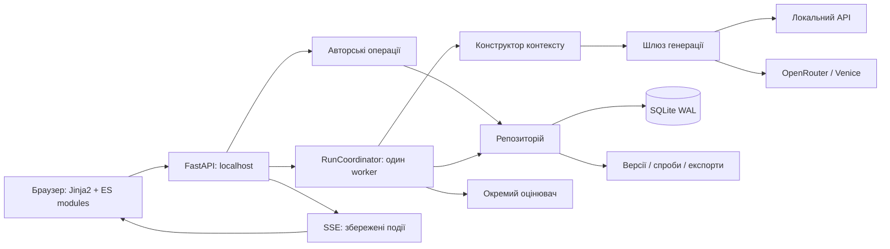

# Obscura Text Writer (Storygen) — специфікація системи

## Purpose

Storygen автоматизує створення українського оповідання за авторським планом із цільовим обсягом 5–15 тисяч слів. Автор керує сценами, моделями, редактурою та пам’яттю твору через локальний вебінтерфейс. Це специфікація реалізованої архітектури, а не початковий бріф Gemini чи перелік майбутніх можливостей.

Базову редакцію звірено з кодом на коміті `c53e669` станом на 20 жовтня 2026 року. Від цієї редакції SPEC.MD є головним джерелом правди щодо архітектури; подальші зміни документа і відповідного коду виконуються разом.

Використано формат OpenSpec: нормативні розділи `Requirement` та перевірні `Scenario` з `GIVEN / WHEN / THEN`. На запит власника всі можливості й технічні рішення зібрані в одному кореневому файлі. Це адаптація формату, без встановлення OpenSpec CLI та без твердження про відповідність його типовій структурі каталогів.

## Requirements

### Requirement: ARCH-001 — Узгодженість архітектури

Будь-яка архітектурна зміна SHALL супроводжуватися зміною SPEC.MD у тому самому наборі змін і коміті. Відомий дефект SHALL описуватися окремо від бажаного контракту.

#### Scenario: Зміна контракту збереження
- GIVEN розробник змінює схему даних або правила публікації результату
- WHEN готується завершення роботи
- THEN SPEC.MD описує нові інваріанти, сценарії та обмеження
- AND історичний план не підміняє чинну специфікацію.

### Requirement: RUNTIME-001 — Локальний застосунок

Система SHALL надавати локальний вебінтерфейс із серверним доступом до моделей і постійним сховищем у вибраному каталозі даних.

#### Scenario: Перезапуск вебсервера
- GIVEN автор зберіг твір і його версії
- WHEN сервер запускається з тим самим каталогом даних
- THEN збережені матеріали доступні без повторної генерації.

### Requirement: DATA-001 — Перевірений імпорт

Імпорт SHALL приймати непорожні UTF-8 TXT/MD файли до 2 MiB кожний, зберігати вихідні байти та створювати версії декодованого тексту.

#### Scenario: Некоректний файл у наборі
- GIVEN набір містить непідтримуваний або некоректно закодований файл
- WHEN виконується імпорт
- THEN попередня перевірка відхиляє набір до початку запису його файлів.

### Requirement: DATA-002 — Авторський контроль структури

Система SHALL дозволяти редагувати сцени та застосовувати запропоновану моделлю структуру лише окремою авторською дією. Повторний імпорт SHALL не замінювати наявні активні сцени автоматично.

#### Scenario: Підготовка структури
- GIVEN існують імпортовані матеріали
- WHEN планувальник завершує підготовку
- THEN пропозиція доступна для перегляду
- AND канон і картки персонажів не стають поточними до застосування.

### Requirement: DATA-003 — Незмінні матеріали версій

Байти збереженої версії SHALL бути незмінними. Читання SHALL перевіряти належність шляху каталогу даних і SHA-256, а поточні матеріали SHALL вибиратися через явні головні версії, а не дату створення.

#### Scenario: Пошкодження файла
- GIVEN файл версії змінено поза застосунком
- WHEN система читає його
- THEN повертається помилка цілісності замість використання зміненого тексту.

### Requirement: DATA-004 — Конкурентні зміни

Авторське збереження SHALL перевіряти очікувану ревізію. Нова модельна публікація SHALL атомарно перевіряти релевантний dependency snapshot і окремий target CAS (ID та лічильник вибору голови). Зміна використаного контексту або цілі зберігає результат альтернативою; нерелевантна зміна твору чи налаштувань ролі сама його не відхиляє. Legacy-спроба без snapshot зберігає консервативний CAS ревізій.

#### Scenario: Автор редагує сцену під час генерації
- GIVEN запит моделі вже розпочато
- WHEN автор змінює матеріали, від яких залежав запит
- THEN результат не перезаписує новіший авторський стан.

### Requirement: DATA-005 — Застарілі залежності

Заміна джерела SHALL транзитивно позначати залежні результати застарілими та відповідні сцени такими, що потребують перегляду, зберігаючи історію і головні посилання.

#### Scenario: Заміна прози
- GIVEN пам’ять залежить від поточної прози
- WHEN автор зберігає нову версію прози
- THEN попередня залежна пам’ять стає застарілою
- AND її файл залишається доступним в історії.

### Requirement: DATA-010 — Явне авторське прийняття застарілого тексту

Автор SHALL мати окремий preview тексту, змінених залежностей expected/current і наслідків прийняття для draft/edited/manual. Окрема явна дія SHALL транзакційно перевіряти власність/вид/complete/SHA-256, scene revision та fingerprint показаного baseline/diff, вибирати голову й додавати append-only рішення з новим author_text baseline. Старі байти, model input_refs/fingerprint та стани історичних alternative-спроб SHALL не переписуватися. Stale brief/memory/evaluation не мають універсального прийняття.

#### Scenario: Прийняття й гонка після preview
- GIVEN автор переглянув stale draft/prose та зміни джерел
- WHEN підтверджує за незмінного показаного стану
- THEN рішення й голова збережені разом, а пам’ять/evaluation не підтверджені автоматично
- AND зміна джерел або ревізії після preview повертає 409 без часткової зміни голови/журналу.

### Requirement: RUN-ACCEPTED — Продовження після прийнятої альтернативи

Після явного вибору актуального результату зупиненого етапу автор SHALL мати окреме продовження без повторного inference цього етапу. Предметна транзакція SHALL перевіряти стан run, точний cursor/task, останню відповідну спробу/result ID, selected head, scene revision, freshness і чинний acceptance ID за наявності рішення. Автоматичного просування від самого вибору голови немає. Cancellation та story/model refusal block SHALL не обходитися.

#### Scenario: Без повтору й підміни історії
- GIVEN remaining зупинився на alternative і автор прийняв саме цей результат
- WHEN явно продовжує після нього
- THEN лише правильний cursor просувається й наступні етапи читають актуальні входи
- AND історичний alternative лишається alternative; cancelled або змінений baseline не дозволяє продовження.

### Requirement: DATA-009 — Похідна актуальність версій

Версії з перевіреним dependency snapshot SHALL визначати актуальність порівнянням baseline з поточними релевантними selectors, refs/хешами, complete і актуальністю джерел. Публічні списки/версії/контекст/експорт SHALL використовувати цей самий resolver. Legacy stale без snapshot SHALL лишатися застарілим. Цикл, відсутнє/чуже/пошкоджене джерело не є доказом актуальності.

#### Scenario: Повернення залежностей A→B→A
- GIVEN нова версія мала перевірений baseline A
- WHEN усі релевантні залежності після зміни на B знову точно A
- THEN актуальність відновлюється без inference та переписування model input_refs
- AND target CAS активної спроби все одно відхиляє вибір її голови A→B→A.

### Requirement: DATA-006 — Кошик і відновлення

Видалення творів і сцен SHALL бути зворотним переміщенням до кошика. Звичайні операції репозиторію SHALL приховувати такі об’єкти. Архівація SHALL відхилятися за наявності незавершеного запуску.

#### Scenario: Експорт архівного твору
- GIVEN твір перебуває в кошику на початку SQL-знімка експорту
- WHEN автор запитує експорт, зокрема з `allow_incomplete=true`
- THEN API повертає 404
- AND нові файли експорту не створюються.

#### Scenario: Відновлення сцени
- GIVEN сцена в кошику, а твір активний
- WHEN автор відновлює сцену
- THEN вона повертається на збережену або найближчу допустиму позицію
- AND матеріали, залежні від зміненої послідовності, потребують перегляду.

### Requirement: DATA-007 — Ручна чернетка

Автор SHALL мати можливість вставити або змінити чернетку й зберегти її як нову поточну `draft`-версію без виклику моделі. Збереження SHALL перевіряти ревізію, відхиляти порожній текст і позначати залежні результати застарілими.

#### Scenario: Вставлення зовнішнього тексту
- GIVEN автор відкрив вкладку «Чернетка», зокрема без раніше створеної чернетки
- WHEN він вставляє непорожній текст і натискає «Зберегти»
- THEN текст дослівно зберігається в новій головній draft-версії
- AND він доступний редактору як чернетка, а не підміняє фінальну прозу.

#### Scenario: Конфлікт ручної чернетки
- GIVEN інша вкладка вже змінила ревізію сцени
- WHEN автор зберігає чернетку зі старою ревізією
- THEN сервер повертає 409, зберігаючи надіслану версію в історії
- AND актуальна голова чернетки не замінюється.

### Requirement: DATA-008 — Прийняття збереженої чернетки

Автор SHALL мати можливість зробити завершену незастарілу draft-версію тієї самої сцени поточною через історію без копіювання тексту й нового модельного виклику. Дія SHALL перевіряти ревізію й інвалідовувати залежності попередньої голови.

#### Scenario: Прийняття альтернативи
- GIVEN генерація зберегла завершену draft-версію, яка не стала головною
- WHEN автор обирає її в історії та натискає «Прийняти чернетку»
- THEN поточна голова вказує на той самий ID версії
- AND вкладка «Чернетка» показує прийнятий текст.

### Requirement: MODEL-001 — Чотири незалежні ролі

Планувальник, письменник, редактор і пам’ять SHALL мати окремі налаштування моделі, провайдера та промпту. Інтерфейс SHALL також дозволяти атомарно зберегти спільного провайдера й модель для чотирьох ролей, зберігши інші рольові параметри.

#### Scenario: Одна модель для всіх ролей
- GIVEN ролі мають різні промпти й ліміти
- WHEN автор застосовує спільну модель
- THEN усі чотири ролі використовують її
- AND їхні окремі промпти та режими зберігаються.

### Requirement: MODEL-002 — Явний виклик провайдера

Генерація SHALL використовувати налаштовану модель без прихованого перемикання провайдера, автоматичного повтору SDK або заміни авторського тексту через тематичний фільтр застосунку.

#### Scenario: Відмова провайдера
- GIVEN провайдер повертає відмову або помилку
- WHEN завершується спроба
- THEN запуск показує відповідний результат
- AND інша модель не викликається автоматично.

### Requirement: MODEL-003 — Каталог Venice

Генерація через Venice SHALL дозволяти лише текстові моделі з явним `uncensored=true` і без `offline=true`. Ця перевірка SHALL діяти також для вручну введеного ID.

#### Scenario: Невідповідна модель Venice
- GIVEN вибраний ID не проходить перевірку каталогу
- WHEN готується генерація
- THEN платний запит завершення не надсилається.

### Requirement: PIPE-001 — Послідовність сцени

Повний запуск сцени SHALL виконувати завдання планувальника, чернетку письменника, редактуру та оновлення пам’яті послідовно. Окремі етапи SHALL запускатися самостійно за виконаних передумов.

#### Scenario: Повна сцена
- GIVEN сцена має потрібний план і налаштовані ролі
- WHEN запускається повний workflow
- THEN етапи виконуються в порядку `brief → draft → edit → memory`
- AND автоматичне оцінювання виконується після пам’яті, якщо ввімкнене.

### Requirement: PIPE-002 — Один виконавець на каталог

Система SHALL послідовно виконувати завдання всіх творів у межах одного каталогу даних і блокувати запуск другого виконавця для цього каталогу.

#### Scenario: Два вебсервери
- GIVEN один виконавець уже володіє блокуванням каталогу
- WHEN другий намагається використати той самий каталог
- THEN він не починає конкурентно виконувати чергу.

### Requirement: PIPE-003 — Ідемпотентне створення запуску

Повторне надсилання того самого `request_id` і запиту SHALL повертати існуючий запуск. Інший запит із цим ID SHALL отримувати конфлікт.

#### Scenario: Відповідь на створення запуску втрачена
- GIVEN браузер не отримав підтвердження
- WHEN він повторює той самий запит з тим самим ID
- THEN друга модельна операція не створюється.

### Requirement: PIPE-004 — Відновлення після збою

Після перезапуску незавершені активні запуски SHALL отримувати стан перерваних. Повтор невизначеної спроби SHALL вимагати явного підтвердження, а не відбуватися автоматично.

#### Scenario: Збій під час платного запиту
- GIVEN процес завершився без остаточного результату спроби
- WHEN виконавець знову запускається
- THEN стан відновлюється як перерваний
- AND повтор запиту не приховує ризику повторної оплати.

### Requirement: PIPE-005 — Пауза і скасування

Пауза SHALL діяти на межі етапів. Скасування SHALL перевірятися між етапами й під час читання потоку; воно SHALL не трактувати частковий текст як завершену версію.

#### Scenario: Скасування потокової генерації
- GIVEN модель уже надсилає текст
- WHEN виконавець помічає запит скасування
- THEN частковий матеріал залишається діагностичним
- AND не стає поточною прозою.

Скасування SHALL не змінювати payload або журнал для completed/failed/cancelled та повторного cancellation_requested. Для queued результат — cancelled; running/pause_requested — cancellation_requested. Для paused/interrupted/needs_review/alternative результат — cancelled зі збереженням error, cursor, текстів і версій. Повторна пауза також не створює зайвих подій.

#### Scenario: PIPE-005-CANCEL-FINISHED — Повторне скасування
- GIVEN запуск завершено, він невдалий або вже скасований
- WHEN надходить cancel
- THEN стан, діагностика, cursor та журнал подій не змінюються.

#### Scenario: PIPE-005-CANCEL-STOPPED — Скасування зупиненого запуску
- GIVEN запуск paused/interrupted/needs_review/alternative
- WHEN автор обирає cancel
- THEN запуск стає cancelled без видалення матеріалів.

### Requirement: PIPE-006 — Перевірка завершення

Прийняття генерації SHALL вимагати непорожньої відповіді, коректного завершення `stop`, відсутності відмови та валідності очікуваної структури. Усічення через ліміт SHALL бути помилкою.

#### Scenario: Вичерпано вихідні токени
- GIVEN провайдер повернув `finish_reason=length`
- WHEN перевіряється відповідь
- THEN вона не публікується як завершений етап.

### Requirement: PIPE-007 — Слід виконання

Спроба SHALL зберігати контекст і налаштування до виклику моделі, часткову відповідь у checkpoint під час потоку та результат перевірки після нього.

#### Scenario: Невалідний JSON
- GIVEN модель повернула синтаксично неправильну структуру
- WHEN перевірка завершується помилкою
- THEN сирий результат доступний для діагностики
- AND система не виправляє його приховано іншою моделлю.

Потік генераційних етапів SHALL записувати partial пакетами дозаписом: поріг 16384 UTF-8-байтів або 0,5 секунди, перевірений при наступній непорожній delta. Перед збереженням пакетної події SHALL виконуватися flush/fsync файла; seq призначається SQL-транзакцією. При звичайному завершенні, скасуванні або винятку шлюзу хвіст SHALL скидатися перед фінальним станом. Помилка checkpoint забороняє публікацію результату й не повторюється автоматично.

#### Scenario: PIPE-007-BATCH — Дрібні фрагменти
- GIVEN 1000 delta по 10 ASCII-байтів і незмінний годинник
- WHEN потік завершується
- THEN точний текст збережено з не більш як трьома записами partial, fsync та транзакціями delta.

#### Scenario: PIPE-007-CRASH — Незбережений хвіст
- GIVEN checkpoint завершений і новий хвіст залишається в RAM
- WHEN процес аварійно завершується без finally
- THEN хвіст може бути втрачений, а partial не стає завершеною версією.

#### Scenario: PIPE-007-REPLAY — Повторне підключення
- GIVEN клієнт уже отримав пакетну подію з seq N
- WHEN він підключається з after або Last-Event-ID N
- THEN сервер повертає лише зафіксовані події з більшими seq без повторення тексту.

#### Scenario: PIPE-007-UTF8 — Читання під час дозапису
- GIVEN читач partial бачить лише початок останнього UTF-8 символу
- WHEN виконується GET стану запуску
- THEN повертається повний коректний префікс без помилки декодування
- AND сирий файл не змінюється.

### Requirement: CONTEXT-001 — Явний бюджет контексту

Конструктор контексту SHALL перевіряти ліміт символів і оцінку токенів із резервом відповіді до модельного виклику. Матеріали SHALL не обрізатися приховано.

#### Scenario: Контекст завеликий
- GIVEN оцінка входу перевищує `context_tokens - max_output_tokens`
- WHEN формується етап
- THEN система пояснює перевищення без відправлення цього запиту моделі.

### Requirement: CONTEXT-002 — План і вже написані події

Контекст SHALL відрізняти майбутні плани від підтверджених подій і використовувати пам’ять попередніх сцен та обмежений хвіст попередньої прози замість безумовного додавання всього твору.

Для сцени n SHALL читатися лише перевірена пам’ять n−1, навіть якщо n та
наступні сцени вже мають готові матеріали. Джерела пам’яті SHALL точно
відповідати вибраній прозі попереднього префікса у порядку сцен. Літературна
секція пам’яті SHALL містити детерміновану проєкцію без технічних IDs/цитат;
повні докази й refs залишаються на сервері.

#### Scenario: Написання другої сцени
- GIVEN перша сцена має прозу та актуальну пам’ять
- WHEN готується контекст письменника
- THEN попередні події представлені пам’яттю й хвостом тексту
- AND майбутні сцени позначені як плани.

#### Scenario: Повтор ранньої сцени після завершення твору
- GIVEN усі сім сцен мають прозу й пам’ять
- WHEN формується brief/draft/prose-edit сцени 2
- THEN секція пам’яті містить лише відомості зі сцени 1
- AND жодна пам’ять сцени 2 або наступних не вибирається за датою завершення.

### Requirement: CONTEXT-003 — Вибрана проза, підтверджена пам’яттю

Контекст SHALL фіксувати точні ID вибраної прози, допустимої через перевірену актуальну пам’ять. Етап memory спирається на вибрані тексти/хеші префікса й поточної сцени та їхні авторські baseline IDs; літературна застарілість цієї прози через непрочитані майбутні плани не створює конфлікту пам’яті. Це не є літературним прийняттям прози. Зміна релевантних selectors/джерел і target CAS SHALL зберігати захист публікації; legacy-спроби також перевіряють ревізії.

#### Scenario: Застарілість перед початком
- GIVEN актуальна пам’ять дослівно підтверджена тими самими вибраними версіями прози
- AND одна з цих версій уже позначена stale до побудови контексту
- WHEN генерація завершується без зміни релевантних входів або target CAS
- THEN результат стає поточним автоматично
- AND вихідна проза залишається stale й потребує авторського перегляду.

#### Scenario: Нове застарівання під час виклику
- GIVEN джерело було актуальним на початку генерації
- WHEN воно або використана пам’ять стає застарілим до публікації
- THEN результат зберігається як альтернатива.

### Requirement: MEMORY-001 — Походження пам’яті

Пам’ять SHALL посилатися на точний упорядкований набір обраних версій прози до поточної сцени включно. Кожний запис SHALL мати джерело й дослівну цитату. Ручне збереження SHALL не переприв’язувати цитати до інших версій автоматично.

#### Scenario: Ручне збереження зі старими джерелами
- GIVEN JSON пам’яті називає інший набір джерел, ніж поточний
- WHEN автор зберігає його
- THEN система відхиляє некоректні дані без зміни походження записів.

### Requirement: MEMORY-002 — Пам’ять через фрагменти

У режимі `evidence_delta` модель SHALL повертати schema_version=2/operations з
add/update/retire та ID фрагментів поточної прози. Сервер SHALL підставляти
джерела/цитати, зберігати повний журнал і застосовувати всі операції атомарно.
Update/retire дозволені лише для активних character_states/open_threads зі
сталими claim ID/category/scope; facts/timeline мають лише add. До 12 операцій
і до трьох add на категорію; target не змінюється двічі за відповідь.

#### Scenario: Невідомий фрагмент
- GIVEN доповнення містить ID, якого немає у поточному документі
- WHEN перевіряється відповідь
- THEN пам’ять не публікується.

### Requirement: MEMORY-003 — Історія та сумісність пам’яті

M[n] SHALL будуватися з M[n−1] та доказової поточної прози, зберігаючи всі
events попереднього префікса. Ручне збереження v1/v2 SHALL створювати нову v2
версію після перевірки ревізії, префікса, цитат і поточних операцій. Воно не
переписує старі bytes та не підтверджує пам’ять після авторського прийняття прози.

#### Scenario: Змінений стан і закрита лінія
- GIVEN попередній claim активний
- WHEN прийнято доказовий update або retire
- THEN чинна проєкція відображає новий стан або закриття
- AND усі попередні події та їхні докази лишаються в журналі.

#### Scenario: Legacy-протокол після v2
- GIVEN старий snapshot-промпт отримав сумісний active view
- WHEN він повертає коректні add-only доповнення
- THEN сервер зберігає повний попередній журнал включно з retired events
- AND невалідна v2-відповідь не переходить приховано до іншого parser чи inference.

### Requirement: EDIT-001 — Обмежена точкова редактура

Режим `patches` SHALL застосовувати лише перевірені локальні заміни з однозначними якорями, без перетинів і переносів рядка, зі збереженням чисел і заперечень та обмеженням сумарного обсягу змін.

#### Scenario: Неоднозначний якір
- GIVEN оригінальний фрагмент заміни повторюється в зазначеному рядку
- WHEN перевіряються правки
- THEN увесь результат відхиляється замість довільного вибору місця.

### Requirement: UI-001 — Передумови workflow

Інтерфейс SHALL вимикати недоступні операції з поясненням причини, а сервер SHALL незалежно перевіряти передумови.

#### Scenario: Незбережені ручні зміни
- GIVEN у редакторі є змінений буфер
- WHEN відображаються операції генерації
- THEN вони недоступні до збереження або скидання змін.

### Requirement: UI-002 — Безпека редакторського буфера

Буфер SHALL бути прив’язаний до ревізії; завершення фонового збереження або оновлення даних SHALL не стирати введений пізніше текст чи відкриту історичну версію. Чистий буфер поточної чернетки або пам’яті SHALL оновлюватися після зміни її головної версії.

#### Scenario: Введення під час збереження
- GIVEN запит збереження попереднього тексту ще триває
- WHEN автор вводить новий текст
- THEN відповідь на попереднє збереження не позначає новий текст збереженим.

### Requirement: UI-003 — Достовірний стан виконання

Потокові події SHALL доповнювати авторитетний стан запуску із сервера. Перезавантаження сторінки SHALL не скасовувати серверну роботу й не відновлювати застарілий стан із давніх подій.

#### Scenario: Відкриття завершеного запуску
- GIVEN запуск уже завершився
- WHEN браузер знову відкриває його
- THEN показуються остаточний стан і доступний частковий результат
- AND таймер не продовжує рахувати активний виклик.

### Requirement: UI-004 — Зрозумілі повідомлення

Успіх, помилка, попередження та інформація SHALL візуально й семантично відрізнятися. Підтвердження операції SHALL перелічувати лише залучені до неї ролі та активний оцінювач.

#### Scenario: Оновлення пам’яті
- GIVEN викликається лише етап пам’яті
- WHEN показується підтвердження
- THEN воно не перелічує моделі письменника, редактора і планувальника як учасників цього виклику.

### Requirement: UI-005 — Оновлення ресурсів інтерфейсу

Локальний сервер SHALL встановлювати `Cache-Control: no-store` для відповідей після перевірки локального доступу, включно з HTML, CSS, усіма ES-модулями та conditional GET. Наступне завантаження сторінки SHALL не покладатися на збережену за цією політикою стару копію інтерфейсу.

#### Scenario: Оновлення JavaScript
- GIVEN код інтерфейсу змінено, а браузер раніше отримав його з політикою no-store
- WHEN автор заново завантажує сторінку
- THEN браузер отримує актуальні entrypoint і відносно імпортовані модулі з сервера.

### Requirement: UI-006 — Брендинг і представлення назв

Вебінтерфейс SHALL використовувати назву Obscura Text Writer (коротко Obscura), SVG-іконку пера із замковою шпариною та спільні токени винного акценту, пергаментних поверхонь і бурштинового індикатора локальної роботи. Триколонкова структура робочого простору SHALL зберігатися на широких екранах, адаптуючись до вузьких. Активний матеріал SHALL мати видиме та семантичне позначення.

#### Scenario: Заголовок вкладки браузера
- GIVEN автор відкриває бібліотеку або твір
- WHEN сервер формує HTML
- THEN бібліотека має title `Obscura Text Writer`, а твір — `<Назва твору> — Obscura`
- AND усі сторінки містять метадані застосунку та `/static/favicon.svg`.

#### Scenario: Markdown у назві сцени
- GIVEN назва містить початковий Markdown-заголовок або маркери `**` чи `__`
- WHEN браузер показує список сцен і заголовок редактора
- THEN ці маркери не відображаються в назві
- AND збережена назва, авторський текст, API, історія та експорт не переписуються.

#### Технічний опис і сумісність

`displaySceneTitle` у `editor.js` прибирає початковий ATX-префікс (`#`–`######` із пробілом) і парні символи `**`/`__` лише з видимого заголовка через `textContent`; HTML не інтерпретується. Вкладки матеріалів використовують `aria-pressed`, список сцен — `aria-current`. Токени у `app.css` мають світлу палітру за замовчуванням і варіант `[data-theme="dark"]`; перемикач теми й автоматичний вибір за ОС не додаються. У темній палітрі другорядний текст і текст акцентних контролів освітлені для читабельності. Іконка постачається як пакетний SVG-ресурс, спільний для header і favicon. Міграції даних та нові зовнішні залежності не потрібні. Усунуте відхилення: сирі Markdown-маркери у видимих назвах сцен; вихідні матеріали залишаються дослівними. Візуальні правила записані в DESIGN.md; архітектурні контракти визначає ця специфікація.

### Requirement: EVAL-001 — Відокремлене оцінювання

Оцінювач SHALL формувати структурований звіт із критеріями, доказами, покриттям, налаштуваннями та результатом перевірки. Самооцінка генератора SHALL не вважатися доказом літературного приймання.

#### Scenario: Непідтверджена цитата
- GIVEN звіт посилається на відсутній текст або джерело
- WHEN виконується перевірка звіту
- THEN така оцінка не зараховується як повне підтверджене оцінювання.

### Requirement: EVAL-002 — Калібрування

Некалібрований профіль SHALL давати лише попередні висновки з формальним станом `incomplete`. Політика зупинки за негативною оцінкою SHALL вимагати перевіреного калібрування відповідного профілю.

#### Scenario: Змінений промпт оцінювача
- GIVEN калібрування виконано для попереднього відбитка налаштувань
- WHEN промпт змінено
- THEN старе калібрування не підтверджує новий профіль.

### Requirement: EVAL-003 — Вимкнення оцінювача

Політика `off` SHALL забороняти ручне оцінювання в інтегрованому workflow і пропускати автоматичне оцінювання, зокрема наступні вікна ще не завершеного багатовіконного запуску.

#### Scenario: Ручне тестування без оцінки
- GIVEN оцінювач вимкнено для твору
- WHEN завершуються етапи сцени
- THEN дані не надсилаються оцінювачу автоматично.

### Requirement: EVAL-004 — Покриття великого твору

Оцінювання SHALL фіксувати неперевірені вимоги та обмежене покриття. Поділ завеликого твору на вікна SHALL не представляти далекі сюжетні зв’язки як повністю перевірені.

#### Scenario: Твір не вміщується в символьний бюджет
- GIVEN повний текст завеликий для одного оцінювання
- WHEN будуються вікна за сценами
- THEN звіт позначає непокриті зв’язки
- AND відсутність перевірки не прирівнюється до успіху.

### Requirement: EVAL-005 — Відмова і фактична причина помилки

Оцінювач SHALL розрізняти refused, error, incomplete та літературні passed/failed. Явна API/структурована/розпізнана текстова відмова SHALL не створювати балів або preliminary_verdict. Технічна помилка SHALL показувати відому причину, HTTP status, provider code/type/request ID та безпечне пояснення, якщо вони надані. Ключі, Authorization, raw stderr/HTTP body і відлуння запиту не публікуються як діагностика. Невідома причина прямо позначається невідомою.

#### Scenario: EVAL-005-CAUSE — Помилка квоти
- GIVEN провайдер явно повідомляє insufficient_quota
- WHEN runner формує результат
- THEN status=error з причиною квоти й доступними кодами, а не refused або літературним failed.

#### Scenario: EVAL-005-REFUSAL — Явна відмова
- GIVEN модель явно відмовила через контент або без пояснення
- WHEN формується outcome
- THEN status=refused, без літературних балів; сирий результат і usage зберігаються за наявності.

### Requirement: EVAL-006 — Постійне блокування оцінювача для твору

Контентна або непояснена явна відмова SHALL блокувати identity оцінювача для цього твору до будь-якого наступного виклику, включно з наступними вікнами, сценами, чергою, resume/retry та рестартом. Захист SHALL записуватися до partial і звітів; їхня помилка не скасовує вже записаного блокування. Помилка запису захисту зупиняє виконання. Технічні error не блокують identity як контентну відмову.

#### Scenario: EVAL-006-RESTART — Повтор після відмови
- GIVEN story/model заблоковано після refused
- WHEN змінено промпт/температуру, виконано off/on, restart або retry
- THEN ця модель не отримує нових викликів для твору; причина доступна користувачу.

#### Scenario: EVAL-006-IO — Недоступний partial після відповіді
- GIVEN відмову вже отримано, а запис partial або звіту падає
- WHEN користувач повертається до запуску
- THEN стійке блокування вже існує й повторний запит заборонено.

### Requirement: EVAL-007 — Політики workflow та придатність профілю

У report refused/error/incomplete SHALL давати збережене warning й дозволяти наступні сцени без позначки успішного оцінювання. Заблоковані оцінки пропускаються без API. У pause_on_failure непозитивний результат дає паузу; блокування не обходиться явним повтором. Storage failure та alternative не маскуються політикою report.

#### Scenario: EVAL-007-REPORT — Текст не оцінено
- GIVEN report-workflow отримав технічну помилку
- WHEN переходить до наступного етапу
- THEN запуск може продовжитися з Run.warning, а результат оцінки лишається error.

Допуск SHALL вимагати канонічного набору v2: 10 нейтральних і 6 дорослих синтетичних прикладів (ню, взаємна доросла близькість без графічного сексу, помірне неграфічне насильство; чистий і дефектний варіант кожної категорії), щонайменше три незалежні повтори кожного та нуль refused на всьому наборі разом із чинними якісними порогами. Зміна suite/config/prompt/rubric інвалідовує допуск; старі звіти не стають v2-придатними автоматично.

#### Scenario: EVAL-007-CALIBRATION — Один refused у контрольному наборі
- GIVEN якісні метрики достатні, але один контрольний запуск refused
- WHEN реєструється калібрування
- THEN профіль не допускається.

### Requirement: EXPORT-001 — Відтворюваний експорт

Кнопка «Опублікувати» SHALL розташовуватися в кінці розділу «Контекст твору». Після створення MD/TXT посилання на завантаження твору та маніфесту SHALL з’являтися безпосередньо під кнопкою; повторна публікація замінює попередні посилання в поточній сторінці. Це створення локального експорту, без розміщення у відкритому доступі.

#### Scenario: Посилання після публікації
- GIVEN автор відкрив активний твір із прозою
- WHEN автор успішно виконує «Опублікувати»
- THEN посилання на файли показані під кнопкою в кінці «Контексту твору» й не залежать від перемикання сцени.

Експорт SHALL використовувати обрані головні версії прози зі знімка БД та створювати MD/TXT із маніфестом походження. Відомі ознаки неповноти SHALL вимагати `allow_incomplete` і явного маркування результату.

Експорт SHALL включати лише активні сцени активного твору, зафіксовані разом з ревізією й метаданими prose-head в одній read-транзакції. `allow_incomplete` SHALL не обходити перевірку кошика або SHA-256.

#### Scenario: Сцена в кошику
- GIVEN активний твір містить активні й архівні сцени
- WHEN формується MD або TXT
- THEN архівні сцени відсутні в тексті, маніфесті, попередженнях і підрахунку слів.

#### Scenario: Конкурентна зміна після початку знімка
- GIVEN експортер уже зафіксував read snapshot твору
- WHEN автор змінює голову прози або архівує сцену
- THEN експорт використовує початкові ревізію, порядок сцен і головні версії
- AND не змішує старі й нові дані.

#### Scenario: Відсутня проза сцени
- GIVEN знімок містить сцену без поточної прози
- WHEN автор не дозволив неповний експорт
- THEN експорт відхиляється з поясненням.

### Requirement: SECURITY-001 — Локальна межа доступу

HTTP-застосунок SHALL обслуговувати loopback-хости та відхиляти змінювальні запити з чужим `Origin`, якщо цей заголовок присутній. Це SHALL не трактуватися як автентифікація користувачів.

#### Scenario: Чужий сайт змінює локальні дані
- GIVEN запит має інший Origin, ніж адреса застосунку
- WHEN викликається змінювальний API
- THEN сервер повертає 403.

### Requirement: SECURITY-002 — Ключі поза даними ролей

Налаштування SHALL зберігати назву змінної середовища, а не значення API-ключа. Ключі SHALL залишатися на сервері й не передаватися браузеру як конфігурація ролі.

#### Scenario: Перегляд налаштувань
- GIVEN сервер має ключ із `.env`
- WHEN інтерфейс отримує конфігурацію
- THEN відповідь не містить секретного значення.

### Requirement: CONTENT-001 — Українська проза і авторський матеріал

Стандартні промпти SHALL вимагати української мови й авторських стильових правил. Застосунок SHALL не впроваджувати окремого тематичного цензурування; обмеження й відмови самого провайдера SHALL залишатися видимими.

#### Scenario: Провайдер змінює поведінку
- GIVEN той самий авторський матеріал більше не приймається моделлю
- WHEN провайдер відмовляє
- THEN система повідомляє про невдалу спробу без прихованого обходу чи підміни моделі.

## Architecture

### A1. Межі компонентів і виконання

- Python >=3.10; пакет `storygen` 0.1.0; setuptools. Базові залежності: OpenAI SDK 2.x, Pydantic 2.x, python-dotenv 1.x, httpx 0.x (`>=0.28,<1`). Web extra додає FastAPI, Uvicorn, Jinja2, python-multipart. Pytest і Playwright належать до перевірок, а не робочого конвеєра.
- Команда `storygen` викликає `storygen.server:main`; `storygen-eval` — `storygen.evaluation.cli:main`. Сервер приймає `--data-dir`, `--env-file`, `--port`, `--open-browser`; типово це `./data`, `./.env`, порт 8765. Uvicorn працює на `127.0.0.1` з одним процесом.
- `.env` завантажується під час запуску; зміна ключів потребує перезапуску. Браузер звертається тільки до локального API, не до API моделей. Фронтенд — HTML/CSS і звичайні JS-модулі, без обов’язкового frontend build service.
- FastAPI lifespan керує worker-потоком. ОС-блокування `worker.lock` (`msvcrt` Windows, `flock` Unix) береться до відновлення черги. Окремі каталоги даних можуть мати окремих виконавців.
- Шаблони, статичні файли, системні промпти, JSON-схеми й SQL-міграції входять до ресурсів пакета.

### Requirement: STORAGE-BOUNDARY — Предметні транзакції сховища

Production-шари поза storage SHALL використовувати публічні предметні операції Repository без прямого SQL, repo.db або приватних методів репозиторію. Storage SHALL не імпортувати generation; спільні RunRequest/Run/RunEvent визначені в незалежному run_models. Валідація літературних схем залишається у сервісах. Універсального SQL API чи зовнішнього callback усередині транзакції немає.

#### Scenario: STORAGE-ROLLBACK
- GIVEN пакет ролей, blueprint, зміна плану/порядку чи відновлення з кошика
- WHEN CAS або перевірка власності/виду матеріалу відхиляє операцію
- THEN SQL-голови, порядок, налаштування й інвалідація не змінюються частково
- AND створені перед транзакцією незмінні файли версій можуть залишитися невибраними.

#### Scenario: STORAGE-EVENT-SEQUENCE
- GIVEN два паралельні записи подій одного запуску
- WHEN Repository додає події
- THEN seq призначається разом із INSERT у BEGIN IMMEDIATE і replay має унікальний зростаючий порядок.

### A2. Домен, версії та сховище

Моделі Pydantic суворі: зайві поля заборонені, нечислові нескінченності не приймаються. ID — UUID4 у hex-поданні, час — UTC ISO. `Story` має назву, цільовий обсяг, ревізію та config_revision (default 0), посилання на стиль/канон/картки персонажів і прапорець кошика. `Scene` має твір, позицію, назву, біти, персонажів, цільовий обсяг, ревізію, головні версії, head_revisions (default {}, відсутній лічильник 0), `needs_review` та дані кошика. Обсяг твору: 5000–15000, типово 7000 слів; сцени: 1–15000, типово 1000. Це планові значення, без жорсткого контролю довжини фактичної генерації.

Версія містить ID, власника-твір і необов’язкову сцену, вид, формат, шлях, SHA-256, вхідні посилання, запуск-джерело, `complete`, `stale`, optional dependency_snapshot (default null), дату. Види: `source_plan`, `source_characters`, `character_cards`, `scene_plan`, `canon`, `style`, `prompt`, `brief`, `draft`, `edited`, `manual`, `memory`, `evaluation`. Окремого класу SourceVersion немає: імпорт — звичайні версії плюс `source_files`.

| Головний матеріал сцени | Допустимий вид версії |
| --- | --- |
| plan | scene_plan |
| brief | brief |
| draft | draft |
| prose | edited або manual |
| memory | memory |

Байти версій незмінні, але метадані застарілості змінюються; застосування структури може прив’язувати підготовлену версію плану до сцени. Структуровані brief/style/cards/memory/evaluation записуються JSON; решта переважно TXT. Шляхи перевіряються після розв’язання відносно data-dir. Запис файла: унікальний ексклюзивний тимчасовий файл, flush/fsync, replace; читання перевіряє хеш. SHA-256 забезпечує цілісність, а не дедуплікацію за вмістом.

SQLite: `storygen.sqlite3`, WAL, foreign keys ON, busy timeout 5 секунд, окремі з’єднання операцій. Таблиці: `stories`, `scenes`, `versions`, `dependency_edges`, `role_settings`, `runs`, `stage_attempts`, `run_events`, `source_files`, `app_settings`. JSON payload доповнюється індексованими/FK-полями; унікальні позиції сцен у творі, `request_id` запусків та порядкові номери подій. Схема керується `PRAGMA user_version`: початкова міграція 0→1, друга 1→2 додає поля кошика до JSON; міграції транзакційні, невідомі версії відхиляються.

Публікація головної версії перевіряє власника, вид, завершеність, свіжість, хеш і очікувану ревізію; оновлює ревізії та транзитивно інвалідовує залежності попередньої голови, виключаючи її заміну. Звичайна інвалідація не видаляє голови, файли й не збільшує ревізію кожної залежної сцени. Зміна загальних авторських матеріалів позначає brief/draft/edited/memory/evaluation застарілими й сцени `needs_review`; ручна проза не включена до цього масового переліку. Зміни конфігурації ролей/evaluator збільшують config_revision і legacy ревізію твору; ролі змінюють майбутні відбитки, але не масово інвалідовують уже прийняті результати.

Repository делегує авторські транзакції storage/authoring.py, ролі/evaluator/calibration/refusal blocks — storage/settings_store.py, run/event/recovery — storage/run_store.py. Транзакційна інвалідація зосереджена в storage/invalidation.py. Авторський сервіс створює й перевіряє літературні payload, storage повторно перевіряє CAS і власність/вид посилань. Збереження спільного провайдера атомарно записує пакет чотирьох ролей. Окремої SQL-міграції для цього перенесення немає (схема 2).

Файлова система і SQL не мають спільної транзакції: файл, записаний перед конфліктом/збоєм SQL, може лишитися без активного посилання. Автоматичного GC, безповоротного purge, шифрування чи хмарної синхронізації немає.

DependencySnapshot v1 містить scope, типізовані finite selectors (story/scene/head/source/order), expected значення з явним null, refs→SHA-256, релевантний scene_order та явні допустимі stale prose IDs; ref_baselines фіксує acceptance ID кожного джерела (null до першого прийняття). Невідома версія/scope/поле відхиляється. Історичні input_refs і dependency_edges не переписуються. Останнє author acceptance рішення за порядком вставлення є чинним baseline версії й не переписує її оригінальний snapshot. Resolver повертає stale, baseline_id та структуровані причини expected/current. Для нових baseline stored stale є лише legacy-сигналом інвалідації, а поточна істина виводиться з залежностей; для legacy він лишається консервативним. needs_review вибраної нової прози виводиться з її актуальності, legacy стан зберігається. Доповнення JSON не змінюють user_version=2.

### A3. Авторські операції та кошик

- Імпорт спершу перевіряє всі файли, потім зберігає raw-байти й декодовані версії. Для поточного імпортованого джерела відповідного виду береться останній запис `source_files`. Увесь багатофайловий імпорт і створення сцен не є однією атомарною транзакцією.
- Поділ плану розпізнає українські заголовки `Сцена N.` / `Сцена N:` з необов’язковими Markdown `#`; без заголовків створюється одна сцена. Автоматичне створення працює лише за відсутності активних сцен; обсяг розподіляється рівномірно.
- `StoryBlueprint` містить канон, картки персонажів із цитатами джерел, щонайменше одну сцену й попередження. Цитата картки має дослівно існувати у вихідному плані/персонажах того самого твору. Застосування зберігає версії до фінальної перевірки ревізії; оновлення покажчиків і інвалідація транзакційні. Початкові версії планів із blueprint зараз не мають ребер до імпортованого джерела.
- Список перестановки містить усі активні scene ID рівно один раз; перевіряється ревізія твору. Ручні зміни створюють версії перед CAS-публікацією, тому конфлікт може залишити невибрану версію.
- Ручна чернетка зберігається через `POST /api/scenes/{scene_id}/draft` (`text`, `expected_revision`); відповідь містить `version` і `scene`, як для ручної прози. Авторський текст має вид draft, порожні `input_refs`, `source_run_id=null`; він не приписується моделі або непідтвердженому джерелу. Публікація використовує звичайний `set_head`, тому залежні від попередньої чернетки edited/memory/evaluation стають stale. Поточна вкладка чернетки підтримує збереження та захист введення під час запиту; перегляд сирої історичної draft-версії лишається режимом history без прямого збереження. Передумови запуску редактора не змінені: режим prose додатково потребує brief, режим patches — чернетки.
- Прийняття наявної чернетки: `POST /api/scenes/{scene_id}/accept-draft` (`version_id`, `expected_revision`) повертає сцену після `set_head`. Версія повинна бути draft тієї самої сцени, complete і не stale; повторного запису її тексту та нового модельного виклику немає. Кнопка історії недоступна для інших видів, неготових/застарілих версій, під час збереження або за незбережених правок; сервер незалежно перевіряє власність, вид, цілісність і CAS. Прийняття не переписує історичний результат запуску alternative як нібито автоматично completed.
- Стиль типово має третю особу, минулий час, українську та тире в діалогах; жанр і тон не нав’язані. `previous_tail_chars=1200`, допустимо 0–12000.
- Кошик зберігає дані, версії й історію запусків. Архівація заборонена за будь-якого стану запуску, крім completed/failed/cancelled, включно з paused/interrupted. Архівація твору не скидає окрему архівацію сцен; перед відновленням сцени треба відновити твір.
- Активні сцени мають суцільний порядок, архівні стоять після них; перебудова використовує тимчасові від’ємні позиції. Відновлення бере `min(збережена позиція, кількість активних)`. Зміна меж послідовності інвалідовує пізніші матеріали, включно з ручними, збільшує ревізії відповідних сцен і лишає головні посилання для перегляду.

Авторське прийняття: Repository.preview_acceptance повертає текст, expected scene revision, список DependencyChange, новий baseline та SHA-256 fingerprint показаного стану. commit під BEGIN IMMEDIATE повторює preview і перевіряє fingerprint/ревізію/файл. Журнал app_settings має ключ acceptance:<story_id>:<acceptance_id>, AcceptanceRecord із version/scene/story, датою, accept_draft/accept_prose, optional note, baseline і previous_baseline_id. Записи лише додаються; чинний останній для версії. author_text baseline фіксує поточні авторитетні матеріали/джерела, плани, metadata сцени й порядок без заяви, що модель їх читала. Звичайне ручне збереження не створює прихованого acceptance; його попередній контракт збережено. Прийняття змінює head_revision і legacy revision, інвалідовує похідні, а ref_baselines не дозволяє старій пам’яті/evaluation автоматично стати fresh через саме прийняття того самого prose ID.

### A4. Конфігурація моделей і шлюз генерації

| Провайдер | Base URL | Ключ / timeout |
| --- | --- | --- |
| local | типовий `http://localhost:1235/v1`; лише HTTP loopback, шлях `/v1` | dummy `local-server`; 3600 с |
| openrouter | тільки `https://openrouter.ai/api/v1` | типово `OPENROUTER_API_KEY`; 180 с |
| venice | тільки `https://api.venice.ai/api/v1` | типово `VENICE_API_KEY`; 180 с |

URL із credentials/query/fragment відхиляються. Ім’я змінної ключа можна налаштувати; значення не зберігається у ролі. ID моделі обов’язковий, не є константою `local-model`. Кожна роль має власний provider/model, системний промпт-версію, контекстний і вихідний бюджет, температуру, stop-послідовності, режими.

Типові рольові параметри: context 8192, output 2048 токенів, max input 80000 символів, temperature 0.7 у діапазоні 0–2; output строго менший context; до чотирьох непорожніх stop-послідовностей до 200 символів. `response_mode`: prompt_json або json_schema; include_usage типово false. `memory_mode`: snapshot/evidence_delta; `edit_mode`: prose/patches; типові evidence_delta для нових налаштувань і prose; legacy збережені налаштування без memory_mode читаються як snapshot. Промпт підготовки структури налаштовується окремо в ролі планувальника.

OpenAI SDK використовується через окремі клієнти з `max_retries=0`, потоковим Chat Completions, max_tokens, temperature та stop. Структурована відповідь за потреби отримує strict JSON schema: прибираються defaults, усі properties стають required, додаткові властивості заборонені. Автоматичного fallback або модельного ремонту JSON немає.

Venice перевіряє `GET /models?type=text` перед кожним completion: `uncensored` має бути саме boolean true, offline — не true. Для json_schema потрібна підтримка response schema. Vendor-параметри: вебпошук off, scraping false, X false; `venice_include_system_prompt` і `venice_disable_thinking` — окремі прапорці, типово false. Скасування ще раз перевіряється після каталогу до completion.

Потік нормалізується до delta/terminal/error/cancelled; зберігаються finish reason, usage та надані провайдером cost/USD/DiEM. Відсутня вартість не означає нуль. Загального грошового ліміту, автоматичного кошторису та гарантії недопущення перевитрат у робочому застосунку немає; ліміти експериментальних скриптів не є продуктовим контрактом.

### A5. Черга, контекст та публікація результатів

RunCoordinator керує condition, preflight і викликами моделей, а SQL run/event/recovery належить Repository. Повтор request_id перевіряється до нового preflight, порівнює точний request і повертає збережений запуск; enqueue_run повторює перевірку всередині транзакції перед INSERT. Requeue повторно перевіряє активність твору/сцени. Моделі run/event залишаються сумісно доступними зі старих generation imports.

Режими `RunRequest`: stage, scene, remaining, prepare, rebuild_memory, evaluate. Генераційні етапи: brief, draft, edit, memory; `pause_after` визначає межі паузи. Оцінювання інтегрованого запуску: scene/edit_pair/story. `prepare` лише створює пропозицію; її застосування — інша авторська операція.

Стани запуску: queued, running, pause_requested, paused, cancellation_requested, cancelled, completed, failed, interrupted, needs_review, alternative. Paused є станом зупинки UI/SSE, але не завершенням, що дозволяє архівацію. Після рестарту queued/running/pause_requested/cancellation_requested переходять в interrupted, активні спроби також. Автоматичного повторного виконання немає.

RunCoordinator — один daemon thread, condition/RLock і постійна черга в БД для всіх творів. Завдання та cursor фіксуються при enqueue; роль читається під час початку конкретного етапу і зберігається у спробі. `request_id` унікальний глобально, не лише в межах твору. Початковий preflight перевіряє потрібні ролі, промпти та доступний початковий контекст, а майбутні етапи повторно будуються на актуальних залежностях. Resume невизначеної спроби вимагає `repeat_interrupted=true`.

Таблиця керувальних переходів (недозволений pause/cancel — без зміни й без нової події; недозволений resume — помилка):

| Стан | cancel | pause | resume |
|---|---|---|---|
| queued | cancelled | paused | помилка |
| running | cancellation_requested | pause_requested | помилка |
| pause_requested | cancellation_requested | без зміни | помилка |
| cancellation_requested | без зміни | без зміни | помилка |
| paused/interrupted/needs_review/alternative | cancelled | без зміни | queued після preflight |
| failed/cancelled | без зміни | без зміни | queued після preflight |
| completed | без зміни | без зміни | помилка |

Resume не означає прийняття alternative й не просуває cursor через сам факт ручної заміни голови. Для цього потрібен окремий контракт R-05. Наявний resume може повторити етап; автоматичного повтору немає.

`ContextBundle` містить system/user, налаштування, ревізії, впорядковані input refs, фрагменти, `accepted_stale_prose_ids` і fingerprint. Оцінка токенів — `ceil(UTF8_bytes(system+user)/2)+64`; це евристика, не tokenizer провайдера. Перевіряються також сумарні символи. Fingerprint — SHA-256 серіалізованих промптів/налаштувань/refs, дозволеної початкової застарілості прози й повного порядку сцен.

`accepted_stale_prose_ids` фіксується перед викликом: тільки вже stale edited/manual ID з вибраної прози, перевіреної `memory_before`, та поточна вибрана проза етапу memory. Публікація допускає незмінну початкову застарілість цих ID, але не нове застарівання інших refs. Пам’ять, brief і решта джерел не отримують такого винятку; ревізії твору/сцени перевіряються як раніше. Старі контексти без поля мають порожній список дозволів; жоден stale-статус не скидається автоматично.

Контекст оповідання включає стиль, канон, часову проєкцію обраних карток або неперевірений вихідний опис персонажів, преамбулу імпортованого плану до першого заголовка, поточний і майбутні плани, попередню перевірену пам’ять, хвіст попередньої прози та brief/draft відповідно до етапу. Контекст пам’яті ізольований до попереднього журналу і пронумерованої поточної прози; майбутні плани/сторонній канон не додаються. Контекст точкової редактури містить лише пронумеровану чернетку.

### Requirement: CHARACTER-TIME — Доступність відомостей за порядком сцен

Картки SHALL читатися через чисті `characters/models.py` і `projection.py`.
CharacterRecord v2 містить schema_version=2, стабільні id/name та entries;
entry містить id/text, availability (`unclassified`, `timeless`, `from_scene`),
available_from_scene_id, origin (`author`, `imported`) і sources(version_id/quote).
Імпортований запис MUST мати точну цитату complete source_plan/source_characters
цього твору. Авторський запис може не мати цитати; це вказівка автора, а не
доказ подій. Legacy description адаптується до unclassified без перезапису bytes.
ID карток і записів у наборі унікальні; нові авторські ID призначає сервер.

Brief/draft/edit SHALL отримувати лише картки зі складу сцени (порожній склад —
усі), timeless та from_scene з позицією anchor <= поточної позиції. Порядок —
авторське подання сцен, не фізичний час подій. Майбутні записи й технічні поля
не передаються; порожня проєкція не дозволяє raw fallback. Відсутня, чужа або
архівна anchor поточної обраної картки зупиняє побудову контексту.

#### Scenario: Ранні сцени та непозначені описи
- GIVEN відомість доступна з третьої сцени, інша має unclassified
- WHEN будується контекст другої сцени
- THEN майбутня відомість відсутня, непозначена присутня з попередженням
- AND reorder змінює доступність за новими позиціями, без зміни immutable карток.

`characters/context.py` використовує один captured view. Списки context_warnings
зберігаються у ContextBundle, додаються до Run.warning без стирання попередніх
попереджень, надсилаються подією context_warning до stage_started і повертаються
readiness. UI показує warning разом із окремою реальною error, після reload теж.
Readiness агрегує попередження цільових сцен; memory не читає карток. Канон,
преамбула плану та custom literary prompt мають окреме попередження: часові мітки
не доводять відсутності майбутніх відомостей у цих матеріалах.

#### Scenario: Незалежне збереження та перегляд
- GIVEN автор редагує відомості в окремому буфері контекстної панелі
- WHEN виконує preview для сцени
- THEN текст показано без збереження, модельних викликів чи зміни буфера прози
- AND запізнілі відповіді не стирають нові локальні правки.

Edit/save буфера інвалідують pending GET tokens, тому відповідь, розпочата до
правки, не може повернути стару ревізію після успішного save. Звуження legacy
source_prose_ids у JSON Schema застосовується лише до memory snapshot; v2
operations використовує власну схему навіть за наявності server-side provenance.

GET `/api/stories/{id}/characters` повертає revision/version_id/cards/scenes,
попередження і raw source лише за відсутності карток; optional scene_id додає
preview. PUT приймає expected_revision/cards, перевіряє цитати/власність/active
anchors, створює immutable character_cards і публікує через story CAS (409 при
гонці). POST `/api/stories/{id}/characters/preview` приймає cards/scene_id й
проєктує незбережені правки без запису. Repository.publish_story_material має
скінченний список style_version_id/style і characters_version_id/character_cards.
Редактор підтримує поділ опису за абзацами, походження, часову мітку, першу сцену,
збереження і preview. Dirty/saving карток блокує запуск генерації; поля plain-text.

Fsck перевіряє всі історичні картки v1/v2, IDs, точні цитати/власність і anchors.
Архівна anchor того самого твору не псує історію; для поточної картки активного
твору це limitation `archived_character_anchor`, а не corruption. Backup/restore
зберігає старі й нові bytes. Міграції SQLite не потрібно. Усунене відхилення:
суцільний опис картки раніше міг передавати ранній сцені відомості з майбутнього.
Це не моделює знання окремого POV і не автоматично класифікує довільну прозу.
Перевірки: tests/characters/, test_character_context.py, test_character_availability.py,
test_context_warnings.py, test_character_integrity.py та синтетичний browser QA.

Перед викликом зберігаються точний контекст, налаштування й порожній partial-файл. `generation/stream_buffer.py` накопичує delta, а окремий mutable writer `FileStore.open_partial` дозаписує пакет із flush/fsync перед callback події. Пороги: 16384 UTF-8-байтів або 0,5 секунди на черговій непорожній delta; фонового таймера немає. Хвіст скидається у finally, зокрема при винятку шлюзу; спроба отримує failed/cancelled без публікації. Помилковий checkpoint не повторюється. `FileStore.write` для immutable версій не змінений. `read_partial` повертає коректний UTF-8 префікс, не декодуючи незавершений останній символ. Прийнятий результат стає версією лише після структурної перевірки й CAS-коміту. Нові спроби перевіряють snapshot і target CAS у тій самій write-транзакції; legacy без snapshot — story/scene revision. target CAS містить scene/head/ID/head_revision; кожний вибір голови збільшує її лічильник. Лічильник не входить до content baseline, щоб власна публікація не робила результат stale. Спеціальний rebuild memory допускає обрані stale edited/manual джерела для відновлення пам’яті, що не означає літературного приймання такої прози. Brief із `proposed_changes` потребує перегляду й окремого прийняття перед публікацією.

Повторне використання результату можливе для неокремого stage-запуску за завершеної свіжої голови з тим самим fingerprint; ручний brief має спеціальне правило авторського вибору. Це не гарантія exactly-once оплати зовнішнього запиту.

Файл partial і SQL-подія не є однією транзакцією: збій між fsync і SQL може лишити файл довшим за журнал. Аварія всередині запису може залишити непідтверджений хвіст; partial залишається діагностичним. Без нових delta часовий поріг не гарантує wall-clock durability. Події запуску зберігаються з монотонним seq; SSE підтримує `after`/Last-Event-ID та heartbeat. Браузер звіряє стан окремим GET, захищає послідовність асинхронних відповідей і показує час поточної спроби/етапу. Термінальний знімок завершує стеження навіть без нової події. Reload не зупиняє worker. Скасування кооперативне; блокувальний виклик може тривати до наступного chunk або timeout. Shutdown чекає потік до 5 секунд, не гарантує миттєвого abort у провайдера.

ContextView фіксує story/scenes/version metadata/активні джерела в одній SQL read-транзакції; зовнішній код отримує копії доменних об’єктів. Незмінні байти читаються за captured SHA-256 після транзакції й кешуються тільки в межах цього view. Формування context і prepare використовує цей view. Матриця: prepare — джерела й їхня відсутність; brief/draft/prose-edit — фактично використані авторські матеріали, сцени/плани/metadata/пам’ять/проза й порядок; patches — draft і frozen prompt/параметри без сторонніх metadata; memory — selected prose, попередня пам’ять і проза префікса без майбутніх сцен/стилю. Відсутній глобальний preamble відстежується окремо від невикористаної частини source_plan. Frozen конфігурація активної спроби не замінюється налаштуванням наступного етапу; reuse усе ще перевіряє fingerprint точного запиту. Memory валідується проти captured prose/previous memory; заміна під час виклику дає збережену alternative замість помилкової відмови схеми.

Продовження після прийняття: RunCoordinator робить preflight наступних завдань, Repository.continue_after_acceptance повторно перевіряє run/task/cursor, останній result attempt з відповідним run_cursor, selected head, freshness/acceptance і ревізію сцени в одній write-транзакції. Дозволені зупинені alternative/needs_review з головними результатами brief/draft/edit/memory; prepare/evaluate не мають такого переходу. За чинного acceptance ID він обов’язково збігається з останнім рішенням; fresh явний вибір без acceptance допускає null. Операція просуває cursor, ставить queued, записує continued_after_acceptance і state події атомарно; worker прокидається після commit. Перед наступним API R-04 guard зберігається; pause_on_failure block додатково перевіряється при cursor commit. Нові evaluator stage_started містять scene_id/run_cursor, тому завершене попереднє вікно не видається за невизначений pending-виклик; legacy-події лишаються консервативними.

### A6. Пам’ять та редактура

`MemorySnapshot`: facts, character_states, open_threads, timeline; запис має text, source_version_id, quote; `source_prose_ids` — точний список обраної прози в хронології. Перед першою сценою попередня пам’ять порожня, перед наступними потрібні попередні вибрані тексти й актуальний останній snapshot. Повний snapshot від моделі має буквально зберігати попередні записи.

R-06a/b: `memory/journal.py` читає legacy snapshot і версійований журнал
schema_version=2 через `load_memory`; legacy bytes не переписуються. Канонічні
events мають стабільні claim/event IDs, operation/category/text/scope/source/quote.
Чистий replay відхиляє повтори, невідомі/закриті targets, зміну category/scope,
незмінних facts/timeline та порядок джерел. `journal_before` перевіряє точний
поточний префікс і цитати; сумісний `memory_before` повертає legacy active view.
Нові результати генерації й ручного збереження завжди v2. Наявні v1 файли не
переписуються; user_version=2 не змінюється. Stable IDs детерміновані від
джерела/операції, legacy-конвертація не об’єднує суперечливі старі твердження.

`memory/projection.py` передає brief/draft/prose-edit усі facts/timeline й
активні open_threads; стани відбираються за scene.character_ids плюс загальні.
Порожній cast включає всі стани, legacy-стани загальні. Закриття лінії видиме
в хронології; retired/superseded стани не видаються за чинні. IDs і цитати не
додаються до літературної секції, власний текст твердження не змінюється.
ContextBundle.memory_metrics фіксує версію проєкції, journal/projection chars,
кількість подій/чинних claims і виключених станів; defaults сумісні зі старими
спробами. Загальний бюджет перевіряється після проєкції, overflow повідомляє
її внесок. Немає прихованого summary або гарантії сталого розміру timeline.
Усунуте відхилення: сирий JSON пам’яті з цитатами/UUID у літературному запиті.

MemoryOperation має action/category/nullable claim_id/text/character_ids/evidence_id.
Add створює новий claim; update замінює його чинний текст, retire фіксує причину
закриття. Retired claim не оновлюється повторно. Scope для нових станів обмежений
character_ids сцени, невідомі прив’язки лишаються загальними; scope існуючого
claim незмінний. Порожній набір операцій дозволений і теж фіксує оброблену прозу.
Каталог моделі містить лише активні ID/category/text/scope; повний previous
journal, expected source IDs і allowed scope зберігаються у fragments спроби.
Нові докази — тільки поточна проза, а не плани/картки. Фрагменти — фізичні
непорожні рядки f000001 із точними позиціями; чистий алгоритм у `evidence.py`,
`generation/evidence.py` сумісно re-export. Модель не переписує старі цитати.
Поточний delta/parser/validation спираються на captured bytes; зміна heads/cast
під час виклику дає alternative. Сирий output лишається в partial. Точний доказ
не доводить семантичну правильність висновку. Усунуте відхилення: лише накопичення
суперечливих станів без update/retire.

Новий default memory_mode — evidence_delta. Збережений explicit snapshot та
legacy payload без поля зберігають старий режим. Snapshot позначений застарілим
і підтримує лише додавання поверх active proof view; сервер відновлює весь
попередній журнал. Валідний старий MemoryDelta з чотирма масивами теж add-only;
структурована schema нового режиму описує лише v2 operations. Custom prompts
не переписуються. JSON із дублікатами полів і порожні докази відхиляються.

Ручний memory API використовує `save_scene_memory`: captured префікс, ревізія,
незмінний журнал попередніх сцен і докази поточного suffix, серверні IDs нових
подій, нова immutable версія та R-05 snapshot. Repository.set_head повторює
freshness і CAS у write-транзакції. Fsck через чисті memory-моделі перевіряє
структуру, source ownership/quote й captured історичний порядок; не порівнює
історичні snapshots із новими heads. `IntegrityReport.limitations` описує
неперевірений історичний порядок legacy без snapshot, не називаючи його
пошкодженням. Backup/restore зберігають змішані v1/v2 bytes і хеші без конвертації.

Точкова редактура (`CopyEdits`): до 80 правок; original 1–160 символів, replacement до 240; категорії grammar/spelling/punctuation/wording. Якір має рівно один збіг у вказаному фрагменті, правки не перетинаються і не містять переносів рядка. Розмір replacement ≤max(24, 3×довжина original); сума max(original,replacement) ≤35% тексту. Перевіряється послідовність чисел і заперечень у кожній правці й у цілому результаті, який не може бути порожнім. Це не перевірка всіх імен, фактів або художнього голосу. Режим prose повертає повну редакцію й не має цих обмежень patches. Прийнята edited-версія містить зібрану прозу, а не JSON правок.

Ручна пам’ять спочатку перевіряє ревізію (409), потім поточні джерела та цитати. UI розрізняє поточний та історичний буфер: для чернетки й пам’яті лише чистий поточний буфер автоматично переходить на нову голову після refresh; dirty/історичний зберігає введений текст.

### A7. Автоматичний оцінювач

Налаштування, реєстрація перевіреного калібрування й перший refusal block зберігаються предметними Repository операціями. Block використовує INSERT OR IGNORE, зберігаючи першу причину до запису partial/report. Нове evaluation фіксує документи, релевантні selectors і порядок конкретного case/window з одного ContextView. Публікація в одній write-транзакції порівнює snapshot; legacy без нього перевіряє input refs і story revision. Нерелевантні майбутні сцени не роблять window stale; заміна його документів робить. Зміна acceptance ID використаного джерела робить старий звіт stale незалежно від незмінності його текстового ID.

Окрема підсистема evaluation не використовує конфігурацію чотирьох генераційних ролей. Провайдери: local, openrouter, codex_cli, venice. Venice використовує офіційний endpoint і VENICE_API_KEY (або явно задане ім’я змінної); перед chat/completions спільний providers/venice.py перевіряє exact ID, uncensored=true, не-offline та supportsResponseSchema для json_schema. Web search/scraping/X search вимкнено; include_venice_system_prompt і disable_thinking типово false, явно входять у config/fingerprint. Каталожна перевірка не доводить якості. Режими: scene, revision (рівно дві цільові версії), story. Інтегрований edit_pair будує revision-case. Стандартний output budget 6000, API response mode json_schema, temperature може бути None; max_input_chars задається явно. Локальний API типово порт 1235, timeout 3600; OpenRouter — офіційний URL, timeout 180; retries=0.

Codex CLI викликається масивом аргументів без shell: `exec --ignore-user-config --ephemeral --sandbox read-only --skip-git-repo-check --cd <temp> --output-schema ... --output-last-message ... --json -`, з необов’язковою моделлю. Типовий timeout 300 секунд. Вхід і вихід UTF-8, BOM допускається. Поля API max_tokens/temperature не означають передавання відповідних CLI-перемикачів. CLI не є необхідним для генерації, це один із backend оцінювання. Standalone evaluation exit codes: passed=0, failed=1, incomplete=2, error=3, refused=4; calibrate зупиняє наступні виклики після першого refused і не встановлює допуск. Standalone cases не мають story_id і не створюють story-block; захист творів застосовується в інтегрованому workflow.

Рубрика охоплює українську, стиль, голос, відповідність плану; story додає безперервність, revision — збереження змісту редактором; case може вимагати додаткові критерії. Оцінки — цілі 0–4 зі статусом assessed; not_checked/not_applicable мають null. Цитати перевіряються за відомими ID/версіями та точним текстом, типово ≥12 непробільних символів; окремі критерії потребують двох незалежних неперекривних якорів. Типовий прохідний бал 3; major/critical блокують приймання.

Формальні підсумки: passed, failed, incomplete, error, refused. Outcome schema_version=2 додає optional FailureDetail; старі outcome читаються без переписування. FailureDetail містить категорію, message, HTTP status, provider code/type/message, request ID. Пояснення провайдера обмежене, ключі й відлуння запиту приховуються; за відсутності точних даних причина не вигадується. Codex timeout/OSError типізовані, nonzero exit використовує лише безпечні structured stdout error/turn.failed, а не raw stderr. JudgeReport додає nullable refusal; непорожня відмова несумісна з оцінками/findings/checked IDs у валідному JudgeReport. Runner розпізнає явну непорожню refusal до валідації цього звіту: навіть суперечливі бали відкидаються, результат refused блокує наступні виклики. API refusal/content_filter і вузькі українські/англійські початкові формулювання текстової відмови розпізнаються лише у відповіді, не в документах або валідних звітах. Нерозпізнана невалідна відповідь залишається error. Refused не має report/балів/preliminary_verdict. Відсутність калібрування, непокриті вимоги, невідомі цитати, неповні оцінки чи відсутні пороги дають incomplete з пріоритетом над failed; попередній verdict може лишатися у метаданих. Перевищення символьного бюджету дає incomplete без модельного виклику; невалідний JSON — error. Вхідні JSON відхиляють дублікати ключів і нечислові нескінченності; текст або відносний файл задаються взаємовиключно, шлях обмежений каталогом manifest.

Калібрування прив’язане до fingerprint конфігурації, рубрики, промпту, protocol_version=2, SHA-256 канонічного набору calibration_suite_v2.json та явно заданої моделі. Набір містить 16 прикладів у чотирьох категоріях, включно з трьома дорослими парами. Звіт реєстрації зберігає suite version/hash/categories, required_repeats, evaluator fingerprint, метрики та run IDs; метрики явно містять refusal_count/error_count. Умовою допуску є також refusal_count=0. При читанні старого каліброваного профілю з нечинним fingerprint effective calibrated=false; off залишається доступним. Збереження нової config може скинути допуск раніше зареєстрованого профілю, але не дозволяє підробити calibrated=true; pause_on_failure все ще потребує актуального допуску. Потрібен повний вбудований набір, щонайменше три незалежні повтори: recall ≥0.8, false positive rate чистих прикладів ≤0.2, доступність ≥0.9, без пропущених critical і невідомих доказів, зі стабільними доступними вердиктами та повними очікуваннями. Precision відображається, але не є окремим порогом допуску. Малий набір не доводить універсальної літературної якості. Прапорця calibrated=true недостатньо: встановлення перевіряє артефакти; реєстрація профілю зберігається глобально в app_settings і файлах.

Для твору зберігаються профіль/контекст (типово 32768), політика off/report/pause_on_failure. Початковий кандидат — report; UI за відсутньої конфігурації трактує оцінювання як off. pause_on_failure вимагає перевіреного профілю. Зміна на off перевіряється також між вікнами, але не перериває миттєво вже активний блокувальний API-запит. У report технічні error не зупиняють решту вікон; refused негайно блокує identity й припиняє надсилання наступних вікон. Наявні результати записуються як completed attempts (або alternative за змінених входів), без прирівнювання літературного результату до успіху. Run.warning зберігає непідтверджене оцінювання; UI показує warning, але наступний справжній failed залишається error. При pause_on_failure контентна відмова лишає cursor на заблокованому завданні до вибору іншої моделі або off; для решти непозитивних результатів чинна пауза — після завдання оцінювання.

`evaluation/blocks.py` зберігає app_settings evaluator_block:<story_id>:<hash_identity> з первісною FailureDetail, UTC та run/attempt IDs. Identity — provider/base_url/model; loopback localhost/127.0.0.1/::1 нормалізуються разом із портом і шляхом, CLI не враховує неактивний base_url. Prompt/temperature/response_mode/calibration і назва CLI command не знімають блокування. Codex без model ID має окрему identity CLI default. Віддалені aliases різних model ID не ототожнюються без доказів. INSERT OR IGNORE зберігає першу причину; загальний settings PUT не може видалити блокування. Існуючий request_id повертає свій run, але не створює нового inference. Новий ручний enqueue, readiness, queued execution і guard перед API перевіряють захист; у report автоматичні оцінки пропускаються з evaluation_skipped, у pause_on_failure потрібне рішення автора. GET evaluator/policy response додає read-only block; форма не відсилає його назад у settings; для сумісності GET→PUT сервер приймає read-only поле, але ніколи не застосовує передане block до сховища. Міграція SQL не потрібна, backup/restore включає app_settings.

Case включає план, канон, стиль, персонажів, потрібні brief і попередню прозу; відсутні/stale залежності стають неперевіреним покриттям. Завеликий story-case ділиться на сценові вікна з позначенням далеких зв’язків як unchecked; кожне вікно додатково проходить оцінку токенів із резервом, без автоматичного стискання. Інтегрований оцінювач працює через ту саму чергу, зберігає спроби/версії/залежності й checkpoints; зміна входів дає alternative.

Звіти у UUID-каталогах містять inputs, raw, request, Markdown і outcome JSON, відбитки, commit, UTC, usage/вартість за наявності. Окремі файли записуються атомарно. Compare порівнює лише формальні passed/failed за сумісних контексту, порядку, налаштувань і профілю; текст цілей маскується для зіставлення, ID зберігаються. Регресія — нижчий спільний бал або новий підтверджений major/critical; incomplete не порівнюється як повноцінний результат.

CLI підтримує evaluate/compare/calibrate, dry-run, reverse-pair, фільтр прикладів і повтори (типово 3 зі зміною порядку). Evaluate exit codes: 0 passed, 1 failed, 2 incomplete, 3 error; compare повертає 2 за непорівнюваності.

### A8. HTTP, UI, експорт та експлуатаційні межі

Нові API: GET /api/scenes/{scene_id}/acceptance-preview?version_id=...; POST /api/scenes/{scene_id}/accept-version (version_id, expected_revision, preview_fingerprint, optional note); versions GET додає acceptances. POST /api/runs/{id}/continue-after-acceptance приймає version_id/expected_cursor/expected_scene_revision/optional acceptance_id. Preview fingerprint — optimistic CAS, не секрет чи автентифікація.

API охоплює твори, сцени, версії, запуски/події/partial, налаштування ролей/оцінювача, каталог моделей, readiness, кошик/відновлення, експорт. Некоректні доменні значення дають 400 із обмеженим повідомленням; відсутність — 404; конфлікт ревізій або цілісності — 409; невалідна HTTP-схема — 422. Middleware допускає hostname localhost/127.0.0.1/::1 і перевіряє Origin змінювальних запитів на той самий scheme/netloc, якщо Origin присутній. Автентифікації, облікових записів і моделі багатокористувацького доступу немає.

Відповіді після цих перевірок отримують `Cache-Control: no-store`, зокрема сторінки, API, статичні файли й відповіді 304. Це запобігає збереженню старих entrypoint і відносно імпортованих ES-модулів та кешуванню приватних відповідей. Уже відкритий документ не оновлюється самостійно. Старий кеш, створений до цієї політики, може потребувати одноразового примусового оновлення Ctrl+F5; сама зміна серверного middleware потребує перезапуску процесу.

Історія має «Переглянути й прийняти текст»: текст і expected/current зміни показуються поруч із окремим підтвердженням, без заміни редакторського буфера. Dirty/saving/epoch/зміна сцени блокують commit; 409 зберігає буфер і потребує нового preview. Після явного прийняття окрема кнопка «Продовжити після прийнятого етапу» надсилає точний cursor та рішення; простий select не запускає фонового продовження.

UI використовує dirty/saving, ревізію буфера й epoch для захисту від гонок. Непідтверджений request_id зберігається локально до підтвердженого enqueue. Є окремі класи/ARIA для error/success/warning/info. Readiness має серверну перевірку й пояснення в UI; набір моделей у підтвердженні залежить від операції. Публічний стан спроби не видає весь приватний контекст; partial доступний для перегляду результату.

`Repository.export_snapshot(story_id)` в одній SQL read transaction перевіряє активний твір і повертає його разом з активними сценами в порядку `position,id` та метаданими їхніх prose-head. Експортер не використовує прямий SQL або приватні методи репозиторію; після закриття транзакції читає незмінні файли за зафіксованими refs із перевіркою хешів, збирає попередження для відсутнього тексту, stale/incomplete і needs_review. Без allow_incomplete попередження блокують експорт; дозволений неповний результат має явне маркування. MD/TXT UTF-8 і сусідній UUID-manifest містять story revision/time/format/complete/warnings, сцени/порядок/назви/ID версій/хеші/кількість слів. Підрахунок — regex `\b[\w’'-]+\b`. Файли пишуться окремо після SQL-знімка, спільної транзакції немає. Подальша архівація не переписує знімок і вже сформовані файли. Завантаження перевіряє поточну активність твору, UUID-ім’я, дозволені md/txt/manifest.json і наявність файла; окремої таблиці експорту немає. Міграція БД для цього виправлення не потрібна.

Секрети, `.env`, data, артефакти, логи, SQLite і локальні середовища виключені з Git. Це не шифрування і не керування правами ОС; авторські матеріали зберігаються локально відкритим текстом, а вибрані операції передають відповідний контекст зовнішньому провайдеру. Матеріали твору — дані, не інструкції для виконання shell. Повної гарантії стійкості всіх модельних промптів до prompt injection немає. Cloudflare, віддалений Git, хостинг, embeddings/vector DB та нескінченний автоматичний цикл переписування не є частиною поточної архітектури.

### A9. Цілісність і холодне резервування

CLI `storygen fsck`, `storygen backup`, `storygen restore` обробляється в `server.main` до імпорту web/uvicorn і завантаження .env. `fsck --data-dir PATH [--json]` повертає 0 за відсутності проблем, 1 за пошкодження або операційної помилки; синтаксис аргументів — 2. Backup додає обов’язковий `--destination`, restore приймає `--backup-dir` і `--destination`. Без підкоманди збережено запуск вебсервера.

`storage/integrity.py` не використовує Database/Repository і не застосовує міграцій. SQLite відкривається через `mode=ro`, `query_only`, read snapshot; підтримується схема 2. Для checkpointed БД без непорожнього WAL додається `immutable=1`, щоб читання не створювало WAL/SHM. Наявний непорожній WAL читається за протоколом SQLite; службовий SHM може створюватися/оновлюватися, авторські дані не записуються. Перевірка живого каталогу не гарантує спільного знімка SQL і файлів; остаточне приймання — на холодному каталозі.

Звіт перевіряє формат snapshot, власність/хеш його refs, scene_order, ref_baselines і власників selectors (invalid_snapshot), формат/власність/ключ/попередній baseline журналу acceptance (invalid_acceptance), SQL integrity/FK, доменні payload і відповідність ключових колонок, власників версій, головні посилання творів/сцен, граф input_refs/dependency_edges, імпортовані джерела й SHA-256 усіх зареєстрованих blobs. Файли без SQL у каталогах immutable versions/sources — orphan_blob; partial, exports, calibration reports та інші допоміжні файли рахуються окремо. Перевіряються також об’єкти кошика. Stale/needs_review не є пошкодженням. Шляхи замкнені в root; symlink/junction/reparse points у дереві відхиляються без переходу до їхнього вмісту. Автоматичного repair/GC немає.

`storage/locking.py` містить той самий AppInstanceLock і worker.lock; імпорт з generation.worker лишається сумісним. Холодний backup захоплює exclusive lock, перевіряє джерело й створює новий destination поза джерелом і не його предком. Формат 1: `manifest.json` і `data/`; SQLite — через backup API з явним закриттям з’єднання, решта звичайних файлів data-dir копіюється, крім worker.lock і кореневих SQLite WAL/SHM/journal. Ці службові журнали поглинаються знімком SQLite. Manifest містить UTC, format_version, status і точний список шляхів/розмірів/SHA-256. Статус complete ставиться тільки після перевірки копії; невдалий результат лишається incomplete, не стираючи джерело.

Restore перевіряє complete manifest, точний inventory, кожний hash і fsck до створення нового каталогу; зайві файли всередині data/ або поруч із manifest відхиляються. Наявне призначення не перезаписується. Копіювання лишає `.restore-incomplete.json` до перевірки фінального inventory/fsck; Repository відхиляє цей маркер до створення/міграції БД, а backup не приймає такий каталог як джерело. Відновлення зберігає UUID/голови/стани, не виконує inference, recovery або міграцій. При наступному звичайному запуску діють чинні правила interrupted/recovery. Кооперативний lock не захищає від прямих зовнішніх записів; сервер має бути зупинений. Міграція схеми для R-02 не потрібна; резервні копії не шифруються.

### Requirement: MAINT-001 — Діагностика без repair

Перевірка цілісності SHALL діагностувати пошкоджені/відсутні immutable файли, сироти, некоректні голови й залежності без запису авторських даних, repair або міграції. Відсутня БД SHALL не створюватися.

#### Scenario: Некоректна або стара база
- GIVEN каталог не містить БД або має непідтримувану версію схеми
- WHEN виконується fsck
- THEN повертається діагностика й ненульовий exit code
- AND Repository/міграції не запускаються.

### Requirement: MAINT-002 — Перевірений холодний backup

Backup SHALL відхиляти зайнятий каталог і наявний/вкладений destination; complete SHALL означати успішну перевірку копії та manifest її файлів.

#### Scenario: Зайнятий каталог
- GIVEN worker утримує lock джерела
- WHEN запитується backup
- THEN операція відхиляється до створення destination
- AND worker не зупиняється.

### Requirement: MAINT-003 — Відновлення в новий каталог

Restore SHALL відхиляти неповний/змінений резерв до створення destination і SHALL не перезаписувати наявні дані. Незавершене відновлення SHALL бути позначене й блокувати запуск Repository.

#### Scenario: Збій копіювання
- GIVEN почате відновлення в новий каталог
- WHEN копіювання завершується помилкою
- THEN у результаті залишається `.restore-incomplete.json`
- AND застосунок відхиляє такий каталог до відкриття БД.

## Матриця перевірок R-05

| Контракт | Перевірки |
|---|---|
| STORAGE-BOUNDARY / rollback / event seq | tests/storage/test_storage_boundaries.py, test_authoring_transactions.py, test_run_store.py |
| Snapshot / missing source / atomic read view | tests/storage/test_dependency_snapshots.py |
| Relevant publication / irrelevant edit / target ABA / role change | tests/generation/test_publication_snapshot.py |
| Freshness A→B→A / legacy / fsck / backup | tests/storage/test_freshness.py |
| Preview / acceptance ledger / ownership / race / no automatic memory refresh | tests/storage/test_acceptance.py |
| API/UI / dirty / 409 / fingerprint | tests/web/test_acceptance_api.py, test_acceptance_ui.py, js/acceptance_regressions.mjs |
| Cursor / no repeat / cancellation / refusal guards | tests/generation/test_accepted_resume.py |
| Семисценовий pause/reopen/alternative/accept/continue/memory/evaluation/export | tests/integration/test_prototype_flow.py::test_seven_scenes_accept_alternative_restart_and_export |

## Known limitations and deviations

1. **Усунене відхилення R-01:** експорт раніше міг включати сцени з кошика або створюватися для архівного твору. Тепер знімок репозиторію виключає такі сцени й відхиляє архівний твір до запису файлів. Межа знімка збережена: подальші авторські зміни не оновлюють уже створений експорт автоматично.
2. Сукупні точні цитати snapshot-пам’яті збільшують контекст із довжиною твору; необмеженого масштабування немає. Евристика токенів не гарантує збігу з tokenizer провайдера.
3. Перевірка походження цитати/фрагмента й захист чисел/заперечень не доводять правдивості переказу, відсутності всіх сюжетних суперечностей або якості української. Мовні правила — промпти, не окремий мовний валідатор. Літературне приймання потребує окремих доказів.
4. Preflight не заморожує всі майбутні входи запуску; кожний етап повторно перевіряє свій контекст. Зміна входів може зупинити довгий workflow пізніше.
5. Немає спільної FS/SQL-транзакції, гарантії exactly-once зовнішніх платежів чи продуктового грошового обмежувача. Повтор перерваного запиту може бути платним.
6. Скасування не гарантує негайної зупинки віддаленої генерації; timeout і швидкість локального inference залежать від backend. Позначка uncensored — метадані каталогу Venice, не гарантія будь-якого змісту чи стабільності поведінки.
7. Прототип розрахований на довіреного локального користувача. Публічне розгортання, кілька процесів на одному data-dir і повноцінний захист від стороннього локального користувача не підтримуються як робочий режим.

## Source map

Шляхи нижче — місця реалізації для перевірки документа; вони не замінюють вимоги.

- Запуск і конфігурація пакета: `pyproject.toml`, `src/storygen/server.py`.
- Домен: `src/storygen/domain.py`, `src/storygen/dependency_models.py`; snapshot/view/freshness: `src/storygen/storage/context_view.py`, `src/storygen/storage/snapshots.py`; авторські операції: `src/storygen/authoring/`; налаштування, контекст і виконання: `src/storygen/application/`, `src/storygen/generation/`; пам’ять: `src/storygen/memory/`; шлюзи провайдерів: `src/storygen/providers/`.
- Репозиторій, SQL і міграції: `src/storygen/storage/` (authoring, settings_store, run_store, invalidation); незалежні моделі запусків: `src/storygen/run_models.py`; авторські рішення: `src/storygen/storage/acceptance.py`; спільна data-only identity Evaluator: `src/storygen/evaluation_identity.py`.
- Автоматичне оцінювання, CLI, рубрика, калібрування: `src/storygen/evaluation/`.
- HTTP, шаблони, стан браузера та SSE: `src/storygen/web/`.
- Перевірки інваріантів і регресій: `tests/`; експериментальні прогони: `scripts/`, історичні результати: `docs/`.

Початкові design/plans у `docs/superpowers/`, звіти прогонів та README допоміжні й можуть описувати попередній стан. Якщо архітектурне рішення змінюється, спочатку узгоджують намір, потім одночасно змінюють код, потрібні перевірки та SPEC.MD. Виявлену регресію не узаконюють простим переписуванням вимоги під помилковий код.

## References

- [OpenSpec: concepts](https://github.com/Fission-AI/OpenSpec/blob/main/docs/concepts.md).
- [OpenSpec: writing specifications](https://github.com/Fission-AI/OpenSpec/blob/main/docs/writing-specs.md).
- [Правила проєкту](AGENTS.md).

## PUB-001. Публічне пакування вихідного коду

### Requirement: Відокремлення публічного коду від приватної історії

Публічна копія SHALL містити код, нейтральні тестові fixtures, конфігураційні
приклади, MIT License та актуальну документацію. Авторські оригінали, бази,
чернетки, exact requests/responses, персональні звіти й секрети MUST залишатися
поза публічним пакетом. Історичні плани та звіти локальної розробки не є
обов’язковими залежностями запуску або тестів.

### Scenario: Перша публікація після приватної розробки

- GIVEN локальна Git-історія містить авторські fixtures та персональні метадані
- WHEN готується перша публічна копія
- THEN вона формується з перевірених поточних файлів без старого `.git`, гілок і тегів
- THEN нейтральний тестовий план зберігає семисценовий контракт імпорту
- THEN оригінали лишаються в приватній локальній резервній копії.

Усунене відхилення: авторський план і опис персонажів використовувалися як
fixtures у відстежуваних файлах; тепер це короткий вигаданий приклад бібліотеки.
Нейтралізація також охоплює evaluation-fixtures, production calibration suites
і відповідні цитати/очікування тестів. Чинний набір v2 має version
`adult-v2-neutral-1`, той самий склад 16 випадків і новий canonical SHA-256.
Старий калібрований допуск не переноситься: fingerprint включає hash набору;
історичні приватні outcomes не переписуються й не публікуються.
Інші короткі синтетичні регресійні приклади є частиною тестового коду.
Схема даних, API та поведінка генерації не змінюються; міграція не потрібна.
Старий локальний репозиторій не стає придатним до прямого push лише після
заміни поточних файлів. `.gitignore` не є контролем доступу для AI-інструментів.
Процедура — `docs/github-publication.md`; персональні дані рекомендовано
зберігати поза checkout через наявний `--data-dir`.

### Scenario: Перевірки у свіжій копії

- GIVEN чиста копія без локального каталогу `artifacts`
- WHEN розробник запускає pytest з установленими тестовими залежностями
- THEN pytest створює `.pytest-tmp/` без потреби в попередньому створенні батьківського каталогу
- THEN Node.js-сценарії запускаються pytest-обгортками, якщо Node.js доступний.

Усунене відхилення: попередній `--basetemp=artifacts/pytest-tmp` падав у свіжому
checkout без каталогу `artifacts`. Тимчасовий каталог ігнорується Git; це не
змінює місця зберігання творів.
