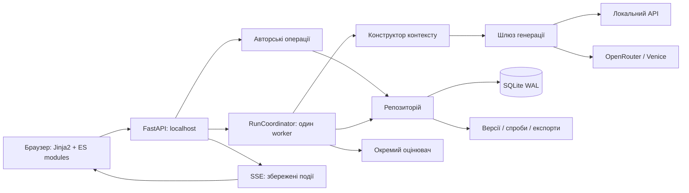

# Obscura Text Writer (Storygen) — специфікація системи

## Purpose

Storygen автоматизує створення українського оповідання за авторським планом із цільовим обсягом 5–15 тисяч слів. Автор керує сценами, моделями, редактурою та пам’яттю твору через локальний вебінтерфейс. Це специфікація реалізованої архітектури, а не початковий бріф Gemini чи перелік майбутніх можливостей.

Базову редакцію звірено з кодом на коміті `c53e669` станом на 20 жовтня 2026 року. Від цієї редакції SPEC.MD є головним джерелом правди щодо архітектури; подальші зміни документа і відповідного коду виконуються разом.

Використано формат OpenSpec: нормативні розділи `Requirement` та перевірні `Scenario` з `GIVEN / WHEN / THEN`. На запит власника всі можливості й технічні рішення зібрані в одному кореневому файлі. Це адаптація формату, без встановлення OpenSpec CLI та без твердження про відповідність його типовій структурі каталогів.

## Зміст

[Простежуваність і перевірки](docs/verification/README.md) · [Стан виконання тестів](docs/STATUS.md) · [Мотиви рішень](docs/adr/README.md)

- [ARCH-001 — Узгодженість архітектури](#arch-001)
- [RUNTIME-001 — Локальний застосунок](#runtime-001)
- [DATA-001 — Перевірений імпорт](#data-001)
- [DATA-002 — Авторський контроль структури](#data-002)
- [DATA-003 — Незмінні матеріали версій](#data-003)
- [DATA-004 — Конкурентні зміни](#data-004)
- [DATA-005 — Застарілі залежності](#data-005)
- [DATA-010 — Явне авторське прийняття застарілого тексту](#data-010)
- [RUN-ACCEPTED — Продовження після прийнятої альтернативи](#run-accepted)
- [DATA-009 — Похідна актуальність версій](#data-009)
- [DATA-006 — Кошик і відновлення](#data-006)
- [DATA-007 — Ручна чернетка](#data-007)
- [DATA-008 — Прийняття збереженої чернетки](#data-008)
- [MODEL-001 — Чотири незалежні ролі](#model-001)
- [ROLE-PROFILES — Переносимі комплекти ролей](#role-profiles)
- [MODEL-002 — Явний виклик провайдера](#model-002)
- [MODEL-003 — Каталог Venice](#model-003)
- [BUDGET-001 — Явні ліміти й резерв виклику](#budget-001)
- [BUDGET-002 — Достовірне завершення обліку](#budget-002)
- [PIPE-001 — Послідовність сцени](#pipe-001)
- [PIPE-002 — Один виконавець на каталог](#pipe-002)
- [PIPE-003 — Ідемпотентне створення запуску](#pipe-003)
- [PIPE-004 — Відновлення після збою](#pipe-004)
- [PIPE-005 — Пауза і скасування](#pipe-005)
- [PIPE-006 — Перевірка завершення](#pipe-006)
- [PIPE-007 — Слід виконання](#pipe-007)
- [CONTEXT-001 — Явний бюджет контексту](#context-001)
- [CONTEXT-004 — Перевірений профіль і ручна активація](#context-004)
- [CONTEXT-002 — План і вже написані події](#context-002)
- [CONTEXT-005 — Горизонт майбутніх планів](#context-005)
- [CONTEXT-003 — Вибрана проза, підтверджена пам’яттю](#context-003)
- [MEMORY-001 — Походження пам’яті](#memory-001)
- [MEMORY-002 — Пам’ять через фрагменти](#memory-002)
- [MEMORY-003 — Історія та сумісність пам’яті](#memory-003)
- [MEMORY-004 — Обмежена нормалізація й точна діагностика](#memory-004)
- [PROMPT-CONTRACT — Призначення промптів](#prompt-contract)
- [EDIT-001 — Обмежена точкова редактура](#edit-001)
- [REWRITE-DIFF — Суцільна редактура з програмними змінами](#rewrite-diff)
- [EDIT-CLASSIFICATION — Окремі необов’язкові поради](#edit-classification)
- [EDIT-DIAGNOSTICS — Конкретні безпечні помилки редактора](#edit-diagnostics)
- [EDIT-REVIEW — Авторський вибір точкових правок](#edit-review)
- [LANGUAGE-WARNINGS — Локальні мовні попередження](#language-warnings)
- [UI-001 — Передумови workflow](#ui-001)
- [UI-002 — Безпека редакторського буфера](#ui-002)
- [UI-003 — Достовірний стан виконання](#ui-003)
- [UI-004 — Зрозумілі повідомлення](#ui-004)
- [UI-005 — Оновлення ресурсів інтерфейсу](#ui-005)
- [UI-006 — Брендинг і представлення назв](#ui-006)
- [EVAL-001 — Відокремлене оцінювання](#eval-001)
- [EVAL-002 — Калібрування](#eval-002)
- [EVAL-003 — Вимкнення оцінювача](#eval-003)
- [EVAL-004 — Покриття великого твору](#eval-004)
- [EVAL-005 — Відмова і фактична причина помилки](#eval-005)
- [EVAL-006 — Постійне блокування оцінювача для твору](#eval-006)
- [EVAL-007 — Політики workflow та придатність профілю](#eval-007)
- [EXPORT-001 — Відтворюваний експорт](#export-001)
- [SECURITY-001 — Локальна межа доступу](#security-001)
- [SECURITY-002 — Ключі поза даними ролей](#security-002)
- [CONTENT-001 — Українська проза і авторський матеріал](#content-001)
- [STORAGE-BOUNDARY — Предметні транзакції сховища](#storage-boundary)
- [SCENE-DESCRIPTION — Назва та учасники з авторського плану](#scene-description)
- [SCENE-CAST-DISPLAY — Імена замість редагування ID](#scene-cast-display)
- [CHARACTER-IMPORT — Початкові картки з Markdown](#character-import)
- [CHARACTER-TIME — Доступність відомостей за порядком сцен](#character-time)
- [MAINT-001 — Діагностика без repair](#maint-001)
- [MAINT-002 — Перевірений холодний backup](#maint-002)
- [MAINT-003 — Відновлення в новий каталог](#maint-003)
- [PUB-001 — Відокремлення публічного коду від приватної історії](#pub-001)
- [EDIT-SENTENCE-CONTEXT — Речення в контексті редакторської правки](#edit-sentence-context)
- [EDIT-SENTENCE-GROUPS — Одна група прийняття на речення](#edit-sentence-groups)
- [BUDGET-LAST-CALL — Вартість останнього виклику в бюджеті](#budget-last-call)
- [EDIT-NO-CHANGES — Відсутність модельних правок не є прийнятною пропозицією](#edit-no-changes)
- [EDIT-LOOP — Багатопрохідна редактура з одним прийняттям](#edit-loop)
- [EDIT-LOOP-STOP — Завершення та recovery](#edit-loop-stop)
- [EDIT-LOOP-REVIEW — Сумарний diff та атомарне завершення](#edit-loop-review)
- [EDIT-WORKFLOW — Єдина редактура для всіх дій](#edit-workflow)
- [DOCS-TRACE — Сталі ID й конкретні перевірки](#docs-trace)
- [DOCS-STATUS — Датоване свідчення виконання](#docs-status)

Технічні розділи: [Architecture](#architecture), [матриця R-05](#матриця-перевірок-r-05), [обмеження](#known-limitations-and-deviations), [Source map](#source-map).

## Requirements

### Requirement: ARCH-001 — Узгодженість архітектури

Будь-яка архітектурна зміна SHALL супроводжуватися зміною SPEC.MD у тому самому наборі змін і коміті. Відомий дефект SHALL описуватися окремо від бажаного контракту.

#### Scenario: ARCH-001-S01 — Зміна контракту збереження
- GIVEN розробник змінює схему даних або правила публікації результату
- WHEN готується завершення роботи
- THEN SPEC.MD описує нові інваріанти, сценарії та обмеження
- AND історичний план не підміняє чинну специфікацію.

### Requirement: RUNTIME-001 — Локальний застосунок

Система SHALL надавати локальний вебінтерфейс із серверним доступом до моделей і постійним сховищем у вибраному каталозі даних.

#### Scenario: RUNTIME-001-S01 — Перезапуск вебсервера
- GIVEN автор зберіг твір і його версії
- WHEN сервер запускається з тим самим каталогом даних
- THEN збережені матеріали доступні без повторної генерації.

### Requirement: DATA-001 — Перевірений імпорт

Імпорт SHALL приймати непорожні UTF-8 TXT/MD файли до 2 MiB кожний, зберігати вихідні байти та створювати версії декодованого тексту.

#### Scenario: DATA-001-S01 — Некоректний файл у наборі
- GIVEN набір містить непідтримуваний або некоректно закодований файл
- WHEN виконується імпорт
- THEN попередня перевірка відхиляє набір до початку запису його файлів.

Шаблони плану й персонажів SHALL постачатися як UTF-8 Markdown у пакетних `web/static/templates/*.md` і завантажуватися з блоку «Додати матеріали» через same-origin посилання з download. План SHALL використовувати розпізнавані заголовки сцен і склад, відповідний заголовкам імен шаблону персонажів. Приклади Початок/Кінець SHALL явно містити день та час, зокрема перехід через північ. Ці рядки зберігаються у beats як авторський текст: окремої моделі фізичного часу, автоматичного обчислення тривалості чи перевірки суперечностей немає. Вони не змінюють порядок читання й часову проєкцію пам’яті. Шаблон персонажів SHALL пояснювати чинне unclassified після імпорту та окреме налаштування доступності у картках.

#### Scenario: DATA-001-S02 — Сумісні завантажувані шаблони
- GIVEN автор відкрив «Додати матеріали»
- WHEN завантажує шаблони плану й персонажів та імпортує їх у новий твір
- THEN сцени й початкові картки розпізнані, склад заповнений відповідними іменами
- AND межі часу, включно з різними днями на початку й наприкінці, збережені в планах без автоматичної зміни доступності карток.

### Requirement: DATA-002 — Авторський контроль структури

Система SHALL дозволяти редагувати сцени та застосовувати запропоновану моделлю структуру лише окремою авторською дією. Повторний імпорт SHALL не замінювати наявні активні сцени автоматично.

#### Scenario: DATA-002-S01 — Підготовка структури
- GIVEN існують імпортовані матеріали
- WHEN планувальник завершує підготовку
- THEN пропозиція доступна для перегляду
- AND канон і картки персонажів не стають поточними до застосування.

### Requirement: DATA-003 — Незмінні матеріали версій

Байти збереженої версії SHALL бути незмінними. Читання SHALL перевіряти належність шляху каталогу даних і SHA-256, а поточні матеріали SHALL вибиратися через явні головні версії, а не дату створення.

#### Scenario: DATA-003-S01 — Пошкодження файла
- GIVEN файл версії змінено поза застосунком
- WHEN система читає його
- THEN повертається помилка цілісності замість використання зміненого тексту.

### Requirement: DATA-004 — Конкурентні зміни

Авторське збереження SHALL перевіряти очікувану ревізію. Нова модельна публікація SHALL атомарно перевіряти релевантний dependency snapshot і окремий target CAS (ID та лічильник вибору голови). Зміна використаного контексту або цілі зберігає результат альтернативою; нерелевантна зміна твору чи налаштувань ролі сама його не відхиляє. Legacy-спроба без snapshot зберігає консервативний CAS ревізій.

#### Scenario: DATA-004-S01 — Автор редагує сцену під час генерації
- GIVEN запит моделі вже розпочато
- WHEN автор змінює матеріали, від яких залежав запит
- THEN результат не перезаписує новіший авторський стан.

### Requirement: DATA-005 — Застарілі залежності

Заміна джерела SHALL транзитивно позначати залежні результати застарілими та відповідні сцени такими, що потребують перегляду, зберігаючи історію і головні посилання.

#### Scenario: DATA-005-S01 — Заміна прози
- GIVEN пам’ять залежить від поточної прози
- WHEN автор зберігає нову версію прози
- THEN попередня залежна пам’ять стає застарілою
- AND її файл залишається доступним в історії.

### Requirement: DATA-010 — Явне авторське прийняття застарілого тексту

Автор SHALL мати окремий preview тексту, змінених залежностей expected/current і наслідків прийняття для draft/edited/manual. Окрема явна дія SHALL транзакційно перевіряти власність/вид/complete/SHA-256, scene revision та fingerprint показаного baseline/diff, вибирати голову й додавати append-only рішення з новим author_text baseline. Старі байти, model input_refs/fingerprint та стани історичних alternative-спроб SHALL не переписуватися. Stale brief/memory/evaluation не мають універсального прийняття.

#### Scenario: DATA-010-S01 — Прийняття й гонка після preview
- GIVEN автор переглянув stale draft/prose та зміни джерел
- WHEN підтверджує за незмінного показаного стану
- THEN рішення й голова збережені разом, а пам’ять/evaluation не підтверджені автоматично
- AND зміна джерел або ревізії після preview повертає 409 без часткової зміни голови/журналу.

### Requirement: RUN-ACCEPTED — Продовження після прийнятої альтернативи

Після явного вибору актуального результату зупиненого етапу автор SHALL мати окреме продовження без повторного inference цього етапу. Предметна транзакція SHALL перевіряти стан run, точний cursor/task, останню відповідну спробу/result ID, selected head, scene revision, freshness і чинний acceptance ID за наявності рішення. Автоматичного просування від самого вибору голови немає. Cancellation та story/model refusal block SHALL не обходитися.

#### Scenario: RUN-ACCEPTED-S01 — Без повтору й підміни історії
- GIVEN remaining зупинився на alternative і автор прийняв саме цей результат
- WHEN явно продовжує після нього
- THEN лише правильний cursor просувається й наступні етапи читають актуальні входи
- AND історичний alternative лишається alternative; cancelled або змінений baseline не дозволяє продовження.

### Requirement: DATA-009 — Похідна актуальність версій

Версії з перевіреним dependency snapshot SHALL визначати актуальність порівнянням baseline з поточними релевантними selectors, refs/хешами, complete і актуальністю джерел. Публічні списки/версії/контекст/експорт SHALL використовувати цей самий resolver. Legacy stale без snapshot SHALL лишатися застарілим. Цикл, відсутнє/чуже/пошкоджене джерело не є доказом актуальності.

#### Scenario: DATA-009-S01 — Повернення залежностей A→B→A
- GIVEN нова версія мала перевірений baseline A
- WHEN усі релевантні залежності після зміни на B знову точно A
- THEN актуальність відновлюється без inference та переписування model input_refs
- AND target CAS активної спроби все одно відхиляє вибір її голови A→B→A.

### Requirement: DATA-006 — Кошик і відновлення

Видалення творів і сцен SHALL бути зворотним переміщенням до кошика. Звичайні операції репозиторію SHALL приховувати такі об’єкти. Архівація SHALL відхилятися за наявності незавершеного запуску.

У бібліотеці дія кошика SHALL перевіряти всі запуски твору. За наявності лише зупинених paused/interrupted/needs_review/alternative вона SHALL явно запропонувати їх скасування разом із переміщенням. Після підтвердження UI послідовно викликає чинний cancel API й перевіряє завершений стан кожного запуску перед чинним trash API. Активні/невідомі стани блокують цю дію без автоматичного скасування. Помилка скасування або незавершене cancellation_requested SHALL не запускати trash; уже скасовані запуски залишаються скасованими, тексти й історія зберігаються. Остаточна серверна перевірка запусків і ревізії лишається обов’язковою; ці окремі запити не є спільною транзакцією.

#### Scenario: DATA-006-S03 — Старі зупинені запуски не утворюють глухий кут кошика
- GIVEN у творі є старі alternative/paused/interrupted/needs_review, а останній запуск уже завершено
- WHEN автор у бібліотеці підтверджує скасування зупинених запусків і кошик
- THEN усі такі запуски скасовані до переміщення, версії та історія збережені
- AND відмова від підтвердження, активна генерація або невдале скасування не переміщують твір.

#### Scenario: DATA-006-S01 — Експорт архівного твору
- GIVEN твір перебуває в кошику на початку SQL-знімка експорту
- WHEN автор запитує експорт, зокрема з `allow_incomplete=true`
- THEN API повертає 404
- AND нові файли експорту не створюються.

#### Scenario: DATA-006-S02 — Відновлення сцени
- GIVEN сцена в кошику, а твір активний
- WHEN автор відновлює сцену
- THEN вона повертається на збережену або найближчу допустиму позицію
- AND матеріали, залежні від зміненої послідовності, потребують перегляду.

### Requirement: DATA-RENAME — Назва оповідання

Автор SHALL перейменовувати активний твір кнопкою олівця поруч із назвою: поле й «ОК», Enter для збереження, Escape для скасування. UI SHALL зберігати введення після помилки, блокувати повторне збереження та захищати незбережену назву перед виходом зі сторінки. Заголовок і document.title SHALL оновлюватися без перезавантаження буфера сцени; назва відображається як текст, а не HTML.

PATCH `/api/stories/{id}` SHALL приймати лише title/expected_revision. Межа Authoring/Repository SHALL перевіряти активність/CAS у write-транзакції, прибирати зовнішні пробіли й приймати 1–300 символів. Змінена назва підвищує story.revision, однакова не змінює її після CAS. Конфлікт — 409, твір у кошику — 404. Перейменування SHALL не змінювати config_revision, матеріали/актуальність сцен чи явно задану назву публікації; незадана назва публікації використовує чинний story.title. Міграція не потрібна.

#### Scenario: DATA-RENAME-S01 — Перейменування без зміни рукопису
- GIVEN активний твір і відкритий, зокрема незбережений, текст сцени
- WHEN автор зберігає нову непорожню назву з чинною ревізією
- THEN назва збережена й відображена в заголовку та бібліотеці, а текст/актуальність сцен не змінені
- AND Escape не зберігає; помилка лишає введення; конфлікт, порожня чи задовга назва та кошик не дозволяють перезапис.

### Requirement: DATA-007 — Ручна чернетка

Автор SHALL мати можливість вставити або змінити чернетку й зберегти її як нову поточну `draft`-версію без виклику моделі. Збереження SHALL перевіряти ревізію, відхиляти порожній текст і позначати залежні результати застарілими.

#### Scenario: DATA-007-S01 — Вставлення зовнішнього тексту
- GIVEN автор відкрив вкладку «Чернетка», зокрема без раніше створеної чернетки
- WHEN він вставляє непорожній текст і натискає «Зберегти»
- THEN текст дослівно зберігається в новій головній draft-версії
- AND він доступний редактору як чернетка, а не підміняє фінальну прозу.

#### Scenario: DATA-007-S02 — Конфлікт ручної чернетки
- GIVEN інша вкладка вже змінила ревізію сцени
- WHEN автор зберігає чернетку зі старою ревізією
- THEN сервер повертає 409, зберігаючи надіслану версію в історії
- AND актуальна голова чернетки не замінюється.

### Requirement: DATA-008 — Прийняття збереженої чернетки

Автор SHALL мати можливість зробити завершену незастарілу draft-версію тієї самої сцени поточною через історію без копіювання тексту й нового модельного виклику. Дія SHALL перевіряти ревізію й інвалідовувати залежності попередньої голови.

#### Scenario: DATA-008-S01 — Прийняття альтернативи
- GIVEN генерація зберегла завершену draft-версію, яка не стала головною
- WHEN автор обирає її в історії та натискає «Прийняти чернетку»
- THEN поточна голова вказує на той самий ID версії
- AND вкладка «Чернетка» показує прийнятий текст.

### Requirement: MODEL-001 — Чотири незалежні ролі

Планувальник, письменник, редактор і пам’ять SHALL мати окремі налаштування моделі, провайдера та промпту. Інтерфейс SHALL також дозволяти атомарно зберегти спільного провайдера й модель для чотирьох ролей, зберігши інші рольові параметри.

#### Scenario: MODEL-001-S01 — Одна модель для всіх ролей
- GIVEN ролі мають різні промпти й ліміти
- WHEN автор застосовує спільну модель
- THEN усі чотири ролі використовують її
- AND їхні окремі промпти та режими зберігаються.

### Requirement: MODEL-002 — Явний виклик провайдера

Генерація SHALL використовувати налаштовану модель без прихованого перемикання провайдера, автоматичного повтору SDK або заміни авторського тексту через тематичний фільтр застосунку.

#### Scenario: MODEL-002-S01 — Відмова провайдера
- GIVEN провайдер повертає відмову або помилку
- WHEN завершується спроба
- THEN запуск показує відповідний результат
- AND інша модель не викликається автоматично.

### Requirement: MODEL-003 — Каталог Venice

Генерація через Venice SHALL дозволяти лише текстові моделі з явним `uncensored=true` і без `offline=true`. Ця перевірка SHALL діяти також для вручну введеного ID.

#### Scenario: MODEL-003-S01 — Невідповідна модель Venice
- GIVEN вибраний ID не проходить перевірку каталогу
- WHEN готується генерація
- THEN платний запит завершення не надсилається.

### Requirement: BUDGET-001 — Явні ліміти й резерв виклику

Кожний cloud completion SHALL мати явний scope limit, чинний official/manual
тариф і атомарний reserve до POST. Story scope накопичувальний; optional run
cap фіксується на перший reserve запуску. Немає типового дозволеного $1.
Повтор call ID SHALL не надсилатися вдруге. Readiness не створює резервів.
Local/Codex — unpriced: usage зберігається без вигаданого USD-рахунку.

#### Scenario: BUDGET-001-S01 — Конкурентні резерви
- GIVEN залишку бюджету вистачає лише на один із двох викликів
- WHEN виклики одночасно резервують кошти
- THEN BEGIN IMMEDIATE допускає лише один reserve; другий не переходить до POST.

#### Scenario: BUDGET-001-S02 — Відсутній або прострочений тариф
- GIVEN немає чинного каталожного тарифу
- WHEN неможливо оновити офіційний каталог
- THEN cloud completion блокується до explicit manual тарифу з джерелом
  та expires_at; невідоме не стає нулем.

### Requirement: BUDGET-002 — Достовірне завершення обліку

Ledger SHALL відрізняти provider actual від priced_usage_estimate та
unresolved. Пріоритет — валідна reported cost; інакше повна фінальна usage
і snapshot тарифу; інакше весь reserve лишається counted. Перезапуск,
скасування й новий attempt ID не звільняють невизначений попередній виклик.
Manual reconcile потребує суми, джерела та власного scope й не дозволений
для активного workflow. Реальний overrun зберігається, а не обрізається.

#### Scenario: BUDGET-002-S01 — Usage без підтвердженої вартості
- GIVEN завершена відповідь має обидва невід’ємні цілі token counts
- WHEN reported cost відсутня
- THEN reserve зменшується до розрахунку за зафіксованим тарифом;
  UI позначає його розрахунком, actual лишається null.

#### Scenario: BUDGET-002-S02 — Збій після POST
- GIVEN завершення або вартість невідомі
- WHEN виконується recovery або авторський retry
- THEN counted reserve збережений; наступний виклик потребує окремого резерву.

### Захист активного виклику та фінальна usage

Runtime утримує неблокувальний OS lease `billing-locks/<hash(call_id)>/worker.lock`
від резервування до завершення обліку. Ручна звірка SHALL захопити той самий
lease; для активного виклику вона відхиляється. Crash звільняє OS lock, але
не грошовий резерв. Standalone evaluation/calibration і budget CLI утримують
кореневий AppInstanceLock, сумісний із R-02 backup; dry-run його не потребує.
Local/Codex standalone без явного scope обліковуються у `cli:evaluator`.
Scope нових записів перевіряється до запису: `story:<id>` або `cli:<name>`;
для story scope потрібен чинний твір.

Невалідний usage container нормалізується до порожнього telemetry без втрати
тексту чи refusal. Лічильники stream SHALL братися з одного останнього usage
snapshot; поля з різних chunks не складаються в удавано повний фінальний usage.
Зберігаються лише дозволені числові лічильники/деталі та валідна cost.

#### Scenario: BUDGET-002-S03 — Ручна звірка під час активного standalone виклику
- GIVEN CLI вже відправив запит і тримає lease виклику
- WHEN інший клієнт намагається звірити його до нуля
- THEN операція відхиляється і доступний залишок не збільшується.

#### Scenario: BUDGET-002-S04 — Неповний останній usage
- GIVEN ранній chunk має обидва лічильники, а останній usage — лише один
- WHEN потік завершується без валідної reported cost
- THEN отриманий текст збережений, виклик unresolved, повний резерв лишається.

### Requirement: PIPE-001 — Послідовність сцени

Повний запуск сцени SHALL виконувати завдання планувальника, чернетку письменника, редактуру та оновлення пам’яті послідовно. Окремі етапи SHALL запускатися самостійно за виконаних передумов.

#### Scenario: PIPE-001-S01 — Повна сцена
- GIVEN сцена має потрібний план і налаштовані ролі
- WHEN запускається повний workflow
- THEN етапи виконуються в порядку `brief → draft → edit → memory`
- AND автоматичне оцінювання виконується після пам’яті, якщо ввімкнене.

### Requirement: PIPE-002 — Один виконавець на каталог

Система SHALL послідовно виконувати завдання всіх творів у межах одного каталогу даних і блокувати запуск другого виконавця для цього каталогу.

#### Scenario: PIPE-002-S01 — Два вебсервери
- GIVEN один виконавець уже володіє блокуванням каталогу
- WHEN другий намагається використати той самий каталог
- THEN він не починає конкурентно виконувати чергу.

### Requirement: PIPE-003 — Ідемпотентне створення запуску

Повторне надсилання того самого `request_id` і запиту SHALL повертати існуючий запуск. Інший запит із цим ID SHALL отримувати конфлікт.

#### Scenario: PIPE-003-S01 — Відповідь на створення запуску втрачена
- GIVEN браузер не отримав підтвердження
- WHEN він повторює той самий запит з тим самим ID
- THEN друга модельна операція не створюється.

### Requirement: PIPE-004 — Відновлення після збою

Після перезапуску незавершені активні запуски SHALL отримувати стан перерваних. Повтор невизначеної спроби SHALL вимагати явного підтвердження, а не відбуватися автоматично.

#### Scenario: PIPE-004-S01 — Збій під час платного запиту
- GIVEN процес завершився без остаточного результату спроби
- WHEN виконавець знову запускається
- THEN стан відновлюється як перерваний
- AND повтор запиту не приховує ризику повторної оплати.

### Requirement: PIPE-005 — Пауза і скасування

Пауза SHALL діяти на межі етапів. Скасування SHALL перевірятися між етапами й під час читання потоку; воно SHALL не трактувати частковий текст як завершену версію.

#### Scenario: PIPE-005-S01 — Скасування потокової генерації
- GIVEN модель уже надсилає текст
- WHEN виконавець помічає запит скасування
- THEN частковий матеріал залишається діагностичним
- AND не стає поточною прозою.

Скасування SHALL не змінювати payload або журнал для completed/failed/cancelled та повторного cancellation_requested. Для queued результат — cancelled; running/pause_requested — cancellation_requested. Для paused/interrupted/needs_review/alternative результат — cancelled зі збереженням error, cursor, текстів і версій. Повторна пауза також не створює зайвих подій.

#### Scenario: PIPE-005-CANCEL-FINISHED — Повторне скасування
- GIVEN запуск завершено, він невдалий або вже скасований
- WHEN надходить cancel
- THEN стан, діагностика, cursor та журнал подій не змінюються.

#### Scenario: PIPE-005-CANCEL-STOPPED — Скасування зупиненого запуску
- GIVEN запуск paused/interrupted/needs_review/alternative
- WHEN автор обирає cancel
- THEN запуск стає cancelled без видалення матеріалів.

### Requirement: PIPE-006 — Перевірка завершення

Прийняття генерації SHALL вимагати непорожньої відповіді, коректного завершення `stop`, відсутності відмови та валідності очікуваної структури. Усічення через ліміт SHALL бути помилкою.

Порожній content за `finish_reason=stop` без явної відмови SHALL мати категорію `empty_output` та повідомлення про наявний `stop`, але відсутній фінальний текст. За наявності додатного `reasoning_tokens` повідомлення SHALL наводити цю кількість і загальний `completion_tokens`, якщо він коректний, та пропонувати вимкнути/зменшити reasoning для сумісної моделі. Без usage причина не вигадується. Такий результат не означає відмову через контент чи вичерпання ліміту; автоматичного повтору немає. Редактор SHALL зберігати це пояснення у помилці спроби. Усунене відхилення: порожня відповідь письменника з `stop` помилково описувалася як відсутність повної відповіді з `stop`. Збережені історичні помилки не переписуються; схема та налаштування моделей не змінюються.

#### Scenario: PIPE-006-S02 — Порожня відповідь із коректним stop
- GIVEN потік завершується з finish_reason=stop, без content і без явної відмови
- WHEN шлюз перевіряє завершення та зберігається невдала спроба
- THEN помилка прямо повідомляє про порожню відповідь із stop; доступні витрати reasoning зберігаються в поясненні
- AND без usage витрати не вигадуються, результат не публікується й запит не повторюється.

#### Scenario: PIPE-006-S01 — Вичерпано вихідні токени
- GIVEN провайдер повернув `finish_reason=length`
- WHEN перевіряється відповідь
- THEN вона не публікується як завершений етап.

### Requirement: PIPE-007 — Слід виконання

Спроба SHALL зберігати контекст і налаштування до виклику моделі, часткову відповідь у checkpoint під час потоку та результат перевірки після нього.

#### Scenario: PIPE-007-S01 — Невалідний JSON
- GIVEN модель повернула синтаксично неправильну структуру
- WHEN перевірка завершується помилкою
- THEN сирий результат доступний для діагностики
- AND система не виправляє його приховано іншою моделлю.

Потік генераційних етапів SHALL записувати partial пакетами дозаписом: поріг 16384 UTF-8-байтів або 0,5 секунди, перевірений при наступній непорожній delta. Перед збереженням пакетної події SHALL виконуватися flush/fsync файла; seq призначається SQL-транзакцією. При звичайному завершенні, скасуванні або винятку шлюзу хвіст SHALL скидатися перед фінальним станом. Помилка checkpoint забороняє публікацію результату й не повторюється автоматично.

#### Scenario: PIPE-007-BATCH — Дрібні фрагменти
- GIVEN 1000 delta по 10 ASCII-байтів і незмінний годинник
- WHEN потік завершується
- THEN точний текст збережено з не більш як трьома записами partial, fsync та транзакціями delta.

#### Scenario: PIPE-007-CRASH — Незбережений хвіст
- GIVEN checkpoint завершений і новий хвіст залишається в RAM
- WHEN процес аварійно завершується без finally
- THEN хвіст може бути втрачений, а partial не стає завершеною версією.

#### Scenario: PIPE-007-REPLAY — Повторне підключення
- GIVEN клієнт уже отримав пакетну подію з seq N
- WHEN він підключається з after або Last-Event-ID N
- THEN сервер повертає лише зафіксовані події з більшими seq без повторення тексту.

#### Scenario: PIPE-007-UTF8 — Читання під час дозапису
- GIVEN читач partial бачить лише початок останнього UTF-8 символу
- WHEN виконується GET стану запуску
- THEN повертається повний коректний префікс без помилки декодування
- AND сирий файл не змінюється.

### Requirement: CONTEXT-001 — Явний бюджет контексту

Конструктор контексту SHALL перевіряти ліміт символів і оцінку токенів із резервом відповіді до модельного виклику. Матеріали SHALL не обрізатися приховано.

Generation та інтегрований API Evaluator SHALL оцінювати повний зафіксований
API body, включно зі schema та provider options, через спільний token_budget.
Без явно активованого перевіреного профілю SHALL застосовуватися
консервативна евристика UTF-8 bytes канонічного body +256, з окремим резервом
виходу. Метод, confidence, profile ID і причини fallback зберігаються в
ContextBundle/контексті evaluation attempt. Невідомий tokenizer не дає
математичної гарантії. Для Codex CLI body є лише обліковим envelope:
CLI не отримує Chat Completions body, емпіричний API-профіль не застосовується.

#### Scenario: CONTEXT-001-S01 — Контекст завеликий
- GIVEN оцінка входу перевищує `context_tokens - max_output_tokens`
- WHEN формується етап
- THEN система пояснює перевищення без відправлення цього запиту моделі.

### Requirement: CONTEXT-004 — Перевірений профіль і ручна активація

Профіль SHALL прив’язуватися до provider/endpoint/model, відомої revision
tokenizer або explicit unknown, system prompt hash, message shape, response
schema та input-affecting provider options. Потрібно ≥40 різних body hashes:
train≥30, holdout10 за детермінованим порядком digest; size range≥4×,
≥5 кириличних/ASCII/JSON user contents кожного типу та кожен тип в обох
частинах. Max train tokens/bytes ×1.20 +256 SHALL не недооцінювати holdout.
Eligible не означає active: активація лише через явний локальний CLI.

#### Scenario: CONTEXT-004-S01 — Недостатні або повторні спостереження
- GIVEN повтори того самого body або usage без додатного цілого prompt_tokens
- WHEN будується профіль
- THEN повтори не збільшують distinct samples, відсутня usage не навчальна;
  недостатній набір не активується.

#### Scenario: CONTEXT-004-S02 — Зміна моделі, діапазону або фактична недооцінка
- GIVEN активний перевірений профіль
- WHEN identity не збігається, body поза min/max або профілю більше7 днів
- THEN цей запит використовує fallback.
- WHEN нова фактична usage перевищує прогноз у чинному діапазоні
- THEN профіль атомарно деактивується до нового build і явного activate.

### Requirement: CONTEXT-002 — План і вже написані події

Контекст SHALL відрізняти майбутні плани від підтверджених подій і використовувати пам’ять попередніх сцен та обмежений хвіст попередньої прози замість безумовного додавання всього твору.

Для сцени n SHALL читатися лише перевірена пам’ять n−1, навіть якщо n та
наступні сцени вже мають готові матеріали. Джерела пам’яті SHALL точно
відповідати вибраній прозі попереднього префікса у порядку сцен. Літературна
секція пам’яті SHALL містити детерміновану проєкцію без технічних IDs/цитат;
повні докази й refs залишаються на сервері.

#### Scenario: CONTEXT-002-S01 — Написання другої сцени
- GIVEN перша сцена має прозу та актуальну пам’ять
- WHEN готується контекст письменника
- THEN попередні події представлені пам’яттю й хвостом тексту
- AND майбутні сцени позначені як плани.

#### Scenario: CONTEXT-002-S02 — Повтор ранньої сцени після завершення твору
- GIVEN усі сім сцен мають прозу й пам’ять
- WHEN формується brief/draft/prose-edit сцени 2
- THEN секція пам’яті містить лише відомості зі сцени 1
- AND жодна пам’ять сцени 2 або наступних не вибирається за датою завершення.

### Requirement: CONTEXT-005 — Горизонт майбутніх планів

Кожна роль SHALL мати `RoleSettings.future_plan_mode=all|next_n|current` (типово all) та `future_plan_count` — ціле 0–1000, типово 2, використане лише next_n. All зберігає попередній вибір усіх поточних/наступних активних планів; next_n передає поточний і N наступних, current — лише поточний. Кошик виключено, досягнення кінця твору не є помилкою, N=0 еквівалентний current. Автоматичного скорочення за token budget немає.

`StyleProfile.ending_goal` SHALL бути спільним необов’язковим авторським текстом до12000 символів, типово порожнім, збереженим у чинній versioned style-формі/API/CAS. Непорожній орієнтир SHALL передаватися один раз окремою секцією «АВТОРСЬКИЙ ОРІЄНТИР ФІНАЛУ — ЗАДУМ, НЕ ЗДІЙСНЕНІ ПОДІЇ», без дублювання в секції стилю. Обмежені режими та запит з орієнтиром SHALL явно обмежувати реалізацію поточними бітами: неостання сцена не завершує весь твір. Це prompt-контракт, не доказ літературної поведінки моделі. Для current/next_n=0 відсутній орієнтир дає context warning без блокування.

Чистий `story_horizon.py::selected_plan_scenes` SHALL використовуватися builder і snapshot. Ref/selectors виключених планів не додаються. Limited snapshot order `narrative_window` SHALL містити минулий префікс, поточну та N наступних сцен; optional selector.future_count обов’язковий лише для narrative_window. Окремий story.scene_count відстежує загальну кількість через видимий заголовок n/total. Перестановка виключених сцен за незмінного вікна не інвалідовує прямі залежності; включені плани, префікс, порядок вікна та total залишаються захищеними. Author acceptance baseline не звужується. Стара snapshot schema1 читається з future_count=null, old all/prefix зберігає значення; SQL2/міграції незмінні. Старі версії/спроби не переписуються. Fsck SHALL перевіряти власника narrative_window як сцену того самого твору. Порівняння snapshot при прийнятті старих patches/diff SHALL нормалізувати обидва документи як DependencySnapshot: відсутнє optional поле не є підміною джерел; реальні відмінності й CAS лишаються захищеними.

Горизонт SHALL обмежувати лише окремо підставлені плани. Канон, стиль, власні промпти, преамбула й уже створений brief/draft можуть містити далекий задум; limited context warning SHALL це пояснювати. Ширший використаний brief зберігає транзитивні залежності, навіть якщо письменник обрав current. Семантичного прихованого фільтрування/переписування джерел немає. Memory, patches/diff та prepare SHALL не отримувати нових планів/орієнтира: memory — попередній журнал/поточна проза, мовна редактура — чернетка, prepare — чинний повний імпортований план.

UI SHALL показувати select/N для planner/writer/prose-editor, вимикати N поза next_n і керування редактора в patches/diff, пояснювати відсутність майбутнього контексту memory та незмінність prepare. Форма письма містить ending_goal. Чинні settings API з CAS зберігають поля; R-11 переносить горизонт ролі, але не ending_goal. Frozen спроба не змінюється після збереження конфігурації; наступний етап читає нові параметри й має відповідний fingerprint. Сама зміна налаштувань не переписує готову прозу. Token estimation/overflow/accounting використовують фактичний запит.

#### Scenario: CONTEXT-005-S01 — Точне вікно планів
- GIVEN 7 або15 активних сцен і горизонт next_n=2 для сцени3
- WHEN будується проєкція
- THEN включено лише поточну3 та наступні4,5; N=0/current включає лише поточну
- AND біля кінця твору та за наявності кошика не додаються зайві сцени.

#### Scenario: CONTEXT-005-S02 — Залежності фактично використаних планів
- GIVEN обмежений контекст без транзитивної залежності на виключений план
- WHEN змінено лише виключений текст або переставлено дві виключені сцени
- THEN прямий snapshot і fingerprint не змінюються
- AND зміна включеного плану/порядку або загальної кількості сцен виявляється.

#### Scenario: CONTEXT-005-S03 — Необов’язковий авторський орієнтир
- GIVEN current без орієнтира або непорожній спільний ending_goal
- WHEN формується контекст
- THEN відсутність дає warning без блокування; наявний текст показано один раз як задум фіналу
- AND memory/patches/diff цього тексту не отримують.

#### Scenario: CONTEXT-005-S04 — Ширший бриф не приховується
- GIVEN writer=current читає бриф, створений із all
- WHEN змінено далекий план, від якого залежить бриф
- THEN його транзитивна stale-ознака зберігається
- AND limited warning пояснює, що бриф/канон можуть містити відомості поза горизонтом.

#### Scenario: CONTEXT-005-S05 — Збереження й перенос горизонту
- GIVEN збережено per-role next_n та спільний ending_goal
- WHEN профіль R-11 застосовано до нового твору або змінено конфігурацію після створення спроби
- THEN ролі незалежні, горизонт переноситься без авторського фіналу, а frozen context лишається незмінним
- AND UI вимикає непридатні поля та сервер відхиляє недопустимі значення без зміни ревізій.

### Requirement: CONTEXT-003 — Вибрана проза, підтверджена пам’яттю

Контекст SHALL фіксувати точні ID вибраної прози, допустимої через перевірену актуальну пам’ять. Етап memory спирається на вибрані тексти/хеші префікса й поточної сцени та їхні авторські baseline IDs; літературна застарілість цієї прози через непрочитані майбутні плани не створює конфлікту пам’яті. Це не є літературним прийняттям прози. Зміна релевантних selectors/джерел і target CAS SHALL зберігати захист публікації; legacy-спроби також перевіряють ревізії.

#### Scenario: CONTEXT-003-S01 — Застарілість перед початком
- GIVEN актуальна пам’ять дослівно підтверджена тими самими вибраними версіями прози
- AND одна з цих версій уже позначена stale до побудови контексту
- WHEN генерація завершується без зміни релевантних входів або target CAS
- THEN результат стає поточним автоматично
- AND вихідна проза залишається stale й потребує авторського перегляду.

#### Scenario: CONTEXT-003-S02 — Нове застарівання під час виклику
- GIVEN джерело було актуальним на початку генерації
- WHEN воно або використана пам’ять стає застарілим до публікації
- THEN результат зберігається як альтернатива.

### Requirement: MEMORY-001 — Походження пам’яті

Пам’ять SHALL посилатися на точний упорядкований набір обраних версій прози до поточної сцени включно. Кожний запис SHALL мати джерело й дослівну цитату. Ручне збереження SHALL не переприв’язувати цитати до інших версій автоматично.

#### Scenario: MEMORY-001-S01 — Ручне збереження зі старими джерелами
- GIVEN JSON пам’яті називає інший набір джерел, ніж поточний
- WHEN автор зберігає його
- THEN система відхиляє некоректні дані без зміни походження записів.

### Requirement: MEMORY-002 — Пам’ять через фрагменти

У режимі `evidence_delta` модель SHALL повертати schema_version=2/operations з
add/update/retire та ID фрагментів поточної прози. Сервер SHALL підставляти
джерела/цитати, зберігати повний журнал і застосовувати всі операції атомарно.
Update/retire дозволені лише для активних character_states/open_threads зі
сталими claim ID/category/scope; facts/timeline мають лише add. До 12 операцій
і до трьох add на категорію; target не змінюється двічі за відповідь.

#### Scenario: MEMORY-002-S01 — Невідомий фрагмент
- GIVEN доповнення містить ID, якого немає у поточному документі
- WHEN перевіряється відповідь
- THEN пам’ять не публікується.

### Requirement: MEMORY-003 — Історія та сумісність пам’яті

M[n] SHALL будуватися з M[n−1] та доказової поточної прози, зберігаючи всі
events попереднього префікса. Ручне збереження v1/v2 SHALL створювати нову v2
версію після перевірки ревізії, префікса, цитат і поточних операцій. Воно не
переписує старі bytes та не підтверджує пам’ять після авторського прийняття прози.

#### Scenario: MEMORY-003-S01 — Змінений стан і закрита лінія
- GIVEN попередній claim активний
- WHEN прийнято доказовий update або retire
- THEN чинна проєкція відображає новий стан або закриття
- AND усі попередні події та їхні докази лишаються в журналі.

#### Scenario: MEMORY-003-S02 — Legacy-протокол після v2
- GIVEN старий snapshot-промпт отримав сумісний active view
- WHEN він повертає коректні add-only доповнення
- THEN сервер зберігає повний попередній журнал включно з retired events
- AND невалідна v2-відповідь не переходить приховано до іншого parser чи inference.

### Requirement: MEMORY-004 — Обмежена нормалізація й точна діагностика

Лише для модельної відповіді v2/operations сервер SHALL прибирати непорожній
`character_ids` у `facts`, `timeline`, `open_threads`, якщо це список рядків.
Цей scope не має значення за контрактом цих категорій. Інші поля, категорії,
тексти, claim IDs та докази SHALL залишатися незмінними; всі звичайні перевірки
й атомарна публікація виконуються після нормалізації. `character_states`, ручні
журнали та доменні validators лишаються строгими. Некоректний тип scope не
виправляється автоматично. Немає повторного inference чи зміни оригінального partial.

Кожне виправлення SHALL зберігатися у `attempt.context.memory_warnings` із номером
операції/категорією та переноситися у стійкий `run.warning`, видимий після reload.
Помилка пам’яті SHALL називати безпечну конкретну причину: JSON-координати,
операцію/поле схеми або порушене правило. Значення model input, невідомі ключі,
тексти документів, довільні exception messages та секрети не потрапляють у
діагностику; невідома причина має загальне безпечне повідомлення.

#### Scenario: MEMORY-004-S01 — Зайвий scope відкритої лінії
- GIVEN модель повернула open_threads із character_ids як непорожнім списком рядків
- WHEN решта операцій і докази проходять перевірку
- THEN у журналі scope порожній, оригінальна відповідь незмінна
- AND спроба та запуск містять попередження про виправлення.

#### Scenario: MEMORY-004-S02 — Невідомий доказ після нормалізації
- GIVEN виправлено зайвий scope, але evidence_id відсутній у поточній прозі
- WHEN перевіряється відповідь
- THEN пам’ять не публікується, конкретна причина показується без відлуння текстів
- AND частковий результат та історія спроб зберігаються, автоматичного повтору немає.

### Requirement: PROMPT-CONTRACT — Призначення промптів

Власна prompt-версія SHALL мати незмінний `prompt_contract` зі stage/mode/schema_version. Очікувані контракти: prepare/blueprint/1, brief/brief/1, draft/prose/1, edit/prose/1, edit/patches/1, edit/diff/1, memory/snapshot/1 і memory/evidence_delta/2. Збереження нового тексту призначає його вибраному режиму; старий або несумісний промпт вимагає явного перепризначення новою версією або повернення стандартного. Зміна моделі сама не змінює контракт. Перевірки власності, типу, актуальності й сумісності SHALL виконуватися під час збереження ролі, preflight усіх запланованих етапів і побудови фактичного контексту до API. Metadata не доводить змістовної правильності довільного промпту.

#### Scenario: PROMPT-CONTRACT-S01 — Несумісний або legacy-промпт
- GIVEN промпт edit/prose/1 обрано для patches або стара версія не має контракту
- WHEN автор запускає workflow
- THEN виклик блокується до API з очікуваним призначенням і способом виправлення
- AND явне підтвердження в налаштуваннях створює нову версію, не переписуючи старої.

### Requirement: EDIT-001 — Обмежена точкова редактура

Режим `patches` SHALL застосовувати лише перевірені локальні заміни з однозначними якорями, без перетинів і переносів рядка, зі збереженням чисел і заперечень та обмеженням сумарного обсягу змін.

Вхід редактора SHALL бути одним JSON-об’єктом або одним зовнішнім Markdown-блоком із трьох backticks та необов’язковою міткою json. Знімається тільки повна зовнішня обгортка без стороннього тексту, із попередженням у спробі/run; сирий partial незмінний. Довільне витягування JSON, текст навколо, кілька блоків, повтор ключа та NaN/Infinity не виправляються. Після розпізнавання повна схема й усі guards залишаються обов’язковими.

#### Scenario: EDIT-001-S01 — Неоднозначний якір
- GIVEN оригінальний фрагмент заміни повторюється в зазначеному рядку
- WHEN перевіряються правки
- THEN увесь результат відхиляється замість довільного вибору місця.

#### Scenario: EDIT-001-LIMITS — Межі точкової правки
- GIVEN patches має понад 80 правок, original понад 160 або replacement понад 240 символів
- WHEN перевіряється схема
- THEN результат відхилено; рівні граничні значення допускаються схемою, але все одно проходять якірні та змістові guards.

### Requirement: REWRITE-DIFF — Суцільна редактура з програмними змінами

`RoleSettings.edit_mode=diff` SHALL отримувати тільки актуальну незмінну чернетку та сумісний промпт `edit/diff/1`. Бриф, пам’ять, канон і майбутні сцени не входять у цей мовний прохід; snapshot використовує чинний scope patches з head draft та фактичними input_refs. Навіть за response_mode=json_schema запит SHALL не містити response_format. Модель повертає всю прозу без JSON; partial, exact request, usage і finish_reason зберігаються штатно.

Програма SHALL створювати `copyedit_proposal.protocol_version=2`: draft_id і proposal з algorithm_version=1, candidate_text та edits[start,end,original,replacement]. Позиції — Unicode code points Python, не JS offsets; вставки мають start=end. Алгоритм — слова/пробіли/пунктуація без нормалізації Unicode/CRLF, SequenceMatcher(autojunk=False). Сусідні зміни об’єднуються, якщо проміжок ≤24 символів, об’єднаний діапазон ≤240 і він не містить переносу рядка або .!?… . Такі одиниці не оголошуються семантично незалежними. Збережений список не перераховується новою версією алгоритму.

Перед переглядом і будь-яким застосуванням SHALL перевірятися original за точними позиціями, порядок, межі, відсутність перетинів/no-op і повний round-trip до candidate_text. Межі: ≤80000 символів кожного тексту й вибраного результату, ≤12000 токенів порівняння на вхід, ≤400 одиниць diff. Перевищення не обрізає текст; сирий результат зберігається, спроба завершується конкретною помилкою. Порожній кандидат/результат не публікується.

#### Scenario: REWRITE-DIFF-S01 — Повторювані цитати та вставка
- GIVEN однакові слова у кількох місцях і вставка в одному з них
- WHEN автор приймає вибрані індекси
- THEN застосовуються тільки позиції незмінної чернетки; пошук першої відповідної цитати не використовується.

#### Scenario: REWRITE-DIFF-S02 — Обов’язковий перегляд
- GIVEN edit_mode=diff та edit_review=auto
- WHEN отримано повну редактуру з finish_reason=stop і фактичними змінами
- THEN етап завжди переходить у needs_review, не створюючи prose-head або автоматичного рішення
- AND початково UI не позначає жодної зміни; перед прийняттям непорожнього вибору показує серверний preview саме цієї підмножини.

Для v2 зміни чисел, заперечень, переносів, істотного обсягу й покриття понад 35% SHALL показуватися як попередження з обов’язковим авторським вибором. Це не послаблює EDIT-001 для модельних patches v1. Самі guards не доводять збереження подій, образів чи голосу. При прийнятті storage SHALL використовувати чинні ownership/snapshot/fingerprint/scene revision/prose-head CAS та зберігати індекси, історію рішення і попередження вибраного результату. Пам’ять/оцінювання інвалідуються звичайним шляхом.

#### Scenario: REWRITE-DIFF-LIMITS — Операційні числові межі
- GIVEN вхід чи кандидат понад 80000 символів або понад 12000 одиниць порівняння, чи результат понад 400 змін
- WHEN будується програмний diff
- THEN операція відхиляється без обрізання; 400 змін допускаються, 401 — ні.

### Requirement: EDIT-CLASSIFICATION — Окремі необов’язкові поради

`RoleSettings.classification` SHALL бути None або допоміжним профілем редактора з provider/context_tokens/max_output_tokens/max_input_chars/temperature. Це не п’ята основна роль; shared-provider чотирьох ролей не перепризначає цей профіль. Ключі — лише через key_env. UI редагує JSON із прикладом і безпечними помилками назв полів; робочі профілі не заповнюються платною моделлю автоматично.

Класифікація SHALL запускатися лише явною кнопкою через окремий queued RunRequest mode=classify з scene_id/proposal_attempt_id/proposal_fingerprint та окремою StageAttempt stage=classify. Вхід — оригінал, кандидат і вже обчислені пронумеровані зміни v2. Вихід: changes[index,category,assessment,explanation]; category — grammar/spelling/punctuation/wording/style/meaning/formatting/mixed/uncertain, assessment — improvement/regression/neutral/uncertain. Схема не містить замін; кожен індекс SHALL зустрічатися рівно один раз. Зміна actual proposal через результат не допускається.

Операція SHALL використовувати штатні тариф/бюджет/usage/токенний preflight, чергу, скасування й відновлення. Точні settings/prompt/request/partial/result зберігаються. Активна класифікація тієї самої пропозиції не дублюється; request_id лишається ідемпотентним. Приймання та продовження оригінального run SHALL працювати без класифікатора й не чекати його результату. Поради не змінюють прапорці, original/replacement, fingerprint, prose-head, рішення автора або cursor вихідного запуску. UI показує останню валідну пораду й окрему історію спроб; вона може помилятися.

#### Scenario: EDIT-CLASSIFICATION-S01 — Помилка чи відмова класифікатора
- GIVEN готова пропозиція v2
- WHEN класифікатор повертає відмову, технічну помилку, неправильні індекси/схему або неповну відповідь
- THEN причина та сирий partial зберігаються окремо; автоматичних повторів і заміни моделі немає
- AND ручне прийняття diff лишається доступним.

Відмова класифікатора SHALL блокувати наступні classify-виклики цього provider/base_url/model для всього оповідання, включно з відмовою без встановленої причини; зміна тільки токенів/температури не обходить блок. Звичайні технічні/протокольні помилки такого блоку не створюють. Цей блок не вимикає письменника/редактора або чинний Evaluator та не підміняє їхні окремі політики.

### Requirement: EDIT-DIAGNOSTICS — Конкретні безпечні помилки редактора

Відхилення результату редактора SHALL мати структурну категорію json/schema/guard/publication та пояснення з довіреного словника. JSON-позиція, номер правки й дозволене ім’я поля можуть показуватися; модельні значення, довільні exception і секрети не копіюються. Невідповідність якоря, перетини, числові факти, заперечення та обсяг правок розрізняються. Оригінальна відповідь зберігається, автоматичного повтору немає.

Надмірна вкладеність JSON SHALL перетворюватися на довірену json-помилку й стан failed, а не лишати спробу running через неперехоплений RecursionError.

CopyEditAnchorError SHALL зберігати 1-based edit_index, edit_count, безпечний fragment_id лише формату f із шістьма цифрами та anchor_reason: fragment_missing/original_missing/original_ambiguous. Повідомлення називає номер правки, конкретну причину й відхилення всього набору, пропонує режим diff як ручну альтернативу. original/replacement не копіюються в діагностику. Неточний original не виправляється нечітким пошуком; валідні правки того самого невдалого набору не застосовуються частково. Ця guard-помилка не є доказом контентної відмови. Усунене відхилення: одна загальна помилка приховувала, який саме якір і чому відхилено.

#### Scenario: EDIT-DIAGNOSTICS-S02 — Неточний або неоднозначний якір

- GIVEN JSON-правки з відсутнім фрагментом, неточно скопійованим original або кількома точними збігами
- WHEN перевіряється застосування
- THEN guard містить номер/кількість правок і конкретну причину без авторського тексту; весь набір відхилено, джерело не змінене, повтору чи автоматичної зміни режиму немає.

#### Scenario: EDIT-DIAGNOSTICS-S01 — Reasoning вичерпав вихідну відповідь
- GIVEN finish_reason=length, порожній content і usage вказує completion_tokens повністю у reasoning_tokens
- WHEN показується помилка
- THEN називаються вихідний ліміт і витрати reasoning; для сумісної моделі пропонується вимкнути/зменшити reasoning
- AND це не видається за переповнення вхідного контексту, запит не повторюється.

### Requirement: EDIT-REVIEW — Авторський вибір точкових правок

`RoleSettings.edit_review` SHALL типово дорівнювати `auto`; значення `review` керує `edit_mode=patches`. Новий `edit_mode=diff` завжди вимагає ручного перегляду незалежно від edit_review. Валідована повна пропозиція, вихідна чернетка, сирий partial та історія рішень SHALL зберігатися. У auto усі перевірені правки публікуються чинним CAS із записом автоматичного рішення. У review етап із фактичними змінами SHALL зупинятися в needs_review без публікації edited-версії до вибору автора. Порожній набір правок або набір без фактичної зміни тексту SHALL завершуватися failed із категорією editor_failure=no_changes, без пропозиції прийняття, edited-версії чи зміни голови; те саме обмеження діє для auto та diff. Звичайний resume не повторює такий етап: після вибору доступне явне продовження після прийнятого результату.

#### Scenario: EDIT-REVIEW-S01 — Вибір підмножини
- GIVEN повний набір містить фактичні зміни й пройшов усі guards EDIT-001, джерела й ціль публікації незмінні
- WHEN автор вибирає унікальні індекси або порожній список із поточною ревізією та fingerprint пропозиції
- THEN storage атомарно публікує нову edited-версію, зберігає рішення й інвалідує залежні матеріали
- AND оригінал та попередні рішення не переписуються; пам’ять і оцінка не стають актуальними автоматично.

#### Scenario: EDIT-REVIEW-S02 — Зміна тексту під час перегляду
- GIVEN змінилися джерела, fingerprint, ревізія або поточна проза поза рішеннями цієї пропозиції
- WHEN застосовується старий вибір
- THEN зміна голови й запис рішення відхиляються
- AND UI не перезаписує незбережений буфер після публікації чи refresh.

Повторний вибір допускається лише над останньою опублікованою версією цієї пропозиції з точною ревізією prose-head або над початковою ціллю CAS до першого рішення. Повернення голови після сторонньої заміни не обходить цю перевірку. Невалідний повний набір не можна врятувати підмножиною. Run/cursor після ручного прийняття змінюється лише чинною явною дією продовження.

#### Scenario: EDIT-REVIEW-S03 — Скасування очікування перегляду
- GIVEN run із редакторською пропозицією скасовано зі стану needs_review
- WHEN автор викликає звичайний resume
- THEN новий виклик редактора не дозволяється без `repeat_interrupted=true`
- AND цей явний повтор дозволений для cancelled run, а звичайний needs_review навіть із цим прапорцем чекає прийняття та продовження після результату.

UI SHALL блокувати застосування старої пропозиції відразу після зміни вибору й до завершення завантаження нової; запізніла відповідь іншої сцени/пропозиції не змінює поточного перегляду.

### Requirement: LANGUAGE-WARNINGS — Локальні мовні попередження

Локальний аналіз SHALL показувати коди, позиції, цитати й пояснення ознак: ы/э/ъ/ё, змішані латинські/кириличні літери в слові, сусідні повтори, дефіс/коротке тире на початку можливої репліки й точні підтверджені регресії. Попередження SHALL не змінювати текст, блокувати workflow, знижувати літературний бал або реагувати лише на дорослу тему. Відмінювання імен та час оповіді не оголошуються достовірно перевіреними цими евристиками.

#### Scenario: LANGUAGE-WARNINGS-S01 — Контекстний дефект і чистий приклад
- GIVEN підтверджений регрес «що відбиваючи аритмічний пульс» та нормативне «Вона йшла, відбиваючи ритм кроками»
- WHEN виконується локальна перевірка
- THEN перший фрагмент отримує попередження, а саме слово «відбиваючи» не є причиною попередження в другому.

Версійований language_regressions_v1.json SHALL містити підтверджені дефекти й чисті контрприклади; його hash входить у evaluator_fingerprint. Зміна набору скасовує допуск старого каліброваного профілю, але offline-тести не надають нового допуску без реального прогону.

### Requirement: UI-001 — Передумови workflow

Інтерфейс SHALL вимикати недоступні операції з поясненням причини, а сервер SHALL незалежно перевіряти передумови.

#### Scenario: UI-001-S01 — Незбережені ручні зміни
- GIVEN у редакторі є змінений буфер
- WHEN відображаються операції генерації
- THEN вони недоступні до збереження або скидання змін.

### Requirement: UI-002 — Безпека редакторського буфера

Буфер SHALL бути прив’язаний до ревізії; завершення фонового збереження або оновлення даних SHALL не стирати введений пізніше текст чи відкриту історичну версію. Чистий поточний буфер завдання, чернетки, прози або пам’яті SHALL оновлюватися після зміни його головної версії, включно з першою генерацією у порожню вкладку.

Підказка порожнього textarea залежить від матеріалу і змінюється через loadBuffer разом із вкладкою: імпорт/створення сцени лише для плану; створення завдання або його JSON — для завдання; ручний текст/«Написати» — для чернетки; прийняття редактури/ручний текст — для прози; «Оновити пам’ять»/розширений JSON — для пам’яті. Невідомі режими не успадковують підказку плану. Після видалення вибраної сцени повертається підказка плану. Значення тексту, dirty і CAS цим оформленням не змінюються.

#### Scenario: UI-002-S01 — Введення під час збереження
- GIVEN запит збереження попереднього тексту ще триває
- WHEN автор вводить новий текст
- THEN відповідь на попереднє збереження не позначає новий текст збереженим.

#### Scenario: UI-002-S02 — Результат генерації у відкритій вкладці
- GIVEN відкрита поточна вкладка завдання, чернетки, прози або пам’яті
- WHEN story-refreshed повідомляє нову головну версію цього матеріалу
- THEN чистий буфер оновлює текст і CAS ревізію разом, без перемикання вкладок, навіть якщо до цього матеріалу не було
- AND dirty, saving та історичний буфери не замінюються; введення під час GET інвалідує його відповідь через bufferEpoch.

### Requirement: UI-003 — Достовірний стан виконання

Потокові події SHALL доповнювати авторитетний стан запуску із сервера. Перезавантаження сторінки SHALL не скасовувати серверну роботу й не відновлювати застарілий стан із давніх подій.

#### Scenario: UI-003-S01 — Відкриття завершеного запуску
- GIVEN запуск уже завершився
- WHEN браузер знову відкриває його
- THEN показуються остаточний стан і доступний частковий результат
- AND таймер не продовжує рахувати активний виклик.

### Requirement: UI-004 — Зрозумілі повідомлення

Успіх, помилка, попередження та інформація SHALL візуально й семантично відрізнятися. Підтвердження операції SHALL перелічувати лише залучені до неї ролі та активний оцінювач.

#### Scenario: UI-004-S01 — Оновлення пам’яті
- GIVEN викликається лише етап пам’яті
- WHEN показується підтвердження
- THEN воно не перелічує моделі письменника, редактора і планувальника як учасників цього виклику.

### Requirement: UI-005 — Оновлення ресурсів інтерфейсу

Локальний сервер SHALL встановлювати `Cache-Control: no-store` для відповідей після перевірки локального доступу, включно з HTML, CSS, усіма ES-модулями та conditional GET. Наступне завантаження сторінки SHALL не покладатися на збережену за цією політикою стару копію інтерфейсу.

#### Scenario: UI-005-S01 — Оновлення JavaScript
- GIVEN код інтерфейсу змінено, а браузер раніше отримав його з політикою no-store
- WHEN автор заново завантажує сторінку
- THEN браузер отримує актуальні entrypoint і відносно імпортовані модулі з сервера.

### Requirement: UI-006 — Брендинг і представлення назв

Вебінтерфейс SHALL використовувати назву Obscura Text Writer (коротко Obscura), SVG-іконку пера із замковою шпариною та спільні токени винного акценту, пергаментних поверхонь і бурштинового індикатора локальної роботи. Триколонкова структура робочого простору SHALL зберігатися на широких екранах, адаптуючись до вузьких. Активний матеріал SHALL мати видиме та семантичне позначення.

#### Scenario: UI-006-S01 — Заголовок вкладки браузера
- GIVEN автор відкриває бібліотеку або твір
- WHEN сервер формує HTML
- THEN бібліотека має title `Obscura Text Writer`, а твір — `<Назва твору> — Obscura`
- AND усі сторінки містять метадані застосунку та `/static/favicon.svg`.

#### Scenario: UI-006-S02 — Markdown у назві сцени
- GIVEN назва містить початковий Markdown-заголовок або маркери `**` чи `__`
- WHEN браузер показує список сцен і заголовок редактора
- THEN ці маркери не відображаються в назві
- AND збережена назва, авторський текст, API, історія та експорт не переписуються.

#### Технічний опис і сумісність

`displaySceneTitle` у `editor.js` прибирає початковий ATX-префікс (`#`–`######` із пробілом) і парні символи `**`/`__` лише з видимого заголовка через `textContent`; HTML не інтерпретується. Вкладки матеріалів використовують `aria-pressed`, список сцен — `aria-current`. Токени у `app.css` мають світлу палітру за замовчуванням і варіант `[data-theme="dark"]`; перемикач теми й автоматичний вибір за ОС не додаються. У темній палітрі другорядний текст і текст акцентних контролів освітлені для читабельності. Іконка постачається як пакетний SVG-ресурс, спільний для header і favicon. Міграції даних та нові зовнішні залежності не потрібні. Усунуте відхилення: сирі Markdown-маркери у видимих назвах сцен; вихідні матеріали залишаються дослівними. Візуальні правила записані в DESIGN.md; архітектурні контракти визначає ця специфікація. Локальний `.impeccable/design.json` є похідним описом для інструментів Impeccable: розширення токенів і preview-компоненти, без участі у runtime. Каталог ігнорується Git і може бути відсутнім у чистому checkout. R-19 узгоджує його з DESIGN.md та CSS без зміни UI-006; процедура й фактичні результати — у [супроводі дизайну](docs/design-sidecar-maintenance.md).

### Requirement: EVAL-001 — Відокремлене оцінювання

Оцінювач SHALL формувати структурований звіт із критеріями, доказами, покриттям, налаштуваннями та результатом перевірки. Самооцінка генератора SHALL не вважатися доказом літературного приймання.

Діагностика SHALL приховувати всі застосовні ключі до будь-якого обрізання
повідомлення. Повний збіг авторського документа SHALL приховуватися також
за довжини менш як 24 символи; довгі часткові збіги перевіряються окремо.
Це усуває витік короткого Document.text та частини frozen key на межі truncation.

#### Scenario: EVAL-001-S01 — Непідтверджена цитата
- GIVEN звіт посилається на відсутній текст або джерело
- WHEN виконується перевірка звіту
- THEN така оцінка не зараховується як повне підтверджене оцінювання.

### Requirement: EVAL-002 — Калібрування

Некалібрований профіль SHALL давати лише попередні висновки з формальним станом `incomplete`. Політика зупинки за негативною оцінкою SHALL вимагати перевіреного калібрування відповідного профілю.

#### Scenario: EVAL-002-S01 — Змінений промпт оцінювача
- GIVEN калібрування виконано для попереднього відбитка налаштувань
- WHEN промпт змінено
- THEN старе калібрування не підтверджує новий профіль.

### Requirement: EVAL-003 — Вимкнення оцінювача

Політика `off` SHALL забороняти ручне оцінювання в інтегрованому workflow і пропускати автоматичне оцінювання, зокрема наступні вікна ще не завершеного багатовіконного запуску.

#### Scenario: EVAL-003-S01 — Ручне тестування без оцінки
- GIVEN оцінювач вимкнено для твору
- WHEN завершуються етапи сцени
- THEN дані не надсилаються оцінювачу автоматично.

### Requirement: EVAL-004 — Покриття великого твору

Оцінювання SHALL фіксувати неперевірені вимоги та обмежене покриття. Поділ завеликого твору на вікна SHALL не представляти далекі сюжетні зв’язки як повністю перевірені.

#### Scenario: EVAL-004-S01 — Твір не вміщується в символьний бюджет
- GIVEN повний текст завеликий для одного оцінювання
- WHEN будуються вікна за сценами
- THEN звіт позначає непокриті зв’язки
- AND відсутність перевірки не прирівнюється до успіху.

### Requirement: EVAL-005 — Відмова і фактична причина помилки

Оцінювач SHALL розрізняти refused, error, incomplete та літературні passed/failed. Явна API/структурована/розпізнана текстова відмова SHALL не створювати балів або preliminary_verdict. Технічна помилка SHALL показувати відому причину, HTTP status, provider code/type/request ID та безпечне пояснення, якщо вони надані. Ключі, Authorization, raw stderr/HTTP body і відлуння запиту не публікуються як діагностика. Невідома причина прямо позначається невідомою.

#### Scenario: EVAL-005-CAUSE — Помилка квоти
- GIVEN провайдер явно повідомляє insufficient_quota
- WHEN runner формує результат
- THEN status=error з причиною квоти й доступними кодами, а не refused або літературним failed.

#### Scenario: EVAL-005-REFUSAL — Явна відмова
- GIVEN модель явно відмовила через контент або без пояснення
- WHEN формується outcome
- THEN status=refused, без літературних балів; сирий результат і usage зберігаються за наявності.

### Requirement: EVAL-006 — Постійне блокування оцінювача для твору

Контентна або непояснена явна відмова SHALL блокувати identity оцінювача для цього твору до будь-якого наступного виклику, включно з наступними вікнами, сценами, чергою, resume/retry та рестартом. Захист SHALL записуватися до partial і звітів; їхня помилка не скасовує вже записаного блокування. Помилка запису захисту зупиняє виконання. Технічні error не блокують identity як контентну відмову.

#### Scenario: EVAL-006-RESTART — Повтор після відмови
- GIVEN story/model заблоковано після refused
- WHEN змінено промпт/температуру, виконано off/on, restart або retry
- THEN ця модель не отримує нових викликів для твору; причина доступна користувачу.

#### Scenario: EVAL-006-IO — Недоступний partial після відповіді
- GIVEN відмову вже отримано, а запис partial або звіту падає
- WHEN користувач повертається до запуску
- THEN стійке блокування вже існує й повторний запит заборонено.

### Requirement: EVAL-007 — Політики workflow та придатність профілю

У report refused/error/incomplete SHALL давати збережене warning й дозволяти наступні сцени без позначки успішного оцінювання. Заблоковані оцінки пропускаються без API. У pause_on_failure непозитивний результат дає паузу; блокування не обходиться явним повтором. Storage failure та alternative не маскуються політикою report.

#### Scenario: EVAL-007-REPORT — Текст не оцінено
- GIVEN report-workflow отримав технічну помилку
- WHEN переходить до наступного етапу
- THEN запуск може продовжитися з Run.warning, а результат оцінки лишається error.

Допуск SHALL вимагати канонічного набору v2: 10 нейтральних і 6 дорослих синтетичних прикладів (ню, взаємна доросла близькість без графічного сексу, помірне неграфічне насильство; чистий і дефектний варіант кожної категорії), щонайменше три незалежні повтори кожного та нуль refused на всьому наборі разом із чинними якісними порогами. Зміна suite/config/prompt/rubric інвалідовує допуск; старі звіти не стають v2-придатними автоматично.

#### Scenario: EVAL-007-CALIBRATION — Один refused у контрольному наборі
- GIVEN якісні метрики достатні, але один контрольний запуск refused
- WHEN реєструється калібрування
- THEN профіль не допускається.

### Requirement: EXPORT-001 — Відтворюваний експорт

Кнопка «Опублікувати» SHALL розташовуватися в кінці розділу «Контекст твору». Після створення MD/TXT/FB2/EPUB/PDF посилання на завантаження твору та маніфесту SHALL з’являтися безпосередньо під кнопкою; повторна публікація замінює попередні посилання в поточній сторінці. Це створення локального експорту, без розміщення у відкритому доступі.

#### Scenario: EXPORT-001-S01 — Посилання після публікації
- GIVEN автор відкрив активний твір із прозою
- WHEN автор успішно виконує «Опублікувати»
- THEN посилання на файли показані під кнопкою в кінці «Контексту твору» й не залежать від перемикання сцени.

Експорт SHALL використовувати обрані головні версії прози зі знімка БД та створювати MD/TXT/FB2/EPUB/PDF із маніфестом походження. Відомі ознаки неповноти SHALL вимагати `allow_incomplete` і явного маркування результату.

Експорт SHALL включати лише активні сцени активного твору, зафіксовані разом з ревізією й метаданими prose-head в одній read-транзакції. `allow_incomplete` SHALL не обходити перевірку кошика або SHA-256.

#### Scenario: EXPORT-001-S02 — Сцена в кошику
- GIVEN активний твір містить активні й архівні сцени
- WHEN формується MD або TXT
- THEN архівні сцени відсутні в тексті, маніфесті, попередженнях і підрахунку слів.

#### Scenario: EXPORT-001-S03 — Конкурентна зміна після початку знімка
- GIVEN експортер уже зафіксував read snapshot твору
- WHEN автор змінює голову прози або архівує сцену
- THEN експорт використовує початкові ревізію, порядок сцен і головні версії
- AND не змішує старі й нові дані.

#### Scenario: EXPORT-001-S04 — Відсутня проза сцени
- GIVEN знімок містить сцену без поточної прози
- WHEN автор не дозволив неповний експорт
- THEN експорт відхиляється з поясненням.

### Requirement: SECURITY-001 — Локальна межа доступу

HTTP-застосунок SHALL обслуговувати loopback-хости та відхиляти змінювальні запити з чужим `Origin`, якщо цей заголовок присутній. Це SHALL не трактуватися як автентифікація користувачів.

#### Scenario: SECURITY-001-S01 — Чужий сайт змінює локальні дані
- GIVEN запит має інший Origin, ніж адреса застосунку
- WHEN викликається змінювальний API
- THEN сервер повертає 403.

### Requirement: SECURITY-002 — Ключі поза даними ролей

Налаштування SHALL зберігати назву змінної середовища, а не значення API-ключа. Ключі SHALL залишатися на сервері й не передаватися браузеру як конфігурація ролі.

#### Scenario: SECURITY-002-S01 — Перегляд налаштувань
- GIVEN сервер має ключ із `.env`
- WHEN інтерфейс отримує конфігурацію
- THEN відповідь не містить секретного значення.

### Requirement: CONTENT-001 — Українська проза і авторський матеріал

Стандартні промпти SHALL вимагати української мови й авторських стильових правил. Застосунок SHALL не впроваджувати окремого тематичного цензурування; обмеження й відмови самого провайдера SHALL залишатися видимими.

#### Scenario: CONTENT-001-S01 — Провайдер змінює поведінку
- GIVEN той самий авторський матеріал більше не приймається моделлю
- WHEN провайдер відмовляє
- THEN система повідомляє про невдалу спробу без прихованого обходу чи підміни моделі.

## Architecture

### A1. Межі компонентів і виконання

- Python >=3.10; пакет `storygen` 0.1.0; setuptools. Базові залежності: OpenAI SDK 2.x, Pydantic 2.x, python-dotenv 1.x, httpx 0.x (`>=0.28,<1`). Web extra додає FastAPI, Uvicorn, Jinja2, python-multipart. Pytest і Playwright належать до перевірок, а не робочого конвеєра.
- Команда `storygen` викликає `storygen.server:main`; `storygen-eval` — `storygen.evaluation.cli:main`. Сервер приймає `--data-dir`, `--env-file`, `--port`, `--open-browser`; типово це `./data`, `./.env`, порт 8765. Uvicorn працює на `127.0.0.1` з одним процесом.
- `.env` завантажується під час запуску; зміна ключів потребує перезапуску. Браузер звертається тільки до локального API, не до API моделей. Фронтенд — HTML/CSS і звичайні JS-модулі, без обов’язкового frontend build service.
- FastAPI lifespan керує worker-потоком. ОС-блокування `worker.lock` (`msvcrt` Windows, `flock` Unix) береться до відновлення черги. Окремі каталоги даних можуть мати окремих виконавців.
- Шаблони, статичні файли, системні промпти, JSON-схеми й SQL-міграції входять до ресурсів пакета.

### Requirement: STORAGE-BOUNDARY — Предметні транзакції сховища

Production-шари поза storage SHALL використовувати публічні предметні операції Repository без прямого SQL, repo.db або приватних методів репозиторію. Storage SHALL не імпортувати generation; спільні RunRequest/Run/RunEvent визначені в незалежному run_models. Валідація літературних схем залишається у сервісах. Універсального SQL API чи зовнішнього callback усередині транзакції немає.

#### Scenario: STORAGE-ROLLBACK
- GIVEN пакет ролей, blueprint, зміна плану/порядку чи відновлення з кошика
- WHEN CAS або перевірка власності/виду матеріалу відхиляє операцію
- THEN SQL-голови, порядок, налаштування й інвалідація не змінюються частково
- AND створені перед транзакцією незмінні файли версій можуть залишитися невибраними.

#### Scenario: STORAGE-EVENT-SEQUENCE
- GIVEN два паралельні записи подій одного запуску
- WHEN Repository додає події
- THEN seq призначається разом із INSERT у BEGIN IMMEDIATE і replay має унікальний зростаючий порядок.

### A2. Домен, версії та сховище

Моделі Pydantic суворі: зайві поля заборонені, нечислові нескінченності не приймаються. ID — UUID4 у hex-поданні, час — UTC ISO. `Story` має назву, цільовий обсяг, ревізію та config_revision (default 0), посилання на стиль/канон/картки персонажів і прапорець кошика. `Scene` має твір, позицію, назву, біти, персонажів, цільовий обсяг, ревізію, головні версії, head_revisions (default {}, відсутній лічильник 0), `needs_review` та дані кошика. Обсяг твору: 5000–15000, типово 7000 слів; сцени: 1–15000, типово 1000. Це планові значення, без жорсткого контролю довжини фактичної генерації.

Версія містить ID, власника-твір і необов’язкову сцену, вид, формат, шлях, SHA-256, вхідні посилання, запуск-джерело, `complete`, `stale`, optional dependency_snapshot (default null), дату. Види: `source_plan`, `source_characters`, `character_cards`, `scene_plan`, `canon`, `style`, `prompt`, `brief`, `draft`, `edited`, `manual`, `memory`, `evaluation`. Окремого класу SourceVersion немає: імпорт — звичайні версії плюс `source_files`.

| Головний матеріал сцени | Допустимий вид версії |
| --- | --- |
| plan | scene_plan |
| brief | brief |
| draft | draft |
| prose | edited або manual |
| memory | memory |

Байти версій незмінні, але метадані застарілості змінюються; застосування структури може прив’язувати підготовлену версію плану до сцени. Структуровані brief/style/cards/memory/evaluation записуються JSON; решта переважно TXT. Шляхи перевіряються після розв’язання відносно data-dir. Запис файла: унікальний ексклюзивний тимчасовий файл, flush/fsync, replace; читання перевіряє хеш. SHA-256 забезпечує цілісність, а не дедуплікацію за вмістом.

SQLite: `storygen.sqlite3`, WAL, foreign keys ON, busy timeout 5 секунд, окремі з’єднання операцій. Таблиці: `stories`, `scenes`, `versions`, `dependency_edges`, `role_settings`, `runs`, `stage_attempts`, `run_events`, `source_files`, `app_settings`. JSON payload доповнюється індексованими/FK-полями; унікальні позиції сцен у творі, `request_id` запусків та порядкові номери подій. Схема керується `PRAGMA user_version`: початкова міграція 0→1, друга 1→2 додає поля кошика до JSON; R-16a міграція 2→3 додає publication_signatures, story_publications і publication_assets; міграції транзакційні, невідомі версії відхиляються.

Публікація головної версії перевіряє власника, вид, завершеність, свіжість, хеш і очікувану ревізію; оновлює ревізії та транзитивно інвалідовує залежності попередньої голови, виключаючи її заміну. Звичайна інвалідація не видаляє голови, файли й не збільшує ревізію кожної залежної сцени. Зміна загальних авторських матеріалів позначає brief/draft/edited/memory/evaluation застарілими й сцени `needs_review`; ручна проза не включена до цього масового переліку. Зміни конфігурації ролей/evaluator збільшують config_revision і legacy ревізію твору; ролі змінюють майбутні відбитки, але не масово інвалідовують уже прийняті результати.

### Requirement: SAVE-UNCHANGED — Незмінне збереження сцени

Ручний Save плану/завдання/чернетки/прози/JSON-пам’яті з точнісінько тими самими UTF-8 bytes чинної голови SHALL бути no-op після перевірки CAS. Він не створює версій, не змінює heads/head_revisions/story/scene revision, інвалідацію або needs_review. Це не приховане прийняття: stale матеріал лишається stale зі старими залежностями/provenance. Змінені пробіли є зміною тексту; загальної дедуплікації за SHA-256 немає. Перше створення голови лишається записом. Незмінні типізовані metadata й повторний set_head того самого ID також не збільшують ревізії; set_head зберігає чинні guards завершеності/актуальності.

#### Scenario: SAVE-UNCHANGED-S01 — Незмінний матеріал не інвалідує наступні сцени

- GIVEN поточний план, brief, draft, prose або memory та залежні пізніші матеріали
- WHEN автор зберігає дослівно той самий текст з актуальною ревізією
- THEN чинні ID/versions/revisions/statuses збережені; повтор зі старою ревізією повертає 409
- AND unchanged stale не стає актуальним, а фактична зміна тексту як раніше інвалідує залежності.

Техніка: Repository.unchanged_scene_text делегує storage/authoring.py; BEGIN IMMEDIATE охоплює active story/scene, current head, перевірку цілісності файла й exact bytes/CAS. Повертається поточний ref з effective freshness без публікації. Brief/memory перевіряють незмінний raw buffer до нормалізації; changed path зберігає чинні validation/CAS/альтернативи. При незмінному плані derived metadata повторно не застосовуються. SQL migration/backfill немає; старі наслідки помилкових Save автоматично не скидаються.

Repository делегує авторські транзакції storage/authoring.py, ролі/evaluator/calibration/refusal blocks — storage/settings_store.py, run/event/recovery — storage/run_store.py. Транзакційна інвалідація зосереджена в storage/invalidation.py. Авторський сервіс створює й перевіряє літературні payload, storage повторно перевіряє CAS і власність/вид посилань. Збереження спільного провайдера атомарно записує пакет чотирьох ролей. Окремої SQL-міграції для цього перенесення немає (схема 2).

Файлова система і SQL не мають спільної транзакції: файл, записаний перед конфліктом/збоєм SQL, може лишитися без активного посилання. Автоматичного GC, безповоротного purge, шифрування чи хмарної синхронізації немає.

DependencySnapshot v1 містить scope, типізовані finite selectors (story/scene/head/source/order), expected значення з явним null, refs→SHA-256, релевантний scene_order та явні допустимі stale prose IDs; ref_baselines фіксує acceptance ID кожного джерела (null до першого прийняття). Невідома версія/scope/поле відхиляється. Історичні input_refs і dependency_edges не переписуються. Останнє author acceptance рішення за порядком вставлення є чинним baseline версії й не переписує її оригінальний snapshot. Resolver повертає stale, baseline_id та структуровані причини expected/current. Для нових baseline stored stale є лише legacy-сигналом інвалідації, а поточна істина виводиться з залежностей; для legacy він лишається консервативним. needs_review вибраної нової прози виводиться з її актуальності, legacy стан зберігається. Доповнення JSON не змінюють user_version=2.

### A3. Авторські операції та кошик

- Імпорт спершу перевіряє всі файли, потім зберігає raw-байти й декодовані версії. Для поточного імпортованого джерела відповідного виду береться останній запис `source_files`. Увесь багатофайловий імпорт і створення сцен не є однією атомарною транзакцією.
- Поділ плану розпізнає українські заголовки `Сцена N.` / `Сцена N:` з необов’язковими Markdown `#`; без заголовків створюється одна сцена. Автоматичне створення працює лише за відсутності активних сцен; обсяг розподіляється рівномірно.
- `StoryBlueprint` містить канон, картки персонажів із цитатами джерел, щонайменше одну сцену й попередження. Цитата картки має дослівно існувати у вихідному плані/персонажах того самого твору. Застосування зберігає версії до фінальної перевірки ревізії; оновлення покажчиків і інвалідація транзакційні. Початкові версії планів із blueprint зараз не мають ребер до імпортованого джерела.
- Список перестановки містить усі активні scene ID рівно один раз; перевіряється ревізія твору. Ручні зміни створюють версії перед CAS-публікацією, тому конфлікт може залишити невибрану версію.
- Ручна чернетка зберігається через `POST /api/scenes/{scene_id}/draft` (`text`, `expected_revision`); відповідь містить `version` і `scene`, як для ручної прози. Авторський текст має вид draft, порожні `input_refs`, `source_run_id=null`; він не приписується моделі або непідтвердженому джерелу. Публікація використовує звичайний `set_head`, тому залежні від попередньої чернетки edited/memory/evaluation стають stale. Поточна вкладка чернетки підтримує збереження та захист введення під час запиту; перегляд сирої історичної draft-версії лишається режимом history без прямого збереження. Передумови запуску редактора не змінені: режим prose додатково потребує brief, режим patches — чернетки.
- Прийняття наявної чернетки: `POST /api/scenes/{scene_id}/accept-draft` (`version_id`, `expected_revision`) повертає сцену після `set_head`. Версія повинна бути draft тієї самої сцени, complete і не stale; повторного запису її тексту та нового модельного виклику немає. Кнопка історії недоступна для інших видів, неготових/застарілих версій, під час збереження або за незбережених правок; сервер незалежно перевіряє власність, вид, цілісність і CAS. Прийняття не переписує історичний результат запуску alternative як нібито автоматично completed.
- Стиль типово має третю особу, минулий час, українську та тире в діалогах; жанр і тон не нав’язані. `previous_tail_chars=1200`, допустимо 0–12000.
- Кошик зберігає дані, версії й історію запусків. Архівація заборонена за будь-якого стану запуску, крім completed/failed/cancelled, включно з paused/interrupted. Архівація твору не скидає окрему архівацію сцен; перед відновленням сцени треба відновити твір.
- Активні сцени мають суцільний порядок, архівні стоять після них; перебудова використовує тимчасові від’ємні позиції. Відновлення бере `min(збережена позиція, кількість активних)`. Зміна меж послідовності інвалідовує пізніші матеріали, включно з ручними, збільшує ревізії відповідних сцен і лишає головні посилання для перегляду.

Авторське прийняття: Repository.preview_acceptance повертає текст, expected scene revision, список DependencyChange, новий baseline та SHA-256 fingerprint показаного стану. commit під BEGIN IMMEDIATE повторює preview і перевіряє fingerprint/ревізію/файл. Журнал app_settings має ключ acceptance:<story_id>:<acceptance_id>, AcceptanceRecord із version/scene/story, датою, accept_draft/accept_prose, optional note, baseline і previous_baseline_id. Записи лише додаються; чинний останній для версії. author_text baseline фіксує поточні авторитетні матеріали/джерела, плани, metadata сцени й порядок без заяви, що модель їх читала. Звичайне ручне збереження не створює прихованого acceptance; його попередній контракт збережено. Прийняття змінює head_revision і legacy revision, інвалідовує похідні, а ref_baselines не дозволяє старій пам’яті/evaluation автоматично стати fresh через саме прийняття того самого prose ID.

### A4. Конфігурація моделей і шлюз генерації

Для Venice `venice_disable_thinking=true` передає і legacy `venice_parameters.disable_thinking=true`, і рекомендоване `reasoning:{enabled:false}` через спільні generation/evaluation request builders та SDK extra_body. З false поле reasoning не додається. За активного вимкнення reasoning wire-контракт входить у evaluator_fingerprint; старий допуск не переноситься на новий запит автоматично. Ця опція не гарантує підтримки будь-якою моделлю: можливості перевіряються за актуальним каталогом провайдера.

| Провайдер | Base URL | Ключ / timeout |
| --- | --- | --- |
| local | типовий `http://localhost:1235/v1`; лише HTTP loopback, шлях `/v1` | dummy `local-server`; 3600 с |
| openrouter | тільки `https://openrouter.ai/api/v1` | типово `OPENROUTER_API_KEY`; 180 с |
| venice | тільки `https://api.venice.ai/api/v1` | типово `VENICE_API_KEY`; 180 с |

URL із credentials/query/fragment відхиляються. Ім’я змінної ключа можна налаштувати; значення не зберігається у ролі. ID моделі обов’язковий, не є константою `local-model`. Кожна роль має власний provider/model, системний промпт-версію, контекстний і вихідний бюджет, температуру, stop-послідовності, режими.

Типові рольові параметри: context 8192, output 2048 токенів, max input 80000 символів, temperature 0.7 у діапазоні 0–2; output строго менший context; до чотирьох непорожніх stop-послідовностей до 200 символів. `response_mode`: prompt_json або json_schema; include_usage типово false. `memory_mode`: snapshot/evidence_delta; `edit_mode`: prose/patches; типові evidence_delta для нових налаштувань і prose; legacy збережені налаштування без memory_mode читаються як snapshot. Промпт підготовки структури налаштовується окремо в ролі планувальника.

OpenAI SDK використовується через окремі клієнти з `max_retries=0`, потоковим Chat Completions, max_tokens, temperature та stop. Структурована відповідь за потреби отримує strict JSON schema: прибираються defaults, усі properties стають required, додаткові властивості заборонені. Автоматичного fallback або модельного ремонту JSON немає.

Venice перевіряє `GET /models?type=text` перед кожним completion: `uncensored` має бути саме boolean true, offline — не true. Для json_schema потрібна підтримка response schema. Vendor-параметри: вебпошук off, scraping false, X false; `venice_include_system_prompt` і `venice_disable_thinking` — окремі прапорці, типово false. Скасування ще раз перевіряється після каталогу до completion.

Потік нормалізується до delta/terminal/error/cancelled; зберігаються finish reason,
usage та надані провайдером cost/USD/DiEM. Спільний client builder задає keys,
timeout/retries=0 для generation/evaluation. providers/accounting.py зв’язує
кожну спробу зі scope/run/call/attempt IDs і точним request hash. SDK gateway
без accounting context не надсилає cloud POST; integrated worker та standalone
evaluation/calibration CLI явно прив’язують context. Розпізнавання відмов,
uncensored/schema checks, exact body R-07 і доменні schemas не об’єднуються
з грошовим обліком. BudgetError — окрема безпечна причина failure budget.

billing/models.py використовує Decimal та цілі nanodollars, money діапазону
0…10^9 USD, reserve округлюється вгору. Офіційні тарифи OpenRouter prompt/
completion (USD/token) нормалізуються в USD/M; Venice USD/M читається з
model_spec.pricing. Тарифи global per provider/model/endpoint, manual має
пріоритет до expires_at; official cache24h. Snapshot ставки/джерела збережений
у кожному виклику. Reserve враховує повний body bytes+256 та output cap,
не знижується через емпіричний R-07 profile. Це обмежує внутрішні резерви,
не гарантує рахунок зовнішнього сервісу при зміні його тарифів/правил.

storage/billing_store.py містить policy/tariff/run/call namespaces app_settings
(SQL2), BEGIN IMMEDIATE, append-only events і стани reserved/sent/settled/
unresolved/released. Cost пріоритет: OpenRouter usage.cost, Venice top-level
cost.usd/diem; інакше final prompt/completion tokens × frozen tariff; інакше
reserve лишається. USD0 із positive DiEM використовує тарифний еквівалент,
DiEM показується окремо. Missing/invalid cost не маскує finish/refusal/прозу.
Збій settle не втрачає текст: sent reserve лишається, warning у attempt context.
Зміна policy має власну revision, не торкається story freshness; архівування
не скидає ledger. Legacy витрати не відновлюються здогадками. Fsck перевіряє
формат/суми/власність записів, cold backup/restore включає всі namespaces.

GET/PUT /api/stories/{id}/budget керує cap/default run cap та summary;
GET budget/calls повертає ledger без body/keys; POST budget/prices задає
manual тариф або refresh; POST budget/calls/{call_id}/reconcile звіряє
невизначений виклик із сумою/джерелом. RunRequest має optional
budget_limit_usd. Settings UI має ліміти/тарифи/історію, workspace — summary
і optional ліміт наступного запуску. Standalone CLI приймає budget-data-dir,
budget-scope та run-limit-usd; storygen-budget конфігурує scope локально без
completion. Dry-run не резервує. Факт, usage-оцінка та незвірений резерв
відображаються окремо; ledger не містить авторського body або auth headers.

### A5. Черга, контекст та публікація результатів

RunCoordinator керує condition, preflight і викликами моделей, а SQL run/event/recovery належить Repository. Повтор request_id перевіряється до нового preflight, порівнює точний request і повертає збережений запуск; enqueue_run повторює перевірку всередині транзакції перед INSERT. Requeue повторно перевіряє активність твору/сцени. Моделі run/event залишаються сумісно доступними зі старих generation imports.

Режими `RunRequest`: stage, scene, remaining, prepare, rebuild_memory, evaluate. Генераційні етапи: brief, draft, edit, memory; `pause_after` визначає межі паузи. Оцінювання інтегрованого запуску: scene/edit_pair/story. `prepare` лише створює пропозицію; її застосування — інша авторська операція.

Стани запуску: queued, running, pause_requested, paused, cancellation_requested, cancelled, completed, failed, interrupted, needs_review, alternative. Paused є станом зупинки UI/SSE, але не завершенням, що дозволяє архівацію. Після рестарту queued/running/pause_requested/cancellation_requested переходять в interrupted, активні спроби також. Автоматичного повторного виконання немає.

RunCoordinator — один daemon thread, condition/RLock і постійна черга в БД для всіх творів. Завдання та cursor фіксуються при enqueue; роль читається під час початку конкретного етапу і зберігається у спробі. `request_id` унікальний глобально, не лише в межах твору. Початковий preflight перевіряє потрібні ролі, промпти та доступний початковий контекст, а майбутні етапи повторно будуються на актуальних залежностях. Resume невизначеної спроби вимагає `repeat_interrupted=true`.

Таблиця керувальних переходів (недозволений pause/cancel — без зміни й без нової події; недозволений resume — помилка):

| Стан | cancel | pause | resume |
|---|---|---|---|
| queued | cancelled | paused | помилка |
| running | cancellation_requested | pause_requested | помилка |
| pause_requested | cancellation_requested | без зміни | помилка |
| cancellation_requested | без зміни | без зміни | помилка |
| paused/interrupted/needs_review/alternative | cancelled | без зміни | queued після preflight |
| failed/cancelled | без зміни | без зміни | queued після preflight |
| completed | без зміни | без зміни | помилка |

Resume не означає прийняття alternative й не просуває cursor через сам факт ручної заміни голови. Для цього потрібен окремий контракт R-05. Наявний resume може повторити етап; автоматичного повтору немає.

`ContextBundle` містить system/user, налаштування, ревізії, впорядковані input refs, фрагменти, `accepted_stale_prose_ids`, fingerprint, api_request і token_estimate. Provider request builders спільні для preflight і SDK transport; SDK extra_body відповідає тим самим top-level полям body. Старі bundles без body читаються з порожнім api_request і legacy estimate_method; нова спроба будується за чинним контрактом. Перевіряються також сумарні символи messages. Fingerprint — SHA-256 серіалізованих промптів/налаштувань/refs, дозволеної початкової застарілості прози й повного порядку сцен; зміна прогнозу сама по собі не робить готовий текст stale.

token_budget/core.py — чисті identity/measurement/estimate/build_profile;
providers/requests.py формує generation/evaluation API bodies; service.py
зв’язує прогноз із Repository. storage/token_store.py зберігає observations
і profiles в app_settings namespace token_observation/token_profile, SQL2.
Observation не дублює авторський body: лише hash, bytes, content class,
identity, source ID і prompt_tokens; exact body лишається у StageAttempt або
standalone outcome. ContextView фіксує profile records разом із read snapshot
генерації; кожне наступне evaluation window читає актуальні профілі окремо,
зберігаючи зафіксований read snapshot авторських джерел. Недооцінка попереднього
вікна тому відразу змінює наступний preflight. Integrated outcome зберігає
той самий прогноз, який був у його StageAttempt, без повторного fallback.
Запис usage не змінює story revision; збій telemetry дає warning у context,
не руйнує згенерований результат. include_usage не вмикається приховано.
Legacy без exact body не використовується для навчання. Cold backup/restore
включають записи. CLI `storygen-tokens --data-dir ... list|collect|build|activate|deactivate`
керує профілями без provider calls; list показує агрегати й hashes, без прози.

`accepted_stale_prose_ids` фіксується перед викликом: тільки вже stale edited/manual ID з вибраної прози, перевіреної `memory_before`, та поточна вибрана проза етапу memory. Публікація допускає незмінну початкову застарілість цих ID, але не нове застарівання інших refs. Пам’ять, brief і решта джерел не отримують такого винятку; ревізії твору/сцени перевіряються як раніше. Старі контексти без поля мають порожній список дозволів; жоден stale-статус не скидається автоматично.

Контекст оповідання включає стиль, канон, часову проєкцію лише карток учасників сцени (неструктурований вихідний опис цілком не підставляється), преамбулу імпортованого плану до першого заголовка, поточний і вибрані горизонтом ролі майбутні плани, окремий необов’язковий авторський орієнтир фіналу, попередню перевірену пам’ять, хвіст попередньої прози та brief/draft відповідно до етапу. Контекст пам’яті ізольований до попереднього журналу і пронумерованої поточної прози; майбутні плани/сторонній канон не додаються. Контекст точкової редактури містить лише пронумеровану чернетку.

### Requirement: SCENE-DESCRIPTION — Назва та учасники з авторського плану

Імпорт, створення сцени, ручне збереження плану й застосування blueprint SHALL
використовувати спільний deterministic parser `scene_description.py`.
Заголовок `Сцена N: Назва` або `Сцена N. Назва` (plain/Markdown heading/bold)
стає title без службового префікса й bold-маркерів; номер не змінює порядок.
При ручному збереженні заголовок розпізнається на першому непорожньому рядку.
Авторські beats/scene_plan bytes лишаються незмінними; title має ліміт300.
UI SHALL оновлювати заголовок із metadata поточного буфера після збереження,
не замінюючи його текст або CAS ревізію новішими серверними даними.

`Хто бере участь:` і `Персонажі:` SHALL задавати список імен або точних ID
через кому/крапку з комою. Імена зіставляються за нормалізованим регістром,
пробілами й апострофами; exact ID має пріоритет. Немає нечіткого зіставлення,
автоматичної транслітерації або створення карток. Дублікати вилучаються,
кілька рядків об’єднуються; порожній рядок очищає список. Без рядка учасників
зберігається ручний character_ids; без заголовка — ручний title.

Storage SHALL оновлювати title/character_ids/plan head разом під scene revision
CAS. Публікація карток/blueprint повторно зіставляє учасників активних сцен у
своїй транзакції, збільшує ревізію лише за зміни складу та інвалідує залежні
матеріали. Рядок плану є джерелом автоматичного списку при повторному збереженні
плану або карток. Окрема ручна зміна параметрів може перевизначити поточний
список; наступне розпізнавання знову застосує авторський рядок.

План із невідомим або неоднозначним ім’ям SHALL зберігатися, а scene generation
(також memory) SHALL блокуватися до уточнення плану/карток із конкретною причиною.
Старі сцени автоматично не переписуються після оновлення програми: повторне
збереження плану застосовує metadata. SQL/schema2 і формат Scene незмінні.

#### Scenario: SCENE-DESCRIPTION-S01 — План збережено раніше за картки
- GIVEN сцена називає Олену й Марію, але карток ще немає
- WHEN автор зберігає план, а потім створює відповідні картки
- THEN імена зіставляються зі стабільними ID та заповнюють character_ids
- AND до уточнення невідомих імен модельний запит не надсилається.

#### Scenario: SCENE-DESCRIPTION-S02 — Сцена з двома учасниками
- GIVEN картотека має трьох персонажів, склад сцени містить двох
- WHEN будується запит brief/draft/edit або оцінювання сцени
- THEN опис третього персонажа не додається з картотеки
- AND часові обмеження двох вибраних карток продовжують діяти.

Сценове й парне оцінювання SHALL використовувати ту саму character projection;
story-case збирає проєкції учасників оцінюваних сцен, пропускаючи повтори.
Попередження включаються в unchecked coverage. Evaluation snapshot SHALL
враховувати character_ids цільових сцен; зміна складу не залишає стару оцінку
актуальною. Неструктуровані описи доступні для prepare та авторської звірки,
але не підставляються цілком у сценові generation/evaluation запити.

### Requirement: SCENE-CAST-DISPLAY — Імена замість редагування ID

У параметрах сцени UI SHALL показувати нередагований текст «Учасники сцени»
з розпізнаними іменами. Порожній склад та відсутня картка мають повідомлення
без raw ID. Підказка спрямовує до рядків учасників у плані; форма назви/обсягу
SHALL не надсилати character_ids, не змінюючи їх прихованим значенням.

GET `/api/stories/{id}` SHALL додавати `character_names` (ID→ім’я) без описів.
Story/scenes/registry читаються з одного captured view. Блок складу показує
останній server cast вибраної сцени та його імена після refresh, не підміняючи
текст/metadata CAS ревізію авторського буфера. Domain/API character_ids та
можливість явної metadata зміни через API лишаються; SQL2 незмінна.

#### Scenario: SCENE-CAST-DISPLAY-S01 — Імена після збереження плану
- GIVEN план містить двох розпізнаних учасників
- WHEN автор зберігає план і UI оновлюється
- THEN блок показує їхні імена, не editable UUID поле
- AND збереження обсягу не надсилає character_ids.

### Requirement: CHARACTER-IMPORT — Початкові картки з Markdown

Імпорт `source_characters` SHALL створювати початкові картки без inference,
якщо у творі ще немає `characters_version_id`. Іменні Markdown-заголовки одного
рівня визначають межі описів; загальний «Персонажі»/«Персонажи»/«Characters»
та порожні описи пропускаються, глибші підзаголовки лишаються в описі.
Імена очищаються від bold/кінцевої двокрапки; змішані абетки дають попередження,
без автоматичної заміни букв. Опис і citation.quote SHALL бути тим самим
дослівним фрагментом імпортованої версії, origin=imported, availability=unclassified.
IDs призначає чинний character service; публікація має story CAS і синхронізує
склад сцен. Порядок імпорту план/персонажі не впливає на заповнення учасників.

Наявні картки, включно з опублікованим порожнім набором, SHALL не замінюватися
повторним імпортом. Файл без іменних заголовків зберігається з поясненням
необхідного формату/ручного створення карток. `ImportResult.created_character_cards`
повертає кількість створених карток; повідомлення не приховує часової неперевіреності.
Файли та SQL schema2 незмінні; старі твори не мігрують автоматично при запуску.

#### Scenario: CHARACTER-IMPORT-S01 — Новий твір із планом і описами
- GIVEN імена в плані відповідають іменним заголовкам файла персонажів
- WHEN автор імпортує обидва файли в довільному порядку
- THEN створюються початкові картки з точними джерелами й заповнюється склад сцен
- AND модельні API не викликаються.

### Requirement: CHARACTER-TIME — Доступність відомостей за порядком сцен

Картки SHALL читатися через чисті `characters/models.py` і `projection.py`.
CharacterRecord v2 містить schema_version=2, стабільні id/name та entries;
entry містить id/text, availability (`unclassified`, `timeless`, `from_scene`),
available_from_scene_id, origin (`author`, `imported`) і sources(version_id/quote).
Імпортований запис MUST мати точну цитату complete source_plan/source_characters
цього твору. Авторський запис може не мати цитати; це вказівка автора, а не
доказ подій. Legacy description адаптується до unclassified без перезапису bytes.
ID карток і записів у наборі унікальні; нові авторські ID призначає сервер.

Brief/draft/edit SHALL отримувати лише картки зі складу сцени (порожній склад —
жодної картки з попередженням), timeless та from_scene з позицією anchor <= поточної позиції. Порядок —
авторське подання сцен, не фізичний час подій. Майбутні записи й технічні поля
не передаються; порожня проєкція не дозволяє raw fallback. Відсутня, чужа або
архівна anchor поточної обраної картки зупиняє побудову контексту.

#### Scenario: CHARACTER-TIME-S01 — Ранні сцени та непозначені описи
- GIVEN відомість доступна з третьої сцени, інша має unclassified
- WHEN будується контекст другої сцени
- THEN майбутня відомість відсутня, непозначена присутня з попередженням
- AND reorder змінює доступність за новими позиціями, без зміни immutable карток.

`characters/context.py` використовує один captured view. Списки context_warnings
зберігаються у ContextBundle, додаються до Run.warning без стирання попередніх
попереджень, надсилаються подією context_warning до stage_started і повертаються
readiness. UI показує warning разом із окремою реальною error, після reload теж.
Readiness агрегує попередження цільових сцен; memory не читає карток. Канон,
преамбула плану та custom literary prompt мають окреме попередження: часові мітки
не доводять відсутності майбутніх відомостей у цих матеріалах.

#### Scenario: CHARACTER-TIME-S02 — Незалежне збереження та перегляд
- GIVEN автор редагує відомості в окремому буфері контекстної панелі
- WHEN виконує preview для сцени
- THEN текст показано без збереження, модельних викликів чи зміни буфера прози
- AND запізнілі відповіді не стирають нові локальні правки.

Edit/save буфера інвалідують pending GET tokens, тому відповідь, розпочата до
правки, не може повернути стару ревізію після успішного save. Звуження legacy
source_prose_ids у JSON Schema застосовується лише до memory snapshot; v2
operations використовує власну схему навіть за наявності server-side provenance.

GET `/api/stories/{id}/characters` повертає revision/version_id/cards/scenes,
попередження і raw source лише за відсутності карток; optional scene_id додає
preview. PUT приймає expected_revision/cards, перевіряє цитати/власність/active
anchors, створює immutable character_cards і публікує через story CAS (409 при
гонці). POST `/api/stories/{id}/characters/preview` приймає cards/scene_id й
проєктує незбережені правки без запису. Repository.publish_story_material має
скінченний список style_version_id/style і characters_version_id/character_cards.
Редактор підтримує поділ опису за абзацами, походження, часову мітку, першу сцену,
збереження і preview. Dirty/saving карток блокує запуск генерації; поля plain-text.

Fsck перевіряє всі історичні картки v1/v2, IDs, точні цитати/власність і anchors.
Архівна anchor того самого твору не псує історію; для поточної картки активного
твору це limitation `archived_character_anchor`, а не corruption. Backup/restore
зберігає старі й нові bytes. Міграції SQLite не потрібно. Усунене відхилення:
суцільний опис картки раніше міг передавати ранній сцені відомості з майбутнього.
Це не моделює знання окремого POV і не автоматично класифікує довільну прозу.
Перевірки: tests/characters/, test_character_context.py, test_character_availability.py,
test_context_warnings.py, test_character_integrity.py та синтетичний browser QA.

Перед викликом зберігаються точний контекст, налаштування й порожній partial-файл. `generation/stream_buffer.py` накопичує delta, а окремий mutable writer `FileStore.open_partial` дозаписує пакет із flush/fsync перед callback події. Пороги: 16384 UTF-8-байтів або 0,5 секунди на черговій непорожній delta; фонового таймера немає. Хвіст скидається у finally, зокрема при винятку шлюзу; спроба отримує failed/cancelled без публікації. Помилковий checkpoint не повторюється. `FileStore.write` для immutable версій не змінений. `read_partial` повертає коректний UTF-8 префікс, не декодуючи незавершений останній символ. Прийнятий результат стає версією лише після структурної перевірки й CAS-коміту. Нові спроби перевіряють snapshot і target CAS у тій самій write-транзакції; legacy без snapshot — story/scene revision. target CAS містить scene/head/ID/head_revision; кожний вибір голови збільшує її лічильник. Лічильник не входить до content baseline, щоб власна публікація не робила результат stale. Спеціальний rebuild memory допускає обрані stale edited/manual джерела для відновлення пам’яті, що не означає літературного приймання такої прози. Brief із `proposed_changes` потребує перегляду й окремого прийняття перед публікацією.

Повторне використання результату можливе для неокремого stage-запуску за завершеної свіжої голови з тим самим fingerprint; ручний brief має спеціальне правило авторського вибору. Це не гарантія exactly-once оплати зовнішнього запиту.

Файл partial і SQL-подія не є однією транзакцією: збій між fsync і SQL може лишити файл довшим за журнал. Аварія всередині запису може залишити непідтверджений хвіст; partial залишається діагностичним. Без нових delta часовий поріг не гарантує wall-clock durability. Події запуску зберігаються з монотонним seq; SSE підтримує `after`/Last-Event-ID та heartbeat. Браузер звіряє стан окремим GET, захищає послідовність асинхронних відповідей і показує час поточної спроби/етапу. Термінальний знімок завершує стеження навіть без нової події. Reload не зупиняє worker. Скасування кооперативне; блокувальний виклик може тривати до наступного chunk або timeout. Shutdown чекає потік до 5 секунд, не гарантує миттєвого abort у провайдера.

ContextView фіксує story/scenes/version metadata/активні джерела в одній SQL read-транзакції; зовнішній код отримує копії доменних об’єктів. Незмінні байти читаються за captured SHA-256 після транзакції й кешуються тільки в межах цього view. Формування context і prepare використовує цей view. Матриця: prepare — джерела й їхня відсутність; brief/draft/prose-edit — фактично використані авторські матеріали, сцени/плани/metadata/пам’ять/проза й порядок; patches — draft і frozen prompt/параметри без сторонніх metadata; memory — selected prose, попередня пам’ять і проза префікса без майбутніх сцен/стилю. Відсутній глобальний preamble відстежується окремо від невикористаної частини source_plan. Frozen конфігурація активної спроби не замінюється налаштуванням наступного етапу; reuse усе ще перевіряє fingerprint точного запиту. Memory валідується проти captured prose/previous memory; заміна під час виклику дає збережену alternative замість помилкової відмови схеми.

Продовження після прийняття: RunCoordinator робить preflight наступних завдань, Repository.continue_after_acceptance повторно перевіряє run/task/cursor, останній result attempt з відповідним run_cursor, selected head, freshness/acceptance і ревізію сцени в одній write-транзакції. Дозволені зупинені alternative/needs_review з головними результатами brief/draft/edit/memory; prepare/evaluate не мають такого переходу. За чинного acceptance ID він обов’язково збігається з останнім рішенням; fresh явний вибір без acceptance допускає null. Операція просуває cursor, ставить queued, записує continued_after_acceptance і state події атомарно; worker прокидається після commit. Перед наступним API R-04 guard зберігається; pause_on_failure block додатково перевіряється при cursor commit. Нові evaluator stage_started містять scene_id/run_cursor, тому завершене попереднє вікно не видається за невизначений pending-виклик; legacy-події лишаються консервативними.

### A6. Пам’ять та редактура

`generation/editor_output.py` розпізнає вузько визначену зовнішню JSON-обгортку й суворо перевіряє дублікати ключів/нечислові константи перед CopyEdits. `StageAttempt.context.editor_warnings` фіксує зняття обгортки навіть за подальшої помилки схеми; worker переносить їх у run.warning і context_warning. `editor_failure` зберігає category/message без відлуння модельних значень; stage.error/run.error містять цю довірену причину. Промпт вимагає перевіряти всі фрагменти, не задає мінімальну кількість замін; це не доводить повноти мовної редактури.

Контракти промптів живуть у незалежному `prompt_contracts.py`; `generation/prompts.py` вибирає вбудовані тексти. Optional `VersionRef.prompt_contract` читається зі старих JSON як null, без зміни blobs або SQL2. `configure_prompts` призначає нові тексти й створює нову версію після `confirm_prompt_contract` / окремого `confirm_prepare_prompt_contract`; storage перевіряє контракт у write-транзакції налаштувань, а readiness і make_context повторюють перевірку перед використанням.

Спільний контракт `CopyEdits`, guards та перевірки пропозиції/цілі — у незалежному `copyediting.py`; generation/copyediting.py лишає compatibility exports. `generation/copyedit_review.py` працює через публічний Repository, а `storage/copyedit_store.py` виконує атомарний CAS і публікацію. Storage не імпортує generation. Валідована пропозиція у `StageAttempt.context.copyedit_proposal` містить protocol_version=1 для модельних patches або protocol_version=2 для програмного diff, draft_id і proposal; SHA-256 канонічного JSON є fingerprint. `copyedit_decisions` зберігає ID, час, auto/manual, selected_indices, result_version_id, head_revision і мовні попередження зібраного результату. Початковий сирий partial не змінюється. Невдалий CAS може залишити незмінну неопубліковану версію; голови й журнал рішень не змінюються.

API: GET `/api/scenes/{scene_id}/copyedits` перелічує валідовані пропозиції; GET `/api/scenes/{scene_id}/copyedits/{attempt_id}` повертає original/edits/preview, рішення, proposal_fingerprint, expected_revision, can_apply/reason. POST за тим самим шляхом приймає expected_revision/proposal_fingerprint/selected_indices. Перед публікацією повний набір, підмножина, snapshot, власність та ціль повторно перевіряються в storage write-транзакції. GET `/api/versions/{id}/language-warnings` аналізує лише збережені draft/edited/manual і повертає version_id/sha256/stale/suite_hash/warnings. UI показує пропозиції як текст із прапорцями й не замінює dirty/saving буфер після асинхронної відповіді.

`MemorySnapshot`: facts, character_states, open_threads, timeline; запис має text, source_version_id, quote; `source_prose_ids` — точний список обраної прози в хронології. Перед першою сценою попередня пам’ять порожня, перед наступними потрібні попередні вибрані тексти й актуальний останній snapshot. Повний snapshot від моделі має буквально зберігати попередні записи.

R-06a/b: `memory/journal.py` читає legacy snapshot і версійований журнал
schema_version=2 через `load_memory`; legacy bytes не переписуються. Канонічні
events мають стабільні claim/event IDs, operation/category/text/scope/source/quote.
Чистий replay відхиляє повтори, невідомі/закриті targets, зміну category/scope,
незмінних facts/timeline та порядок джерел. `journal_before` перевіряє точний
поточний префікс і цитати; сумісний `memory_before` повертає legacy active view.
Нові результати генерації й ручного збереження завжди v2. Наявні v1 файли не
переписуються; user_version=2 не змінюється. Stable IDs детерміновані від
джерела/операції, legacy-конвертація не об’єднує суперечливі старі твердження.

`memory/projection.py` передає brief/draft/prose-edit facts/timeline й
активні open_threads, крім claims, які автор вимкнув для цієї межі сцен за MEMORY-FORWARD. Стани додатково відбираються за scene.character_ids плюс загальні.
Порожній cast включає всі стани, legacy-стани загальні. Закриття лінії видиме
в хронології; retired/superseded стани не видаються за чинні. IDs і цитати не
додаються до літературної секції, власний текст твердження не змінюється.
ContextBundle.memory_metrics фіксує версію проєкції, journal/projection chars,
кількість подій/чинних claims, виключених станів та hidden_claim_count; defaults сумісні зі старими
спробами. Загальний бюджет перевіряється після проєкції, overflow повідомляє
її внесок. Немає прихованого summary або гарантії сталого розміру timeline.
Усунуте відхилення: сирий JSON пам’яті з цитатами/UUID у літературному запиті.

MemoryOperation має action/category/nullable claim_id/text/character_ids/evidence_id.
Add створює новий claim; update замінює його чинний текст, retire фіксує причину
закриття. Retired claim не оновлюється повторно. Scope для нових станів обмежений
character_ids сцени, невідомі прив’язки лишаються загальними; scope існуючого
claim незмінний. Порожній набір операцій дозволений і теж фіксує оброблену прозу.
Каталог моделі містить лише активні ID/category/text/scope; повний previous
journal, expected source IDs і allowed scope зберігаються у fragments спроби.
Нові докази — тільки поточна проза, а не плани/картки. Фрагменти — фізичні
непорожні рядки f000001 із точними позиціями; чистий алгоритм у `evidence.py`,
`generation/evidence.py` сумісно re-export. Модель не переписує старі цитати.
Поточний delta/parser/validation спираються на captured bytes; зміна heads/cast
під час виклику дає alternative. Сирий output лишається в partial. Точний доказ
не доводить семантичну правильність висновку. Усунуте відхилення: лише накопичення
суперечливих станів без update/retire.

Новий default memory_mode — evidence_delta. Збережений explicit snapshot та
legacy payload без поля зберігають старий режим. Snapshot позначений застарілим
і підтримує лише додавання поверх active proof view; сервер відновлює весь
попередній журнал. Валідний старий MemoryDelta з чотирма масивами теж add-only;
структурована schema нового режиму описує лише v2 operations. Custom prompts
не переписуються. JSON із дублікатами полів і порожні докази відхиляються.

Ручний memory API використовує `save_scene_memory`: captured префікс, ревізія,
незмінний журнал попередніх сцен і докази поточного suffix, серверні IDs нових
подій, нова immutable версія та R-05 snapshot. Repository.set_head повторює
freshness і CAS у write-транзакції. Fsck через чисті memory-моделі перевіряє
структуру, source ownership/quote й captured історичний порядок; не порівнює
історичні snapshots із новими heads. `IntegrityReport.limitations` описує
неперевірений історичний порядок legacy без snapshot, не називаючи його
пошкодженням. Backup/restore зберігають змішані v1/v2 bytes і хеші без конвертації.

Точкова редактура (`CopyEdits`): до 80 правок; original 1–160 символів, replacement до 240; категорії grammar/spelling/punctuation/wording. Якір має рівно один збіг у вказаному фрагменті, правки не перетинаються і не містять переносів рядка. Розмір replacement ≤max(24, 3×довжина original); сума max(original,replacement) ≤35% тексту. Перевіряється послідовність чисел і заперечень у кожній правці й у цілому результаті, який не може бути порожнім. Це не перевірка всіх імен, фактів або художнього голосу. Режим prose повертає повну редакцію й не має цих обмежень patches. Прийнята edited-версія містить зібрану прозу, а не JSON правок.

Ручна пам’ять спочатку перевіряє ревізію (409), потім поточні джерела та цитати. UI розрізняє поточний та історичний буфер: для завдання, чернетки, прози й пам’яті лише чистий поточний буфер автоматично переходить на нову голову після refresh; dirty/saving/історичний зберігає введений текст. versions.js використовує show/loadBuffer з перевіркою bufferEpoch після GET, тому текст і ревізія переходять разом; план і пропозиція структури не підпадають під цей автоматичний перехід.

### A7. Автоматичний оцінювач

Налаштування, реєстрація перевіреного калібрування й перший refusal block зберігаються предметними Repository операціями. Block використовує INSERT OR IGNORE, зберігаючи першу причину до запису partial/report. Нове evaluation фіксує документи, релевантні selectors і порядок конкретного case/window з одного ContextView. Публікація в одній write-транзакції порівнює snapshot; legacy без нього перевіряє input refs і story revision. Нерелевантні майбутні сцени не роблять window stale; заміна його документів робить. Зміна acceptance ID використаного джерела робить старий звіт stale незалежно від незмінності його текстового ID.

Окрема підсистема evaluation не використовує конфігурацію чотирьох генераційних ролей. Провайдери: local, openrouter, codex_cli, venice. Venice використовує офіційний endpoint і VENICE_API_KEY (або явно задане ім’я змінної); перед chat/completions спільний providers/venice.py перевіряє exact ID, uncensored=true, не-offline та supportsResponseSchema для json_schema. Web search/scraping/X search вимкнено; include_venice_system_prompt і disable_thinking типово false, явно входять у config/fingerprint. Каталожна перевірка не доводить якості. Режими: scene, revision (рівно дві цільові версії), story. Інтегрований edit_pair будує revision-case. Стандартний output budget 6000, API response mode json_schema, temperature може бути None; max_input_chars задається явно. Локальний API типово порт 1235, timeout 3600; OpenRouter — офіційний URL, timeout 180; retries=0.

Codex CLI викликається масивом аргументів без shell: `exec --ignore-user-config --ephemeral --sandbox read-only --skip-git-repo-check --cd <temp> --output-schema ... --output-last-message ... --json -`, з необов’язковою моделлю. Типовий timeout 300 секунд. Вхід і вихід UTF-8, BOM допускається. Поля API max_tokens/temperature не означають передавання відповідних CLI-перемикачів. CLI не є необхідним для генерації, це один із backend оцінювання. Standalone evaluation exit codes: passed=0, failed=1, incomplete=2, error=3, refused=4; calibrate зупиняє наступні виклики після першого refused і не встановлює допуск. Standalone cases не мають story_id і не створюють story-block; захист творів застосовується в інтегрованому workflow.

Рубрика охоплює українську, стиль, голос, відповідність плану; story додає безперервність, revision — збереження змісту редактором; case може вимагати додаткові критерії. Оцінки — цілі 0–4 зі статусом assessed; not_checked/not_applicable мають null. Цитати перевіряються за відомими ID/версіями та точним текстом, типово ≥12 непробільних символів; окремі критерії потребують двох незалежних неперекривних якорів. Типовий прохідний бал 3; major/critical блокують приймання.

Формальні підсумки: passed, failed, incomplete, error, refused. Outcome schema_version=2 додає optional FailureDetail; старі outcome читаються без переписування. FailureDetail містить категорію, message, HTTP status, provider code/type/message, request ID. Пояснення провайдера обмежене, ключі й відлуння запиту приховуються; за відсутності точних даних причина не вигадується. Codex timeout/OSError типізовані, nonzero exit використовує лише безпечні structured stdout error/turn.failed, а не raw stderr. JudgeReport додає nullable refusal; непорожня відмова несумісна з оцінками/findings/checked IDs у валідному JudgeReport. Runner розпізнає явну непорожню refusal до валідації цього звіту: навіть суперечливі бали відкидаються, результат refused блокує наступні виклики. API refusal/content_filter і вузькі українські/англійські початкові формулювання текстової відмови розпізнаються лише у відповіді, не в документах або валідних звітах. Нерозпізнана невалідна відповідь залишається error. Refused не має report/балів/preliminary_verdict. Відсутність калібрування, непокриті вимоги, невідомі цитати, неповні оцінки чи відсутні пороги дають incomplete з пріоритетом над failed; попередній verdict може лишатися у метаданих. Перевищення символьного бюджету дає incomplete без модельного виклику; невалідний JSON — error. Вхідні JSON відхиляють дублікати ключів і нечислові нескінченності; текст або відносний файл задаються взаємовиключно, шлях обмежений каталогом manifest.

Калібрування прив’язане до fingerprint конфігурації, рубрики, промпту, protocol_version=2, SHA-256 канонічного набору calibration_suite_v2.json та явно заданої моделі. Набір містить 16 прикладів у чотирьох категоріях, включно з трьома дорослими парами. Звіт реєстрації зберігає suite version/hash/categories, required_repeats, evaluator fingerprint, метрики та run IDs; метрики явно містять refusal_count/error_count. Умовою допуску є також refusal_count=0. При читанні старого каліброваного профілю з нечинним fingerprint effective calibrated=false; off залишається доступним. Збереження нової config може скинути допуск раніше зареєстрованого профілю, але не дозволяє підробити calibrated=true; pause_on_failure все ще потребує актуального допуску. Потрібен повний вбудований набір, щонайменше три незалежні повтори: recall ≥0.8, false positive rate чистих прикладів ≤0.2, доступність ≥0.9, без пропущених critical і невідомих доказів, зі стабільними доступними вердиктами та повними очікуваннями. Precision відображається, але не є окремим порогом допуску. Малий набір не доводить універсальної літературної якості. Прапорця calibrated=true недостатньо: встановлення перевіряє артефакти; реєстрація профілю зберігається глобально в app_settings і файлах.

Для твору зберігаються профіль/контекст (типово 32768), політика off/report/pause_on_failure. Початковий кандидат — report; UI за відсутньої конфігурації трактує оцінювання як off. pause_on_failure вимагає перевіреного профілю. Зміна на off перевіряється також між вікнами, але не перериває миттєво вже активний блокувальний API-запит. У report технічні error не зупиняють решту вікон; refused негайно блокує identity й припиняє надсилання наступних вікон. Наявні результати записуються як completed attempts (або alternative за змінених входів), без прирівнювання літературного результату до успіху. Run.warning зберігає непідтверджене оцінювання; UI показує warning, але наступний справжній failed залишається error. Неочікуваний виняток поза структурованим outcome оцінювача зупиняє запуск без повтору; run.error і поточна незавершена evaluator-спроба зберігають безпечний діагноз із типом винятку та доступним повідомленням, приховавши поточний ключ, ключ зі frozen config спроби та відлуння поля Document.text. При pause_on_failure контентна відмова лишає cursor на заблокованому завданні до вибору іншої моделі або off; для решти непозитивних результатів чинна пауза — після завдання оцінювання.

`evaluation/blocks.py` зберігає app_settings evaluator_block:<story_id>:<hash_identity> з первісною FailureDetail, UTC та run/attempt IDs. Identity — provider/base_url/model; loopback localhost/127.0.0.1/::1 нормалізуються разом із портом і шляхом, CLI не враховує неактивний base_url. Prompt/temperature/response_mode/calibration і назва CLI command не знімають блокування. Codex без model ID має окрему identity CLI default. Віддалені aliases різних model ID не ототожнюються без доказів. INSERT OR IGNORE зберігає першу причину; загальний settings PUT не може видалити блокування. Існуючий request_id повертає свій run, але не створює нового inference. Новий ручний enqueue, readiness, queued execution і guard перед API перевіряють захист; у report автоматичні оцінки пропускаються з evaluation_skipped, у pause_on_failure потрібне рішення автора. GET evaluator/policy response додає read-only block; форма не відсилає його назад у settings; для сумісності GET→PUT сервер приймає read-only поле, але ніколи не застосовує передане block до сховища. Міграція SQL не потрібна, backup/restore включає app_settings.

Case включає план, канон, стиль, персонажів, потрібні brief і попередню прозу; відсутні/stale залежності стають неперевіреним покриттям. Завеликий story-case ділиться на сценові вікна з позначенням далеких зв’язків як unchecked; кожне вікно додатково проходить оцінку токенів із резервом, без автоматичного стискання. Інтегрований оцінювач працює через ту саму чергу, зберігає спроби/версії/залежності й checkpoints; зміна входів дає alternative.

Звіти у UUID-каталогах містять inputs, raw, request, Markdown і outcome JSON, відбитки, commit, UTC, usage/вартість за наявності. Окремі файли записуються атомарно. Compare порівнює лише формальні passed/failed за сумісних контексту, порядку, налаштувань і профілю; текст цілей маскується для зіставлення, ID зберігаються. Регресія — нижчий спільний бал або новий підтверджений major/critical; incomplete не порівнюється як повноцінний результат.

CLI підтримує evaluate/compare/calibrate, dry-run, reverse-pair, фільтр прикладів і повтори (типово 3 зі зміною порядку). Evaluate exit codes: 0 passed, 1 failed, 2 incomplete, 3 error; compare повертає 2 за непорівнюваності.

### A8. HTTP, UI, експорт та експлуатаційні межі

Нові API: GET /api/scenes/{scene_id}/acceptance-preview?version_id=...; POST /api/scenes/{scene_id}/accept-version (version_id, expected_revision, preview_fingerprint, optional note); versions GET додає acceptances. POST /api/runs/{id}/continue-after-acceptance приймає version_id/expected_cursor/expected_scene_revision/optional acceptance_id. Preview fingerprint — optimistic CAS, не секрет чи автентифікація.

API охоплює твори, сцени, версії, запуски/події/partial, налаштування ролей/оцінювача, каталог моделей, readiness, кошик/відновлення, експорт. Некоректні доменні значення дають 400 із обмеженим повідомленням; відсутність — 404; конфлікт ревізій або цілісності — 409; невалідна HTTP-схема — 422. Middleware допускає hostname localhost/127.0.0.1/::1 і перевіряє Origin змінювальних запитів на той самий scheme/netloc, якщо Origin присутній. Автентифікації, облікових записів і моделі багатокористувацького доступу немає.

Відповіді після цих перевірок отримують `Cache-Control: no-store`, зокрема сторінки, API, статичні файли й відповіді 304. Це запобігає збереженню старих entrypoint і відносно імпортованих ES-модулів та кешуванню приватних відповідей. Уже відкритий документ не оновлюється самостійно. Старий кеш, створений до цієї політики, може потребувати одноразового примусового оновлення Ctrl+F5; сама зміна серверного middleware потребує перезапуску процесу.

Історія має «Переглянути й прийняти текст»: текст і expected/current зміни показуються поруч із окремим підтвердженням, без заміни редакторського буфера. Dirty/saving/epoch/зміна сцени блокують commit; 409 зберігає буфер і потребує нового preview. Після явного прийняття окрема кнопка «Продовжити після прийнятого етапу» надсилає точний cursor та рішення; простий select не запускає фонового продовження.

UI використовує dirty/saving, ревізію буфера й epoch для захисту від гонок. Непідтверджений request_id зберігається локально до підтвердженого enqueue. Є окремі класи/ARIA для error/success/warning/info. Readiness має серверну перевірку й пояснення в UI; набір моделей у підтвердженні залежить від операції. Публічний стан спроби не видає весь приватний контекст; partial доступний для перегляду результату.

`Repository.publication_snapshot(story_id)` в одній SQL read transaction перевіряє активний твір і повертає story revision, resolved картку/підписи/обкладинку й активні сцени в порядку position,id з ефективними refs прози. `publication/book.py` після транзакції читає незмінні blobs за захопленими шляхами/SHA-256; renderer не читає поточні heads або картки повторно. Legacy `export_snapshot` зберігається як repository API, але фасад публікації використовує повний publication snapshot. Missing/stale/incomplete/needs_review блокують повний експорт; allow_incomplete дає видимі маркери у файлі й manifest. MD/TXT UTF-8 зберігають колишнє оформлення; заголовок усіх форматів — effective_title картки. Manifest v2 зберігає попередні поля story_id/revision/created_at/format/complete/warnings/scenes/word_count (regex `\b[\w’'-]+\b`) і додає schema_version=2, export_id, edition_id, metadata (resolved card/signatures/cover з revisions), exporter/protocol, validation, output_file і output_sha256. Edition UUIDv5 сталий для story_id у фіксованому namespace f194517a-40c4-52c1-8d82-74d6c82bb54b; кожна операція має окремий export UUID. Atomic FileStore пише файл першим, manifest останнім; спільної файлової/SQL транзакції немає. Збій manifest може лишити недоступний orphan; старі експорти не переписуються. Download перевіряє активний твір, allowlist UUID-імен, власника/формат/назву/версію manifest і SHA-256, потім повертає вже прочитані bytes з MIME й attachment. Manifest download теж перевіряє відповідний файл. Старий manifest без schema_version допускається лише для MD/TXT за попереднім контрактом без hash гарантії. Новий файл без manifest не видається. Окремої таблиці експорту/міграції немає.

Секрети, `.env`, data, артефакти, логи, SQLite і локальні середовища виключені з Git. Це не шифрування і не керування правами ОС; авторські матеріали зберігаються локально відкритим текстом, а вибрані операції передають відповідний контекст зовнішньому провайдеру. Матеріали твору — дані, не інструкції для виконання shell. Повної гарантії стійкості всіх модельних промптів до prompt injection немає. Cloudflare, віддалений Git, хостинг, embeddings/vector DB та нескінченний автоматичний цикл переписування не є частиною поточної архітектури.

### A9. Цілісність і холодне резервування

CLI `storygen fsck`, `storygen backup`, `storygen restore` обробляється в `server.main` до імпорту web/uvicorn і завантаження .env. `fsck --data-dir PATH [--json]` повертає 0 за відсутності проблем, 1 за пошкодження або операційної помилки; синтаксис аргументів — 2. Backup додає обов’язковий `--destination`, restore приймає `--backup-dir` і `--destination`. Без підкоманди збережено запуск вебсервера.

`storage/integrity.py` не використовує Database/Repository і не застосовує міграцій. SQLite відкривається через `mode=ro`, `query_only`, read snapshot; підтримуються схеми 2 та 3, без міграції при діагностиці. Для checkpointed БД без непорожнього WAL додається `immutable=1`, щоб читання не створювало WAL/SHM. Наявний непорожній WAL читається за протоколом SQLite; службовий SHM може створюватися/оновлюватися, авторські дані не записуються. Перевірка живого каталогу не гарантує спільного знімка SQL і файлів; остаточне приймання — на холодному каталозі.

Звіт перевіряє формат snapshot, власність/хеш його refs, scene_order, ref_baselines і власників selectors (invalid_snapshot), формат/власність/ключ/попередній baseline журналу acceptance (invalid_acceptance), SQL integrity/FK, доменні payload і відповідність ключових колонок, власників версій, головні посилання творів/сцен, граф input_refs/dependency_edges, імпортовані джерела й SHA-256 усіх зареєстрованих blobs. Файли без SQL у каталогах immutable versions/sources — orphan_blob; partial, exports, calibration reports та інші допоміжні файли рахуються окремо. Перевіряються також об’єкти кошика. Stale/needs_review не є пошкодженням. Шляхи замкнені в root; symlink/junction/reparse points у дереві відхиляються без переходу до їхнього вмісту. Автоматичного repair/GC немає.

`storage/locking.py` містить той самий AppInstanceLock і worker.lock; імпорт з generation.worker лишається сумісним. Холодний backup захоплює exclusive lock, перевіряє джерело й створює новий destination поза джерелом і не його предком. Формат 1: `manifest.json` і `data/`; SQLite — через backup API з явним закриттям з’єднання, решта звичайних файлів data-dir копіюється, крім worker.lock і кореневих SQLite WAL/SHM/journal. Ці службові журнали поглинаються знімком SQLite. Manifest містить UTC, format_version, status і точний список шляхів/розмірів/SHA-256. Статус complete ставиться тільки після перевірки копії; невдалий результат лишається incomplete, не стираючи джерело.

Restore перевіряє complete manifest, точний inventory, кожний hash і fsck до створення нового каталогу; зайві файли всередині data/ або поруч із manifest відхиляються. Наявне призначення не перезаписується. Копіювання лишає `.restore-incomplete.json` до перевірки фінального inventory/fsck; Repository відхиляє цей маркер до створення/міграції БД, а backup не приймає такий каталог як джерело. Відновлення зберігає UUID/голови/стани, не виконує inference, recovery або міграцій. При наступному звичайному запуску діють чинні правила interrupted/recovery. Кооперативний lock не захищає від прямих зовнішніх записів; сервер має бути зупинений. Міграція схеми для R-02 не потрібна; резервні копії не шифруються.

### Requirement: MAINT-001 — Діагностика без repair

Перевірка цілісності SHALL діагностувати пошкоджені/відсутні immutable файли, сироти, некоректні голови й залежності без запису авторських даних, repair або міграції. Відсутня БД SHALL не створюватися.

#### Scenario: MAINT-001-S01 — Некоректна або стара база
- GIVEN каталог не містить БД або має непідтримувану версію схеми
- WHEN виконується fsck
- THEN повертається діагностика й ненульовий exit code
- AND Repository/міграції не запускаються.

### Requirement: MAINT-002 — Перевірений холодний backup

Backup SHALL відхиляти зайнятий каталог і наявний/вкладений destination; complete SHALL означати успішну перевірку копії та manifest її файлів.

#### Scenario: MAINT-002-S01 — Зайнятий каталог
- GIVEN worker утримує lock джерела
- WHEN запитується backup
- THEN операція відхиляється до створення destination
- AND worker не зупиняється.

### Requirement: MAINT-003 — Відновлення в новий каталог

Restore SHALL відхиляти неповний/змінений резерв до створення destination і SHALL не перезаписувати наявні дані. Незавершене відновлення SHALL бути позначене й блокувати запуск Repository.

#### Scenario: MAINT-003-S01 — Збій копіювання
- GIVEN почате відновлення в новий каталог
- WHEN копіювання завершується помилкою
- THEN у результаті залишається `.restore-incomplete.json`
- AND застосунок відхиляє такий каталог до відкриття БД.

## Матриця перевірок R-05

| Контракт | Перевірки |
|---|---|
| STORAGE-BOUNDARY / rollback / event seq | tests/storage/test_storage_boundaries.py, test_authoring_transactions.py, test_run_store.py |
| Snapshot / missing source / atomic read view | tests/storage/test_dependency_snapshots.py |
| Relevant publication / irrelevant edit / target ABA / role change | tests/generation/test_publication_snapshot.py |
| Freshness A→B→A / legacy / fsck / backup | tests/storage/test_freshness.py |
| Preview / acceptance ledger / ownership / race / no automatic memory refresh | tests/storage/test_acceptance.py |
| API/UI / dirty / 409 / fingerprint | tests/web/test_acceptance_api.py, test_acceptance_ui.py, js/acceptance_regressions.mjs |
| Cursor / no repeat / cancellation / refusal guards | tests/generation/test_accepted_resume.py |
| Семисценовий pause/reopen/alternative/accept/continue/memory/evaluation/export | tests/integration/test_prototype_flow.py::test_seven_scenes_accept_alternative_restart_and_export |

## Known limitations and deviations

1. **Усунене відхилення R-01:** експорт раніше міг включати сцени з кошика або створюватися для архівного твору. Тепер знімок репозиторію виключає такі сцени й відхиляє архівний твір до запису файлів. Межа знімка збережена: подальші авторські зміни не оновлюють уже створений експорт автоматично.
2. Сукупні точні цитати snapshot-пам’яті збільшують контекст із довжиною твору; необмеженого масштабування немає. Евристика токенів не гарантує збігу з tokenizer провайдера.
3. Перевірка походження цитати/фрагмента й захист чисел/заперечень не доводять правдивості переказу, відсутності всіх сюжетних суперечностей або якості української. Детерміновані мовні попередження охоплюють лише перелічені ознаки й підтверджені регресії, не повний граматичний аналіз, відмінювання імен чи час оповіді. Літературне приймання потребує окремих доказів.
4. Preflight не заморожує всі майбутні входи запуску; кожний етап повторно перевіряє свій контекст. Зміна входів може зупинити довгий workflow пізніше.
5. Немає спільної FS/SQL-транзакції або гарантії exactly-once зовнішніх платежів. Продуктовий грошовий обмежувач R-08 діє через явні ліміти та резерви; він не скасовує невідомі витрати провайдера чи можливе перевищення підтвердженої вартості над резервом. Повтор перерваного запиту може бути платним.
6. Скасування не гарантує негайної зупинки віддаленої генерації; timeout і швидкість локального inference залежать від backend. Позначка uncensored — метадані каталогу Venice, не гарантія будь-якого змісту чи стабільності поведінки.
7. Прототип розрахований на довіреного локального користувача. Публічне розгортання, кілька процесів на одному data-dir і повноцінний захист від стороннього локального користувача не підтримуються як робочий режим.

## Source map

Шляхи нижче — місця реалізації для перевірки документа; вони не замінюють вимоги.

- Запуск і конфігурація пакета: `pyproject.toml`, `src/storygen/server.py`.
- Домен: `src/storygen/domain.py`, `src/storygen/dependency_models.py`; snapshot/view/freshness: `src/storygen/storage/context_view.py`, `src/storygen/storage/snapshots.py`; авторські операції: `src/storygen/authoring/`; налаштування, контекст і виконання: `src/storygen/application/`, `src/storygen/generation/`; пам’ять: `src/storygen/memory/`; шлюзи провайдерів: `src/storygen/providers/`.
- Репозиторій, SQL і міграції: `src/storygen/storage/` (authoring, settings_store, run_store, invalidation); незалежні моделі запусків: `src/storygen/run_models.py`; авторські рішення: `src/storygen/storage/acceptance.py`; спільна data-only identity Evaluator: `src/storygen/evaluation_identity.py`.
- Автоматичне оцінювання, CLI, рубрика, калібрування: `src/storygen/evaluation/`.
- HTTP, шаблони, стан браузера та SSE: `src/storygen/web/`.
- Перевірки інваріантів і регресій: `tests/`; експериментальні прогони: `scripts/`, історичні результати: `docs/`.

Початкові design/plans у `docs/superpowers/`, звіти прогонів та README допоміжні й можуть описувати попередній стан. Якщо архітектурне рішення змінюється, спочатку узгоджують намір, потім одночасно змінюють код, потрібні перевірки та SPEC.MD. Виявлену регресію не узаконюють простим переписуванням вимоги під помилковий код.

## References

- [OpenSpec: concepts](https://github.com/Fission-AI/OpenSpec/blob/main/docs/concepts.md).
- [OpenSpec: writing specifications](https://github.com/Fission-AI/OpenSpec/blob/main/docs/writing-specs.md).
- [Правила проєкту](AGENTS.md).

## PUB-001. Публічне пакування вихідного коду

### Requirement: PUB-001 — Відокремлення публічного коду від приватної історії

Публічна копія SHALL містити код, нейтральні тестові fixtures, конфігураційні
приклади, MIT License та актуальну документацію. Авторські оригінали, бази,
чернетки, exact requests/responses, персональні звіти й секрети MUST залишатися
поза публічним пакетом. Історичні плани та звіти локальної розробки не є
обов’язковими залежностями запуску або тестів.

### Scenario: PUB-001-S01 — Перша публікація після приватної розробки

- GIVEN локальна Git-історія містить авторські fixtures та персональні метадані
- WHEN готується перша публічна копія
- THEN вона формується з перевірених поточних файлів без старого `.git`, гілок і тегів
- THEN нейтральний тестовий план зберігає семисценовий контракт імпорту
- THEN оригінали лишаються в приватній локальній резервній копії.

Усунене відхилення: авторський план і опис персонажів використовувалися як
fixtures у відстежуваних файлах; тепер це короткий вигаданий приклад бібліотеки.
Нейтралізація також охоплює evaluation-fixtures, production calibration suites
і відповідні цитати/очікування тестів. Чинний набір v2 має version
`adult-v2-neutral-1`, той самий склад 16 випадків і новий canonical SHA-256.
Старий калібрований допуск не переноситься: fingerprint включає hash набору;
історичні приватні outcomes не переписуються й не публікуються.
Інші короткі синтетичні регресійні приклади є частиною тестового коду.
Схема даних, API та поведінка генерації не змінюються; міграція не потрібна.
Старий локальний репозиторій не стає придатним до прямого push лише після
заміни поточних файлів. `.gitignore` не є контролем доступу для AI-інструментів.
Процедура — `docs/github-publication.md`; персональні дані рекомендовано
зберігати поза checkout через наявний `--data-dir`.

### Scenario: PUB-001-S02 — Перевірки у свіжій копії

- GIVEN чиста копія без локального каталогу `artifacts`
- WHEN розробник запускає pytest з установленими тестовими залежностями
- THEN pytest створює `.pytest-tmp/` без потреби в попередньому створенні батьківського каталогу
- THEN Node.js-сценарії запускаються pytest-обгортками, якщо Node.js доступний.

Усунене відхилення: попередній `--basetemp=artifacts/pytest-tmp` падав у свіжому
checkout без каталогу `artifacts`. Тимчасовий каталог ігнорується Git; це не
змінює місця зберігання творів.

## Технічне доповнення: редактура diff та допоміжна класифікація

`rewrite_diff.py` є незалежним доменним модулем. `copyediting.proposal_data/apply_proposal` адаптують v1 CopyEdits та v2 RewriteDiff; storage/copyedit_store повторно перевіряє протокол, snapshot, subset, текст edited-версії та CAS у BEGIN IMMEDIATE. У рішенні v2 додатково зберігаються rewrite_warnings для вибраного тексту. Версії SQL-таблиць не змінені; старі payload читаються з типовими значеннями нових необов’язкових полів.

API використовує чинні GET/POST `/api/scenes/{scene_id}/copyedits/{attempt_id}`. GET додатково повертає protocol_version/default_selected_indices, контекст змін, warnings, classification/classification_history/can_classify/classification_reason. POST `/selection-preview` під цим шляхом приймає ті самі expected_revision/proposal_fingerprint/selected_indices й повертає text/warnings без публікації. POST `/classify` приймає request_id/proposal_fingerprint і необов’язковий budget_limit_usd; повертає окремий Run, за яким працюють чинні SSE/керування запуском. Запізнілі preview іншої сцени/пропозиції/підмножини не розблоковують прийняття. Класифікація не скидає вибір автора.

`generation/edit_classification.py` відповідає за вхід, schema, повне покриття індексів, fingerprint та історію порад. StageAttempt stage=classify зберігає classification_proposal_id/classification_fingerprint/classification_identity/classification_result або classification_failure/refusal. Пропозиція батьківського edit не змінюється. Черга має окрему гілку classify без створення VersionRef чи зміни scene-head. Окремий профіль читається перед етапом; активна спроба лишає точний знімок налаштувань.

`ProviderSettings.venice_reasoning_effort` — None або none/low/medium/high/xhigh/max. Непорожній effort несумісний із venice_disable_thinking=True. Для Venice exact builder передає reasoning.effort, SDK переносить його в extra_body зі збереженням верхнього JSON-рівня. Для None стара поведінка не змінюється; поле не оголошує можливість моделі підтвердженою. Для classify API-помилки мають безпечну категорію timeout/connection/quota/authentication/permission/rate_limit/provider/refusal; відлуння запиту й ключі не копіюються у повідомлення. Протокольна помилка та неповний вихід відокремлені від відмови.

Відомі обмеження: автоматичне визначення смислових змін відсутнє; автор має перевіряти дії, метафори, голос і зв’язність вибраної підмножини. Злиття близьких операцій лише зменшує ризик прийняти половину локальної правки. Класифікація й локальні попередження — поради, не допуск. Чанкінг великих сцен, паралельна класифікація й прихований перезапуск не реалізовані.

### Requirement: EDIT-SENTENCE-CONTEXT — Речення в контексті редакторської правки

GET перегляду редакторської пропозиції SHALL повертати `context_before` і `context_after` для кожної правки обох протоколів v1/v2. Разом із дослівним original ці поля відтворюють ціле речення навколо правки; багатореченнєва правка включає всі зачеплені речення. Межі визначаються локально за кінцевою пунктуацією або фізичним переносом рядка, без обрізання за числом символів і без модельного виклику. Для v1 позиція походить із перевіреного унікального якоря всередині фрагмента; для v2 — зі збережених точних позицій. Поля є лише похідним відображенням, не змінюють fingerprint, збережений протокол, одиниці вибору чи правила публікації.

UI SHALL показувати «Було» і «Стало» з однаковим незмінним контекстом звичайного кольору; original — кольором помилки із закресленням, replacement — кольором успіху з підкресленням. Авторський текст SHALL вставлятися як текстові вузли, не HTML; рядки переносяться в межах панелі. Кольори адаптуються до чинної теми; підписи й оформлення передають різницю без залежності лише від кольору.

### Scenario: EDIT-SENTENCE-CONTEXT-S01 — Правка в середині речення

- GIVEN правка «з бібліотекі» → «з бібліотеки» у реченні «Вона знала дорогу з бібліотекі до виходу.»
- WHEN автор відкриває пропозицію будь-якого протоколу
- THEN обидва рядки містять повне речення, а кольором та оформленням виділена лише заміна
- AND прийняття використовує первісні перевірені позиції, без повторного пошуку за показаним контекстом.

Усунене відхилення: v1 показував лише якір, v2 — довільні 70 символів із кожного боку. Новий контекст не потребує міграції або перегенерації пропозицій. Відоме обмеження: сегментація пунктуаційна, не лінгвістична; скорочення з крапкою можуть утворювати окрему межу, а рядок без кінцевої пунктуації показується до фізичного переносу або кінця тексту.

### Requirement: BUDGET-LAST-CALL — Вартість останнього виклику в бюджеті

GET `/api/stories/{id}/budget` SHALL додатково повертати `last_call`: null за відсутності відправлених викликів або безпечний підсумок останнього відправленого виклику цього scope. Порядок SHALL визначатися часом події `sent`, а не порядком SQL-рядків чи часом пізнішої звірки. Невідправлені резерви не витісняють останній виклик. Підсумок містить call_id, provider/model, sent_at, state, cost_source та суми nanos; запит, секрети й тариф у це поле не копіюються. Це похідне поле ledger, без міграції й без зміни бюджетних розрахунків.

Панель «Бюджет викликів» у workspace і налаштуваннях SHALL показувати окремий рядок останнього виклику з моделлю та сумою: provider — «підтверджено», priced_usage_estimate — «розраховано за токенами». Без підтвердженої вартості SHALL явно називати суму резервом і показувати «виконується» або «потребує звірки». Для unpriced SHALL показувати відсутність токенної USD-ціни, без вигаданого нуля. Рядок оновлюється чинним ручним refresh і подією story-refreshed; усі дані моделі вставляються як текст.

### Scenario: BUDGET-LAST-CALL-S01 — Пізня звірка старого виклику

- GIVEN виклик A відправлено перед B, а A звірено пізніше за B
- WHEN автор оновлює бюджет
- THEN останнім лишається B з його власною сумою та статусом, незалежно від пізнішого запису A або нового невідправленого резерву.

### Requirement: EDIT-NO-CHANGES — Відсутність модельних правок не є прийнятною пропозицією

Для patches/diff редакторський результат SHALL відтворювати текст, відмінний від початкової чернетки. Порожній edits, усі original=replacement або ідентичний повний кандидат SHALL завершувати спробу failed з editor_failure.category=no_changes та повідомленням «Редактор не запропонував змін». Сирий partial і usage зберігаються; автоматичного повтору, edited-версії чи авторського рішення немає. Це відсутність придатних змін, не підтвердження літературної якості й не відмова моделі через контент. Для справді порожньої/пробільної відповіді з finish_reason=stop SHALL бути окрема категорія empty_output та конкретне повідомлення. Помилки провайдера, відмови й length зберігають власні причини.

GET preview SHALL повертати похідне has_changes. Історичні no-op пропозиції залишаються читабельними, але can_apply/can_classify=false; UI SHALL показувати відсутність змін, приховувати прийняття, preview підмножини й зібраний текст. POST прийняття, selection-preview та атомарний storage CAS SHALL відхиляти такі пропозиції незалежно від UI. Нові виклики не створюють no-op proposal. Збережені версії та попередні рішення не переписуються; міграції не потрібні.

### Scenario: EDIT-NO-CHANGES-S01 — Порожня відповідь редактора правок

- GIVEN модель повернула {"edits":[]} або лише заміни original=replacement
- WHEN відповідь перевірено в patches review/auto
- THEN показано «Редактор не запропонував змін», пропозицію прийняття не створено, голови та версії незмінні.

### Scenario: EDIT-NO-CHANGES-S02 — Автор відхиляє запропоновані зміни

- GIVEN повна валідована пропозиція містить фактичні зміни
- WHEN автор сам обирає порожню підмножину
- THEN чинна можливість явно прийняти початкову чернетку зберігається з усіма перевірками джерел і CAS.

Усунене відхилення: порожній модельний набір раніше переходив у needs_review або auto-публікацію і пропонував оригінал як результат редактора. Це відокремлено від свідомого авторського відхилення непорожньої пропозиції.

### Requirement: EDIT-LOOP — Багатопрохідна редактура з одним прийняттям

RunRequest SHALL підтримувати mode=edit_loop, scene_id та strict int edit_pass_limit 1..10 (типово 5). Це окремий запуск лише редактора patches/diff/prose, без автоматичних memory/evaluator/classify. Поточні heads.draft/prose не змінюються між проходами. Під час початку виконання джерелом SHALL бути поточна завершена актуальна проза, а за її відсутності — чернетка; непридатна поточна проза не замінюється чернеткою мовчки. Readiness SHALL бути без записів і називати тільки редактора та максимум спроб.

`generation/editor_loop.py` SHALL відповідати за source/context/readiness, приватний результат проходу, checkpoint, stop і підсумкову пропозицію. Run SHALL мати необов’язковий editor_loop checkpoint з IDs джерела/початкової та поточної робочої копії, кандидатів, початковою scene_revision і target CAS, seen SHA-256, attempt_count, stop_reason та proposal_attempt_id; авторських текстів у публічному Run немає. Working copies — незмінні draft VersionRef з provenance/input_refs/snapshot, без призначення головами. Baseline snapshot прив’язаний до початкових джерел, target CAS — до початкової прози; перед кожним викликом і перед завершенням перевіряються початковий snapshot, ревізія сцени та prose-head CAS. Публікація нового результату не повинна робити його stale лише через заміну вихідної прози.

Кожен прохід SHALL використовувати актуальну роль редактора, чинний prompt contract/парсер/guards, точний builder і gateway/accounting у тому самому run_id. Спеціальний внутрішній edit_loop_run_id у ContextBundle.fragments дозволяє execute_stage зберігати валідний результат як draft без commit_stage_result; marker перевіряється на власний loop-run. Звичайна редактура без marker не змінюється. Кожна створена модельна StageAttempt, включно з невдалою, рахується в ліміт; явне повторення не збільшує ліміту. Ліміти бюджету оповідання/запуску, тариф, token preflight, timeout, відмови та відсутність прихованих повторів лишаються чинними. Нові налаштування діють із наступного проходу.

### Scenario: EDIT-LOOP-S01 — Послідовне виправлення

- GIVEN перший прохід виправив одну помилку, а другий знайшов наступну
- WHEN цикл виконує другий прохід
- THEN джерелом є збережений кандидат першого; початкові чернетка та проза лишаються вибраними до рішення автора.

### Requirement: EDIT-LOOP-STOP — Завершення та recovery

Нормальні stop_reason SHALL бути no_changes, limit або cycle; pass_failed позначає зупинку після невдалої модельної спроби зі збереженням попередніх успішних змін для перегляду. Відсутність фактичних змін зупиняє тільки модельні виклики циклу й не є літературним допуском. Повтор SHA-256 будь-якого попереднього тексту зберігає циклічний кандидат в історії, але лишає останній неповторений кандидат для огляду. No_changes першої спроби дає completed із попередженням без пропозиції. Порожня/неповна відповідь, відмова, guard або бюджетна/технічна помилка зупиняють виклики без повтору. Якщо завершена StageAttempt має state=failed і попередні успішні проходи вже змінили робочу копію, цикл SHALL створювати сумарну пропозицію тільки останнього успішного неповтореного кандидата та переходити в needs_review. Реальна причина показується у warning; невдала спроба, partial, usage/accounting лишаються в історії failed та враховуються в ліміті. Перша невдала спроба без успішних змін лишається failed без пропозиції. Винятки побудови контексту (включно з overflow до спроби), storage/checkpoint та зміни джерел не маскуються як успішне завершення; проміжні draft лишаються в історії.

Пауза SHALL діяти між проходами; скасування й recovery використовують чинну чергу. Завершений StageAttempt перед незаписаним checkpoint повторно використовується без API. Stop_reason зберігається разом із просуванням cursor до локального завершення, тому переривання після no_changes/cycle не дозволяє нового виклику. Невизначені спроби потребують explicit repeat_interrupted у межах залишку ліміту. Активний дублікат циклу для тієї ж сцени заборонено, request_id ідемпотентний.

Checkpoint pass_failed SHALL зберігати failed_attempt_id та failure_message перед побудовою summary. Явне продовження failed/interrupted/paused із таким перевіреним checkpoint потребує лише локального завершення, без повтору невдалої спроби. Readiness окремого edit_loop показує calls=0; комплексний workflow може додатково показувати потенційні наступні етапи, хоча відновлення зупиняється на needs_review до авторського рішення. Уже збережена failed-спроба поточного pass із попередніми успішними змінами повторно використовується для зупинки без API, навіть якщо checkpoint не встиг записатися; для впізнаної модельної помилки редакторський preflight показує calls=0 і звичайне явне продовження не просить дозволу повторювати API. StageAttempt.context.edit_loop_failure_origin=model_response встановлюється лише для завершеного модельного результату/довіреної помилки його протоколу, не для винятку StreamBuffer/storage чи невідомої помилки збереження. Старі failed-спроби без цього маркера не класифікуються автоматично як модельна зупинка. Скасування має перевагу: cancelled не створює автоматичного часткового прийняття. Джерела/CAS й ліміти diff перевіряються перед summary та при прийнятті.

### Scenario: EDIT-LOOP-STOP-S03 — Остання спроба невдала, попередні зміни збережені

- GIVEN один або кілька успішних проходів змінили робочу копію
- WHEN наступна модельна спроба завершується failed, зокрема reasoning вичерпав вихідний ліміт без content
- THEN нових викликів немає, останній успішний текст показано як спільну пропозицію в needs_review, причина зупинки видима
- AND невдала спроба лишається failed у журналі, її текст не використано; голови прози/чернетки не змінені до авторського прийняття
- AND recovery після checkpoint виконує лише локальне завершення; перша failure, cancel або зміна джерел не отримують автоматичного прийняття.

### Scenario: EDIT-LOOP-STOP-S01 — Ліміт і повтор кандидата
- GIVEN цикл має ліміт N або отримує текст з уже відомим SHA-256
- WHEN завершується відповідний прохід
- THEN додаткового виклику немає; останній неповторений текст лишається кандидатом.

### Scenario: EDIT-LOOP-STOP-S02 — Відновлення збереженого no_changes
- GIVEN спроба збережена, але checkpoint перервано
- WHEN автор явно продовжує запуск
- THEN готова спроба використовується без повторного API.

### Requirement: EDIT-LOOP-REVIEW — Сумарний diff та атомарне завершення

Після нормальної зупинки або pass_failed із сумарними змінами SHALL локально будуватися один протокол v2 між початковою робочою копією й останнім неповтореним кандидатом, у межах чинних diff-лімітів. Синтетична StageAttempt edit містить edit_loop_summary з IDs модельних спроб і stop_reason, raw фінального тексту й початкові snapshot/target CAS; для pass_failed додано failed_attempt_id, failure_message та successful_attempt_ids. Це не новий модельний виклик і не вигаданий usage. Початково всі прапорці порожні. Чинні ownership/fingerprint/snapshot/scene revision/CAS, preview підмножини та manual decision SHALL діяти повністю.

`storage/copyedit_store.py` SHALL у транзакції прийняття перевіряти відповідний loop-run і summary ID, публікувати edited-версію та атомарно переводити needs_review run у completed, cursor до кінця. Події edit_loop_accepted/state записуються в тій самій транзакції; API повертає Run для refresh UI. Уже completed чи cancelled історія не переписується як новий запуск; cancelled зберігає стан. Пам’ять/оцінювання не стають актуальними автоматично. Свідомий порожній авторський вибір непорожньої пропозиції дозволений; відсутність сумарних змін не створює прийняття.

Workspace SHALL мати єдину кнопку «Редагувати» для edit_loop замість двох окремих запусків редактора, ліміт 1..10 (типово 5), підтвердження максимуму викликів та одного кінцевого перегляду; SSE показує номер спроби. Зміна ліміту стосується нового RunRequest, не збільшує вже запущений цикл. Пауза після кожного етапу для цього режиму означає паузу між проходами.

Сумісність: нової SQL-міграції немає, поля checkpoint/summary необов’язкові для старих payload; робочі матеріали/профілі не мігруються. Автоматична класифікація/оцінювання/пам’ять в окремому циклі не запускаються. Після невдалої модельної спроби з попередніми успішними змінами використовується чинний перегляд спільного diff без окремої кнопки прийняття часткового циклу. Старі failed-цикли при читанні не переписуються. Усунене відхилення: пізня помилка приховувала готові успішні проходи за failed-станом без підсумкової пропозиції. Максимум проходів — операційна межа, не гарантія повної мовної якості.

### Scenario: EDIT-LOOP-REVIEW-S01 — Єдиний окремий запуск редактора

- GIVEN автор хоче один або кілька проходів редактури сцени
- WHEN він запускає «Редагувати» з максимумом N (1..10, типово 5)
- THEN UI надсилає mode=edit_loop і edit_pass_limit=N; окремої кнопки багатопрохідного запуску немає
- AND значення 1 обмежує цикл однією модельною спробою зі спільним авторським переглядом.

### Requirement: EDIT-WORKFLOW — Єдина редактура для всіх дій

Workspace SHALL надсилати edit_workflow=loop та вибраний edit_pass_limit для «Уся сцена» й «Пройти решту», а для «Редагувати» — mode=edit_loop. У комплексному запуску кожне завдання edit отримує editor_loop=true. Run.editor_loops SHALL містити незалежні checkpoints за рядковим індексом завдання; pass_cursor відокремлений від Run.cursor. Внутрішні fragments.edit_loop_task_cursor/edit_loop_pass_index фіксують фазу й прохід; модельні спроби/підсумки не змішуються між сценами. Budget/run_id спільні для всього workflow.

Комплексний цикл SHALL брати поточну актуальну чернетку після письменника, а не попередню прозу. Patches/diff зберігають власні builders; prose використовує повний літературний build_context з editor_source_id замість draft-head. Перед збереженням приватного результату prose застосовуються операційні diff-обмеження. Налаштований режим і prompt contract не підмінюються. Проміжні результати всіх трьох режимів — draft, не публікація.

### Scenario: EDIT-WORKFLOW-S01 — Спільний diff кожної сцени і явне продовження

- GIVEN scene/remaining workflow із edit_workflow=loop завершив редактуру поточної сцени
- WHEN є сумарні зміни
- THEN Run лишається needs_review на тому самому edit cursor до авторського перегляду
- AND storage атомарно перевіряє checkpoint саме цього завдання і summary ID та публікує вибраний edited результат
- AND прийняття лишає комплексний Run у needs_review, не викликаючи моделей
- AND «Продовжити після прийнятого етапу» штатно перевіряє вибраний результат, просуває cursor до пам’яті та продовжує workflow.

За відсутності сумарних змін комплексний запуск SHALL продовжувати лише з уже вибраною актуальною завершеною прозою, яка точно дорівнює початковому тексту циклу. Інакше він зупиняється як failed з поясненням, без створення прози, пропозиції прийняття або виклику пам’яті. Окремий edit_loop без змін лишається completed без прийняття. Readiness/підтвердження SHALL рахувати до N викликів редактора на кожну сцену плюс решту етапів; зміна поля ліміту перераховує підтвердження.

Продовження після no-op з ідентичною вибраною прозою SHALL зберігати pause_requested/paused і pause_after=edit: cursor переходить до наступного завдання, але пам’ять не запускається до явного продовження. Усунене відхилення реалізації: цей локальний перехід міг скинути паузу в running.

Сумісність: RunRequest.edit_workflow типово single для старих API-клієнтів; новий UI явно обирає loop. Збережені завдання без editor_loop marker зберігають стару поведінку; одиночний API stage=edit незмінний. Нове поле editor_loops має типове порожнє значення; SQL2 незмінна, дані не мігруються. Усунене відхилення: UI мав дубльовані одиночну й багатопрохідну кнопки та різну редактуру в окремому й комплексному запусках.

## Перевірність специфікації та стан перевірок

### Requirement: DOCS-TRACE — Сталі ID й конкретні перевірки

SPEC.MD SHALL мати зміст та унікальні сталі Requirement/Scenario ID. Зміна назви не змінює ID. Матриця `docs/verification/traceability.json` SHALL вказувати для кожного сценарію вимогу, конкретні test node IDs без wildcard та/або локальну процедуру ручної перевірки з причиною. Наявність зв’язку не доводить повноти тесту або виконання ручної процедури. Read-only `scripts/check_docs.py` SHALL ненульовим exit відхиляти пропуски/зайві записи, невідомі ID/тести, пусті межі перевірки й зламані локальні посилання актуальних документів. Реєстр req markers SHALL бути перевірним; marker допускається на конкретній test-функції та звіряється з матрицею, не є допуском цілої вимоги. Runtime не залежить від інструмента.

#### Scenario: DOCS-TRACE-S01 — Видалений тест або новий сценарій
- GIVEN сценарій без mapping або mapping на відсутню test-функцію
- WHEN виконується check_docs.py
- THEN команда завершується помилкою, не викликаючи моделей і не змінюючи даних.

#### Scenario: DOCS-TRACE-S02 — Ручна перевірка без удаваного допуску
- GIVEN процесний або літературний сценарій потребує людського судження
- WHEN його процедура з причиною записана в матриці
- THEN структурна перевірка допускає цей зв’язок, але не оголошує процедуру виконаною або текст якісним.

### Requirement: DOCS-STATUS — Датоване свідчення виконання

`scripts/verify.py` SHALL запускати pytest поточним Python зі свіжим JUnit XML у новому artifact-каталозі та формувати `docs/STATUS.md`: дата UTC, базовий commit, dirty flag, SHA-256 перевірених вихідних файлів, точна команда, exit code, passed/failed/errors/skipped та тривалість. Згенеровані STATUS/artifacts не входять у hash знімка. Успіх SHALL вимагати exit=0, валідний XML і хоча б один виконаний тест; collection-only не є виконанням. Відсутній/пошкоджений XML або exit≠0 не дає успішного статусу, старий XML не використовується. Частковий запуск описується своєю командою, не видається за повний suite. Після завершення вихідний hash перевіряється повторно; зміна hash або commit під час виконання робить результат unconfirmed. Звіт описує конкретний знімок, а не довільні майбутні зміни. Літературна якість і робота реальних моделей ним не підтверджуються.

#### Scenario: DOCS-STATUS-S01 — Collection замість виконання
- GIVEN запит містить --collect-only або --co
- WHEN запускається verify.py
- THEN runner відхиляє його до запуску pytest і не переписує STATUS як успішний.

#### Scenario: DOCS-STATUS-S02 — Помилка або відсутній XML
- GIVEN pytest повернув ненульовий exit або немає придатного свіжого звіту
- WHEN формується STATUS
- THEN стан невдалий або непідтверджений, а не зелений; жодні старі підсумки не підставляються.

ADR у docs/adr/ пояснюють мотиви реалізованих рішень, не задають паралельного контракту. Датовані звіти та старі плани історичні; їхні числа не переписуються. Перевірка локальних посилань охоплює SPEC/README/CONTRIBUTING/STATUS, інструкцію перевірок та ADR, не довільні старі журнали. Нових runtime-залежностей, SQL/API або платних прогонів R-10 не додає. Старі pytest-тести можна зв’язувати через матрицю без масового декорування.

### Requirement: EDIT-SENTENCE-GROUPS — Одна група прийняття на речення

У межах однієї обраної редакторської пропозиції v1/v2 або сумарного diff циклу всі зміни одного вихідного речення SHALL прийматися разом одним прапорцем. Різні спроби/пропозиції не змішуються. `sentence_groups.py` — незалежний доменний модуль: будує derived групи з незмінних початкових індексів і before_parts/after_parts (`text`, `changed`). UI SHALL показувати повне «Було / Стало», змінені частини через del/ins, незмінні — звичайним текстом. Поради класифікатора зберігають початкові індекси й відображаються всередині групи.

Межі використовують детерміновану евристику sentence context: .!?… з можливими закривальними лапками/дужками перед пробілом/кінцем та переноси рядка. Повний мовний аналіз скорочень не виконується. Якщо одна первинна зміна перетинає кілька речень, вона не розрізається; перекриті контексти об’єднуються консервативно. Raw proposal, algorithm_version, fingerprint, індекси/позиції й історичні рішення не переписуються.

GET copyedits preview SHALL додавати `groups` і `grouping_version=1`, зберігаючи плоскі edits для provenance/класифікації. POST зберігає старі selected_indices, але selection-preview, сервіс публікації та storage write-транзакція SHALL відхиляти неповну групу з конкретною причиною, без прихованого додавання правок. CAS/snapshot/guards/diff limits лишаються чинними. Міграції немає, старі пропозиції отримують групи при читанні без нового модельного виклику. Історичний частковий вибір читається незмінно; UI показує невизначений прапорець та блокує прийняття до явного повного вибору або відхилення. Старий API-клієнт із частковим вибором тепер отримує помилку. Свідоме відхилення всіх змін непорожньої пропозиції лишається допустимим.

#### Scenario: EDIT-SENTENCE-GROUPS-S01 — Взаємозалежні заміни в реченні
- GIVEN дві віддалені зміни однієї пропозиції переставляють частини одного речення
- WHEN автор відкриває перегляд
- THEN одна група показує повне вихідне й виправлене речення з виділенням усіх змін
- AND один прапорець надсилає всі первинні індекси, не утворюючи проміжного зламаного речення.

#### Scenario: EDIT-SENTENCE-GROUPS-S02 — Частковий API-вибір
- GIVEN запит вибрав лише одну зміну багатокомпонентної групи
- WHEN перевіряється preview або публікація, включно з прямим storage-викликом
- THEN запит відхиляється до зміни prose-head, історії рішень і запуску наступних моделей.

#### Scenario: EDIT-SENTENCE-GROUPS-S03 — Історичне часткове прийняття
- GIVEN раніше автор прийняв лише частину змін речення
- WHEN новий інтерфейс читає цю пропозицію
- THEN старе рішення лишається незмінним, а повторне прийняття чекає явного вибору цілої групи або її відхилення.

Усунене відхилення: евристика близькості первинних diff змін могла розділити взаємозалежну перестановку слів одного речення на незалежні прапорці. Нова авторська група не змінює збереженого алгоритму diff або сирих модельних даних.

### Requirement: ROLE-PROFILES — Переносимі комплекти ролей

Глобальний іменований профіль SHALL містити рівно planner/writer/editor/memory та необов’язковий Evaluator. Це копійований шаблон без живого зв’язку з творами. Кожне збереження SHALL створювати незмінну версію; оновлення вимагає expected_version поточної голови. Імпорт завжди створює новий ID, навіть за однакової назви. Відсутній Evaluator SHALL залишати чинну конфігурацію твору незмінною. Авторський стиль, матеріали, бюджети, тарифи, спостереження токенів і блокування відмов у профіль не входять.

`role_profiles.py` визначає строгий JSON format=obscura-role-profile/schema_version=1: name 1–100 непорожніх символів, roles з налаштуваннями та portable prompt/prepare_prompt, evaluator або null. Імпорт/експорт обмежений 2 MiB UTF-8, текст власного промпту — 100000 символів. Невідомі поля, дубльовані JSON-поля, сирі prompt UUID, неправильні контракти й калібрування відхиляються без echo довільних значень. Імена key_env/api_key_env дозволені за шаблоном змінної середовища; значення ключів не читаються й не експортуються. Для переносимого Evaluator codex_command SHALL бути лише стандартним codex; власні команди не імпортуються.

Промпт SHALL містити контракт stage/mode/schema_version; text=null обирає чинний вбудований промпт, власний text створює нову prompt-версію цільового твору без input_refs на вихідний твір. Legacy без контракту не перепризначається приховано. Бібліотека вбудованих промптів не заморожена у профілі; точні тексти й запит заморожуються кожною спробою як раніше.

Збереження й застосування SHALL перевіряти story revision; capture повторює CAS джерела при записі профілю. `storage/role_profile_store.py` зберігає незмінні `role_profile:{id}:{version}`, CAS-голову `role_profile_head:{id}` та `role_profile_applied:{story_id}` (ID/version/applied_at) в app_settings. Застосування публікує всі чотири ролі, необов’язковий Evaluator, походження та приріст revision/config_revision однією write-транзакцією. Спільний writer ролей перевіряє ownership/контракти; перевірка Evaluator використовує спільну функцію без запису. Підготовлені prompt-версії при CAS-конфлікті можуть лишитися неопублікованими; частково застосованих налаштувань немає. SQL2 незмінна, міграції/оновлення старих творів немає.

Capture Evaluator SHALL прибирати calibrated/fingerprints; імпорт не доводить придатності моделі. Report/off доступні як candidate, pause_on_failure без підтвердженого калібрування відхиляється без зміни політики. Застосування не змінює стійкий refusal block цільового твору. Активна спроба зберігає заморожені параметри; наступний етап читає нові, готовий текст лише від зміни моделі не стає outdated. Профілі не запускають provider calls.

HTTP: GET /api/role-profiles, GET /api/role-profiles/{id}/versions/{version} та /export; POST /api/role-profiles/import (сирий JSON), POST /api/stories/{id}/role-profiles/capture (name/include_evaluator/expected_revision та optional profile_id/expected_version), /preview та /apply (profile_id/version/expected_revision). Export — JSON attachment; надмірний імпорт — 413, CAS — 409, неправильний документ — безпечний 400. Preview показує параметри, промпти, Evaluator і warnings; apply повторює перевірки. UI у налаштуваннях SHALL вимагати preview вибраної версії перед активуванням apply, скидати його при зміні вибору/ручних правках і попереджати про втрату незбережених форм перед успішним застосуванням та reload. Capture включає лише вже збережені параметри. UI не є серверним дозволом: прямий apply самостійно перевіряє CAS і контракт.

#### Scenario: ROLE-PROFILES-S01 — Копія й незмінні версії
- GIVEN профіль версії 1 застосовано до іншого твору
- WHEN збережено версію 2
- THEN твір зберігає попередні параметри, а обидві версії профілю читаються окремо
- AND власний промпт у цільовому творі має власний ID без чужих refs.

#### Scenario: ROLE-PROFILES-S02 — CAS і атомарне застосування
- GIVEN ревізія джерела/цілі чи профілю змінилася або сталася помилка write-транзакції
- WHEN виконується capture чи apply
- THEN конфлікт/помилка не створює частково застосованих ролей, Evaluator чи приросту ревізії цілі.

#### Scenario: ROLE-PROFILES-S03 — Безпечний переносимий JSON
- GIVEN експортований документ або невалідний JSON із секретом/чужим prompt UUID/контрактом/командою/калібруванням
- WHEN виконується import
- THEN валідний документ стає новим профілем; невалідний відхиляється без секретного echo
- AND імпорт понад 2 MiB не зберігається.

#### Scenario: ROLE-PROFILES-S04 — Необов’язковий Evaluator без обходу блокування
- GIVEN у цільовому творі є відмова Evaluator або профіль не містить Evaluator
- WHEN застосовується комплект
- THEN відмова не скидається, а за відсутності Evaluator його налаштування не змінюються
- AND pause_on_failure без калібрування відхиляється до публікації ролей.

#### Scenario: ROLE-PROFILES-S05 — Перегляд перед застосуванням
- GIVEN автор відкрив налаштування твору
- WHEN обрано й переглянуто конкретну версію, а потім змінено вибір або форму
- THEN apply доступний лише для чинного preview; застосування попереджає про незбережені форми й оновлює сторінку лише після успіху.

## Супровід критичних модулів (R-13, 22.10.2026)

У generation/worker.py, generation/stages.py, storage/snapshots.py та storage/copyedit_store.py розгорнуто inline suites і semicolon-послідовності, оформлено довгі виклики/умови та додано анотації вже доступних типів. Межі RunCoordinator/execute_stage/storage, блокувань, транзакцій, SQL, CAS, потоків, подій і діагностики незмінні. Нових runtime-вимог, API, схем чи міграцій цей пакет не вводить.

Нормалізований AST виконуваного коду та послідовність коментарів звірено з базою d2d589d; лише анотації параметрів/повернення є дозволеною зміною метаданих. Розгорнуто35 OP-semicolon та18 inline тіл; вибрані файли більше їх не містять. Довгі рядки понад120 символів скорочено з61 до24, без переписування текстів повідомлень. Межі та докази приймання описано в docs/specs/changes/R-13-maintainability.md і плані 2026-10-22-r13-maintainability.md; фактичний прогін — docs/STATUS.md. Тестова матриця зберігає чинні Scenario IDs: нова поведінка не вигадується заради рефакторингу.

### Requirement: R16-META — Картка публікації та публічні підписи

Система SHALL зберігати окрему картку твору з publication title override, language=uk, author_ids, genres, annotation, keywords, cover_id, cycle_title/number, publication_date, publisher, ISBN, rights, translator_ids і source_language. Порожні картки допустимі; список/ліміти та інструкція — [картка публікації](docs/publication-card.md). Немає автоматичного запозичення особистих даних, публічний підпис — один незалежний display_name, без прихованої прив’язки псевдоніма до особи.

#### Scenario: R16-META-S01 — Міграція й defaults

- GIVEN каталог зі схемою 2 і наявним твором
- WHEN Repository застосовує транзакційну міграцію 003
- THEN схема 3, старі Story/Scene/Version payload незмінні, картка без backfill читає default revision=0 й ефективну назву твору; старі MD/TXT не змінюються.

#### Scenario: R16-META-S02 — CAS та архівація підпису

- GIVEN картка з вибраним публічним підписом і формою з відомими ревізіями
- WHEN підпис змінено/архівовано або картку зберегла інша вкладка
- THEN наступний перегляд бачить актуальний підпис, refs зберігаються, нове додавання архівного підпису заборонене, застарілий CAS дає 409 без часткових записів; прозові heads/freshness незмінні.

#### Scenario: R16-META-S03 — Правки під час асинхронного збереження

- GIVEN незбережена форма
- WHEN відповідь Save приходить після нових правок або сервер повертає конфлікт
- THEN нові значення залишаються dirty, помилка пояснюється, форма не очищується; Reload відкидає їх лише після явного підтвердження.

Техніка: data-only publication_models.py; Repository.publication делегує storage/publication_store. Записи довідника та картки мають окремі revision і BEGIN IMMEDIATE CAS; зміни не торкаються story.revision та інвалідації прози. Перевіряються всі вибрані signature revisions. Read defaults не створює SQL-запис; перше Save має expected_revision=0. story_id має чинний рядковий контракт Story, включно з legacy ID; лише нові власні signature/asset IDs вимагають UUID hex. Довідник live для наступних переглядів, а publication_snapshot в одному SQL read transaction фіксує Story, картку, підписи/ревізії, cover ref та ContextView активних Scene/prose refs у position/id порядку. Чужі ресурси заборонені. Розв’язана назва — card.title або story.title. Архівація підпису зворотна й не стирає використовувані записи.

HTTP: GET/POST /api/publication-signatures, PATCH /api/publication-signatures/{id}; GET/PUT /api/stories/{id}/publication; сторінка /stories/{id}/publication із посиланням у workbench. Body PUT: data, expected_revision, expected_signature_revisions. Перекладачі й автори використовують той самий довідник та зберігають окремий вибраний порядок. Підписи показуються як textContent, шаблони екрануються. Структурна перевірка мовного тега не підтверджує реєстрацію в IANA. Genre vocabulary повний, із українськими підписами: авторський upstream gribuser/fb2, commit 4d3740e319039911c30d291abb0c8b26ec99703b; чотири XSD та SHA-256 manifest у пакетних resources/fb2; локальний .gitattributes задає XSD -text для збереження upstream bytes при checkout у Windows. Copyright/license лишаються в FictionBook.xsd. Включення ресурсів ще не означає реалізації FB2 renderer/XSD acceptance.

### Requirement: R16-COVER — Обкладинка й цілісність публікаційних даних

Upload SHALL локально перевіряти один статичний PNG/JPEG <=10MiB й <=20MP, без довіри до filename/MIME клієнта. Обкладинка необов’язкова. Нормалізація застосовує EXIF orientation, копіює pixels у нове зображення без EXIF/GPS та не кадрує. Стара версія ресурсу не стирається при заміні/ref removal.

#### Scenario: R16-COVER-S01 — Upload, власність та окреме Save

- GIVEN картка з іншими незбереженими полями
- WHEN завантажено придатне зображення або помилковий/надмірний/багатокадровий файл
- THEN придатний ресурс зареєстрований під системним ID, але картка змінюється лише явним Save; інші поля не втрачені, хибний upload відхилено; чужий asset ID недоступний і не призначається картці.

#### Scenario: R16-COVER-S02 — Схеми 2/3 та перевірене резервування

- GIVEN старий каталог схеми 2 або новий схеми 3 з archived підписами й cover blobs
- WHEN запущено read-only fsck, холодний backup і restore
- THEN обидві схеми перевіряються без міграції; картки/підписи/assets зберігаються, hash/payload/owner corruption діагностуються, невідома схема відхиляється.

Техніка: multipart parser має один file/нуль текстових fields і bounded stream <=10MiB+64KiB framing; bytes file перевіряються окремо. publication/covers.py lazy-import Pillow; publication extra додає Pillow>=11,<13, у перевіреному lock Pillow12.3.0. Без нього картки/MD/TXT/server не імпортують Pillow; upload дає інструкцію, fsck з cover перевіряє hashes і явно зазначає пропущене декодування. З декодером fsck перевіряє format/dimensions, payload/колонки, FK/owner і refs, включно з кошиком; незареєстровані cover blobs — orphan_blob. Нормалізований blob у stories/{story_id}/publication/covers/{id}.png|jpg, metadata — publication_assets. Upload перевіряє активного власника до decode і повторно під write lock перед file/SQL registration. File write і SQL не є спільною файловою транзакцією; збій може лишити діагностований orphan, але не приховано призначену обкладинку.

POST /api/stories/{id}/publication/cover реєструє ресурс; GET /api/stories/{id}/publication/covers/{asset_id} перевіряє активний твір, власність і SHA-256 та повертає фактичний image/png|image/jpeg із nosniff. Заміну/прибирання cover_id виконує звичайний CAS PUT картки. Готові файли експорту не переписуються. R-16c додає FB2/EPUB до export endpoint; R-16d додає PDF. Додаткова міграція БД не потрібна.

### Requirement: R16-SUGGEST — Переглядна пропозиція порожніх метаданих

Система SHALL створювати одну пропозицію за всією повною актуальною прозою активних сцен через чинний профіль планувальника. Дозволені лише порожні title/annotation/genres/keywords; успадкована назва твору вважається заповненою. Автори, права, видавець, ISBN, дата, цикл, перекладачі й обкладинка не вгадуються. Пропозиція MUST не змінювати картку автоматично.

Після перевірки JSON, схеми й PublicationData система SHALL зберігати коректні непорожні допустимі поля, навіть якщо інші дозволені поля порожні/відсутні/null. Для кожного поля без пропозиції SHALL показувати попередження й можливість ручного заповнення; жанр лишається обов’язковим при FB2 експорті. Порожнє відоме поле поза eligible_fields SHALL пропускатися з попередженням без зміни збереженого значення. Непорожнє недопустиме значення, непорожнє поле поза eligible_fields або невідоме поле навіть із порожнім значенням SHALL відхиляти всю пропозицію; це правило не ремонтує дані. Відсутність усіх непорожніх пропозицій SHALL завершуватися поясненням, без прийняття порожнього результату.

#### Scenario: R16-SUGGEST-S01 — Один запит і ручні правки

- GIVEN повний твір і порожні допустимі поля
- WHEN автор запускає пропозицію й редагує поле під час запиту
- THEN один запит планувальника аналізує всю прозу, результат доступний для перегляду, ручне поле не замінене, заповнення форми й Save є окремими явними діями.

#### Scenario: R16-SUGGEST-S02 — Контекст і бюджет до виклику

- GIVEN запит завеликий або платному твору не задано явний бюджет
- WHEN автор запускає пропозицію
- THEN операція заблокована з поясненням до модельного dispatch і резервування, без обрізання, частин, заміни моделі чи повторів.

#### Scenario: R16-SUGGEST-S03 — Помилка й актуальність при Save

- GIVEN збережені джерела й пропозиція
- WHEN модель відмовила, сталася технічна помилка, отримано порожній/некоректний JSON, запуск скасовано/перервано або джерела змінено до Save
- THEN причина збережена окремо, partial/usage лишаються у спробі, картка не змінена автоматично; застаріле чи чуже прийняття відхиляється атомарно.

#### Scenario: R16-SUGGEST-S04 — Часткова непорожня пропозиція

- GIVEN модель повернула коректну анотацію й ключові слова, але порожні genres
- WHEN перевірено відповідь планувальника
- THEN анотація й ключові слова доступні для перегляду й окремого явного заповнення/Save; жанри пропущені з попередженням у спробі, запуску, API та UI, без автоматичного запису картки
- AND якщо genres не запитувалися, порожнє відоме поле пропущене з попередженням без зміни збереженого жанру; непорожній недопустимий жанр, непорожнє незапитане/невідоме поле та повністю порожні пропозиції лишаються помилками; сирий текст і usage збережені.

Техніка часткового результату: parse_suggestions спочатку перевіряє всі значення, потім вилучає лише порожні нормалізовані поля. publication_warnings зберігаються в context спроби, зливаються в run.warning/event context_warning та повертаються у proposals/history API. UI показує їх через textContent, включно з історією; старі спроби без поля читаються як warnings=[]. Fingerprint пропозиції та чинні source/eligible/CAS guards не змінені. Історичні failed спроби не переписуються і приховано не приймаються; міграції немає.

RunRequest.mode=publication_suggest, одна task зі stage=publication_suggest і scene_id=None; використано чинні coordinator/stream/cancel/recovery/accounting без нової міграції, ролі чи VersionKind. Профіль планувальника фіксується на початку спроби; наступна спроба бере актуальні налаштування. Окремий пакетний prompt publication_metadata_uk_v1.txt не отримує планів, канону, карток персонажів чи пам’яті. Повний JSON Schema (якщо ввімкнено) включено до фактичного request/token estimate та max_input_chars; перевищення пояснює оцінку й ліміт. Платний dispatch додатково проходить чинний тариф/резерв/accounting шлюз; UI preflight не обіцяє остаточного бюджетного допуску.

PublicationSuggestions приймає nullable title/annotation/genres/keywords; зайві/повторні ключі, нечислові константи, порожній результат, невідомі жанри чи заповнення поза маскою відхиляються. StageAttempt.context.publication_proposal містить suggestions, eligible_fields, source_stamp і SHA-256 fingerprint канонічного вмісту; result_version_id відсутній. source_stamp фіксує story ID/title, порядок/назви/ID сцен і ID/hash поточної прози; усі сцени потребують complete/fresh prose без needs_review. Старі пропозиції лишаються в історії. Відмови з явною причиною контенту відрізняються від відмов невідомої причини, timeout/connection/authentication/quota/rate_limit/provider errors, output_limit, empty_output та protocol. Небезпечні відлуння запиту й ключі приховує чинний safe API adapter. Автоматичного повтору немає.

GET /api/stories/{id}/publication/suggestions повертає історію/актуальність/активні запуски без сирого контексту; GET .../suggestions/readiness — причину доступності та лише модель планувальника. POST /api/runs запускає операцію з request_id. Одна кнопка «Запропонувати», status/cancel і відновлення спостереження після reload; повторний активний запуск відхиляється. «Заповнити порожні поля» переносить після перегляду лише незмінені автором порожні поля у форму, не в базу. Змішування різних пропозицій до Save/відкидання блокується. PUT картки приймає optional suggestion={attempt_id,fingerprint,fields}; у тій самій BEGIN IMMEDIATE transaction, що CAS картки, повторно перевіряє власника, completed run/attempt, hash, source_stamp та порожність полів. Автор може виправити запропонований текст до Save. Ручне збереження без suggestion лишається звичайним авторським введенням, а не доказом модельного походження. Оцінювання літературної якості цієї пропозиції автоматичними тестами не підтверджується.

### Requirement: MEMORY-FORWARD — Авторський відбір пам’яті для наступних сцен

Система SHALL дозволяти вимкнути передавання успадкованого або нового запису пам’яті без зміни доказового журналу. Scene.memory_forwarding — optional словник claim_id→strict bool, типово {}; на межі сцен правила активних попередніх сцен складаються за поточним порядком, останній явний вибір перемагає. Правило сцени n діє з n+1; вхідний контекст n не змінюється. Update того самого claim зберігає вимкнення до явного ввімкнення; нові claim ID типово ввімкнені, зіставлення за схожістю не виконується. SQL-міграції та нового VersionKind немає; Scene payload включається в чинні fsck/backup/restore.

#### Scenario: MEMORY-FORWARD-S01 — Хронологічне приховування й повернення

- GIVEN накопичена пам’ять містить факт попередньої сцени
- WHEN автор у сцені n знімає прапорець і зберігає, а згодом явно вмикає його на пізнішій межі
- THEN наступні літературні проєкції враховують останній вибір лише з наступної сцени, минуле й bytes журналу незмінні
- AND оновлений стан і закриття прихованої лінії залишаються прихованими, повний каталог моделі пам’яті збережений.

#### Scenario: MEMORY-FORWARD-S02 — Конфлікт і залежності

- GIVEN таблиця відкрита з певною ревізією й fingerprint та існують готові залежні тексти
- WHEN інша вкладка змінює пам’ять/вибір попередніх сцен або передано невідомий claim
- THEN конкурентний Save відхилено без часткового запису; невідомі claims і не-bool значення відхилено
- AND зміна вибору позначає залежні майбутні тексти застарілими, не переписуючи їх чи журнал; точне повернення початкової політики дозволяє відновити актуальність.

#### Scenario: MEMORY-FORWARD-S03 — Таблиця та розширений JSON

- GIVEN автор відкриває поточну пам’ять сцени
- WHEN він шукає записи, змінює прапорці, зберігає або переходить до розширеного JSON
- THEN таблиця показує текст/категорію/сцену/розгортний доказ без видимих ID, dirty вибір не губиться при конфлікті чи async Save
- AND зміна режиму з dirty потребує явного відкидання, JSON typing не скидає режим або буфер, звичайне збереження JSON доступне.

Технічний контракт: memory/forwarding.py обчислює choices_at/hidden_before й читабельний view з captured ContextView; storage/memory_forwarding.py виконує write під BEGIN IMMEDIATE. GET/PUT /api/scenes/{id}/memory-view повертає/перевіряє expected_revision, fingerprint, current memory_id, can_save/reason і rows. PUT choices — зміни тільки для claims поточного view, перевірка активного власника/ревізії/джерел/попередніх політик/актуальності перед записом. Stamp включає поточний memory head, префікс ID сцен/прози та forwarding maps; Journal не переписується. Застарілий журнал доступний лише для читання прапорців. Порожня пам’ять пояснює відсутність записів.

Літературний project_memory прибирає hidden_claim_ids з усіх категорій, включно з історією закритих ліній, до оцінки бюджету. Повний journal/catalog/legacy view для моделі пам’яті не фільтрується; Evaluator використовує свої первинні джерела. Плани, канон, проза/чернетка та previous_prose_tail не змінюються цим прапорцем: це відбір блоку пам’яті, не загальна заборона відомостей.

Скінченний selector scene/memory_projection_policy містить sorted list вимкнених claim ID попередніх активних сцен. Він додається до brief/draft/prose_edit та author_text baseline; patches/diff/memory/prepare не читають цю проєкцію. Старі snapshots цих літературних scope без selector порівнюються з початковим порожнім списком за власником scene/title; старі текстові версії без baseline також вважають початковою політикою «все ввімкнено». Новий author acceptance фіксує поточний вибір. Приховування не переписує збережених prompts/версій і не робить журнал пам’яті stale лише через прапорці.

memory-table.js встановлюється versions.js у workbench; вкладка «Пам’ять» типово ховає сирий textarea за таблицею. Пошук/категорія — локальні фільтри, не відкидають вибір інших рядків; лічильник враховує весь набір. Вибір використовує чинний dirty/saving/Save і блокує генерацію до збереження. JSON для розширеного редагування зберігає попередній протокол/правила ручного журналу; історичні версії показуються попереднім способом. Async запити прив’язані до сцени/head/buffer epoch, JSON keystrokes не запускають повторне завантаження таблиці; Save має CAS, поля вибору заблоковані під час запиту, конфлікт зберігає pending. На вузькій ширині рядки таблиці складаються вертикально. Усі авторські тексти в DOM передаються як textContent. Інструкція: docs/memory-view.md.

### Requirement: R16-EBOOK — Локальні FB2 та EPUB зі спільного знімка

Система SHALL експортувати FB2 namespace FictionBook 2.0 й EPUB package 3.0 (можливості EPUB 3.3) без модельних викликів, зміни прози або зовнішніх ресурсів. Один активний scene — один розділ з поточною назвою; кошик виключено. Читацькі метадані SHALL використовувати тільки публічні підписи, без внутрішніх story/version IDs.

#### Scenario: R16-EBOOK-S01 — Текст, поля й обкладинка

- GIVEN сім активних сцен з українським текстом і картка з авторами, перекладачами, жанрами, анотацією, ключовими словами, циклом, датою, видавцем, ISBN, правами, мовою оригіналу та PNG/JPEG
- WHEN автор експортує FB2 або EPUB
- THEN порядок/назви/проза/публічні метадані й обкладинка збережені; plain text екранований як текст, а не HTML; FB2 проходить комплектну XSD, EPUB має navigation, spine й локальні ресурси.

#### Scenario: R16-EBOOK-S02 — Неповнота й непридатні дані

- GIVEN відсутня або застаріла сцена, відсутні обов’язкові FB2 автор/жанр, непридатний XML символ або пошкоджений blob
- WHEN автор виконує експорт
- THEN неповнота вимагає explicit allow_incomplete й маркування; решта помилок не обходиться цим прапорцем, пошкоджений файл не видається як успіх.

#### Scenario: R16-EBOOK-S03 — Незмінність і завершення публікації

- GIVEN знімок отримано, а поточні метадані/проза змінюються або запис manifest завершується помилкою
- WHEN виконується export/download
- THEN файл містить лише захоплені джерела; edition ID сталий, export ID новий; попередній файл доступний, новий orphan недоступний; зміна файла виявляється SHA-256, у тому числі при завантаженні manifest.

#### Scenario: R16-EBOOK-S04 — Явна форма публікації

- GIVEN робоча область твору з обраною прозою
- WHEN автор відкриває «Опублікувати»
- THEN форма явно обирає MD/TXT/FB2/EPUB/PDF і allow_incomplete, веде до картки; «Скасувати» не викликає API; busy/dirty/saving блокують виклик; помилка показана біля форми й зберігає попередні посилання; успіх замінює посилання. Вибір сцени не є умовою експорту твору.

#### Scenario: R16-EBOOK-S05 — Перевірка форматів на великому творі

- GIVEN синтетичні сім сцен понад 15 тисяч слів, мінімальна й повна картки та неповний контроль
- WHEN розробник виконує scripts/check_ebooks.py з локальними Java й офіційним EPUBCheck
- THEN усі FB2 проходять локальну XSD, EPUB — офіційний validator; результат із хешами й кодами виходу записується окремо від pytest; візуальне читання книги є окремою ручною перевіркою.

Техніка: `publication/fb2.py` будує XML stdlib і lazy-import lxml (publication extra lxml>=6,<7; lock6.1.3). SHA-256 комплектних чотирьох XSD перевіряється перед використанням; resolver дозволяє тільки ці локальні ресурси, no_network/load_dtd=false/resolve_entities=false, вихід з DTD/entities заборонено. FB2 потребує автора й жанру; публічне ім’я цілком зберігається в nickname, без вигаданого поділу. Publisher/ISBN/rights — custom-info, без неправдивого publish-info друкованого джерела. Обкладинка — base64 binary + xlink. `publication/epub.py` формує UTF-8 XHTML/OPF/container/nav/ZIP: mimetype перший і ZIP_STORED, решта DEFLATED, одна scene на XHTML; окрема cover page у spine та cover-image. Authors — creator/aut, translators — contributor/trl, genres/keywords — subject з ознакою походження; source-language — власний metadata vocabulary; цикл — belongs-to-collection/group-position, ISBN — додатковий identifier. EPUB допускає відсутнього автора; обов’язкові title/language/stable edition identifier/modified. CSS використовує відносний serif без мережевих шрифтів або кольорів UI. Runtime структурна перевірка контролює ZIP paths/duplicates, package metadata, manifest/spine/nav, локальні посилання, заборону активного контенту, DTD/entities та 64MiB uncompressed ceiling. Вона не підміняє офіційний EPUBCheck. Java/EPUBCheck — лише dev acceptance, не runtime сервера.

Фізичний непорожній рядок — p; порожній рядок — FB2 empty-line або EPUB p/br; CRLF/CR нормалізуються як роздільники. Символи, відступи всередині рядків і тире не виправляються. Недопустимі XML1.0 controls/surrogates відхиляються, не зникають мовчки. MIME: application/x-fictionbook+xml, application/epub+zip; MD/TXT text/markdown|text/plain, manifest application/json. Картка зберігається на окремій сторінці зі своїм dirty/CAS guard; story export працює лише зі збереженою карткою. PDF реалізований окремим renderer R16-PDF. Перевірка схеми не доводить літературної якості або вигляду в кожному читачі.

### Requirement: R16-PDF — Книжковий PDF A5

Експорт PDF SHALL використовувати той самий captured Book, правила активних матеріалів/неповноти й manifest-last, що й інші формати; він не викликає модель. PDF SHALL мати A5 148×210мм, поля17мм/нижнє18мм, Noto Serif11pt/15pt, абзацний відступ4мм, вбудовані комплектні шрифти й придатний для виділення український текст. Формат додається до чинної форми, API та download allowlist із application/pdf.

#### Scenario: R16-PDF-S01 — Книга, зміст і номери

- GIVEN сім сцен, назва/публічні автори/цикл і необов’язкова завантажена обкладинка
- WHEN автор експортує PDF
- THEN cover вписаний пропорційно без crop на білому, далі титул, зміст із фізичними номерами й розділи у порядку сцен; титул/обкладинка без видимого номера, зміст і наступні сторінки мають послідовні номери; plaintext/українські символи не перетворюються на markup.

#### Scenario: R16-PDF-S02 — Шрифти й помилки до публікації

- GIVEN відсутній ReportLab, пошкоджений комплектний шрифт/ліцензія або символ без glyph у Noto Serif
- WHEN формується PDF
- THEN конкретна помилка зупиняє публікацію; для unsupported glyph показано U+codepoint без заміни символу; MD/TXT не вимагають ReportLab. Manifest PDF містить format_details з версією ReportLab, профілем і pinned font source/commit/SHA-256/license.

#### Scenario: R16-PDF-S03 — Великий і неповний твір

- GIVEN сім сцен понад15k слів, довгі заголовки/слова або явно дозволена неповнота
- WHEN автор експортує PDF
- THEN текст переноситься, номер змісту відповідає початку розділу, немає штучних парних/порожніх сторінок; неповнота видима на титулі й відповідній сцені; порожній неповний твір не містить службового TOC placeholder. Автоматичний extract/bounds контроль і візуальний render є різними перевірками.

Техніка: `publication/pdf.py` lazy-import ReportLab4.x (lock4.5.1, BSD), Platypus BaseDocTemplate/Frame/Paragraph/TableOfContents з multiBuild до10 passes. Frame без внутрішнього padding відповідає полям; Front template пригнічує footer, Body друкує9pt номер на9мм віднизу. afterFlowable зафіксованого заголовка створює bookmark/TOCEntry/outline; користувацькі назви повторно екрануються при передаванні в TOC. Кожна сцена починається з нової сторінки; widow/orphan обмеження, keepWithNext для заголовка, splitLongWords. Непорожній фізичний рядок — абзац; порожній — вертикальний пропуск, кінцеві пусті рядки не створюють сторінок. PDF має типографічне перенесення й нормалізацію пробільних роздільників Paragraph; семантичний текст/Unicode/тире не спрощуються до ASCII. Поля титулу: effective_title, автори, optional цикл/номер/видавець/дата. Інші поля лишаються в manifest, а не вигадуються на титулі. Надзвичайно довгий титул може займати кілька сторінок; це не фіксований одноаркушний постер.

Чотири незмінені статичні NotoSerif Regular/Italic/Bold/BoldItalic з OFL-1.1 зберігаються в publication/resources/fonts; pinned upstream notofonts/noto-fonts commit ffebf8c1ee449e544955a7e813c54f9b73848eac, файли/хеші в manifest.json. TTF і OFL bytes не нормалізуються Git. Кожний PDF перевіряє хеші всього комплекту перед реєстрацією fonts; process lock захищає першу реєстрацію, об’єкти PDF не поділяються між запитами. Перевірка glyph coverage для Regular/Bold охоплює всі видимі author text перед layout. Системні шрифти/мережа не використовуються. `publication` extra додає ReportLab і його Pillow/charset-normalizer; `dev` — pypdf/pdfplumber для extract/geometry acceptance. Poppler лише явний dev renderer через scripts/check_pdf.py, не прихована залежність server. PyMuPDF/MuPDF застосовано тільки як зовнішній локальний reader acceptance, не включено у runtime чи package.

Обмеження: один погоджений книжковий профіль, без A4/керування гарнітурою/автоматичних українських словникових переносів, без PDF/A або tagged-PDF гарантії. Перевірка на синтетичному тексті не підтверджує літературної якості або всі можливі reader/UI реалізації. Нова міграція БД не потрібна; старі експорти не змінюються.

### Requirement: UI-FEEDBACK — Статус роботи над сценою й керовані повідомлення

Навігація сцен SHALL розрізняти відсутність тексту та текст, який потребує перегляду. needs_review у сховищі не змінюється для косметичного виправлення; readiness і збережені попередження зберігають чинні правила.

#### Scenario: UI-FEEDBACK-S01 — Сцена лише з планом

- GIVEN сцена має тільки план, у тому числі needs_review=true після імпорту/інвалідації
- WHEN оновлюється список сцен
- THEN статус «Не почато»; якщо вже є brief, але немає draft/prose — «Немає тексту»; draft без needs_review — «Є чернетка»; лише за наявності draft/prose needs_review має підпис «Потребує перегляду».

#### Scenario: UI-FEEDBACK-S02 — Закриття повідомлення

- GIVEN глобальне повідомлення успіху або помилки
- WHEN автор натискає кнопку-хрестик із доступною назвою «Закрити повідомлення» або фактично переходить до іншої сцени
- THEN повідомлення приховується, його timeout скасовується; скасований через незбережені правки перехід не приховує його; наступне повідомлення може знову показатися. Текст залишається plain text; error має role=alert, решта — status. Чинні auto-hide12s/7s збережені.

Техніка: base.html зберігає .notice-message і #notice-close (SVG-хрестик із aria-label/title «Закрити повідомлення»); api.js оновлює span через textContent, dismissNotice очищає timer і hidden, scene-selected завершує повідомлення попереднього контексту. Це не видалення run history або журналу помилок. Виправлено відсутню дію закриття й залишене повідомлення попередньої сцени.

### Requirement: MANUAL-POLICY — Поточний вибір пам’яті для нового ручного тексту

Новий ручний brief/draft/prose SHALL фіксувати поточний sorted hidden_before(scene) у nullable VersionRef.manual_projection_policy, не помилково успадковувати припущення про порожній вибір. Це тільки відбиток правила проєкції, а не декларація читання планів моделлю чи приховане авторське прийняття старої версії.

#### Scenario: MANUAL-POLICY-S01 — Ручне збереження після приховування факту

- GIVEN попередня сцена приховує claim від передачі далі
- WHEN автор зберігає нову ручну чернетку або прозу наступної сцени з правильною revision
- THEN нова версія публікується й актуальна за цієї політики; старі stale версії не приймаються автоматично; зміна політики робить нову версію stale, повернення до захопленого набору усуває лише цю причину. CAS конфлікт лишає head і зберігає конфліктний текст в історії.

Техніка: save_manual_draft/prose отримують choices із read ContextView перед save_version; set_head повторно перевіряє ефективну freshness у write transaction. Якщо choices змінилися між читанням і публікацією — захист від stale лишається. За відсутності dependency_snapshot/acceptance legacy raw stale flag та перевірка complete/hash залишаються; expected policy — manual_projection_policy, якщо поле задане, інакше[] для старих даних. Повні dependency snapshots й авторські acceptances мають попередній пріоритет; їхні семантичні правила не послаблено. Repository.get_version враховує цю проєкцію; effective_scene для нової ручної прози додає її stale до raw needs_review через OR, не приховуючи незалежної інвалідації стилю/персонажів. Повний snapshot/acceptance лишає попереднє точне перевизначення. Поле default=None не backfill-ить історію, не потребує міграції SQL і не змінює bytes текстів. Виправлено дефект, за якого щойно створена ручна версія після приховування пам’яті відхилялася «Версія застаріла або незавершена».

#### Scenario: MANUAL-POLICY-S02 — Ручна правка згенерованого завдання

- GIVEN згенерований brief і приховані записи пам’яті попередніх сцен
- WHEN автор змінює JSON у вкладці «Завдання» й зберігає з правильною scene revision
- THEN створюється нова актуальна авторська brief-версія з поточним manual_projection_policy, не старим модельним snapshot; без proposed_changes вона стає head, з ними — чекає явного accept-brief. Конфлікт409 не замінює head і лишає текст в історії; попередні stale версії не приймаються автоматично.

Техніка доповнення: POST /api/scenes/{id}/brief фіксує effective scene, story, plan/previous prose-memory/source refs і sorted hidden_before в одному ContextView. `save_version` лишає input_refs і додає той самий manual_projection_policy, що й draft/prose; set_head перевіряє його заново при публікації. Native WritersBrief schema/proposed_changes gate/legacy raw stale/CAS не змінені. Попередній баг: поле для manual brief не задавалося, тому нова правка хибно вважалася створеною за policy[]. Схема SQL/конфігурація/генерація не змінюються; старі version payload не backfill-яться.

### Requirement: PLANNER-JSON — Обгортка JSON та конкретні помилки планувальника

Етапи brief/prepare SHALL приймати plain JSON або одну повну зовнішню Markdown-обгортку з міткою json (без урахування регістру) чи без мітки, лише whitespace поза нею. Схеми WritersBrief/StoryBlueprint, strict types, complete stream/stop, proposed_changes review та CAS/залежності SHALL залишатися незмінними. Автоматичного повтору/зміни моделі/ремонту вмісту немає.

#### Scenario: PLANNER-JSON-S01 — Валідний об’єкт у Markdown

- GIVEN планувальник завершив stop із одним fenced JSON об’єктом, придатним для схеми етапу
- WHEN перевіряється результат
- THEN система знімає лише зовнішню обгортку, зберігає внутрішній JSON у version, оригінальний partial без змін і planner_warnings у спробі/run; непорожні proposed_changes лишають needs_review без автоматичного head.

#### Scenario: PLANNER-JSON-S02 — Невалідний JSON або схема

- GIVEN відповідь має пояснення поза блоком, кілька JSON-об’єктів, duplicate keys/nonfinite/deep JSON або невірні поля/типи
- WHEN перевіряється результат
- THEN результат не публікується, raw partial лишається; повідомлення називає JSON line/column або до3 порушень відомих структурних полів без відлуння авторських значень/довільних назв ключів. Повторних API-викликів немає.

Техніка: generation/planner_output.py — anchored fullmatch для єдиної обгортки, json.loads з duplicate/nonfinite guards, потім незмінений model_validate_json (включно з його перевіркою Unicode). JSON не шукається всередині довільної прози й не лагодиться евристиками. planner_failure.category=json|schema|publication; невідома помилка збереження не називається порушенням схеми моделі. StageAttempt.context містить planner_failure/planner_warnings, worker зливає warnings у run і context_warning event. Сирий StreamBuffer/usage/finish reason не переписуються. Зміна не стосується parser memory/editor/evaluation/publication_suggest. Старі failed attempts не перезаписуються й їхній результат не приймається приховано. Нова схема БД або зміна конфігурації провайдерів не потрібні. Усунене відхилення: валідний brief із Markdown-обгорткою помилково відхилявся загальною помилкою, яка приховувала причину.

### Requirement: R18-STATS — Локальна статистика матеріалів, пам’яті й контексту

Система SHALL показувати окремі counts plan/brief/draft/prose за selected heads, version/stale/complete та зіставлення слів прози з target_words. Історія й альтернативи не додаються до готового обсягу; absent матеріал SHALL бути unknown/відсутній, а не нуль. Plan без голови використовує поточні beats із явною позначкою «Без версії». Символи — Unicode code points з пробілами/переносами; слова — Unicode літери/цифри після NFC з внутрішніми апострофами ' ’ ʼ та дефісами - ‐ ‑, тире є роздільником.

#### Scenario: R18-STATS-S01 — Збережене й незбережене не змішуються

- GIVEN сцена з вибраною прозою, історією й альтернативами та ручний буфер
- WHEN автор вводить текст або відкриває статистику
- THEN компактний рядок локально рахує видимий буфер і позначає dirty/saving/history/JSON/table-memory, а деталі показують лише збережені heads з актуальністю й target; ввід не викликає API, модель або запис матеріалів
- AND запізніла відповідь іншої сцени не змінює панель.

#### Scenario: R18-STATS-S02 — Пам’ять лише до поточної сцени

- GIVEN накопичені журнали попередніх і поточної сцен
- WHEN статистика завантажена
- THEN окремо показано префікс попередніх сцен і журнал після поточної, counts чинних claims/історичних events за facts/character_states/open_threads/timeline, add/update/retire й внесок сцени
- AND майбутнє/невідоме джерело робить відповідну статистику недоступною з причиною; stale/incomplete журнал явно позначений, відсутній журнал не видається за порожній; перед першою сценою порожній префікс відомий.

#### Scenario: R18-STATS-S03 — Оцінка справжнього запиту й фактичний usage

- GIVEN обраний brief/draft/edit/memory і поточний профіль ролі
- WHEN автор відкриває або оновлює панель контексту
- THEN read-only GET будує справжній запит локально, показує модель, вхідний бюджет/резерв/вікно, метод оцінки, розбивку system/plans/characters/memory/previous-tail/brief/draft/prose/other/schema/protocol та окремо останній actual usage із датою/моделлю
- AND сума JSON bytes дорівнює canonical API body; сума розподіленої оцінки дорівнює token_estimate; пропорційний розподіл не називається токенізацією; overflow показує розбивку, відсутні prerequisites — причину, не фіктивний нуль; немає gateway/queue/reservation/write.

Техніка: application/statistics.py — counts/read facade, generation/context_metrics.py — metadata-only breakdown із тих самих system/sections/body в make_context; optional ContextBundle.context_breakdown default={} та ContextOverflow.breakdown. JSON escaping враховано, response_format виділено; wrappers/escaped separators/provider options і резерв256/rounding віднесені protocol. Підрахунок не змінює messages/max_tokens/temperature чи чинну логіку бюджетів; емпіричний профіль лишається чинним token_estimate. Без явної пари editor_source_head/editor_source_version_id standalone edit використовує editor_loop.context з current prose або draft; він приймає captured ContextView. Показано початкову робочу копію наступної редактури, а не майбутній невідомий текст її проходів. Джерела всіх підрахунків матеріалів/пам’яті взяті з captured SQL view; налаштування ролі зафіксовані окремим чинним read. Usage останньої спроби — окреме історичне читання, не приписується оцінці поточного профілю.

API GET /api/scenes/{scene_id}/statistics?stage=brief|draft|edit|memory повертає counts, refs/статуси й metadata, не текст прози/промптів/цитат/секретів. Панель під редактором: компактний рядок + details, select етапу/ручне оновлення, ліниві GET на open/scene-selected/story-refreshed; немає polling. scene/epoch guard і textContent зберігають буфер/безпечний рендер. JSON пам’яті/завдання рахується як JSON, таблиця пам’яті не видається за текст прози. Counts журналу включають приховані записи; їхній forwarding/scope впливає на справжню проєкцію контексту, а не переписує журнал. Старі attempts без context_breakdown сумісні, SQL migration відсутня. Інструкція: docs/scene-statistics.md. Це не оцінка літературної якості.

## Ручний маршрут сцени (R-20)

### Requirement: R20-WORKSPACE — Видимі етапи та безпечна основна дія

Сторінка твору SHALL показувати шість етапів: План, Завдання, Чернетка, Редактура, Проза, Пам’ять. Редактура — перегляд чинних пропозицій, не новий VersionKind. Відкриття вкладки не викликає моделей і не є авторським прийманням. Вкладки та Save/основна дія знаходяться в закріпленій області над матеріалом. Історія, повторні/службові й автоматичні операції згруповані в розгортаних блоках; керування запуском показане за його станом. План не приховується після підготовки. Картка публікації є явним інтерактивним переходом.

Основна дія SHALL зберігати dirty матеріал до початку наступного етапу, перевіряти незмінність scene/mode/buffer epoch та readiness перед enqueue. Save і enqueue — дві окремі операції; збій другої не відкидає успішне Save. Помилка Save, нове введення, перемикання сцени, історичний буфер чи active run SHALL блокувати запуск. Повтор — явний «Створити новий варіант…» зі збереженням історії, без послаблення CAS/актуальності. Для memory збереження forwarding та перехід не запускають наступну сцену; після останньої перехід веде до картки. Без створеної актуальної пам’яті primary завершення недоступний; ручна навігація сцен збережена.

#### Scenario: R20-WORKSPACE-S01 — Save перед запуском та конкурентні зміни
- GIVEN автор змінив поточний матеріал
- WHEN натискає основну дію
- THEN спершу завершується Save, після цього перевірка передумов і явний enqueue
- AND помилка Save, зміна buffer epoch/scene/mode або повторне натискання не породжує додаткового виклику.

#### Scenario: R20-WORKSPACE-S02 — Редактура та завершення сцени
- GIVEN відкрито етап редактури або пам’яті
- WHEN автор приймає вибрані чинні правки або переходить далі після збереження пам’яті
- THEN застосовується існуючий механізм прийняття або відкривається наступна сцена/картка без нового inference
- AND відсутня/порожня пропозиція не дозволяє прихованого прийняття, а відсутня пам’ять не позначає сцену завершеною.

Техніка: static/workspace-state.js задає маршрут/primary transition, workspace-route.js координує UI; workspace-commands.js — Promise-команди save/show/run/accept-review. Чинні editor.js/versions.js/runs.js та copyedit/memory компоненти реалізують ці команди. Стан версій/актуальності залишається серверним. text-editor.js інкапсулює serialized read/write/focus/input/readOnly; новий маршрут не залежить від textarea.value. Markdown-рядки зберігаються без нормалізації. R-22 rich editing/конвертація Markdown у книги ще не реалізовані. Історичні ручні сценарії та автоматичні режими збережено.

### Requirement: R20-EDITOR-SOURCE — Зафіксоване джерело окремої редактури

RunRequest SHALL приймати optional editor_source_head=draft|prose і editor_source_version_id лише разом і лише для mode=edit_loop. Вибір із чернетки SHALL редагувати саме її, явна повторна редактура прози — саме прозу. Server перевіряє head/version, scene/story ownership, вид матеріалу, complete/freshness/nonempty до запуску; initialize повторює перевірку після черги. Нова голова не підміняє зафіксоване джерело. Подальші проходи використовують чинні робочі копії циклу, target CAS і контроль бази. Legacy відсутність пари зберігає prose-or-draft, пакетний workflow — draft.

#### Scenario: R20-EDITOR-SOURCE-S01 — Обидва матеріали існують
- GIVEN сцена має чернетку та прозу
- WHEN standalone редактуру запускають із явними head/version
- THEN контекст використовує саме цей текст, а зміна голови після enqueue відхиляється до inference
- AND чужий/невідповідний/неповний матеріал не приймається.

#### Scenario: R20-EDITOR-SOURCE-S02 — Узгоджений preview
- GIVEN для редактури обрано конкретну чернетку або прозу
- WHEN запитано readiness або статистику контексту
- THEN optional editor_source_head/editor_source_version_id визначають той самий source, що й у запуску
- AND preview не створює версій або модельних викликів.

GET /api/stories/{id}/readiness і GET /api/scenes/{id}/statistics?stage=edit приймають цю пару optional query параметрів. editor_loop readiness повертає editor_source_version_id, статистика — context.editor_source_version_id. Без параметрів чинна API-сумісність збережена. SQL-міграції та автоматичної зміни старих runs немає.

### Requirement: R20-RECOVERY — Налаштування за причиною зупинки та достовірний usage

Сторінка SHALL зберігати розрізнення input overflow, output/reasoning limit, refusal й технічної помилки. Поруч доступний перехід до відповідної ролі на чинній сторінці налаштувань із поверненням у сцену/матеріал; dirty/saving блокує вихід без збереження, повернення не запускає inference. Role/mode/scene перевіряються за allowlist, return target будується тільки для поточного твору; текстів/секретів у URL немає. Нові role settings не змінюють параметри активної спроби.

last_call бюджетного summary SHALL включати optional usage лише з явно збереженими невід’ємними integer token counters; невідома usage — null. UI SHALL розрізняти відсутню телеметрію й явно повернений 0. Ліміти/резерв/confirmed/estimated та порядок останнього sent виклику лишаються чинними. Вартість останнього виклику не видається за суму editor-loop.

#### Scenario: R20-RECOVERY-S01 — Повернення до сцени
- GIVEN зупинка конкретної ролі або context/configuration preflight error
- WHEN автор переходить у її налаштування й повертається
- THEN відкривається та сама активна сцена/матеріал без довільного redirect або автоматичного повтору
- AND незбережений буфер спершу потребує збереження.

#### Scenario: R20-RECOVERY-S02 — Відсутні або нульові токени
- GIVEN провайдер не повернув token counter або явно повернув 0
- WHEN показано usage останнього відправленого виклику
- THEN відсутнє значення показане як «Немає даних», а явний 0 збережено як 0
- AND історичному виклику не приписано вигаданої вартості чи токенів.

### Requirement: R21-SETTINGS — Налаштування за розділами та незалежні буфери

Сторінка налаштувань SHALL показувати розділи Письмо, Моделі, Оцінювач, Бюджет, Комплекти через ліве меню; на вузькому екрані — через select. Видима одна форма ролі. Перемикання SHALL зберігати незбережені значення й позначки. Основна кнопка зберігає лише поточний розділ/роль; тарифи й звірка бюджету мають власні дії. Save сусіда не скидає інші буфери. Вихід із dirty/busy стану захищений beforeunload.

Під час асинхронного Save, скидання з GET або застосування комплекту всі зареєстровані форми SHALL бути заблоковані до завершення; повторний запис не запускається. Явне застосування комплекту попереджає про втрату незбережених форм перед reload. Застосування підключення до чотирьох ролей підтверджує заміну лише зачеплених dirty полів і зберігає решту буферів.

#### Scenario: R21-SETTINGS-S01 — Незалежне збереження і захист очікування
- GIVEN у письменника є незбережений промпт
- WHEN автор зберігає редактора або очікує скидання/застосування комплекту
- THEN Save редактора зберігає буфер письменника, а протягом операції введення та другий Save заблоковані
- AND помилка звільняє блокування, не підміняючи буфер типовими значеннями.

#### Scenario: R21-SETTINGS-S02 — Видимий розділ і повернення до сцени
- GIVEN автор відкрив налаштування з role/scene/material за маршрутом R-20
- WHEN перемикає розділи й ролі на desktop або mobile
- THEN видима лише потрібна форма, dirty значення збережені, повернення веде до того самого матеріалу без inference.

Техніка: settings-state.js — чистий реєстр базових/поточних значень; settings-workspace.js — DOM-реєстрація, навігація, busy/error, блокування та scope Save/Reset. settings.js зберігає наявні API ролей і профілю письма, preflight порівнює збережений scope й використовує свіжу story revision для чинного CAS. Це не нова міжклієнтська транзакція: evaluator API не має CAS; R-15 лишається відкладеною. Budget limits зберігають revision завантаженої політики; оновлення summary не перебазовує dirty ліміти. Deep link відкриває роль перед фокусуванням. Схема БД, queue та активні спроби не змінені.

### Requirement: R21-EVALUATOR-FORM — Звичайні поля та явний технічний JSON

EvaluatorConfig і вкладений класифікатор редактора SHALL налаштовуватися без обов’язкового JSON. Адаптер підключення розрізняє ProviderSettings timeout/key_env і EvaluatorConfig timeout_seconds/api_key_env; null temperature/timeout/model CLI, advanced поля та промпт-контракти зберігаються без неявної нормалізації. Каталог завантажується лише явною дією, не змінює ліміти автоматично. Форма містить лише назву env-змінної, не секрет. Класифікатор зберігається разом із редактором; його налаштування не запускає класифікацію.

Evaluator JSON SHALL мати окремий pending буфер із Apply/Discard. До рішення звичайні поля та повне Save заблоковані. Невалідний JSON/типи не змінюють структурований стан. Негайний off використовує policy endpoint незалежно від невалідних полів/JSON; успішний off зберігається при наступному Apply. Увімкнення пояснює, що використовує вже збережені параметри. Fingerprints/calibrated — read-only свідчення сервера, не довіра до введеного JSON. Для зміни порогів перевіреного профілю потрібне явне створення candidate; зміна fingerprint при pause вимагає явного report/off до Save. Refusal block і його причина залишаються чинними.

#### Scenario: R21-EVALUATOR-FORM-S01 — Round-trip і pending JSON
- GIVEN оцінювач має null/advanced параметри або незастосований технічний JSON
- WHEN автор редагує звичайну форму, застосовує невалідний JSON або негайно вимикає оцінювач
- THEN параметри збережено, помилка JSON не підміняє стан, а успішний off переживає Apply без прихованого ввімкнення.

#### Scenario: R21-EVALUATOR-FORM-S02 — Калібрування та причина блокування
- GIVEN збережено калібрований pause профіль або серверне блокування після відмови
- WHEN автор змінює модель/пороги чи вводить fingerprints у JSON
- THEN форма не надає нового допуску, вимагає candidate/явну policy і не обходить серверну перевірку чи історичний блок.

Техніка: settings-connection.js — provider-aware поля й окремі адаптери; classification-settings.js — вкладена форма; evaluator-form-state.js — типізований локальний стан і raw Apply; evaluator-settings.js — завантаження, normal/profile поля та чинні API. Лише справжній стан «не налаштовано» створює початкову off форму; інші GET-помилки мають retry, не фальшиві defaults. settings-role-layout.js групує чинні поля ролі у основні/додаткові/промпти, не змінюючи їхні контракти. SQL-міграцій, нових провайдерів або модельних викликів під час відкриття/збереження форми немає.
