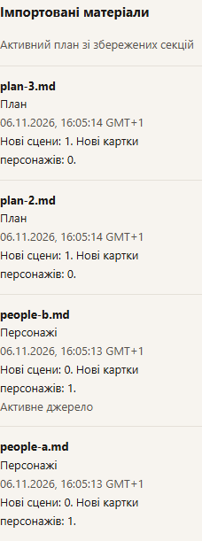
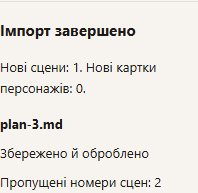
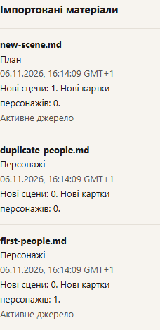

# Additive imports

Character imports add new names only. Duplicate names are skipped; edit existing cards on Characters. IDs, descriptions and availability markers are preserved.

Scene duplicates use the explicit author number: “Сцена 2. Зустріч” and “Сцена 2: Друзі” match. Titles and list positions do not identify duplicates. Unnumbered sections are always new, including on repeated imports. New scenes are appended; the active plan retains its previous text and adds only new sections. Renumbering a manually saved plan updates its author number; an occupied number is rejected.

Edit the word target in Settings → Writing. Save applies it with the profile; Reset restores the saved value. The materials panel lists each imported filename and its local date, time and time zone. An active plan assembled from accepted sections is marked separately, without adding a fictitious import event. GET story adds source_files (name, UTC created_at) and active_sources. PUT settings accepts target_words with profile and expected_revision in one atomic save. Minimum: 5,000; recommended up to 15,000 words. Existing scene targets stay unchanged.

Multipart results contain files with imported, failed or not_processed status. A partial success returns200 and partial=true. Do not retry the whole batch automatically; unnumbered scenes would be added again. Initial format/UTF-8 validation rejects the whole batch before publication; a runtime failure stops subsequent files.

Database schema5 preserves previous active sources and exact original bytes. Make a cold backup before upgrade; downgrading requires a matching older data backup.

A failed file reports no created/skipped material or success warnings. Appending a plan preserves current canon and cards citing the previous immutable plan. Scene creation accepts an explicit author_scene_number and rejects a conflicting numbered heading. A heading that cleans down to markup only receives a default title instead of failing the import.

The result stays beside the upload form: new scene/card counts, skipped names/numbers and each file’s status. Duplicate character names link to Characters. Successful files are cleared from the form; only select unsuccessful files for a deliberate retry. The current scene and material remain open.

If the journal refresh fails after a confirmed import, the confirmed result stays visible; Refresh journal retries only the read. If the upload response is lost, the outcome is unknown and the files are cleared from the form. Refresh the journal and check scenes/cards before selecting files again. Unnumbered scenes would be added again on a repeated upload.

New journal entries show the scenes and character cards actually created by each file; skipped duplicates are excluded. These counts survive reload. Older entries without saved counters show unknown counts, rather than reconstructing them from the current story. Provider failures now retain a safe reason and HTTP status when available, distinguishing timeout, connection, key, quota and rate limit. Responses/partial text and cost accounting are preserved; there is no automatic retry.

