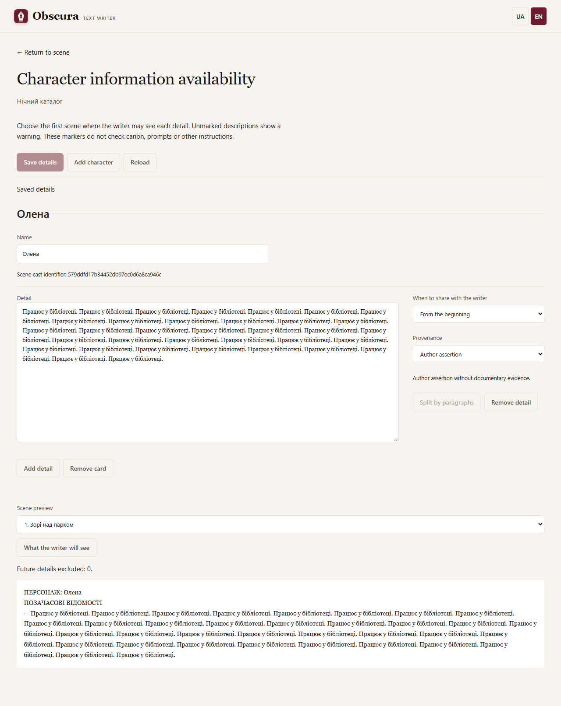

# Characters

Open **Characters** next to **Settings** at the top of your story. The separate page provides wide description fields, with availability settings alongside them on desktop and below them on mobile.

Use the controls at the top to save, add a character, or reload saved cards. For each entry, choose its availability and, when applicable, the first scene where it becomes available. Preview a selected scene before saving; preview does not save your changes. You can still split descriptions into paragraphs and manage entries, origins and sources.

The return link restores the scene and material you were viewing. Your browser warns before leaving unsaved edits. A failed save or revision conflict keeps your edits; reloading requires confirmation. Another tab uses saved cards only. Without scenes, cards can be edited but preview is unavailable. Switching UA/EN preserves your text.

