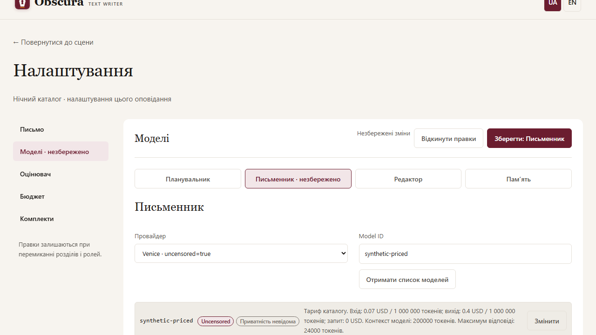

# Editor workflow

In a comment rewrite review, Select all changes checks every proposed group. Then Preview selected text and explicitly apply the selection. Selecting changes does not call a model or modify the draft.

For a long story, click Scenes and its count to collapse the whole list and keep Add materials nearby. Click again to expand it. Your current scene and unsaved text remain intact. Latest results in the book review can be collapsed the same way; the current author checkpoint remains visible outside that history. Report actions fold with their reports.

Under Settings → Models, Get the model list and choose the exact Model ID. The field hint and list show USD per1,000,000 input/output tokens, request fee and known model caps. The saved current tariff matches Budget; manual and expired tariffs are labelled. Missing data means Tariff unknown, never zero. Changing provider/URL clears the previous quote; selecting a model does not change your limits. Metadata discovery does not generate text. Exceeding a known context/output cap stops before the completion POST with the allowed value; unknown caps do not promise an unlimited window.

Structured model responses, including checks, may have one paired outer JSON wrapper using backticks or apostrophes. The app removes that wrapper before validation, preserving apostrophes within text and the original raw response. Manual JSON stays strict. Surrounding explanations, incomplete blocks and invalid evidence remain errors; retry explicitly. The changed evaluator protocol requires renewed calibration before automatic qualification.

Model capacity checks compare the estimated actual input plus the response reserve. The configured context window is a role ceiling, not the length of every request; setting a larger ceiling does not mean that many tokens are sent.

A model proposal with exactly scene_number/change is preserved as “Сцена N: …” text with a warning. Its scene number and text are retained; the brief still requires explicit acceptance. Other unknown shapes remain errors. Manual JSON uses a list of strings for proposed_changes.
# One-click workspace actions

Before a primary model action, the button displays the planned model and maximum number of calls; hover or focus for details and warnings. One click saves changes and starts the stage after its checks. While it runs, the button requests cancellation; the server reports its own status, and calls may already have incurred costs. If the enqueue response is lost, the interface checks the server and temporarily blocks a new primary run. Browser local storage is required for reconciliation. Current Work shows the saved plan, which can differ from parameters used by a later call. Reusing stale previous memory still requires separate consent.
