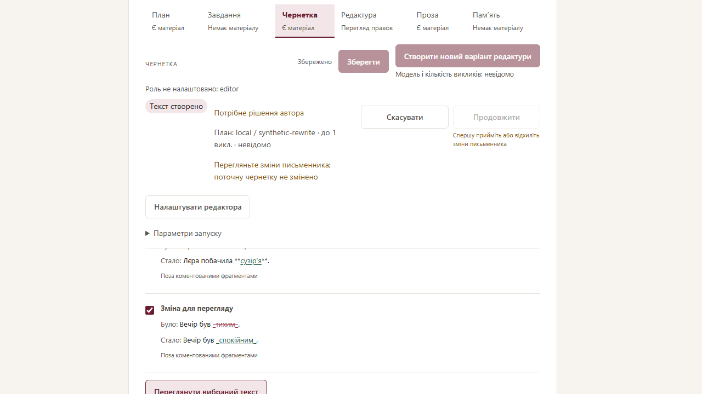
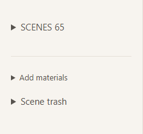
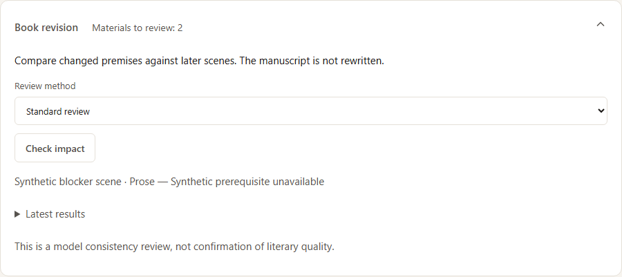
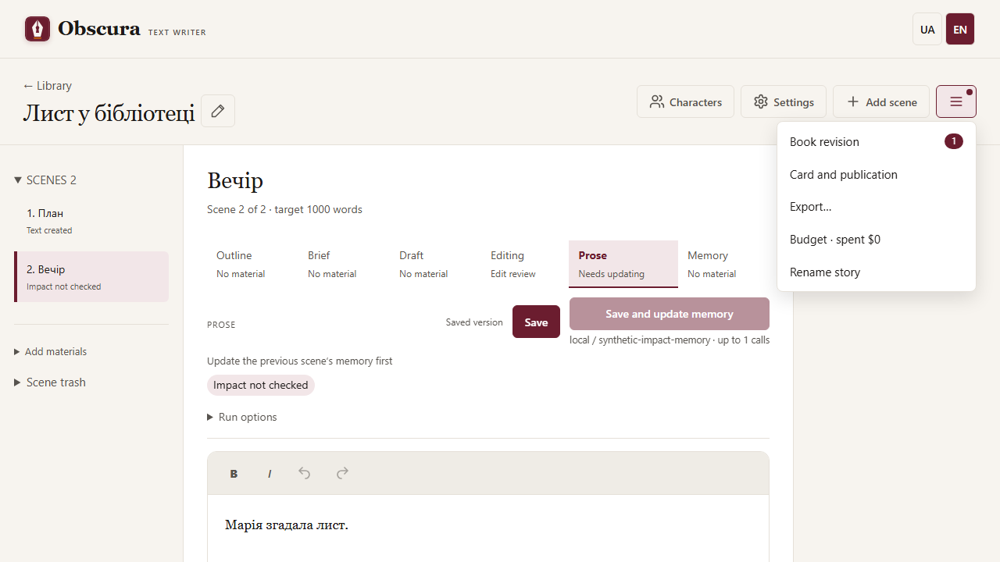
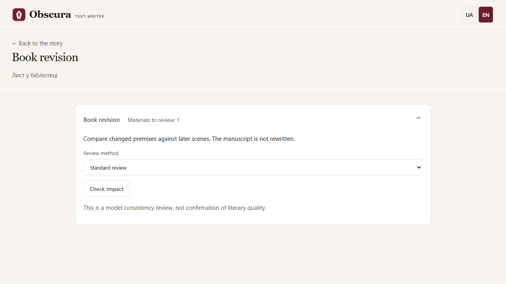

# Editor workflow

In a comment rewrite review, Select all changes checks every proposed group. Then Preview selected text and explicitly apply the selection. Selecting changes does not call a model or modify the draft.

For a long story, click Scenes and its count to collapse the whole list and keep Add materials nearby. Click again to expand it. Your current scene and unsaved text remain intact. Latest results in the book review can be collapsed the same way; the current author checkpoint remains visible outside that history. Report actions fold with their reports.

Under Settings → Models, Get the model list and choose the exact Model ID. The field hint and list show USD per1,000,000 input/output tokens, request fee and known model caps. The saved current tariff matches Budget; manual and expired tariffs are labelled. Missing data means Tariff unknown, never zero. Changing provider/URL clears the previous quote; selecting a model does not change your limits. Metadata discovery does not generate text. Exceeding a known context/output cap stops before the completion POST with the allowed value; unknown caps do not promise an unlimited window.

Structured model responses, including checks, may have one paired outer JSON wrapper using backticks or apostrophes. The app removes that wrapper before validation, preserving apostrophes within text and the original raw response. Manual JSON stays strict. Surrounding explanations, incomplete blocks and invalid evidence remain errors; retry explicitly. The changed evaluator protocol requires renewed calibration before automatic qualification.

Model capacity checks compare the estimated actual input plus the response reserve. The configured context window is a role ceiling, not the length of every request; setting a larger ceiling does not mean that many tokens are sent.

A model proposal with exactly scene_number/change is preserved as “Сцена N: …” text with a warning. Its scene number and text are retained; the brief still requires explicit acceptance. Other unknown shapes remain errors. Manual JSON uses a list of strings for proposed_changes.
# Story workspace

The top row has three icon actions: **Characters**, **Settings** and **Add scene** (labelled on wide screens). Story-wide actions live in the **☰ Story actions** menu: **Book revision** (a separate page with **← Back to the story**; the number next to it counts materials waiting for review), **Card and publication**, **Export…** (a dialog), story evaluation and reports, a budget line linking to settings, and rename. The menu works from the keyboard; `Escape` closes it and returns focus.

A status row above the scene text shows the scene status, run progress and run controls; **Run options** holds the next-run limit. When a sequential impact review waits for your decision, its card appears just below the status row, next to the text. The side panel is about the scene only: **Scene settings** and **Scene evaluation** collapse and remember their state in this browser; evaluation is hidden when the evaluator is off. The import journal opens inside the import section of the scene list.

Mobile: [workspace](../images/workspace-menu-mobile.png), [Book revision](../images/workspace-revision-mobile.png).

# One-click workspace actions

Before a primary model action, the button displays the planned model and maximum number of calls; hover or focus for details and warnings. One click saves changes and starts the stage after its checks. While it runs, the button requests cancellation; the server reports its own status, and calls may already have incurred costs. If the enqueue response is lost, the interface checks the server and blocks a new primary run until the result is known or you press Stop to resolve the pending request. Browser local storage is required for reconciliation. Current Work shows the saved plan, which can differ from parameters used by a later call. Reusing stale previous memory still requires separate consent.

Rewrite from comments saves edits, checks readiness and starts one writer call with a single click and no confirmation dialog. The writer model appears beside the button, and readiness warnings appear below it as the run starts; a failed save or readiness check prevents the run. The browser still controls the warning when a tab with unsaved changes is closed.

Editing an accepted brief keeps its acceptance when you save or start a draft. A new proposal that has not yet been accepted still requires explicit acceptance after editing.
