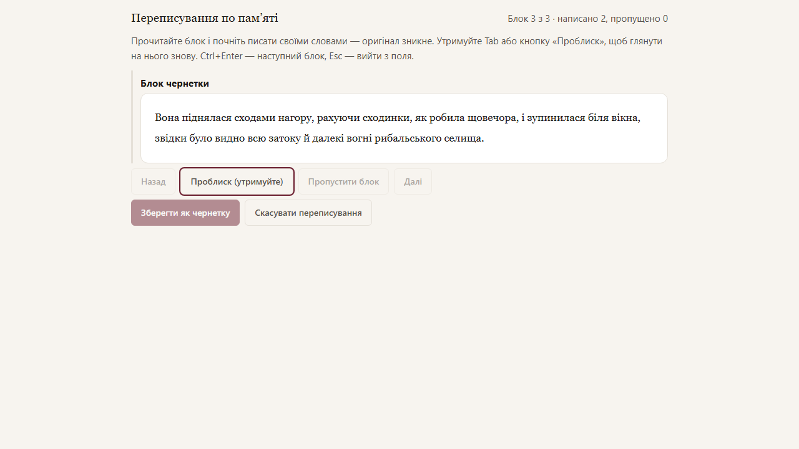

# Rewriting from memory

This mode helps you rewrite a scene's AI draft in your own words instead of editing it mechanically. At any moment you either read the original or write, never both at once. The result becomes your manual draft, which you can then proofread with the regular editor or accept as prose right away.

## Getting started

1. Open the scene and the Draft step. The draft must be saved.
2. Click **Rewrite from memory**. A full-screen mode opens.

The draft is split into blocks: a paragraph, with short paragraphs (such as dialogue lines) joined to the following ones until the block reaches about two lines (160 characters). Scene separators (`***`) are not rewritten; they are carried into the result as is.

## Writing

- You see the current draft block. As soon as you start typing, it disappears and only your text remains. Erasing everything you wrote does not bring the original back.
- **Peek:** while you hold `Tab`, your text is hidden, the draft block is shown and typing is locked. Release the key and keep writing. For mouse and touch there is a **Peek (hold)** button.
- `Ctrl+Enter` or **Next** moves to the next block, **Back** to the previous one. The original of an earlier block is visible again only during a peek.
- **Skip block** deliberately leaves the fragment out of the new draft; **Restore block** undoes the skip.
- `Esc` moves the cursor out of the field (since `Tab` in the field is taken by the peek).
- Pasting is disabled in this mode, and the draft text cannot be selected or copied.
- You write with the same editor and formatting as regular prose.

## Saving

**Save as draft** is available once every block is either written or explicitly skipped. If some blocks are skipped, the app asks for confirmation. Saving creates a new manual draft of the scene; the AI draft stays in history unchanged. The new draft remembers which AI draft (and therefore which brief) it grew from, so the protagonist's acquaintances are counted correctly.

Then follow the usual path: run the editor (it fixes spelling and punctuation without rewriting) or accept the draft as prose.

After saving, and under the history list for such a version, you see statistics: how many blocks were rewritten and skipped, what share of your text matches the draft verbatim (by four-word fragments), how many peeks there were and how many pastes were blocked. Peek and paste counts are labelled "editor reports": they come from the browser. Nothing is sent to models or elsewhere.

## Unsaved rewriting

Until you save or cancel, the rewrite is kept in this browser: after closing the tab the button reads **Continue rewriting**. The browser warns before closing the tab. In another browser or after clearing site data the unsaved text is gone. **Cancel rewriting** deletes it after confirmation.

If the draft was updated after you started, the mode warns you: you are rewriting the version you started from.

## Limitations

The mode is a discipline for the author, not a protection: the draft can be opened in another tab. The overlap share sees only verbatim matches, not close paraphrase.
