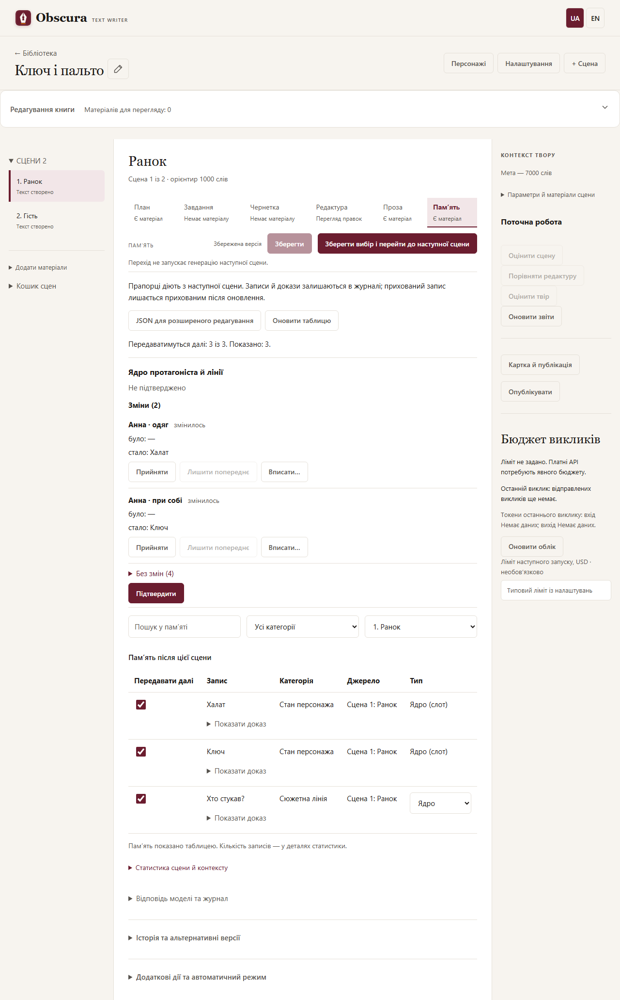
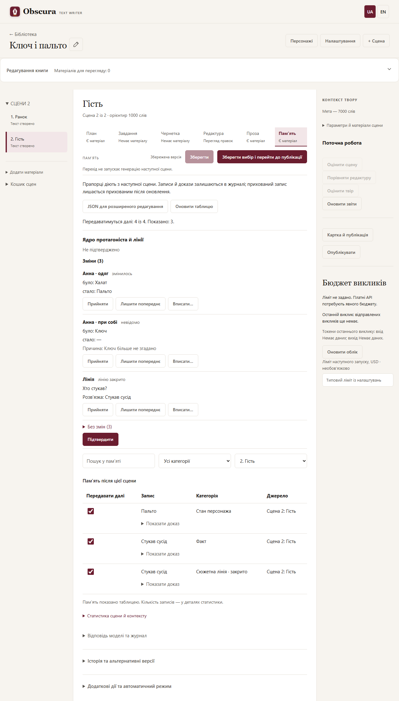
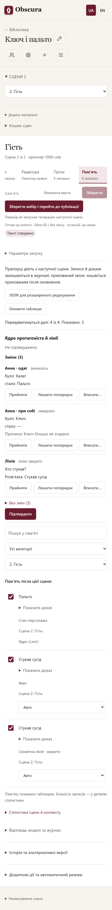

# Reviewing and selecting memory

Open a scene and choose **Memory**. Instead of JSON, the default is a table view: the text of each entry, its category, and the source scene. Technical IDs are hidden; **Show evidence** opens the quote from the prose. The source scene filter initially shows entries from the current scene; select another scene or All scenes to see inherited entries. Search and the scene and category filters do not change the selection of hidden rows.

Clear **Forward** next to entries you do not need and press **Save**. A choice made on scene 5 applies from scene 6 onward, including inherited facts, without deleting them from the journal or rebuilding memory from scratch. In a later scene you can tick the box again; earlier scenes keep their own choice. If the same entry is updated, it stays hidden until you enable it explicitly.

Only the entry in the literary memory block for the planner, the writer and the full literary edit is switched off. It is not deleted from your plan, canon, prose or the tail of the previous scene. The memory model keeps the full catalog for the journal; the Evaluator works from its own primary sources.

Finished texts are not rewritten automatically. Dependent tasks, drafts and prose of later scenes may become stale: review and accept them explicitly, or regenerate. The memory journal itself does not become stale because of the checkboxes. Restoring the exact earlier selection restores freshness under the usual dependency rules.

Stale memory is shown read-only; refresh memory before saving its checkboxes. If another tab causes a conflict, your changes stay in the form and are not applied; **Refresh table** lets you discard the unsaved selection and reload current data. Unsaved changes block generation, and leaving for other material asks you to confirm discarding them.

**JSON for advanced editing** returns the previous journal editor with all its quote/prefix checks. Checkboxes are not part of the JSON; they are a separate author setting. A core state slot (`slot`) can be set in the JSON only for the protagonist; a `resolves_claim_id` link must point to an entry already in the journal, and the application itself moves it to the internal ID that entry receives. Historical versions are browsed through history as before. Fully regenerating an entry with a new internal ID creates a new entry with the default enabled checkbox; the system never carries a choice over to similar text by guesswork.

## Evidence in memory entries

Memory is updated only in evidence mode (`evidence_delta`, format v4, labelled "Evidence-based memory operations v4"); the legacy "Full snapshot" mode is gone, and a role saved with it automatically works in evidence mode. The model does not rewrite quotes. For the protagonist it must decide every core state slot (clothing, carried, location, body, company): unchanged, changed with evidence, unknown with a reason, or "introduced" for an author entry that the prose shows to the reader for the first time. For every active thread it must say whether the thread stays open or is closed by evidence of its resolution; a character's absence from the scene never closes a thread. When the plan's `Початок:` line shows a new day, the model receives a separate notice. Everything else is grouped operations: add only for facts and timeline, add, update and retire for other states, and add for new threads. Each operation names 1 to 3 prose fragment IDs (`evidence_ids`). The application takes the verbatim quotes from the prose itself: the first fragment becomes the main quote, and the rest (up to two) become supporting quotes.

In the memory table, **Show evidence** opens the main quote with the supporting quotes below it, in the same order. If there are none, only the main quote is shown.

For models that support response schemas, choose the `json_schema` response mode: the application builds a schema for each request (allowed fragment IDs, active entries available for update, scene characters), which rules out most format errors.

## Protagonist core state in the writer context

The memory block for the planner, the writer and the full literary edit starts with a **ЯДРО СТАНУ — <protagonist name>** (core state) section (if the protagonist's card has no name, **ЯДРО СТАНУ — протагоніст**). It lists the current slot values in a fixed order: clothing, carried, location, body, company. Empty slots are not shown, and older stories have no such section until a scene's memory is regenerated. The core is shown even in a scene where the protagonist is not in the cast: their state carries over unchanged. A slot value is not repeated under current states. The **Forward** checkbox applies to core entries the same way as to other entries. If you hid a slot value and the model later marks it unknown, the value moves to current states still hidden (in the memory table its checkbox is cleared) until you explicitly enable that state itself.

**Closing threads.** A closed thread leaves the open threads, and its resolution becomes an ordinary fact; the closure is not repeated in the timeline. Closures made before format v4 stay in the timeline as before. If you hid a thread, its resolution is hidden too (in the memory table the resolution's checkbox is cleared) until you explicitly enable the thread itself or the resolution fact itself.

**Unknown to the reader.** An author entry without a quote is a truth of the story world that the reader has not seen yet. The writer receives it marked "(читачеві невідомо: якщо знадобиться, введи в тексті як нове)" (unknown to the reader: if needed, introduce it in the text as new) and must introduce it as new information. Once the prose shows it, the memory stage marks the slot as "introduced" and the mark disappears. If the model instead marks such a slot unknown, the entry moves to current states and keeps the mark.

**Day change.** A new day is detected from the `Початок:` line in the scene plan (`D.M.Y, H:M` or `день N, H:M`). Different spellings of the same date (`1.3.24`, `01.03.2024`, `1.3.2024`) are one day. The memory model then decides separately whether clothing, carried items and body state still hold or marks them unknown with a reason. Without this line there is no signal, and the values stay current until the prose changes them.

## When memory does not fit the context

While the full request of the planner, the writer or the editor fits the role limits (context minus the answer reserve, and the maximum input characters), memory is sent in full and nothing changes. When it does not fit, the application selects part of the memory instead of failing and shows a warning: "Повна пам’ять не вміщається: у запит відібрано X з Y записів" (full memory does not fit: X of Y entries selected). Selection is deterministic: the same story and the same settings give the same set of entries.

Order of importance:

1. the protagonist's core, always in full;
2. fresh protagonist states: changed on the scene's day (from the `Початок:` line) or within the last 3 scenes;
3. open threads that mention scene participants;
4. states of other participants;
5. general states without characters;
6. facts about participants;
7. the timeline of the last 20 scenes;
8. "atmosphere": older protagonist states and facts only about the protagonist, up to 10% of the memory budget;
9. other entries found by the words of the scene plan (and, for the draft and the edit, of the brief).

A dropped timeline is marked in the request itself by the first line of the timeline section, for example "Не показано записів: 12 (сцени 1–12)" (12 entries not shown, scenes 1–12). If even the core does not fit, the request is not sent and the application explains that the core is never cut: reduce other materials (canon, previous prose tail, plan horizon) or increase the context to match the real model. Participants are matched by the stem of their name, so another case form (for example «Олі» for «Оля») may not be recognised; such an entry can still come in through the plan words. The memory stage likewise receives the full catalogue while it fits. When it does not, the catalogue is narrowed: the core and every thread stay, and of the other entries the states of scene participants and general states, up to 20 states found by the prose text, facts about participants and the timeline of the last 20 scenes. The application warns: "Каталог пам’яті звужено: N записів не показано моделі" (memory catalogue narrowed: N entries not shown to the model). An entry that was not shown cannot be updated in this run, so if the prose changed it, the model may add a new duplicate entry; check the memory table and turn off the extra one.

### Entry type: core or atmosphere

The last column of the table, **Type**, tells selection what to do with the entry when memory does not fit the context:

- **Auto**: the entry goes into a layer by the usual rules.
- **Core**: the entry is always shown, together with the hero's core.
- **Atmosphere**: the entry only gets into the small atmosphere share (about 10% of the memory budget).

Core slots of tracked characters are shown as "Core (slot)" and their type cannot be changed. The choice is saved at once, without the Save button, and applies to the whole story. While the full memory fits, a mark changes nothing. It makes stale only texts built with selection in which this entry was already in memory. If the story was changed meanwhile in another tab, the application reports a conflict and reloads the table.

What was selected is shown in the scene and context statistics: the line "Memory selection: X of Y chosen, Z dropped" with the layers where entries were dropped.

## Confirming the core

On the **Memory** tab, below the table buttons, there is a **Protagonist core and threads** panel. It compares this scene's memory with the memory it was built from: for each core slot it shows "was" and "now", for an unknown value the model's reason, and for a closed thread its resolution. The **Changes** group is expanded; the **Unchanged** group (and threads that stay open) is collapsed. The top line shows the state: "Not confirmed" or "Confirmed" with the time. In the first scene or an older story without a core, the panel shows "The core is not filled in yet" and only the threads.

Row actions:

- **Accept** keeps the model's decision (and removes your edit of this row, if there was one).
- **Keep previous** restores the value of the previous scene or keeps the thread open. It is available only for versions generated by the memory model: a manually saved version has no model answer, so the button is disabled with an explanation.
- **Write in…** opens the entry panel: enter a value (for a thread, its resolution), choose the quote scene and a fragment of its prose (search narrows the list), or select **No quote**. An entry without a quote becomes "unknown to the reader": the writer receives it with that mark. For a thread that is already closed in a version without a model answer, Write in… is not offered.

**Apply** and **Cancel** change only the panel's draft; nothing is sent to the server. **Confirm** without edits only marks the current memory as confirmed: it does not change the journal and does not make the memory of later scenes outdated. **Confirm with edits (N)** creates a new memory version with your edits and confirms it at once; the memory of later scenes then becomes outdated under the usual rules.

An unsaved core draft is protected like unsaved text: **Refresh table**, choosing another scene or material, or closing the page asks first whether to discard it. The question names the **Protagonist core and threads** panel: **Save** and **Save selection and…** save only the table checkboxes, and core edits reach memory only through **Confirm with edits**. If the scene memory has changed in the meantime (for example in another tab), the panel reloads and the draft is discarded with a notice. If a confirmation fails because of such a change, the panel shows the reason and reloads; check the state and repeat if needed.

Edits on an outdated scene memory (one not built from the current memory of the previous scene) are rejected: regenerate this scene's memory first. Confirming it without edits still works.

Automatic mode does not wait for confirmation. Before running a scene or the remaining scenes, the confirmation window shows how many scenes have an unconfirmed core; this is information only and does not block the run.

## If a memory run fails

The run status shows the full list of response-format violations (up to 50 items, then "N more"). Each item is an operation label (for example `facts.add, element 2`, `Operation 3` or `Response`) plus a code. Texts and record IDs never appear in the list.

- `evidence_unknown` - evidence not found in the source: the fragment ID is not in the current prose.
- `evidence_count` - invalid number of evidence quotes: 1 to 3 distinct IDs are required.
- `add_limit` - add limit exceeded: at most three new entries per category.
- `ops_limit` - operation limit exceeded: at most 12 elements per response.
- `target_unknown` - unknown target: the entry to update or retire is not an active entry of that category.
- `target_meta` - (v2 format only) an update or retire changed the claim's category or scope.
- `target_twice` - the same entry is changed twice in one response.
- `scope_unknown` - unknown record scope (a character who is not in the scene).
- `schema` - the response does not match the schema: required keys are missing, extra fields are present, and so on.
- `wire_version` - unsupported format version: the response does not match the format the prompt asks for.

Most often the `json_schema` mode or simply running again helps; if a code keeps repeating, review your custom prompt.

## Custom memory prompt: moving to v4

Custom prompts saved with contract `/2` or `/3` no longer run: they do not ask for the mandatory core state and thread decisions, so runs and role saves stop with the explanation "Incompatible prompt: required memory/evidence_delta/4". For such a prompt the memory role settings show the checkbox **Move the custom prompt to format v4**. First rewrite the text so that it asks for format v4 (the `core` and `threads` sections together with the operation groups), then tick the checkbox and save: the prompt is stored with contract `/4`. Without the rewritten text the model will answer in the old format and the run will fail with `wire_version` or `schema`. Clearing the custom prompt returns the built-in v4 prompt.
