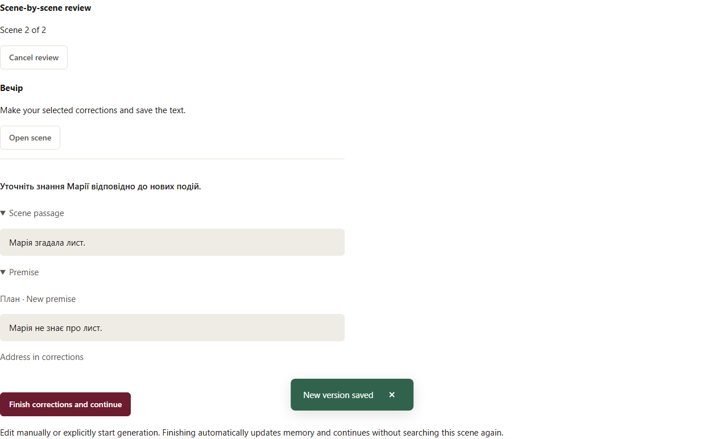

# Scene-by-scene book review

[Українська](../sequential-review.md)

Older briefs and prose without a saved historical baseline use **Current premises**: current plans, canon, character descriptions, the scene brief for prose, and earlier scenes. The preview and report explicitly state that no before-and-after comparison was performed. Original history is preserved. A complete clean search or your decision makes the material current for these premises; later source changes require review again. Corrupt sources and invalid memory remain blockers.

Open **Book revision → Check impact** on the story page. The preview shows the planner and an approximate initial search call count. Later scenes are planned after earlier scenes finish. Memory updates may require additional calls. For paid roles, enter a session spending limit; the story budget also applies. Opening a page or settings never starts a model call.

The session proceeds in scene order. A complete, successful search without concerns automatically marks the scene current. This is a practical model assessment that can miss problems, not a guarantee of literary quality.

Concerns or questions pause the session. Each includes a message, a scene passage and a premise. Choose **Dismiss as irrelevant** or **Address in corrections** for each, then apply your decisions. **Dismiss all and continue** explicitly accepts the scene as an author decision.

If you select corrections, open the scene and edit the saved text manually or use the existing generation/rewrite tools. Selecting concerns does not generate anything. Save your work, then choose **Finish corrections and continue**. The system accepts the current materials, updates memory and advances without searching that scene again. Your decision remains separate from the model report.

Memory uses only the current and earlier scenes. Changes to earlier prose can require several journals to be refreshed in order. A memory failure preserves accepted text and pauses the session. **Resume review** asks for explicit permission to repeat a failed call; completed, verified answers are reused without another call. Historical or invalid memory evidence is never silently accepted.

Decisions and session progress survive reload and settings navigation. Unsaved edits block author continuation. Changes to scene order or search sources stop application of the result; prepare a new preview. Role setting changes apply to the next call, while completed attempts retain their original settings.

Earlier impact checks remain in history in their original format. The new button starts protocol3. Journals and proofs are included in normal backup and integrity checks; no SQLite migration is required.

If a rebuild could erase author-maintained memory entries or lose forwarding choices, it stops before a model call and names the scene. Update that scene’s memory manually, preserving the required entries and checking your choices, then resume review. The old journal is not overwritten automatically. Invalid older journals also require manual repair.
