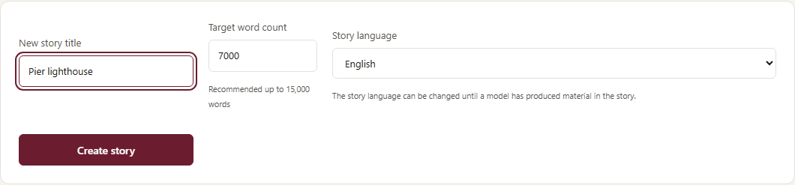
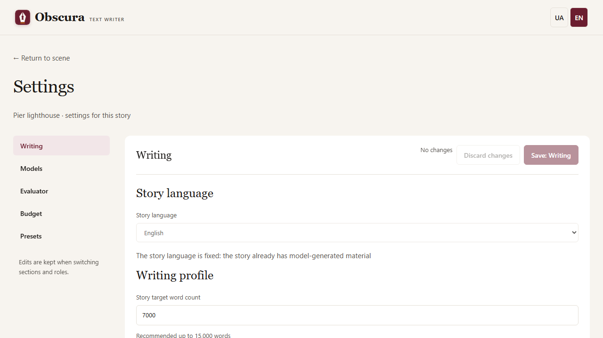
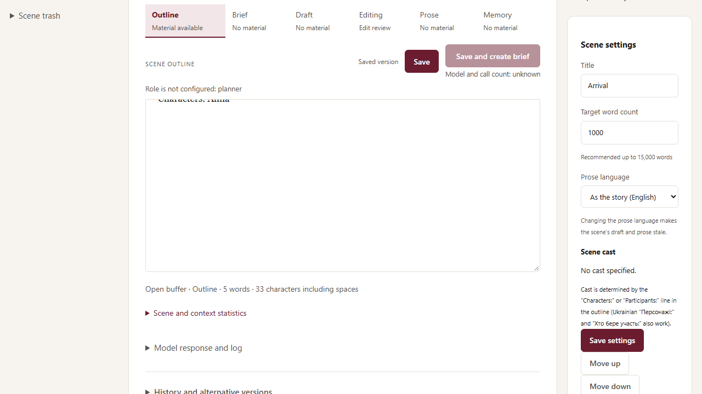

# Story language

A story can be written in Ukrainian or English. The interface language (the UA/EN switch at the top) is independent of it: you can work on an English story in the Ukrainian interface and vice versa.

## A new story

In the **New story** form on the home page, choose the **Story language**: Ukrainian (the default) or English. The language determines:

- the default prompts of every role and the context headings the model sees;
- the downloadable plan and character templates (English ones, with `Scene 1:` and `Characters:` headings, for an English story);
- the language hints after copyediting;
- the default language of the publication card.

## When the language can still change

Until a model has produced any text in the story, you can change the language under **Settings → Writing → Story language**. The choice is saved at once, without the section's save button. After the first generation the language is fixed: the field is disabled and explains why, and the server rejects the change.

## Prose language of a single scene

The **Prose language** field in the scene card lets you write one scene in a different language from the rest of the story. "As the story" means the story language. Model instructions stay in the story language; the model gets one instruction saying which language to write this scene's prose in.

Changing the prose language makes the scene's draft and prose stale. The scene brief and memory do not become stale. Drafts made before this field existed count as Ukrainian.

## Importing a plan and characters in English

Parsing understands English headings alongside Ukrainian ones:

- scenes: `Scene 3: Arrival` just like `Сцена 3: Прибуття`; participants: `Characters:`, `Participants:` or `Cast:`;
- the starting day: `start` alongside `початок`;
- protagonist and role markers in character descriptions: `protagonist`, `main character`, `role in the story`, `knows …`.

Untitled plan sections of an English story are named `Scene`, not «Сцена».

## What works differently for English prose

- **Language hints** for an English scene check only mixed alphabets and repeated words. Ukrainian rules (the letters ы/э/ъ/ё, a dash at the start of a dialogue line, known model regressions) do not apply.
- **Negation protection** in point edits covers English `not`, `cannot` and `n't`.
- **Evaluation** of English prose is not available yet: the Evaluate buttons are disabled with an explanation. The evaluator is calibrated on Ukrainian texts only.

## Publication and role profiles

- A new publication card for an English story starts with language `en`. A saved card is not changed: its language is the author's choice.
- FB2 genre names on the publication page follow the interface language. The model request that suggests metadata names genres in the story language.
- A role profile remembers the language of the story it was saved from. Applying it to a story in another language shows a warning but does not block it: the author's own prompts are not translated.

Українська версія: [Мова твору](../story-language.md).
