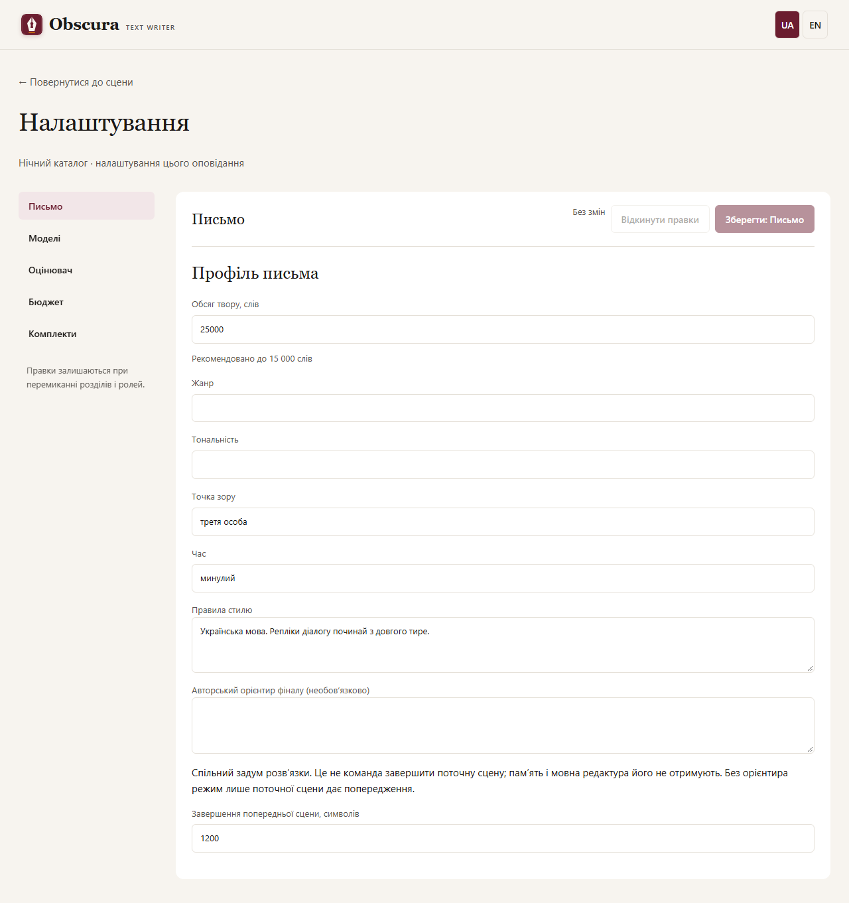

# Target word count

Story and scene target word counts have no hard upper bound. Recommended up to 15,000 words. The minimum remains 5,000 for a story and 1 for a scene; defaults remain 7,000 and 1,000. Larger targets are saved without truncation. Model context limits still apply to generation.

Edit an existing story under Settings → Writing → Story target word count. Save includes the writing profile; Reset restores saved values. A concurrent target change is reported without discarding your input. Scene targets are not redistributed.

