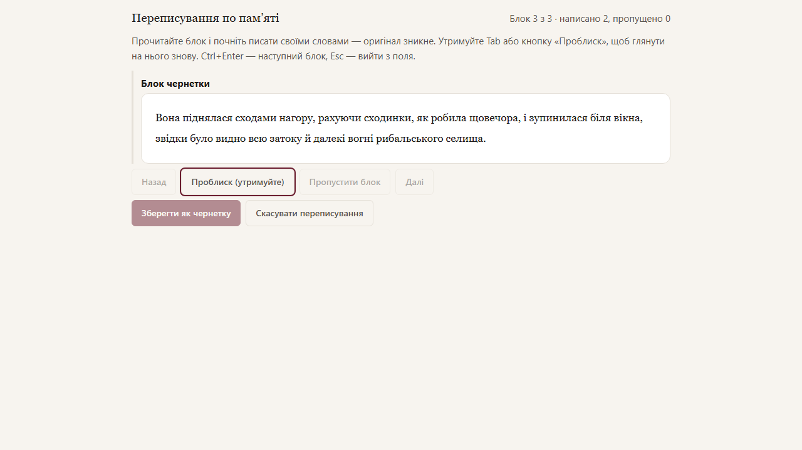

# Переписування по пам’яті

Режим допомагає переписати AI-чернетку сцени власними словами, а не правити її механічно. У кожну мить ви або читаєте оригінал, або пишете — але не обидва одночасно. Результат стає вашою ручною чернеткою, яку далі можна вичитати звичайним редактором або одразу прийняти як прозу.

## Як почати

1. Відкрийте сцену й крок «Чернетка». Чернетку має бути збережено.
2. Натисніть **«Переписати по пам’яті»**. Відкриється повноекранний режим.

Чернетку поділено на блоки: абзац, а короткі абзаци (наприклад, репліки діалогу) склеєні з наступними, доки блок не набере близько двох рядків (160 символів). Розділювачі сцени (`***`) не переписуються: вони переносяться в результат як є.

## Як писати

- Ви бачите поточний блок чернетки. Щойно починаєте друкувати, він зникає, і лишається тільки ваш текст. Якщо стерти все написане, оригінал не повертається.
- **Проблиск:** поки ви тримаєте `Tab`, ваш текст ховається і видно блок чернетки, а набір заблоковано. Відпустіть клавішу — і пишіть далі. Для миші й сенсорного екрана є кнопка **«Проблиск (утримуйте)»**.
- `Ctrl+Enter` або **«Далі»** — наступний блок, **«Назад»** — попередній. Оригінал попереднього блоку видно знову лише під час проблиску.
- **«Пропустити блок»** свідомо прибирає фрагмент із нової чернетки; **«Повернути блок»** скасовує пропуск.
- `Esc` виводить курсор із поля (бо `Tab` у полі зайнятий проблиском).
- Вставка тексту в режимі вимкнена, а текст чернетки не можна виділити чи скопіювати.
- Ваш текст пишеться тим самим редактором, що й звичайна проза, з тим самим форматуванням.

## Збереження

**«Зберегти як чернетку»** доступне, коли кожен блок або написано, або явно пропущено. Якщо є пропущені блоки, застосунок перепитає. Збереження створює нову ручну чернетку сцени; AI-чернетка лишається в історії без змін. Нова чернетка пам’ятає, з якої AI-чернетки (і отже з якого завдання) вона виросла, тож знайомства героя рахуються правильно.

Далі — звичайний шлях: запустіть редактора (він виправить орфографію й пунктуацію, не переписуючи текст) або прийміть чернетку як прозу.

Після збереження видно статистику, а також під списком історії для такої версії: скільки блоків переписано й пропущено, яка частка вашого тексту дослівно збігається з чернеткою (за фрагментами з чотирьох слів), скільки було проблисків і скільки вставок заблоковано. Лічильники проблисків і вставок позначено «за даними редактора»: це свідчення браузера. Нічого не надсилається моделям чи назовні.

## Незбережене переписування

Поки ви не зберегли й не скасували переписування, воно зберігається в цьому браузері: після закриття вкладки кнопка називатиметься **«Продовжити переписування»**. Браузер попередить перед закриттям вкладки. В іншому браузері або після очищення даних сайту незбережений текст зникне. **«Скасувати переписування»** після підтвердження видаляє його.

Якщо чернетку оновили після початку переписування, режим попередить: ви переписуєте ту версію, з якої почали.

## Обмеження

Режим — дисципліна для автора, а не захист: чернетку можна відкрити в іншій вкладці. Частка збігів бачить лише дослівні збіги, а не близький переказ.
