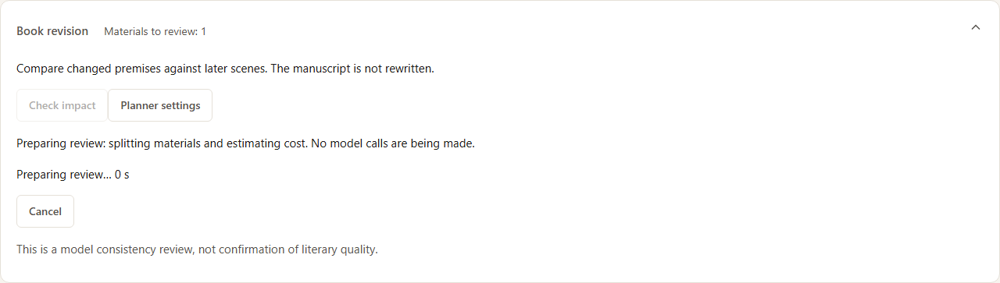
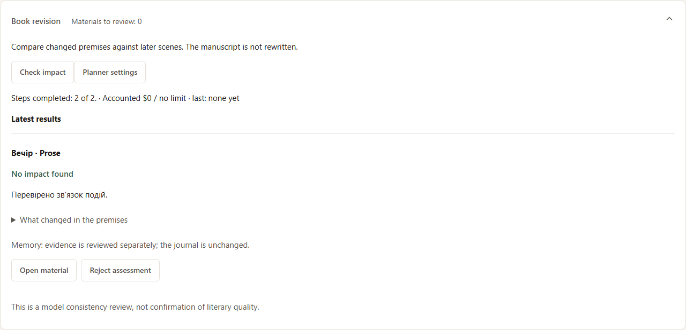
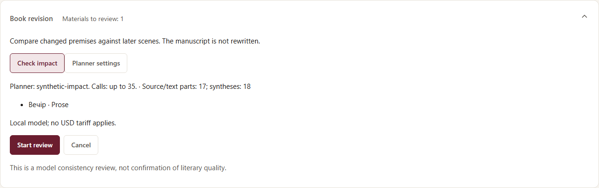
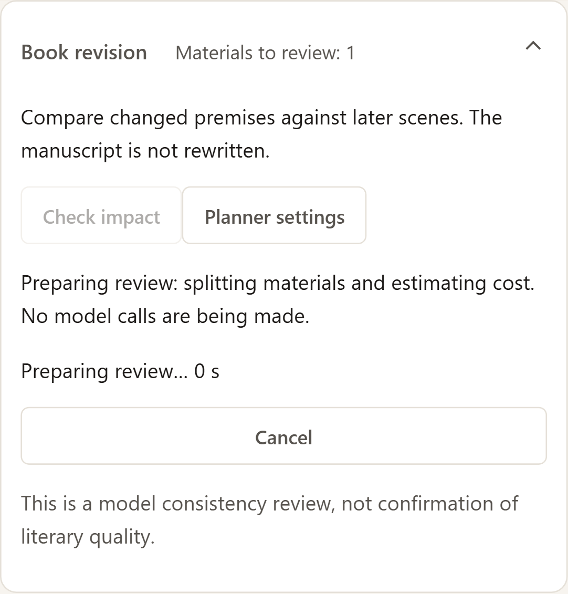
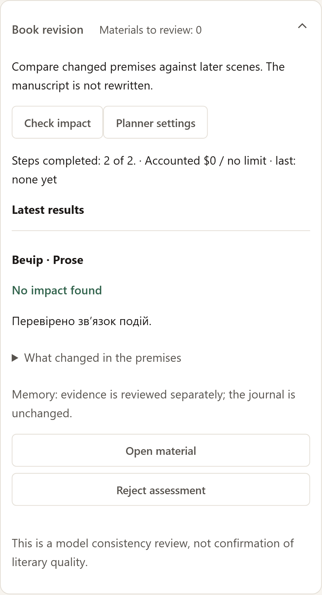
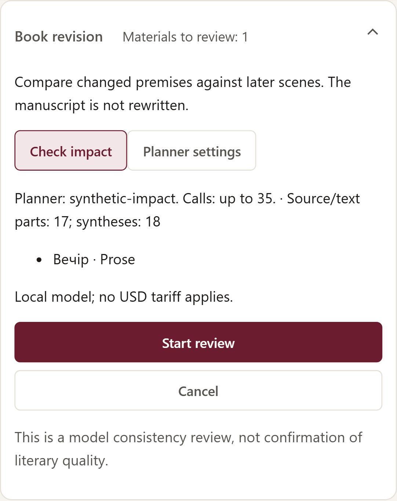

# Перевірка впливу під час редагування книги / Book revision impact review

## Українською

На сторінці твору розгорніть **«Редагування книги»** під назвою. Інструмент порівнює змінені передумови із завданнями та прозою залежних сцен. Він не переписує текст.

1. Збережіть правки в главі. Якщо є незбережений текст, «Перевірити вплив» спочатку запропонує його зберегти; скасування не запускає модель.
2. Натисніть **«Перевірити вплив»**. Перегляньте матеріали, модель планувальника, число можливих викликів і бюджет. У налаштуваннях планувальника можна змінити контекст/резерв/response mode; ця операція використовує окремі вбудовані промпти дельти й перевірки, а не користувацький промпт генерації завдання.
3. Для Venice/OpenRouter потрібні явний бюджет твору, чинний тариф та окремий ліміт цієї серії. Верхня оцінка консервативна: враховує максимально дозволений вхід та вихід усіх викликів. Можна задати менший ліміт, але тоді серія зупиниться перед викликом, що не вміщується. Зміна моделі між етапами не збільшує ліміт. Локальна модель не отримує вигаданої ціни USD.
4. Натисніть **«Запустити перевірку»**. Спочатку модель знаходить змістову дельту; однакові пари змінених передумов використовують спільну дельту. Далі кожен матеріал перевіряється окремо. Повні змінені джерела теж передаються, щоб аналіз не спирався лише на дельту.
5. Перегляньте результати. «Впливу не знайдено» прибирає потребу перегляду конкретного тексту. «Потрібні зміни» показує точні уривки, нові передумови та потрібне виправлення; проза отримує цю позначку лише за конкретною знахідкою. «Потрібен перегляд» означає невизначеність, не літературний штраф. Завдання й проза мають незалежні висновки.
6. Розгорніть **«Що змінилось у передумовах»** для дельти. **«Відкрити матеріал»** повертає до відповідної сцени/вкладки. Виправляйте текст вручну або чинними AI-assisted інструментами; сама перевірка нічого не переписує.
7. Якщо висновок моделі хибний, натисніть **«Відхилити висновок»**. Він лишиться в історії, але не очищуватиме статус. Це не авторське підтвердження тексту. Нові зміни джерел теж роблять звіт нечинним.

Стан, витрати й керування паузою/скасуванням працюють через звичайну чергу. Відмова, технічна помилка, порожня відповідь, ліміт виходу та непридатна схема розрізняються; автоматичних повторів немає. Після відмови серія не надсилає наступні сцени. Збережена завершена відповідь відновлюється без нового модельного виклику. Зовнішня зміна тексту під час перевірки не дозволяє застосувати старий висновок. Незбережені правки у відкритому редакторі не підміняються результатом.

Після натискання «Перевірити вплив» відразу видно підготовку та час очікування. Для великого твору це може зайняти кілька секунд; модельні виклики ще не йдуть. «Скасувати» припиняє очікування в браузері; через120с воно завершується окремою помилкою й дозволяє повторити preview.

### Пам’ять

Якщо перевірений журнал цільової сцени вміщується в контекст, модель окремо оцінює його змістові наслідки. Якщо журнал не вміщується, перевірка прози продовжується з явним попередженням, а пам’ять лишається неперевіреною. Непридатні джерела/цитати не надсилаються як валідний журнал.

«Змістового впливу не знайдено» для пам’яті **не переприв’язує цитати**: вони можуть залишатися точними цитатами історичних версій. Після оновлення прози її джерела можуть потребувати «Оновити пам’ять» окремим викликом. Перевірка не змінює журнал, head пам’яті або прапорці «передавати далі». Новий журнал не скасовує узгодженість уже перевіреної прози лише через зміну його ID; власний memory verdict при цьому має окрему актуальність.

### Межі

- Аналіз моделі може помилятися. Це перевірка узгодженості, а не доказ загальної літературної якості.
- Старі тексти без відтворюваної бази не очищуються автоматично. Після власного перегляду можна явно встановити поточну авторську базу через **«Історія версій → Переглянути й прийняти текст»**. Це рішення автора; історичні джерела моделі не вигадуються. Нові фактичні ручні Save відтепер записують префіксні передумови; незмінний Save не створює нової бази.
- Перестановка/видалення сцен, невідомі або пошкоджені джерела можуть вимагати ручного перегляду. Порожня сцена лишається «Не почато/Немає тексту».
- Проєкція персонажів поважає часові мітки; канон і нерозмічені авторські вказівки можуть містити майбутні відомості, про це показується попередження.
- Токенний бюджет і «Операційний ліміт входу, символів» — незалежні обмеження планувальника. Повідомлення вказує, яке перевищено: якщо токенів достатньо, збільшіть символьний ліміт для потрібного обсягу; це не змінює вікно моделі.
- Завеликий новий запит автоматично планується частинами: система усуває дублікати, ділить джерела й за потреби цільовий текст із перекриттям, а потім зводить результати. Перед запуском показуються кількість частин і зведень та верхня оцінка витрат. Для цього можуть знадобитися десятки викликів. Жодних викликів до кнопки запуску немає.
- Висновок «впливу не знайдено» застосовується лише після повного перевіреного графа частин. Незавершена частина/відмова/невизначеність не очищують поточний матеріал. Успішні частини зберігаються для відновлення без повтору; старі короткі перевірки працюють за попереднім протоколом.
- Якщо змінено налаштування планувальника або відповідь перевищила резерв частини, потрібен новий попередній перегляд. Мінімальний службовий запит теж має вміщуватися в модель; надто мала межа дає конкретну помилку. Текст не обрізається. Повне покриття не гарантує, що модель помітить усі далекі зв’язки.
- Звіти та їх відхилення зберігаються в backup і перевіряються fsck; нова SQL-міграція для цієї функції не потрібна.

## English

Expand **Book revision** below the story title. This tool compares changed premises against dependent briefs and prose. It does not rewrite the manuscript.

1. Save your chapter edits. **Check impact** offers to save unsaved text first; cancelling dispatches no model call.
2. Review the affected materials, planner model, possible calls and budget. **Planner settings** opens the relevant role. The feature uses separate built-in delta/check prompts rather than your custom brief-generation prompt.
3. Venice/OpenRouter require an explicit story budget, a current tariff and a separate run limit. The conservative upper estimate includes each call’s maximum permitted input and output. A smaller run limit is allowed; the series stops before a call that cannot fit. Changing models does not increase the approved limit. Local calls have no invented USD price.
4. Select **Start review**. The model first extracts a semantic delta; identical changed-source pairs share it. Each target material is then checked separately, with the full changed sources available in addition to the delta.
5. **No impact found** clears review status for that specific text. **Changes required** shows exact quotations, changed premises and what needs fixing. Prose receives this status only for a concrete finding. **Review needed** indicates uncertainty, not a quality penalty. Brief and prose verdicts are independent.
6. Expand **What changed in the premises** to inspect the delta. **Open material** returns to the relevant scene/tab. Edit manually or use existing AI-assisted tools; impact review itself never rewrites text.
7. **Reject assessment** retains the report in history but removes its effect. Rejection does not constitute author acceptance. New source changes also invalidate the report.

The existing queue handles progress, costs, pause and cancellation. Refusal, technical failure, empty output, output limits and schema failures remain distinct; there are no automatic retries. A refusal stops further scene submissions in that series. A completed saved response can recover without another model call. Changed saved inputs prevent applying an outdated conclusion, and unsaved editor text is preserved.

Clicking Check impact immediately shows preparation and elapsed time. Large books may take several seconds; model calls have not started. Cancel stops browser waiting; after120s a specific timeout unlocks retry.

### Memory

When the validated scene journal fits the context, the model separately reviews semantic impact on its claims. Otherwise prose review continues with an explicit warning and memory remains unchecked. Invalid evidence is not presented as a valid journal.

A positive memory conclusion does not rebind quotations: they may still refer to historical prose versions. Use **Update memory** separately when its sources need updating. Review never changes journal text, its selected version or forwarding choices. Updating the scene’s own journal does not invalidate a prose assessment merely because the memory ID changed; its memory conclusion has independent validity.

### Limits

- Model consistency analysis can be wrong; it is not proof of literary quality.
- Old texts without a reproducible baseline cannot be cleared automatically. After reviewing them yourself, use **Version history → Review and accept text** to establish an explicit author baseline. New actual manual saves record prefix dependencies; unchanged saves do not invent a baseline.
- Reordered/deleted scenes, missing or corrupt sources can require manual review. Empty scenes remain unstarted.
- Character availability respects scene markers. Canon and unclassified directions can still contain future information; warnings identify this limitation.
- The planner token budget and operational input character limit are independent. The error identifies the exceeded limit: if tokens fit, increase the character limit for the required payload; this does not change the model context window.
- A new oversized request is planned in bounded parts automatically: duplicate wire texts are removed, sources and, when needed, the target are split with overlap, then synthesized. Preview shows source/text parts, syntheses and the upper cost estimate. Large reviews may need dozens of calls; none are sent before explicit start.
- No impact is applied only after the full proof graph is verified. Missing parts, refusals and uncertainty do not clear the current material. Successful parts remain available for recovery without repeated calls; short and historical reviews retain their previous protocol.
- Changed planner settings or an oversized part response require a new preview. Even the minimum service envelope must fit the model. Text is never truncated. Complete coverage does not guarantee that the model notices every long-range connection.
- Backup and fsck preserve and validate reports and their rejection history. No new SQLite migration is required.

