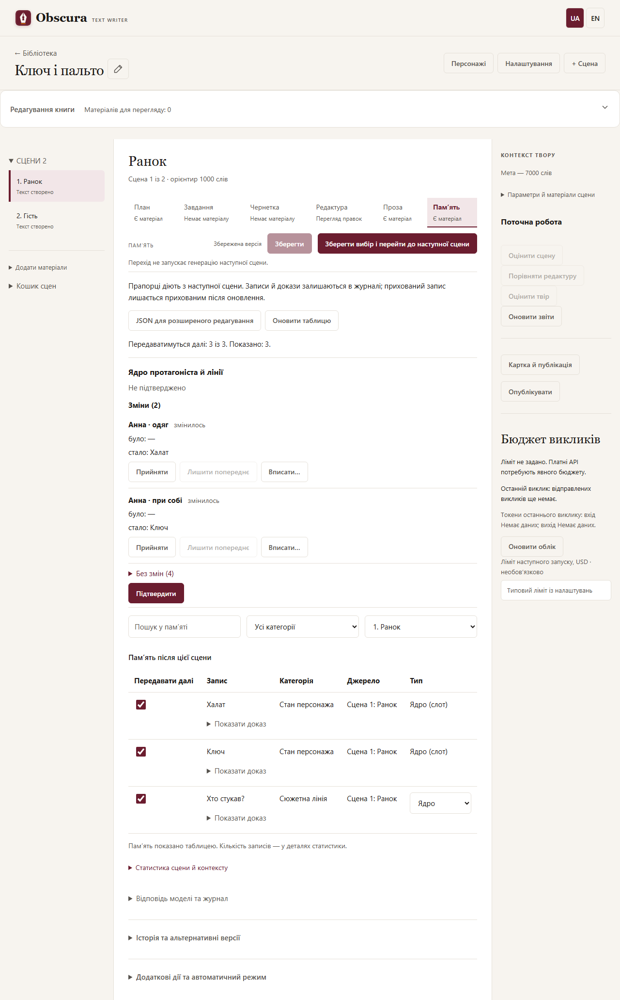

# Перегляд і відбір пам’яті

Відкрийте сцену → **«Пам’ять»**. Замість JSON типовим є табличний перегляд: зміст запису, категорія й сцена-джерело. Технічні ID не показуються; **«Показати доказ»** відкриває цитату з прози. Фільтр сцени-джерела спочатку показує записи поточної сцени; виберіть іншу сцену або «Усі сцени», щоб побачити успадковані записи. Пошук і фільтри сцен та категорій не змінюють вибір прихованих рядків.

Зніміть **«Передавати далі»** біля зайвих записів і натисніть **«Зберегти»**. Вибір сцени 5 діє зі сцени 6. Він застосовується й до успадкованих фактів, не видаляючи їх із журналу й не потребуючи перебудови пам’яті від початку. У наступній сцені можна знову поставити прапорець; попередні сцени збережуть свій вибір. Якщо той самий запис оновлюється, він лишається прихованим до вашого явного ввімкнення.

Вимикається тільки запис у літературному блоці пам’яті для планувальника, письменника та повної літературної редактури. Це не видалення факту з авторського плану/канону/прози або хвоста попередньої сцени. Модель пам’яті зберігає повний каталог для ведення журналу; Evaluator працює зі своїми первинними джерелами.

Уже готові тексти автоматично не переписуються. Залежні завдання/чернетки/проза наступних сцен можуть стати застарілими: перегляньте й явно прийміть їх або згенеруйте заново. Сам журнал пам’яті від прапорців не стає застарілим. Точне повернення до попереднього вибору дозволяє відновити актуальність за звичайними правилами залежностей.

Застаріла пам’ять показується для читання; перш ніж зберігати її прапорці, оновіть пам’ять. При конфлікті іншої вкладки зміни лишаються у формі: збереження не застосувалося, **«Оновити таблицю»** дозволяє явно відкинути незбережений вибір і перечитати актуальні дані. Незбережені зміни блокують генерацію, а перехід до іншого матеріалу потребує підтвердження відкидання.

**«JSON для розширеного редагування»** повертає попередній редактор журналу й усі його перевірки цитат/попереднього префікса. Прапорці в JSON не додаються — це окремі авторські налаштування. Слот ядра стану (`slot`) у JSON можна вказати лише для протагоніста; посилання `resolves_claim_id` має вказувати на запис, що вже є в журналі, і програма сама переводить його на внутрішній ID, який отримає цей запис. Історичні версії переглядаються як раніше через історію. Повна регенерація запису з новим внутрішнім ID створює новий запис із типовим увімкненим прапорцем; система не переносить вибір на схожі тексти за здогадкою.

## Докази в записах пам’яті

Пам’ять оновлюється лише в режимі за доказами (`evidence_delta`, формат v4 — «Операції пам’яті v4 за доказами»); застарілий режим «Повний snapshot» прибрано, а збережена з ним роль автоматично працює за доказами. Модель не переписує цитати. Для головного героя вона обов’язково вирішує кожен слот ядра стану (одяг, при собі, місце, тілесний стан, з ким): без змін, змінено з доказом, невідомо з причиною або «введено» для запису автора, який проза вперше показала читачеві. Для кожної активної лінії вона обов’язково каже, чи лінія триває, чи закрита доказом розв’язки; відсутність персонажа в сцені лінію не закриває. Якщо мітка `Початок:` у плані показує новий день, модель отримує про це окреме повідомлення. Решта — групові операції: для фактів і хронології — лише додавання, для інших станів — додавання, оновлення та закриття, для нових ліній — додавання. Кожна операція вказує від 1 до 3 ID фрагментів прози (`evidence_ids`). Програма сама бере з прози дослівні цитати: перший фрагмент стає основною цитатою, решта (до двох) — додатковими.

У таблиці пам’яті **«Показати доказ»** відкриває основну цитату, а під нею — додаткові цитати в тому самому порядку. Якщо додаткових немає, показується лише основна.

Для моделей, що підтримують схему відповіді, оберіть режим відповіді `json_schema`: програма будує схему для кожного запиту (допустимі ID фрагментів, активні записи для оновлення, персонажі сцени), і більшість помилок формату стає неможливою.

## Ядро стану протагоніста в контексті письменника

Блок пам’яті для планувальника, письменника й повної літературної редактури починається з секції **«ЯДРО СТАНУ — <ім’я героя>»** (якщо в картці героя немає імені — **«ЯДРО СТАНУ — протагоніст»**). Вона містить чинні значення слотів у сталому порядку: одяг, при собі, місце, тілесний стан, з ким. Порожні слоти не показуються, а в старих творах секції немає, доки пам’ять сцени не перегенерують. Ядро показується навіть у сцені, де героя немає в складі: його стан переходить без змін. Значення слота не повторюється в «Поточних станах». Прапорець **«Передавати далі»** діє на записи ядра так само, як на інші записи. Якщо ви сховали значення слота, а згодом модель позначила його невідомим, це значення переходить у «Поточні стани» теж прихованим (у таблиці пам’яті прапорець знятий), доки ви явно не ввімкнете сам цей стан.

**Закриття ліній.** Закрита лінія зникає з «Відкритих ліній», а її розв’язка стає звичайним фактом у «Фактах»; у «Хронології» закриття не дублюється. Закриття, створені до формату v4, лишаються в хронології, як раніше. Якщо ви сховали лінію, її розв’язка теж прихована (у таблиці пам’яті прапорець розв’язки знятий), доки ви явно не ввімкнете саму лінію або сам факт-розв’язку.

**«Читачеві невідомо».** Запис автора без цитати — правда світу, якої читач ще не бачив. Письменник отримує його з позначкою «(читачеві невідомо: якщо знадобиться, введи в тексті як нове)» і має ввести це в текст як нову інформацію. Коли проза це покаже, етап пам’яті позначить слот як «введено», і позначка зникне. Якщо ж модель позначить такий слот невідомим, запис переходить у «Поточні стани» разом із позначкою.

**Перехід дня.** Зміна дня визначається за рядком `Початок:` у плані сцени (`Д.М.Р, Г:Х` або `день N, Г:Х`). Різні записи тієї самої дати (`1.3.24`, `01.03.2024`, `1.3.2024`) — один день. Тоді модель пам’яті окремо вирішує, чи лишаються одяг, речі при собі й тілесний стан, або позначає їх невідомими з причиною. Без цього рядка сигналу немає, і значення лишаються чинними, доки проза їх не змінить.

## Коли пам’ять не вміщається в контекст

Поки повний запит планувальника, письменника чи редактора вміщається в ліміти ролі (контекст мінус резерв відповіді й «Максимум символів входу»), пам’ять передається повністю і нічого не змінюється. Якщо не вміщається, програма замість помилки відбирає частину пам’яті й попереджає: «Повна пам’ять не вміщається: у запит відібрано X з Y записів». Відбір детермінований: той самий твір і ті самі налаштування дають той самий набір записів.

Порядок важливості:

1. ядро героя — завжди повністю;
2. свіжі стани героя: змінені в день сцени (за рядком `Початок:`) або за останні 3 сцени;
3. відкриті лінії, де згадано учасників сцени;
4. стани інших учасників;
5. загальні стани без персонажів;
6. факти про учасників;
7. хронологія останніх 20 сцен;
8. «атмосфера»: давні стани героя й факти лише про нього, до 10 % бюджету пам’яті;
9. решта записів, знайдених за словами плану сцени (а для чернетки й редактури — завдання).

Відкинута хронологія позначена в самому запиті першим рядком розділу «Хронологія», наприклад «Не показано записів: 12 (сцени 1–12)». Якщо не вміщається навіть ядро, запит не надсилається й програма пояснює, що ядро не обрізається: зменште інші матеріали (канон, хвіст попередньої прози, горизонт планів) або збільште контекст відповідно до реальної моделі. Згадку учасника програма шукає за основою імені, тож інша відмінкова форма (наприклад, «Олі» для «Оля») може не розпізнатися; такий запис усе одно може потрапити за словами плану. Етап пам’яті так само отримує повний каталог, поки той вміщається. Якщо ні, каталог звужується: ядро й усі лінії лишаються, а з інших записів — стани учасників сцени й загальні, до 20 станів, знайдених за текстом прози, факти про учасників і хронологія останніх 20 сцен. Програма попереджає: «Каталог пам’яті звужено: N записів не показано моделі». Непоказаний запис у цьому запуску оновити неможливо, тож якщо проза його змінила, модель може додати новий запис-дубль; перевірте таблицю пам’яті й вимкніть зайве.

### Тип запису: ядро чи атмосфера

Останній стовпець таблиці, **«Тип»**, підказує відбору, що робити із записом, коли пам’ять не вміщається в контекст:

- **Авто** — запис іде в шар за звичайними правилами.
- **Ядро** — запис показується завжди, разом із ядром героя.
- **Атмосфера** — запис потрапляє лише в невелику частку «атмосфери» (близько 10 % бюджету пам’яті).

Слоти ядра відстежуваних персонажів позначено «Ядро (слот)», їхній тип не змінюється. Вибір зберігається одразу, без кнопки «Зберегти», і діє для всього твору. Поки повна пам’ять вміщається, позначка нічого не змінює. Застарілими вона робить лише тексти, зібрані з відбором, у яких цей запис уже був у пам’яті. Якщо твір тим часом змінили в іншій вкладці, програма повідомить про конфлікт і перезавантажить таблицю.

Що саме відібрано, видно в «Статистиці сцени й контексту»: рядок «Відбір пам’яті: вибрано X з Y, відкинуто Z» з переліком шарів, де записи відкинуто.

## Підтвердження ядра

На вкладці **«Пам’ять»** під кнопками таблиці є панель **«Ядро протагоніста й лінії»**. Вона порівнює пам’ять цієї сцени з пам’яттю, з якої її побудовано: для кожного слота ядра показано «було» і «стало», для невідомого значення — причину від моделі, для закритої лінії — розв’язку. Група **«Зміни»** розгорнута, група **«Без змін»** (і лінії, що тривають) згорнута. Угорі видно стан: «Не підтверджено» або «Підтверджено» з часом. У першій сцені чи в старому творі без ядра панель показує «Ядро ще не заповнене» і лише лінії.

Дії над рядком:

- **«Прийняти»** — лишити рішення моделі (і прибрати вашу правку цього рядка, якщо вона була).
- **«Лишити попереднє»** — повернути значення попередньої сцени або залишити лінію відкритою. Доступне лише для версій, згенерованих моделлю пам’яті: у вручну збереженої версії немає відповіді моделі, і кнопка вимкнена з поясненням.
- **«Вписати…»** — відкрити панель запису: введіть значення (для лінії — розв’язку), виберіть сцену цитати й фрагмент її прози (пошук звужує список) або позначте **«Без цитати»**. Запис без цитати стане «читачеві невідомо»: письменник отримає його з відповідною позначкою. Для вже закритої лінії у версії без відповіді моделі «Вписати…» не пропонується.

**«Застосувати»** і **«Скасувати»** змінюють лише чернетку панелі, на сервер нічого не надсилається. Кнопка **«Підтвердити»** без правок лише позначає поточну пам’ять підтвердженою: вона не змінює журнал і не робить застарілою пам’ять наступних сцен. **«Підтвердити з правками (N)»** створює нову версію пам’яті з вашими правками і одразу її підтверджує; пам’ять наступних сцен тоді стає застарілою за звичайними правилами.

Незбережена чернетка ядра захищена так само, як незбережений текст: **«Оновити таблицю»**, вибір іншої сцени чи матеріалу або закриття сторінки спершу питають, чи відкинути її. Питання прямо називає панель «Ядро протагоніста й лінії»: «Зберегти» і «Зберегти вибір і перейти…» зберігають лише прапорці таблиці, а правки ядра потрапляють у пам’ять тільки кнопкою **«Підтвердити з правками»**. Якщо пам’ять сцени тим часом змінилась (наприклад, в іншій вкладці), панель перечитується, а чернетка відкидається з повідомленням. Якщо підтвердження не вдалося через таку зміну, панель показує причину й перезавантажується; перевірте стан і за потреби повторіть.

Правки для застарілої пам’яті сцени (побудованої не з поточної пам’яті попередньої сцени) відхиляються: спершу перегенеруйте пам’ять цієї сцени. Підтвердження без правок для неї працює.

Автоматичний режим не чекає підтвердження. Перед запуском сцени або решти сцен вікно підтвердження показує, скільки сцен мають непідтверджене ядро; це лише інформація, запуск вона не блокує.

## Якщо запуск пам’яті не вдався

Статус запуску показує повний список порушень формату відповіді (до 50 пунктів і «ще N» для решти). Кожен пункт — це мітка операції (наприклад, `facts.add, елемент 2`, `Операція 3` або `Відповідь`; нумерація з 1, інтерфейс формує мітку із збереженого шляху) і код. Тексти й ID записів у список не потрапляють.

- `evidence_unknown` — доказ не знайдено в джерелі: ID фрагмента немає у поточній прозі.
- `evidence_count` — неприпустима кількість доказів: потрібно від 1 до 3 різних ID.
- `add_limit` — перевищено ліміт додавань: не більше трьох нових записів на категорію.
- `ops_limit` — перевищено ліміт операцій: не більше 12 елементів за відповідь.
- `target_unknown` — невідома ціль: запис для оновлення чи закриття не є активним записом цієї категорії.
- `target_meta` — (лише формат v2) оновлення чи закриття змінило категорію або область (scope) запису.
- `target_twice` — один запис змінено двічі в одній відповіді.
- `scope_unknown` — невідома область запису (персонаж, якого немає в сцені).
- `schema` — відповідь не відповідає схемі: бракує обов’язкових ключів, є зайві поля тощо.
- `wire_version` — непідтримувана версія формату: відповідь не збігається з форматом, якого вимагає промпт.

Найчастіше допомагає режим `json_schema` або повторний запуск; якщо код повторюється, перегляньте власний промпт.

## Власний промпт пам’яті: перехід на v4

Власні промпти, збережені з контрактом `/2` або `/3`, більше не запускаються: вони не вимагають обов’язкових рішень щодо ядра стану й ліній, тому запуск і збереження ролі зупиняються з поясненням «Несумісний промпт: потрібно memory/evidence_delta/4». Для такого промпту в налаштуваннях ролі пам’яті з’являється прапорець **«Перевести власний промпт на формат v4»**. Спершу перепишіть текст так, щоб він вимагав формат v4 (секції `core` і `threads` разом із групами операцій), потім позначте прапорець і збережіть: промпт буде збережено з контрактом `/4`. Без переписаного тексту модель відповідатиме у старому форматі, і запуск завершиться помилкою `wire_version` або `schema`. Очищення власного промпту повертає вбудований промпт v4.
