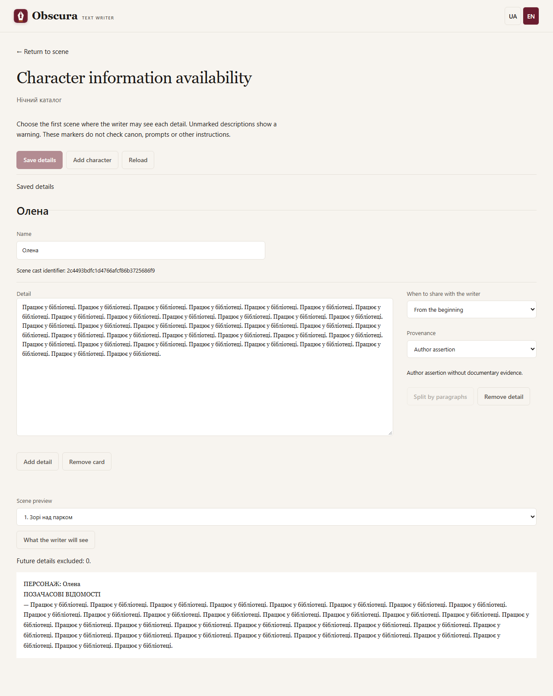
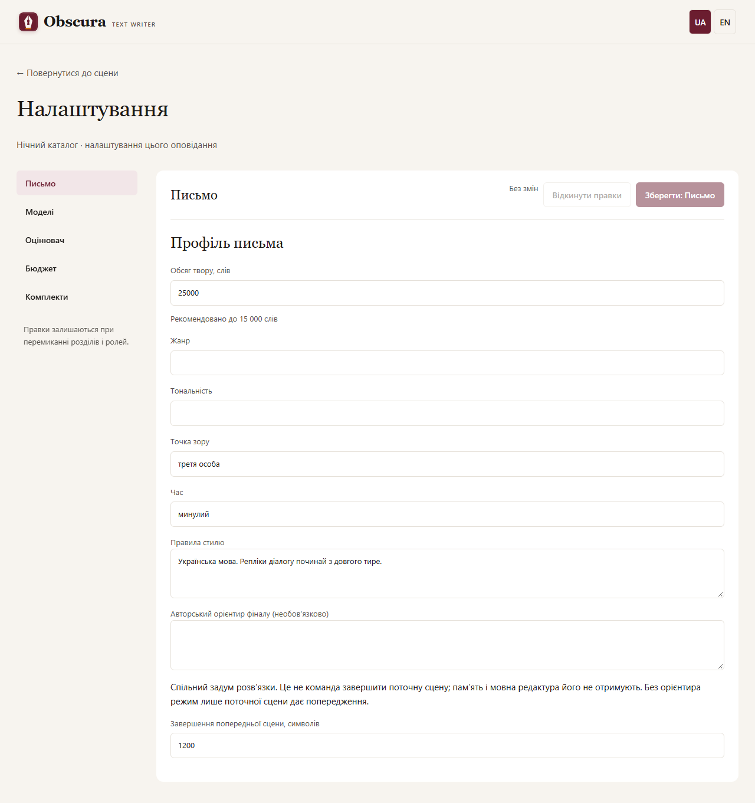
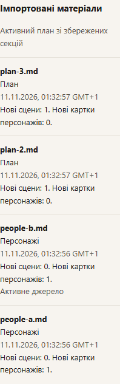
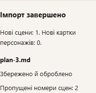
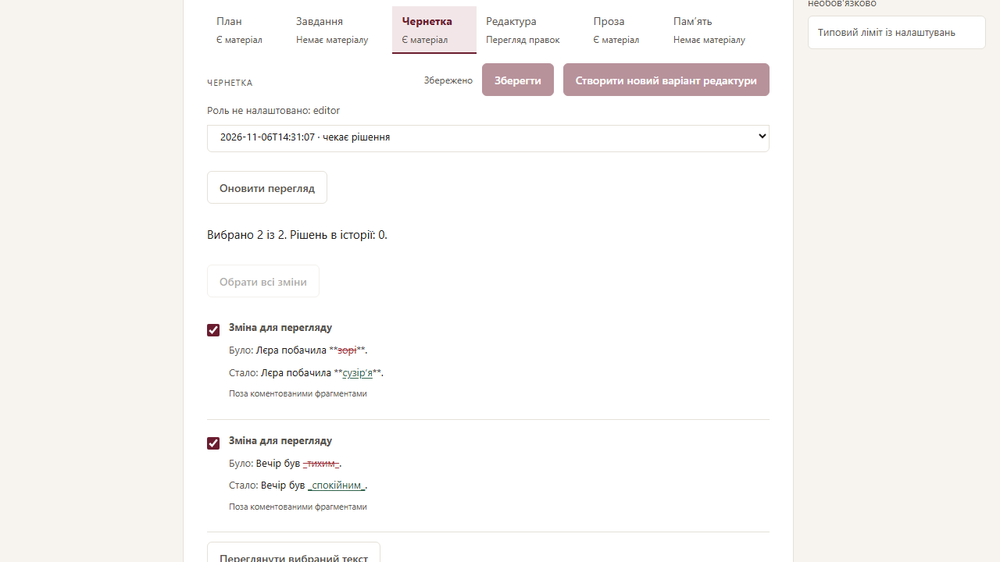
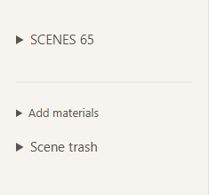
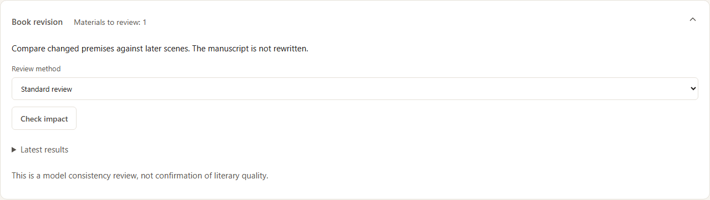

# Локальний запуск

Windows, Python 3.10+, один сервер і один послідовний виконавець.
Встановлення описано в [README](../README.md).

```powershell
./scripts/start.ps1 -DataDir "$env:LOCALAPPDATA/ObscuraTextWriter/data"
```

Якщо виконання PowerShell-скриптів заборонене:

```powershell
./.venv/Scripts/python.exe -m storygen.server --data-dir "$env:LOCALAPPDATA/ObscuraTextWriter/data" --env-file .env --open-browser
```

Сервер слухає лише `127.0.0.1:8765`. Параметр `--port` змінює порт.

У сторінці оповідання розгорніть «Додати матеріали» й завантажте шаблони «План із часовими мітками (.md)» та «Персонажі (.md)». Відредагуйте файли й імпортуйте у відповідні поля. Назви учасників мають точно відповідати заголовкам імен. Для нічної сцени задайте, наприклад, «Початок: день 1, 23:40» та «Кінець: день 2, 00:20». Час передається як частина плану; програма не перевіряє тривалість автоматично. Після імпорту позначте початкові відомості персонажів «Від самого початку», пізніші — «Починаючи зі сцени» на сторінці «Персонажі»; сам текст шаблону не встановлює ці позначки.
Запуск без `--data-dir` використовує `./data`. Один каталог захищений OS-lock
від другого виконавця. Зупинка — Ctrl+C у терміналі.

## Перший твір

1. Створіть твір та імпортуйте UTF-8 план/персонажів із TXT або Markdown.
   Перевірте запропоновані сцени перед генерацією.
2. У налаштуваннях задайте провайдера, URL, точний model ID, контекст і резерв
   виходу для кожної ролі. Локальний API за замовчуванням: `http://localhost:1235/v1`.
3. Для OpenRouter потрібен `OPENROUTER_API_KEY`, для Venice — `VENICE_API_KEY`
   у `.env` або середовищі сервера. Venice перевіряє online та `uncensored=true`.
4. Спершу виконайте одну коротку сцену: завдання → чернетка → редактура → пам’ять.
   Перевірте результат. Генерація не підтверджує літературного приймання.
5. «Пройти решту» виконує сцени послідовно. Пауза діє між етапами; закриття
   вкладки не скасовує роботу. Скасування не гарантує негайної зупинки провайдера.
6. Вибирайте версії в історії. Ручне редагування створює нову версію; зміни ранніх
   сцен можуть зробити залежні матеріали застарілими. Перебудова пам’яті — окремий
   модельний запуск, який може бути платним.
7. Оцінювач можна вимкнути. Candidate-звіти не підтверджують проходження quality
   gate; режим блокування потребує успішного калібрування профілю.
8. Експортуйте MD/TXT після перевірки вибраних версій. Неповний експорт потребує
   явного вибору та містить позначки.

## Збереження й відновлення

Штатні команди (зупиніть сервер перед остаточною перевіркою й резервуванням):

```powershell
./.venv/Scripts/storygen.exe fsck --data-dir "$env:LOCALAPPDATA/ObscuraTextWriter/data" --json
./.venv/Scripts/storygen.exe backup --data-dir "$env:LOCALAPPDATA/ObscuraTextWriter/data" --destination "C:/Backups/storygen-2026-10-20" --json
./.venv/Scripts/storygen.exe restore --backup-dir "C:/Backups/storygen-2026-10-20" --destination "C:/Restored/storygen" --json
```

Підставте свій data-dir і нові шляхи призначення; батьківські каталоги мають існувати. Backup містить `manifest.json` і `data/`; restore перевіряє всі хеші й створює тільки новий каталог, без перезапису. Команди не потребують ключів і не викликають моделі. Exit code 0 — успіх, 1 — діагностичні/операційні проблеми, 2 — неправильні аргументи.

`fsck` не видаляє сироти й не виправляє дані. Для холодної checkpointed БД він не змінює файли; за наявності непорожнього WAL протокол SQLite може створити/оновити службовий SHM. Для узгодженого backup потрібен зупинений сервер: зайнятий worker.lock дасть відмову. Не запускайте зовнішні інструменти запису одночасно з maintenance.

Цитати джерел у картках персонажів перевіряються дослівно, включно з LF/CRLF/CR. Збережені Windows-переноси не потрібно змінювати перед перевіркою або резервуванням; `fsck` читає той самий точний UTF-8 текст, що й застосунок.

Після збою backup лишається зі status incomplete; restore — з `.restore-incomplete.json`. Такий каталог не запускайте й не прибирайте маркер вручну: повторіть відновлення з перевіреного резерву в інший новий каталог. Неповний результат не видаляється автоматично. Backup зберігає весь звичайний вміст data-dir відкритим текстом, включно з допоміжними звітами; зберігайте його як приватні дані.

Альтернатива — ручна холодна копія:

Зупиніть сервер і скопіюйте **весь** каталог даних, включно з SQLite, versions,
sources та runs. Не копіюйте лише базу окремо від текстів. Зберігайте резервні
копії поза репозиторієм. Не редагуйте базу й незмінні версії вручну.

Після аварії незавершені запуски стають interrupted без автоматичного повтору
API-викликів. Продовжуйте запуск явно в інтерфейсі; повтор може бути платним.
Після оновлення коду перезапустіть сервер та оновіть вкладку, попередньо
зберігши ручні правки. Міграції схеми застосовуються під час відкриття сховища.

Пам’ять перевіряє джерела, але не гарантує відсутності всіх сюжетних суперечностей.
Оцінка токенів приблизна; перевищення бюджету зупиняє виклик без мовчазного
обрізання. Повний контракт і відомі дефекти — у [SPEC.MD](../SPEC.MD).

## Evaluator: відмови, причини й захист твору (R-04)

Готові JSON для UI (Venice/local/OpenRouter/Codex), параметри та політики:
[Налаштування оцінювача](evaluator-configuration.md).

Evaluator підтримує local/OpenRouter/Codex CLI/Venice. Для Venice вкажіть
точний ID із каталогу uncensored, `VENICE_API_KEY` у серверному середовищі й
офіційний endpoint; приклад без ключів — `config/evaluator.venice.example.json`.
JSON Schema потребує відповідної capability; відсутня підтримка не спричиняє
автоматичного переходу на інший формат або модель.

- `refused` — явна відмова, без літературного бала; `error` — технічна причина.
  У звіті є категорія, безпечне пояснення, HTTP/provider codes і request ID,
  якщо вони надані. Непояснена відмова позначається невідомою, не квотою/timeout.
- Після контентної або непоясненої явної відмови ця identity оцінювача
  заблокована для твору. Off/on, prompt, temperature, restart і retry не
  знімають захист. Технічні error такого блокування не створюють.
- У `report` workflow продовжує прозу з warning і пропускає заблоковані оцінки;
  у `pause_on_failure` потрібне рішення автора — інша явно обрана модель або off.
  Кнопки розблокування та автоматичної заміни немає. CLI default — окрема
  identity; для точного допуску потрібен явний model ID.
- Калібрування v2: 16 синтетичних випадків, мінімум 3 повтори кожного,
  нуль відмов разом з якісними порогами. Зміни конфігурації/промпту/набору
  скидають допуск; старі звіти лишаються читабельними. Це не доказ придатності
  до довільного контенту або бездоганної літературної якості.

Перевірка кількості викликів без моделі:

```powershell
./.venv/Scripts/storygen-eval.exe calibrate --suite src/storygen/evaluation/resources/calibration_suite_v2.json --config config/evaluator.venice.example.json --repeats 3 --dry-run
```

Dry-run повертає 48 викликів, нічого не надсилає. Перед реальним прогоном
окремо погоджуються модель, дані й бюджет; приклад model ID треба замінити.
Standalone CLI cases не прив’язані до story_id і не записують блокування твору;
calibrate припиняє свій прогін після першого refused. Exit codes evaluate:
0 passed, 1 failed, 2 incomplete, 3 error, 4 refused.


## Прийняття застарілого тексту та продовження (R-05)

1. В історії версій оберіть чернетку або прозу. Збережіть незбережені правки, перш ніж приймати інший текст.
2. Натисніть «Переглянути й прийняти текст»: прочитайте текст і список змінених джерел. Потім окремо підтвердьте прийняття. Якщо джерела змінилися після preview, відкрийте його заново; помилка не стирає буфер.
3. Рішення з’явиться в історії як авторське прийняття. Текст, старі джерела й історичний alternative-запуск не переписуються. Пам’ять і оцінювання оновлюються окремо. Прийняття stale brief/memory/evaluation не передбачене.
4. Якщо workflow зупинився саме на цьому результаті, натисніть «Продовжити після прийнятого етапу». Це окрема дія: прийнятий етап не генерується повторно, наступні можуть викликати налаштовані моделі. Звичайне «Продовжити» чи явний повтор перерваного етапу мають інший зміст.
5. За 409 перевірте поточну сцену/версію й повторіть перегляд. Скасований запуск або блокування оцінювача не обходяться прийняттям тексту.

Нові модельні версії мають точний snapshot: нерелевантна зміна майбутнього плану не блокує memory; точне повернення всіх залежностей від B до A відновлює актуальність без повторного inference. Старі stale-версії без знімка автоматично не відновлюються. Попередні metadata не змінювали SQL-схему; R-16a додає міграцію 003 (2→3) для картки публікації; перед використанням оновлення з авторським каталогом рекомендовано перевірений холодний backup. Реальні моделі не потрібні для offline-регресій.

## Пам’ять v2 (R-06a/b)

Перед сценою n використовується лише пам’ять n−1. Оновлення після прози n
додає поточні докази до повної попередньої історії. Наступні сцени не є
джерелами, навіть коли вони вже готові.

Нові налаштування пам’яті типово використовують «Операції пам’яті v2 за
доказами». Модель повертає add/update/retire; сервер перевіряє фрагменти та
зберігає журнал. Стани й відкриті лінії оновлюються/закриваються без стирання
історії; факти й хронологія мають лише додавання. Авторські промпти не
змінюються: legacy delta і snapshot підтримують лише add, snapshot застарілий.

Письменник бачить компактний поточний стан без технічних IDs та цитат, зі
станами персонажів сцени й загальними; порожній список означає всі стани.
Повний журнал залишається у вкладці «Пам’ять». Ручний JSON v1/v2 нормалізується
в нову v2-версію; змінити журнал попередніх сцен із поточної не можна.
Виправте пам’ять джерельної сцени й явно перебудуйте наступні.

Межі контексту явні: R-06 не гарантує fit у 8k. Fsck перевіряє журнал/цитати;
limitations для історичної legacy-пам’яті без snapshot не означають пошкодження.
Перед оновленням авторського каталогу використовуйте штатний холодний backup.
# Часова доступність персонажів (R-06)



У верхній навігації твору поруч із «Налаштуваннями» відкрийте «Персонажі».
Окрема сторінка надає широкі поля описів; «Повернутися» повертає до поточної сцени й матеріалу. Для кожної
відомості оберіть «Від самого початку», «Починаючи зі сцени» або «Час не перевірено».
Суцільний імпортований опис можна розділити за порожніми абзацами. Перевіряйте
склад сцен за ID карток: порожній склад передає всі картки. Нові ручні відомості
мають походження «Авторське твердження»; імпортовані зберігають цитати джерела.

«Що побачить письменник» показує незбережені правки для обраної сцени без виклику
моделі. «Зберегти відомості» створює нову версію карток; конфлікт ревізії повертає
409 і залишає локальні правки. Вихід із незбереженими картками потребує підтвердження браузера. Інша вкладка використовує лише збережені картки. Після
перестановки сцен доступність визначається новим порядком; якщо anchor у кошику,
поверніть сцену або змініть мітку картки. Непозначені описи лишаються видимими з
попередженням. Мітки не перевіряють канон, промпти чи знання окремого персонажа.


Платні виклики потребують явного ліміту оповідання/CLI та чинного тарифу.
Налаштування й пояснення сум: [бюджет модельних викликів](provider-budget.md).


Формат плану та автоматичний склад сцени: [опис сцени](scene-description.md).


Контракти власних промптів, вибір точкових правок і локальні мовні попередження: [редакторський перегляд](editor-review.md).


Картка публікації, підписи та обкладинка: [інструкція](publication-card.md). Нові формати додаються наступними частинами R-16.


## Ручний маршрут сцени (R-20)

Після імпорту перевірте сцени й учасників. Основна смуга: План → Завдання → Чернетка → Редактура → Проза → Пам’ять. Вкладка лише відкриває матеріал; основна кнопка над текстом зберігає ручні правки, перевіряє передумови й пропонує явний запуск наступного етапу. Старі результати залишаються в історії. «Створити новий варіант…» означає новий виклик, не приховане прийняття старої версії.

На «Редактура» перегляньте речення, виберіть правки та зібраний текст, потім прийміть через основну кнопку. Порожню пропозицію прийняти не можна; якщо бажаєте використати чернетку як авторську прозу без редактури, це окрема явна дія в додаткових операціях. Основна дія «Проза» оновлює пам’ять; повторна редактура поточної прози — додаткова дія, її джерело зафіксоване окремо від чернетки.

Після збереження вибору пам’яті перейдіть до наступної сцени; після останньої — до картки публікації. Параметри сцени/кошик, історія та автоматичні режими збережені. За помилкою контексту або конфігурації є перехід до відповідної ролі й повернення до сцени; це не повторює запуск автоматично. Збільшення налаштованого ліміту не збільшує фізичне вікно моделі.

Бюджет показує останній відправлений виклик і загальний облік. Відсутня token usage відображається як «Немає даних», явний нуль — як 0. Параметр «Запитувати usage потоку» залежить від підтримки endpoint; його не вмикають приховано. Форматований Markdown-редактор — окрема майбутня R-22; цей редизайн не додає rich text.


### Налаштування за розділами (R-21)

Відкрийте Письмо, Моделі (потім роль), Оцінювач, Бюджет або Комплекти. Кнопка
вгорі зберігає лише відкриту форму; незбережені правки інших форм зберігаються
при переході й мають позначку. Тарифи та звірка мають окремі кнопки.
Оцінювач і класифікатор редактора налаштовуються полями; технічний JSON
оцінювача необов’язковий і потребує Apply/Discard. Негайне вимкнення
оцінювача не потребує коректної повної форми. Збереження параметрів не запускає модель.


### Мова інтерфейсу (R-24)

Інтерфейс має українську й англійську версії. При першому відкритті мова
визначається з налаштувань браузера; якщо uk/en там немає, використовується uk.
Перемикач UA/EN у верхній панелі запам’ятовує вибір у цьому браузері для всіх
оповідань. Він не перезавантажує сторінку й не скидає незбережені правки.

Це мова керування застосунком: рукописи, модельні відповіді, власні й стандартні
промпти лишаються оригінальними. Генерація наразі орієнтована на українську.
Відомі повідомлення застосунку перекладаються; невідома історична або
провайдерська діагностика може показуватися мовою оригіналу. Технічні ID/enum,
JSON та env-назви не перекладаються. CLI ще не локалізований.


### Підтвердження попередньої пам’яті

Послідовний перегляд книги та авторські рішення описані в [інструкції перевірки](sequential-review.md), також доступній [англійською](en/sequential-review.md).

Якщо окреме оновлення пам’яті потребує старого журналу, дія лишається доступною після інших перевірок. У підтвердженні запуску показано сцену пам’яті, кількість нових версій і справді змінених текстів. «Скасувати» не запускає модель. Підтвердження зберігає старі джерела й цитати: воно не означає автоматичної перевірки фактів. Ризик зміненої прози показано в наступних контекстах і таблиці пам’яті. Після нової зміни джерел підтвердіть стан заново; некоректні дані та майбутні джерела обійти не можна. Для автоматичного workflow виконайте заблокований memory-етап окремо з явним рішенням.


Обсяг твору й сцени не має жорсткої верхньої межі: рекомендовано до 15 000 слів. Нижня межа твору — 5000, сцени — 1 слово.


## Повторний імпорт

Персонажі: імпорт додає тільки нові імена; дублікати пропускаються з пропозицією редагувати їх у «Персонажах». Уже внесені описи й часові мітки зберігаються.

План: дубль визначається за явним номером («Сцена 2. Зустріч» та «Сцена 2: Друзі» збігаються). Нові номери створюють сцени в кінці; секції без номера завжди нові, включно з повторним імпортом. Старий активний план доповнюється тільки новими секціями. Зміна номера у ручному плані синхронізує author_scene_number; зайнятий номер відхиляється. Назва й position не є ключем дубля.

У «Параметрах і матеріалах сцени» кожен імпорт має назву файла, локальні дату/час і часовий пояс. Активний план зі збережених секцій позначається окремо, без додаткового запису імпорту. GET story повертає source_files (назва й UTC created_at) та active_sources. PUT settings приймає target_words разом із profile й expected_revision; мінімум5000, рекомендовано до15000, цілі сцен не перераховуються. Multipart результат files треба читати перед повтором: imported уже застосовано, failed не застосовано, not_processed не оброблявся. При partial=true не повторюйте весь набір автоматично, особливо ненумеровані сцени.

Схема даних5 мігрується при запуску; перед переходом зробіть холодну резервну копію. Старі активні джерела й точні bytes зберігаються; повернення до старої версії програми потребує відповідної старої копії даних.


Failed-файл у результаті імпорту не заявляє про створені чи пропущені матеріали. Після доповнення плану старі картки й канон із цитатами початкового плану лишаються придатними до підготовки структури. У API створення сцени можна явно задати author_scene_number; суперечність із номером у плані відхиляється. Заголовок лише з розмітки отримує типову назву замість відмови всього імпорту.


Обсяг наявного твору можна змінити в «Налаштування → Письмо → Обсяг твору, слів». Save зберігає його разом із профілем; Reset відновлює збережене. Рекомендовано до15 000, але верхньої межі немає. Цілі сцен не перерозподіляються.

Результат лишається біля форми: кількість нових сцен/карток, пропущені імена/номери й статус кожного файла. Посилання «Персонажі» веде до редагування дублів. Успішні файли прибираються з форми; для свідомого повтору виберіть тільки незастосовані. Поточна сцена й матеріал зберігаються.

Якщо після підтвердженого імпорту не оновився журнал, підтверджений результат лишається видимим; «Оновити журнал» повторює лише читання. Якщо відповідь на завантаження втрачено, результат невідомий, а файлові поля очищуються. Оновіть журнал і перевірте сцени/картки перед новим вибором файлів: ненумеровані сцени при повторі додадуться знову.






Модельна відповідь пам’яті може бути в повному блоці ```json або парних зовнішніх апострофах: сервер прибирає цю обгортку перед перевіркою JSON. Апострофи всередині текстів/цитат не змінюються; оригінальна відповідь збережена. Після успіху видно попередження. Некоректні схема/докази й ручний JSON лишаються строгими; автоматичного повтору генерації немає.


У перегляді переписування за коментарями «Обрати всі зміни» позначає всі запропоновані групи. Потім натисніть «Переглянути вибраний текст» і явно застосуйте вибір. Натискання вибору не викликає модель і не змінює чернетку.


[English editor workflow](en/editor-workflow.md).


Якщо сцен багато, натисніть заголовок «Сцени» з їх кількістю: увесь список згорнеться, а «Додати матеріали» лишиться поряд. Повторне натискання розгортає список. Поточна сцена й незбережений текст зберігаються. У перевірці книги так само згортається список «Останні результати»; поточний авторський checkpoint лишається видимим поза історією; дії конкретного звіту згортаються разом із ним.









