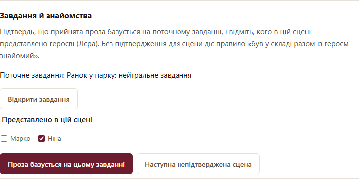

# Опис сцени

У вкладку «План» можна вставити такий опис. Кілька сцен можна імпортувати одним
TXT/Markdown-файлом; кожна починається з «Сцена N: Назва» або «Сцена N. Назва».

```text
Сцена 3: Дзвінок сестри. Дзеркало
Локація: Лєра — біля студії; Марія — в університетській бібліотеці
Хто бере участь: Лєра, Марія.
Точка зору: Лєра
Що було в попередніх сценах: проблеми з ремонтом студії
Що відбувається: Марія телефонує Лєрі й отримує пораду
Дії:
1. Дзвінок Марії.
2. Розмова про її дилему.
3. Лєра приміряє власну пораду до себе.
Ключове усвідомлення:
Емоційний акцент:
Чим завершується сцена:
```

Після «Зберегти» заголовок оновить назву сцени, а рядок учасників — її список
персонажів. Замість «Хто бере участь:» можна написати «Персонажі:»; розділювачі —
кома або крапка з комою. Markdown heading/bold розпізнаються. Номер у заголовку
не переставляє сцени. Оригінальний текст плану зберігається.

До імені можна додати пояснення в круглих дужках, наприклад
«Лєра (за дверима, мовчить)»: воно лишиться в плані для моделі, але не
вважатиметься частиною імені. Кома в дужках не розділяє персонажів.

Імена мають однозначно відповідати іменам карток; регістр і зайві пробіли не
заважають. Можна вказувати точні ID карток, зокрема якщо імена однакові. Система
не вгадує «Лера» замість «Лєра» і не створює персонажа за самим іменем. План із
невідомим/неоднозначним ім’ям збережеться, але генерація чекатиме уточнення.
Картки можна додати після імпорту: список учасників оновиться при їх збереженні.

Без рядка учасників зберігається вручну вибраний список. Порожнє «Персонажі:»
очищає його; це не означає «всі персонажі». При збереженні плану або карток
рядок учасників знову визначає список, навіть якщо ID перед цим змінювали вручну.
Для старого плану змініть і збережіть його текст, щоб повторно визначити склад;
збереження без змін не оновлює список і не скасовує ручний вибір.

Планувальник, письменник, літературний редактор і сценовий оцінювач отримують
описи лише вибраних учасників, з урахуванням часових міток. Оцінка всього твору
збирає відповідні описи з усіх оцінюваних сцен. Неструктурований файл персонажів
лишається матеріалом для підготовки карток і звірки; цілком у запит сцени він
не підставляється. Спочатку застосуйте підготовлені картки або додайте їх вручну.

Решта полів — авторські вказівки для моделей; вони не створюють нових станів
пам’яті. Перевірена пам’ять попередніх сцен надходить окремо.


## Файл персонажів для автоматичних карток

У новому творі імпортований файл такого вигляду автоматично створить початкові
картки й заповнить учасників сцен, незалежно від порядку імпорту двох файлів:

```markdown
# Персонажі

## Лєра
Опис Лєри.

## Марія:
Опис Марії.
```

Заголовки імен мають бути одного рівня. Нижчі підзаголовки залишаються в описі.
Описи копіюються дослівно з цитатами джерела та статусом «Час не перевірено».
Це технічне розділення файла, без моделі й літературного переписування.
Наявні картки повторний імпорт не замінює — змінюйте їх вручну.
Для раніше імпортованого файла без карток можна імпортувати його повторно.
Файл без заголовків зберігається з підказкою необхідного формату.

Імена зі змішаною абеткою дають попередження: латинська C у «Cлужанки» — інша
буква, ніж кирилична С у «Служанки». Виправте ім’я картки або рядок учасників;
система не замінює такі літери автоматично.

У «Параметрах сцени» склад тепер показаний як текст з іменами, без редагування
внутрішніх ID. Змінюйте учасників через план; назву й обсяг можна змінювати
окремо, вони не перезаписують склад сцени.

## Знайомства головного героя

Щоб модель не називала на ім’я того, з ким головний герой ще не знайомий, перед brief, чернеткою й переписуванням сцени додається короткий блок «Знайомства головного героя»: хто вже знайомий (з якої сцени) і хто ще не представлений. Блок з’являється лише тоді, коли головний герой є серед учасників сцени. Якщо сцену розповідають з його погляду, але його немає в рядку учасників, додайте героя до складу, інакше блоку не буде.

- **Головний герой.** Позначте його окремим рядком «Протагоніст» або «Головний герой» (для героїні — «Протагоністка» або «Головна героїня») в описі картки. Підходить і рядок ролі зі стандартного шаблону: «Роль у творі: Головна героїня» (перша названа роль). Позначка діє на весь твір, навіть якщо стоїть у відомості, доступній лише з пізнішої сцени. Без позначки головним героєм вважається перший учасник найранішої сцени.
- **Знайомства до початку історії.** Рядок «Знайомий з: Ім’я, Ім’я» в описі картки героя або того, кого він знає; знайомство взаємне. Рядок підкоряється часовій мітці своєї відомості: якщо він у відомості, доступній з п’ятої сцени, знайомство з’явиться з п’ятої сцени без представлення в тексті. Прочерк («Знайомий з: —») означає «нікого». Невідоме або неоднозначне ім’я дає попередження, але не блокує генерацію; попередження називає картку з позначкою, саме ім’я і що виправити. Позначки не обов’язкові: без них персонаж при першій появі разом із героєм вважається незнайомим.
- **Поле `introduced` у завданні письменнику.** Планувальник перелічує персонажів, яких представлено героєві в цій сцені; хто один раз представлений, далі вважається знайомим. Якщо ви пишете чи правите завдання вручну, можете змінити це поле. Чернетка й переписування поле не заповнюють.
- **Підтвердження завдання.** Якщо прозу сцени збережено вручну так, що зв’язок із завданням загубився, на вкладці прози з’являється панель **«Завдання й знайомства»**. Вона показує мету поточного завдання й учасників сцени, крім головного героя. Позначте тих, кого в цій сцені представлено героєві, і натисніть **«Проза базується на цьому завданні»**; без позначок це означає «нікого не представлено». Якщо завдання застаріле чи не відповідає прозі, натисніть **«Відкрити завдання»**, виправте його, збережіть і потім підтвердіть. **«Наступна непідтверджена сцена»** переходить до наступної сцени, що чекає підтвердження. Підтвердження не змінює прозу й не робить застарілими інші матеріали; уже згенеровані наступні сцени за потреби перегенеруйте самі. Якщо сцену тим часом змінено, підтвердження не збережеться, а позначки лишаться. Нові ручні правки прози й чернетки зберігають зв’язок із попередньою версією, тож завдання й підтвердження не губляться.

  
- **Обмеження.** Знайомство — це намір планувальника, а не перевірка прози: якщо письменник пропустив представлення, наступна сцена все одно вважатиме персонажа знайомим. Для попередніх сцен із прозою без завдання й без вашого підтвердження діє запасне правило: усі, хто був у складі разом із героєм, вважаються знайомими. Якщо ви використовуєте власний промпт brief, застосунок сам додає після нього короткий опис форми відповіді з полем `introduced`, тож старі промпти не треба переписувати. Якщо модель структурованої відповіді все ж зациклиться на пробілах, генерацію буде зупинено з поясненням, без витрати всього ліміту відповіді.

Інтерфейс не змінюється, наявні картки, завдання й проза не переписуються.
