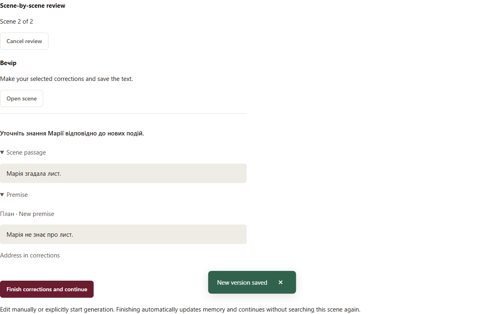
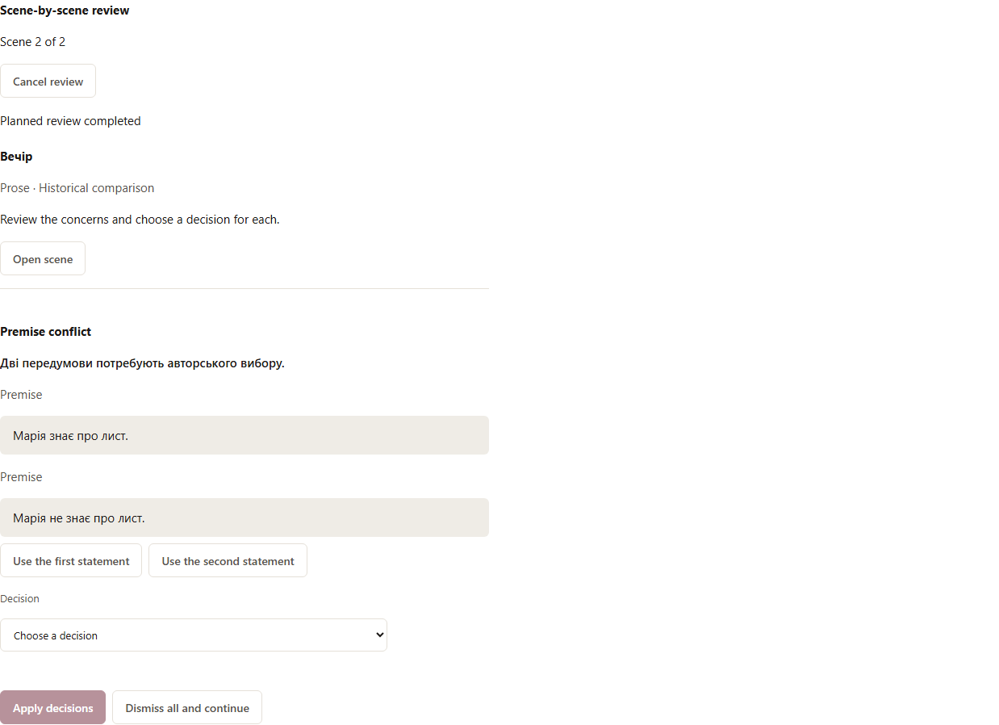

# Послідовна перевірка книги

[English](en/sequential-review.md)

Старі завдання та проза без збереженої історичної бази перевіряються в режимі **Поточні передумови**: чинні плани, канон, описи персонажів, завдання сцени для прози та попередні сцени. У попередньому перегляді й звіті явно зазначено, що порівняння «було → стало» не виконувалося. Початкова історія не переписується. Чистий повний пошук або ваше рішення робить матеріал актуальним для цих передумов; наступна зміна джерел знову потребуватиме перевірки. Пошкоджені джерела й невалідна пам’ять залишаються блокерами.

На сторінці твору відкрийте меню **☰ «Дії твору» → «Редагування книги» → «Перевірити вплив»**. Поки сесія чекає на ваше рішення, її картка також показується в рядку стану редактора, щоб правити сцену поруч із рішеннями. Попередній перегляд показує планувальника й приблизну кількість викликів початкового пошуку. Наступні сцени плануються після завершення попередніх. Оновлення пам’яті можуть потребувати додаткових викликів. Для платних ролей задайте загальний ліміт сесії; також діє бюджет оповідання. Перегляд сторінки чи налаштувань не запускає модель.

Після запуску система йде сценами по порядку. Повний успішний пошук без зауважень автоматично робить сцену актуальною. Це практичний модельний висновок, який може помилятися; він не є гарантією літературної якості.

Якщо є зауваження або питання, сесія зупиняється. Для кожного показано текст зауваження, уривок сцени та передумову. Оберіть **Відхилити як нерелевантне** або **Врахувати в правках**, потім застосуйте рішення. **Відхилити всі й продовжити** — явне пакетне авторське прийняття сцени.

Якщо обрано правки, відкрийте сцену й виправте збережений текст вручну або використайте наявні інструменти генерації/переписування. Сам вибір зауважень нічого не генерує. Після збереження натисніть **Завершити правки й продовжити**. Система прийме поточні матеріали, оновить пам’ять і перейде далі без повторного пошуку цієї сцени. Авторське рішення зберігається окремо від модельного звіту.

Пам’ять використовує лише поточну й попередні сцени. Якщо ранню прозу змінили, може знадобитися послідовне оновлення кількох журналів. При помилці пам’яті прийнятий текст зберігається, сесія зупиняється. **Відновити перегляд** потребує явного дозволу повторити невдалий виклик; завершені перевірені відповіді використовуються без нового виклику. Старі чи некоректні докази пам’яті не приймаються потай.

Рішення й етап сесії зберігаються після перезавантаження та переходу в налаштування. Незбережені правки блокують авторське продовження. Зміна порядку сцен або джерел під час пошуку зупиняє застосування результату; створіть новий попередній перегляд. Нові налаштування ролі застосовуються з наступного виклику, завершені спроби зберігають свої параметри.

Старі перевірки впливу лишаються в історії зі своїм попереднім форматом. Нова кнопка запускає protocol3. Журнали й докази входять у стандартне резервне копіювання та перевірку цілісності; міграція SQLite не потрібна.

Якщо перебудова може стерти ручні записи пам’яті або втратити вибір «передавати далі», вона зупиняється до виклику моделі й називає сцену. Оновіть її пам’ять вручну, зберігши потрібні записи та перевіривши вибір, потім відновіть перегляд. Старий журнал не перезаписується автоматично. Це також стосується старих некоректних журналів.

## Перевірка з точними доказами

Перед попереднім переглядом можна обрати **Перевірка з точними доказами**. Звичайна перевірка зберігає попередній формат. Новий формат спочатку зіставляє передумови між собою, включно з твердженнями всередині одного уривка, потім — текст із передумовами. Модель повертає точні пари цитат; програма перевіряє адреси й визначає категорію. Цитатний збіг підтверджує походження, але не гарантує правильності модельного висновку.

**Потрібна правка** означає суперечність тексту чинній однозначній передумові. **Конфлікт передумов** потребує авторського рішення; **Бракує даних** називає конкретну необхідну інформацію. У конфліктній парі можна обрати перше або друге твердження як чинне для цього матеріалу цієї сцени. Це не підвищує весь документ. Рішення зберігається окремо, робить поточну перевірку неактуальною й потребує нового попереднього перегляду. Звичайний формат уже не може обійти цей пріоритет. У розділі **Авторські пріоритети для цієї сцени** можна скасувати рішення; скасування також потребує нової перевірки й не відновлює старого прийняття.

**Перевірку не завершено** зберігає придатні знахідки та перелік незавершених частин. Прийняти такий результат або відхилити все й продовжити неможливо. Явний повтор виконує лише непридатні частини та залежні зведення; завершені перевірені частини зберігаються. Пошкоджений JSON або обірвана відповідь не ремонтуються автоматично.

У цій поставці новий формат потребує **авторського підтвердження навіть за відсутності зауважень**. Автоматичний модельний допуск чекає окремого оцінювання. Повнота виконаного плану не є гарантією, що модель помітила кожну суперечність.

Для локального нового формату потрібні native JSON schema, вимкнене thinking та окремо активований кваліфікований лічильник для нового системного промпту; старий binding не переноситься. Його відсутність чи пошкодження блокує запуск. [Керування токенним бюджетом](token-budget.md) описує offline реєстрацію й активацію. Нова кваліфікація не виконується самим вибором формату.

Кількість пар передумов зростає квадратично, але передумови, що вміщуються разом, передаються групою. Початкова кількість викликів — оцінка: повернуті докази можуть змінити подальше пакування. Межа пошуку однієї сцени —10000 частин; під час розбиття preflight також обмежує роботу до100000 пар. Платний попередній перегляд показує консервативну верхню вартість пошуку однієї сцени за цією межею; пам’ять і наступні сцени оплачуються окремо в межах тих самих бюджетних правил. Пошук не розширює бюджет самостійно.

