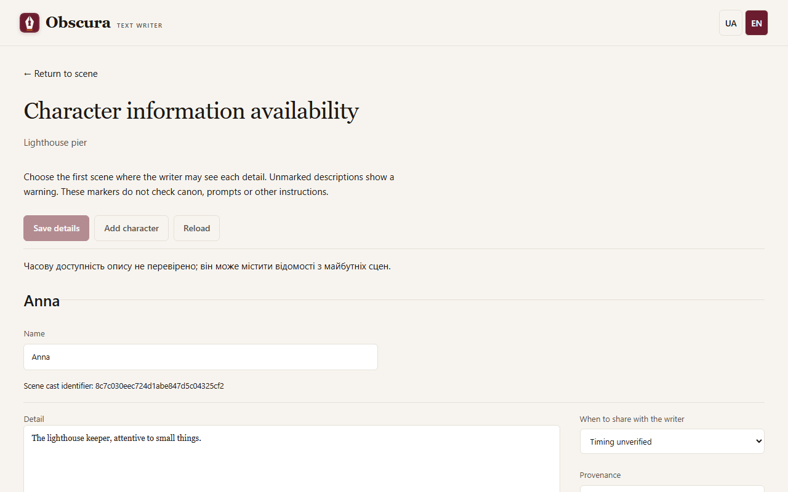

# Characters

Open **Characters** in the story's top row. The separate page has wide description fields, with availability settings alongside them on a computer and below the description on a phone. **Return** opens the same scene and material you came from.

## Cards and entries

The buttons at the top save the cards, add a character or reload what is saved. Each card consists of entries; a solid imported description can be split into entries at blank paragraphs. Entries written by hand are marked "Author statement", and imported ones keep their source quotations.

## When a character appears

For each entry choose:

- **From the very beginning**: the model knows it in every scene;
- **Starting from scene**: only from the chosen scene;
- **Time not checked**: the entry is visible with a warning.

**What the writer will see** shows which entries reach the context of the chosen scene, with no model call and without saving. After you reorder scenes, availability follows the new order.

**Save entries** creates a new version of the cards. If the cards changed in another tab meanwhile, your edits stay in the form, and reloading asks for confirmation.

## Protagonist and acquaintances

To keep the model from naming people the protagonist has not met yet, the brief, draft and rewrite contexts get a short "Protagonist acquaintances" block.

- Mark the protagonist with a line of its own in a card description. The app recognises only the Ukrainian words «протагоніст», «протагоністка», «головний герой» or «головна героїня». The template line «Роль у творі: Головна героїня» also works. Without a mark, the protagonist is the first participant of the earliest scene.
- Acquaintances from before the story use the Ukrainian line «Знайомий з: Name, Name» («Знайома з:», «Знайомі з:»). A dash, «Знайомий з: —», means the protagonist knows nobody. An unknown name produces a warning but does not block generation.
- The planner records in the brief whom the protagonist meets in this scene. If you write the brief by hand, you can change this field.

An acquaintance is the planner's intent, not a check of the prose: if the writer skipped the introduction, the next scene still treats the character as acquainted.

If prose was saved by hand and its link to the brief was lost, the prose tab shows the **Brief and introductions** panel. Tick who was introduced to the protagonist in this scene and press **The prose rests on this brief**. If the brief does not match the prose, press **Open the brief**, fix and save it. **Next unconfirmed scene** moves to the next scene waiting for confirmation. Confirmation does not change the prose.

## Character age

The age-rating safeguard reads the age from a line starting with `Age:` or `Вік:` in the card entries. See [Age ratings](content-rating.md#character-age).
