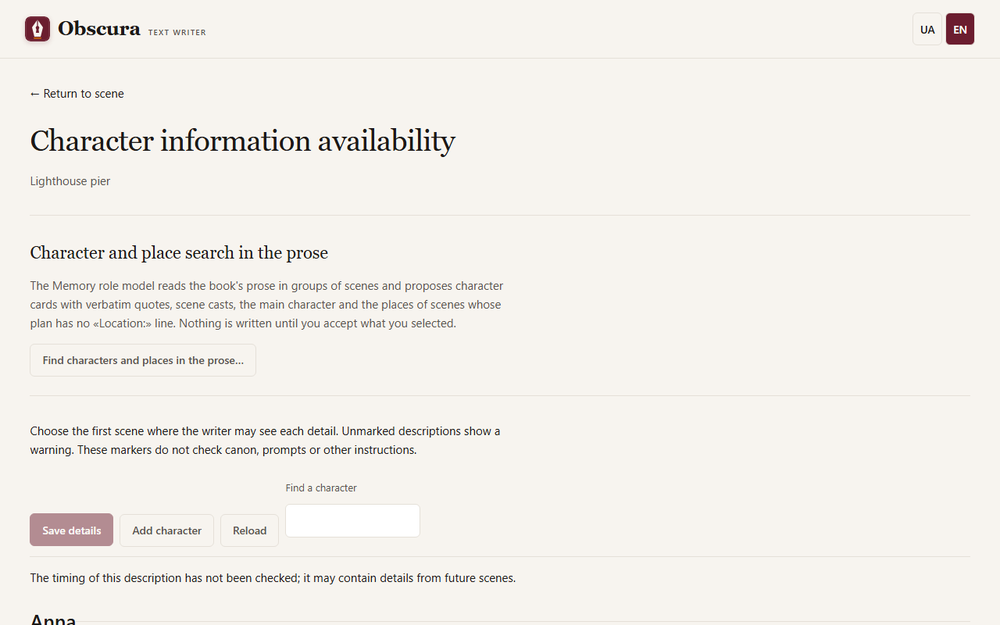

# Characters

Open **Characters** in the story's top row. The separate page has wide description fields, with availability settings alongside them on a computer and below the description on a phone. **Return** opens the same scene and material you came from.

## Cards and entries

The buttons at the top save the cards, add a character or reload what is saved. Each card consists of entries; a solid imported description can be split into entries at blank paragraphs. Entries written by hand are marked "Author statement", imported ones keep their source quotations, and entries accepted from the model's character search are marked "From model".

After you save changed cards, Obscura asks: “Cards changed: … Mark the dependent scenes as unchecked? Scenes: N.” Dependent scenes are the scenes with a brief where the character is a participant or the narrator, including for a removed card. **Yes** makes the brief and prose of these scenes “Unchecked” until you approve or regenerate them ([scene status](workspace.md#scene-status-valid-or-unchecked)); **No** changes nothing. Cards changed through a chat client (MCP) do not change scene status.

The **Find a character** field next to the buttons keeps only the cards whose title or [other name](#other-names) contains the text you type, and shows how many cards are visible. Enter or picking a name from the suggestions moves to that card and puts the cursor in its name field. Cards are only hidden: your edits are kept, and **Save details** saves every card. If a hidden card has an empty required field, the filter is cleared so you can see it. **Add character** clears the filter too.

## When a character appears

For each entry choose:

- **From the beginning**: the model knows it in every scene;
- **Starting from a scene**: only from the chosen scene;
- **Timing unverified**: the entry is visible with a warning.

**What the writer will see** shows which entries reach the context of the chosen scene, with no model call and without saving. After you reorder scenes, availability follows the new order.

**Save details** creates a new version of the cards. If the cards changed in another tab meanwhile, your edits stay in the form, and reloading asks for confirmation.

## Other names

If a character goes by several names, list the other names in a card entry with a line such as `Other name: Boss` (also `Other names:`, `Also known as:`, `AKA:`, or the Ukrainian «Інше ім’я:», «Інші імена:», «Також відомий як:»). Separate several names with commas.

- Plans recognise the character by the card name and by every other name: in the scene cast, `Knows:`, the narrator line and `Protagonist:`.
- To have the character called differently from some scene on, set the entry with the line `Other name: John` to **Starting from a scene**. From that scene the models call the character John and see the earlier names: "John (also: Boss)". Obscura does not insert the name John into earlier scenes; your own text in plans or other entries goes as written.
- An entry without a first scene only adds a name; it does not change what the character is called.
- A card name wins over another card's other name: with the cards "Aya" and "Aya-bot" whose entry says `Other name: Aya`, "Aya" in a plan means the card "Aya". The Characters page and the import result point this out.
- If two cards share a card name, or two cards share an other name, the page and the import result show a warning, and a plan using that name asks you to clarify the cast.
- The interface calls the character by the card name. A name change makes stale the drafts whose requests it changed.

## Protagonist and acquaintances

To keep the model from naming people the protagonist has not met yet, the brief, draft and rewrite contexts get a short "Protagonist acquaintances" block.

- Mark the protagonist with a line of its own in a card description: `Protagonist`, `Main character` or `Lead character` (or the Ukrainian «протагоніст», «протагоністка», «головний герой», «головна героїня»). A template line such as `Role in the story: Protagonist` also works. Without a mark, the protagonist is the first participant of the earliest scene.
- Acquaintances from before the story use the line `Knows: Name, Name` or `Acquainted with: Name, Name` (or the Ukrainian «Знайомий з:», «Знайома з:», «Знайомі з:»). A dash, `Knows: —`, means the protagonist knows nobody. An unknown name produces a warning but does not block generation.
- The planner records in the brief whom the protagonist meets in this scene. If you write the brief by hand, you can change this field.

An acquaintance is the planner's intent, not a check of the prose: if the writer skipped the introduction, the next scene still treats the character as acquainted.

If prose was saved by hand and its link to the brief was lost, the prose tab shows the **Brief and introductions** panel. Tick who was introduced to the protagonist in this scene and press **The prose rests on this brief**. If the brief does not match the prose, press **Open the brief**, fix and save it. **Next unconfirmed scene** moves to the next scene waiting for confirmation. Confirmation does not change the prose.

## Character age

The age-rating safeguard reads the age from a line starting with `Age:` or `Вік:` in the card entries. See [Age ratings](content-rating.md#character-age).
