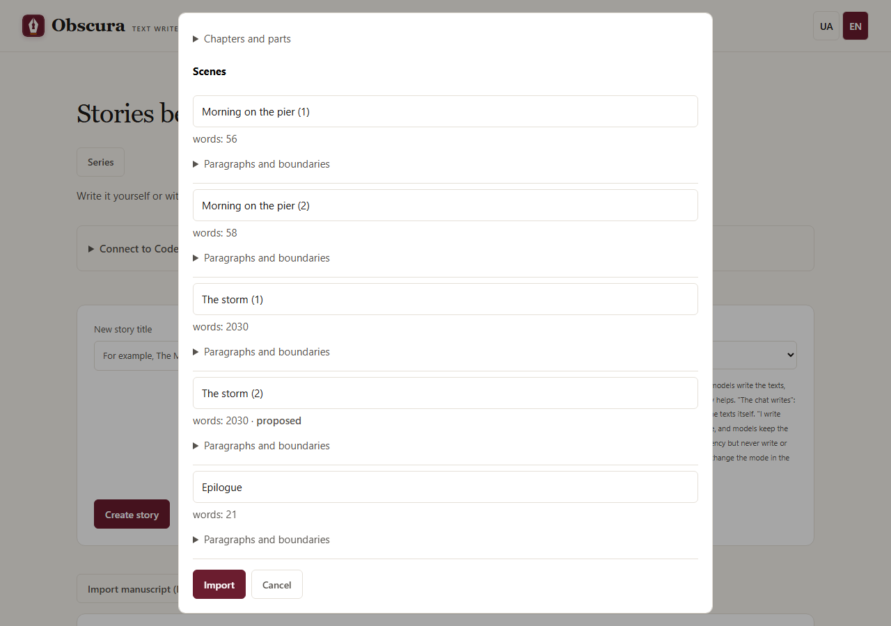

# Importing a manuscript

You can bring a book you have already written into Obscura as one file. Chapters become scenes with your prose, you split chapters that are too long before saving, and then you build the book's memory. An import always creates a **new** book and never changes existing ones. No model is called during the import, so the preview and the save cost nothing.

## Formats and limits

- **DOCX**, **Markdown** (`.md`) and **TXT** (`.txt`), up to 20 MiB. Markdown and TXT must be UTF-8, with or without a BOM; a file in another encoding (such as windows-1251) is refused with an explanation.
- One import takes up to 500 scenes. Split a longer manuscript into several files or merge scenes in the preview.
- Italics and bold are kept. Tables, images, footnotes, headers and footers are not imported. Word comments are not imported either: the preview tells you how many there are. Unresolved Word tracked changes are imported as accepted (insertions stay, deleted text disappears), and the preview warns about it: better resolve them in Word before the import.
- A Word table of contents is skipped.

## How to import

1. In the library press **Import manuscript (DOCX, Markdown, TXT)…** and choose the **Manuscript file**.
2. Obscura shows a preview: the book title, the language, the rating, and the chapters and scenes it found with their word counts. Nothing is written until you press **Import**.
3. Fix scene titles and boundaries if needed (see below), then press **Import**.
4. The summary gives a link to the book and a **Build memory (scenes: N)** button.

**Cancel**, or closing the dialog without an import, deletes the file Obscura kept for the preview. An unfinished preview is kept for 24 hours; after that, or if the import was cancelled in another tab, the dialog asks you to choose the file again.

## How chapters are recognised

- **Chapter markers.** A line of up to 120 characters that starts with the word "Chapter", "Глава" or "Розділ", followed by a number (Arabic, Roman in Latin or Cyrillic letters, or a word) or a title: "Chapter 3", "Chapter II. The storm", "Chapter One". You can change the list of words in the **Chapter markers (comma-separated)** field. When the file has at least two such lines, they are the chapters.
- **Heading styles.** Otherwise a chapter is a heading of the highest level (up to the third) that occurs at least twice. In Word these are the "Heading 1–3" styles (in a localised Word too), in Markdown the `#`, `##`, `###` lines.
- **Chapter source.** If the parse went wrong, choose chapter markers or a heading level in the **Chapter source** field: the file is parsed again.
- **Prologue, Epilogue, Afterword, Interlude** (and Пролог, Епілог, Післямова, Інтерлюдія) on a line of their own become chapters with that title.
- Without headings or markers the whole text becomes one scene, "Manuscript", with a warning.

Changing the markers or the chapter source parses the file again, and your scene boundaries are reset: the preview says so.

## Scene boundaries

- A line of only `***`, `* * *`, `#`, `—`, `~`, `⁂` or similar signs splits a chapter into scenes and does not go into the prose. In Markdown `---` and `# # #` work the same way. A blank line is not a boundary.
- A scene of more than 2,500 words gets proposed boundaries, marked "proposed". A boundary lies between paragraphs: preferably where the file had a blank line, before a paragraph that does not open with dialogue, and after the end of a sentence.
- Boundaries are also proposed for a scene that does not fit the memory model's limits.
- Expand **Paragraphs and boundaries** under a scene to see its paragraphs. **Boundary here** puts a new boundary before a paragraph, **Remove boundary** joins the scene with the previous one. A new scene gets a title such as "The storm (2)"; you can change it.
- A boundary cannot be placed on a heading or a separator.

## Front matter and book title

- The book title proposed is the first paragraph in the "Title" style or the first heading before the chapters. Without them the **Book title** field is empty: type the title yourself.
- Text of more than 50 words before the first chapter becomes a "Prologue" scene.
- Shorter text (a dedication, an epigraph) is front matter: by default it is not imported, and the **Add the front matter to the start of the first scene** switch adds it to the first scene.

## Parts and series

- **Free edition:** one standalone book, chapters are scenes on one level. Part headings ("Part One") are skipped with a warning, and their text is not lost. While the [trial](paid.md#trial-in-the-microsoft-store-build) is free, the preview of a manuscript with parts shows the **Import with parts as the trial book** checkbox: with it the book is imported with parts and becomes the trial book, without it the book has no parts. If the trial went to a series, a book with parts can be imported into it, and the series list holds only that series. While the trial is free or on a series, part headings are recognised, and instead of the warning the preview explains that without the checkbox or outside the trial series the book is imported without parts.
- **Paid edition:** lines "Part", "Book", "Частина" or "Книга" with a number become [parts of the book](book-structure.md); the **Part markers (comma-separated)** field sets the list. You can add the book to a [series](series.md) with a number right away. If the memory of the previous book in the series is not built yet, the preview warns that the new book starts without a series start snapshot; this does not block the import, and the snapshot can be refreshed later.

## After the import

Every scene has your prose as an author's version, and the scene plans are empty. The scene status row shows "Imported from manuscript: <file>", and for a scene without a plan adds "Plan optional: validation checks the prose and the memory". A scene without a plan stays "incomplete" until you write the plan. You can write the plan later: the scene's prose and memory do not become stale because of it.

## Characters before memory

Memory keeps the protagonist's state (clothes, things at hand, place, body, who they are with) only for a character from a card who takes part in the scene. So add character cards before you build memory: on the [Characters](characters.md) page, by [importing a characters file](imports.md) or with the model's [character and place search in the prose](characters.md#character-and-place-search-in-the-prose). Search for characters before building memory: the first accepted cards make the already built memory of every scene stale. The same search proposes scene places: an imported scene has an empty plan, so without them memory does not know where the scene happens and cannot bring records about that place to later scenes ([Locations](memory.md#locations)). Mark the protagonist in their card; without a mark the first participant of the first scene becomes the protagonist.

Obscura fills the participants of imported scenes itself, without a model, before the memory build starts. Only scenes with your prose (imported or written by you) are filled; a scene whose prose a model wrote is left as it is:

- a scene's participants are the cards whose name its prose mentions, in order of first mention;
- a scene whose plan has a "Characters:" or "Participants:" line, or a scene whose participants you have already chosen, is left as it is;
- a name is also found in inflected forms: for a name longer than four letters the last letter is dropped (the Ukrainian "Марія" also finds "Марію"). A name of up to four letters is not shortened, so the Ukrainian "Оля" does not find "Олю". A name is looked up as the start of a word, so a short name may be found by mistake inside a longer word: the Ukrainian "Рома" also finds "романтичний" ("romantic"). A name of one or two letters is not found at all;
- participants filled from names count as chosen afterwards: cards you add later are not added to such scenes. Add a new character to the participants of these scenes yourself;
- a character named only by a pronoun or a description does not get into the cast, and a namesake may get in by mistake. Fix the participants in the scene plan or the scene properties.

## Building memory

**Build memory (scenes: N)** is in the import summary, and in the **☰ Story actions** menu when the book has scenes without valid memory and every scene from the first such scene to the end of the book has prose. Details are in [Building the book memory](memory.md#building-the-book-memory).

## Chat clients

Through [MCP](mcp.md) the chat can import a manuscript from the full path of a local file or send a small file (up to 2 MiB) as content. First the chat shows the scene preview and creates the book only after your consent; it builds the memory with a separate run with a cost preview.

## Known limitations

- The chapter heuristic may miss unusual headings: fix the boundaries in the preview.
- TXT: a line that ends with a dash or a bracket is taken as wrapped, so a dialogue line ending with a dash may be joined to the next line.
- Markdown: a `---` line right after text is taken as a scene separator, not a heading.
- In the paid edition the text before the first part becomes a first part without a title.
- If the series was deleted between the preview and the import, the dialog says the preview file is no longer kept: choose the file again.
- Participants from names: a short name may be found by mistake inside a longer word (the Ukrainian "Рома" in "романтичний"), and cards added after the first memory build do not get into scenes already filled. Check the participants in the scene properties.
