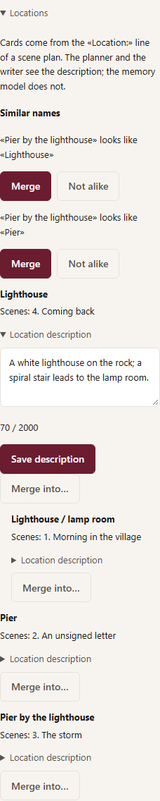

# Memory

Once prose is accepted, the memory model records what happened in the scene: facts, character states, open plot lines and the timeline. Every entry rests on a quotation from the prose. Later scenes receive this memory in the planner, writer and editor context.

## Viewing

Open a scene → **Memory**. The table shows the text of each entry, its category and the source scene. **Show evidence** opens the quotation from the prose. The source scene filter first shows entries of the current scene; choose another scene or **All scenes** to see inherited entries.

## What to pass forward

Clear **Share forward** next to entries you do not need and press **Save**. A choice made in scene 5 applies from scene 6, inherited facts included; the entry itself stays in the journal. In a later scene you can tick it again.

Only the entry in the memory block for the models is switched off, not the fact in your outline or prose. Finished texts are not rewritten automatically, but dependent materials of later scenes may become stale: review and accept them or generate them again.

## Protagonist core state

For the protagonist, memory keeps a core state: clothing, items carried, location, physical state and who they are with. The writer's memory block starts with these values. If the hero already wore something else earlier the same day (for example, undressed to swim), the clothing line also shows that value: "clothing: naked (earlier this day: dress, sandals)", so a hero dressing again does not get invented clothes. When the prose shows it, the memory model records where removed clothes were left. When a change of day is visible from the `Start:` (or `Початок:`) line of the scene outline (`D.M.Y, H:M`, `day N`, or a mark made of a year, month and day in any order, negative ones included: `Start: Year 2, Day 14, 08:00`, `Start: Year -20`; `Start: unknown` means the moment is unknown), the model decides separately what carries over to the new day. The planner, the writer and a chat over MCP also get a "DAY CHANGED" note, and the standard prompts ask them not to contradict the core, to show a change of clothes or any other change explicitly, and not to carry yesterday's clothing over silently. Custom prompts do not get these rules, but they still see the note. If you change the day in the `Start:` line of the hero's previous scene, the brief and the draft of the next scene become out of date; your own manual texts do not.

You can check the model's core decisions in the panel above the table: **Accept**, **Keep previous** or **Write in…** your own value with or without a quotation. **Keep previous** is available only for versions produced by the memory model. Edits to outdated memory are rejected: regenerate this scene's memory first. **Apply** and **Cancel** change only the panel draft. **Confirm** without edits only marks the memory as checked, while **Confirm with edits (N)** creates a new memory version; memory of later scenes then becomes stale. An unsaved core draft is protected like unsaved text.

An author entry without a quotation is a truth of the world the reader has not seen yet. The writer gets it marked "unknown to the reader" and has to introduce it in the text as new.

## When memory does not fit

While the request fits the role limits, memory is passed in full. Otherwise the application selects the most important part and warns you: the protagonist core always in full, then recent protagonist states, open lines involving the scene participants, other participants' states, facts, records about the scene's place, the timeline of the last 20 scenes and "atmosphere". If even the core does not fit, the request is not sent.

The **Type** column guides the selection: **Auto**, **Core** (always shown) or **Atmosphere** (only within a small share). The choice is saved at once and applies to the whole story.

## Locations

The `Location:` line of a scene plan names where the scene happens: `Location: Lighthouse / lamp room`. Separate several places with a comma, a semicolon, `→` or the words "then" and "later": `Location: Pier, then lighthouse`. A slash nests one place in another, so `Lighthouse / lamp room` gives two cards, "Lighthouse" and "Lighthouse / lamp room". "and" stays part of a name ("Bed and breakfast"). Cards appear on their own when you save the plan; the same name (ignoring case and extra spaces) is the same card.

The memory model marks records with the scene's places. When memory does not fit, a later scene in the same place, in a place that contains it or in one inside it gets those records, including the state of a character who is not in the scene. Records made before this change have no places.

The cards are in the **Locations** section at the bottom of the **Memory** tab of any scene:

- **Location description** is optional text of up to 2000 characters. The planner and the writer see it (also through MCP); the memory model does not. Changing it makes the drafts of scenes in that place and the places inside it outdated.
- **Similar names** suggests possible duplicates, such as the typo "Pier" / "Peir". **Merge** makes the later card part of the first one; **Not alike** hides the suggestion for good.
- **Merge into…** merges a card with any other. Plan texts stay as they are; drafts of the scenes the merge affects become outdated. **Split** undoes the merge.

After you save a description, merge or split, Obscura asks: “Locations changed: … Mark the dependent scenes as unchecked? Scenes: N.” Dependent scenes are the scenes with a brief whose shown places or memory of nearby places changed. **Yes** makes the brief and prose of these scenes “Unchecked” until you approve or regenerate them; **No** changes nothing.

Nothing is merged without your decision. If the story was changed in another tab, saving is refused and the typed description stays in the field. The memory table shows each record's places as "Locations: …", and search finds a record by a place name too.

## Timeline summaries

A selected request leaves out the timeline older than 20 scenes. To keep the model aware of what happened earlier, create a summary in the **Timeline summaries** section of the memory panel. A block is a part of the book, or, in a book without parts, every 10 scenes (1–10, 11–20…). The **Create summary** button is highlighted once the first scene of the block leaves the timeline window. The summary is written by the Memory role model: you see the model and the token estimate before the run, and the call is paid. You can correct the finished text with **Edit**.

A summary is used only when memory does not fit: it replaces all timeline entries of its block with one line. If the prose or memory of a scene in the block changes, or the block's scenes change, the summary is marked "stale" and is not sent until you rebuild it.

## Memory merge

In a book with [arcs](book-structure.md) each arc keeps its own memory. Where arcs come together — in a meeting scene, in the first scene of the next part, in the first scene of an arc after several arcs have ended, and at the end of the book — the memory has to be merged. What changed in one arc only carries over without questions, and so does the same result in both arcs. When the arcs changed the same record differently (say, Anna put on a jacket in one and a raincoat in the other), that is a conflict, and you decide it.

The **Memory merge** section in the memory tab of such a scene shows the arcs that meet and one row per conflict: the value of each arc and **Own value**. Choose a value in every row and press **Confirm merge**. If the book or the arc memory changed while you were choosing, the app warns you, reads the merge again and keeps your choice wherever the conflict is the same.

Until the merge is confirmed, writing this scene does not start: a run stops before it, and an **Open memory merge** button appears next to the run status. After confirming, press **Continue** — the run goes on from the same scene.

If the memory of one of the arcs changes later, the merge becomes out of date and has to be confirmed again; decisions for the same conflicts with the same values are filled in by themselves and marked as carried over. The end-of-book merge appears in the memory tab of the last scene: it does not stop writing, but the summary of the last part needs it.

## Flashbacks

A flashback scene tells about the past and does not move the present on. Mark it with the **Flashback** checkbox in the scene settings, with a `Flashback: yes` line in the outline, or with a mark in the time line: `Start: Year -20 (flashback)` (also `(спогад)`). When the mark sets the flashback, the checkbox is on and cannot be changed. The scene list shows “flashback” under the title of such a scene.

The memory of a flashback only adds facts, up to six per scene: character states, open threads and the timeline do not change, so the next scene of the present sees the hero as before the flashback and gets the new facts. Saving flashback memory by hand that changes anything else is refused with “A flashback adds only facts”. A flashback neither gives a "DAY CHANGED" note nor breaks one: the scene after it compares its day with the scene before it.

In a story (no parts or arcs) the model writing a flashback gets no memory at all. In a book with arcs it gets the facts, threads and timeline without the hero's core state.

A scene of a book with arcs also sees **The past of other arcs**: facts from flashbacks of other arcs that stand above it in the text and describe the time before its arc starts. See [Parts and arcs](book-structure.md), “Flashbacks in a book with arcs”.

## Confirming earlier memory

If updating a scene's memory relies on an old journal of the previous scene, the application asks for confirmation. The dialog shows the memory scene, the number of new versions and of changed texts; **Cancel** does not start the model. Confirmation keeps the old sources and quotations; it does not verify the facts. If the sources change again, confirm again.

## Carrying memory to later scenes

The memory of each scene continues the memory of the previous one. When a scene gets a new memory — from the memory stage, a manual edit, a chat stage result or picking another version in the history — Obscura carries the records of later scenes over to the new memory on its own. The carry goes through the scenes in reading order, with no model and no cost; in the run summary it shows as **Memory carry**. The facts of later scenes do not change, so their briefs, prose and status stay as they were.

Until the carry reaches a scene, model runs for it are refused with the explanation “Memory is being carried”; you can still read and edit the text by hand. If the application was closed during a carry, it continues on its own after the next launch.

The carry stops when a scene's records refer to a fact the new memory of the previous scene does not have. This happens almost every time the memory of an early scene is generated again: the new records get new labels, and the carry usually stops at the very next scene. The run summary then shows a warning naming the scene, and its panel shows **The memory was not carried over** with **Create a new memory** and **Rebuild memory**. The new memory of that scene is built on the new memory of the previous one, and the carry continues, but it may stop again at the next scene. **Rebuild memory** has a model create the memory of this scene and of all later scenes in one run; like other model runs, it shows the number of calls and asks for your consent. The carry also stops before a scene that needs a memory merge: confirm the merge, and the carry continues from the scene after it.

If the carry was paused, ended with an error, or the application was closed while it was being cancelled, the panel of a scene it has not reached shows **The memory carry stopped** with **Resume carry** and **Cancel carry**. Resuming costs nothing. After a cancel, model runs for these scenes are available again, but their memory stays built on the old memory of the previous scene.

The scenes after the one where the carry failed wait too: their memory still relies on the old one. Their panel names the scene where the carry stopped and offers **Create a new memory** or **Rebuild memory** for it.

If you changed the prose but the facts stayed the same, press **Keep the earlier memory** in the panel below the text ([scene status](workspace.md#scene-status-valid-or-unchecked)). The next scene then does not ask for confirmation because of this prose change.

## Building the book memory

When a book already has prose but no memory yet (for example after a [manuscript import](manuscript-import.md)), the memory of all scenes is built with one run. The **Build memory (scenes: N)** item in the **☰ Story actions** menu is visible when the book has scenes without valid memory and every scene from the first such scene to the end of the book has prose; N is the number of these scenes. In a book you are still writing the item is not shown: update a scene's memory in the workspace. Memory is not valid when there is none, when it was marked stale by a change it depends on (for example, the scene's prose), or when the scene's participants changed after it. Memory the scene panel shows as stale only because of a link check or changed inputs is not counted by this item. For such a scene the workspace has **Rebuild memory**: the run covers it and every later scene to the end of the book (scenes where nothing changed are not paid for again). **Update memory** builds the memory of that scene only. In the free version the item is not shown for a book with parts or a series book: there it is read-only.

The item opens a preview, and nothing starts until you press **Build**. The preview shows:

- how many scenes and memory model calls there will be, from which scene, and which model;
- **Cost: up to $X (upper bound)** for a cloud model with a known price. For a local model it simply says "Cost unknown": it is not paid by a price list. For a cloud model without a price it says "Cost unknown" with the reason. This does not block the run. The estimate is approximate: it does not know what the memory of the next scenes and the length of the model's answer will be;
- the scenes that do not fit the memory role limits, with links: the run will stop on them, because the text is not truncated. Split such a scene or raise the role limit;
- how many character cards there are, who the protagonist is and how many scenes get participants from the names in the prose (see [Importing a manuscript](manuscript-import.md#characters-before-memory)). Without cards the preview warns "No character cards: the memory will have no hero state" with links to **Characters** and **Import characters from Markdown**; the run is still possible;
- in a series book that has not taken its start snapshot from the previous book although that book already has memory, an offer to press **Update from the previous book** first. Without it the memory will not take the previous book into account;
- if the previous memory awaits your confirmation, **Build** is unavailable with that reason and an **Open scene N** link: confirm the memory in the scene and come back to the build.

**Build** writes the participants of scenes with your prose (prose a model wrote is not changed and does not become stale) and starts an ordinary memory run: pause, resume and cancel are in the run row. The story budget and the run limit apply as for other runs. If the book, the cards or the memory model changed between the preview and the press, Obscura starts nothing and shows a new preview: "The build plan has changed. Check the preview again." While another run is active, **Build** is unavailable. If a build of this book is already queued or running (for example in another tab or from a chat), Obscura does not start a second one and says: "A memory build of this story is already queued or running: wait for it or cancel it in the runs panel". A paused build does not block a new one. But a paused or interrupted build cannot be resumed while another one is running: Obscura says "Another memory build of this story is already queued or running: wait for it or cancel it before resuming this one". Closing the dialog before the run request is sent cancels the build; scene participants already written stay.

## Advanced editing

**JSON for advanced editing** opens the memory journal as JSON with all quotation checks. Use it only when the table is not enough.

Stale memory is shown read-only: update it first. If memory changed in another tab, your choice stays in the form, and **Refresh table** lets you reread the current data explicitly.
