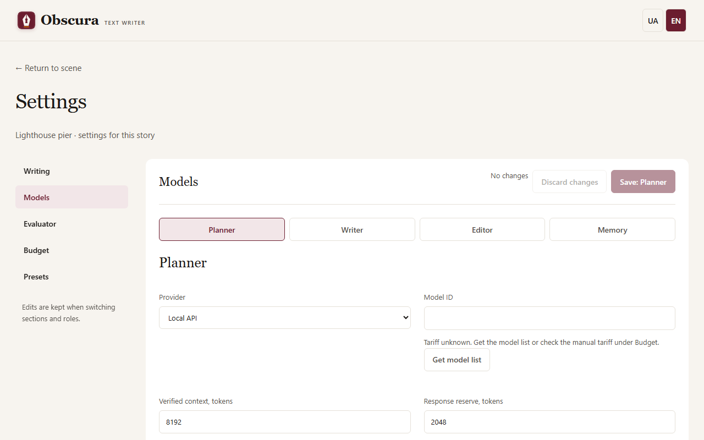

# Models, roles and budget

Four roles prepare a scene: the **Planner** writes the outline and brief, the **Writer** writes the draft, the **Editor** suggests changes, and **Memory** records what happened. Each role can have its own model. The [evaluator](evaluator.md) is configured separately.

## Role settings

Open the story settings → **Models** and choose a role. Enter the provider, API address, exact model ID, context, response reserve and input limit. **Get model list** shows the available IDs and known prices. Save the role with the **Save:** button carrying the role name; other roles' settings stay unchanged.

Providers:

- **Venice** and **OpenRouter** are cloud providers: they need a key, either in `.env` or in the "Provider key" block under the model field (see [Installation](install.md#provider-keys)), and a call budget. Models without the Uncensored mark need [consent](#consent-for-a-model-without-uncensored).
- **Local** is a server on your computer, such as LM Studio or Bionic; the default address is `http://localhost:1235/v1`. No key or budget is needed.
- **Codex CLI** uses your existing Codex sign-in; the text is sent to the Codex service.

The input limit in characters is a safeguard, not a token count. Before sending, the application estimates the tokens of the whole request and adds the response reserve; the sum must fit the context. Raising the numbers in the form does not increase the model's real context. Text is never silently cut: a request that does not fit is not sent.

## A separate writer model for scenes 0-1

In the **Writer** settings, the **Separate model for scenes rated 0-1** checkbox opens its own provider, API address, model, limits, temperature and timeout. The prompt and response mode stay shared with the main model. The variant is used when no axis of the scene's [rating](content-rating.md) (its own, or the story's when the scene has none) is 2; for level 2 scenes the main model writes. Generation cannot start until the story has a rating, so a scene without its own rating is always judged by the story's. The variant applies to the Draft and Rewrite stages.

The variant model has its own [consent](#consent-for-a-model-without-uncensored) and its own [refusal mark](#refusal-mark), like any other writer model. The pre-run check lists the variant model among the roles and counts its provider in the budget limit. Unchecking the box and saving returns every scene to the main model. The variant is part of [saved presets](#saved-presets) (such a preset uses format version 2), while the shared provider button changes only the main model. Limitations: the variant form does not check in advance that the reply reserve is smaller than the context (the server rejects the save), and the variant has no separate key field: on the same provider it uses the main model's key, on another provider that provider's default key name.

## Model list

Instead of a field with suggestions, the role form and the connection block show the provider's catalog. At the top is the chosen model: its ID, badges, context, price and a **Change** button. Below are a search box, filters and a sortable table; the footer "Showing N of M" tells you how many models the filters hide.

Badges come only from catalog fields, never from the model name:

- **Uncensored** — the provider explicitly marked the model as uncensored.
- **TEE**, **Private**, **Anonymous** — the Venice privacy level. "Privacy unknown" means the catalog did not report the field, as with OpenRouter.
- **JSON Schema** — the catalog says the model supports structured output by schema.

Filters: search by name or ID, **Uncensored only**, **Privacy** (default "Private and above"; you can choose "any" or "TEE only") and **JSON Schema**. For providers that do not report privacy (OpenRouter, local) the privacy filter is inactive and models are shown with "privacy unknown". A missing field always means "unknown", never "yes" or "no".

Venice lists all online models, including those without Uncensored, and they can be chosen. An ID that is not in the catalog can be typed manually; it is kept and marked "not in catalog".

### JSON Schema mode

If a role or connection uses the **JSON Schema** response mode, the JSON Schema filter is on and locked, and models the catalog marks as lacking schema support are visible but cannot be chosen. Models with unknown support (for example, all local ones) can be chosen and saved; a hint beside them says "JSON Schema support is unknown: check the model yourself." Changing the response mode rebuilds the list at once. If the already chosen model does not support JSON Schema, the form will not save, and the server also rejects such a save with an explanation: choose another model or the "JSON by prompt" mode. If the catalog is unavailable or support is unknown, saving is allowed. Before a call the app checks the model against the catalog only for Venice; for OpenRouter and local models check schema support yourself. In "JSON by prompt" mode the filter is ordinary and optional.

## Consent for a model without Uncensored

A cloud model (Venice, OpenRouter) that the provider has not marked as Uncensored may refuse explicit text. So when the request rating is above 0 on at least one axis, the application does not call such a model until you agree. The request rating is the highest level on each axis among the story rating and the scene of the stage; material of earlier scenes (memory, the end of the previous prose) does not raise it. Impact, review and publication-suggestion stages read several scenes, so their rating also counts those scenes. For a 0/0/0 story with one 2/0/0 scene, consent is needed only for that scene.

Under the chosen model in the role settings (and in the evaluation classification settings for the Editor role) a warning with an "I agree…" checkbox appears. The checkbox acts at once, without the **Save:** button. Consent belongs to the "role + model + API address" pair and applies in all stories; another role, model or address needs its own consent. Clearing the checkbox blocks calls again. Local models need no consent.

Without consent the stage stops with an explanation of which model, role and rating are involved, and no request is sent to the provider. For Venice the Uncensored state comes from the catalog, so the warning appears only after the model list is loaded.

## Refusal mark

If a model refused to write because of the content (the provider returned a content-policy refusal), the application remembers the rating at which it happened for that role and model. From then on calls with the same or a higher rating on every axis are blocked, and lower ones are not: after a refusal at 2/0/0 a 1/1/0 scene is allowed, a 2/1/0 scene is not. A red notice appears under the model with the refusal ratings and the buttons **Clear the mark** and **Choose another model**.

The application never switches the model by itself: you clear the mark yourself (for example after changing the prompt) or choose another model. A refusal the model expresses in plain text ("I can't write about this") is not recognized and leaves no mark.

## Call budget

For Venice and OpenRouter open the story settings → **Call budget**:

1. Set **Total story limit, USD** and press **Save limits**. Without it no cloud model receives a request.
2. Optionally set a default per-run limit; on the workspace page you can change it for the next run.
3. For pricing choose the provider and the exact model ID and press **Update from catalog**. This request carries none of your text; the tariff is valid for 24 hours. You can also save manual pricing with a source and an end date.

The limit is cumulative: restarts, the bin and new attempts do not reset it. To allow more spending, raise the total.

What the amounts mean:

- **Confirmed** — the provider reported the cost, or you reconciled it by hand.
- **Calculated from tokens** — the actual token count × the tariff. An estimate, not a bill.
- **Reserved** — the request is sent, the result is not recorded yet.
- **Needs reconciliation** — the cost is unknown after a failure or cancellation. The reserve stays until you reconcile the amount in **Call history and reconciliation**.

The reserve before a call is conservative: it counts the whole request and the full response limit. This is an internal control, not a guarantee of the provider's bill. Local models and Codex have no dollar price: the application shows usage, not an invented zero. Missing token data is shown as "No data", an explicit zero as 0. Enable **Request streaming usage (if supported)** only when the endpoint supports it.

## Saved presets

The **Saved model presets** block stores the settings of the four roles together with their prompts, so you can apply them to another story.

1. Save all roles with the usual forms.
2. Expand **Save current settings or import a preset**, enter a name and press **Save preset**.
3. In another story choose the preset and version, press **Preview preset**, check the models and limits, and apply it. Unsaved form changes will be lost.

**Export JSON** and file import work without model calls. The JSON contains no keys, only environment variable names: on another computer add the key to `.env` separately. Do not put a key in a model name or a prompt. The evaluator can be added to a preset, but not its calibration.

Role settings and the writing profile can also be changed from a [chat client](mcp.md#settings-from-the-chat). When you return to an open settings page, it checks for changes from the chat or another tab by itself: without unsaved edits the page refreshes, and with edits it stays and says "Settings were changed elsewhere".

## Local models

A local model costs nothing, but large books need many calls and time. Tested profile for an 8 GB GPU: **Huihui-Qwen3.5-9B-abliterated Q4_K_M** with a 131072 context in Bionic, the **Planner** role, address `http://localhost:1235/v1`, response reserve 12288, temperature 0.1, JSON Schema and **Disable thinking (reasoning_effort=none)** enabled. This profile was tested for [impact review](revision.md); other roles can keep using cloud models.

The context estimate is conservative. If an answer does not fit its reserve or a quotation is not found in the text, the stage stops and keeps the finished parts; there are no automatic retries.
