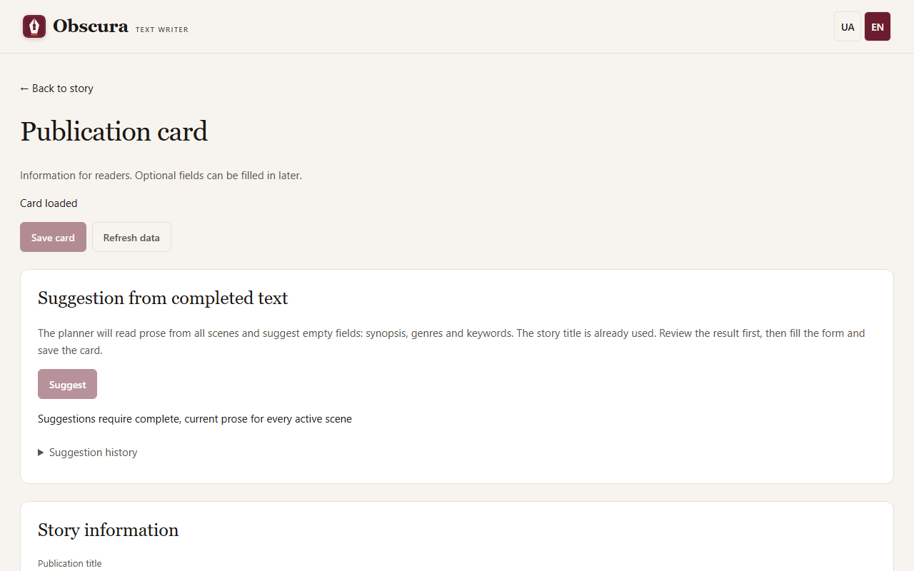

# Publication and export

## Publication card

Open the **☰ Story actions → Card and publication** menu item. The card is available before the first scene, and empty optional fields can be saved.

- **Title** may differ from the working title; an empty title uses the story title.
- **Language** of a new card is the story language; you can enter another language tag, such as `en` or `uk-UA`.
- **Synopsis** is text for the reader. **Genres** — up to 10, **keywords** — one per line, up to 30.
- **Authors.** Expand **Shared author and pen-name directory**, add a public signature, select it and press **Add author**. The directory is shared by all stories; a real name and a pen name are separate entries.
- **Additional information**: series and number, date, publisher, ISBN (the checksum is verified), rights, translators, original language.
- **Cover** — PNG or JPEG up to 10 MiB and 20 million pixels. Extra EXIF and GPS data are removed.

All changes, the cover included, apply only with **Save card**. The card does not make prose, memory or evaluations outdated. If the card was changed in another tab, your edits stay in the form, and **Refresh data** first asks whether to discard unsaved changes.

## Synopsis and genre suggestions

**Suggest** asks the planner model to fill in an empty synopsis, genres and keywords from all of the story's prose. Accepted prose for every scene is required, and a cloud model also needs a budget. Review the suggestion, press **Fill empty fields**, edit and **Save card**. Fields you have already filled in are not replaced. If the prose changed, an outdated suggestion is not saved, and the form stays.

## Export

Open **☰ Story actions → Export…** and choose a format: MD, TXT, FB2, EPUB or PDF. The file is created on your computer.

- FB2 needs an author and at least one genre in the card.
- Bold and italics from the text carry over to FB2, EPUB and PDF; TXT removes formatting marks.
- FB2 and EPUB receive an age label from the [rating](content-rating.md#label-in-fb2-and-epub).
- If some scenes need review or have no prose, export requires your explicit permission. The book contains no internal marks: warnings stay only in the separate manifest.

A finished file does not change when you edit the text: create a new export.

FB2, EPUB, PDF and covers need the `publication` extras; the installer includes them. For an installation from source, see [Installation](install.md).
