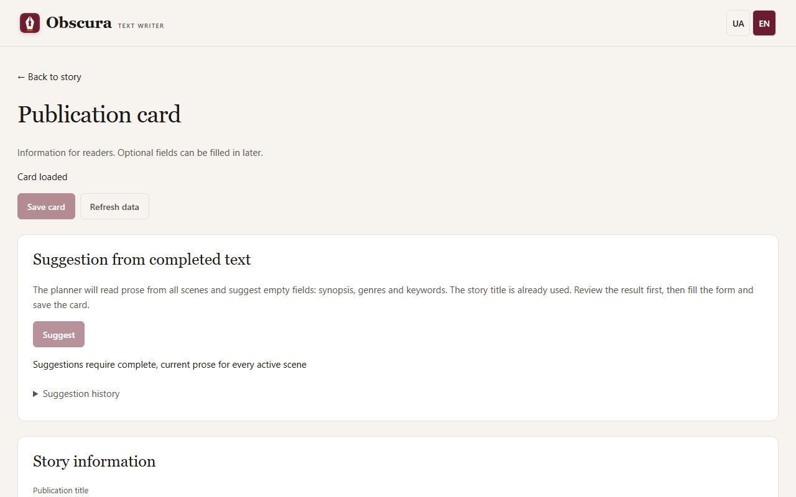
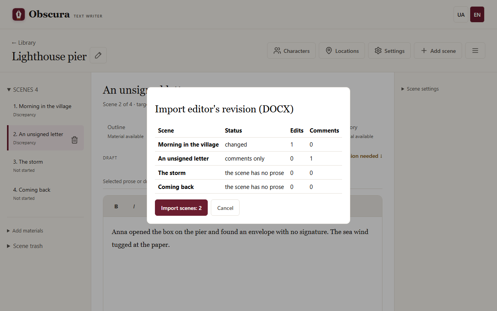

# Publication and export

## Publication card

Open the **☰ Story actions → Card and publication** menu item. The card is available before the first scene, and empty optional fields can be saved.

- **Title** may differ from the working title; an empty title uses the story title.
- **Language** of a new card is the story language; you can enter another language tag, such as `en` or `uk-UA`.
- **Synopsis** is text for the reader. **Genres** — up to 10, **keywords** — one per line, up to 30.
- **Authors.** Expand **Shared author and pen-name directory**, add a public signature, select it and press **Add author**. The directory is shared by all stories; a real name and a pen name are separate entries.
- **Additional information**: series and number, date, publisher, ISBN (the checksum is verified), rights, translators, original language.
- **Cover** — PNG or JPEG up to 10 MiB and 20 million pixels. Extra EXIF and GPS data are removed.
- **Text cover.** If you have no image, choose a palette (Ink, Paper, Wine or Forest) and press **Create text cover**. Obscura draws a cover from the title, series with number and authors that are in the form right now, even unsaved ones. Text that is too long is cut with «…». The cover does not redraw itself: after changing the title, press the button again.

All changes, the cover included, apply only with **Save card**. The card does not make prose, memory or evaluations outdated. If the card was changed in another tab, your edits stay in the form, and **Refresh data** first asks whether to discard unsaved changes.

The card can also be filled in from a [chat client](mcp.md#publishing-from-the-chat). When you return to an open card page, it checks for changes from the chat or another tab by itself: a clean form is refreshed, while a form with unsaved edits stays and the page says "The publication card was changed elsewhere". A new signature appears in the directory at once unless you are editing a directory row.

## Synopsis and genre suggestions

**Suggest** asks the writer model to fill in an empty synopsis, genres and keywords from the story idea (the plan preamble) and the prose. Accepted prose for every scene is required, and a cloud model also needs a budget. Review the suggestion, press **Fill empty fields**, edit and **Save card**. Fields you have already filled in are not replaced. If the prose or the plan preamble changed, an outdated suggestion is not saved, and the form stays.

If a long book does not fit the model window whole, the model reads the idea and the beginning of the book in whole scenes. The line under the button shows which scenes: “the model will read the story idea and scenes 1–14 of 31”. The suggestion then shows “Read: …”, and the history shows “Selected: …”. If the writer's character limit is what stops it, you can raise it in the model settings (the “Input limit, characters” field), and the model will read more. Check a synopsis written from the beginning of the book before you save it.

## Export

Open **☰ Story actions → Export…** and choose a format: MD, TXT, FB2, EPUB, PDF, a Word manuscript (DOCX) or an RTF manuscript. The file is created on your computer.

- FB2 needs an author and at least one genre in the card.
- Bold and italics from the text carry over to FB2, EPUB, PDF, DOCX and RTF; TXT removes formatting marks.
- FB2 and EPUB receive an age label from the [rating](content-rating.md#label-in-fb2-and-epub).
- If some scenes need review or have no prose, export requires your explicit permission. The book contains no internal marks: warnings stay only in the separate manifest.

A finished file does not change when you edit the text: create a new export.

### Manuscript for an editor (DOCX and RTF)

DOCX and RTF are for handing the book to an outside editor; for print, use PDF. The manuscript uses the layout editors expect: A4, Times New Roman 12 pt, 1.5 line spacing, page numbers at the bottom. The title page holds the title, the authors and the word count; every part and every scene starts on a new page, and the headings use the Word styles Heading 1 and Heading 2, so the structure shows in the navigation pane. The text language comes from the publication card, so Word checks spelling in the right language.

DOCX carries invisible scene marks: Obscura uses them to sort a returned edit back into scenes (see [Importing the editor’s revision](#importing-the-editors-revision-docx)). The marks survive ordinary editing and track changes, but disappear together with a scene heading if the editor deletes it. RTF has no such marks; it is for editors without Word.

The book file downloads under a name made of the author, the title and the export date, for example `Author — Title — 2026-11-21.epub`. Several authors are joined with “and” in an English card; commas, full stops and characters Windows does not allow in file names become spaces, and a long title is shortened. Without an author the name starts with the title.

The same list has a **Plan and characters (.md)** item. It gives you one readable file with the general plan notes, the plan of each scene in reading order and the character cards. It needs no prose, but save unsaved edits first. The file is built from the current state when you download it and is not kept among the exports. It cannot be imported back: importing uses the separate plan and character templates.

FB2, EPUB, PDF and covers need the `publication` extras; the installer includes them. For an installation from source, see [Installation](install.md).

### Importing the editor’s revision (DOCX)

When the editor returns the manuscript, bring their edits back into the story. Obscura does not change the prose by itself: the edits become proposals you accept or reject, and no model is called.

1. Export the **Word manuscript (.docx)** and give the file to the editor.
2. The editor edits the file in Word, preferably with track changes turned on, and leaves comments on phrases.
3. Save your unsaved edits in the story and open **☰ Story actions → Import editor's revision (DOCX)…**. While there are unsaved edits, the item is unavailable and shows "Save your changes first". Choose a file of up to 20 MiB.
4. You see a summary: a table of scenes with a status, the number of edits and comments, and warnings. The story changes only after you confirm.

Scene statuses:

- **changed** — the editor edited the text; the edits become a proposal.
- **comments only** — the text is unchanged, the comments become draft comments.
- **unchanged** — nothing to import.
- **draft only: the edits do not fit into the review** — there are too many edits to review one by one; the editor’s text becomes a new draft version without a proposal.
- **prose changed after export** and **no export data** — you edited the scene after the export, or the editor worked without track changes and Obscura does not know which text they started from. These scenes need your choice.
- **resolve the previous proposal first** — the scene still has an unresolved proposal from an earlier import; importing again does not duplicate it.
- **the scene has no prose** and **the prose markup cannot pass through DOCX** — the scene is not imported.

If every scene can be imported without a choice, press **Import scenes: N**. If some scenes changed after the export, the dialog names them, and the table shows for each what happens "if replaced". Instead of one button there are three:

- **Cancel import** — change nothing and remove the uploaded file;
- **Skip changed scenes** — import the rest and leave the changed scenes as they are;
- **Replace all** — import the changed scenes too. Your later changes will appear as edits you can reject.

If the story changed while the summary was open, the import writes nothing and asks you to choose the file again.

After the import, the result shows how many scenes were imported and skipped, with links to the scenes. The edits are on the scene’s **Editing** tab: expand **Editor changes**; the proposal is marked “· from editor (DOCX)” with a note that no model was called. Accept the edits as after [editing](revision.md#editing-a-scene). The editor’s comments become [draft comments](writing-tools.md#draft-comments): a comment on an unchanged phrase is attached to it, the others go into the general comment with a quote. The earlier draft comments stay in the previous draft version.

Limitations:

- tables, images, footnotes and formatting changes other than italics and bold are not imported — the summary shows a warning;
- a scene whose prose has a one-line list, a quote or a heading is not imported: DOCX cannot carry such markup unchanged (status “the prose markup cannot pass through DOCX”);
- an edit in a scene heading is not imported, and a scene whose whole text the editor deleted is skipped;
- a new paragraph the editor inserted right after a list, a quote or a line with a break may merge with it — the summary warns about this, so check paragraph boundaries in the proposal;
- only Microsoft Word has been tested; Google Docs and other editors have not;
- the import is meant for a DOCX exported from Obscura for this story; a file from another story is rejected, and RTF is not imported.
