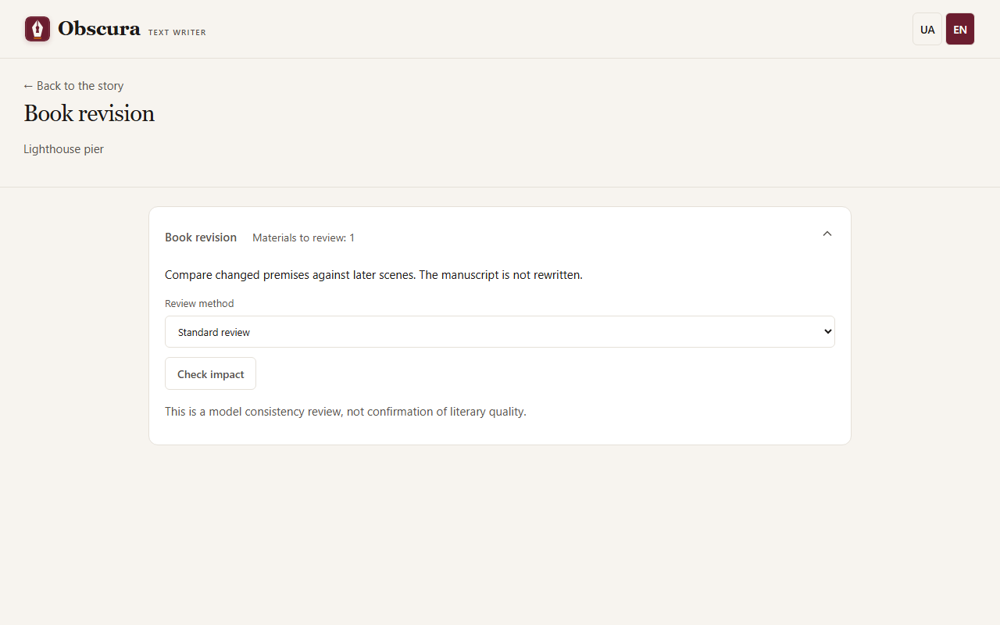

# Editing and impact review

## Editing a scene

The **Editing** stage follows the draft. The editor suggests changes, and you decide what to accept.

- **Targeted language edits** (an editor role setting) fix spelling, punctuation and single sentences without rewriting the text. They are applied **Automatically after validation** or after **Author review first**.
- In review, open **Editor changes**, tick the replacements you want and press **Apply selected changes**: this creates a new prose version.
- If the stage stopped for your decision, after accepting press **Continue after accepted stage**: the editor is not called again.

In the version history you can choose a draft or prose version and press **Check the selected version’s language**. The rules find letters from another alphabet, mixed alphabets within a word, repeated neighbouring words and a hyphen instead of a dash in dialogue. The saved version is checked, with no model call.

## Book revision

When you change early scenes, the outline or the characters, later materials may contradict them. Open the **☰ Story actions → Book revision** menu item: the tool opens as a separate page, and **← Back to the story** returns to the editor. The number next to the menu item counts materials waiting for review.

1. Save your edits. If there is unsaved text, the application offers to save it first.
2. Press **Check impact**. The preview shows the materials, the planner model, the possible number of calls and the budget. It does not call the model yet.
3. Cloud providers need a story budget, a current tariff and a limit for this series. The cost estimate is conservative.
4. Press **Start review**. The model finds what changed in the premises and checks every dependent material.
5. **No impact found** clears the review need for that text. **Changes required** shows exact passages, the new premises and what needs fixing.
6. **Open material** takes you to the scene and tab. Fix the text by hand or with the existing tools; the review itself rewrites nothing.
7. If an assessment is wrong, press **Reject assessment**: it stays in the history but no longer affects the status.

## Sequential review

A sequential review goes through the scenes in order. A scene without concerns becomes current automatically. Concerns pause the session: each shows the message, a scene passage and the premise. Choose **Dismiss as irrelevant** or **Address in corrections** and apply your decisions. **Dismiss all and continue** is an explicit batch decision by the author.

While the session waits for you, its card is also visible in the workspace below the status row, so you can edit the scene next to the decisions. After editing press **Finish corrections and continue**. Decisions survive a reload.

Before the preview you can choose **Review with exact evidence**: it first matches the premises against each other and then the text against them. **Correction needed** means the text contradicts a current premise, **Premise conflict** needs your decision, and **Missing information** names what is missing.

## Limits

A model assessment can be wrong: this is a consistency check, not a judgement of literary quality. Run status, costs, pause and cancellation work through the usual queue; there are no automatic retries.
