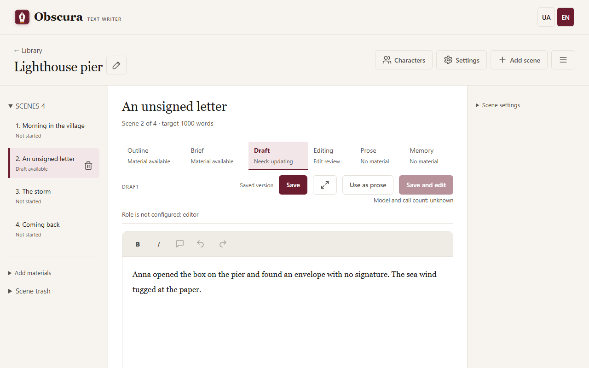
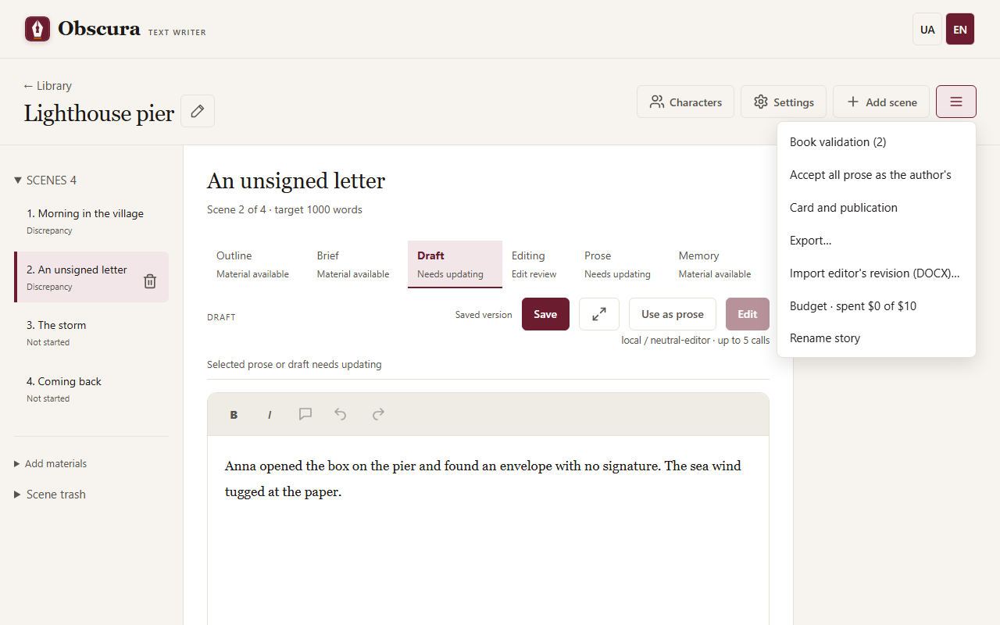
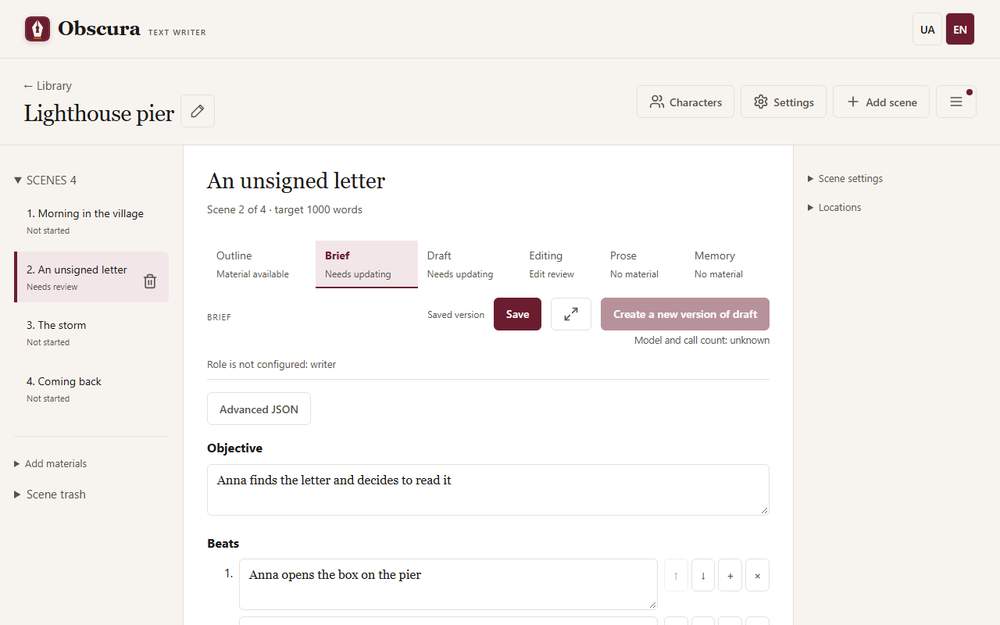
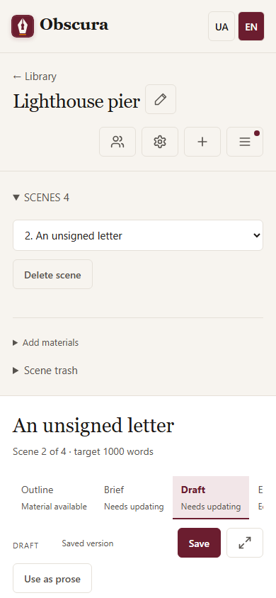

# Workspace and scene stages

The story workspace has three parts: the scene list on the left, the scene editor in the middle and the scene sections on the right. On a narrow screen they stack one under another.

If there are many scenes, click the **Scenes** heading with their count: the list collapses, and **Add materials** stays nearby. The current scene and unsaved text are kept.



## Delete and restore a scene

- In the scene list, the selected scene has a button with a trash icon: **Delete scene**. The app asks for confirmation and moves the scene to the scene trash; the following scenes will then need review.
- Save your text first: with unsaved changes the scene is not deleted and the app tells you why.
- If a run of the story stopped and is waiting for your decision, the app offers to cancel such runs together with deleting or restoring the scene. Text and history are preserved. While a model is working, the scene cannot be deleted: wait for the run to finish or cancel it.
- Accepting a brief or applying point edits finishes the run that was waiting for them, and a new run of the same scene stage cancels the old stopped one.
- To bring a scene back, expand **Scene trash** under the list and click **Restore**. Scenes are never deleted permanently.
- On a narrow screen there is no scene list: pick the scene in the selector and click **Delete scene** under it.

## Top row

- **Characters** opens the character cards on a separate page.
- **Settings** opens the models, writing, evaluator and budget for this story.
- **Add scene** creates a scene right after the open one (at the end of the list if no scene is open) and fills its outline from a template right away. Location, characters, key realisation and emotional focus are carried over from the previous scene's outline; its "End" becomes the "Start" of the new scene, and its "What happens" becomes "Previously". "End", "What happens" and the three "Beats" items stay empty. The number in the heading is the new scene's place in the list; the numbers in the outlines of the following scenes move on. A scene added at the end gets the number after the previous scene's number. In a Ukrainian story the outline labels are Ukrainian. Whatever the previous outline lacks stays empty; you can correct everything in the outline straight away.
- The **☰ Story actions** menu holds everything that concerns the whole story: **Accept all prose as the author's** (when the prose of at least one scene is outdated), **Card and publication**, **Export…**, story evaluation and reports (when an evaluator is configured), the budget line and **Rename story**. The menu works from the keyboard; `Escape` closes it.



## Change the scene order

- Open a scene and press **Move up** or **Move down** in **Scene settings**. Each press moves the scene by one place.
- Save the text first: a scene with unsaved edits does not move.
- After a move the story's texts need review: what the model knows from earlier scenes depends on the order.
- The number in the first line of the outline ("Scene 3: …") becomes the scene's number in the list. Only the number changes; a saved outline gets a new version and the previous one stays in the history. Scenes without a number in the outline (a prologue, an interlude) get no number but keep their place. The same happens when a scene is inserted in the middle, moved to the trash or restored.
- In a story with parts and arcs these buttons cannot move a scene into another arc: use the [book structure](book-structure.md).

## Scene stages

The **Outline → Brief → Draft → Editing → Prose → Memory** tabs show the scene materials and their state: "No material", "Material available", "Needs updating". A tab only opens the material; the primary button above the text starts the action.

On the **Outline** tab numbered items ("1.", "2)" and so on) number themselves. Enter at the end of an item starts the next number and shifts the items below; Enter on an empty item removes its number and ends the list. After you insert, delete or drag lines, the list is renumbered from its first item. A blank line separates two lists. The **Renumber** button puts every list in the outline in order, for example after you paste a whole outline. Ctrl+Z first brings back the old numbers, then undoes the edit itself. The scene heading and lines such as "Who takes part:" stay as they are.

The **Brief** tab shows the writer's brief as a form: the objective, numbered beats, constraints and proposed changes. Each beat has its own field; the buttons next to it move the beat up or down, insert a new one before it or remove it, and **Add beat** adds one at the end. The numbers next to the fields are set automatically and are not part of the beat text, so quotes, line breaks and any other text are saved as written. Empty fields are dropped when you save; with no beats **Save** is unavailable. **Advanced JSON** shows the same brief as JSON and **Simple view** brings the form back; unsaved edits are kept. If the JSON is broken, the form explains the error and waits until it is fixed.



If the planner reports "Significant changes require the author’s decision", the **Brief** tab opens a new proposal with a list of changes. Review it, save your manual edits and press **Accept brief**; **Save** keeps the proposal without accepting it.

Before you press it, the primary button shows the model and the maximum number of calls. Hover over it or reach it with Tab to see details and warnings. If a role is not configured, a button next to it takes you to that role in the settings.

On the **Draft** tab the primary button starts editing: the first time it reads **Save and edit**, and once there is prose it reads **Edit**. To its left, **Use as prose** saves the draft as prose without editing, just as if you copied it into the **Prose** tab. On the **Prose** tab the same place has the **Edit current prose** button.

## Status row

Only the stage tabs and the row with **Save** and the primary action stay pinned at the top. The same place shows why the primary action is unavailable, the mark for text from an external client and the warning that the material changed elsewhere. Below the scene text you see the note about the primary action, the scene status, the run progress and the pause, cancel, continue and repeat buttons. When a run waits for your decision (review, choosing a variant, pause, failure), the pinned row shows a **Decision needed ↓** link that scrolls to the buttons. The run progress takes one line: the state, the models, the cost in dollars (total / last call) and a ⚠ mark when there is a warning. The provider's usage details are in the tooltip on the cost. Click that line to see the plan, warnings and stages, and click again to hide them. A failed run shows its error right away. The text the model is writing right now appears in the **Text the model is writing** block below the scene text: it opens while a stage runs and closes once the stage's text is in. **Run options** sets the limit for the next run. **Run remaining scenes** runs the remaining scenes one after another. The Microsoft Store edition has neither these buttons nor the **Additional actions and automatic mode** block: there, a chat over [MCP](mcp.md) automates several stages or scenes. Pause takes effect between stages; closing the tab does not cancel the work, and cancelling does not guarantee that the provider stops answering at once. Check one scene first, as described in [Your first story](first-story.md).

## Editor

Draft and Prose have a formatting toolbar: **B** (`Ctrl+B`), *I* (`Ctrl+I`), undo (`Ctrl+Z`) and redo (`Ctrl+Y`). **Save** creates a new version and does not erase earlier ones. Pasting brings in plain text only. The browser warns you before you leave with unsaved edits.

The editor remembers the last scene and tab separately for each story in this browser.

The **Full screen** button in the row with **Save** spreads the text over the whole app window: the header, scene list, right panel, tabs and status row are hidden, and **Save** and **Exit full screen** remain. Leave with that button or the `Esc` key. The mode works on any tab; to run a stage or open another scene, leave it first.

## Scene sections

On the right, the **Scene settings** section (participants, narrator, word target, scene age rating) and the **Scene evaluation** section collapse and remember their state. Evaluation is hidden when the evaluator is off.

On a phone the sections go below the editor, and the top-row buttons show icons only.



## Scene narrator

By default every scene is told by the narrator from the story style. To tell one scene from another point of view, choose the **Narrator** field in **Scene settings**: **First person**, **Third person through a character** or **Third person, omniscient**. For first person and third person through a character also choose the **Character** from the character cards. **As in the story** returns the narrator from the style. The model receives the choice in the brief, the draft and the full edit of this scene.

You can also set the narrator with an outline line:

```
Narrator: Lera, first person
```

`Narrator: omniscient` and `Narrator: Marko, third person` work too. The outline line takes precedence: the fields in the settings are then unavailable and show its value. When the line is unclear (no person, no character, or the name does not match a card), an explanation appears under the field, and the choice in the settings applies.

When the narrator is not among the scene participants, Obscura saves the choice and warns about it. Changing the narrator makes only this scene’s brief, draft and prose out of date.
