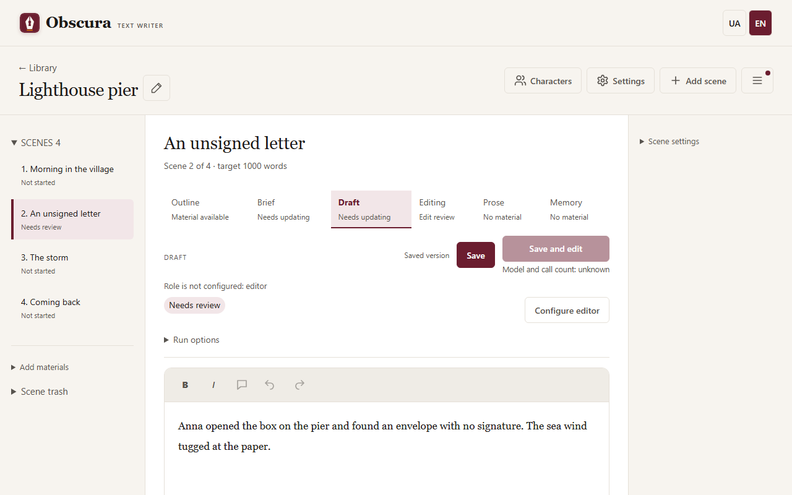
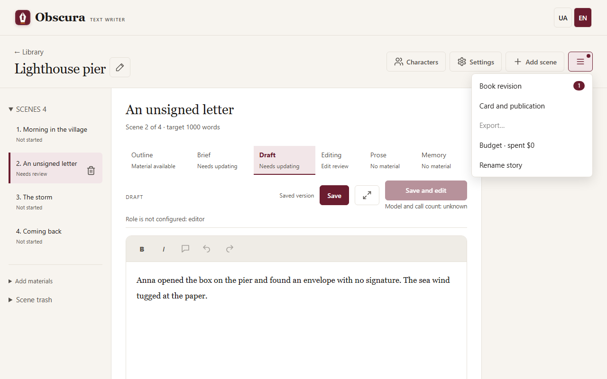
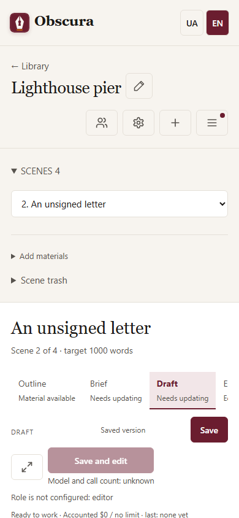

# Workspace and scene stages

The story workspace has three parts: the scene list on the left, the scene editor in the middle and the scene sections on the right. On a narrow screen they stack one under another.

If there are many scenes, click the **Scenes** heading with their count: the list collapses, and **Add materials** stays nearby. The current scene and unsaved text are kept.

## Top row

- **Characters** opens the character cards on a separate page.
- **Settings** opens the models, writing, evaluator and budget for this story.
- **Add scene** creates an empty scene at the end of the list.
- The **☰ Story actions** menu holds everything that concerns the whole story: **Book revision** (the number next to it counts materials waiting for review), **Card and publication**, **Export…**, story evaluation and reports (when an evaluator is configured), the budget line and **Rename story**. The menu works from the keyboard; `Escape` closes it.

## Scene stages

The **Outline → Brief → Draft → Editing → Prose → Memory** tabs show the scene materials and their state: "No material", "Material available", "Needs updating". A tab only opens the material; the primary button above the text starts the action.

If the planner reports "Significant changes require the author’s decision", the **Brief** tab opens a new proposal with a list of changes. Review it, save your manual edits and press **Accept brief**; **Save** keeps the proposal without accepting it.

Before you press it, the primary button shows the model and the maximum number of calls. Hover over it or reach it with Tab to see details and warnings. If a role is not configured, a button next to it takes you to that role in the settings.

## Status row

Above the scene text you see the scene status, the run progress and the pause, cancel, continue and repeat buttons. **Run options** sets the limit for the next run. When a sequential impact review waits for your decision, its card appears below the status row, next to the text.

## Editor

Draft and Prose have a formatting toolbar: **B** (`Ctrl+B`), *I* (`Ctrl+I`), undo (`Ctrl+Z`) and redo (`Ctrl+Y`). **Save** creates a new version and does not erase earlier ones. Pasting brings in plain text only. The browser warns you before you leave with unsaved edits.

The editor remembers the last scene and tab separately for each story in this browser.

## Scene sections

On the right, the **Scene settings** section (participants, word target, scene age rating) and the **Scene evaluation** section collapse and remember their state. Evaluation is hidden when the evaluator is off.

On a phone the sections go below the editor, and the top-row buttons show icons only.

