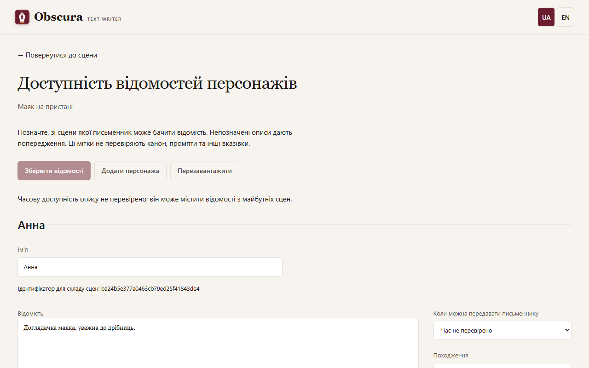

# Персонажі

Відкрийте **Персонажі** у верхньому рядку твору. Окрема сторінка має широкі поля описів, а налаштування доступності — поруч на комп’ютері й під описом на телефоні. **Повернутися** відкриває ту саму сцену й матеріал, з яких ви прийшли.

## Картки й відомості

Кнопки вгорі зберігають картки, додають персонажа або перезавантажують збережене. Кожна картка складається з відомостей; суцільний імпортований опис можна розділити на відомості за порожніми абзацами. Нові відомості, написані вручну, мають походження «Авторське твердження», а імпортовані зберігають цитати джерела.

## Коли персонаж з’являється

Для кожної відомості оберіть:

- **Від самого початку** — модель знає її в усіх сценах;
- **Починаючи зі сцени** — лише від вибраної сцени;
- **Час не перевірено** — відомість видима з попередженням.

**Що побачить письменник** показує, які відомості потраплять у контекст вибраної сцени, без виклику моделі й без збереження. Після перестановки сцен доступність рахується за новим порядком.

**Зберегти відомості** створює нову версію карток. Якщо картки тим часом змінилися в іншій вкладці, ваші правки лишаються у формі, а перезавантаження потребує підтвердження.

## Головний герой і знайомства

Щоб модель не називала людей, яких герой ще не зустрів, у контекст завдання, чернетки й переписування додається короткий блок «Знайомства протагоніста».

- Позначте головного героя окремим рядком в описі картки: «протагоніст», «протагоністка», «головний герой» або «головна героїня». Підходить і рядок шаблону «Роль у творі: Головна героїня». Англійські позначки (`Protagonist`, `Main character`, `Role in the story:`) теж розпізнаються. Без позначки протагоністом вважається перший учасник найранішої сцени.
- Знайомства до початку історії задає рядок «Знайомий з: Ім’я, Ім’я» («Знайома з:», «Знайомі з:»). Англійською — `Knows:` або `Acquainted with:`. Прочерк «Знайомий з: —» означає, що герой нікого не знає. Невідоме ім’я дає попередження, але не блокує генерацію.
- Планувальник записує в завданні, з ким герой знайомиться в цій сцені. Якщо пишете завдання вручну, це поле можна змінити.

Знайомство — намір планувальника, а не перевірка прози: якщо письменник пропустив знайомство, наступна сцена все одно вважатиме персонажа знайомим.

Якщо прозу збережено вручну й зв’язок із завданням загубився, на вкладці прози з’являється панель **Завдання й знайомства**. Позначте, кого в цій сцені представлено героєві, і натисніть **Проза базується на цьому завданні**. Якщо завдання не відповідає прозі, натисніть **Відкрити завдання**, виправте й збережіть його. **Наступна непідтверджена сцена** переходить до наступної сцени, що чекає підтвердження. Підтвердження не змінює прозу.

## Вік персонажа

Запобіжник вікового рейтингу читає вік із рядка `Вік:` на початку рядка відомостей картки. Докладніше — у розділі [Вікові рейтинги](content-rating.md#вік-персонажів).
