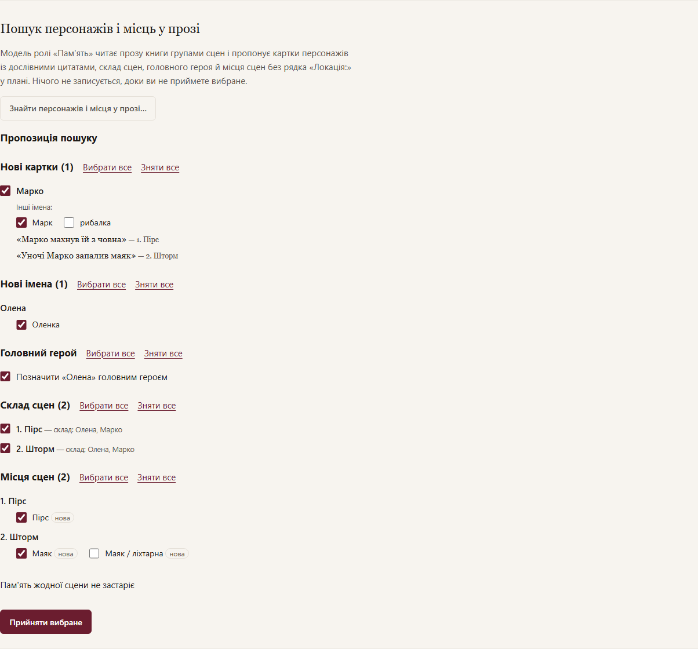

# Персонажі

Відкрийте **Персонажі** у верхньому рядку твору. Окрема сторінка має широкі поля описів, а налаштування доступності — поруч на комп’ютері й під описом на телефоні. **Повернутися** відкриває ту саму сцену й матеріал, з яких ви прийшли.

## Картки й відомості

Кнопки вгорі зберігають картки, додають персонажа або перезавантажують збережене. Кожна картка складається з відомостей; суцільний імпортований опис можна розділити на відомості за порожніми абзацами. Нові відомості, написані вручну, мають походження «Авторське твердження», імпортовані зберігають цитати джерела, а прийняті з пошуку персонажів моделлю мають походження «Від моделі».

Після збереження змінених карток Obscura питає: «Змінено картки: … Позначити залежні сцени як неперевірені? Сцен: N.» Залежні — сцени із завданням, де персонаж є серед учасників чи оповідачем, зокрема для вилученої картки. **Так** робить завдання й прозу цих сцен «Не перевірено», доки ви їх не затвердите чи не згенеруєте знову ([стан сцени](workspace.md#стан-сцени-валідна-чи-не-перевірена)); **Ні** нічого не змінює. Картки, змінені через чат-клієнт (MCP), стану сцен не змінюють.

Поле **Знайти персонажа** поруч із кнопками лишає лише картки, у назві чи [іншому імені](#інші-імена) яких є введений текст, і показує, скільки карток видно. Enter або вибір імені з підказок переносить до картки й ставить курсор у поле імені. Картки лише ховаються: правки не губляться, а **Зберегти відомості** зберігає всі картки. Якщо прихована картка має незаповнене поле, фільтр знімається, щоб його було видно. **Додати персонажа** теж знімає фільтр.

## Пошук персонажів і місць у прозі

Якщо книга вже написана, наприклад [імпортована з рукопису](manuscript-import.md), картки можна не писати вручну: модель ролі «Пам’ять» прочитає прозу й запропонує їх, а заразом — місця сцен, у плані яких немає рядка `Локація:`. Розділ **Пошук персонажів і місць у прозі** видно, коли хоч одна сцена має прозу.

**Знайти персонажів і місця у прозі…** відкриває перегляд, і без **Запустити** нічого не запускається. Модель читає книгу групами цілих сцен і бачить уже знайдених персонажів, тож краще розуміє, хто головний герой. **Розмір групи, слів** — від 1 000 до 20 000, типово 5 000. Перегляд показує, скільки сцен і груп буде прочитано, найбільшу кількість викликів моделі, верхню межу вартості (для локальної моделі — «Вартість невідома») і сцени, яких пошук не читатиме, з причинами. Справжня ціна зазвичай — центи за книгу. Якщо попередню пропозицію ще не прийнято, перегляд попереджає: після нового пошуку її вже не можна буде прийняти.

Поки пошук іде, рядок під кнопкою показує, скільки груп лишилося й скільки викликів зроблено; там же **Призупинити**, **Продовжити** й **Скасувати пошук**. Сторінку можна закрити: пошук іде далі, а рядок повернеться, коли відкриєте її знову. Скасований пошук пропонує те, що встиг прочитати, і називає сцени, яких не прочитав. Якщо модель відмовилася відповідати через зміст, пошук зупиняється: виберіть іншу модель ролі «Пам’ять» і натисніть **Продовжити**.

Після пошуку з’являється пропозиція. Автоматично нічого не записується:

- **Нові картки** — ім’я, інші імена й одна-дві дослівні цитати з назвою сцени;
- **Нові імена** — імена, яких ще немає в наявних картках;
- **Головний герой** — якщо жодна картка ще не має позначки героя;
- **Склад сцен** — учасники сцени. Порожньому складу пропонується повний, а до заповненого лише додаються нові учасники: нікого не прибирають.
- **Місця сцен** — до трьох місць сцени, названих у її прозі, з повним шляхом, як у рядку `Локація:` (`Маяк / ліхтарна`). Місце, якого ще немає серед [карток локацій](memory.md#локації), має позначку «нова». Сцену, план якої вже називає місце, пошук не чіпає, а місця, які сцена вже має, не пропонуються вдруге.

Кожен пункт має прапорець, а кожна група — **Вибрати все** і **Зняти все**. Імена з малої літери (описи й звертання на кшталт «стара» чи «рибалка») спершу не вибрані, як і місце, якого проза сцени не називає. Під списком видно, скільки сцен із побудованою пам’яттю стануть застарілими. У книзі без карток перші ж прийняті картки роблять застарілою пам’ять усіх сцен, тому шукайте персонажів до побудови пам’яті.

**Прийняти вибране** записує вибрані пункти. Поки в картках є незбережені правки, кнопка недоступна: спершу збережіть або скасуйте їх. Пункт, що застарів (сцену вилучили, прозу змінили чи картку з таким іменем уже додали), пропускається, а підсумок перелічує пропущене з причинами. Цитати стають відомостями з походженням «Від моделі», доступними від сцени цитати; їх можна правити як звичайні. Прийняті місця стають картками розділу [Локації](memory.md#локації) й місцями сцени. Рядок `Локація:`, який ви потім допишете в план, має перевагу над ними, а помилкове місце можна прибрати зі сцени в тому ж розділі. Пропозицію приймають один раз: невибране відкидається, а для нового вибору потрібен новий пошук.

## Коли персонаж з’являється

Для кожної відомості оберіть:

- **Від самого початку** — модель знає її в усіх сценах;
- **Починаючи зі сцени** — лише від вибраної сцени;
- **Час не перевірено** — відомість видима з попередженням.

**Що побачить письменник** показує, які відомості потраплять у контекст вибраної сцени, без виклику моделі й без збереження. Після перестановки сцен доступність рахується за новим порядком.

**Зберегти відомості** створює нову версію карток. Якщо картки тим часом змінилися в іншій вкладці, ваші правки лишаються у формі, а перезавантаження потребує підтвердження.

## Інші імена

Якщо героя називають по-різному, перелічіть інші імена у відомості картки рядком «Інше ім’я: Хазяїн» (також «Інші імена:», «Також відомий як:»; англійською `Other name:`, `Also known as:`, `AKA:`). Кілька імен пишіть через кому.

- У плані героя розпізнають за назвою картки й за кожним іншим ім’ям: у складі сцени, «Знайомий з:», рядку оповідача та «Протагоніст:».
- Щоб героя з певної сцени звали інакше, задайте відомості з рядком «Інше ім’я: Джон» доступність **Починаючи зі сцени**. Із цієї сцени моделі називатимуть героя Джоном і бачитимуть раніші імена: «Джон (також: Хазяїн)». У ранніх сценах ім’я «Джон» Obscura не підставляє; ваш власний текст плану чи інших відомостей іде як є.
- Відомість без першої сцени лише додає ім’я, але не змінює, як героя називають.
- Назва картки важливіша за інше ім’я іншої картки: якщо є картки «Айя» та «Айя-бот» з «Інше ім’я: Айя», то «Айя» в плані означає картку «Айя». Сторінка «Персонажі» та результат імпорту про це нагадують.
- Якщо одну назву мають дві картки або одне інше ім’я мають дві картки, сторінка й результат імпорту показують попередження, а план із цим іменем просить уточнити склад.
- Інтерфейс називає героя назвою картки. Зміна імені робить застарілими чернетки, у запитах яких воно змінилося.

## Головний герой і знайомства

Щоб модель не називала людей, яких герой ще не зустрів, у контекст завдання, чернетки й переписування додається короткий блок «Знайомства протагоніста».

- Позначте головного героя окремим рядком в описі картки: «протагоніст», «протагоністка», «головний герой» або «головна героїня». Підходить і рядок шаблону «Роль у творі: Головна героїня». Англійські позначки (`Protagonist`, `Main character`, `Role in the story:`) теж розпізнаються. Без позначки протагоністом вважається перший учасник найранішої сцени.
- Знайомства до початку історії задає рядок «Знайомий з: Ім’я, Ім’я» («Знайома з:», «Знайомі з:»). Англійською — `Knows:` або `Acquainted with:`. Прочерк «Знайомий з: —» означає, що герой нікого не знає. Невідоме ім’я дає попередження, але не блокує генерацію.
- Планувальник записує в завданні, з ким герой знайомиться в цій сцені. Якщо пишете завдання вручну, це поле можна змінити.

Знайомство — намір планувальника, а не перевірка прози: якщо письменник пропустив знайомство, наступна сцена все одно вважатиме персонажа знайомим.

Якщо прозу збережено вручну й зв’язок із завданням загубився, на вкладці прози з’являється панель **Завдання й знайомства**. Позначте, кого в цій сцені представлено героєві, і натисніть **Проза базується на цьому завданні**. Якщо завдання не відповідає прозі, натисніть **Відкрити завдання**, виправте й збережіть його. **Наступна непідтверджена сцена** переходить до наступної сцени, що чекає підтвердження. Підтвердження не змінює прозу.

## Вік персонажа

Запобіжник вікового рейтингу читає вік із рядка `Вік:` на початку рядка відомостей картки. Докладніше — у розділі [Вікові рейтинги](content-rating.md#вік-персонажів).
