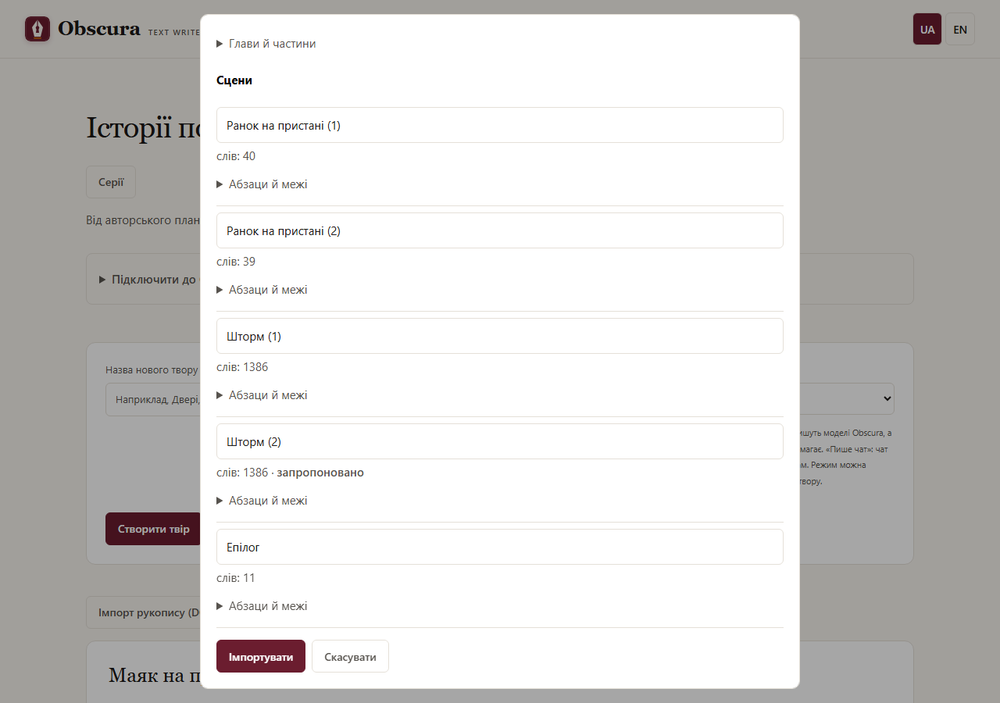

# Імпорт рукопису

Уже написану книжку можна перенести в Obscura одним файлом. Глави стають сценами з вашою прозою, задовгі глави ви ділите ще до збереження, а потім будуєте пам’ять книги. Імпорт завжди створює **нову** книгу й не змінює наявних. Моделі під час імпорту не викликаються, тож перегляд і збереження нічого не коштують.

## Формати й ліміти

- **DOCX**, **Markdown** (`.md`) і **TXT** (`.txt`), до 20 MiB. Markdown і TXT мають бути в UTF-8, з BOM чи без; файл в іншому кодуванні (наприклад windows-1251) відхиляється з поясненням.
- За один імпорт — до 500 сцен. Довший рукопис розділіть на кілька файлів або об’єднайте сцени в перегляді.
- Курсив і жирний зберігаються. Таблиці, зображення, виноски й колонтитули не імпортуються. Коментарі Word теж не імпортуються: перегляд покаже, скільки їх. Невирішені виправлення Word імпортуються як прийняті (вставки лишаються, видалений текст зникає), і перегляд про це попереджає: краще вирішіть їх у Word до імпорту.
- Автоматичний зміст Word пропускається.

## Як імпортувати

1. У бібліотеці натисніть **Імпорт рукопису (DOCX, Markdown, TXT)…** і виберіть **Файл рукопису**.
2. Obscura покаже перегляд: назву книги, мову, рейтинг, знайдені глави й сцени з кількістю слів. До натискання **Імпортувати** нічого не записується.
3. За потреби виправте назви сцен і межі (див. нижче), потім натисніть **Імпортувати**.
4. Підсумок дає посилання на книгу й кнопку **Побудувати пам’ять (сцен: N)**.

**Скасувати** або закриття вікна без імпорту видаляє файл, який Obscura тримала для перегляду. Незавершений перегляд зберігається 24 години; після цього, або якщо імпорт скасовано в іншій вкладці, діалог попросить вибрати файл ще раз.

## Як розпізнаються глави

- **Маркери глав.** Рядок до 120 символів, що починається словом «Глава», «Розділ» чи «Chapter», далі номер (арабський, римський латинськими чи кириличними літерами, словом) або назва: «Глава 3», «Розділ ІІ. Шторм», «Chapter One». Список слів можна змінити в полі **Маркери глав (через кому)**. Коли у файлі щонайменше два такі рядки, главами є саме вони.
- **Стилі заголовків.** Інакше главою стає заголовок найвищого рівня (до третього), що трапляється щонайменше двічі. У Word це стилі «Заголовок 1–3» (зокрема в локалізованому Word), у Markdown — рядки `#`, `##`, `###`.
- **Джерело глав.** Якщо розбір помилився, виберіть у полі **Джерело глав** маркери глав або рівень заголовків: файл розбереться заново.
- **Пролог, Епілог, Післямова, Інтерлюдія** (і Prologue, Epilogue, Afterword, Interlude) окремим рядком стають главами з цією назвою.
- Без заголовків і маркерів увесь текст стає однією сценою «Рукопис» з попередженням.

Зміна маркерів чи джерела глав розбирає файл заново, і ваші межі сцен скидаються: перегляд про це скаже.

## Межі сцен

- Рядок лише з `***`, `* * *`, `#`, `—`, `~`, `⁂` чи подібних знаків ділить главу на сцени й у прозу не потрапляє. У Markdown так само діють `---` і `# # #`. Порожній рядок межею не є.
- Сцена понад 2 500 слів отримує запропоновані межі, позначені «запропоновано». Межа стоїть між абзацами: переважно там, де у файлі був порожній рядок, перед абзацом, що не починається з репліки, і після кінця речення.
- Межі пропонуються й для сцени, яка не вміщується в ліміти моделі пам’яті.
- Розгорніть **Абзаци й межі** під сценою, щоб побачити її абзаци. **Межа тут** ставить нову межу перед абзацом, **Прибрати межу** з’єднує сцену з попередньою. Нова сцена отримує назву на кшталт «Шторм (2)»; її можна змінити.
- Межу не можна поставити на заголовку чи розділювачі.

## Передмова й назва книги

- Назвою книги пропонується перший абзац стилю «Назва» або перший заголовок перед главами. Якщо їх немає, поле **Назва книги** порожнє: впишіть назву самі.
- Текст перед першою главою понад 50 слів стає сценою «Пролог».
- Коротший (присвята, епіграф) — передмова: типово вона не імпортується, а перемикач **Додати передмову на початок першої сцени** дописує її в першу сцену.

## Частини й серії

- **Безкоштовне видання:** одна окрема книга, глави — сцени одним рівнем. Заголовки частин («Частина перша») пропускаються з попередженням, а їхній текст не губиться. Поля маркерів частин і серії немає.
- **Платне видання:** рядки «Частина», «Книга», «Part» чи «Book» з номером стають [частинами книги](book-structure.md); список задає поле **Маркери частин (через кому)**. Книгу можна одразу додати в [серію](series.md) з номером. Якщо пам’ять попередньої книги серії ще не побудовано, перегляд попередить, що нова книга почнеться без знімка початку серії; імпорт це не блокує, а знімок можна оновити пізніше.

## Після імпорту

Кожна сцена має вашу прозу як авторську версію, а план сцен порожній. Рядок стану сцени показує «Імпортовано з рукопису: <файл>», а для сцени без плану додає «План необов’язковий: валідація перевіряє прозу й пам’ять». Сцена без плану лишається «неповною», доки ви не напишете план. План можна дописати пізніше: проза й пам’ять сцени від цього не застаріють.

## Персонажі перед пам’яттю

Пам’ять веде стан головного героя (одяг, речі, місце, тіло, з ким він) лише для персонажа з картки, який бере участь у сцені. Тому до побудови пам’яті додайте картки персонажів: на сторінці [Персонажі](characters.md), [імпортом файла персонажів](imports.md) або [пошуком персонажів і місць у прозі](characters.md#пошук-персонажів-і-місць-у-прозі) моделлю. Шукайте персонажів до побудови пам’яті: перші прийняті картки роблять застарілою вже побудовану пам’ять усіх сцен. Той самий пошук пропонує місця сцен: план імпортованої сцени порожній, тож без них пам’ять не знатиме, де відбувається сцена, і не зможе брати записи про це місце для пізніших сцен ([Локації](memory.md#локації)). Головного героя позначте в його картці; без позначки ним стане перший учасник першої сцени.

Учасників імпортованих сцен Obscura заповнює сама, без моделі, перед запуском побудови пам’яті. Так заповнюються лише сцени з вашою прозою (імпортованою чи написаною вами); сцену, прозу якої написала модель, Obscura не змінює:

- учасниками сцени стають картки, чиє ім’я згадано в її прозі, у порядку першої згадки;
- сцену, у плані якої є рядок «Хто бере участь:» чи «Персонажі:», або сцену, учасників якої ви вже вибрали, Obscura не змінює;
- ім’я впізнається й у відмінках: для імені довшого за чотири літери остання літера відкидається («Марія» знайде «Марію»). Ім’я до чотирьох літер не скорочується, тож «Оля» не знайде «Олю». Ім’я шукається як початок слова, тож коротке ім’я може хибно знайтися в довшому слові: «Рома» знайде й «романтичний». Ім’я з однієї-двох літер не знаходиться зовсім;
- учасники, заповнені за іменами, далі вважаються вибраними: картки, які ви додасте пізніше, у такі сцени не додаються. Додайте нового персонажа в учасники цих сцен вручну;
- персонаж, названий лише займенником чи описом, не потрапить у склад, а однофамілець може потрапити хибно. Виправте учасників у плані сцени або в її властивостях.

## Побудова пам’яті

**Побудувати пам’ять (сцен: N)** є в підсумку імпорту, а в меню **☰ «Дії твору»** — коли в книзі є сцени без чинної пам’яті й кожна сцена від першої такої до кінця книги має прозу. Подробиці — у розділі [Побудова пам’яті книги](memory.md#побудова-памяті-книги).

## Чат-клієнти

Через [MCP](mcp.md) чат може імпортувати рукопис за повним шляхом до локального файла або передати невеликий файл (до 2 MiB) вмістом. Спершу чат показує перегляд сцен і лише після вашої згоди створює книгу; пам’ять він будує окремим запуском з переглядом вартості.

## Відомі обмеження

- Евристика глав може не впізнати нестандартні заголовки: виправте межі в перегляді.
- TXT: рядок, що закінчується тире чи дужкою, вважається перенесеним, тож репліка, що закінчується тире, може приєднатися до наступного рядка.
- Markdown: рядок `---` одразу після тексту вважається розділювачем сцен, а не заголовком.
- У платному виданні текст перед першою частиною стає першою частиною без назви.
- Якщо серію видалили між переглядом і імпортом, діалог скаже, що файл перегляду більше не зберігається: виберіть файл ще раз.
- Учасники за іменами: коротке ім’я може хибно знайтися в довшому слові («Рома» в «романтичний»), а картки, додані після першої побудови пам’яті, у вже заповнені сцени не потрапляють. Перевірте учасників у властивостях сцени.
