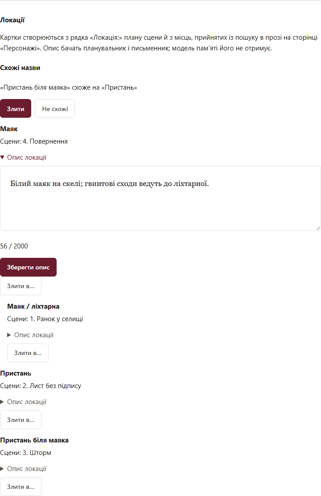

# Пам’ять

Після прийняття прози модель пам’яті записує, що сталося в сцені: факти, стани персонажів, відкриті сюжетні лінії й хронологію. Кожен запис спирається на цитату з прози. Наступні сцени отримують цю пам’ять у контексті планувальника, письменника й редактора.

## Перегляд

Відкрийте сцену → **Пам’ять**. Таблиця показує зміст запису, категорію й сцену-джерело. **Показати доказ** відкриває цитату з прози. Фільтр сцени-джерела спершу показує записи поточної сцени; виберіть іншу сцену або «Усі сцени», щоб побачити успадковані записи.

## Що передавати далі

Зніміть **Передавати далі** біля зайвих записів і натисніть **Зберегти**. Вибір у сцені 5 діє зі сцени 6, зокрема для успадкованих фактів; запис при цьому не видаляється з журналу. У наступній сцені прапорець можна поставити знову.

Вимикається лише запис у блоці пам’яті для моделей, а не факт у вашому плані чи прозі. Готові тексти автоматично не переписуються, але залежні матеріали наступних сцен можуть стати застарілими: перегляньте й прийміть їх або згенеруйте заново.

## Ядро стану героя

Для головного героя пам’ять веде ядро стану: одяг, речі при собі, місце, тілесний стан і з ким він зараз. Блок пам’яті для письменника починається з цих значень. Якщо того самого дня герой уже був одягнений інакше (наприклад, роздягся, щоб поплавати), рядок одягу показує й попереднє значення: «одяг: гола (раніше цього дня: сукня, сандалі)», тож, знову вдягаючись, герой не отримує вигаданого одягу. Модель пам’яті, коли проза це показує, записує, де лишився знятий одяг. Якщо зміна дня видно з рядка `Початок:` у плані сцени (`Д.М.Р, Г:Х`, `день N` або позначка з року, місяця й дня в будь-якому порядку, зокрема від’ємних: `Початок: Рік 2, День 14, 08:00`, `Початок: Рік -20`; `Початок: невідомо` — момент невідомий), модель окремо вирішує, що з цього лишається на новий день. Планувальник, письменник і чат через MCP теж отримують позначку «ЗМІНИВСЯ ДЕНЬ», а стандартні промпти просять їх не суперечити ядру, явно показувати переодягання чи інші зміни й не переносити вчорашній одяг мовчки. Власні промпти цих правил не отримують, але позначку бачать. Якщо змінити день у рядку `Початок:` попередньої сцени з героєм, завдання й чернетка наступної сцени стають застарілими; ваші власні ручні тексти — ні.

Рішення моделі щодо ядра можна перевірити в панелі над таблицею: **Прийняти**, **Лишити попереднє** або **Вписати…** власне значення з цитатою чи без неї. **Лишити попереднє** доступне лише для версій, створених моделлю пам’яті. Правки застарілої пам’яті відхиляються: спершу перегенеруйте пам’ять цієї сцени. **Застосувати** й **Скасувати** змінюють лише чернетку панелі. **Підтвердити** без правок лише позначає пам’ять перевіреною, а **Підтвердити з правками (N)** створює нову версію пам’яті; тоді пам’ять наступних сцен стає застарілою. Незбережена чернетка ядра захищена так само, як незбережений текст.

Запис автора без цитати — правда світу, якої читач ще не бачив. Письменник отримує його з позначкою «читачеві невідомо» й має ввести в текст як нове.

## Коли пам’ять не вміщається

Поки запит вміщається в ліміти ролі, пам’ять передається повністю. Якщо ні, застосунок відбирає найважливіше й попереджає про це: ядро героя завжди повністю, далі свіжі стани героя, відкриті лінії учасників сцени, стани інших учасників, факти, записи про місце сцени, хронологія останніх 20 сцен і «атмосфера». Якщо не вміщається навіть ядро, запит не надсилається.

Стовпець **Тип** допомагає відбору: **Авто**, **Ядро** (показувати завжди) чи **Атмосфера** (лише в невеликій частці). Вибір зберігається одразу й діє для всього твору.

## Локації

Рядок `Локація:` у плані сцени називає її місце: `Локація: Маяк / ліхтарна`. Кілька місць пишіть через кому, крапку з комою, `→` або слова «потім», «далі», «згодом»: `Локація: Пристань, потім маяк`. Скісна риска вкладає місце в інше, тож `Маяк / ліхтарна` дає дві картки — «Маяк» і «Маяк / ліхтарна». «і» та «та» лишаються частиною назви («Сад і город»). Картки створюються самі, коли ви зберігаєте план; однакова назва (без урахування регістру й зайвих пробілів) — та сама картка.

Модель пам’яті позначає записи місцями сцени. Коли пам’ять не вміщається, наступна сцена в тому самому місці, у місці, що його містить, чи у вкладеному отримує ці записи, зокрема стан персонажа, якого в сцені немає. Записи, зроблені до цієї зміни, місць не мають.

Картки видно в розділі **Локації** внизу вкладки **Пам’ять** будь-якої сцени:

- **Опис локації** — необов’язковий текст до 2000 знаків. Його бачать планувальник і письменник (також через MCP), модель пам’яті — ні. Зміна опису робить застарілими чернетки сцен у цьому місці та вкладених.
- **Схожі назви** підказують можливі дублікати, як-от друкарську помилку «Пристань» / «Пристаннь». **Злити** робить пізнішу картку частиною першої, **Не схожі** ховає підказку назавжди.
- **Злити в…** зливає картку з будь-якою іншою. Текст планів не змінюється; чернетки сцен, яких стосується злиття, стають застарілими. **Розділити** скасовує злиття.

Після збереження опису, злиття чи поділу Obscura питає: «Змінено локації: … Позначити залежні сцени як неперевірені? Сцен: N.» Залежні — сцени із завданням, у яких змінилися показані місця чи пам’ять сусідніх місць. **Так** робить завдання й прозу цих сцен «Не перевірено», доки ви їх не затвердите чи не згенеруєте знову; **Ні** нічого не змінює.

Злиття відбувається лише за вашим рішенням. Якщо твір змінили в іншій вкладці, збереження відхиляється, а набраний опис лишається в полі. Таблиця пам’яті показує місця кожного запису рядком «Локації: …», а пошук знаходить запис і за назвою місця.

## Підсумки хронології

Хронологія старша за 20 сцен у відібраний запит не потрапляє. Щоб модель пам’ятала, що було раніше, створіть підсумок у розділі **Підсумки хронології** панелі пам’яті. Блок — це частина книги, а в книзі без частин — кожні 10 сцен (1–10, 11–20…). Кнопка **Створити підсумок** підсвічується, коли перша сцена блоку виходить за вікно хронології. Підсумок пише модель ролі «Пам’ять»: перед запуском видно модель і оцінку токенів, а виклик платний. Готовий текст можна виправити кнопкою **Редагувати**.

Підсумок використовується лише тоді, коли пам’ять не вміщається: він заміняє всі записи хронології свого блоку одним рядком. Якщо прозу чи пам’ять сцени блоку змінено або блок змінив склад, підсумок позначається «застарів» і в запит не йде, доки ви його не перебудуєте.

## Злиття пам’яті

У книзі з [арками](book-structure.md) кожна арка веде свою пам’ять. Там, де арки сходяться, — у сцені зустрічі, у першій сцені наступної частини, у першій сцені арки після кількох закінчених арок і в кінці книги — пам’ять треба злити. Те, що змінилося лише в одній арці, переходить без питань; однаковий результат в обох арках — теж. Якщо ж арки по-різному змінили той самий запис (наприклад, у одній Анна вдягла куртку, а в іншій — плащ), це конфлікт, і вирішуєте його ви.

Розділ **Злиття пам’яті** на вкладці пам’яті такої сцени показує арки, що сходяться, і рядок для кожного конфлікту: значення кожної арки й **Своє значення**. Виберіть значення в кожному рядку й натисніть **Підтвердити злиття**. Якщо поки ви вибирали, книга чи пам’ять арок змінилися, застосунок попередить, перечитає злиття й залишить ваш вибір там, де конфлікт той самий.

Поки злиття не підтверджене, письмо цієї сцени не запускається: запуск зупиняється перед нею, а біля стану запуску з’являється кнопка **Відкрити злиття пам’яті**. Після підтвердження натисніть **Продовжити** — запуск піде далі з тієї самої сцени.

Якщо пізніше змінилася пам’ять однієї з арок, злиття стає застарілим, і його треба підтвердити знову; рішення для тих самих конфліктів із тими самими значеннями підставляються самі й позначені як перенесені. Злиття в кінці книги показується на вкладці пам’яті останньої сцени: письма воно не зупиняє, але потрібне для підсумку останньої частини.

## Спогади

Сцена-спогад розповідає про минуле й не рухає теперішнє. Позначте її прапорцем **Спогад** у параметрах сцени, рядком `Спогад: так` у плані або позначкою в рядку часу: `Початок: Рік -20 (спогад)` (також `(флешбек)`). Якщо спогад задано позначкою, прапорець увімкнений і недоступний. У списку сцен під назвою спогаду стоїть позначка «спогад».

Пам’ять спогаду лише додає факти, до шести за сцену: стани персонажів, лінії й хронологія не змінюються, тож наступна сцена теперішнього бачить героя таким, як до спогаду, і отримує нові факти. Ручне збереження пам’яті спогаду, що змінює щось інше, відхиляється з поясненням «Спогад додає лише факти». Спогад не дає позначки «ЗМІНИВСЯ ДЕНЬ» і не перериває її: сцена після спогаду порівнює день зі сценою перед ним.

В оповіданні (без частин і арок) модель, що пише спогад, не отримує пам’яті взагалі. У книзі з арками вона отримує факти, лінії й хронологію без ядра стану героя.

Сцена книги з арками бачить також **Минуле інших арок** — факти спогадів інших арок, що стоять вище в тексті й описують час до початку її арки. Деталі — у [Частини й арки](book-structure.md), розділ «Спогади в книзі з арками».

## Підтвердження попередньої пам’яті

Якщо оновлення пам’яті сцени спирається на старий журнал попередньої сцени, застосунок просить підтвердження. Вікно показує сцену пам’яті, кількість нових версій і змінених текстів; **Скасувати** модель не запускає. Підтвердження зберігає старі джерела й цитати, а не перевіряє факти. Якщо джерела знову змінилися, підтвердьте ще раз.

## Перенос у пізніші сцени

Пам’ять кожної сцени продовжує пам’ять попередньої. Коли сцена отримує нову пам’ять — етапом пам’яті, ручною правкою, результатом етапу з чату чи вибором іншої версії в історії, — Obscura сама переносить записи пізніших сцен на нову пам’ять. Перенос іде по сценах у порядку читання, без моделі й без витрат; у підсумку запусків він видний як **Перенос пам’яті**. Факти пізніших сцен не змінюються, тож їхні завдання, проза й стан лишаються такими, як були.

Поки перенос не дійшов до сцени, запуски моделей для неї відмовляють з поясненням «Пам’ять переноситься»; читати й правити текст вручну можна. Якщо застосунок закрили під час переносу, після запуску він продовжиться сам.

Перенос зупиняється, коли записи сцени посилаються на факт, якого в новій пам’яті попередньої сцени немає. Так буває майже щоразу, коли пам’ять ранньої сцени згенеровано заново: нові записи мають нові позначки, і перенос зазвичай зупиняється вже на наступній сцені. Тоді підсумок запуску показує попередження з назвою сцени, а її панель — **Пам’ять не перенесено** з кнопками **Створити нову пам’ять** і **Перебудувати пам’ять**. Нова пам’ять цієї сцени будується на новій пам’яті попередньої, і перенос іде далі, але може знову зупинитися на наступній сцені. **Перебудувати пам’ять** створює пам’ять цієї й усіх пізніших сцен моделлю за один запуск; як і інші запуски моделей, він показує кількість викликів і просить згоди. Перенос зупиняється й перед сценою, якій потрібне злиття пам’яті: підтвердьте злиття, і перенос продовжиться від сцени після нього.

Якщо перенос поставлено на паузу, він завершився помилкою або застосунок закрили, коли його скасовували, панель сцени, до якої він не дійшов, показує **Перенос пам’яті зупинився** з кнопками **Продовжити перенос** і **Скасувати перенос**. Продовження нічого не коштує. Після скасування запуски моделей для цих сцен знову доступні, але їхня пам’ять лишається побудованою на старій пам’яті попередньої сцени.

Сцени після тієї, де перенос не зійшовся, теж чекають: їхня пам’ять ще спирається на стару. Їхня панель називає сцену зупинки й пропонує для неї **Створити нову пам’ять** або **Перебудувати пам’ять**.

Якщо ви змінили прозу, а факти лишилися ті самі, натисніть на панелі під текстом **Залишити попередню пам’ять** ([стан сцени](workspace.md#стан-сцени-валідна-чи-не-перевірена)). Тоді наступна сцена не просить підтвердження через цю зміну прози.

## Побудова пам’яті книги

Коли книга вже має прозу, а пам’яті ще немає (наприклад, після [імпорту рукопису](manuscript-import.md)), пам’ять усіх сцен будується одним запуском. Пункт **Побудувати пам’ять (сцен: N)** у меню **☰ «Дії твору»** видно, коли в книзі є сцени без чинної пам’яті й кожна сцена від першої такої до кінця книги має прозу; N — кількість цих сцен. У книзі, яку ви ще пишете, пункту немає: оновлюйте пам’ять сцени в робочому просторі. Пам’ять не чинна, якщо її немає, якщо її позначено застарілою після зміни, від якої вона залежить (наприклад, прози сцени), або якщо склад учасників сцени змінився після неї. Пам’ять, яку панель сцени показує застарілою лише через перевірку зв’язків чи змінені вхідні дані, цей пункт не враховує. Для такої сцени в робочому просторі є **Перебудувати пам’ять**: запуск охоплює її й усі наступні сцени до кінця книги (сцени, для яких нічого не змінилося, не оплачуються вдруге). **Оновити пам’ять** будує пам’ять лише цієї сцени. У безкоштовній версії пункту немає для книги з частинами чи книги серії: там вона лише для читання.

Пункт відкриває перегляд, і без натискання **Побудувати** нічого не запускається. Перегляд показує:

- скільки сцен і викликів моделі пам’яті буде, від якої сцени й яка модель;
- **Вартість: до X $ (верхня межа)** для хмарної моделі з відомою ціною. Для локальної моделі — просто «Вартість невідома»: вона не платна за тарифом. Для хмарної моделі без ціни — «Вартість невідома» з причиною. Запуск це не блокує. Кожну сцену оцінено за найбільшим запитом і найдовшою відповіддю, які дозволяє роль пам’яті, тож справжня ціна зазвичай значно нижча. Якщо ціну моделі змінили після перегляду, Obscura нічого не запускає й показує новий перегляд;
- сцени, що не вміщуються в ліміти ролі пам’яті, з посиланнями: запуск зупиниться на них, бо текст не обрізається. Розділіть таку сцену або збільште ліміт ролі;
- скільки є карток персонажів, хто головний герой і скільки сцен отримають учасників за іменами в прозі (див. [Імпорт рукопису](manuscript-import.md#персонажі-перед-памяттю)). Без карток перегляд попереджає «Немає карток персонажів: пам'ять не матиме стану героя» з посиланнями на **Персонажі** й **Імпорт персонажів з Markdown**; запуск і тоді можливий;
- у книзі серії, яка ще не взяла знімок початку з попередньої книги, хоча та вже має пам’ять, — пропозицію спершу натиснути **Оновити з попередньої книги**. Без цього пам’ять не враховуватиме попередню книгу;
- якщо попередня пам’ять чекає вашого підтвердження, **Побудувати** недоступна з цією причиною й посиланням **Відкрити сцену N**: підтвердьте пам’ять у сцені й поверніться до побудови.

**Побудувати** записує учасників сцен з вашою прозою (прозу, написану моделлю, це не змінює й не робить застарілою) і запускає звичайний запуск пам’яті: паузу, продовження й скасування шукайте в рядку запуску. Діють бюджет твору й ліміт запуску, як для інших запусків. Якщо між переглядом і натисканням книгу, картки чи модель пам’яті змінили, Obscura нічого не запускає й показує новий перегляд: «План побудови змінився. Перевірте перегляд ще раз.» Поки триває інший запуск, **Побудувати** недоступна. Якщо побудову цієї книги вже поставлено в чергу чи запущено (наприклад, в іншій вкладці чи з чату), Obscura другої не запускає й пише: «Побудова пам’яті цього твору вже в черзі або виконується: дочекайтеся її чи скасуйте в панелі запусків». Призупинена побудова нової не блокує. Але продовжити призупинену чи перервану побудову, поки йде інша, не можна: Obscura пише «Інша побудова пам’яті цього твору вже в черзі або виконується: дочекайтеся її чи скасуйте, перш ніж продовжувати цю». Закриття вікна, доки запуск ще не надіслано, скасовує побудову; уже записані учасники сцен лишаються.

## Розширене редагування

**JSON для розширеного редагування** відкриває журнал пам’яті як JSON з усіма перевірками цитат. Цим режимом користуйтеся лише тоді, коли таблиці недостатньо.

Застарілу пам’ять видно лише для читання: спершу оновіть її. Якщо пам’ять змінили в іншій вкладці, ваш вибір лишається у формі, а **Оновити таблицю** дозволяє явно перечитати актуальні дані.
