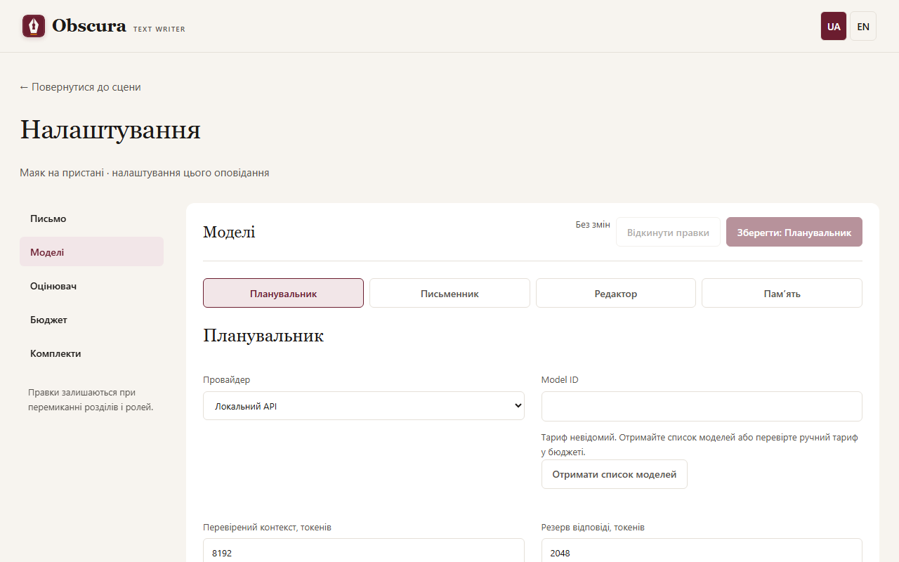

# Моделі, ролі й бюджет

Сцену готують чотири ролі: **Планувальник** складає план і завдання, **Письменник** пише чернетку, **Редактор** пропонує правки, **Пам’ять** записує, що сталося. Кожній ролі можна дати окрему модель. Окремо налаштовується [оцінювач](evaluator.md).

## Налаштування ролі

Відкрийте налаштування твору → **Моделі** і виберіть роль. Вкажіть провайдера, адресу API, точний ідентифікатор моделі, контекст, резерв відповіді й ліміт входу. **Отримати список моделей** показує доступні ідентифікатори й відомі ціни. Збережіть роль кнопкою **Зберегти:** з назвою ролі; налаштування інших ролей не змінюються.

Провайдери:

- **Venice** і **OpenRouter** — хмарні, потрібен ключ: у `.env` або в блоці «Ключ провайдера» під вибором моделі (див. [Встановлення](install.md#ключі-провайдерів)) і бюджет викликів. Для моделей без позначки Uncensored потрібна [згода](#згода-на-модель-без-uncensored).
- **Локальний** — сервер на вашому комп’ютері, наприклад LM Studio чи Bionic, типова адреса `http://localhost:1235/v1`. Ключ і бюджет не потрібні.
- **Codex CLI** — використовує ваш наявний вхід у Codex; текст передається сервісу Codex.

Ліміт входу в символах — запобіжник, а не кількість токенів. Перед відправленням застосунок оцінює токени всього запиту й додає резерв відповіді; сума має вміститися в контекст. Збільшення чисел у формі не збільшує реального контексту моделі. Текст приховано не обрізається: запит, що не вміщається, не надсилається.

Якщо список моделей Venice чи OpenRouter повідомляє максимальний контекст або максимум відповіді вибраної моделі, форма не дає зберегти більші значення: під моделлю з’являється пояснення, а поле показує допустимий максимум. Те саме перевіряє сервер під час збереження, зокрема для окремої моделі письменника, класифікатора й спільного провайдера. Якщо список недоступний або модель не повідомляє межі, збереження не блокується.

## Окрема модель письменника для сцен 0–1

У налаштуваннях **Письменника** галочка **Окрема модель для сцен рівня 0–1** відкриває власні провайдера, адресу API, модель, ліміти, температуру й timeout. Промпт і режим відповіді лишаються спільними з основною моделлю. Варіант використовується, коли жодна вісь [рейтингу](content-rating.md) сцени (її власного або, якщо не задано, рейтингу твору) не дорівнює 2; для сцен рівня 2 пише основна модель. Без заданого рейтингу твору генерацію запустити не можна, тому сцена без власного рейтингу завжди оцінюється за рейтингом твору. Варіант діє на етапах «Чернетка» й «Переписування».

Для моделі варіанта діє окрема [згода](#згода-на-модель-без-uncensored) і окрема [позначка відмови](#позначка-відмови), як для будь-якої іншої моделі письменника. Перевірка перед запуском показує модель варіанта серед ролей і враховує її провайдера в ліміті бюджету. Зняття галочки й збереження повертає всі сцени до основної моделі. Варіант входить у [збережені комплекти](#збережені-комплекти) (такий комплект має формат версії 2), а кнопка спільного провайдера змінює лише основну модель. Обмеження: форма варіанта не перевіряє заздалегідь, що резерв відповіді менший за контекст (збереження відхилить сервер), і окремого поля ключа для варіанта немає: на тому самому провайдері він бере ключ основної моделі, на іншому — типове ім’я ключа цього провайдера.

## Список моделей

Замість поля з підказками форма ролі й блок підключення показують каталог провайдера. Угорі — вибрана модель: ідентифікатор, позначки, контекст, ціна й кнопка **Змінити**. Нижче — пошук, фільтри й таблиця, яку можна сортувати; підсумок «Показано N з M» каже, скільки моделей приховали фільтри.

Позначки беруться лише з полів каталогу, а не з назви моделі:

- **Uncensored** — провайдер явно позначив модель як без цензури.
- **TEE**, **Private**, **Anonymous** — рівень приватності Venice. «Приватність невідома» — каталог цього поля не повідомив, наприклад у OpenRouter.
- **JSON Schema** — каталог каже, що модель підтримує структуровану відповідь за схемою.

Фільтри: пошук за назвою чи ідентифікатором, **Лише Uncensored**, **Приватність** (типово «Private і вище»; можна вибрати «будь-яка» або «лише TEE») і **JSON Schema**. Для провайдерів, що не повідомляють приватність (OpenRouter, локальний), фільтр приватності неактивний, а моделі показано з позначкою «приватність невідома». Відсутнє поле завжди означає «невідомо», а не «так» чи «ні».

Venice показує всі онлайн-моделі, зокрема без Uncensored, і їх можна вибрати. Ідентифікатор, якого немає в каталозі, можна ввести вручну; він збережеться з позначкою «немає в каталозі».

### Режим JSON Schema

Якщо роль чи підключення працює в режимі відповіді **JSON Schema**, фільтр JSON Schema увімкнений і заблокований, а моделі, яким каталог відмовляє в підтримці схеми, видно, але вибрати не можна. Моделі з невідомою підтримкою (наприклад, усі локальні) можна вибрати й зберегти; поруч підказка «Підтримка JSON Schema невідома: перевірте модель самостійно.» Зміна режиму відповіді одразу перебудовує список. Якщо вже вибрана модель не підтримує JSON Schema, форма не збережеться, і сервер також відхилить такий запис із поясненням: виберіть іншу модель або режим «JSON за промптом». Якщо каталог недоступний або підтримка невідома, збереження дозволено. Перед викликом застосунок звіряє модель із каталогом лише для Venice; для OpenRouter і локальних моделей підтримку схеми перевірте самостійно. У режимі «JSON за промптом» фільтр звичайний і необов’язковий.

## Згода на модель без Uncensored

Хмарна модель (Venice, OpenRouter), яку провайдер не позначив як Uncensored, може відмовитися від відвертого тексту. Тому, якщо рейтинг запиту має хоча б одну вісь вище 0, застосунок не викликає таку модель, доки ви не погодитеся. Рейтинг запиту — найвищий рівень за кожною віссю серед рейтингу твору й сцени етапу; матеріал попередніх сцен (пам’ять, кінець попередньої прози) його не підвищує. Етапи наслідків, перегляду й пропозиції метаданих публікації читають кілька сцен, тож їхній рейтинг враховує й ці сцени. Для твору 0/0/0 з однією сценою 2/0/0 згода потрібна лише на цю сцену.

Під вибраною моделлю в налаштуваннях ролі (і в налаштуваннях оцінювання класифікації для ролі «Редактор») з’являється попередження з галочкою «Я погоджуюся…». Галочка діє одразу, без кнопки **Зберегти:**. Згода належить парі «роль + модель + адреса API» і діє в усіх творах; інша роль, інша модель чи інша адреса потребують окремої згоди. Зняття галочки знову блокує виклики. Локальні моделі згоди не потребують.

Без згоди етап зупиняється з поясненням, яку модель, роль і який рейтинг це стосується, і запит провайдеру не надсилається. Для Venice стан Uncensored береться з каталогу, тому попередження з’являється лише після завантаження списку моделей.

## Позначка відмови

Якщо модель відмовилася писати через зміст (провайдер повернув відмову за політикою вмісту), застосунок запам’ятовує, на якому рейтингу це сталося, для цієї ролі й моделі. Далі виклики з таким самим або вищим рейтингом за кожною віссю блокуються, а нижчі — ні: після відмови на 2/0/0 сцена 1/1/0 дозволена, а 2/1/0 ні. Під моделлю з’являється червоне повідомлення з рейтингами відмов і кнопками **Зняти позначку** та **Вибрати іншу модель**.

Автоматично застосунок модель не змінює: ви самі знімаєте позначку (наприклад, після зміни промпту) або вибираєте іншу модель. Відмову, яку модель висловила звичайним текстом («я не можу про це писати»), застосунок не розпізнає, тож позначки вона не дає.

## Бюджет викликів

Для Venice і OpenRouter відкрийте налаштування твору → **Бюджет викликів**:

1. Задайте **Загальний ліміт оповідання, USD** і натисніть **Зберегти ліміти**. Без нього хмарна модель не отримає жодного запиту.
2. За бажання задайте типовий ліміт окремого запуску; на робочій сторінці його можна змінити для наступного запуску.
3. Для тарифу виберіть провайдера й точний ідентифікатор моделі та натисніть **Оновити з каталогу**. Це запит без вашого тексту; тариф чинний 24 години. Можна зберегти й ручний тариф із джерелом і датою завершення.

Ліміт накопичувальний: перезапуск, кошик і нова спроба облік не обнуляють. Щоб дозволити більше витрат, збільште загальну суму.

Що означають суми:

- **Підтверджено** — вартість повідомив провайдер або ви звірили її вручну.
- **Розраховано за токенами** — фактична кількість токенів × тариф. Це оцінка, а не рахунок.
- **У резерві** — запит надіслано, результат ще не записано.
- **Потребує звірки** — вартість невідома після збою чи скасування. Резерв лишається, доки ви не звірите суму в **Історія викликів і звірка**.

Резерв перед викликом консервативний: він враховує весь запит і повний ліміт відповіді. Це внутрішній контроль, а не гарантія рахунку провайдера. Локальні моделі й Codex не мають ціни в доларах: застосунок показує використання, а не вигаданий нуль. Відсутні дані про токени показано як «Немає даних», явний нуль — як 0. **Запитувати usage потоку (якщо підтримується)** вмикайте лише тоді, коли endpoint це підтримує.

## Збережені комплекти

Блок **Збережені комплекти моделей** зберігає налаштування чотирьох ролей разом із промптами, щоб застосувати їх до іншого твору.

1. Збережіть усі ролі звичайними формами.
2. Розкрийте **Зберегти поточні налаштування або імпортувати комплект**, задайте назву й натисніть **Зберегти комплект**.
3. В іншому творі виберіть комплект і версію, натисніть **Переглянути комплект**, перевірте моделі й ліміти та застосуйте. Незбережені зміни форм буде втрачено.

**Експортувати JSON** і імпорт файлу працюють без модельних викликів. JSON не містить ключів, лише назви змінних середовища: на іншому комп’ютері ключ треба додати до `.env` окремо. Не вписуйте ключ у назву моделі чи промпт. Оцінювача можна додати до комплекту, але не його калібрування.

Налаштування ролей і профіль письма можна змінювати й із [чат-клієнта](mcp.md#налаштування-з-чату). Коли ви повертаєтеся на відкриту сторінку налаштувань, вона сама перевіряє зміни з чату чи іншої вкладки: без незбережених правок сторінка оновлюється, а з правками лишається й повідомляє «Налаштування змінено ззовні».

## Локальні моделі

Локальна модель працює без оплати, але великі книги потребують багатьох викликів і часу. Перевірений профіль для GPU на 8 ГБ: **Huihui-Qwen3.5-9B-abliterated Q4_K_M** з контекстом 131072 у Bionic, роль **Планувальник**, адреса `http://localhost:1235/v1`, резерв відповіді 12288, температура 0,1, JSON Schema й увімкнений параметр **Вимкнути thinking (reasoning_effort=none)**. Цей профіль перевірено для [перевірки впливу](revision.md); інші ролі можуть працювати через хмарні моделі.

Оцінка контексту консервативна. Якщо відповідь не вміщається в резерв або цитата не знаходиться в тексті, етап зупиняється зі збереженням готових частин; автоматичних повторів немає.
