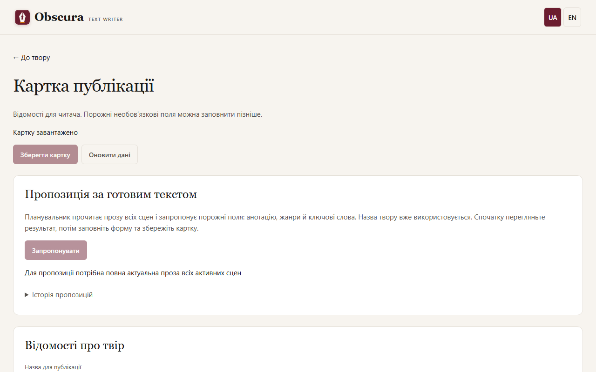
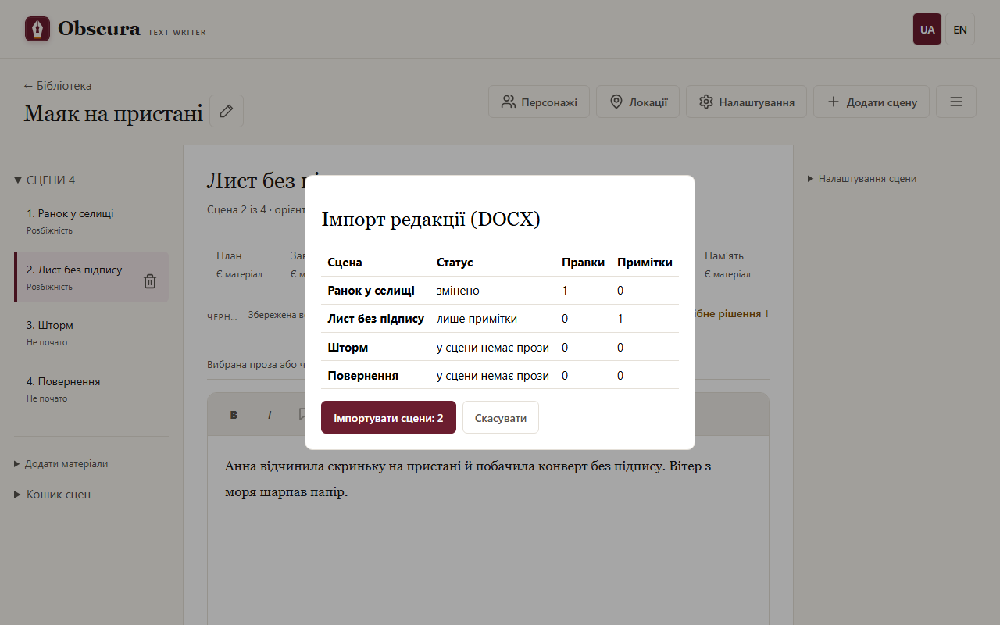

# Публікація й експорт

## Картка публікації

Відкрийте меню **☰ «Дії твору» → «Картка й публікація»**. Картка доступна ще до першої сцени, а порожні необов’язкові поля можна зберігати.

- **Назва** може відрізнятися від робочої; порожня назва бере назву твору.
- **Мова** нової картки — мова твору; можна вказати інший мовний тег, наприклад `en` чи `uk-UA`.
- **Анотація** — текст для читача. **Жанри** — до 10, **ключові слова** — окремими рядками, до 30.
- **Автори.** Розгорніть **Спільний довідник авторів і псевдонімів**, додайте публічний підпис, виберіть його й натисніть **Додати автора**. Довідник спільний для всіх творів; справжнє ім’я й псевдонім — окремі записи.
- **Додаткові відомості**: цикл і номер, дата, видавець, ISBN (перевіряється контрольна сума), права, перекладачі, мова оригіналу.
- **Обкладинка** — PNG або JPEG до 10 MiB і 20 мільйонів пікселів. Зайві EXIF і GPS прибираються.
- **Текстова обкладинка.** Якщо готового зображення немає, виберіть палітру («Чорнило», «Папір», «Бордо» чи «Ліс») і натисніть **Створити текстову обкладинку**. Obscura намалює обкладинку з назви, циклу з номером і авторів, які зараз у формі, навіть незбережених. Задовгий текст обрізається «…». Обкладинка сама не перемальовується: змінивши назву, натисніть кнопку ще раз.

Будь-які зміни, зокрема обкладинку, застосовує лише **Зберегти картку**. Картка не робить прозу, пам’ять чи оцінки застарілими. Якщо картку змінили в іншій вкладці, ваші правки лишаються у формі, а **Оновити дані** спершу спитає, чи відкинути незбережене.

Картку можна заповнити й із [чат-клієнта](mcp.md#публікація-з-чату). Коли ви повертаєтеся на відкриту сторінку картки, вона сама перевіряє зміни з чату чи іншої вкладки: чиста форма оновлюється, а форма з незбереженими правками лишається, і сторінка повідомляє «Картку публікації змінено ззовні». Новий підпис у довіднику з’являється одразу, якщо ви не редагуєте рядок довідника.

## Пропозиція анотації й жанрів

**Запропонувати** просить модель письменника заповнити порожні анотацію, жанри й ключові слова за всією прозою твору. Потрібна прийнята проза кожної сцени, а для хмарної моделі — бюджет. Перегляньте пропозицію, натисніть **Заповнити порожні поля**, відредагуйте й **Зберегти картку**. Поля, які ви вже заповнили, не підмінюються. Якщо проза змінилася, застаріла пропозиція не збережеться, а форма лишиться.

## Експорт

Відкрийте **☰ «Дії твору» → «Експорт…»** і виберіть формат: MD, TXT, FB2, EPUB, PDF, рукопис Word (DOCX) або рукопис RTF. Файл створюється на вашому комп’ютері.

- Для FB2 у картці потрібні автор і хоча б один жанр.
- Жирний і курсив із тексту переносяться в FB2, EPUB, PDF, DOCX і RTF; TXT прибирає позначки форматування.
- FB2 і EPUB отримують вікову позначку з [рейтингу](content-rating.md#позначка-в-fb2-і-epub).
- Якщо є неперевірені сцени або сцени без прози, експорт потребує вашого явного дозволу. Книга не містить службових позначок: попередження лишаються лише в окремому manifest.

Готовий файл не змінюється, коли ви правите текст: створіть новий експорт.

### Рукопис для редактора (DOCX і RTF)

DOCX і RTF призначені для того, щоб передати книгу зовнішньому редактору; для друку беріть PDF. Рукопис оформлено звично для редакторів: A4, Times New Roman 12 пт, полуторний інтервал, номер сторінки внизу. На титульній сторінці — назва, автори й кількість слів; кожна частина й кожна сцена починаються з нової сторінки, а заголовки мають стилі Word «Заголовок 1» і «Заголовок 2», тож структуру видно в області навігації. Мова тексту береться з картки публікації, щоб Word перевіряв правопис потрібною мовою.

DOCX містить невидимі мітки сцен: за ними Obscura розкладає повернену редакцію назад по сценах (див. [Імпорт редакції](#імпорт-редакції-docx)). Мітки переживають звичайне редагування й режим рецензування, але зникають разом із заголовком сцени, якщо редактор його видалить. RTF таких міток не має; він для редакторів без Word.

Файл книги завантажується під іменем з автора, назви й дати експорту, наприклад `Автор — Назва — 2026-11-21.epub`. Кількох авторів з'єднано через «та»; коми, крапки й символи, заборонені в іменах файлів Windows, замінено пробілом, а задовгу назву скорочено. Якщо автора не вибрано, ім'я починається з назви.

У тому самому списку є пункт **«План і персонажі (.md)»**. Він дає один читабельний файл із загальними нотатками плану, планом кожної сцени в порядку читання й картками персонажів. Прози для нього не потрібно, але незбережені правки спершу треба зберегти. Файл збирається з поточного стану під час завантаження й не зберігається серед експортів. Назад його не імпортувати: для імпорту є окремі шаблони плану й персонажів.

Для FB2, EPUB, PDF і обкладинки потрібні додаткові залежності `publication`; інсталятор їх містить. Під час встановлення з вихідного коду дивіться [Встановлення](install.md).

### Імпорт редакції (DOCX)

Коли редактор поверне рукопис, перенесіть його правки назад у твір. Obscura не змінює прозу сама: правки стають пропозиціями, які ви приймаєте чи відхиляєте, а модель не викликається.

1. Експортуйте **Рукопис Word (.docx)** і передайте файл редактору.
2. Редактор править файл у Word, краще з увімкненим режимом виправлень, і лишає примітки до фраз.
3. Збережіть ручні правки у творі й відкрийте **☰ «Дії твору» → «Імпорт редакції (DOCX)…»**. Поки є незбережені правки, пункт недоступний і показує «Спершу збережіть ручні правки». Виберіть файл до 20 MiB.
4. Ви побачите зведення: таблицю сцен зі статусом, кількістю правок і приміток та попередженнями. Твір змінюється лише після підтвердження.

Статуси сцен:

- **змінено** — редактор правив текст; правки стануть пропозицією.
- **лише примітки** — текст без змін, примітки стануть коментарями.
- **без змін** — нічого імпортувати.
- **лише чернетка: правки не вміщуються в перегляд** — правок забагато для перегляду по одній; текст редактора стане новою версією чернетки без пропозиції.
- **прозу змінено після експорту** і **немає даних про експорт** — ви правили сцену після експорту або редактор працював без режиму виправлень і Obscura не знає, з якого тексту він починав. Такі сцени потребують вашого вибору.
- **спершу вирішіть попередню пропозицію** — у сцени ще є невирішена пропозиція з попереднього імпорту; повторний імпорт її не дублює.
- **у сцени немає прози** і **розмітку прози не передати через DOCX** — сцену не імпортовано.

Якщо всі сцени можна імпортувати без вибору, натисніть **Імпортувати сцени: N**. Якщо є сцени, змінені після експорту, діалог назве їх, а в таблиці для кожної буде видно, що станеться «при заміні». Замість однієї кнопки з'являться три:

- **Скасувати імпорт** — нічого не змінювати й прибрати завантажений файл;
- **Пропустити змінені сцени** — імпортувати решту, а змінені сцени лишити як є;
- **Замінити все** — імпортувати й змінені сцени. Ваші пізніші зміни з'являться як правки, які можна відхилити.

Якщо твір змінився, поки було відкрито зведення, імпорт нічого не запише й попросить вибрати файл ще раз.

Після імпорту підсумок показує, скільки сцен імпортовано й пропущено, з посиланнями на сцени. Правки — на вкладці **Редактура** сцени: розгорніть **Правки редактора**; пропозиція має мітку «· від редактора (DOCX)» і примітку, що модель не викликалася. Приймайте правки так само, як після [редактури](revision.md#редактура-сцени). Примітки редактора стають [коментарями чернетки](writing-tools.md#коментарі-до-чернетки): примітка до незміненої фрази прив'язується до неї, інші — до загального коментаря з цитатою. Попередні коментарі чернетки лишаються в попередній версії чернетки.

Обмеження:

- таблиці, зображення, виноски й зміни форматування, окрім курсиву й жирного, не імпортуються — зведення показує попередження;
- сцена, у прозі якої є однорядковий список, цитата чи заголовок, не імпортується: DOCX не передає таку розмітку без змін (статус «розмітку прози не передати через DOCX»);
- правка в заголовку сцени не імпортується, а сцена, з якої редактор вилучив увесь текст, пропускається;
- новий абзац, який редактор вставив одразу після списку, цитати чи рядка з розривом, може злитися з ним — зведення попереджає про це, перевірте межі абзаців у пропозиції;
- перевірено лише з Microsoft Word; Google Docs та інші редактори не перевірялися;
- імпорт розрахований на DOCX, експортований з Obscura для цього твору; файл з іншого твору відхиляється, а RTF не імпортується.
