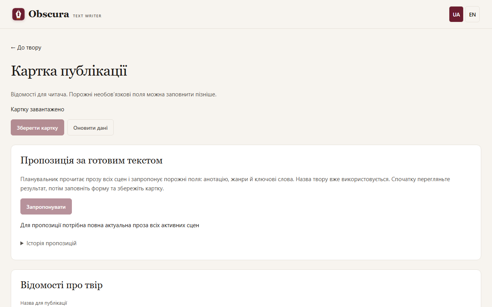

# Публікація й експорт

## Картка публікації

Відкрийте меню **☰ «Дії твору» → «Картка й публікація»**. Картка доступна ще до першої сцени, а порожні необов’язкові поля можна зберігати.

- **Назва** може відрізнятися від робочої; порожня назва бере назву твору.
- **Мова** нової картки — мова твору; можна вказати інший мовний тег, наприклад `en` чи `uk-UA`.
- **Анотація** — текст для читача. **Жанри** — до 10, **ключові слова** — окремими рядками, до 30.
- **Автори.** Розгорніть **Спільний довідник авторів і псевдонімів**, додайте публічний підпис, виберіть його й натисніть **Додати автора**. Довідник спільний для всіх творів; справжнє ім’я й псевдонім — окремі записи.
- **Додаткові відомості**: цикл і номер, дата, видавець, ISBN (перевіряється контрольна сума), права, перекладачі, мова оригіналу.
- **Обкладинка** — PNG або JPEG до 10 MiB і 20 мільйонів пікселів. Зайві EXIF і GPS прибираються.

Будь-які зміни, зокрема обкладинку, застосовує лише **Зберегти картку**. Картка не робить прозу, пам’ять чи оцінки застарілими. Якщо картку змінили в іншій вкладці, ваші правки лишаються у формі, а **Оновити дані** спершу спитає, чи відкинути незбережене.

Картку можна заповнити й із [чат-клієнта](mcp.md#публікація-з-чату). Коли ви повертаєтеся на відкриту сторінку картки, вона сама перевіряє зміни з чату чи іншої вкладки: чиста форма оновлюється, а форма з незбереженими правками лишається, і сторінка повідомляє «Картку публікації змінено ззовні». Новий підпис у довіднику з’являється одразу, якщо ви не редагуєте рядок довідника.

## Пропозиція анотації й жанрів

**Запропонувати** просить модель планувальника заповнити порожні анотацію, жанри й ключові слова за всією прозою твору. Потрібна прийнята проза кожної сцени, а для хмарної моделі — бюджет. Перегляньте пропозицію, натисніть **Заповнити порожні поля**, відредагуйте й **Зберегти картку**. Поля, які ви вже заповнили, не підмінюються. Якщо проза змінилася, застаріла пропозиція не збережеться, а форма лишиться.

## Експорт

Відкрийте **☰ «Дії твору» → «Експорт…»** і виберіть формат: MD, TXT, FB2, EPUB або PDF. Файл створюється на вашому комп’ютері.

- Для FB2 у картці потрібні автор і хоча б один жанр.
- Жирний і курсив із тексту переносяться в FB2, EPUB і PDF; TXT прибирає позначки форматування.
- FB2 і EPUB отримують вікову позначку з [рейтингу](content-rating.md#позначка-в-fb2-і-epub).
- Якщо є неперевірені сцени або сцени без прози, експорт потребує вашого явного дозволу. Книга не містить службових позначок: попередження лишаються лише в окремому manifest.

Готовий файл не змінюється, коли ви правите текст: створіть новий експорт.

У тому самому списку є пункт **«План і персонажі (.md)»**. Він дає один читабельний файл із загальними нотатками плану, планом кожної сцени в порядку читання й картками персонажів. Прози для нього не потрібно, але незбережені правки спершу треба зберегти. Файл збирається з поточного стану під час завантаження й не зберігається серед експортів. Назад його не імпортувати: для імпорту є окремі шаблони плану й персонажів.

Для FB2, EPUB, PDF і обкладинки потрібні додаткові залежності `publication`; інсталятор їх містить. Під час встановлення з вихідного коду дивіться [Встановлення](install.md).
