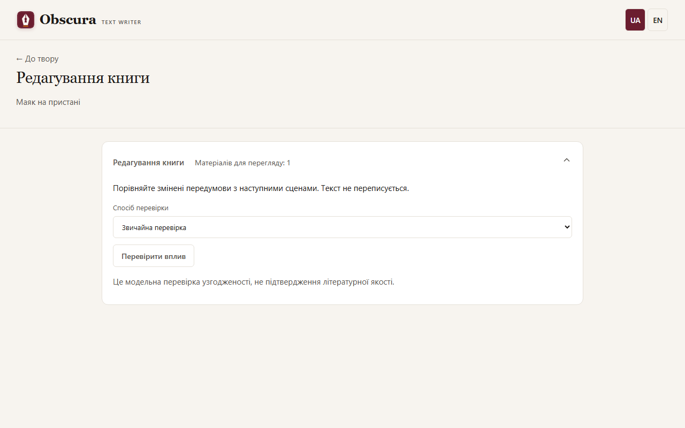

# Редактура й перевірка впливу

## Редактура сцени

Етап **Редактура** йде після чернетки. Редактор пропонує правки, а ви вирішуєте, що прийняти.

- **Точкові мовні правки** (налаштування ролі редактора) виправляють орфографію, пунктуацію й окремі речення, не переписуючи текст. Застосування буває **автоматичним після перевірки** або **спершу переглядом автором**.
- У перегляді відкрийте **Правки редактора**, позначте потрібні заміни й натисніть **Застосувати вибрані правки**: це створює нову версію прози.
- Якщо етап зупинився на вашому рішенні, після прийняття натисніть **Продовжити після прийнятого етапу**: редактор повторно не викликається.

В історії версій можна вибрати чернетку чи прозу й натиснути **Перевірити мову вибраної версії**. Правила знаходять літери іншої абетки, змішані абетки в слові, повтори сусідніх слів і дефіс замість тире в репліці. Перевіряється збережена версія, без виклику моделі.

## Редагування книги

Коли ви змінюєте ранні сцени, план чи персонажів, пізніші матеріали можуть їм суперечити. Відкрийте меню **☰ «Дії твору» → «Редагування книги»**: інструмент відкривається окремою сторінкою, а **← До твору** повертає до редактора. Число біля пункту меню показує матеріали, що чекають перевірки.

1. Збережіть правки. Якщо є незбережений текст, застосунок спершу запропонує його зберегти.
2. Натисніть **Перевірити вплив**. Попередній перегляд показує матеріали, модель планувальника, можливу кількість викликів і бюджет. Він ще не викликає модель.
3. Для хмарних провайдерів потрібні бюджет твору, чинний тариф і ліміт цієї серії. Оцінка вартості консервативна.
4. Натисніть **Запустити перевірку**. Модель знаходить, що змінилося в передумовах, і перевіряє кожен залежний матеріал.
5. **Впливу не знайдено** знімає потребу перегляду цього тексту. **Потрібні зміни** показує точні уривки, нові передумови й що треба виправити.
6. **Відкрити матеріал** веде до сцени й вкладки. Виправляйте текст вручну або наявними інструментами; сама перевірка нічого не переписує.
7. Якщо висновок хибний, натисніть **Відхилити висновок**: він лишиться в історії, але не впливатиме на стан.

## Послідовна перевірка

Послідовна перевірка йде сценами по порядку. Сцена без зауважень стає актуальною автоматично. Якщо є зауваження, сесія зупиняється: для кожного видно текст зауваження, уривок сцени й передумову. Оберіть **Відхилити як нерелевантне** або **Врахувати в правках** і застосуйте рішення. **Відхилити всі й продовжити** — явне пакетне рішення автора.

Поки сесія чекає на вас, її картка видна й у робочому просторі під рядком стану, тож сцену можна правити поруч із рішеннями. Після правок натисніть **Завершити правки й продовжити**. Рішення зберігаються після перезавантаження.

Перед попереднім переглядом можна обрати **Перевірку з точними доказами**: вона спершу зіставляє передумови між собою, а потім текст із ними. **Потрібна правка** означає суперечність тексту чинній передумові, **Конфлікт передумов** потребує вашого рішення, **Бракує даних** називає, чого не вистачає.

## Межі

Висновок моделі може помилятися: це перевірка узгодженості, а не оцінка літературної якості. Стан запуску, витрати, пауза й скасування працюють через звичайну чергу; автоматичних повторів немає.
