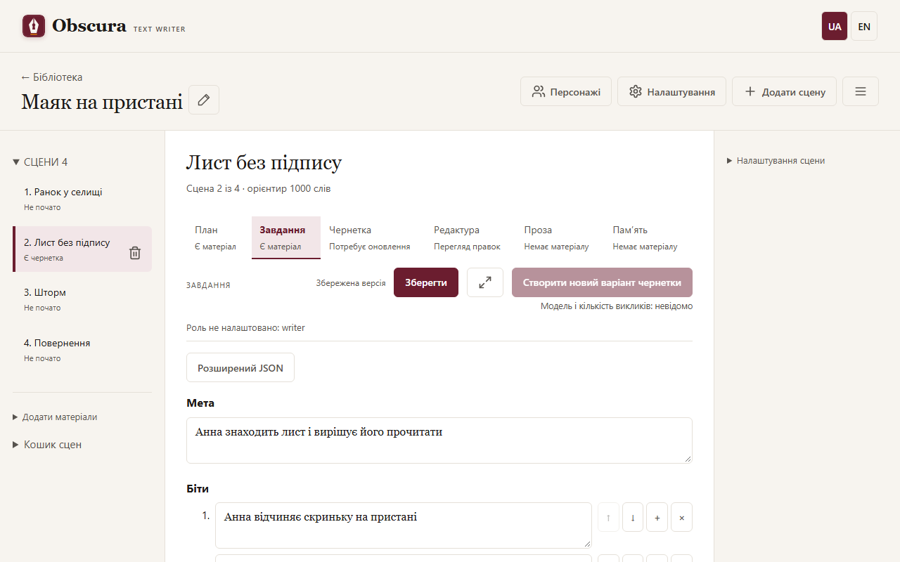
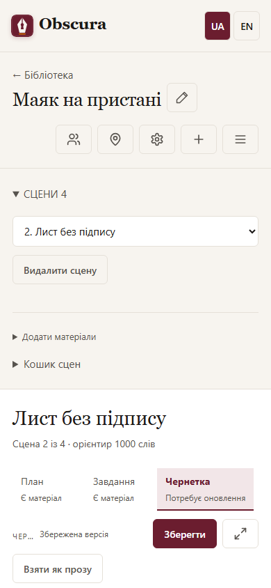

# Робочий простір і етапи сцени

Робочий простір твору має три частини: список сцен ліворуч, редактор сцени посередині та розділи сцени праворуч. На вузькому екрані вони йдуть одна під одною.

Якщо сцен багато, натисніть заголовок **Сцени** з їх кількістю: список згорнеться, а **Додати матеріали** лишиться поруч. Поточна сцена й незбережений текст не губляться.


## Видалити й відновити сцену

- У списку сцен біля обраної сцени є кнопка з іконкою кошика — **Видалити сцену**. Застосунок перепитає й перенесе сцену в кошик сцен; наступні сцени після цього потребуватимуть перегляду.
- Спершу збережіть текст: з незбереженими правками сцена не видаляється, а застосунок показує причину.
- Якщо якийсь запуск твору зупинився й чекає вашого рішення, застосунок запропонує скасувати такі запуски разом із видаленням чи відновленням сцени. Тексти й історія збережуться. Поки модель працює, сцену не видалити: дочекайтеся завершення або скасуйте запуск.
- Прийняте завдання чи застосовані точкові правки завершують запуск, який на них чекав, а новий запуск того самого етапу сцени скасовує старий зупинений.
- Щоб повернути сцену, розгорніть **Кошик сцен** під списком і натисніть **Відновити**. Остаточно сцени не видаляються.
- На вузькому екрані списку сцен немає: оберіть сцену в полі вибору й натисніть **Видалити сцену** під ним.

## Верхній рядок

- **Персонажі** відкриває картки персонажів окремою сторінкою.
- **Налаштування** відкриває моделі, письмо, оцінювач і бюджет цього твору.
- **Додати сцену** створює сцену одразу після відкритої (якщо сцену не відкрито — у кінці списку) й одразу заповнює її план за шаблоном. З плану попередньої сцени переносяться локація, учасники, ключове усвідомлення й емоційний акцент; її «Кінець» стає «Початок» нової сцени, а «Що відбувається» — «Що було в попередніх сценах». «Кінець», «Що відбувається» і три пункти «Дії» лишаються порожніми. Номер у заголовку — місце нової сцени в списку; номери наступних сцен у їхніх планах зсуваються. Сцена, додана в кінець, отримує номер, наступний після номера попередньої сцени. В англійському творі мітки плану англійські. Чого в попередньому плані немає, те лишається порожнім; усе можна одразу виправити в плані.
- Меню **☰ «Дії твору»** містить усе, що стосується всього твору: **Прийняти всю прозу як авторську** (коли проза хоча б однієї сцени застаріла), **Картка й публікація**, **Експорт…**, оцінювання твору й звіти (якщо налаштовано оцінювач), рядок бюджету й **Перейменувати**. Меню відкривається клавіатурою; `Escape` закриває його.


## Змінити порядок сцен

- Відкрийте сцену й у розділі **Параметри сцени** натисніть **Перемістити вище** або **Перемістити нижче**. Кожне натискання зсуває сцену на одне місце.
- Спершу збережіть текст: з незбереженими правками сцена не переміщується.
- Після перестановки тексти твору потребують перегляду: від порядку залежить, що модель знає з попередніх сцен.
- Номер у першому рядку плану («Сцена 3: …») стає рівним номеру сцени в списку. Змінюється лише число; збережений план отримує нову версію, попередня лишається в історії. Сцени без номера в плані (пролог, інтерлюдія) номера не отримують, але займають місце. Те саме відбувається, коли сцену вставлено посередині, перенесено в кошик чи відновлено.
- У творі з частинами й арками сцену не можна перемістити в іншу арку цими кнопками: скористайтеся [структурою книги](book-structure.md).

## Етапи сцени

Вкладки **План → Завдання → Чернетка → Редактура → Проза → Пам’ять** показують матеріали сцени й їхній стан: «Немає матеріалу», «Є матеріал», «Потребує оновлення». Вкладка лише відкриває матеріал; дію запускає основна кнопка над текстом.

На вкладці **План** нумеровані пункти («1.», «2)» тощо) нумеруються самі. Enter у кінці пункту починає наступний номер, а пункти нижче зсуваються; Enter на порожньому пункті прибирає номер і закінчує список. Після вставки, видалення чи перетягування рядків номери списку вирівнюються від першого пункту. Порожній рядок розділяє два списки. Кнопка **Перенумерувати** вирівнює всі списки плану, наприклад після вставки цілого плану. Ctrl+Z спершу повертає старі номери, потім скасовує саму правку. Заголовок сцени й рядки на кшталт «Хто бере участь:» не змінюються.

Вкладка **Завдання** показує завдання письменнику як форму: мета, нумеровані біти, обмеження й пропозиції змін. Кожен біт — окреме поле; кнопки біля нього переміщують біт вище чи нижче, вставляють новий перед ним або видаляють його, а **Додати біт** додає біт у кінець. Номери біля полів ставляться самі й у текст біта не входять, тож лапки, переноси рядків і будь-який текст зберігаються як написано. Порожні поля при збереженні відкидаються; без жодного біта **Зберегти** неактивна. Кнопка **Розширений JSON** показує те саме завдання як JSON, **Звичайний вигляд** повертає форму; незбережені правки при цьому не губляться. Якщо JSON зіпсовано, форма пояснює помилку й чекає виправлення.



Якщо планувальник повідомив «Суттєві зміни потребують рішення автора», на вкладці **Завдання** відкривається нова пропозиція зі списком змін. Перегляньте її, збережіть ручні правки й натисніть **Прийняти завдання**; **Зберегти** зберігає пропозицію, не приймаючи її.

Перед натисканням основна кнопка показує модель і максимальну кількість викликів. Наведіть на неї або перейдіть до неї клавішею Tab, щоб побачити подробиці й попередження. Якщо роль не налаштовано, поруч є кнопка переходу до потрібної ролі в налаштуваннях.

На вкладці **Чернетка** основна кнопка запускає редактуру: уперше вона зветься **Зберегти й редагувати**, а коли проза вже є — **Редагувати**. Ліворуч від неї кнопка **Взяти як прозу** зберігає чернетку як прозу без редактури, так само як якби ви скопіювали її у вкладку **Проза**. На вкладці **Проза** там само є кнопка **Редагувати поточну прозу**.

## Рядок стану

Угорі закріплено лише вкладки етапів і рядок зі **Зберегти** та основною дією. Там само з’являються причина, чому основна дія недоступна, позначка тексту від зовнішнього клієнта й попередження про зміну матеріалу ззовні. Під текстом сцени показано пояснення до основної дії, стан сцени, хід запуску й кнопки паузи, скасування, продовження та повтору. Коли запуск чекає вашого рішення (перевірка, вибір варіанта, пауза, збій), у закріпленому рядку з’являється посилання **Потрібне рішення ↓**: воно прокручує до кнопок. Хід запуску займає один рядок: стан, моделі, витрати в доларах (усього / останній виклик) і знак ⚠, якщо є попередження. Подробиці usage провайдера — у підказці до витрат. Клікніть цей рядок, щоб побачити план, попередження й етапи, і ще раз — щоб сховати. Помилку проваленого запуску видно одразу. Текст, який модель пише зараз, видно в блоці **Текст, що пише модель** під текстом сцени: він розгортається на час етапу й згортається, коли текст етапу отримано. **Параметри запуску** задають ліміт наступного запуску. **Пройти решту** виконує решту сцен по черзі. У виданні з Microsoft Store цих кнопок і блоку **Додаткові дії та автоматичний режим** немає: автоматизацію кількох етапів чи сцен там дає чат через [MCP](mcp.md). Пауза діє між етапами; закриття вкладки роботу не скасовує, а скасування не гарантує негайної зупинки відповіді провайдера. Спершу перевірте одну сцену, як описано в розділі [Перший твір](first-story.md).

## Редактор

Чернетка й проза мають панель форматування: **B** (`Ctrl+B`), *I* (`Ctrl+I`), скасування (`Ctrl+Z`) і повтор (`Ctrl+Y`). **Зберегти** створює нову версію й не стирає попередніх. Вставлення переносить лише текст. Браузер попереджає, перш ніж ви підете з незбереженими правками.

Редактор пам’ятає останню сцену й вкладку окремо для кожного твору в цьому браузері.

Кнопка **На весь екран** у рядку зі **Зберегти** розгортає текст на все вікно застосунку: шапка, список сцен, права панель, вкладки й рядок стану ховаються, лишаються **Зберегти** й кнопка **Згорнути**. Вийти можна цією кнопкою або клавішею `Esc`. Режим діє на будь-якій вкладці; щоб запустити етап чи перейти до іншої сцени, вийдіть із нього.

## Розділи сцени

Праворуч розділи **Налаштування сцени** (учасники, оповідач, орієнтир слів, віковий рейтинг сцени) і **Оцінювання сцени** згортаються й пам’ятають стан. Оцінювання приховане, якщо оцінювач вимкнено.

На телефоні розділи йдуть під редактором, а кнопки верхнього рядка показують лише іконки.



## Оповідач сцени

Зазвичай усі сцени розповідає оповідач зі стилю твору. Щоб окрема сцена звучала від іншої особи, у **Налаштуваннях сцени** виберіть поле **Оповідач**: **Перша особа**, **Третя особа через героя** або **Третя особа, всезнаючий**. Для першої й третьої особи через героя виберіть також **Героя** з карток персонажів. **Як у творі** повертає оповідача зі стилю. Модель отримує вибір у брифі, чернетці й повній редактурі цієї сцени.

Оповідача можна задати й рядком плану:

```
Оповідач: Лєра, перша особа
```

Також підходять `Оповідач: всезнаючий` і `Оповідач: Марко, третя особа`. Рядок плану має перевагу: поля в налаштуваннях тоді недоступні й показують його значення. Якщо рядок незрозумілий (немає лиця, героя або ім’я не збігається з карткою), під полем з’являється пояснення, а діє вибір у налаштуваннях.

Якщо оповідача немає серед учасників сцени, Obscura збереже вибір і попередить про це. Зміна оповідача робить застарілими бриф, чернетку й прозу лише цієї сцени.
