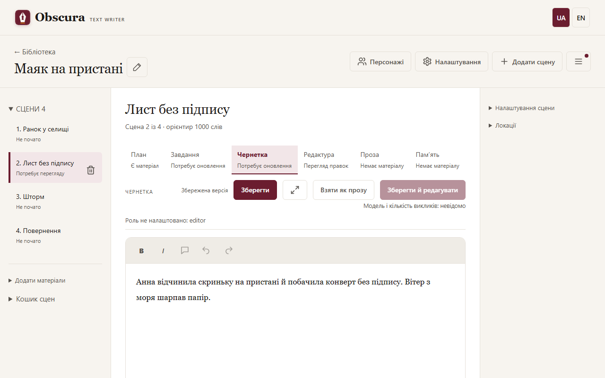
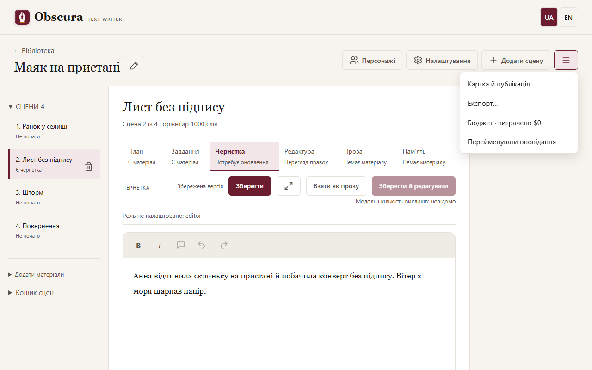
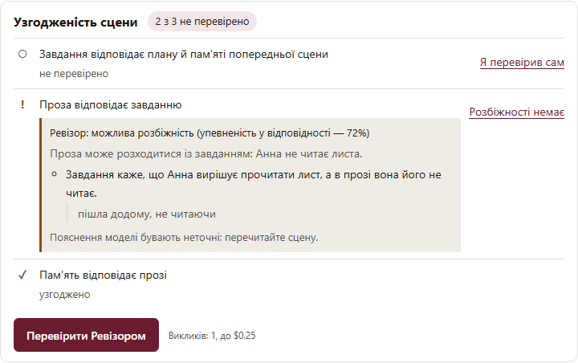
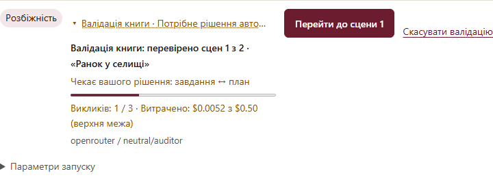
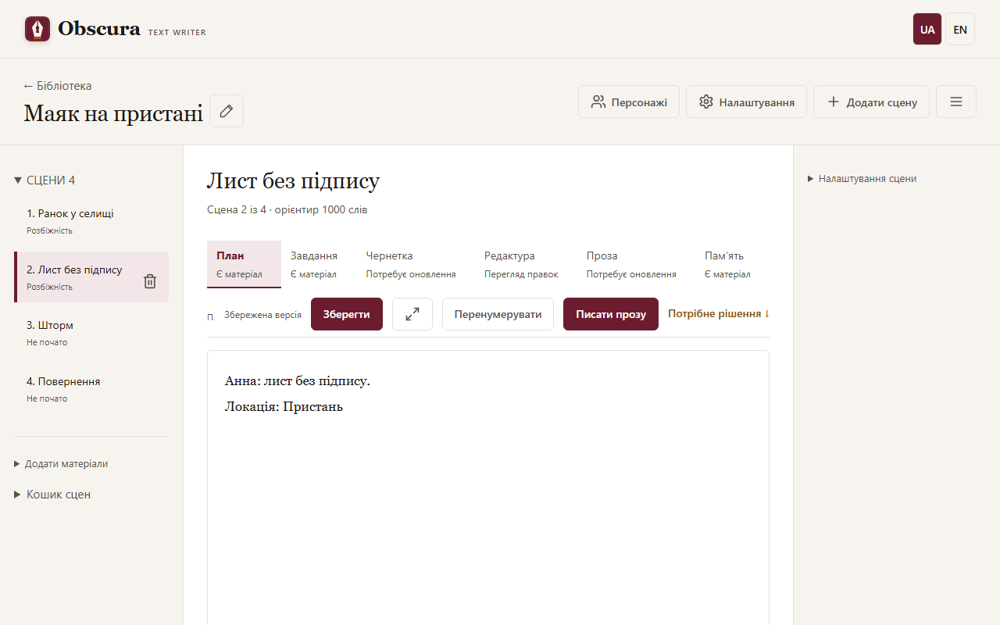

# Робочий простір і етапи сцени

Робочий простір твору має три частини: список сцен ліворуч, редактор сцени посередині та розділи сцени праворуч. На вузькому екрані вони йдуть одна під одною.

Якщо сцен багато, натисніть заголовок **Сцени** з їх кількістю: список згорнеться, а **Додати матеріали** лишиться поруч. Поточна сцена й незбережений текст не губляться.



## Видалити й відновити сцену

- У списку сцен біля обраної сцени є кнопка з іконкою кошика — **Видалити сцену**. Застосунок перепитає й перенесе сцену в кошик сцен; наступні сцени після цього потребуватимуть перегляду.
- Спершу збережіть текст: з незбереженими правками сцена не видаляється, а застосунок показує причину.
- Якщо якийсь запуск твору зупинився й чекає вашого рішення, застосунок запропонує скасувати такі запуски разом із видаленням чи відновленням сцени. Тексти й історія збережуться. Поки модель працює, сцену не видалити: дочекайтеся завершення або скасуйте запуск.
- Прийняте завдання чи застосовані точкові правки завершують запуск, який на них чекав, а новий запуск того самого етапу сцени скасовує старий зупинений.
- Щоб повернути сцену, розгорніть **Кошик сцен** під списком і натисніть **Відновити**. Остаточно сцени не видаляються.
- На вузькому екрані списку сцен немає: оберіть сцену в полі вибору й натисніть **Видалити сцену** під ним.

## Верхній рядок

- **Персонажі** відкриває картки персонажів окремою сторінкою.
- **Налаштування** відкриває моделі, письмо, оцінювач і бюджет цього твору.
- **Додати сцену** створює сцену одразу після відкритої (якщо сцену не відкрито — у кінці списку) й одразу заповнює її план за шаблоном. З плану попередньої сцени переносяться локація, учасники, ключове усвідомлення й емоційний акцент; її «Кінець» стає «Початок» нової сцени, а «Що відбувається» — «Що було в попередніх сценах». «Кінець», «Що відбувається» і три пункти «Дії» лишаються порожніми. Номер у заголовку — місце нової сцени в списку; номери наступних сцен у їхніх планах зсуваються. Сцена, додана в кінець, отримує номер, наступний після номера попередньої сцени. В англійському творі мітки плану англійські. Чого в попередньому плані немає, те лишається порожнім; усе можна одразу виправити в плані.
- Меню **☰ «Дії твору»** містить усе, що стосується всього твору: **Валідація книги** з кількістю невалідних сцен ([валідація книги](#валідація-книги)), **Побудувати пам’ять (сцен: N)**, коли є сцени без чинної пам’яті й усі вони до кінця книги вже мають прозу ([побудова пам’яті книги](memory.md#побудова-памяті-книги)), **Прийняти всю прозу як авторську** (коли проза хоча б однієї сцени не перевірена), **Картка й публікація**, **Експорт…**, **Імпорт редакції (DOCX)…** ([імпорт редакції](publication.md#імпорт-редакції-docx)), оцінювання твору й звіти (якщо налаштовано оцінювач), рядок бюджету й **Перейменувати**. Меню відкривається клавіатурою; `Escape` закриває його.



## Змінити порядок сцен

- Відкрийте сцену й у розділі **Параметри сцени** натисніть **Перемістити вище** або **Перемістити нижче**. Кожне натискання зсуває сцену на одне місце.
- Спершу збережіть текст: з незбереженими правками сцена не переміщується.
- Після перестановки тексти твору потребують перегляду: від порядку залежить, що модель знає з попередніх сцен.
- Номер у першому рядку плану («Сцена 3: …») стає рівним номеру сцени в списку. Змінюється лише число; збережений план отримує нову версію, попередня лишається в історії. Сцени без номера в плані (пролог, інтерлюдія) номера не отримують, але займають місце. Те саме відбувається, коли сцену вставлено посередині, перенесено в кошик чи відновлено.
- У творі з частинами й арками сцену не можна перемістити в іншу арку цими кнопками: скористайтеся [структурою книги](book-structure.md).

## Етапи сцени

Вкладки **План → Завдання → Чернетка → Редактура → Проза → Пам’ять** показують матеріали сцени й їхній стан: «Немає матеріалу», «Є матеріал», «Потребує оновлення». Вкладка лише відкриває матеріал; дію запускає основна кнопка над текстом.

На вкладці **План** нумеровані пункти («1.», «2)» тощо) нумеруються самі. Enter у кінці пункту починає наступний номер, а пункти нижче зсуваються; Enter на порожньому пункті прибирає номер і закінчує список. Після вставки, видалення чи перетягування рядків номери списку вирівнюються від першого пункту. Порожній рядок розділяє два списки. Кнопка **Перенумерувати** вирівнює всі списки плану, наприклад після вставки цілого плану. Ctrl+Z спершу повертає старі номери, потім скасовує саму правку. Заголовок сцени й рядки на кшталт «Хто бере участь:» не змінюються.

Вкладка **Завдання** показує завдання письменнику як форму: мета, нумеровані біти, обмеження й пропозиції змін. Кожен біт — окреме поле; кнопки біля нього переміщують біт вище чи нижче, вставляють новий перед ним або видаляють його, а **Додати біт** додає біт у кінець. Номери біля полів ставляться самі й у текст біта не входять, тож лапки, переноси рядків і будь-який текст зберігаються як написано. Порожні поля при збереженні відкидаються; без жодного біта **Зберегти** неактивна. Кнопка **Розширений JSON** показує те саме завдання як JSON, **Звичайний вигляд** повертає форму; незбережені правки при цьому не губляться. Якщо JSON зіпсовано, форма пояснює помилку й чекає виправлення.


Якщо планувальник повідомив «Суттєві зміни потребують рішення автора», на вкладці **Завдання** відкривається нова пропозиція зі списком змін. Перегляньте її, збережіть ручні правки й натисніть **Прийняти завдання**; **Зберегти** зберігає пропозицію, не приймаючи її.

Перед натисканням основна кнопка показує модель і максимальну кількість викликів. Наведіть на неї або перейдіть до неї клавішею Tab, щоб побачити подробиці й попередження. Якщо роль не налаштовано, поруч є кнопка переходу до потрібної ролі в налаштуваннях.

На вкладці **Чернетка** основна кнопка запускає редактуру: уперше вона зветься **Зберегти й редагувати**, а коли проза вже є — **Редагувати**. Ліворуч від неї кнопка **Взяти як прозу** зберігає чернетку як прозу без редактури, так само як якби ви скопіювали її у вкладку **Проза**. На вкладці **Проза** там само є кнопка **Редагувати поточну прозу**.

## Рядок стану

Угорі закріплено лише вкладки етапів і рядок зі **Зберегти** та основною дією. Там само з’являються причина, чому основна дія недоступна, позначка тексту від зовнішнього клієнта й попередження про зміну матеріалу ззовні. Під текстом сцени показано пояснення до основної дії, стан сцени, хід запуску й кнопки паузи, скасування, продовження та повтору. Коли запуск чекає вашого рішення (перевірка, вибір варіанта, пауза, збій), у закріпленому рядку з’являється посилання **Потрібне рішення ↓**: воно прокручує до кнопок. Хід запуску займає один рядок: стан, моделі, витрати в доларах (усього / останній виклик) і знак ⚠, якщо є попередження. Подробиці usage провайдера — у підказці до витрат. Клікніть цей рядок, щоб побачити план, попередження й етапи, і ще раз — щоб сховати. Помилку проваленого запуску видно одразу. Текст, який модель пише зараз, видно в блоці **Текст, що пише модель** під текстом сцени: він розгортається на час етапу й згортається, коли текст етапу отримано. **Параметри запуску** задають ліміт наступного запуску. **Пройти решту** виконує решту сцен по черзі. У виданні з Microsoft Store цих кнопок і блоку **Додаткові дії та автоматичний режим** немає: автоматизацію кількох етапів чи сцен там дає чат через [MCP](mcp.md). Пауза діє між етапами; закриття вкладки роботу не скасовує, а скасування не гарантує негайної зупинки відповіді провайдера. Спершу перевірте одну сцену, як описано в розділі [Перший твір](first-story.md).

## Стан сцени: валідна чи не перевірена

Сцена має три зв’язки: завдання відповідає плану й пам’яті попередніх сцен, проза — завданню, а пам’ять сцени — її прозі. Під текстом сцени й у списку сцен видно її стан:

- **Валідна** — усі три зв’язки чинні: тексти створили моделі Obscura чи чат із поточних матеріалів, або ви їх затвердили.
- **Не перевірено** — щось написано чи змінено вручну, або змінилася пам’ять попередньої сцени, і відповідність ніхто не підтвердив.
- **Розбіжність** — [Ревізор](#перевірка-сцени-ревізором) знайшов можливу невідповідність.

Завдання, проза й пам’ять стають застарілими лише тоді, коли змінилося те, з чого їх зроблено: план, пам’ять попередньої сцени, завдання чи проза. Зміна налаштувань — оповідача, мови прози, рейтингу, стилю, спогадів чи імен — позначає застарілими тільки чернетки. Завдання, яке ви написали чи відредагували самі, не блокує чернетку, але сцена лишається «Не перевірено».

Якщо в сцені є що перевірити, під текстом сцени з’являється панель **Узгодженість сцени**. У ній завжди три рядки в тому самому порядку: завдання відповідає плану й пам’яті попередньої сцени, проза відповідає завданню, пам’ять відповідає прозі. Значок біля рядка показує стан: ✓ — узгоджено (поруч видно, хто підтвердив: Ревізор чи ви), ○ — не перевірено, ! — Ревізор знайшов можливу розбіжність, — — перевірити зараз не можна (поруч пояснення); «ще немає» означає, що цієї частини сцени ще немає. Біля заголовка панелі видно, скільки зв’язків не перевірено. Коли переконалися, що завдання відповідає плану, а проза — завданню, натисніть у рядку **Я перевірив сам**. Затвердження прози не робить її авторською й не змінює тексту. Якщо сцену змінили після показу панелі, Obscura нічого не затвердить, покаже помилку й оновить панель. Валідна сцена показує замість панелі один рядок «Сцена узгоджена ✓»; якщо в сцені поки нема чого вирішувати (наприклад, є лише завдання від моделі), панелі немає.

Для пам’яті та відсутньої пам’яті панель пропонує інші дії:

- **Пам’ять не підтверджена: прозу змінено після неї.** Якщо зміна прози не зачепила фактів, натисніть **Залишити попередню пам’ять**: пам’ять сцени лишається, а наступна сцена більше не просить оновити її через цю зміну. Якщо факти змінилися, натисніть **Створити нову пам’ять** — етап пам’яті запуститься після попереднього перегляду й вашої згоди.
- **У сцени ще немає пам’яті** — **Створити пам’ять** запускає етап пам’яті цієї сцени.
- **Попередня сцена «…» не має пам’яті** — завдання й прозу цієї сцени не можна перевірити. **Створити пам’ять** відкриває ту сцену й пропонує запустити для неї етап пам’яті. Якщо сцена продовжує злиття пам’яті, панель лише пояснює, чого бракує.
- **Пам’ять переноситься…** — після нової пам’яті попередньої сцени Obscura сама оновлює пам’ять пізніших сцен ([перенос у пізніші сцени](memory.md#перенос-у-пізніші-сцени)). Поки перенос не дійшов до сцени, запуски моделей для неї відмовляють з поясненням «Пам’ять переноситься», а читати й правити текст можна. Нотатка зникає сама, коли перенос закінчиться; якщо він триває довше двох хвилин, оновіть сторінку.
- **Пам’ять не перенесено** — перенос зупинився на цій сцені. **Створити нову пам’ять** будує її пам’ять на новій пам’яті попередньої сцени, і перенос іде далі; **Перебудувати пам’ять** створює моделлю пам’ять цієї й усіх пізніших сцен. Залишити таку пам’ять не можна.
- **Перенос пам’яті зупинився до цієї сцени** — перенос на паузі, завершився помилкою чи перервався. **Продовжити перенос** (без витрат) або **Скасувати перенос**: після скасування запуски моделей доступні, а пам’ять сцени лишається побудованою на старій пам’яті попередньої.

У повноекранному режимі панель прихована.

## Перевірка сцени Ревізором

Головна кнопка панелі «Узгодженість сцени» — **Перевірити Ревізором**. Поруч із нею видно, скільки викликів Ревізора знадобиться, а для хмарної моделі — найбільшу суму, наприклад «Викликів: 2, до $0.02». Кнопка запускає [Ревізора](models.md#ревізор): модель читає зв’язки сцени по черзі (завдання, проза, пам’ять) і нічого не змінює в текстах. Спершу ви бачите, які зв’язки буде перевірено, модель, найбільшу кількість викликів і для хмарної моделі — найбільшу суму в доларах; перевірка починається лише після **Підтвердити**. Кількість викликів і сума — верхня межа, поки сцену не змінюють. Якщо сцену змінили, поки діалог був відкритий, перевірка не почнеться, а Obscura повідомить «План перевірки змінився. Перегляньте його ще раз»: натисніть **Перевірити Ревізором** ще раз. Ліміт бюджету діє як для інших запусків.

Кнопка неактивна, а під нею написано чому, коли перегляд ще не готовий (наприклад, Ревізора не налаштовано), коли кожен зв’язок чекає вашого рішення («Ревізору нема що перевіряти: вирішіть зв’язки вручну»), коли є незбережені правки і коли триває інший запуск. Затвердження зв’язку самим автором зменшує кількість викликів.



- Якщо Ревізор упевнений щонайменше на 90% і не знайшов розбіжностей, зв’язок стає чинним, і перевірка йде до наступного.
- Інакше перевірка зупиняється, а рядок зв’язку в панелі отримує значок ! і текст «Ревізор: можлива розбіжність (упевненість у відповідності — N%)» з підсумком, списком розбіжностей і цитатами. Пояснення моделі бувають неточними: вона може помітити, що щось не так, але назвати не те. Перечитайте сцену самі.
- Якщо все гаразд, натисніть у рядку **Розбіжності немає** (для пам’яті — **Залишити попередню пам’ять**); якщо ні — виправте текст на вкладці етапу або натисніть **Створити нову пам’ять**. Потім натисніть **Продовжити** в рядку стану, щоб перевірити решту зв’язків.
- Поки зупинена перевірка чекає вас, рядок стану пише «Чекає вашого рішення: завдання ↔ план» (для зв’язку без пам’яті — «Чекає вашої дії: …»), а **Продовжити** неактивна з підказкою, який зв’язок вирішити спершу. Смуга й «Викликів: n / N» рахують лише те, що лишилося перевірити, тож зв’язки, які ви затвердили самі, з плану зникають.
- Якщо після ваших рішень перевіряти більше нічого, рядок пише «Усе вирішено: перевірку можна завершити», а кнопка називається **Завершити перевірку**. Вона закриває перевірку одразу, без діалогу: Ревізор не викликається й нічого не коштує.
- Якщо Ревізор не зміг перевірити зв’язок, рядок пояснює чому. Коли вхід перевищує ліміт Ревізора, посилання **Відкрити налаштування Ревізора** веде до його налаштувань; збільште ліміт і запустіть перевірку знову. Затвердити такий зв’язок не можна.
- Зв’язок, який не можна перевірити без пам’яті (немає пам’яті попередньої сцени, пам’ять переноситься), зупиняє перевірку без виклику моделі; дії для нього описано вище.

Пауза й скасування діють між викликами. Якщо під час виклику змінити сцену, висновок не застосовується, і зв’язок перевіряється знову; після трьох таких разів поспіль перевірка зупиняється з помилкою «Сцену змінювали під час перевірки кілька разів поспіль». Неправильна відповідь моделі зупиняє перевірку без висновку; повторити її можна лише явно.

## Валідація книги

Щоб перевірити всю книгу, відкрийте меню **☰ «Дії твору» → «Валідація книги (N)»**, де N — кількість сцен, у яких є хоча б один зв’язок «Не перевірено», «Розбіжність» чи «Недоступно» (зокрема сцена лише із завданням). Коли таких сцен немає, пункт показує «Книга валідна» й неактивний; він неактивний і тоді, коли триває інший запуск.

- Спершу ви бачите, скільки сцен буде перевірено, найбільшу кількість викликів Ревізора, його модель і верхню межу вартості: «Вартість: до $X (верхня межа)». Для локальної моделі суми немає. Якщо ціни моделі немає чи вона застаріла, діалог пише «Суму не пораховано: …»: оновіть ціни в налаштуваннях ([бюджет викликів](models.md#бюджет-викликів)). Перевірка починається лише після **Почати валідацію**; **Скасувати** нічого не запускає.
- Ревізор іде сценами в порядку списку (без кошика), у кожній — завдання, проза, пам’ять, і викликає модель лише для неперевірених зв’язків і тих, де вхід раніше не вмістився. Валідні сцени він пропускає.
- Поки валідація йде, рядок стану під текстом сцени розгорнутий і показує хід: «Валідація книги: перевірено сцен n з N · «назва»», що саме перевіряється (наприклад, «завдання ↔ план»), смугу й «Викликів: n / N · Витрачено: $x з $y (верхня межа)». Для локальної моделі частини про долари немає.
- На першій розбіжності чи недоступному зв’язку перевірка зупиняється. Рядок стану показує, де саме, з кнопкою **Перейти до сцени N** і посиланням **Скасувати валідацію**. Кнопка відкриває сцену й переносить фокус на панель «Узгодженість сцени», де рядок зв’язку показує розбіжність. На самій сцені зупинки кнопка неактивна: ви вже там. Ухваліть рішення, як для [перевірки сцени](#перевірка-сцени-ревізором), і натисніть у панелі **Продовжити валідацію**. Поки рішення немає, кнопка неактивна з підказкою «Спершу вирішіть зв’язок»; якщо Ревізор не зміг перевірити зв’язок через ліміт входу, збільште ліміт — кнопка активна одразу. Перевірка знову читає книгу від початку, тож якщо ви тим часом змінили ранішу сцену, спершу вона перевірить її. Коли після ваших рішень у книзі не лишилося нічого перевірити, рядок пише «Усе вирішено: перевірку можна завершити», а замість **Перейти до сцени N** стоїть **Завершити валідацію**; кнопка панелі на сцені зупинки називається так само. Вона закриває валідацію одразу, без діалогу й без викликів Ревізора.
- Кнопки **Продовжити** в рядку стану для зупиненої валідації книги немає: воно в панелі сцени зупинки. Лише якщо цю сцену перенесли в кошик, **Продовжити** з’являється в рядку стану.



- Сцени, виклики й сума — верхня межа, лише поки книгу не змінюють: правки під час перевірки можуть додати роботу. Якщо книгу змінили, поки діалог був відкритий, Obscura не почне перевірку, а покаже «План перевірки змінився. Перегляньте його ще раз» з кнопкою **Переглянути знову**. Вона показує новий план, і перевірка почнеться лише після нової згоди.
- Поки валідація триває чи зупинена, пункт меню показує «Валідація триває: показати» чи «Валідацію зупинено: показати». Він нічого не запускає, а розгортає рядок цієї валідації: скільки сцен перевірено, викликів і витрат. Коли рядок показує інший запуск, що ще триває, пункт неактивний, доки той не завершиться; так само неактивна й **Продовжити валідацію** в панелі.
- Нова валідація книги скасовує зупинені перевірки цього твору (сцени чи книги), щоб не продовжити давнього плану. Діалог про це не попереджає.
- Пауза, скасування, збій і повтор працюють так само, як для перевірки сцени.

## Режим «Пишу сам»

У творі з режимом **Пишу сам** прозу пишете ви. Моделі можуть скласти завдання сцени, ведуть пам’ять і перевіряють узгодженість Ревізором, але не пишуть і не переписують прози. Режим вибирають у формі нового твору (**Хто пише тексти**) або змінюють будь-коли в налаштуваннях твору; написані тексти від цього не змінюються.



- На вкладках **План**, **Завдання** й **Чернетка** основна кнопка — **Писати прозу**: вона відкриває вкладку **Проза**, де ви пишете сцену. Якщо в сцені вже є чернетка (наприклад, написана до зміни режиму), на вкладці **Чернетка** основна кнопка — **Взяти як прозу**.
- Кнопок, що запускають чернетку чи редактуру моделлю, немає: ні **Редагувати поточну прозу**, ні запусків сцени цілком чи решти твору, ні переписування чернетки за коментарями.
- На вкладці **Проза** основна кнопка, як і в інших режимах, оновлює пам’ять сцени. Підказка до неї показує, що отримає модель пам’яті ([що отримає модель](memory.md#що-отримає-модель)).
- Пропозиції моделі-редактора, створені до зміни режиму, застосувати не можна; правки редактора-людини, імпортовані з файлу, — можна.
- Obscura перевіряє режим і на своєму боці: запуск, що пише прозу, відхиляється з поясненням «Твір у режимі «Пишу сам»: модель не пише прозу. Змініть режим у налаштуваннях твору». Якщо ви змінили режим, поки модель писала чернетку, її відповідь не збережеться, а запуск зупиниться з цією причиною.
- Чат-клієнт у такому творі може скласти завдання сцени й пам’ять, але не чернетку чи редактуру ([Чат-клієнти (MCP)](mcp.md#хто-пише-тексти)).

Режим не доводить авторства перед третіми сторонами: він лише не дає моделям Obscura й чату писати прозу цього твору. Версії, написані моделями до зміни режиму, лишаються в історії.

## Редактор

Чернетка й проза мають панель форматування: **B** (`Ctrl+B`), *I* (`Ctrl+I`), скасування (`Ctrl+Z`) і повтор (`Ctrl+Y`). **Зберегти** створює нову версію й не стирає попередніх. Вставлення переносить лише текст. Браузер попереджає, перш ніж ви підете з незбереженими правками.

Редактор пам’ятає останню сцену й вкладку окремо для кожного твору в цьому браузері.

Кнопка **На весь екран** у рядку зі **Зберегти** розгортає текст на все вікно застосунку: шапка, список сцен, права панель, вкладки й рядок стану ховаються, лишаються **Зберегти** й кнопка **Згорнути**. Вийти можна цією кнопкою або клавішею `Esc`. Режим діє на будь-якій вкладці; щоб запустити етап чи перейти до іншої сцени, вийдіть із нього.

## Розділи сцени

Праворуч розділи **Налаштування сцени** (учасники, оповідач, орієнтир слів, віковий рейтинг сцени) і **Оцінювання сцени** згортаються й пам’ятають стан. Оцінювання приховане, якщо оцінювач вимкнено.

На телефоні розділи йдуть під редактором, а кнопки верхнього рядка показують лише іконки.


## Оповідач сцени

Зазвичай усі сцени розповідає оповідач зі стилю твору. Щоб окрема сцена звучала від іншої особи, у **Налаштуваннях сцени** виберіть поле **Оповідач**: **Перша особа**, **Третя особа через героя** або **Третя особа, всезнаючий**. Для першої й третьої особи через героя виберіть також **Героя** з карток персонажів. **Як у творі** повертає оповідача зі стилю. Модель отримує вибір у брифі, чернетці й повній редактурі цієї сцени.

Оповідача можна задати й рядком плану:

```
Оповідач: Лєра, перша особа
```

Також підходять `Оповідач: всезнаючий` і `Оповідач: Марко, третя особа`. Рядок плану має перевагу: поля в налаштуваннях тоді недоступні й показують його значення. Якщо рядок незрозумілий (немає лиця, героя або ім’я не збігається з карткою), під полем з’являється пояснення, а діє вибір у налаштуваннях.

Якщо оповідача немає серед учасників сцени, Obscura збереже вибір і попередить про це. Зміна оповідача робить застарілою лише чернетку цієї сцени; бриф і проза лишаються чинними (див. [стан сцени](#стан-сцени-валідна-чи-не-перевірена)).
