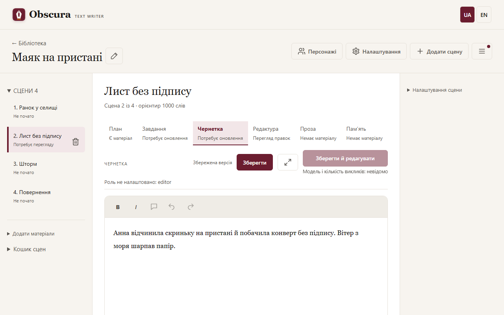
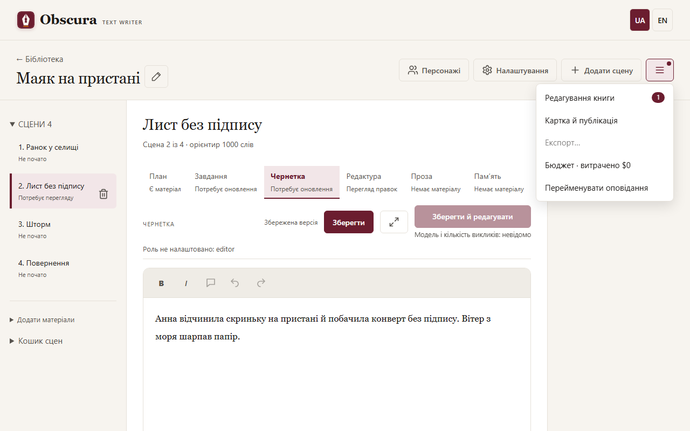
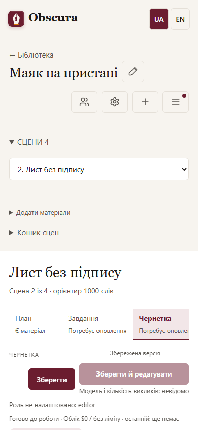

# Робочий простір і етапи сцени

Робочий простір твору має три частини: список сцен ліворуч, редактор сцени посередині та розділи сцени праворуч. На вузькому екрані вони йдуть одна під одною.

Якщо сцен багато, натисніть заголовок **Сцени** з їх кількістю: список згорнеться, а **Додати матеріали** лишиться поруч. Поточна сцена й незбережений текст не губляться.

## Видалити й відновити сцену

- У списку сцен біля обраної сцени є кнопка з іконкою кошика — **Видалити сцену**. Застосунок перепитає й перенесе сцену в кошик сцен; наступні сцени після цього потребуватимуть перегляду.
- Спершу збережіть текст: з незбереженими правками сцена не видаляється, а застосунок показує причину.
- Щоб повернути сцену, розгорніть **Кошик сцен** під списком і натисніть **Відновити**. Остаточно сцени не видаляються.
- На вузькому екрані списку сцен немає: оберіть сцену в полі вибору й натисніть **Видалити сцену** в розділі додаткових дій під редактором.

## Верхній рядок

- **Персонажі** відкриває картки персонажів окремою сторінкою.
- **Налаштування** відкриває моделі, письмо, оцінювач і бюджет цього твору.
- **Додати сцену** створює сцену в кінці списку й одразу заповнює її план за шаблоном. З плану попередньої сцени переносяться локація, учасники, ключове усвідомлення й емоційний акцент; її «Кінець» стає «Початок» нової сцени, а «Що відбувається» — «Що було в попередніх сценах». «Кінець», «Що відбувається» і три пункти «Дії» лишаються порожніми. Номер у заголовку — наступний після номера попередньої сцени. В англійському творі мітки плану англійські. Чого в попередньому плані немає, те лишається порожнім; усе можна одразу виправити в плані.
- Меню **☰ «Дії твору»** містить усе, що стосується всього твору: **Редагування книги** (число біля пункту — матеріали, що чекають перевірки), **Картка й публікація**, **Експорт…**, оцінювання твору й звіти (якщо налаштовано оцінювач), рядок бюджету й **Перейменувати**. Меню відкривається клавіатурою; `Escape` закриває його.

## Етапи сцени

Вкладки **План → Завдання → Чернетка → Редактура → Проза → Пам’ять** показують матеріали сцени й їхній стан: «Немає матеріалу», «Є матеріал», «Потребує оновлення». Вкладка лише відкриває матеріал; дію запускає основна кнопка над текстом.

Якщо планувальник повідомив «Суттєві зміни потребують рішення автора», на вкладці **Завдання** відкривається нова пропозиція зі списком змін. Перегляньте її, збережіть ручні правки й натисніть **Прийняти завдання**; **Зберегти** зберігає пропозицію, не приймаючи її.

Перед натисканням основна кнопка показує модель і максимальну кількість викликів. Наведіть на неї або перейдіть до неї клавішею Tab, щоб побачити подробиці й попередження. Якщо роль не налаштовано, поруч є кнопка переходу до потрібної ролі в налаштуваннях.

## Рядок стану

Над текстом сцени показано стан сцени, хід запуску й кнопки паузи, скасування, продовження та повтору. Хід запуску займає один рядок: стан, моделі, витрати в доларах (усього / останній виклик) і знак ⚠, якщо є попередження. Подробиці usage провайдера — у підказці до витрат. Клікніть цей рядок, щоб побачити план, попередження й етапи, і ще раз — щоб сховати. Помилку проваленого запуску видно одразу. **Параметри запуску** задають ліміт наступного запуску. **Пройти решту** виконує решту сцен по черзі. Пауза діє між етапами; закриття вкладки роботу не скасовує, а скасування не гарантує негайної зупинки відповіді провайдера. Спершу перевірте одну сцену, як описано в розділі [Перший твір](first-story.md). Якщо послідовна перевірка впливу чекає вашого рішення, її картка з’являється під рядком стану поруч із текстом.

## Редактор

Чернетка й проза мають панель форматування: **B** (`Ctrl+B`), *I* (`Ctrl+I`), скасування (`Ctrl+Z`) і повтор (`Ctrl+Y`). **Зберегти** створює нову версію й не стирає попередніх. Вставлення переносить лише текст. Браузер попереджає, перш ніж ви підете з незбереженими правками.

Редактор пам’ятає останню сцену й вкладку окремо для кожного твору в цьому браузері.

## Розділи сцени

Праворуч розділи **Налаштування сцени** (учасники, орієнтир слів, віковий рейтинг сцени) і **Оцінювання сцени** згортаються й пам’ятають стан. Оцінювання приховане, якщо оцінювач вимкнено.

На телефоні розділи йдуть під редактором, а кнопки верхнього рядка показують лише іконки.

