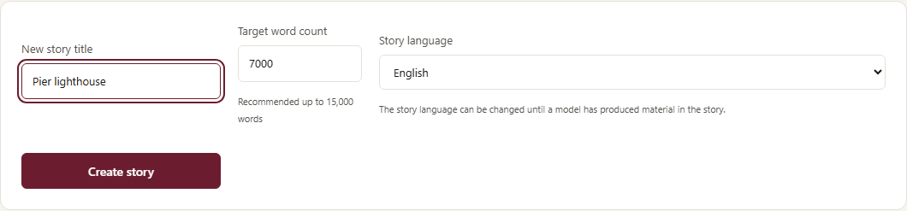
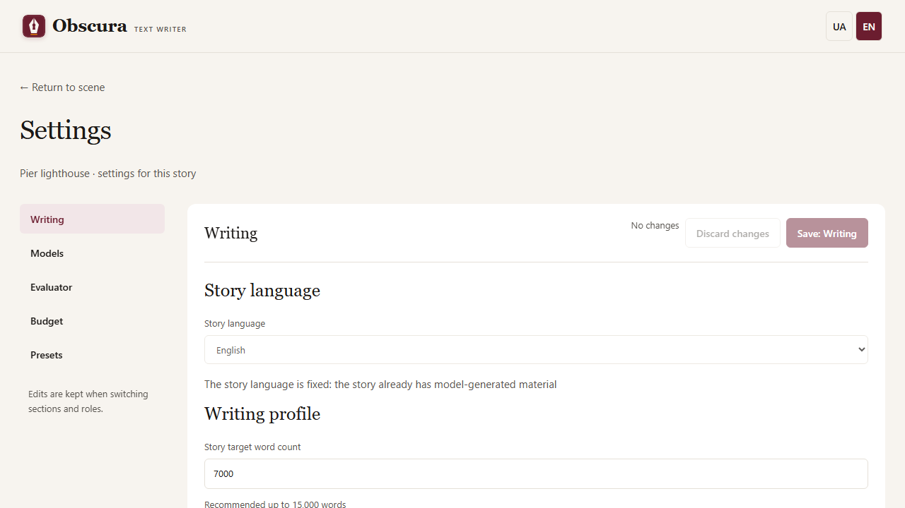
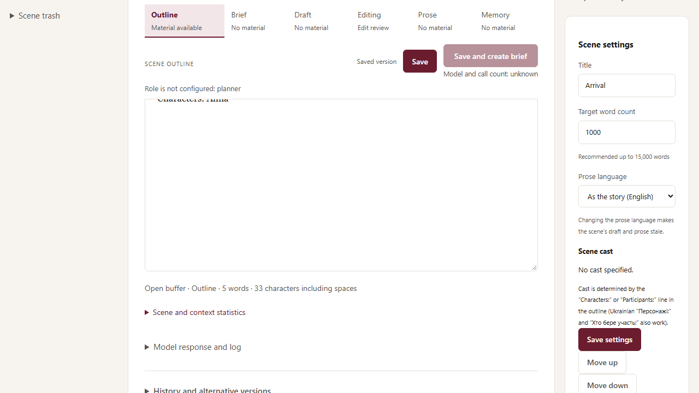

# Мова твору

Твір можна писати українською або англійською. Мова інтерфейсу (перемикач UA/EN угорі) від цього не залежить: можна працювати в українському інтерфейсі над англійським твором і навпаки.

## Новий твір

У формі «Новий твір» на головній сторінці оберіть **«Мова твору»**: українська (за замовчуванням) або англійська. Від мови залежать:

- стандартні промпти всіх ролей і заголовки контексту, які бачить модель;
- шаблони плану й персонажів для завантаження (для англійського твору — англійські, із заголовками `Scene 1:` і `Characters:`);
- мовні підказки після редактури;
- мова картки публікації за замовчуванням.

## Коли мову ще можна змінити

Доки у творі немає жодного тексту, створеного моделлю, мову можна змінити в **«Налаштування» → «Письмо» → «Мова твору»**. Вибір зберігається одразу, без кнопки збереження розділу. Після першої генерації мова зафіксована: поле вимкнене й пояснює причину, а сервер відхиляє зміну.

## Мова прози окремої сцени

У картці сцени поле **«Мова прози»** дозволяє написати одну сцену іншою мовою, ніж решту твору. Значення «Як у творі» означає мову твору. Інструкції моделі лишаються мовою твору; модель отримує одну вказівку, якою мовою писати прозу цієї сцени.

Зміна мови прози робить чернетку й прозу сцени застарілими. Завдання сцени й пам’ять при цьому не застарівають. Чернетки, створені до появи цього поля, вважаються українськими.

## Імпорт плану й персонажів англійською

Розбір розуміє англійські заголовки поряд з українськими:

- сцени: `Scene 3: Arrival` так само, як `Сцена 3: Прибуття`; учасники: `Characters:`, `Participants:` або `Cast:`;
- день початку подій: `start` поряд із `початок`;
- позначки протагоніста й ролі в описах персонажів: `protagonist`, `main character`, `role in the story`, `knows …`.

Неназвані розділи плану англійського твору отримують назву `Scene`, а не «Сцена».

## Що працює інакше для англійської прози

- **Мовні підказки** для англійської сцени перевіряють лише змішані алфавіти й повтори слів. Українські правила (літери ы/э/ъ/ё, тире на початку репліки, відомі помилки моделей) не застосовуються.
- **Захист заперечень** у точкових правках охоплює й англійські `not`, `cannot`, `n't`.
- **Оцінювання** англійської прози поки недоступне: кнопки «Оцінити» вимкнені з поясненням. Оцінювач відкалібровано лише на українських текстах.

## Публікація й комплекти ролей

- Нова картка публікації англійського твору починається з мови `en`. Збережену картку не змінено: її мову обирає автор.
- Назви жанрів FB2 на сторінці публікації показуються мовою інтерфейсу. Запит до моделі, що пропонує метадані, використовує назви жанрів мовою твору.
- Комплект ролей запам’ятовує мову твору, з якого його збережено. Застосування до твору іншої мови показує попередження, але не блокує: власні промпти автора не перекладаються.

English version: [Story language](en/story-language.md).
