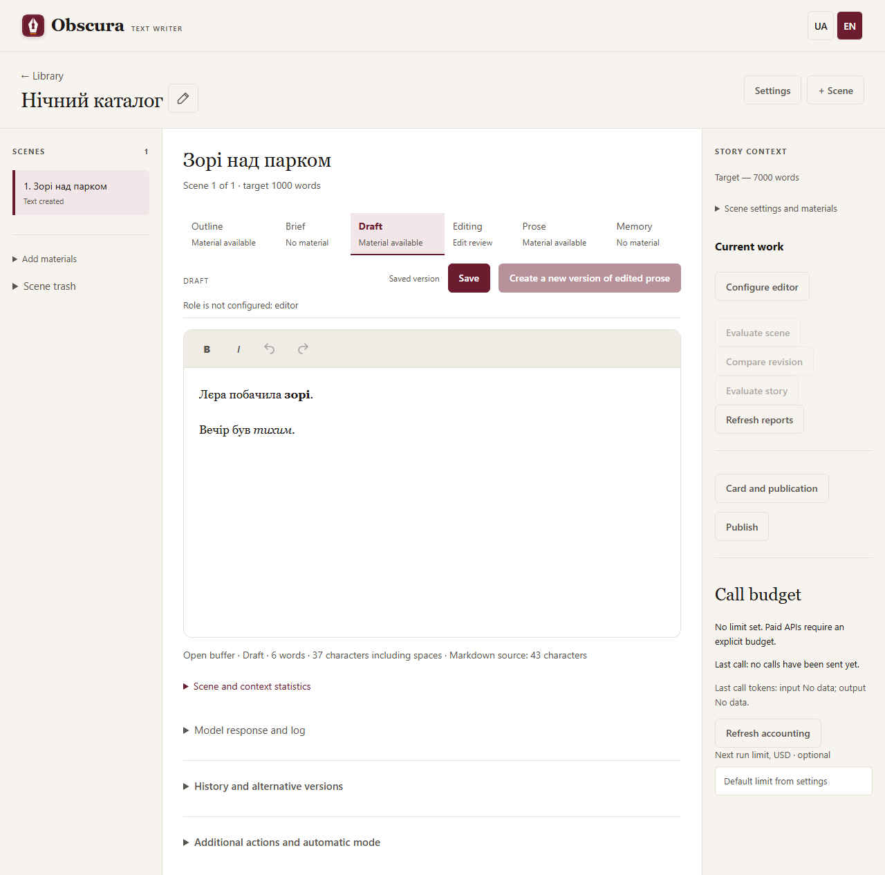

# Форматування чернетки та прози

У кроках «Чернетка» і «Проза» над текстом є панель форматування:

- **B** — жирний (`Ctrl+B`), *I* — курсив (`Ctrl+I`). Виділіть текст для зміни або ввімкніть формат перед введенням.
- Стрілки — скасувати й повторити правку (`Ctrl+Z`, `Ctrl+Y` або `Ctrl+Shift+Z`). Збереження не очищає історію правок відкритого буфера.
- «Зберегти» записує текст і форматування; без змін нова версія не створюється.

Старі тексти відкриваються буквально: зірочки чи `_` не стають форматуванням самі. Після справжнього редагування джерело зберігається у Markdown, а спеціальні символи звичайного тексту екрануються. Режиму редагування сирого Markdown немає. План, завдання й розширений JSON пам’яті залишаються текстовими полями.

Вставлення переносить лише текст, без стороннього HTML, стилів чи зображень. Непідтримані Markdown-конструкції (списки, посилання, код, HTML) показуються буквально в окремому блоці; внутрішня структура такого блока не редагується панеллю жирного/курсиву. Історичні версії відкриваються для читання. UA/EN змінює підписи інтерфейсу, зберігаючи текст і виділення.

Статистика під редактором рахує видимий текст. Для Markdown окремо показано обсяг джерела; форматні маркери впливають на джерело й запит моделі, хоча не відображаються як текст.

Форматування зберігається в модельній редактурі та у FB2/EPUB/PDF. TXT містить видимий текст; MD — джерело (старий plain текст екранується). Непідтримані Markdown-конструкції залишаються буквальними й у книгах. Коментарі та AI-assisted rewrite додаються окремими пакетами R-23. Переписати AI-чернетку власними словами блок за блоком допомагає [режим переписування по пам’яті](ghost-mode.md).

## English

Draft and Prose have a visual toolbar: **B** / `Ctrl+B`, *I* / `Ctrl+I`, Undo / `Ctrl+Z`, Redo / `Ctrl+Y` or `Ctrl+Shift+Z`. Save preserves formatting and does not clear undo history. Saving unchanged text reuses its existing version. To rewrite an AI draft in your own words block by block, see [rewriting from memory](en/ghost-mode.md).

Legacy plain text remains literal; formatting characters are not reinterpreted on opening. A real edit stores Markdown with escaped literal punctuation. There is no raw Markdown editing mode. Outline, brief and advanced memory JSON use plain fields. Paste imports text only. Unsupported Markdown structures appear as literal, opaque blocks. Historical versions are read-only; switching UA/EN preserves text and selection.

The compact statistics count visible text and show Markdown source size separately. Formatting survives model editing and FB2/EPUB/PDF export. TXT uses visible text; MD preserves Markdown source and escapes legacy plain text. Unsupported structures remain literal; comments and assisted rewriting follow in R-23.

Нейтральний приклад, без авторських матеріалів:

[Мобільний вигляд редактора](images/r22-editor-mobile.png).

Довгий текст прокручується всередині редактора; toolbar форматування/коментарів залишається над текстовою областю. English: long text scrolls inside the editor while the formatting/comment toolbar remains above the text area.

Редактор запам’ятовує останню сцену та поточну вкладку окремо для кожного оповідання в цьому браузері. Після оновлення або повторного відкриття твору робота продовжується з цього місця. Явне посилання на сцену/матеріал має пріоритет. Якщо сцену перенесли до кошика, відкриється план першої доступної. Перегляд історичної версії не змінює запам’ятовану робочу вкладку. Це не автозбереження: незбережений текст слід зберегти до reload.

English: the editor remembers the last scene and current workflow tab separately for each story in this browser. Reloading or reopening the story restores that position. An explicit scene/material link takes priority. A removed scene falls back to the first available outline. Viewing historical versions does not replace the remembered current tab. This is not autosave; save working edits before reloading.

Якщо планувальник повідомив «Суттєві зміни потребують рішення автора», у «Завданні» відкриється нова пропозиція зі списком змін. Перегляньте її, збережіть ручні правки та натисніть «Прийняти завдання» над текстом. Звичайне Save зберігає, але не приймає proposed_changes. Після прийняття можна створювати чернетку, якщо решта контексту/налаштувань придатна. Прийняття не запускає генерацію.

English: when the planner requests an author decision, Brief shows the new proposal and its changes. Review it, save manual edits, then choose Accept brief above the text. Save preserves the proposal without selecting it. After acceptance, Draft becomes available if the remaining context/settings are valid. Acceptance does not start generation.

[Нейтральний приклад прийняття завдання](images/brief-proposal-review.png).
